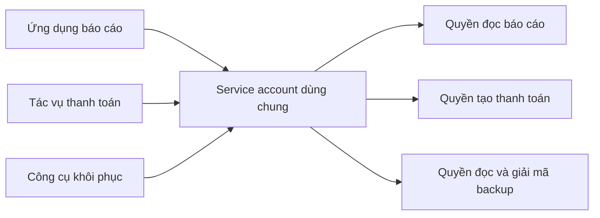

# Shared service account: khi nhiều bên dùng chung tài khoản dịch vụ

Một service account giúp phần mềm truy cập tài nguyên bằng danh tính dành cho máy. Khi nhiều ứng dụng, script hoặc nhóm người cùng sử dụng tài khoản đó, việc tạo ít tài khoản có thể thuận tiện lúc đầu, nhưng ranh giới quyền, trách nhiệm và xử lý sự cố dễ bị trộn lẫn.

**Shared service account** là tài khoản dịch vụ được nhiều bên sử dụng. Để đánh giá có phù hợp hay không, cần xác định những bên đó có thật sự là cùng một workload với cùng mục đích và quyền hay là các workload độc lập đang bị gộp vào một danh tính.

Bài học này tập trung vào tác động của việc dùng chung đối với nguyên tắc ít quyền nhất, khả năng truy vết, vòng đời credential và kế hoạch tách tài khoản mà vẫn duy trì hoạt động của dịch vụ.

## 1. “Dùng chung” có nhiều hình thức

Không thể kết luận chỉ bằng số lượng tiến trình đang sử dụng một tài khoản. Cần xem mục đích, môi trường, mức tin cậy, vòng đời và cách cấp credential.

| Trường hợp | Điều đang được chia sẻ | Điểm cần đánh giá |
| --- | --- | --- |
| Nhiều replica của cùng một dịch vụ production | Một danh tính logic cho cùng workload | Các replica có cùng quyền không, có cần phân biệt instance không và credential được cấp thế nào |
| Ứng dụng báo cáo, tác vụ thanh toán và công cụ backup | Một principal giữa các workload độc lập | Quyền bị gộp, khó thu hồi riêng và tăng phạm vi ảnh hưởng |
| Production và môi trường thử nghiệm | Danh tính qua hai môi trường | Môi trường ít được bảo vệ có thể trở thành đường vào tài nguyên production |
| Nhiều kỹ sư giữ cùng một khóa dịch vụ | Credential có thể sử dụng để mạo danh dịch vụ | Khó xác định ai dùng khóa, khó thu hồi theo từng người |
| Một broker được nhiều ứng dụng gọi | Một dịch vụ trung gian có danh tính riêng | Broker có xác thực từng caller và giới hạn từng thao tác hay chỉ chuyển tiếp quyền rộng |

### 1.1. Nhiều replica không nhất thiết là chia sẻ sai ranh giới

Mười replica của `inventory-api` có thể cùng đại diện cho một dịch vụ, được vận hành bởi cùng nhóm và cần cùng tập quyền. Một danh tính dịch vụ ổn định có thể phù hợp với mô hình đó.

Tuy nhiên, dùng chung danh tính logic không bắt buộc phải sao chép một private key lâu dài vào cả mười replica. Nền tảng có thể cấp credential riêng, ngắn hạn cho từng phiên chạy nhưng vẫn ánh xạ về cùng principal được cấp quyền. Khả năng này phụ thuộc cơ chế workload identity đang dùng.

Nếu cần cô lập quyền hoặc kiểm toán đến từng instance, một principal chung có thể chưa đủ. Cần quyết định mức định danh theo yêu cầu thực tế, thay vì mặc định mỗi tiến trình phải có một tài khoản hoặc mọi tiến trình đều nên dùng cùng tài khoản.

### 1.2. Cùng nhóm vận hành chưa có nghĩa là cùng workload

Hai ứng dụng do một nhóm quản lý vẫn có thể xử lý dữ liệu khác nhau, triển khai ở môi trường khác nhau và có vòng đời độc lập. Tách tài khoản theo ranh giới ứng dụng hoặc tác vụ giúp kiểm soát quyền và thu hồi độc lập ngay cả khi owner là cùng một nhóm.

## 2. Rủi ro quyền bị gộp

Giả sử ba workload có nhu cầu khác nhau:

| Workload | Nhu cầu thực tế |
| --- | --- |
| `report-reader` | Đọc một view báo cáo |
| `payment-scheduler` | Tạo lệnh thanh toán trong phạm vi được duyệt |
| `backup-restorer` | Đọc và giải mã một tập backup phục vụ khôi phục |

Nếu cả ba xác thực bằng `svc-automation-shared`, tài khoản này có thể phải được cấp tất cả các quyền trên. Trong mô hình đơn giản không có điều kiện hoặc deny bổ sung, tập quyền được cấp sẽ có dạng:

```text
Permissions(shared)
    = Permissions(report-reader)
    ∪ Permissions(payment-scheduler)
    ∪ Permissions(backup-restorer)
```

Bên nhận chỉ thấy principal chung thì không thể tự biết yêu cầu hiện tại đến từ ứng dụng nào để áp dụng một tập quyền riêng. Nếu credential dùng chung cho phép thực hiện toàn bộ các quyền đó, kẻ kiểm soát ứng dụng báo cáo có thể thử sử dụng cả quyền thanh toán hoặc quyền backup.

Điều kiện cấp quyền, audience, phạm vi token hoặc một điểm thực thi độc lập có thể làm hẹp quyền trong một số thiết kế. Nhưng sự giới hạn phải được hệ thống thực sự kiểm tra, không thể chỉ dựa vào quy ước “ứng dụng báo cáo sẽ chỉ gọi API báo cáo”.



Sơ đồ thể hiện một ranh giới xác thực bị gộp. Phạm vi ảnh hưởng thực tế còn tùy điều kiện truy cập, phân đoạn mạng và các kiểm soát khác, nhưng việc các ứng dụng tự giới hạn chức năng không thay thế cho cấp quyền tối thiểu.

Google Cloud nêu ba khó khăn khi nhiều ứng dụng chia sẻ một service account: vòng đời khác nhau, nhu cầu quyền có thể ngày càng khác nhau và khó truy ngược hoạt động về đúng ứng dụng. Tài liệu khuyến nghị service account chuyên biệt theo ứng dụng. [Nguồn: Best practices for using service accounts securely](https://docs.cloud.google.com/iam/docs/best-practices-service-accounts).

## 3. Khả năng truy vết suy giảm như thế nào?

Một bản ghi audit chỉ có principal `svc-automation-shared` cho biết danh tính nào đã được xác thực, nhưng có thể chưa cho biết ứng dụng nào hoặc ai đã khiến hành động xảy ra.

Ví dụ, một thao tác ghi bất thường lúc 02:00 có thể đến từ tác vụ hợp lệ, một script được chạy thủ công hoặc một bản sao credential bị lấy cắp. Nếu cả ba dùng cùng một credential và đường truy cập, log ở tài nguyên có thể không đủ phân biệt.

Để điều tra tốt hơn, hệ thống có thể cần liên kết các thông tin như:

- Danh tính workload đã được xác thực tại điểm cấp credential hoặc điểm nhận yêu cầu.
- Phiên chạy, job, deployment hoặc pipeline liên quan.
- Người khởi phát pipeline khi hành động có nguồn gốc từ con người.
- Định danh yêu cầu, thời gian và tài nguyên bị tác động.
- Thông tin delegation hoặc impersonation nếu nền tảng có hỗ trợ ghi nhận.

Các nguồn bằng chứng phải được thu thập và bảo vệ phù hợp. Một header `X-Application-Name` do caller tùy ý gửi có thể giúp tra cứu khi hệ thống hoạt động bình thường, nhưng không tự chứng minh nguồn gọi khi caller đã bị xâm nhập. Không dùng một nhãn tự khai làm cơ sở phân quyền nếu thiếu ràng buộc đáng tin cậy.

Tương tự, không mặc định mọi hình thức impersonation đều làm mất dấu người dùng. Một số nền tảng có thể ghi lại principal yêu cầu và chuỗi ủy quyền. Cần xác minh loại log, cấu hình thu thập và dịch vụ đích thực sự lưu được những gì. Sao chép cùng một private key cho nhiều người là tình huống khác với một luồng impersonation có xác thực cá nhân và audit.

## 4. Credential dùng chung tạo sự phụ thuộc vận hành

### 4.1. Rotation ảnh hưởng nhiều bên

Nếu nhiều workload dùng cùng một secret, thay secret yêu cầu biết tất cả nơi đã nhận bản sao và thời điểm chúng chuyển sang bản mới. Một script ít chạy hoặc một cấu hình nằm ngoài inventory có thể chỉ báo lỗi nhiều tuần sau.

Giữ cả secret cũ và mới quá lâu để tránh gián đoạn làm kéo dài thời gian bản cũ còn có thể bị lạm dụng. Thu hồi bản cũ quá sớm có thể làm hỏng những workload chưa chuyển đổi. Vấn đề nằm ở sự phụ thuộc chung, không chỉ ở thao tác thay chuỗi credential.

### 4.2. Khó thu hồi riêng khi có sự cố

Nếu credential bị lộ tại `report-reader`, việc vô hiệu hóa principal chung có thể làm dừng cả thanh toán và khôi phục. Nếu vẫn giữ principal hoạt động để tránh gián đoạn, phải có cách chặn bản credential hoặc nguồn truy cập bị xâm nhập; không thể chỉ hy vọng rằng bản credential mới sẽ thay thế mọi bản sao cũ.

Credential riêng theo workload có thể giúp thu hồi chọn lọc hơn nếu nền tảng hỗ trợ, nhưng phải phân biệt:

- Thu hồi một credential có chặn được token hoặc phiên đã được cấp từ credential đó không?
- Hai credential có cùng principal vẫn được hưởng cùng quyền tài nguyên hay có ràng buộc khác được thực thi?
- Bên bị xâm nhập còn có thể xin credential mới không?

### 4.3. Vòng đời tài khoản không khớp vòng đời ứng dụng

Khi một trong ba ứng dụng ngừng hoạt động, tài khoản chung vẫn phải tồn tại cho hai ứng dụng còn lại. Quyền được thêm cho ứng dụng cũ dễ bị bỏ quên. Nếu sau này không ai biết quyền nào phục vụ ứng dụng nào, review sẽ khó đưa ra quyết định giảm quyền.

Việc gắn một owner rõ ràng giúp điều phối, nhưng owner không tự loại bỏ các phụ thuộc này. Hồ sơ vẫn phải ghi đầy đủ bên sử dụng và lý do cho từng quyền.

## 5. Chọn ranh giới danh tính phù hợp

Một điểm khởi đầu hữu ích là service account phục vụ một mục đích rõ ràng trong một môi trường và một phạm vi quyền đã xác định. Sau đó điều chỉnh theo mức rủi ro, khả năng nền tảng và yêu cầu quản lý.

| Tiêu chí | Dấu hiệu nên tách danh tính |
| --- | --- |
| Mục đích nghiệp vụ | Một bên chỉ đọc báo cáo, bên khác thay đổi giao dịch |
| Môi trường | Development hoặc staging đang dùng danh tính có quyền production |
| Độ tin cậy của mã chạy | Script từ nguồn ít kiểm soát cùng dùng quyền với dịch vụ nhạy cảm |
| Owner và lịch thay đổi | Hai nhóm triển khai, review và xử lý sự cố độc lập |
| Vòng đời | Một tác vụ theo dự án ngắn hạn dùng chung tài khoản với hệ thống dài hạn |
| Dữ liệu hoặc tenant | Các bên cần quyền cô lập và phải chứng minh không truy cập chéo |
| Nhu cầu điều tra | Cần quy hoạt động về từng workload nhưng log principal chung không đủ |

Không cần tạo một service account mới cho mọi HTTP request chỉ để tăng số lượng danh tính. Số lượng tài khoản không phải thước đo cô lập. Điều cần chứng minh là từng bên chỉ nhận được quyền cần thiết, credential không bị phát tán tùy tiện và vòng đời có thể quản lý được.

Tách service account nhưng cho mọi workload quyền mạo danh tất cả các tài khoản mới vẫn có thể giữ nguyên đường leo thang quyền. Phải kiểm soát cả quyền trên tài nguyên và quyền sử dụng, tạo credential hoặc thay chính sách của từng service account.

## 6. Các cách giảm dùng chung credential

### 6.1. Danh tính gắn với workload

Khi nền tảng hỗ trợ, workload có thể nhận credential ngắn hạn dựa trên danh tính hoặc bằng chứng của môi trường chạy. Điều này giảm nhu cầu sao chép secret lâu dài giữa các ứng dụng.

Điều kiện cấp phát phải phân biệt đúng workload và môi trường. Nếu mọi ứng dụng đều có thể tự nhận danh tính của một tài khoản đặc quyền, việc bỏ file secret chưa tạo ra ranh giới quyền cần thiết.

### 6.2. Tài khoản chuyên biệt và quản lý credential riêng

Nếu phải dùng credential do ứng dụng quản lý, hãy tách theo mục đích phù hợp, lưu trong hệ thống được kiểm soát và chỉ cho đúng workload nhận credential của mình. Không đưa credential vào mã nguồn, tài liệu chung hoặc kênh chat của nhóm.

Các credential riêng dưới cùng một principal có thể giảm việc sao chép một bí mật giữa nhiều nơi, nhưng không mặc nhiên tách quyền của principal. Nếu hai ứng dụng có nhu cầu quyền khác nhau, thường phải thay cả mô hình danh tính hoặc cơ chế giới hạn quyền được thực thi ở bên nhận.

### 6.3. Truy cập của con người qua luồng có kiểm soát

Kỹ sư cần xử lý sự cố nên bắt đầu bằng danh tính cá nhân được xác thực và một cơ chế truy cập được phê duyệt. Nếu cần hành động dưới service account, quyền đó phải có phạm vi, thời hạn và bằng chứng phù hợp với rủi ro.

Không phát cùng một khóa dịch vụ cho mọi thành viên chỉ vì đó là tài khoản “của nhóm”. Khi một người rời nhóm, việc thu hồi quyền trên kho bí mật không làm biến mất bản sao khóa mà họ có thể đã lưu.

### 6.4. Broker hoặc dịch vụ trung gian

Một broker có thể xác thực từng caller, kiểm tra quyền thao tác và cung cấp một giao diện hẹp đến hệ thống phía sau. Cách này hữu ích khi hệ thống đích có hạn chế về số lượng tài khoản hoặc giao thức xác thực.

Tuy nhiên, broker trở thành một ranh giới bảo mật quan trọng. Cần kiểm soát quyền quản trị broker, xác thực caller, giới hạn phương thức và tài nguyên, bảo vệ credential phía sau và lưu bằng chứng từ yêu cầu ban đầu đến hành động ở hệ thống đích.

Nếu broker chỉ trả lại cùng một bearer token đặc quyền cho mọi caller, các caller vẫn có thể dùng quyền chung trong phạm vi token đó. Nếu broker chuyển tiếp tùy ý URL hoặc thao tác mà không kiểm tra, nó có thể trở thành đường thực thi quyền rộng thay cho caller.

## 7. Khi hệ thống cũ bắt buộc dùng một tài khoản chung

Một sản phẩm cũ hoặc bên cung cấp dịch vụ có thể chỉ hỗ trợ một tài khoản tích hợp. Khi chưa thể thay ngay, cần ghi nhận đây là một giới hạn kỹ thuật và quản lý ngoại lệ có thời hạn.

Hồ sơ ngoại lệ nên xác định các bên sử dụng, owner, mục đích, quyền, lý do chưa tách được, phạm vi ảnh hưởng và kế hoạch xử lý. Mọi ứng dụng mới muốn dùng tài khoản chung phải được xem xét; không mặc định tài khoản đó là lối tích hợp cho mọi dự án.

Những biện pháp bù đắp có thể gồm:

- Giảm quyền của tài khoản chung xuống tập cần thiết đã được phê duyệt.
- Giới hạn workload được kết nối đến hệ thống đích bằng cơ chế mạng và danh tính phù hợp.
- Đặt truy cập qua một điểm kiểm soát có xác thực caller và giới hạn thao tác.
- Quản lý credential tập trung, hạn chế nơi có thể đọc hoặc xuất bản sao.
- Ghi log liên kết hoạt động của từng caller với yêu cầu phía sau.
- Lập lịch review và chuẩn bị cách ngừng sử dụng khi sản phẩm hỗ trợ phương án tốt hơn.

Mỗi biện pháp chỉ giải quyết một phần. Giới hạn mạng không tự tách quyền giữa hai workload đã được phép kết nối. Vault giảm rủi ro lưu trữ credential, nhưng nếu cả hai ứng dụng đều có thể lấy cùng secret đặc quyền thì rủi ro quyền chung vẫn tồn tại.

## 8. Chuyển từ tài khoản chung sang tài khoản riêng

Migration cần dựa trên dependency thật, không chỉ tạo tài khoản mới rồi thay tên cấu hình.

### Bước 1: Kiểm kê các bên sử dụng

Liệt kê ứng dụng, script, pipeline, tác vụ định kỳ và thao tác thủ công có thể dùng tài khoản chung. Đối chiếu inventory, cấu hình và nhật ký trong phạm vi quản trị được phép. Chú ý tác vụ cuối tháng, theo mùa hoặc phục hồi thảm họa.

Ghi lại mỗi bên nhận credential bằng cách nào, truy cập tài nguyên nào và ai chịu trách nhiệm. Không sao chép secret vào bảng kiểm kê.

### Bước 2: Thiết kế ánh xạ mục đích sang danh tính

Ví dụ, có thể thay `svc-automation-shared` bằng các danh tính sau:

| Workload | Danh tính đích | Quyền chủ đích |
| --- | --- | --- |
| `report-reader` production | `svc-report-reader-prod` | Đọc view báo cáo được chỉ định |
| `payment-scheduler` production | `svc-payment-scheduler-prod` | Tạo lệnh qua giao diện thanh toán được phê duyệt |
| `backup-restorer` phục vụ khôi phục | `svc-backup-restorer-recovery` | Truy cập tập backup và thao tác khôi phục theo điều kiện đã định |

Đây là mô hình minh họa. Quyền thực tế cần được mô tả ở cấp tài nguyên và hành động mà nền tảng có thể thực thi. Không sao chép nguyên mọi quyền của tài khoản cũ sang cả ba tài khoản mới.

### Bước 3: Thiết lập đường cấp credential và quyền sử dụng

Mỗi workload chỉ được nhận hoặc sử dụng danh tính đích tương ứng. Rà soát pipeline triển khai, quyền truy cập kho credential, quyền impersonation và quyền đổi binding để tránh một workload vẫn chuyển sang danh tính khác được.

Giữ nguyên định danh tài nguyên cần bảo vệ khi kiểm tra quyền. Chỉ đổi tên biến môi trường mà ứng dụng vẫn tải secret chung từ một nơi khác sẽ không hoàn thành migration.

### Bước 4: Chuyển từng workload và kiểm tra hai chiều

Thực hiện một đợt chuyển có phạm vi nhỏ trước khi mở rộng. Cần kiểm tra tác vụ hợp lệ vẫn chạy và thao tác ngoài quyền bị từ chối. Ví dụ, `report-reader` phải đọc được view cần thiết nhưng không được tạo lệnh thanh toán bằng credential của nó.

Đối chiếu audit để xác nhận danh tính mới được dùng ở hệ thống đích, không chỉ ở file cấu hình. Theo dõi các workload chưa chuyển để tránh nhầm rằng tài khoản cũ đã hết dependency.

### Bước 5: Thu hẹp rồi ngừng tài khoản cũ

Khi một nhóm quyền không còn cần cho bên nào còn dùng tài khoản chung, xem xét thu hồi nhóm quyền đó. Sau khi tất cả dependency được chuyển hoặc kết thúc, ngừng đường cấp credential và xử lý credential, quyền, token hoặc phiên còn tồn tại theo cơ chế của hệ thống.

Không coi việc xóa secret khỏi một file triển khai là bằng chứng mọi bản sao đã biến mất. Không giả định disable tài khoản luôn làm mọi token đã cấp mất hiệu lực ngay lập tức.

### Bước 6: Đóng migration bằng bằng chứng

Xác nhận danh tính đích có owner, quyền đúng phạm vi, log hoạt động được và tài khoản cũ đã được xử lý theo kế hoạch. Ghi lại ngoại lệ còn tồn tại cùng người chịu trách nhiệm và hạn giải quyết.

Kế hoạch rollback cần được xác định trước. Nếu phải tạm quay về tài khoản cũ trong một sự cố triển khai, cần biết quyền nào vẫn còn, khoảng thời gian cho phép và cách chấm dứt đường truy cập tạm. Không duy trì tài khoản chung đặc quyền vô thời hạn dưới tên gọi dự phòng.

## 9. Các lỗi thiết kế dễ gặp

| Cách làm | Vì sao chưa giải quyết được vấn đề? | Hướng xử lý |
| --- | --- | --- |
| Đổi tên một tài khoản chung thành tên ứng dụng chính | Các workload khác vẫn dùng cùng principal | Kiểm kê và thay đường cấp danh tính thực tế |
| Tạo nhiều khóa cho cùng tài khoản rồi gọi đó là tách quyền | Các khóa có thể vẫn nhận cùng quyền của principal | Tách principal hoặc áp dụng giới hạn quyền được bên nhận thực thi |
| Tạo tài khoản riêng nhưng cho mọi pipeline impersonate tất cả | Một pipeline vẫn có thể sử dụng quyền của workload khác | Giới hạn đường sử dụng từng danh tính |
| Lưu secret chung trong vault và coi như đã cô lập | Những bên đọc được secret vẫn chia sẻ credential | Giảm số bên nhận, tách danh tính và quyền theo nhu cầu |
| Dựa vào tên ứng dụng trong header để cấp quyền | Caller có thể tự khai hoặc sửa tên | Gắn quyền với danh tính hoặc thuộc tính đã xác minh |
| Chỉ kiểm tra tác vụ thành công sau migration | Có thể đã sao chép quá nhiều quyền | Kiểm tra cả truy cập hợp lệ và truy cập phải bị từ chối |
| Xóa tài khoản sau vài ngày không thấy log | Có thể bỏ sót lịch chạy dài hoặc thiếu log | Kiểm tra dependency và độ đầy đủ của bằng chứng |

## 10. Câu hỏi tự kiểm tra

**Có phải mọi service account được nhiều tiến trình sử dụng đều phải tách ngay?**

Không. Các replica của cùng workload có thể dùng một danh tính logic nếu mô hình quyền và yêu cầu kiểm toán phù hợp. Cần tránh gộp những bên có mục đích, môi trường hoặc phạm vi tin cậy khác nhau mà không có kiểm soát thích hợp.

**Mỗi ứng dụng có một credential riêng nhưng cùng principal thì đã đạt ít quyền nhất chưa?**

Chưa thể kết luận. Credential riêng có thể giúp quản lý hoặc thu hồi chọn lọc, nhưng quyền tài nguyên có thể vẫn là tập quyền chung. Cần kiểm tra quyền hiệu lực của mỗi đường truy cập và điều kiện được thực thi.

**Vì sao tài khoản chung làm sự cố của ứng dụng ít quyền trở nên nghiêm trọng hơn?**

Vì nếu ứng dụng đó nhận credential đại diện cho principal có quyền gộp, kẻ kiểm soát ứng dụng có thể sử dụng quyền dành cho các workload khác. Phạm vi ảnh hưởng không còn chỉ là chức năng mà ứng dụng thường thực hiện.

**Có thể dùng application log để bù hoàn toàn việc dùng chung danh tính không?**

Log giúp điều tra, nhưng không tự giới hạn quyền và cũng không tự đáng tin nếu caller có thể sửa dữ liệu nhận diện. Cần bằng chứng được ràng buộc với xác thực, bảo vệ log và kiểm soát truy cập thực tế.

**Dấu hiệu nào cho thấy đã tách tài khoản thành công?**

Mỗi workload sử dụng đúng danh tính đích, chỉ nhận quyền cần thiết, không tùy ý dùng danh tính khác và có owner cùng vòng đời rõ ràng. Tác vụ hợp lệ hoạt động, truy cập ngoài phạm vi bị từ chối và những đường sử dụng tài khoản chung cũ đã được xử lý có bằng chứng.
