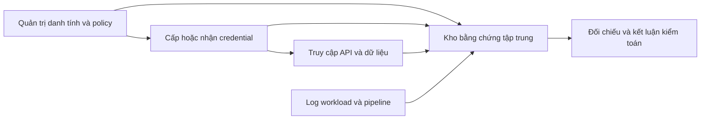

# Service account audit

## 1. Kiểm toán service account nhằm chứng minh điều gì?

Một service account là danh tính kỹ thuật mà ứng dụng, job hoặc pipeline sử dụng để truy cập hệ thống. Vì danh tính này có thể hoạt động liên tục và không gắn với một phiên đăng nhập tương tác của con người, việc chỉ biết tài khoản đang tồn tại chưa đủ để đánh giá an toàn.

**Service account audit** là quá trình thu thập và đối chiếu bằng chứng để trả lời các câu hỏi về mục đích, quyền, cách sử dụng và vòng đời của danh tính kỹ thuật. Một đợt kiểm toán cần phân biệt điều đã xác minh được, điều chưa có bằng chứng và điều cần khắc phục.

Các câu hỏi chính gồm:

- Tài khoản phục vụ workload nào, thuộc môi trường nào và ai chịu trách nhiệm?
- Những quyền nào đang có hiệu lực, và chúng có phù hợp với nhiệm vụ không?
- Ai hoặc workload nào có thể sử dụng tài khoản, tạo credential hay thay đổi policy liên quan?
- Tài khoản đã thực hiện hành động gì, trên tài nguyên nào và với kết quả ra sao?
- Credential được phát hành, luân chuyển, thu hồi hoặc hết hạn như thế nào?
- Nguồn log có đủ độ bao phủ và được bảo vệ để làm bằng chứng không?

Không nên đồng nhất ba hoạt động:

| Hoạt động | Mục tiêu | Ví dụ |
| --- | --- | --- |
| Ghi audit log | Lưu sự kiện làm bằng chứng | Ghi nhận thay đổi policy hoặc lần đọc dữ liệu |
| Giám sát | Phát hiện điều cần chú ý trong hoạt động đang diễn ra | Cảnh báo một service account tạo khóa ngoài quy trình |
| Kiểm toán | Đánh giá kiểm soát và kết luận dựa trên nhiều nguồn bằng chứng | Xác nhận tài khoản chỉ phục vụ đúng workload và đã xử lý quyền dư |

Có log không tự chứng minh rằng quyền tối thiểu đang được thực thi. Ngược lại, một cấu hình quyền hợp lý tại thời điểm kiểm tra cũng không chứng minh rằng tài khoản luôn được sử dụng đúng trong quá khứ.

## 2. Bắt đầu từ kiểm kê danh tính và trách nhiệm

Một danh sách tên service account là điểm khởi đầu, nhưng chưa phải hồ sơ kiểm toán. Cần nối mỗi danh tính với công việc thực tế và chủ thể chịu trách nhiệm.

| Thông tin | Ý nghĩa khi kiểm toán |
| --- | --- |
| Định danh ổn định của tài khoản | Phân biệt tài khoản dù tên hiển thị thay đổi hoặc được tái sử dụng |
| Mục đích và workload sử dụng | Đánh giá quyền có phù hợp với nhiệm vụ không |
| Chủ sở hữu nghiệp vụ và nhóm vận hành | Xác định người giải trình và xử lý phát hiện |
| Môi trường và phạm vi dữ liệu | Phân biệt development, staging, production và mức nhạy cảm |
| Trạng thái vòng đời | Đang dùng, tạm dừng, chờ ngừng hoặc đã ngừng |
| Cơ chế xác thực | Danh tính runtime, federation, impersonation hay khóa dài hạn |
| Credential và binding liên quan | Xác định các đường sử dụng danh tính cần xem xét |

Tên như `service-bot-01` không giải thích được nhiệm vụ. Tên như `invoice-report-prod` hỗ trợ nhận diện nhưng vẫn cần kiểm chứng bằng cấu hình workload, pipeline, hồ sơ cấp quyền và xác nhận của chủ sở hữu.

Nếu một tài khoản không có chủ sở hữu, đó là một phát hiện quản trị cần xử lý. Chưa thể kết luận ngay rằng tài khoản không còn dùng: nó có thể phục vụ tác vụ theo mùa, một lịch chạy hiếm hoặc một hệ thống chưa được đưa vào kiểm kê.

## 3. Rà soát cả quyền của tài khoản và quyền sử dụng tài khoản

Service account vừa là principal nhận quyền, vừa có thể là đối tượng mà người hoặc workload khác được phép sử dụng. Vì vậy, chỉ xuất danh sách role gắn trực tiếp vào tài khoản sẽ bỏ sót một phần quan trọng của phạm vi kiểm toán.

### Quyền mà service account có thể thực hiện

Cần đối chiếu hành động và tài nguyên với nhiệm vụ đã xác nhận. Nguồn cấp quyền có thể gồm binding trực tiếp, nhóm, quyền kế thừa, policy của tài nguyên hoặc các cơ chế phiên của nền tảng.

Các điểm cần xem xét là quyền quản trị IAM, quyền dữ liệu vượt nhu cầu, phạm vi tài nguyên quá rộng và khả năng chuyển sang danh tính mạnh hơn. Không đánh giá chỉ bằng tên role: một role có tên “operator” hoặc “reader” vẫn cần được xem trong ngữ cảnh quyền cụ thể và loại dữ liệu có thể tiếp cận.

### Chủ thể có thể sử dụng hoặc thay đổi danh tính

Cần xác định ai có thể nhận token, impersonate, tạo khóa, gắn service account vào workload hoặc thay đổi binding liên quan. Đồng thời xem xét ai có thể sửa mã, cấu hình triển khai hoặc pipeline chạy dưới danh tính này.

Ví dụ, một người không có quyền đọc cơ sở dữ liệu trực tiếp nhưng có thể sửa mã của job đang dùng tài khoản đọc dữ liệu. Đường kiểm soát workload đó có thể liên quan đến khả năng sử dụng quyền của service account, tùy các kiểm soát triển khai thực tế.

Hồ sơ kiểm toán nên lưu thời điểm chụp cấu hình, định danh tài nguyên và nguồn policy. Muốn giải thích một hành động trong quá khứ, cần policy hoặc lịch sử thay đổi tương ứng với thời điểm đó; cấu hình hiện tại không đủ để suy ra quyền hiệu lực ở mọi thời điểm trước đây.

## 4. Thu thập ba lớp sự kiện

Một chuỗi truy cập có thể đi từ thay đổi cấu hình, qua cấp credential, tới sử dụng tài nguyên. Ba lớp này trả lời những câu hỏi khác nhau.



Sơ đồ thể hiện các nguồn bằng chứng cần kết nối. Không phải mọi lần truy cập đều có một sự kiện cấp token riêng có thể quan sát hoặc liên kết trực tiếp.

| Lớp sự kiện | Ví dụ cần xem xét | Giá trị kiểm toán |
| --- | --- | --- |
| Quản trị | Tạo, vô hiệu hóa, xóa tài khoản; tạo khóa; sửa role hoặc binding | Ai thay đổi khả năng truy cập và thay đổi lúc nào |
| Credential | Nhận credential ngắn hạn, impersonation hoặc token exchange được nền tảng ghi nhận | Danh tính nào yêu cầu sử dụng service account |
| Tài nguyên | Đọc, ghi, xóa, gọi API; thành công hoặc bị từ chối | Service account đã làm gì tại hệ thống đích |

Log của IAM không tự bao phủ mọi thao tác dữ liệu. Log của dịch vụ dữ liệu cũng không nhất thiết chứa đầy đủ quá trình cấp credential. Cần kiểm tra từng dịch vụ, loại thao tác, cấu hình thu thập và đích lưu trữ.

Ví dụ, Google Cloud phân loại các lời gọi của Service Account Credentials API như `GenerateAccessToken` vào Data Access audit logs. Việc thu thập các sự kiện này phụ thuộc cấu hình audit log được hỗ trợ, không nên suy luận rằng bật log quản trị là đã đủ. [Google Cloud: Service Account Credentials audit logging](https://docs.cloud.google.com/iam/docs/audit-logging/audit-logging-iamcreds)

## 5. Những trường dữ liệu giúp hình thành bằng chứng

Một bản ghi có ích cần đủ thông tin để xác định hành động và đánh giá nguồn gốc của nó. Schema cụ thể tùy hệ thống; bảng dưới là mô hình để thiết kế thu thập và chuẩn hóa.

| Nhóm trường | Nội dung hữu ích |
| --- | --- |
| Thời gian | Thời điểm sự kiện, thời điểm tiếp nhận và múi giờ hoặc chuẩn thời gian |
| Định danh sự kiện | Event ID, nguồn log và phiên bản schema nếu có |
| Danh tính hiệu lực | Principal mà hệ thống đích dùng khi xử lý yêu cầu |
| Nguồn sử dụng danh tính | Principal khởi tạo, chuỗi delegation hoặc workload đã được xác nhận nếu nguồn log cung cấp |
| Hành động và tài nguyên | API hoặc thao tác, định danh tài nguyên và môi trường |
| Kết quả | Thành công, từ chối hoặc lỗi; mã lý do phù hợp |
| Thông tin liên kết | Request ID, trace ID, session ID hoặc workload run ID nếu có căn cứ sử dụng |
| Credential | Loại credential, định danh khóa hoặc phiên khi nền tảng cung cấp; không phải giá trị bí mật |
| Ngữ cảnh | Địa chỉ nguồn, runtime hoặc thuộc tính policy có ích và được phép thu thập |

Không phải mọi trường đều luôn hiện diện. Một giá trị không có sẵn phải được giữ ở trạng thái thiếu hoặc không xác định, thay vì tự điền từ suy đoán rồi coi là bằng chứng do nền tảng phát hành.

Ví dụ bản ghi **chuẩn hóa giả định** cho một lần đọc dữ liệu:

```json
{
  "eventId": "evt-1042",
  "eventTime": "2026-11-20T02:10:04Z",
  "ingestedAt": "2026-11-20T02:10:08Z",
  "source": "storage-audit",
  "effectivePrincipal": "sa-invoice-report-prod",
  "initiatingPrincipal": "pipeline-release-prod",
  "attributionSource": "provider-delegation-metadata",
  "credentialType": "short-lived",
  "credentialKeyId": null,
  "action": "object.read",
  "resource": "data/prod/invoices/input/part-001",
  "result": "SUCCESS",
  "requestId": "req-8391",
  "workloadRunId": "run-582"
}
```

Đây không phải schema của một nhà cung cấp. `initiatingPrincipal` chỉ được điền theo bằng chứng có nguồn gốc rõ ràng; `workloadRunId` có thể cần được bổ sung từ một nguồn workload đáng tin cậy. Không được coi chuỗi do client tùy ý gửi lên là bằng chứng độc lập về người khởi tạo.

## 6. Phân biệt danh tính hiệu lực và người chịu trách nhiệm

Khi API ghi nhận `sa-invoice-report-prod`, điều được xác nhận trước hết là hệ thống đã xử lý yêu cầu dưới danh tính đó. Chưa chắc log đã cho biết chính xác con người nào điều khiển yêu cầu.

Có thể xảy ra các trường hợp:

- Workload sử dụng danh tính được gắn vào runtime.
- Một principal nhận credential ngắn hạn để thực hiện công việc dưới service account.
- Nhiều tiến trình dùng chung một khóa dài hạn của tài khoản.
- Credential bị lấy cắp và được sử dụng ngoài workload dự kiến.

Nếu nhiều nơi cùng giữ một khóa, log có thể chỉ ra service account hoặc key ID mà không phân biệt được người đang cầm khóa. Chủ sở hữu tài khoản không mặc nhiên là người thực hiện mọi hành động của tài khoản đó.

Một số nền tảng ghi thêm thông tin delegation để hỗ trợ truy vết. Chẳng hạn ví dụ audit log của Google Cloud cho thấy principal tạo credential và có trường hợp log tài nguyên chứa `serviceAccountDelegationInfo`. Khả năng có các trường này cần được kiểm tra theo dịch vụ và cơ chế xác thực cụ thể. [Google Cloud: Example logs for service accounts](https://docs.cloud.google.com/iam/docs/audit-logging/examples-service-accounts)

Khi liên kết sự kiện, cần phân biệt:

- **Liên kết trực tiếp:** các bản ghi có định danh phiên hoặc chuỗi delegation được nguồn có thẩm quyền cung cấp và hỗ trợ đối chiếu.
- **Tương quan hỗ trợ:** cùng thời gian, runtime, job hoặc địa chỉ mạng giúp thu hẹp giả thuyết nhưng chưa tự chứng minh quan hệ nhân quả.

Địa chỉ IP không phải danh tính duy nhất của workload. NAT, proxy hoặc runner dùng chung có thể khiến nhiều tiến trình có cùng địa chỉ nguồn. Cùng một service account và hai sự kiện gần nhau cũng chưa đủ để khẳng định một token cụ thể đã tạo ra hành động thứ hai.

## 7. Đối chiếu dòng thời gian của một hoạt động đáng ngờ

Giả sử `sa-invoice-report-prod` có nhiệm vụ đọc dữ liệu hóa đơn và ghi báo cáo. Trong một khoảng thời gian, hệ thống quan sát được:

| Thời điểm UTC | Bằng chứng quan sát |
| --- | --- |
| 02:00 | Một binding cấp quyền rộng hơn cho tài khoản được thay đổi |
| 02:03 | Có sự kiện tạo khóa mới cho tài khoản |
| 02:08 | Log tài nguyên ghi nhận nhiều lần đọc ngoài vùng dữ liệu báo cáo dự kiến |
| 02:15 | Job báo cáo thông thường hoàn tất |

Chuỗi này là lý do để điều tra, không tự động chứng minh mọi sự kiện do cùng một người hoặc cùng một credential gây ra.

Quá trình đối chiếu cần làm rõ:

1. Thay đổi binding có được phê duyệt không, actor nào thực hiện và nội dung thay đổi là gì?
2. Khóa mới thuộc tài khoản nào, ai được phép tạo, và nó có liên quan đến thay đổi triển khai hợp lệ không?
3. Các lần đọc có thật sự vượt yêu cầu nghiệp vụ và quyền được phê duyệt không?
4. Log truy cập có cung cấp key ID, delegation hoặc thông tin nào liên kết trực tiếp với credential đang nghi vấn không?
5. Log workload và pipeline có xác nhận các thao tác tương ứng hay chỉ ghi nhận job đã chạy?
6. Có khoảng trống thu thập nào khiến chưa thể kết luận không?

Một kết luận thận trọng có thể là: đã xác minh quyền bị mở rộng và dữ liệu ngoài phạm vi đã được đọc; chưa đủ bằng chứng để quy mọi lần đọc cho khóa mới. Phần chưa xác định phải được giữ trong báo cáo thay vì biến giả thuyết thành sự thật.

## 8. Truy vấn phục vụ kiểm toán

Sau khi chuẩn hóa dữ liệu vào một kho truy vấn, có thể tìm sự kiện theo danh tính và khoảng thời gian. Các câu lệnh sau là **SQL minh họa trên schema giả định**, không phải truy vấn trực tiếp của một sản phẩm. Tham số thời gian phải được xử lý theo kiểu dữ liệu và múi giờ của hệ thống thực tế.

```sql
SELECT event_time, event_id, source,
       initiating_principal, effective_principal,
       action, resource_id, result
FROM audit_events
WHERE effective_principal = :service_account_id
  AND event_time >= :from_time
  AND event_time < :to_time
ORDER BY event_time, event_id;
```

Không nên chỉ lọc danh tính hiệu lực để tìm mọi thay đổi liên quan đến tài khoản. Trong sự kiện tạo khóa hoặc sửa binding, tài khoản đang được quản trị có thể nằm ở trường đối tượng đích, còn danh tính hiệu lực là người quản trị.

```sql
SELECT event_time, event_id, initiating_principal,
       action, target_principal, result
FROM audit_events
WHERE target_principal = :service_account_id
  AND action IN ('account.key.create', 'account.use_binding.change')
  AND event_time >= :from_time
  AND event_time < :to_time
ORDER BY event_time, event_id;
```

Các tên action trong ví dụ là tên chuẩn hóa giả định. Một truy vấn kiểm toán thực tế còn cần biết nguồn sự kiện có trùng lặp không, sự kiện đến muộn được xử lý ra sao và trường nào biểu diễn lỗi hoặc trạng thái của thao tác dài hạn.

Khi đếm hoạt động, cần phân biệt số lần yêu cầu, số sự kiện log và số hành động nghiệp vụ. Retry có thể sinh nhiều yêu cầu; một thao tác có thể sinh nhiều bản ghi; bản ghi được chuyển tiếp nhiều lần có thể bị lặp. Không suy ra số đối tượng dữ liệu bị truy cập chỉ từ một tổng số dòng log chưa được giải thích.

## 9. Kiểm chứng độ bao phủ của hệ thống audit

“Không thấy sự kiện” có thể có nhiều nguyên nhân: tài khoản không hoạt động, thao tác không được ghi log, log chưa được bật, bị lọc khỏi tuyến chuyển tiếp, đến muộn hoặc đã hết thời gian lưu.

Vì vậy, cần kiểm chứng đường đi của bằng chứng bằng một số thao tác được phép và có kiểm soát trong môi trường phù hợp. Ví dụ, thực hiện một lần sử dụng credential và một truy cập dữ liệu thử nghiệm, rồi xác minh chúng xuất hiện ở nguồn và đích lưu trữ dự kiến. Không dùng thử nghiệm làm thay đổi dữ liệu production ngoài phạm vi được phê duyệt.

Các kiểm tra có ích gồm:

- Loại thao tác quan trọng có thực sự tạo log không, kể cả đọc dữ liệu và truy cập bị từ chối nếu dịch vụ hỗ trợ?
- Log có đi qua đầy đủ bộ lọc, routing và pipeline thu thập không?
- Timestamps có thể đối chiếu được và có phân biệt thời gian sự kiện với thời gian tiếp nhận không?
- Có phát hiện được backlog, lỗi chuyển tiếp, mất nguồn hoặc thay đổi cấu hình logging không?
- Người đọc log có đủ quyền xem nguồn cần thiết, hay đang diễn giải một tập dữ liệu bị giới hạn quyền truy cập?

Không nên đánh dấu một service account là “không sử dụng trong 90 ngày” chỉ vì truy vấn 90 ngày không trả về kết quả. Kết luận phù hợp hơn là “chưa quan sát thấy hoạt động trong các nguồn và khoảng thời gian có độ bao phủ đã nêu”. Việc ngừng tài khoản vẫn cần đối chiếu lịch job, dependency và chủ sở hữu.

## 10. Bảo vệ log và dữ liệu kiểm toán

Audit log là tài sản cần bảo vệ. Nó có thể chứa thông tin về cấu trúc hệ thống, danh tính, đường dẫn dữ liệu và hành động nhạy cảm.

Không ghi khóa riêng, mật khẩu, header `Authorization`, access token, refresh token hoặc toàn bộ credential vào log. Khi cần đối chiếu, ưu tiên định danh khóa hoặc phiên không phải bí mật mà nền tảng cung cấp. Việc log dữ liệu nhạy cảm và bảo vệ quyền truy cập log là các nội dung được nhấn mạnh trong hướng dẫn logging của OWASP. [OWASP Logging Cheat Sheet](https://cheatsheetseries.owasp.org/cheatsheets/Logging_Cheat_Sheet.html)

Ngoài nội dung, cần kiểm soát các khả năng sau:

- Ai được đọc, xuất, sửa cấu hình lưu trữ hoặc xóa log?
- Workload đang được kiểm toán có thể vô hiệu nguồn log hoặc tự xóa bằng chứng của nó không?
- Có bản lưu trữ tập trung với quyền quản trị tách biệt phù hợp không?
- Có phát hiện thay đổi routing, thời gian lưu và quyền truy cập kho log không?
- Bản xuất dùng cho điều tra có ghi nhận nguồn, thời gian lấy và phương thức bảo toàn không?

Thời gian lưu cần theo nhu cầu vận hành, điều tra và chính sách áp dụng của tổ chức; không có một con số chung phù hợp cho mọi hệ thống. Nếu dùng checksum để bảo toàn bản xuất, checksum giúp phát hiện thay đổi từ thời điểm tính trở đi, không tự chứng minh dữ liệu nguồn ban đầu đã đầy đủ hay chính xác.

## 11. Từ phát hiện tới khắc phục có bằng chứng

Một báo cáo hữu ích phải biến quan sát thành việc có thể theo dõi, thay vì chỉ liệt kê danh sách tài khoản hoặc xuất toàn bộ log.

Ví dụ một phát hiện:

```text
Đối tượng: sa-invoice-report-prod
Quan sát: Có quyền đọc dữ liệu ngoài vùng hóa đơn đã được phê duyệt.
Bằng chứng: Snapshot policy tại thời điểm kiểm tra và binding kế thừa liên quan.
Rủi ro: Workload có thể tiếp cận dữ liệu ngoài nhiệm vụ nếu bị xâm nhập.
Hành động: Thu hẹp binding tại nguồn cấp quyền phù hợp; xác minh dependency.
Chủ sở hữu: Nhóm vận hành báo cáo và quản trị dữ liệu.
Đóng phát hiện: Có bằng chứng policy mới, luồng hợp lệ vẫn chạy và truy cập
ngoài phạm vi bị từ chối bởi kiểm soát phân quyền liên quan.
```

Đây là mẫu trình bày, không phải kết luận về một hệ thống thực tế. Độ ưu tiên phải dựa trên khả năng bị lợi dụng, độ nhạy cảm tài nguyên, phạm vi ảnh hưởng và các kiểm soát đang tồn tại.

Khi thu hồi khóa, giảm quyền hoặc ngừng service account, cần xác minh cả tác động vận hành và hiệu quả kiểm soát. Xóa khóa không nhất thiết vô hiệu token đã được cấp trước đó; chặn cấp credential mới không đồng nghĩa mọi phiên hiện có lập tức dừng. Cơ chế thu hồi và đánh giá policy của nền tảng quyết định cách xác minh phù hợp.

Chỉ đóng phát hiện khi hành động đã được thực hiện và bằng chứng kiểm tra lại đủ rõ. Nếu chấp nhận ngoại lệ, cần ghi chủ thể phê duyệt, lý do, phạm vi và điều kiện xem xét lại theo quy trình tổ chức.

## 12. Kết quả của một đợt audit có thể giải trình

Một đợt service account audit cần nêu được phạm vi tài khoản, môi trường, khoảng thời gian, nguồn dữ liệu và những giới hạn quan trọng. Với mỗi danh tính, cần nối được mục đích, chủ sở hữu, quyền hiệu lực, đường sử dụng credential và hoạt động đã quan sát.

Kết luận tốt không chỉ là “có audit log” hoặc “không phát hiện lỗi”. Nó chỉ ra kiểm soát nào đã được kiểm chứng, phát hiện nào đã được khắc phục và phần nào vẫn chưa đủ bằng chứng. Cách tiếp cận này giúp quản trị danh tính workload theo nguyên tắc ít quyền nhất và duy trì khả năng truy vết trong suốt vòng đời service account.
