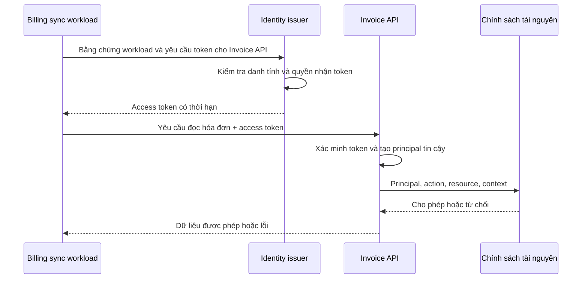

# Machine-to-machine access

## 1. Truy cập machine-to-machine là gì?

**Machine-to-machine access**, thường viết tắt là **M2M access**, là việc một chương trình truy cập tài nguyên của hệ thống khác bằng danh tính và quyền được hệ thống nhận diện, thay vì yêu cầu người dùng trực tiếp đăng nhập cho từng thao tác. Bên gọi có thể là một dịch vụ, batch job, pipeline, agent hoặc chương trình tích hợp.

Ví dụ, tác vụ `billing-sync` đọc hóa đơn đã được phê duyệt từ API hóa đơn rồi chuyển dữ liệu sang hệ thống kế toán. Tác vụ cần chứng minh nó là chương trình được phép chạy và chỉ được thực hiện đúng những thao tác đã được cấp.

Trong IAM, service account thường là principal đại diện cho chương trình đó. Tuy nhiên, M2M mô tả một **mô hình truy cập**, không bắt buộc mọi nền tảng đều dùng cùng một loại đối tượng hay cùng tên gọi service account. Một API client hoặc danh tính workload do nền tảng quản lý cũng có thể đảm nhiệm vai trò tương ứng.

M2M không chỉ là “gửi token thành công”. Một đường truy cập hoàn chỉnh phải kết nối được danh tính bên gọi, bằng chứng xác thực, tài nguyên đích, quyết định phân quyền và khả năng thu hồi. Bài học này tập trung vào cách thiết kế các mối liên hệ đó theo nguyên tắc ít quyền nhất.

## 2. Các thành phần của một quyết định truy cập

Một quyết định M2M có thể được mô tả bằng bộ thông tin:

```text
principal + action + resource + context → allow hoặc deny
```

| Thành phần | Ý nghĩa | Ví dụ |
|---|---|---|
| Principal | Danh tính đã được xác thực | `svc:prod:billing-sync` |
| Action | Hành động cụ thể được yêu cầu | Đọc hóa đơn đã phê duyệt |
| Resource | Đối tượng chịu tác động | Hóa đơn của đơn vị kinh doanh A |
| Context | Điều kiện liên quan đến quyết định | Môi trường, tenant, trạng thái hóa đơn |
| Policy | Quy tắc kết hợp các thông tin trên | Chỉ đọc hóa đơn đã phê duyệt trong phạm vi A |

Ba câu hỏi cần tách biệt là:

1. **Ai được sử dụng danh tính này?** Ví dụ, chỉ workload `billing-sync` trong môi trường production được nhận credential của `svc:prod:billing-sync`.
2. **Danh tính được cấp credential nào?** Ví dụ, access token dành cho API hóa đơn, có thời hạn và phạm vi nhất định.
3. **Credential đó cho phép request nào tại tài nguyên?** Ví dụ, token hợp lệ vẫn không cho phép sửa thông tin ngân hàng của khách hàng.

Quyền được nhận token không tự đồng nghĩa quyền truy cập tất cả API. Ngược lại, việc gán role trên tài nguyên không có ý nghĩa nếu bất kỳ workload nào cũng có thể nhận danh tính mang role đó.

## 3. Thiết kế service account cho M2M

### 3.1. Tách danh tính theo ranh giới quyền và vòng đời

Không nên dùng một tài khoản chung cho mọi chương trình vì khi credential bị lộ, rất khó giới hạn ảnh hưởng hoặc xác định bên đã thực hiện hành động. Các ứng dụng có mục đích, owner hoặc quyền khác nhau thường cần danh tính riêng.

Ví dụ:

```text
svc:prod:billing-sync
svc:dev:billing-sync
svc:prod:invoice-report
```

`billing-sync` trong production có thể đọc hóa đơn thật, còn bản development chỉ được truy cập dữ liệu thử nghiệm. `invoice-report` chỉ cần đọc dữ liệu báo cáo và không được nhận quyền ghi của tác vụ đồng bộ.

Không nhất thiết tạo principal mới cho từng replica nếu chúng có cùng vai trò và chính sách. Có thể dùng một danh tính logic cho cả dịch vụ, đồng thời cấp credential riêng cho từng instance và ghi thêm thông tin instance khi kiểm toán. Cần hiểu khả năng thu hồi đến cấp nào: một credential, một instance hay toàn bộ danh tính dịch vụ.

### 3.2. Xác định owner và mục đích sử dụng

Mỗi service account cần có owner chịu trách nhiệm cho mục đích, quyền, các workload được phép sử dụng và kế hoạch kết thúc vòng đời. Owner nên gắn với nhóm quản lý hệ thống, không chỉ một nhân viên đã tạo tài khoản.

Một bản mô tả quản trị có thể ghi nhận:

| Thuộc tính | Ví dụ |
|---|---|
| Danh tính | `svc:prod:billing-sync` |
| Mục đích | Đồng bộ hóa đơn đã phê duyệt sang kế toán |
| Owner | Nhóm ứng dụng tài chính |
| Workload được sử dụng | Job đồng bộ trong môi trường production được phê duyệt |
| Tài nguyên đích | API hóa đơn và API kế toán đã chỉ định |
| Quyền chính | Đọc hóa đơn đã phê duyệt, tạo bút toán tương ứng |
| Điều kiện thu hồi | Dừng tích hợp, thay đổi owner hoặc phát hiện xâm nhập |

Đây là thông tin phục vụ quản trị và kiểm toán, không phải một schema IAM dùng chung cho mọi sản phẩm.

### 3.3. Kiểm soát ai có thể thay đổi danh tính và quyền

Quyền quản lý service account đôi khi có sức ảnh hưởng lớn hơn quyền dùng một API cụ thể. Một người có thể không trực tiếp đọc hóa đơn nhưng nếu họ được phép tự cấp credential hoặc cho workload tùy ý sử dụng `billing-sync`, họ có thể gián tiếp thực hiện thao tác đó.

Vì vậy, cần xem xét cả quyền quản trị như tạo khóa, thay đổi cấu hình federation, gắn danh tính vào workload, sửa policy hoặc cấp quyền impersonation. Service account có role ít quyền tại một nơi vẫn có thể trở thành đường leo thang nếu nó được phép nhận danh tính khác mạnh hơn.

## 4. Lựa chọn bằng chứng xác thực

M2M không quy định một loại credential duy nhất. Cơ chế phải phù hợp với khả năng của bên gọi, bên cấp credential và tài nguyên đích.

| Cơ chế | Cách sử dụng trong M2M | Điểm cần kiểm soát |
|---|---|---|
| Shared secret hoặc API key | Caller xuất trình giá trị bí mật được cấp | Phân phối, sao chép, phạm vi quyền và rotation |
| Khóa riêng và chữ ký | Caller chứng minh khả năng sử dụng khóa | Bảo vệ khóa, dữ liệu được ký và chống phát lại theo giao thức |
| Chứng thư client, mTLS | Xác thực bên gọi tại kết nối | Trust anchor, danh tính chứng thư và phân quyền sau xác thực |
| Access token | Caller gọi tài nguyên bằng token được cấp | Issuer, audience, thời hạn, quyền và cách thu hồi |
| Danh tính nền tảng hoặc federation | Workload nhận credential dựa trên bằng chứng môi trường | Điều kiện nhận danh tính và mức tin cậy của môi trường |

Một mô hình dùng OAuth client credentials có thể cấp access token cho client hành động theo quyền của chính nó. Cách client xác thực với authorization server có thể là secret, khóa hoặc cơ chế khác được hỗ trợ. Không nên đồng nhất tên luồng này với việc bắt buộc sử dụng mật khẩu dài hạn.

Với federation, phải giới hạn issuer và những workload cụ thể được chấp nhận thông qua subject, audience hoặc thuộc tính phù hợp với nền tảng. Tin mọi assertion có chữ ký của một issuer mà không giới hạn workload có thể cấp danh tính đặc quyền cho bên ngoài dự định.

Khi có khả năng dùng credential ngắn hạn tự động, có thể giảm số secret dài hạn phải phân phối cho ứng dụng. Dù vậy, vẫn phải bảo vệ token được cấp và kiểm soát quyền tiếp tục xin credential. Token ngắn hạn không ngăn kẻ tấn công liên tục xin token mới nếu họ đã kiểm soát workload được tin cậy.

## 5. Luồng truy cập M2M và các ranh giới tin cậy

Luồng sau minh họa workload nhận access token để gọi API hóa đơn:



Các thành phần issuer, API và bộ đánh giá policy có thể được triển khai chung hoặc tách riêng. Sơ đồ chỉ mô tả trách nhiệm; nó không yêu cầu mỗi request luôn phải gọi một policy server bên ngoài.

Có ít nhất ba ranh giới cần hiểu:

- **Workload → issuer**: issuer kiểm tra bằng chứng nào, và tại sao workload được phép nhận danh tính yêu cầu?
- **Workload → tài nguyên**: caller có xác thực đúng máy chủ đích, và tài nguyên có xác minh đúng credential của caller không?
- **Principal đã xác thực → hành động nghiệp vụ**: quyền có được kiểm tra cho đúng đối tượng, tenant và trạng thái nghiệp vụ không?

Kênh truyền cần được bảo vệ. Caller không được gửi token đến một URL tùy ý do input bên ngoài cung cấp. Nếu bên tấn công có thể thay đổi địa chỉ nhận request, việc token có chữ ký hợp lệ không ngăn token bị gửi nhầm đến máy chủ của họ.

## 6. Audience, scope, role và quyền trên tài nguyên

Các khái niệm này có liên quan nhưng không tương đương:

| Khái niệm | Câu hỏi chính | Giới hạn |
|---|---|---|
| Audience | Token dành cho bên nhận nào? | Đúng audience chưa chứng minh request có đủ quyền |
| Scope | Token được cấp phạm vi truy cập nào? | Ý nghĩa phụ thuộc contract của issuer và API |
| Role | Principal được nhóm quyền nào trong hệ thống policy? | Tên role không tự cho biết toàn bộ quyền hiệu lực |
| Quyền trên tài nguyên | Principal có được làm action với đối tượng này không? | Phải xét đúng đối tượng và các điều kiện liên quan |

Một token dành cho `invoice-api` không nên được chấp nhận tại `accounting-api` chỉ vì hai API tin cùng issuer. Audience là ranh giới nơi sử dụng token; resource server phải kiểm tra ranh giới đó.

Một scope như `invoice.read` cũng chưa nhất thiết giới hạn được đơn vị kinh doanh hoặc tenant. Nếu yêu cầu chỉ cho đọc hóa đơn của đơn vị A, API phải có chính sách ràng buộc tương ứng, thay vì chỉ kiểm tra chuỗi scope rồi trả về mọi dữ liệu.

RBAC có thể nhóm quyền theo chức năng, chẳng hạn role đọc hóa đơn hoặc role nhập bút toán. ABAC có thể bổ sung điều kiện theo thuộc tính của principal, tài nguyên và request. Cách kết hợp allow, deny, kế thừa hoặc điều kiện phụ thuộc mô hình policy của từng hệ thống; không thể suy ra quyền hiệu lực chỉ từ một role đơn lẻ.

Mã giả sau minh họa quyết định nghiệp vụ, không phải một ngôn ngữ policy cụ thể:

```text
principal = authenticate(request.credential)

require principal được phép thực hiện "invoice.read"
require invoice.businessUnit thuộc phạm vi của principal
require invoice.status == "APPROVED"

return các trường hóa đơn được phép xuất
```

Thông tin `businessUnit` hoặc `tenant` do caller tự gửi không tự tạo quyền. API phải đối chiếu nó với principal và tài nguyên thực tế. Nếu caller có thể truyền `tenant=B` để vượt sang dữ liệu của B, xác thực thành công vẫn không bảo vệ được ranh giới tenant.

## 7. Ví dụ thiết kế cho Billing Sync

### 7.1. Xác định quyền tối thiểu

Tác vụ `billing-sync` cần đọc hóa đơn đã phê duyệt thuộc đơn vị A và tạo bút toán tương ứng. Nó không cần sửa hóa đơn, thay thông tin thanh toán hoặc xóa dữ liệu kế toán.

| Bên gọi | Tài nguyên đích | Quyền được cấp | Quyền loại khỏi nhiệm vụ |
|---|---|---|---|
| `svc:prod:billing-sync` | Invoice API | Đọc hóa đơn đã phê duyệt của đơn vị A | Sửa hóa đơn, xem mọi đơn vị |
| `svc:prod:billing-sync` | Accounting API | Tạo bút toán trong phạm vi tích hợp | Xóa bút toán, thay policy, quản trị người dùng |
| `svc:prod:invoice-report` | Dữ liệu báo cáo | Đọc tập dữ liệu tổng hợp | Dùng quyền ghi của Billing Sync |

Quyền tạo bút toán cũng cần giới hạn dữ liệu được phép tạo và các kiểm tra nghiệp vụ. Một role có tên “integration” không thay thế việc xác định loại bút toán, đơn vị và các trường được chấp nhận.

### 7.2. Cấp token phù hợp cho từng đích

`billing-sync` có thể cần hai access token: một dành cho Invoice API, một dành cho Accounting API, tùy cơ chế cấp token được triển khai. Không chuyển tiếp token nhận từ API đầu sang API sau nếu audience và contract không cho phép.

Credential provider phải phân biệt ít nhất những thuộc tính quyết định token được sử dụng, chẳng hạn principal, audience và phạm vi yêu cầu. Cache nhầm token giữa hai đích hoặc hai danh tính có thể gây lỗi hoặc phá vỡ cách ly truy cập.

Workload lấy credential bằng danh tính thực thi được phê duyệt. Không cho người gửi yêu cầu nghiệp vụ tự chọn service account đặc quyền hoặc tự truyền tên danh tính để workload impersonate. Các giá trị đó phải được ràng buộc bởi cấu hình và policy tin cậy.

### 7.3. Xử lý request và retry

```text
invoices = invoiceClient.readApprovedInvoices(allowedBusinessUnit)

for each invoice in invoices:
    entry = transformAndValidate(invoice)
    accountingClient.createEntry(
        entry,
        idempotencyKey = stableReferenceFor(invoice)
    )
```

Đây là mã giả minh họa nghiệp vụ, không phải API của một sản phẩm. `allowedBusinessUnit` phải được resource server kiểm tra theo principal; không chỉ được workload tự khai báo.

Khóa idempotency giúp hệ thống xử lý retry mà không tạo bút toán trùng theo contract đã thiết kế. Nó không phải bằng chứng xác thực và không thay thế kiểm tra quyền. Hệ thống cũng cần quy định phạm vi của khóa, cách xử lý cùng khóa nhưng dữ liệu khác và thời gian lưu kết quả tương ứng.

Khi credential hết hạn, workload có thể xin token mới theo cơ chế được hỗ trợ và thử lại có giới hạn. Nếu tài nguyên từ chối vì thiếu quyền, việc lặp lại yêu cầu cấp token không tự sửa policy. Với request ghi đã bị timeout, cần xử lý trạng thái chưa rõ kết quả trước khi gửi lại để tránh tác dụng phụ trùng lặp.

## 8. Truy cập nhân danh dịch vụ và truy cập thay mặt người dùng

Một chương trình có thể gọi API theo quyền của chính nó, hoặc tham gia luồng xử lý thay mặt người dùng. Hai trường hợp có ý nghĩa khác nhau.

| Trường hợp | Chủ thể cần được đánh giá |
|---|---|
| Batch đồng bộ hóa đơn theo nhiệm vụ đã phê duyệt | Service account và phạm vi công việc của nó |
| API trung gian xử lý yêu cầu xem hóa đơn của người dùng | Caller workload cùng quyền của người dùng hoặc ngữ cảnh ủy quyền đáng tin |
| Job được cấp quyền impersonate một principal khác | Workload gốc, quyền impersonation và quyền của principal được sử dụng |

Token client credentials thường đại diện cho client hành động theo quyền của chính nó. Không được tự suy rằng một token như vậy chứng minh bất kỳ người dùng cụ thể nào đã đăng nhập hoặc được phép truy cập một hóa đơn.

Nếu một API trung gian có quyền đọc rộng nhưng nhận yêu cầu từ người dùng quyền hẹp, nó có thể trở thành **confused deputy**: bị lợi dụng để thực hiện hành động mà người dùng không được phép làm. Cần kiểm tra quyền của người dùng tại ranh giới phù hợp và truyền ngữ cảnh ủy quyền qua cơ chế được tin cậy khi downstream cần sử dụng.

Không nên giải quyết bằng cách thêm header `X-User-Id` rồi tin mọi giá trị caller gửi. Hệ thống phải biết ai tạo thông tin đó, thông tin được bảo vệ như thế nào và bên nhận có thể xác minh nó hay không.

Với impersonation, quyền dùng danh tính khác là một quyền nhạy cảm riêng. Phải giới hạn ai có thể impersonate ai, cho mục đích nào, trong điều kiện nào, và giữ được dấu vết actor gốc theo khả năng của hệ thống. Chỉ ghi principal đích có thể khiến việc điều tra mất thông tin quan trọng.

## 9. Các lớp bảo vệ bổ sung

### 9.1. Kiểm soát mạng

Firewall, network policy hoặc private endpoint giúp hạn chế nguồn kết nối và giảm bề mặt tấn công. Tuy nhiên, địa chỉ IP hoặc việc ở cùng mạng không tự chứng minh danh tính service account. Một tiến trình bị chiếm quyền trong mạng cho phép vẫn có thể gửi request trái phép nếu tài nguyên bỏ xác thực.

Tương tự, token hợp lệ không có nghĩa là mọi nguồn mạng đều nên được tiếp cận tài nguyên. Kiểm soát mạng và IAM có thể cùng áp dụng khi phù hợp, nhưng cần theo dõi riêng lý do từ chối để không nhầm lỗi kết nối với lỗi quyền.

### 9.2. Service mesh và proxy

Một mesh có thể thực hiện mTLS giữa các proxy và cung cấp danh tính workload tại lớp mạng. Nếu mTLS kết thúc ở proxy, ứng dụng cần một đường tin cậy để nhận security context và phải được bảo vệ khỏi việc gọi thẳng bỏ qua proxy.

Header danh tính do proxy tạo chỉ đáng tin khi proxy kiểm soát nó, loại bỏ dữ liệu giả mạo từ nguồn không tin cậy và ứng dụng chỉ chấp nhận thông tin qua đường đã bảo vệ. mTLS cũng không tự cấp quyền nghiệp vụ cho mọi request; vẫn cần quyết định theo action và tài nguyên.

### 9.3. Giới hạn tần suất và phạm vi tác động

Rate limit, quota và giới hạn khối lượng mỗi job có thể giảm ảnh hưởng của chương trình lỗi hoặc credential bị lạm dụng. Chúng không thay thế authorization: một caller bị giới hạn tốc độ vẫn không được truy cập tài nguyên ngoài phạm vi.

Với các thao tác nhạy cảm, có thể thiết kế quy trình phê duyệt hoặc quyền có thời hạn phù hợp với nghiệp vụ. Sự phê duyệt phải gắn với hành động, dữ liệu hoặc phiên thực thi cụ thể nếu đó là điều kiện cần, thay vì biến một lần phê duyệt thành quyền quản trị tồn tại vô hạn.

## 10. Vòng đời truy cập và xử lý sự cố

Một đường truy cập M2M có vòng đời từ cấp quyền, hoạt động, rà soát đến thu hồi. Quản lý token chỉ là một phần của vòng đời này.

| Giai đoạn | Việc cần kiểm soát |
|---|---|
| Cấp ban đầu | Owner, mục đích, workload được nhận danh tính và quyền tối thiểu |
| Đang hoạt động | Làm mới credential, xác minh request và kiểm toán |
| Thay đổi | Rotation, cập nhật tài nguyên hoặc quyền theo nhu cầu mới |
| Rà soát | Đối chiếu quyền hiện có với nhiệm vụ còn thực tế |
| Ngừng hoặc sự cố | Chặn cấp mới, thu hồi credential/quyền và xử lý phiên còn tồn tại |

Khi phát hiện một instance bị xâm nhập, cần xác định kẻ tấn công có chỉ lấy được một token hay vẫn kiểm soát nguồn cấp token. Hai tình huống đòi hỏi phạm vi phản ứng khác nhau.

Các biện pháp có thể bao gồm dừng hoặc cách ly workload, ngăn nó nhận credential mới, thu hồi credential liên quan, gỡ quan hệ federation sai và áp dụng policy từ chối tại tài nguyên theo cơ chế hỗ trợ. Cần đánh giá cả những phiên hoặc kết nối đã thiết lập.

Không phải mọi token bị vô hiệu hóa tức thì khi tài khoản bị khóa. Token được xác minh offline có thể tiếp tục được chấp nhận đến khi hết hạn nếu resource server không có thông tin thu hồi bổ sung. Chứng thư hoặc phiên kết nối cũng có hành vi phụ thuộc cơ chế xác minh và quản lý phiên được triển khai.

Khi issuer tạm thời không sẵn sàng, hệ thống có thể tiếp tục dùng credential và dữ liệu xác minh cache còn hợp lệ theo chính sách. Không dùng token hết hạn hoặc bỏ kiểm tra chữ ký để giữ cho batch chạy. Nếu không thể xác minh, phải từ chối truy cập theo contract đã thiết kế và ghi nhận lỗi để vận hành xử lý.

## 11. Kiểm toán đường truy cập M2M

Một sự kiện truy cập hữu ích cần thể hiện principal đã xác thực, action, tài nguyên, kết quả, thời gian và thông tin liên kết request. Khi có federation hoặc impersonation, cần lưu thông tin actor gốc và quan hệ danh tính nếu cơ chế hỗ trợ.

Nên có khả năng liên kết các sự kiện sau:

```text
Workload bắt đầu chạy
    → Nhận credential theo danh tính được cấp
    → Gọi API và nhận quyết định quyền
    → Thực hiện hoặc từ chối hành động nghiệp vụ
    → Hoàn tất lần chạy
```

Run ID hoặc correlation ID giúp nối các sự kiện, nhưng không phải bằng chứng danh tính. Giá trị caller tự gửi cần được phân biệt với dữ liệu do hệ thống xác thực tạo ra.

Không log nguyên access token, client secret, API key hoặc private key. Có thể ghi định danh credential không bí mật theo nhu cầu điều tra, nhưng phải hiểu liệu giá trị đó có thực sự an toàn để ghi hay không. Dữ liệu hóa đơn, khách hàng hoặc tenant trong log cũng cần được giảm thiểu và bảo vệ phù hợp.

| Dấu hiệu | Câu hỏi điều tra |
|---|---|
| Service account gọi API ngoài nhiệm vụ | Quyền đang cấp quá rộng hay credential bị lạm dụng? |
| Token được xin từ workload không dự kiến | Điều kiện nhận danh tính hoặc môi trường thực thi có bị thay đổi? |
| Nhiều lần từ chối theo tenant | Có lỗi mapping, input không hợp lệ hay cố vượt ranh giới dữ liệu? |
| Tăng mạnh thao tác ghi | Có retry sai, lỗi nghiệp vụ hoặc hành vi trái phép? |
| Danh tính vẫn hoạt động sau khi job bị loại bỏ | Có credential, phiên hoặc workload khác còn sử dụng? |

Tín hiệu bất thường cần được đối chiếu với lịch chạy, thay đổi triển khai và mục đích tài khoản. Không nên coi mọi khác biệt là xâm nhập, nhưng cũng không nên bỏ qua chỉ vì principal có tên giống một dịch vụ hợp lệ.

## 12. Bài tập áp dụng

Một tổ chức có ba workload: đồng bộ hóa đơn, xuất báo cáo và triển khai ứng dụng. Cả ba đang dùng chung một API key có quyền quản trị. Workload triển khai nhận mã từ nhiều nhánh, còn tác vụ báo cáo chỉ cần đọc số liệu tổng hợp.

Hãy thiết kế lại M2M access bằng cách:

1. Xác định các service account, owner và ranh giới môi trường.
2. Chọn cơ chế xác thực cho từng workload và giải thích nguồn tin cậy ban đầu.
3. Liệt kê principal, action, resource và context của từng đường truy cập.
4. Phân biệt quyền nhận credential với quyền tại tài nguyên đích.
5. Ràng buộc workload hoặc nhánh triển khai nào được nhận danh tính production.
6. Mô tả cách phát hiện và thu hồi truy cập khi API key cũ đã bị lộ.
7. Chỉ ra dữ liệu kiểm toán cần giữ và những credential không được ghi vào log.

Một thiết kế hợp lý có thể tách danh tính theo nhiệm vụ, dùng token ngắn hạn theo audience ở nơi hỗ trợ, giới hạn quyền theo tài nguyên và chặn mã chưa được phê duyệt nhận danh tính triển khai production. Nếu một tích hợp vẫn buộc dùng API key, key phải có phạm vi riêng, được bảo vệ và có vòng đời thu hồi rõ ràng.

## 13. Các điểm cần ghi nhớ

M2M access là toàn bộ đường đi từ workload đến hành động trên tài nguyên. Xác thực chứng minh danh tính; phân quyền quyết định danh tính đó có được thực hiện request cụ thể hay không. Service account phải được quản lý cả ở phía ai được sử dụng nó và phía nó được truy cập những gì.

Một thiết kế có thể kiểm soát được cần tách danh tính phù hợp, bảo vệ credential, giới hạn audience và quyền, giữ rõ ngữ cảnh ủy quyền, đồng thời có kiểm toán và cách thu hồi thực tế. Khi các ranh giới đó được xác định rõ, tự động hóa có thể hoạt động ổn định mà vẫn giữ nguyên tắc ít quyền nhất trong toàn bộ vòng đời.
