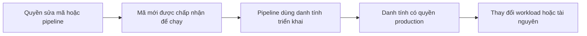

# Privileged access là gì?

Một nhân viên có thể được phép xem trạng thái đơn hàng, nhưng không được tự cấp quyền cho đồng nghiệp, thay chính sách xác thực hoặc tắt nhật ký bảo mật. Những khả năng quản trị và kiểm soát vượt ra ngoài hoạt động thông thường này thuộc phạm vi **privileged access**, tức truy cập đặc quyền.

Privileged access là khả năng truy cập được cấp cho một danh tính để thực hiện những chức năng quản trị, kiểm soát hoặc chức năng liên quan đến an ninh mà người dùng thông thường không được phép thực hiện trong cùng phạm vi hệ thống. Danh tính đó có thể là con người, tài khoản dịch vụ, pipeline hoặc một workload tự động.

Điểm cần xem xét là danh tính có thể làm gì và ảnh hưởng đến đâu. Tên tài khoản có chữ `admin` là một dấu hiệu, nhưng không phải điều kiện đủ để xác định toàn bộ đặc quyền trong hệ thống.

## 1. Đặc quyền được xác định bằng khả năng kiểm soát

NIST mô tả privileged user thông qua quyền thực hiện những chức năng liên quan đến an ninh mà người dùng thông thường không được phép thực hiện; các định nghĩa được dẫn trong glossary cũng đề cập chức năng kiểm soát, giám sát và quản trị hệ thống. [Nguồn: NIST CSRC — Privileged user](https://csrc.nist.gov/glossary/term/privileged_user).

Trong thực tế, một quyền cần được đánh giá theo hành động, tài nguyên, môi trường và các điều kiện áp dụng. Những câu hỏi hữu ích gồm:

- Danh tính có thể thay đổi cấu hình hoặc vận hành của hệ thống quan trọng không?
- Có thể cấp, sửa hoặc thu hồi quyền của danh tính khác không?
- Có thể lấy credential, sử dụng danh tính khác hoặc thay điều kiện cấp credential không?
- Có thể thay phần mềm được chạy với quyền cao không?
- Có thể làm suy yếu giám sát, khôi phục hoặc các cơ chế bảo vệ không?

Ví dụ, quyền triển khai mã vào một dịch vụ production có thể có tác động rất lớn dù người giữ quyền không được cấp shell quản trị trực tiếp. Mã mới có thể chạy dưới danh tính của dịch vụ và sử dụng những quyền mà dịch vụ đang có.

Quyền xem dữ liệu nhạy cảm cũng cần kiểm soát chặt, nhưng không tự đồng nghĩa với quyền quản trị hệ thống. Một người được phép xem hồ sơ theo nghiệp vụ và một người có thể tự cấp quyền xem mọi hồ sơ có các khả năng khác nhau. Tổ chức cần xác định phạm vi quản trị đặc quyền và truy cập nhạy cảm theo mô hình rủi ro của mình.

## 2. Ví dụ về truy cập thông thường và truy cập đặc quyền

Các ví dụ dưới đây có tính minh họa. Một hành động có thể được phân loại khác nhau tùy hệ thống và phạm vi ảnh hưởng.

| Phạm vi | Hoạt động thông thường trong phạm vi đã cấp | Hoạt động có tính đặc quyền |
| --- | --- | --- |
| Ứng dụng nghiệp vụ | Xem hoặc xử lý hồ sơ được phân công | Thay role của người dùng, đổi chính sách phân quyền toàn ứng dụng |
| Máy chủ | Sử dụng một dịch vụ hoặc đọc log được cho phép | Đổi cấu hình bảo mật, quản lý tài khoản hệ điều hành, chạy tác vụ quản trị |
| Cơ sở dữ liệu | Thực hiện truy vấn nghiệp vụ được cấp | Tạo tài khoản, cấp quyền, thay cấu trúc hoặc cấu hình quản trị quan trọng |
| Nền tảng cloud | Dùng một tài nguyên đã được cấp quyền | Sửa IAM policy, thay cấu hình bảo vệ hoặc quản trị nhiều tài nguyên production |
| Kho bí mật | Workload nhận đúng credential cần cho nhiệm vụ | Thay policy của kho, đọc hoặc cấp phát credential của nhiều workload |
| CI/CD | Xem kết quả một pipeline | Thay luồng triển khai có thể chạy với danh tính production, tùy các kiểm soát bảo vệ |
| Hệ thống kiểm toán | Xem log theo phạm vi nhiệm vụ | Thay cấu hình thu thập, quyền truy cập hoặc cơ chế bảo vệ bằng chứng |

“Đặc quyền” không có nghĩa là một danh tính có thể làm mọi việc. Người có quyền quản trị một cơ sở dữ liệu có thể không có quyền quản trị directory. Một operator chỉ được khởi động lại một dịch vụ có phạm vi nhỏ hơn người có thể đổi chính sách cho cả tổ chức.

Vì vậy, đánh giá chỉ bằng hai nhãn `admin` và `user` thường quá thô. Cần biết quyền nào đang có hiệu lực, trên tài nguyên nào và bằng đường truy cập nào.

## 3. Ai hoặc cái gì có thể có đặc quyền?

### 3.1. Danh tính của con người

Quản trị viên directory, quản trị hệ thống, DBA, kỹ sư vận hành và nhân sự ứng cứu đều có thể cần một số đặc quyền để hoàn thành nhiệm vụ. Người dùng nghiệp vụ cũng có thể giữ quyền quản trị riêng trong một ứng dụng, chẳng hạn quản lý quyền truy cập dữ liệu của đơn vị mình.

Không phải mọi thành viên của một chức danh đều cần cùng tập quyền. Quyền cần bám vào nhiệm vụ đã giao, thay vì suy luận rằng mọi kỹ sư đều cần toàn quyền production.

### 3.2. Danh tính của máy và workload

Tài khoản dịch vụ có thể tạo tài nguyên, thay cấu hình, triển khai mã hoặc quản trị danh tính khác. Một pipeline tự động không có giao diện đăng nhập bằng người dùng vẫn có thể là đường truy cập đặc quyền.

Với các danh tính này, cần biết owner, mục đích, điều kiện cấp credential, những bên có thể sử dụng danh tính và quyền tại tài nguyên. Quy trình yêu cầu con người nhập MFA cho từng lượt chạy thường không phù hợp với workload tự động; cần dùng cơ chế xác thực và giới hạn quyền dành cho máy.

### 3.3. Danh tính khẩn cấp

Tài khoản hoặc cơ chế truy cập khẩn cấp giúp tổ chức xử lý tình huống đường quản trị thông thường không hoạt động. Đây là một đường đặc quyền cần được thiết kế, bảo vệ và kiểm tra sẵn, không phải tài khoản dự phòng để mọi người sử dụng hằng ngày.

Quy trình khẩn cấp phải xét phụ thuộc: nếu toàn bộ cơ chế khôi phục cũng phụ thuộc vào chính hệ thống đang hỏng, tổ chức có thể không sử dụng được quyền cần thiết khi có sự cố.

## 4. Đặc quyền trực tiếp và đặc quyền gián tiếp

### 4.1. Đường trực tiếp

Một người được gán role quản trị, thuộc nhóm có quyền cao hoặc kích hoạt một vai trò được cấp tạm thời. Đường này thường dễ nhìn thấy hơn trong danh sách binding hoặc thành viên nhóm.

Tuy nhiên, quyền hiệu lực có thể còn đến từ nhóm lồng nhau, tài nguyên cha, quyền kế thừa hoặc chính sách tại tài nguyên. Không chỉ xem những role được gán trực tiếp cho tài khoản.

### 4.2. Đường gián tiếp

Một danh tính không mang role quản trị vẫn có thể kiểm soát một danh tính khác có quyền cao. Ví dụ:

- Có thể tạo credential cho service account đặc quyền.
- Có thể sửa chính sách để tự cấp quyền sử dụng một tài khoản mạnh hơn.
- Có thể thay mã hoặc cấu hình được một pipeline đặc quyền thực thi.
- Có thể điều khiển một máy hoặc agent nơi credential đặc quyền được sử dụng.

Sơ đồ dưới đây minh họa một đường có thể tồn tại nếu các bước triển khai không có kiểm soát độc lập đủ mạnh:



Quyền sửa mã không tự động tương đương quyền production trong mọi hệ thống. Review bắt buộc, bảo vệ nhánh, kiểm soát artifact, môi trường triển khai và phân tách quyền có thể giới hạn đường này. Điều cần làm là kiểm tra chuỗi điều kiện thực tế, thay vì chỉ nhìn tên role của người dùng đầu tiên.

Mô hình truy cập doanh nghiệp của Microsoft phân biệt control plane, management plane và data/workload plane, đồng thời xét cả đường truy cập của người dùng lẫn ứng dụng. Cách nhìn này giúp nhận diện khả năng kiểm soát thông qua nhiều lớp, thay vì chỉ tập trung vào đăng nhập quản trị máy chủ. [Nguồn: Enterprise access model](https://learn.microsoft.com/en-us/security/privileged-access-workstations/privileged-access-access-model).

## 5. Vì sao truy cập đặc quyền cần được quản lý riêng?

### 5.1. Một hành động có thể ảnh hưởng nhiều người và hệ thống

Sai sót của người dùng thông thường có thể nằm trong một tập hồ sơ được giao. Sai sót của tài khoản có quyền thay IAM policy, triển khai mã hoặc thay cấu hình production có thể mở rộng sang nhiều workload và dữ liệu.

Mức ảnh hưởng không chỉ là số lượng tài nguyên. Quyền thay đổi hệ thống danh tính hoặc hạ tầng cấp credential có thể tạo thêm đường truy cập đến những tài nguyên khác.

### 5.2. Quyền có thể được dùng để tạo quyền mới

Một số đặc quyền cho phép tạo tài khoản, cấp role, thay policy hoặc thiết lập credential khác. Kẻ chiếm được quyền đó có thể tạo một đường truy cập mới. Sau đó chỉ đổi mật khẩu của tài khoản bị chiếm ban đầu có thể chưa loại bỏ được đường truy cập đã tạo.

Vì vậy, ứng cứu cần xem cả thay đổi đã diễn ra: binding mới, credential mới, tài khoản mới, cấu hình triển khai và những nơi hệ thống đã bị tác động.

### 5.3. Có thể tác động đến khả năng phát hiện và khôi phục

Quyền sửa cấu hình log, thay nơi lưu bằng chứng hoặc quản lý backup có thể làm giảm khả năng điều tra và phục hồi. Thiết kế cần bảo vệ những thành phần này theo quyền hiệu lực của nền tảng, đồng thời tránh để một danh tính dễ dàng kiểm soát mọi lớp bằng chứng và khôi phục.

## 6. Phân biệt các khái niệm liên quan

| Khái niệm | Câu hỏi chính |
| --- | --- |
| Authentication — xác thực | Danh tính đang truy cập là ai, bằng chứng có hợp lệ không? |
| Authorization — cấp quyền | Danh tính được thực hiện hành động nào trên tài nguyên nào? |
| Privileged access — truy cập đặc quyền | Danh tính có khả năng quản trị hoặc kiểm soát vượt phạm vi thông thường nào? |
| IAM | Quản lý danh tính, xác thực, quyền truy cập và vòng đời liên quan nói chung |
| PAM — Privileged Access Management | Quản lý và kiểm soát những đường truy cập đặc quyền |
| PIM — Privileged Identity Management | Thuật ngữ thường dùng cho quản lý vai trò, điều kiện và vòng đời của danh tính hoặc quyền đặc quyền; phạm vi cụ thể tùy sản phẩm |

PAM có thể bao gồm kiểm soát credential, quản lý phiên, cấp quyền tạm thời, giám sát và review. Không phải mọi công cụ có tên PAM đều bảo vệ tất cả giao thức, API, tài nguyên hoặc đường truy cập. Phải xem phạm vi thực thi thực tế.

MFA làm tăng độ tin cậy của bước xác thực theo cơ chế được triển khai. MFA không tự giảm quyền của một tài khoản đã đăng nhập, không bảo đảm thiết bị không bị xâm nhập và không tự phê duyệt mọi thao tác quản trị tiếp theo.

Tương tự, một ticket được phê duyệt là bằng chứng của quyết định quản trị. Nếu hệ thống kỹ thuật không giới hạn quyền, thời gian và phạm vi theo quyết định đó, người dùng vẫn có thể giữ khả năng vượt quá phần đã được duyệt.

## 7. Các nguyên tắc quản lý đặc quyền cơ bản

### 7.1. Cấp đúng phần quyền cần cho nhiệm vụ

Nguyên tắc ít quyền nhất yêu cầu giới hạn hành động và tài nguyên theo nhu cầu. Nếu nhiệm vụ là khởi động lại một dịch vụ, cần xem có thể cấp đúng khả năng đó thay vì cấp quyền quản trị toàn cụm hay không.

Giới hạn phải có ý nghĩa tại nơi thực thi. Một script có giao diện chỉ cho chọn một dịch vụ nhưng chạy dưới credential toàn quyền có thể chưa tạo ra ranh giới bảo mật nếu người gọi vẫn có cách thay script hoặc dùng credential trực tiếp.

### 7.2. Giới hạn thời gian có quyền

Quyền thường trực tồn tại kể cả khi người dùng không thực hiện nhiệm vụ. Cấp quyền khi cần, thường gọi là just-in-time, giúp giảm thời gian đặc quyền hoạt động nếu cơ chế cấp và hết hạn được thực thi đúng.

Đồng thời, just-enough-access nhấn mạnh phạm vi vừa đủ cho công việc. Giới hạn thời gian và giới hạn phạm vi bổ sung cho nhau: toàn quyền trong thời gian ngắn vẫn có thể đủ để gây thiệt hại lớn.

### 7.3. Tách hoạt động hằng ngày khỏi hoạt động quản trị

Một người không nên dùng trạng thái đặc quyền rộng cho mọi hoạt động như đọc email, duyệt web hoặc sử dụng công cụ thông thường. Tùy hệ thống, việc tách có thể được thực hiện bằng tài khoản quản trị riêng, phiên nâng quyền có kiểm soát hoặc môi trường làm việc chuyên dụng.

Tách tên tài khoản chưa đủ nếu cả hai đều sử dụng cùng một môi trường dễ bị chiếm và credential đặc quyền có thể bị lấy từ đó. Cần xét thiết bị, trình duyệt, agent, phiên và đường truy cập liên quan.

### 7.4. Kiểm soát việc yêu cầu và phê duyệt

Thay đổi có rủi ro cao có thể cần người phê duyệt độc lập, điều kiện thiết bị, xác thực bổ sung hoặc cửa sổ bảo trì. Mức kiểm soát phải phù hợp với nhiệm vụ; không phải mọi thao tác đọc trạng thái đều cần cùng quy trình với thay quyền toàn tổ chức.

Người có thể sửa chính sách cấp quyền cũng là một đối tượng đặc quyền. Nếu một người tự sửa điều kiện để bỏ phê duyệt rồi tự kích hoạt quyền, quy trình phê duyệt bề ngoài có thể mất tác dụng.

### 7.5. Ghi nhận và quan sát hành động

Nhật ký cần giúp xác định người hoặc workload khởi phát, danh tính hiệu lực, tài nguyên, hành động, thời điểm, kết quả và tham chiếu yêu cầu khi có. Giám sát phiên có thể bổ sung ngữ cảnh, nhưng không thay thế audit tại tài nguyên.

Một hệ thống chỉ ghi hình phiên qua bastion sẽ bỏ sót nếu cùng tài khoản còn được phép gọi API trực tiếp ngoài bastion. Cần kiểm tra các đường truy cập thay thế, không chỉ đường chính được mô tả trong tài liệu.

### 7.6. Thu hồi và xác minh quyền thực sự kết thúc

Hết thời hạn role hoặc gỡ một binding không mặc nhiên chấm dứt tức thì mọi token, phiên hoặc kết nối đã được cấp. Hành vi phụ thuộc nền tảng và nơi thực thi quyền.

Khi xác định thời gian thu hồi, cần xem cache policy, thời hạn credential, session và những cơ chế chặn bổ sung. Với sự cố, còn cần kiểm tra các đường duy trì truy cập đã được tạo trong lúc đặc quyền có hiệu lực.

## 8. Một luồng sử dụng đặc quyền có kiểm soát

Giả sử kỹ sư vận hành cần khởi động lại `order-api` trong production để xử lý sự cố. Hệ thống có một role chỉ cho phép hành động đó trên đúng dịch vụ, còn việc thay IAM policy hoặc quản trị các dịch vụ khác nằm ngoài role.

Một luồng minh họa có thể diễn ra như sau:

1. Kỹ sư bắt đầu bằng danh tính cá nhân và gửi yêu cầu gắn với sự cố, tài nguyên, thao tác và thời gian dự kiến.
2. Hệ thống kiểm tra điều kiện xác thực, thiết bị và quyền được yêu cầu; yêu cầu phê duyệt nếu chính sách của nhiệm vụ cần.
3. Sau khi điều kiện được đáp ứng, quyền được kích hoạt trong phạm vi và khoảng thời gian đã định.
4. Kỹ sư thực hiện thao tác qua đường quản trị được kiểm soát; tài nguyên kiểm tra quyền hiệu lực của yêu cầu.
5. Nhật ký liên kết yêu cầu với người khởi phát, role hoặc danh tính hiệu lực và kết quả thao tác.
6. Khi hoàn tất hoặc hết hạn, hệ thống xử lý kết thúc quyền, phiên và credential theo cơ chế của nền tảng, rồi xác nhận truy cập mới ngoài thời hạn bị từ chối.

Nếu thao tác vẫn thất bại, không mặc định chuyển sang toàn quyền. Có thể nguyên nhân là sai tài nguyên, lỗi dịch vụ hoặc cấu hình role chưa khớp nhiệm vụ. Việc mở rộng quyền cần một quyết định mới có cơ sở.

### Một yêu cầu đặc quyền cần diễn đạt rõ

Ví dụ sau là thông tin minh họa cho quyết định quản trị, không phải cấu hình áp dụng cho một sản phẩm:

```text
Người yêu cầu: kỹ sư trực đã được định danh
Lý do: xử lý sự cố INC-EXAMPLE-021
Tài nguyên: order-api trong production
Hành động: khởi động lại dịch vụ
Khoảng thời gian: cửa sổ xử lý được phê duyệt
Ngoài phạm vi: thay IAM policy, đọc secret khác, quản trị dịch vụ khác
Bằng chứng: quyết định cấp quyền và audit của thao tác
Kết thúc: hoàn tất công việc hoặc hết thời hạn đã định
```

Các giới hạn chỉ có giá trị bảo vệ nếu hệ thống thực thi chúng. Mô tả “ngoài phạm vi” trong ticket không đủ nếu role kỹ thuật vẫn cho phép những hành động đó.

## 9. Đánh giá rủi ro của một đường đặc quyền

Có thể bắt đầu bằng bốn chiều đánh giá thay vì chỉ đếm số tài khoản admin:

| Chiều đánh giá | Câu hỏi cần trả lời |
| --- | --- |
| Phạm vi ảnh hưởng | Quyền tác động đến một dịch vụ, một môi trường hay toàn hệ thống danh tính? |
| Thời gian tồn tại | Quyền luôn hoạt động hay chỉ được kích hoạt cho nhiệm vụ cụ thể? |
| Đường sử dụng | Người hoặc workload nào có thể sử dụng quyền, trực tiếp hoặc gián tiếp? |
| Khả năng phát hiện và chặn | Có thấy hành động đã diễn ra không, và mất bao lâu để ngăn truy cập tiếp theo? |

Một tài khoản quản trị có MFA nhưng quyền thường trực trên toàn tổ chức vẫn mang rủi ro lớn nếu phiên hoặc thiết bị bị chiếm. Một role phạm vi hẹp nhưng được nhiều pipeline không được bảo vệ sử dụng cũng cần đánh giá lại đường truy cập.

Không nên cộng các yếu tố này thành một công thức rủi ro chính xác nếu chưa có mô hình và dữ liệu phù hợp. Chúng là những câu hỏi giúp xác định nơi cần ưu tiên kiểm soát.

## 10. Những hiểu nhầm phổ biến

| Hiểu nhầm | Cách hiểu chính xác hơn |
| --- | --- |
| Chỉ `root`, `Administrator` hoặc role tên `Admin` mới có đặc quyền | Quyền hiệu lực và đường kiểm soát mới quyết định phạm vi đặc quyền |
| Người dùng có MFA thì có thể giữ toàn quyền mọi lúc | MFA hỗ trợ xác thực; vẫn cần giới hạn quyền, thời gian và đường truy cập |
| Tài khoản dịch vụ không phải đối tượng quản lý đặc quyền | Workload và pipeline có thể giữ quyền quản trị rất lớn |
| Có công cụ PAM nghĩa là mọi đường đã được bảo vệ | Cần xác minh API, CLI, phiên, credential và các đường đi vòng trong phạm vi thực tế |
| Đã ghi log thì hành động nguy hiểm sẽ bị ngăn | Log cung cấp bằng chứng; ngăn chặn cần cơ chế thực thi hoặc phản ứng thích hợp |
| Gỡ role là mọi phiên đặc quyền kết thúc ngay | Phải kiểm tra hành vi của token, session, cache và nơi xác minh quyền |
| Đặc quyền là dấu hiệu hoạt động không hợp lệ | Đặc quyền cần cho vận hành; vấn đề là chỉ cấp và sử dụng theo phạm vi được phép |

## 11. Câu hỏi tự kiểm tra

**Một người không có role quản trị nhưng có thể tạo credential cho service account toàn quyền có liên quan đến đặc quyền không?**

Có. Cần đánh giá đường sử dụng credential và các điều kiện áp dụng, vì người đó có thể gián tiếp sử dụng quyền của service account. Chỉ xem role trên tài khoản người dùng sẽ bỏ sót khả năng này.

**Quyền khởi động lại một dịch vụ có giống quyền quản trị cả môi trường production không?**

Không. Cả hai có thể là quyền vận hành nhạy cảm hoặc đặc quyền trong phạm vi tương ứng, nhưng mức kiểm soát và phạm vi ảnh hưởng khác nhau. Quyền cần phù hợp với nhiệm vụ cụ thể.

**Cấp toàn quyền trong năm phút có tự đáp ứng nguyên tắc ít quyền nhất không?**

Không. Thời gian ngắn không thay thế giới hạn hành động và tài nguyên. Năm phút vẫn có thể đủ để thay chính sách, tạo credential mới hoặc tác động lớn đến hệ thống.

**Vì sao phải kiểm tra cả người dùng, workload và pipeline?**

Vì đặc quyền đi theo khả năng kiểm soát, không chỉ theo hình thức đăng nhập. Một danh tính tự động hoặc người có thể thay đổi đầu vào của nó có thể tạo ra đường truy cập quan trọng đến production.

**Một cơ chế quản lý đặc quyền cần chứng minh điều gì?**

Danh tính đúng được sử dụng đúng phần quyền cần thiết, trên đúng tài nguyên và trong điều kiện được phép. Hệ thống phải ghi được bằng chứng phù hợp, xử lý hết hạn hoặc thu hồi có kiểm chứng và quản lý cả những đường có thể gián tiếp dẫn đến cùng quyền đó.
