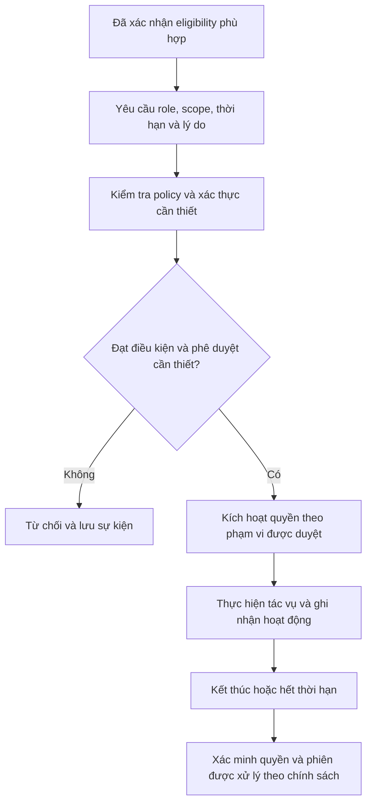

# Privileged role

## 1. Privileged role là gì?

**Privileged role**, hay vai trò đặc quyền, là vai trò chứa những quyền có khả năng tác động đáng kể đến danh tính, cơ chế bảo mật, cấu hình hệ thống, tính sẵn sàng hoặc dữ liệu quan trọng. Khi một principal được sử dụng vai trò này, hệ thống phải quản lý mức tin cậy và phạm vi tác động tương xứng.

Ví dụ gồm vai trò quản trị danh tính, quản trị cơ sở dữ liệu, quản trị khóa mã hóa hoặc vận hành tài nguyên production. Tuy nhiên, không thể nhận diện đặc quyền chỉ bằng việc tên vai trò có chứa `Admin` hay không.

Một vai trò không có tên quản trị vẫn có thể rất nhạy cảm nếu được phép tạo credential cho tài khoản mạnh hơn, sửa pipeline triển khai, thay đổi policy hoặc tắt nguồn audit log. Ngược lại, quyền quản trị một tài nguyên thử nghiệm biệt lập không có cùng phạm vi ảnh hưởng với quyền quản trị toàn tenant production.

Do đó, cần đánh giá vai trò theo **quyền thực tế, tài nguyên áp dụng và các đường mở rộng quyền**, thay vì chỉ dựa vào nhãn.

Trong mô hình RBAC, role gom các quyền theo chức năng. Khi role chứa các khả năng có tác động cao, nó trở thành một đơn vị cần kiểm soát đặc quyền: ai có thể nhận role, nhận trong phạm vi nào, khi nào được sử dụng và bằng chứng nào ghi lại việc sử dụng.

## 2. Phân biệt role, permission, account và assignment

Những khái niệm này liên quan với nhau nhưng không thay thế nhau:

| Khái niệm | Ý nghĩa | Ví dụ minh họa |
| --- | --- | --- |
| Permission | Quyền thực hiện một loại hành động | Chấm dứt phiên cơ sở dữ liệu |
| Role | Tập quyền phục vụ một chức năng | Vai trò xử lý phiên bị treo |
| Principal hoặc account | Danh tính nhận hoặc sử dụng quyền | Kỹ sư trực ca hoặc workload vận hành |
| Assignment | Quan hệ cấp role cho principal tại một phạm vi | Cấp role xử lý phiên trên cơ sở dữ liệu hóa đơn production |
| Activation hoặc phiên nâng quyền | Khoảng sử dụng role theo cơ chế nền tảng | Kích hoạt quyền trong 20 phút để xử lý sự cố |

Tạo một role definition không đồng nghĩa mọi người đã có quyền đó. Một tài khoản có tên `admin` cũng không tự chứng minh nó đang có đặc quyền; cần xem các assignment và quyền hiệu lực.

Ngược lại, một tài khoản thông thường có thể trở thành principal có đặc quyền khi được cấp role nhạy cảm. Việc tách tài khoản quản trị khỏi tài khoản làm việc hằng ngày có thể hỗ trợ giảm rủi ro, nhưng không thay thế kiểm soát role, scope và điều kiện sử dụng.

Một cách mô tả assignment rõ ràng là:

```text
Principal nào
    + Role nào
    + Trên tài nguyên hoặc phạm vi nào
    + Trong khoảng thời gian nào
    + Với điều kiện sử dụng nào
```

Không phải nền tảng nào cũng lưu cả năm yếu tố trong một đối tượng assignment. Đây là các câu hỏi thiết kế cần được trả lời bằng những cơ chế mà hệ thống hỗ trợ.

## 3. Điều gì làm một role trở nên đặc quyền?

Đặc quyền có thể tác động lên nhiều loại tài sản, không chỉ quyền truy cập máy chủ.

| Khả năng trong role | Tác động cần đánh giá |
| --- | --- |
| Sửa người dùng, nhóm, role hoặc binding | Thay đổi chủ thể nào có thể truy cập hệ thống |
| Đặt lại cơ chế xác thực hoặc quản lý credential | Có thể ảnh hưởng khả năng kiểm soát danh tính khác |
| Thay cấu hình mạng, runtime hoặc dịch vụ | Có thể làm gián đoạn hoặc mở rộng bề mặt truy cập |
| Đọc hay xuất dữ liệu nhạy cảm trên phạm vi lớn | Có thể gây lộ dữ liệu ngay cả khi không được ghi |
| Xóa, khôi phục hoặc thay dữ liệu quan trọng | Ảnh hưởng tính toàn vẹn và khả năng phục hồi |
| Quản lý khóa mã hóa hoặc secret | Có thể mở đường tới dữ liệu hoặc danh tính khác |
| Sửa nguồn audit, cảnh báo hoặc chính sách bảo mật | Có thể làm suy yếu khả năng phát hiện và kiểm chứng |
| Thay mã chạy dưới danh tính mạnh hơn | Có thể tạo đường sử dụng đặc quyền gián tiếp |

Phân loại cần dựa trên ngữ cảnh. Không phải mọi quyền đọc hay quyền thay đổi cấu hình đều được xếp cùng mức rủi ro. Cần xét dữ liệu nào bị tác động, quyền có thể kết hợp với quyền khác ra sao và hậu quả nếu principal bị chiếm quyền.

Ví dụ, role chỉ được đọc một secret có thể có tác động lớn nếu secret chứa khóa quản trị. Role được sửa một pipeline cũng cần được xem xét nếu pipeline có thể triển khai mã chạy dưới danh tính production có quyền cao.

Quyền **cấp đặc quyền** và quyền **thực hiện tác vụ đặc quyền** nên được đánh giá riêng. Một kỹ sư cần khởi động lại một dịch vụ không mặc nhiên cần quyền cấp role quản trị cho người khác.

## 4. Thiết kế role theo nhiệm vụ và phạm vi nhỏ nhất

Trước khi chọn role, hãy diễn đạt tác vụ cần hoàn thành. “Cần quyền admin để sửa lỗi” thường quá rộng để làm yêu cầu cấp quyền.

Một yêu cầu cụ thể hơn là:

> Kỹ sư trực ca cần xem thông tin phiên và chấm dứt một phiên gây nghẽn trên cơ sở dữ liệu hóa đơn production trong thời gian xử lý sự cố đã được ghi nhận.

Từ yêu cầu này có thể xem xét:

| Hành động | Có thuộc nhiệm vụ không? | Lưu ý |
| --- | --- | --- |
| Xem thông tin phiên phục vụ chẩn đoán | Có | Giới hạn thông tin nhạy cảm nếu dịch vụ hỗ trợ |
| Chấm dứt phiên trên cơ sở dữ liệu được chỉ định | Có | Có thể ảnh hưởng tính sẵn sàng và giao dịch đang chạy |
| Tạo người dùng cơ sở dữ liệu | Không | Không cần cho việc xử lý phiên |
| Sửa schema hoặc xuất toàn bộ dữ liệu | Không | Vượt mục đích xử lý sự cố |
| Tự cấp role quản trị cao hơn | Không | Là một khả năng quản trị quyền khác |
| Tắt audit log | Không | Làm mất bằng chứng của hoạt động đặc quyền |

Cần xác minh hệ thống có thể thực thi mức chi tiết mong muốn. Nếu API chỉ hỗ trợ chấm dứt mọi phiên trong một database, việc ghi lý do “chỉ chấm dứt phiên gây nghẽn” không tự biến lý do đó thành điều kiện phân quyền. Có thể cần công cụ trung gian, quy trình xác nhận hoặc một thiết kế vận hành khác.

Một role hẹp nhưng được cấp trên toàn tenant vẫn có thể gây tác động lớn. Ngược lại, scope chỉ gồm một tài nguyên nhưng role chứa quyền thay đổi identity hoặc sử dụng tài nguyên khác có thể vượt ra ngoài ranh giới dự kiến. Phải xem cả role definition và scope của assignment.

Nguyên tắc ít quyền nhất là chỉ cho phép quyền cần thiết để thực hiện nhiệm vụ đã được phân công; việc giới hạn các chức năng bảo mật và việc sử dụng tài khoản đặc quyền là những nội dung liên quan trong nhóm kiểm soát AC-6. [NIST SP 800-53 Rev. 5](https://nvlpubs.nist.gov/nistpubs/SpecialPublications/NIST.SP.800-53r5.pdf)

## 5. Quyền thường trực, eligible và active

Một assignment có thể cho phép sử dụng quyền thường trực hoặc yêu cầu kích hoạt trước khi sử dụng. Thuật ngữ cụ thể tùy nền tảng.

| Trạng thái hoặc cách cấp | Ý nghĩa trong mô hình quản trị |
| --- | --- |
| Quyền thường trực | Principal có quyền sử dụng role theo assignment đang có, không cần xin nâng quyền cho từng lần |
| Eligible | Principal được xem là đủ điều kiện yêu cầu kích hoạt role, nhưng chưa sử dụng quyền chỉ từ eligibility đó |
| Chờ phê duyệt hoặc kiểm tra | Yêu cầu kích hoạt chưa đạt điều kiện để có quyền |
| Active | Role đã được kích hoạt hoặc được cấp ở trạng thái sử dụng theo cơ chế của nền tảng |
| Hết hạn hoặc bị thu hồi | Quan hệ hoặc phiên tương ứng không còn được phép tiếp tục theo chính sách |

Microsoft Entra Privileged Identity Management là một ví dụ có phân biệt eligible assignment và active assignment: người có eligible assignment phải kích hoạt trước khi sử dụng role. Các điều kiện kích hoạt có thể được cấu hình theo khả năng của sản phẩm. [Microsoft Learn: What is Privileged Identity Management?](https://learn.microsoft.com/en-us/entra/id-governance/privileged-identity-management/pim-configure)

Không nên coi eligible là không có rủi ro. Nếu người dùng có thể tự kích hoạt bất kỳ lúc nào mà không có điều kiện phù hợp, việc chiếm tài khoản vẫn có thể mở đường tới đặc quyền. Đồng thời, eligibility tồn tại vĩnh viễn mà không được xem xét lại có thể trở thành quyền dư sau khi người dùng đổi nhiệm vụ.

Just-in-time access giảm khoảng thời gian đặc quyền đang hoạt động. Nó cần đi cùng scope hẹp và kiểm soát kích hoạt phù hợp; một role toàn quyền trong vài phút vẫn có thể gây thiệt hại nghiêm trọng.

## 6. Luồng sử dụng privileged role có kiểm soát



Luồng minh họa cho thấy phê duyệt là một cổng quyết định, không phải bước tự động tạo ra quyền vô hạn. Yêu cầu được phê duyệt phải khớp role, tài nguyên và thời hạn thực sự được cấp.

Những điểm cần làm rõ gồm:

- Principal có còn thuộc nhóm công việc phù hợp không?
- Tác vụ cần role này hay có thể thực hiện bằng role hẹp hơn?
- Scope có đúng tài nguyên đang xử lý không?
- Có cần xác thực bổ sung cho người dùng tương tác, chẳng hạn MFA, theo policy không?
- Có yêu cầu phê duyệt độc lập và ghi nhận lý do hoặc mã sự cố không?
- Khi kết thúc, hệ thống thu hồi assignment và xử lý credential hoặc phiên như thế nào?

Không phải mọi lần kích hoạt đều cần cùng mức phê duyệt thủ công. Chính sách có thể khác theo mức tác động, nhiệm vụ, môi trường và cơ chế kiểm soát hiện có. Điều cần tránh là một quy trình hình thức trong đó người yêu cầu có thể tự thay eligibility, tự phê duyệt và tự mở rộng scope mà không có giới hạn phù hợp.

Mã ticket và lý do giúp giải trình nhưng không thay thế kiểm tra quyền. Một ticket tồn tại không tự chứng minh tác vụ được phép trên mọi tài nguyên.

## 7. Ví dụ role và assignment tạm thời

Ví dụ sau tách role definition khỏi assignment để làm rõ ý định. Đây là **pseudoconfiguration**, không phải schema hay tên permission có thể triển khai trực tiếp trên một nền tảng.

```yaml
# Pseudoconfiguration: role định nghĩa nhóm hành động.
role:
  id: database-session-operator
  purpose: Chẩn đoán và xử lý phiên cơ sở dữ liệu
  permissions:
    - database.session.inspect
    - database.session.terminate
```

```yaml
# Pseudoconfiguration: assignment giới hạn người, tài nguyên và thời gian.
assignment:
  principal: user/oncall-operator
  role: database-session-operator
  scope: databases/invoice-production
  mode: eligible
  activation:
    maximumDurationMinutes: 20
    requireIndependentApproval: true
    requireStepUpAuthentication: true
    requireIncidentReference: true
```

Con số 20 phút chỉ minh họa một lựa chọn vận hành, không phải thời hạn chuẩn cho mọi tác vụ. Tên role, permission, scope và các điều kiện phải được ánh xạ sang khả năng thực tế của hệ thống.

Thiết kế này chỉ đạt mục tiêu nếu:

- Danh tính người trực ca được xác nhận đúng và cơ chế xác thực được thực thi.
- Role thực tế không chứa thêm các quyền ngoài tác vụ.
- Assignment không bị quyền kế thừa hoặc assignment khác làm mở rộng ngoài dự kiến.
- Người yêu cầu không có một đường khác để tự nhận role mạnh hơn.
- Việc hết hạn và bằng chứng hoạt động được hệ thống thực hiện đúng.

Nếu nền tảng không hỗ trợ role đủ nhỏ hoặc điều kiện mong muốn, cần ghi nhận hạn chế và chọn kiểm soát bổ sung phù hợp. Không được coi pseudoconfiguration là bằng chứng rằng ranh giới đó đã được thực thi.

## 8. Tách nhiệm vụ quản trị và ngăn đường nâng quyền

Vòng đời privileged role có nhiều quyền quản trị khác nhau:

| Khả năng quản trị | Câu hỏi kiểm soát |
| --- | --- |
| Tạo hoặc sửa role definition | Ai có thể thêm permission nhạy cảm vào role đang được nhiều người sử dụng? |
| Cấp hoặc sửa assignment | Ai có thể cho một principal nhận role và mở rộng scope? |
| Cấp eligibility | Ai có thể đưa người dùng vào tập được phép yêu cầu kích hoạt? |
| Sửa policy kích hoạt | Ai có thể bỏ phê duyệt, giảm yêu cầu xác thực hoặc kéo dài thời hạn? |
| Phê duyệt yêu cầu | Người phê duyệt có độc lập phù hợp với người yêu cầu không? |
| Thực hiện tác vụ | Người sử dụng có thể thay đổi bằng chứng hoặc vô hiệu giám sát không? |

Không phải tổ chức nào cũng có đủ người để tách mọi khả năng thành những nhóm riêng biệt. Tuy nhiên, cần nhận diện các tổ hợp quyền khiến một chủ thể có thể tự mở rộng đặc quyền rồi xóa dấu vết, và áp dụng mức phân tách hoặc giám sát phù hợp với rủi ro.

Role hierarchy và group membership cũng cần được tính đến. Người dùng có thể không có assignment trực tiếp nhưng vẫn nhận role qua nhóm hoặc quan hệ kế thừa. Người được phép quản lý thành viên nhóm đặc quyền có thể kiểm soát ai nhận quyền của nhóm đó.

Sửa role definition là một thay đổi nhạy cảm vì có thể ảnh hưởng đồng thời nhiều assignment hiện có. Việc xem xét và ghi nhận thay đổi role cần chú ý tác động tới toàn bộ principal đang sử dụng role, thay vì chỉ kiểm tra người đề xuất thay đổi.

## 9. Hết thời hạn không đồng nghĩa mọi tác động đã chấm dứt

Cần phân biệt ít nhất ba mốc:

- **Hết eligibility:** principal không còn đủ điều kiện kích hoạt theo quan hệ đó.
- **Hết activation hoặc assignment đang hoạt động:** quyền tạm thời cần được gỡ theo chính sách.
- **Hết hạn hoặc thu hồi credential và phiên:** token, kết nối hay phiên liên quan được xử lý theo cơ chế của hệ thống.

Ba mốc này không mặc nhiên trùng nhau. Một ứng dụng có thể giữ token, cache quyền hoặc duy trì kết nối lâu hơn thời điểm thay đổi assignment. Hiệu lực thu hồi phụ thuộc nơi đánh giá quyền, khả năng thu hồi và độ trễ lan truyền cấu hình.

Ngoài ra, một thay đổi đã được thực hiện trong thời gian có đặc quyền có thể tồn tại sau khi role hết hạn. Ví dụ, nếu role cho phép tạo credential dài hạn hoặc thêm một binding khác, đường truy cập mới đó không nhất thiết biến mất cùng activation ban đầu.

Vì vậy, thiết kế cần ngăn hoặc kiểm soát khả năng tạo quyền bền vững vượt mục đích phiên. Khi cần dừng truy cập, phải xác định assignment, credential, phiên và các thay đổi phát sinh nào cần được xử lý; không chỉ dựa vào việc giao diện hiển thị role đã hết hạn.

Nếu cần kéo dài tác vụ, việc gia hạn phải theo policy rõ ràng. Gia hạn tự động liên tục có thể khiến một cơ chế được gọi là tạm thời trở thành đặc quyền thường trực trên thực tế.

## 10. Privileged role cho workload

Privileged role không chỉ dành cho con người. Pipeline triển khai, job khôi phục hoặc hệ thống quản trị tự động cũng có thể cần quyền có tác động cao.

Workload không thực hiện MFA tương tác theo cách của người dùng. Việc bảo vệ cần dựa trên danh tính runtime, nguồn phát hành credential, điều kiện federation, bảo vệ mã nguồn và pipeline, phạm vi tài nguyên cùng vòng đời credential.

Ví dụ, pipeline chỉ triển khai ứng dụng hóa đơn không nên mặc nhiên có role quản trị toàn bộ tenant. Cần xem nó được triển khai tới đâu, có được đổi danh tính runtime hay không và ai có thể đưa mã vào luồng triển khai đó.

Một bước phê duyệt của con người trước khi chạy pipeline có thể là một phần của kiểm soát, nhưng không thay thế policy trên danh tính workload. Sau khi được chạy, pipeline vẫn phải bị giới hạn đúng hành động và tài nguyên cần thiết.

Nếu có cơ chế cấp quyền tạm thời cho workload, cần bảo vệ cả quyền yêu cầu cấp và điều kiện nhận credential. Không áp dụng nguyên xi các trạng thái hoặc tính năng nâng quyền dành cho người dùng vào mọi nền tảng workload.

## 11. Kiểm chứng và truy vết việc sử dụng role

Một thiết kế privileged role cần trả lời được ai nhận quyền, quyền nào có hiệu lực và việc sử dụng có nằm trong mục đích được phê duyệt không.

Các sự kiện hữu ích gồm thay đổi role definition, thay đổi assignment hoặc eligibility, yêu cầu kích hoạt, quyết định phê duyệt, xác thực bổ sung, thời điểm kích hoạt, hành động trên tài nguyên và kết thúc quyền.

Không ghi giá trị token, mật khẩu hoặc khóa riêng vào log. Chỉ dùng định danh phiên, request ID và thông tin principal phù hợp để liên kết bằng chứng theo khả năng nguồn log.

Với ví dụ xử lý phiên cơ sở dữ liệu, có thể xác định các kết quả mong đợi:

| Tình huống | Kết quả cần kiểm chứng |
| --- | --- |
| Chưa kích hoạt role, yêu cầu thao tác đặc quyền | Không được sử dụng quyền chỉ từ eligibility |
| Role đã kích hoạt đúng scope | Thực hiện được hành động đã duyệt trên database được cấp |
| Dùng role trên database khác | Bị từ chối bởi kiểm soát phạm vi liên quan |
| Tạo người dùng hoặc sửa policy IAM | Bị từ chối nếu không có một nguồn quyền hợp lệ khác |
| Activation hết hạn | Quyền và phiên được xử lý đúng chính sách đã công bố |
| Người dùng đổi nhiệm vụ hoặc rời nhóm trực ca | Eligibility và các assignment liên quan được xem xét, thu hồi phù hợp |

Lỗi mạng không phải bằng chứng cho việc phân quyền đã từ chối. Tương tự, một thao tác thành công không chứng minh role đang hẹp nếu người dùng còn có một assignment quản trị khác. Cần kiểm tra principal thực tế và các nguồn quyền hiệu lực.

Truy cập khẩn cấp có thể cần một cơ chế riêng khi luồng nâng quyền thông thường không hoạt động. Cơ chế đó phải có phạm vi, người chịu trách nhiệm, giám sát và kiểm tra sau sử dụng phù hợp; không nên trở thành đường tránh kiểm soát cho công việc hằng ngày.

## 12. Cách nhận biết một privileged role được thiết kế rõ ràng

Một privileged role có thể giải thích được nhiệm vụ mà nó phục vụ, các permission thực tế, scope được phép cấp và các chủ thể đủ điều kiện sử dụng. Quy trình còn phải xác định điều kiện kích hoạt, thời hạn, cách kết thúc quyền và nguồn bằng chứng.

Điều quan trọng là quyền có tác động cao được gắn với một công việc cụ thể và được thực thi trong ranh giới có thể kiểm chứng. Tên role, thời hạn ngắn hoặc một bước phê duyệt riêng lẻ đều chưa đủ nếu principal vẫn có thể tự mở rộng quyền hoặc sử dụng đặc quyền ngoài phạm vi đã duyệt.
