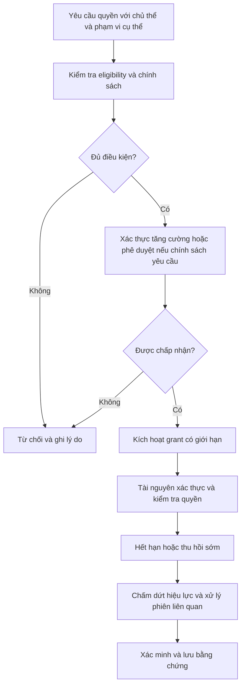

# Just-in-time privilege: cấp đặc quyền đúng lúc cần sử dụng

## 1. Bài toán của đặc quyền thường trực

Một kỹ sư vận hành có thể chỉ cần quyền quản trị production trong khoảng thời gian ngắn để xử lý sự cố. Nếu quyền đó luôn hoạt động, tài khoản bị chiếm vào bất kỳ thời điểm nào cũng có thể trở thành đường truy cập đặc quyền.

**Just-in-time privilege**, thường viết là **JIT privilege**, là cách cấp hoặc kích hoạt quyền khi có nhu cầu hợp lệ, trong một phạm vi và khoảng thời gian được xác định, rồi kết thúc quyền khi nhu cầu hoặc thời hạn không còn.

Ví dụ, Linh trực vận hành hệ thống thanh toán. Tài khoản hằng ngày của Linh được xem các thông tin vận hành cơ bản. Khi cần khởi động lại một dịch vụ production để xử lý sự cố, Linh yêu cầu một quyền tạm thời cho đúng dịch vụ và đúng hành động. Sau cửa sổ được cấp, quyền tạm thời phải không còn được tài nguyên chấp nhận.

JIT giúp giảm thời gian một chủ thể có đặc quyền hoạt động. Nó không tự bảo đảm quyền được cấp là tối thiểu, hành động là an toàn hoặc tài khoản không thể bị lạm dụng trong lúc quyền đang có hiệu lực. Vì vậy, thiết kế phải kết hợp giới hạn thời gian với phạm vi quyền, điều kiện kích hoạt và cơ chế thực thi tại tài nguyên.

## 2. JIT khác gì với quyền tối thiểu và quyền tạm thời?

| Khái niệm | Câu hỏi được giải quyết | Ví dụ |
| --- | --- | --- |
| Least privilege — nguyên tắc ít quyền nhất | Chủ thể cần những hành động và tài nguyên nào? | Chỉ cho khởi động lại dịch vụ A, không cho đọc mọi secret |
| JIT privilege | Khi nào quyền đó được hoạt động và hoạt động trong bao lâu? | Kích hoạt quyền cho một lần xử lý sự cố trong 20 phút |
| Just-enough access — truy cập vừa đủ | Phạm vi thao tác nào đủ cho công việc? | Cung cấp chức năng bảo trì hẹp thay vì shell quản trị toàn máy |
| Credential ngắn hạn | Phương tiện xác thực được sử dụng trong bao lâu? | Token có hạn dùng ngắn |

Một quyền quản trị toàn hệ thống tồn tại trong 20 phút vẫn rất rộng trong 20 phút đó. Một token hết hạn nhanh cũng không tạo ra JIT nếu tài khoản có thể liên tục lấy token mới với quyền quản trị thường trực mà không cần đánh giá nhu cầu kích hoạt.

Ngược lại, một cơ chế JIT có thể sử dụng membership nhóm tạm thời, một grant có thời hạn, một phiên quản trị qua trung gian hoặc credential được cấp riêng cho công việc. Cần đánh giá kết quả cấp và thu hồi quyền, không chỉ tên gọi của giải pháp.

## 3. Tách điều kiện được kích hoạt khỏi quyền đang hoạt động

Trong nhiều mô hình, một người được **đủ điều kiện kích hoạt** một vai trò nhưng chưa có quyền hoạt động của vai trò đó.

- **Eligibility:** chính sách xác định chủ thể có thể yêu cầu hoặc được xem xét kích hoạt quyền nào.
- **Activation hoặc active grant:** quyết định cụ thể cho phép dùng quyền trong một ngữ cảnh và thời hạn.

Ví dụ, Linh thuộc nhóm trực vận hành và có eligibility cho quyền bảo trì dịch vụ thanh toán. Khi chưa kích hoạt, tài khoản không được gọi chức năng bảo trì production. Khi yêu cầu được chấp nhận, hệ thống tạo một grant chỉ áp dụng cho dịch vụ đang xử lý.

Eligibility cũng là dữ liệu nhạy cảm vì nó mở đường để nhận đặc quyền. Nó cần được quản lý theo vòng đời nhân sự, trách nhiệm trực và phạm vi công việc. Một nhân viên đã chuyển đội không nên giữ eligibility vô thời hạn chỉ vì hiện tại chưa có grant nào hoạt động.

Việc gỡ eligibility và việc kết thúc grant đang hoạt động có thể là hai thao tác khác nhau. Hệ thống phải quy định rõ nếu một người mất điều kiện giữa chừng thì quyền đã kích hoạt được xử lý như thế nào.

## 4. Mô tả một quyền JIT đủ rõ

Một yêu cầu như “cho tôi quyền admin trong một lúc” chưa đủ để kiểm tra hoặc thực thi. Cần xác định những thành phần cụ thể.

| Thành phần | Ý nghĩa | Ví dụ khái niệm |
| --- | --- | --- |
| Chủ thể | Ai sẽ sử dụng quyền? | Tài khoản riêng của Linh |
| Vai trò hoặc tập hành động | Được làm gì? | Khởi động lại dịch vụ thông qua chức năng bảo trì đã giới hạn |
| Tài nguyên và môi trường | Quyền áp dụng ở đâu? | Dịch vụ `payment-api`, production |
| Mục đích | Vì sao cần quyền? | Xử lý sự cố `INC-204` |
| Khoảng hiệu lực | Khi nào bắt đầu và kết thúc? | Từ 14:00 đến trước 14:20 theo đồng hồ tin cậy của hệ thống |
| Điều kiện | Cần thỏa điều gì khi cấp và sử dụng? | Eligibility hợp lệ, xác thực tăng cường phù hợp, yêu cầu được chấp nhận |
| Kết thúc quyền | Cơ chế nào ngăn sử dụng sau khi hết hạn hoặc bị thu hồi? | Chính sách tài nguyên kiểm tra grant và trạng thái phiên theo thiết kế |

Mục đích hoặc mã sự cố hỗ trợ giải trình, nhưng không tự chứng minh yêu cầu hợp lệ. Một mã sự cố do người dùng nhập phải được kiểm tra theo quy trình thích hợp nếu hệ thống dùng nó làm điều kiện quyết định.

Tên vai trò cũng chưa đủ để hiểu quyền thực tế. Cần biết nó bao gồm những hành động nào, có quyền kế thừa nào khác và có thể tạo đường truy cập lâu dài hay không.

## 5. Vòng đời của một lần kích hoạt

Một luồng tổng quát có thể gồm các bước sau. Đây là mô hình khái niệm, không phải quy trình bắt buộc giống nhau cho mọi sản phẩm.



### 5.1. Yêu cầu

Yêu cầu phải gắn với principal sẽ sử dụng quyền, vai trò, tài nguyên, môi trường và thời lượng. Hệ thống không nên tin một trường tên người dùng tự khai khi danh tính thực đã được xác thực là người khác.

Nếu một dịch vụ gửi yêu cầu thay mặt người dùng, cần giữ rõ danh tính dịch vụ trung gian và người được đại diện. Điều đó giúp tránh việc bên gọi tùy ý xin quyền cho một chủ thể khác.

### 5.2. Đánh giá và chấp nhận

Chính sách có thể sử dụng eligibility, trách nhiệm trực, trạng thái thiết bị, mức xác thực, loại tài nguyên và rủi ro hành động. Tùy trường hợp, quyết định có thể tự động hoặc cần một người có thẩm quyền xem xét.

Phê duyệt thủ công không phải định nghĩa bắt buộc của JIT. Điều bắt buộc về mặt thiết kế là quyết định cấp phải có cơ sở rõ và được thực thi đúng phạm vi. Với quyền nhạy cảm, tách người yêu cầu khỏi người phê duyệt có thể giúp giảm xung đột trách nhiệm.

### 5.3. Kích hoạt

Sau khi được chấp nhận, hệ thống áp dụng grant hoặc mở phiên theo cơ chế đã chọn. Thời điểm được phê duyệt và thời điểm quyền thực sự hoạt động có thể khác nhau; thiết kế cần nêu rõ thời hạn được tính từ đâu.

Nếu một yêu cầu đã được phê duyệt cho quyền đọc dữ liệu của tài nguyên A, việc thay nội dung yêu cầu sang quyền quản trị tài nguyên B phải làm mất hiệu lực quyết định cũ hoặc buộc đánh giá lại. Phê duyệt phải gắn với nội dung được chấp nhận, không chỉ với một mã yêu cầu chung.

### 5.4. Sử dụng và kết thúc

Tài nguyên vẫn cần kiểm tra danh tính và quyền khi xử lý hành động. Khi grant hết hạn hoặc bị thu hồi sớm, hệ thống phải chấm dứt khả năng sử dụng theo mục tiêu đã đặt và xác minh hiệu lực tại những điểm liên quan.

Chuyển bản ghi điều phối sang trạng thái expired chưa đủ nếu tài nguyên vẫn chấp nhận credential hoặc phiên được tạo trước đó.

## 6. Các cách thực hiện và điều kiện đi kèm

| Cách thực hiện | Cách quyền được kích hoạt | Vấn đề cần kiểm tra |
| --- | --- | --- |
| Membership hoặc role assignment tạm thời | Thêm chủ thể vào nhóm hoặc vai trò rồi gỡ theo hạn | Độ trễ đồng bộ, cache và credential chứa quyền đã chụp tại lúc phát hành |
| Grant có thời hạn tại điểm phân quyền | Tài nguyên hoặc bộ quyết định kiểm tra grant khi xử lý | Đồng hồ, độ sẵn sàng, cache và việc mọi đường truy cập có đi qua kiểm tra không |
| Phiên quản trị qua trung gian | Mở một phiên với phạm vi và thời hạn được kiểm soát | Đường truy cập trực tiếp có thể đi vòng; cách chấm dứt phiên và tiến trình liên quan |
| Credential tạm thời | Cấp credential sau quyết định JIT | Phạm vi, khả năng cấp tiếp, hạn dùng và việc thu hồi trước hạn |

Không có một cách duy nhất phù hợp cho mọi tài nguyên. Một hệ thống có thể kết hợp nhiều cách, chẳng hạn grant có thời hạn ở lớp IAM và một phiên quản trị giới hạn qua trung gian.

Điều quan trọng là xác định điểm thực thi cuối cùng. Nếu người dùng vẫn giữ một khóa quản trị thường trực để truy cập trực tiếp cùng tài nguyên, việc đóng phiên JIT chưa loại bỏ được đường truy cập đó.

## 7. Giới hạn thời gian phải có hiệu lực tại tài nguyên

### 7.1. Dùng thời gian từ nguồn tin cậy

Thời điểm bắt đầu và kết thúc quyền phải được hệ thống thực thi xác định hoặc xác minh. Đồng hồ trình duyệt của người yêu cầu không phải nguồn có thẩm quyền để quyết định grant còn hiệu lực hay không.

Một quy tắc minh họa có thể là:

```text
Quyền chỉ hoạt động nếu:
  grant đã được kích hoạt
  grant chưa bị thu hồi
  thời_gian_bắt_đầu <= thời_gian_hiện_tại < thời_gian_kết_thúc
  principal, hành động và tài nguyên đều khớp grant
  các điều kiện bắt buộc khác vẫn đạt theo chính sách
```

Quy tắc trên chỉ minh họa logic. Hệ thống còn cần xử lý lệch đồng hồ, độ trễ cập nhật và cách thể hiện múi giờ. Người dùng nên nhìn thấy thời hạn dễ hiểu, còn quyết định thực thi phải dùng mốc thời gian được diễn giải nhất quán.

### 7.2. Token có thể giữ dấu vết của quyền cũ

Giả sử grant có hiệu lực từ 14:00 đến 14:20. Một token được phát hành lúc 14:19, có quyền đã được chụp trong token và hạn dùng đến 15:19. Nếu tài nguyên chỉ kiểm tra chữ ký cùng hạn token, không kiểm tra lại grant hoặc trạng thái thu hồi, quyền có thể tiếp tục được chấp nhận sau 14:20.

Trong mô hình đó, cần một thiết kế phù hợp để ràng buộc hiệu lực credential với grant hoặc để tài nguyên đánh giá lại quyền. Không thể kết luận chỉ từ việc role assignment đã được gỡ lúc 14:20.

Ngược lại, một tài nguyên kiểm tra grant hiện tại cho mỗi hành động có thể có hành vi khác. Cần hiểu cơ chế thật, thay vì mặc định mọi token hoặc mọi cơ chế role đều có cùng cách thu hồi.

### 7.3. Phiên đang tồn tại cũng cần chính sách

Một phiên shell, kết nối cơ sở dữ liệu hoặc kênh quản trị có thể đã được thiết lập trong lúc quyền hoạt động. Khi cửa sổ JIT kết thúc, hệ thống phải xác định có đóng phiên, chặn lệnh mới, đánh giá lại quyền hay áp dụng cơ chế khác.

Đóng kết nối không tự bảo đảm mọi công việc đã khởi chạy bị hoàn tác hoặc chấm dứt. Ví dụ, một tác vụ nền do người dùng khởi tạo có thể tiếp tục theo cơ chế của máy đích. Việc quản lý tiến trình hoặc công việc phát sinh cần được xét riêng khi mục tiêu yêu cầu điều đó.

## 8. Ví dụ: quyền bảo trì một dịch vụ production

Linh cần khởi động lại `payment-api` để xử lý sự cố. Giả sử hệ thống có một chức năng bảo trì chuyên biệt, được thiết kế chỉ cho phép khởi động lại dịch vụ đã chọn. Nó không cung cấp quyền sửa mọi cấu hình triển khai hoặc shell quản trị.

Một grant khái niệm có thể được mô tả như sau:

```yaml
subject: human:linh
action: service.restart
resource: production/payment-api
purpose: INC-204
startsAt: '14:00'
endsAt: '14:20'
```

Đây là ví dụ mô tả, không phải cấu hình của một nền tảng cụ thể. Một hệ thống thực tế phải có ngày, múi giờ hoặc mốc thời gian đầy đủ và các định danh được xác minh; những giá trị giờ trên chỉ để dễ theo dõi tình huống.

Kết quả mong đợi:

| Tình huống | Quyết định theo grant minh họa |
| --- | --- |
| Linh yêu cầu khởi động lại `payment-api` lúc 14:05, các điều kiện khác đều đạt | Có thể được cho phép |
| Linh yêu cầu khởi động lại một dịch vụ khác | Bị từ chối vì ngoài phạm vi tài nguyên |
| Linh yêu cầu đọc secret hoặc sửa chính sách IAM | Bị từ chối vì ngoài phạm vi hành động |
| Một người khác sao chép mã grant rồi gọi | Không được coi là Linh chỉ vì biết mã grant |
| Linh gọi sau thời điểm kết thúc | Không được chấp nhận bằng grant này |
| Grant bị thu hồi sớm do phát hiện rủi ro | Bị xử lý theo cơ chế thu hồi đã thiết kế và được xác minh |

Nếu nền tảng chỉ có một quyền sửa cấu hình rất rộng, đổi tên quyền đó thành `service.restart` không làm nó hẹp hơn. Cần một cơ chế thực thi thật sự giới hạn thao tác, hoặc phải thừa nhận phạm vi quyền thực tế khi đánh giá rủi ro.

Sau khi sử dụng, log cần liên hệ được yêu cầu JIT, quyết định cấp, grant, hành động ở tài nguyên và việc kết thúc hiệu lực. Như vậy mới phân biệt được Linh đã được cấp gì với Linh thực sự đã làm gì.

## 9. Xác thực tăng cường và phê duyệt cần gắn đúng yêu cầu

JIT thường đi cùng xác thực tăng cường cho hành động đặc quyền, nhưng xác thực và phân quyền vẫn là hai quyết định riêng. Người dùng xác thực mạnh có thể vẫn không đủ điều kiện nhận một vai trò quản trị cụ thể.

Nếu chính sách yêu cầu xác thực gần thời điểm kích hoạt, hệ thống cần kiểm tra bằng chứng xác thực phù hợp. Một chuỗi do client tự gửi như `mfa=true` không thể thay thế kết quả đã được nguồn tin cậy xác nhận.

Tương tự, người phê duyệt cần biết đang chấp nhận chủ thể nào, hành động nào, tài nguyên nào và thời lượng bao lâu. Nếu họ chỉ thấy một thông báo chung “Approve admin access”, việc đánh giá phạm vi rất dễ thiếu chính xác.

Một số nguyên tắc cần được thực thi theo chính sách là:

- Người phê duyệt có thẩm quyền cho đúng loại tài nguyên và phạm vi.
- Không cho phép sửa nội dung đã được chấp nhận mà vẫn dùng quyết định cũ.
- Quyết định cũ không được phát lại để tạo một grant mới ngoài điều kiện đã cho phép.
- Người dùng không được tự tăng thời lượng hoặc chuyển sang vai trò rộng hơn qua một tham số yêu cầu.

Gia hạn cũng là một quyết định cấp quyền. Làm mới phiên đăng nhập hoặc mở lại trình duyệt không nên tự động bắt đầu lại cửa sổ đặc quyền. Nếu công việc cần thêm thời gian, chính sách phải nêu rõ điều kiện gia hạn và giới hạn tổng thời gian, nếu có.

## 10. Giảm thời gian quyền hoạt động nhưng không để lại quyền lâu dài

Một grant chỉ tồn tại vài phút vẫn có thể được dùng để tạo một đường truy cập lâu dài nếu phạm vi quá rộng. Chẳng hạn, một quyền cho phép tạo khóa mới, sửa chính sách truy cập hoặc tạo một tài khoản quản trị khác có thể để lại tác động sau khi grant ban đầu hết hạn.

Do đó, cần xem xét cả **quyền trực tiếp** và **khả năng tạo quyền hoặc cơ chế truy cập dẫn xuất**. JIT giới hạn thời gian sử dụng grant ban đầu; nó không tự xóa mọi đối tượng hoặc thay đổi được tạo trong khoảng đó.

Khi thiết kế quyền cho một công việc, cần hỏi:

1. Chủ thể có thể ủy quyền tiếp hoặc cấp quyền cho một danh tính khác không?
2. Chủ thể có thể tạo credential dài hạn hoặc lấy một secret khác không?
3. Chủ thể có thể sửa cơ chế kiểm toán hoặc đường thực thi quyền không?
4. Công việc có thể thực hiện bằng một chức năng hẹp hơn không?

Không phải mọi quyền quản trị đều có thể tách nhỏ hoàn toàn. Khi phải cấp quyền rộng để phục vụ công việc thực tế, cần biết phạm vi đó và theo dõi các thay đổi phát sinh, thay vì coi thời hạn ngắn là đủ để loại bỏ mọi tác động lâu dài.

## 11. JIT cho workload và tác vụ tự động

JIT privilege không chỉ áp dụng cho con người. Một pipeline triển khai có thể cần quyền thay đổi một dịch vụ production trong khoảng thời gian thực hiện một lần triển khai, rồi kết thúc quyền khi công việc hoàn tất.

Workload thường không thể chờ nhập MFA cho từng API call. Quyết định cấp có thể dựa trên bằng chứng và chính sách của hệ thống tự động: danh tính pipeline, môi trường thực thi, ngữ cảnh job và phạm vi triển khai đã được chấp nhận.

Các thuộc tính này phải có nguồn tin cậy phù hợp. Nếu pipeline chỉ tự khai `environment=production` hoặc `approved=true`, hệ thống chưa có cơ sở để cấp đặc quyền production. Người có quyền sửa pipeline hoặc giả mạo môi trường chạy cũng có thể ảnh hưởng đường cấp quyền, nên quyền quản trị cơ sở tự động hóa cần được xem xét cùng thiết kế JIT.

Một mô hình hợp lý phải giữ riêng danh tính workload thực thi và dấu vết người hoặc quy trình đã chấp nhận triển khai. Sau khi job kết thúc, việc dừng cấp mới và xử lý credential còn hiệu lực cần được xác định rõ.

## 12. Khi việc cấp hoặc thu hồi gặp lỗi

JIT phụ thuộc vào các thành phần đánh giá, cấp và thực thi quyền. Cần xử lý cả lỗi kích hoạt lẫn lỗi kết thúc quyền.

| Tình huống | Điều cần xác định |
| --- | --- |
| Yêu cầu kích hoạt hết thời gian chờ | Grant có được tạo hay chưa; tránh tạo trùng khi retry |
| Bên cấp đã tạo grant nhưng tài nguyên chưa đồng bộ | Khi nào quyền có hiệu lực và người dùng sẽ nhận thông tin gì |
| Tác vụ gỡ quyền gặp lỗi | Grant còn có thể sử dụng ở đâu; cần phát hiện và xử lý ra sao |
| Tài nguyên dùng cache quyết định cũ | Giới hạn độ trễ và khả năng thu hồi trước hạn |
| Hệ thống phê duyệt không khả dụng | Cách duy trì vận hành theo chính sách, không tự cấp rộng cho mọi yêu cầu |

Một cơ chế hết hạn tại điểm thực thi có thể giảm phụ thuộc vào một tác vụ dọn quyền chạy đúng giờ, nhưng vẫn cần kiểm tra việc triển khai thực tế. Nếu quyền chỉ hết khi một lịch nền xóa membership, lỗi của lịch đó có thể làm cửa sổ đặc quyền kéo dài ngoài dự kiến.

Truy cập khẩn cấp, thường gọi là break-glass, cần một thiết kế riêng với phạm vi, người được sử dụng, bảo vệ credential, ghi nhận và rà soát sau sử dụng. Đây không phải lý do để mọi người giữ một khóa quản trị thường trực ngoài cơ chế JIT mà không được quản lý.

## 13. Kiểm toán và xác minh hiệu quả

Các sự kiện cần liên hệ được với nhau gồm yêu cầu, kết quả kiểm tra điều kiện, xác thực tăng cường nếu có, quyết định chấp nhận, thời điểm kích hoạt, hành động tại tài nguyên, gia hạn và kết thúc hiệu lực.

Một bản ghi khái niệm có thể gồm:

```text
request_id: jit-684
subject: human:linh
resource: production/payment-api
action: service.restart
decision: approved
grant_id: grant-915
policy_version: maintenance-policy-8
activation_result: active
termination_verification: recorded_separately
```

Không cần ghi token, mật khẩu hoặc khóa riêng vào log để đạt khả năng truy vết. Cần giữ những định danh và thông tin quyết định đủ để đối chiếu sự kiện mà không làm lộ credential.

Việc đánh giá cơ chế JIT nên kiểm tra hành vi thực tế, chẳng hạn:

- Trước kích hoạt, chủ thể chưa thực hiện được hành động đặc quyền.
- Trong cửa sổ, chỉ đúng chủ thể và phạm vi đã cấp được chấp nhận.
- Thay đổi nội dung đã phê duyệt hoặc phát lại quyết định không tạo quyền ngoài ý định.
- Sau hết hạn hoặc thu hồi, các đường truy cập liên quan không còn chấp nhận quyền theo mục tiêu thiết kế.
- Credential, phiên và thay đổi dẫn xuất được xử lý theo chính sách đã công bố.

Số lượng yêu cầu được phê duyệt không tự đo được hiệu quả giảm đặc quyền. Những dữ liệu hữu ích hơn gồm thời gian quyền thực sự hoạt động, phạm vi quyền đã cấp, các grant tồn đọng, độ trễ thu hồi, tần suất sử dụng đường khẩn cấp và những lần quyền tạm thời tạo ra quyền lâu dài.

## 14. Những sai lầm cần tránh

| Sai lầm | Vấn đề tạo ra | Hướng xử lý |
| --- | --- | --- |
| Cấp quyền admin rộng trong vài phút rồi coi là ít quyền nhất | Phạm vi tác động vẫn rất lớn trong cửa sổ đó | Kết hợp JIT với quyền vừa đủ cho hành động và tài nguyên |
| Chỉ đặt hạn ở giao diện yêu cầu | Tài nguyên có thể không thực thi hạn đó | Kiểm tra thời gian và trạng thái tại các điểm thực thi phù hợp |
| Token hoặc phiên vượt xa hạn grant | Quyền tiếp tục được chấp nhận sau khi bản ghi đã hết hạn | Ràng buộc hiệu lực hoặc đánh giá lại quyền theo cơ chế thực tế |
| Giữ đường quản trị trực tiếp ngoài JIT | Chủ thể có thể bỏ qua quy trình kích hoạt | Quản lý đầy đủ các đường truy cập đặc quyền |
| Gỡ eligibility rồi mặc định grant hiện tại đã mất | Quyền đang hoạt động có thể chưa bị thu hồi | Xử lý rõ eligibility và grant đang có |
| Cho sửa tài nguyên sau khi được phê duyệt | Quyết định cũ có thể bị dùng cho mục tiêu khác | Gắn quyết định với nội dung yêu cầu và kiểm tra lại khi thay đổi |
| Cho gia hạn vô hạn mà không đánh giá lại | Đặc quyền tạm thời trở thành thường trực trên thực tế | Định nghĩa điều kiện gia hạn và theo dõi thời gian sử dụng |
| Chỉ ghi log cấp quyền, không kiểm tra kết thúc | Không biết quyền đã thực sự mất hiệu lực hay chưa | Giữ bằng chứng thu hồi và hành vi tại tài nguyên |

## 15. Những điểm cần ghi nhớ

JIT privilege giảm đặc quyền thường trực bằng cách gắn quyền hoạt động với nhu cầu, phạm vi và thời hạn cụ thể. Eligibility, quyết định kích hoạt, credential và hiệu lực tại tài nguyên là các lớp cần được phân biệt và liên kết đúng.

Một cơ chế JIT có giá trị khi chủ thể chưa có quyền trước lúc cần, chỉ dùng được quyền phù hợp trong cửa sổ được chấp nhận và không tiếp tục giữ đường truy cập ngoài ý định sau khi cửa sổ kết thúc. Giới hạn thời gian phải đi cùng nguyên tắc ít quyền nhất, quản lý phiên và kiểm toán toàn bộ vòng đời grant.
