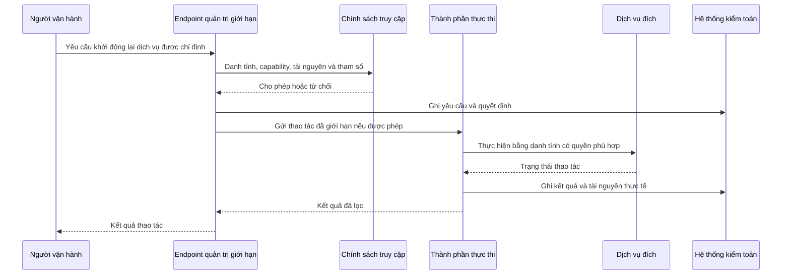

# Just-enough administration

## 1. Quản trị “vừa đủ” là gì?

**Just-enough administration**, viết tắt là **JEA**, là cách giới hạn khả năng quản trị ở đúng những thao tác cần thiết để hoàn thành nhiệm vụ. Người vận hành không nhận một phiên quản trị toàn quyền chỉ vì công việc của họ có một bước cần đặc quyền.

Ví dụ, nhân viên trực vận hành cần khởi động lại một dịch vụ xử lý thanh toán. Nếu được cấp quyền quản trị toàn bộ máy chủ, họ còn có thể đọc secret, thay đổi tài khoản, sửa cấu hình bảo mật hoặc dừng những dịch vụ không liên quan. JEA hướng tới việc chỉ cho phép thao tác “khởi động lại dịch vụ đã chỉ định”, với tài nguyên, tham số và điều kiện được kiểm soát.

JEA là một cách thực hiện nguyên tắc ít quyền nhất trong công việc quản trị. Tên gọi này cũng được dùng trong những cơ chế quản trị cụ thể của sản phẩm; chi tiết cấu hình phụ thuộc nền tảng. Bài học tập trung vào nguyên tắc thiết kế, các ranh giới cần thực thi và cách kiểm tra một luồng quản trị có thực sự “vừa đủ” hay không.

Một mô tả quyền hữu ích không dừng ở “được làm admin”, mà phải trả lời:

- Ai được yêu cầu thao tác?
- Được thực hiện thao tác nào trên tài nguyên nào?
- Những tham số và điều kiện nào được chấp nhận?
- Thao tác chạy bằng danh tính nào và danh tính đó có quyền gì?
- Hệ thống ghi nhận, giám sát và chấm dứt truy cập ra sao?

## 2. Phân biệt JEA, JIT, least privilege và PAM

Các khái niệm này có thể kết hợp nhưng giải quyết những khía cạnh khác nhau.

| Khái niệm | Câu hỏi trọng tâm | Ví dụ |
|---|---|---|
| Least privilege | Chủ thể thực sự cần những quyền nào? | Nhóm vận hành chỉ cần quyền xử lý dịch vụ mình phụ trách |
| JEA | Khi quản trị, được làm chính xác việc gì? | Chỉ xem trạng thái và khởi động lại hai dịch vụ được phép |
| Just-in-time access — JIT | Được sử dụng quyền vào lúc nào, trong bao lâu? | Kích hoạt quyền xử lý sự cố trong 20 phút |
| Privileged access management — PAM | Đặc quyền được quản lý và kiểm soát tổng thể thế nào? | Phê duyệt, cấp quyền, quản lý credential, giám sát và kiểm toán |

JIT có thể giảm khoảng thời gian quyền tồn tại nhưng vẫn cấp một role quá rộng. JEA có thể giới hạn rất chặt thao tác nhưng cho phép sử dụng liên tục. Khi kết hợp, người dùng chỉ được thực hiện một tập thao tác giới hạn trong một khoảng thời gian phù hợp.

Ví dụ, “quản trị toàn bộ máy chủ trong 20 phút” là giới hạn về thời gian, chưa phải giới hạn đầy đủ theo JEA. “Được khởi động lại dịch vụ `payment-worker-a` trong cửa sổ xử lý sự cố” kiểm soát cả thao tác, tài nguyên và thời gian.

MFA xác minh người đang yêu cầu truy cập theo cơ chế đã triển khai. MFA không tự biến một tập quyền rộng thành quyền vừa đủ. Một người xác thực hợp lệ vẫn có thể thao tác nhầm hoặc có yêu cầu vượt phạm vi nhiệm vụ.

## 3. Chuyển công việc quản trị thành capability cụ thể

Một **capability** trong thiết kế này là một khả năng nghiệp vụ hoặc vận hành được giới hạn rõ, chẳng hạn “xem trạng thái dịch vụ” hoặc “khởi động lại một dịch vụ được quản lý”. Nó không nhất thiết là tên một đối tượng IAM cụ thể của sản phẩm.

Thay vì cấp role rộng theo chức danh, hãy bắt đầu từ danh mục công việc thực tế.

| Nhiệm vụ | Capability có thể cấp | Phạm vi cần giới hạn |
|---|---|---|
| Xác định dịch vụ có hoạt động không | Xem trạng thái | Các dịch vụ và máy chủ thuộc nhóm phụ trách |
| Khôi phục một worker bị treo | Khởi động lại dịch vụ | Đúng dịch vụ, đúng môi trường, điều kiện xử lý sự cố |
| Kiểm tra dấu hiệu lỗi ứng dụng | Xem một tập log đã lọc | Nguồn log, khoảng thời gian, dữ liệu nhạy cảm |
| Thay đổi cấu hình triển khai | Áp dụng cấu hình đã phê duyệt | Phiên bản, tài nguyên và người phê duyệt phù hợp |
| Quản lý tài khoản đặc quyền | Thực hiện workflow quản trị IAM riêng | Tập tài khoản, loại thay đổi và kiểm soát tách nhiệm vụ |

Một capability phải được xem xét theo các chiều:

```text
Chủ thể + thao tác + tài nguyên + tham số + điều kiện + kết quả được trả về
```

Giới hạn thao tác mà bỏ qua các chiều còn lại có thể để lại quyền rất rộng. Ví dụ, “được xem file log” vẫn nguy hiểm nếu người dùng tự chọn mọi đường dẫn và có thể đọc file chứa khóa riêng. Tương tự, “được khởi động dịch vụ” không còn hẹp nếu người dùng có thể thay chương trình mà dịch vụ đó sẽ chạy.

## 4. Kiến trúc thực thi JEA

Một mô hình thường gặp là người dùng gửi yêu cầu tới một endpoint quản trị giới hạn. Endpoint kiểm tra quyền và gọi một thành phần thực thi có đặc quyền phù hợp. Người dùng không trực tiếp nhận credential hay một shell toàn quyền của thành phần thực thi.



Sơ đồ mô tả trách nhiệm, không yêu cầu mỗi khối là một dịch vụ độc lập. Một nền tảng có thể cung cấp sẵn endpoint, role, cơ chế thực thi và audit; nền tảng khác cần tích hợp chúng.

Thiết kế phải giữ được ít nhất hai danh tính:

- **Danh tính người yêu cầu**: ai đã khởi tạo thao tác và vì mục đích nào?
- **Danh tính thực thi**: principal nào thực sự tác động tới tài nguyên?

Nếu mọi hành động đều chạy dưới một tài khoản dịch vụ, log chỉ ghi tên tài khoản đó sẽ không đủ để quy trách nhiệm cho người đã yêu cầu. Cần liên kết danh tính người yêu cầu, lần phê duyệt hoặc kích hoạt và kết quả thực thi. Thông tin này phải đến từ security context đáng tin cậy, không chỉ từ một trường `requestedBy` mà client tự điền.

## 5. Giới hạn thao tác và tham số

### 5.1. Cấp thao tác có cấu trúc

Một endpoint như `restartManagedService(serviceId)` dễ giới hạn hơn một endpoint nhận chuỗi lệnh quản trị tùy ý. Nó cho phép hệ thống kiểm tra thao tác, ánh xạ `serviceId` tới tài nguyên đã đăng ký và xử lý tham số theo kiểu dữ liệu rõ ràng.

Không nên coi việc kiểm tra chuỗi lệnh có bắt đầu bằng một từ được phép là đủ. Chuỗi có thể được diễn giải qua shell, có thêm tham số hoặc gọi tới thành phần khác với quyền rộng hơn dự kiến.

Một tập thao tác được phép thường nên được định nghĩa theo allowlist. Mặc định không cho thực hiện thao tác ngoài danh sách, kể cả khi giao diện chưa hiển thị nút tương ứng. Kiểm tra phải nằm ở phía server hoặc điểm thực thi tin cậy, vì người dùng có thể gửi request trực tiếp.

### 5.2. Kiểm tra giá trị tham số và tài nguyên

Ngay cả một thao tác hợp lệ cũng có thể bị lạm dụng qua tham số. Ví dụ, endpoint được phép “xem log” cần kiểm soát nguồn log và khoảng thời gian; không nên cho người dùng tự biến nó thành công cụ đọc mọi file trên máy.

Tài nguyên nên được xác định bằng định danh ổn định và ánh xạ phía server khi có thể. Nếu phải nhận đường dẫn, hệ thống cần xử lý cách diễn giải đường dẫn theo nền tảng, liên kết và phạm vi file thực tế; kiểm tra một tiền tố chuỗi đơn giản có thể không phản ánh đúng đích cuối cùng.

Những tham số như executable, script, plugin, file cấu hình hoặc biến môi trường có khả năng thay đổi chương trình được chạy cần được xem là đầu vào nhạy cảm. Cho phép chúng tùy ý có thể biến một capability hẹp thành quyền thực thi mã rộng.

### 5.3. Kiểm soát dữ liệu đầu ra

Quyền đọc phục vụ quản trị vẫn có thể làm lộ secret hoặc dữ liệu nhạy cảm. Kết quả nên giới hạn vào những gì cần cho nhiệm vụ, chẳng hạn tên dịch vụ, trạng thái và mã kết quả, thay vì trả toàn bộ biến môi trường hoặc nội dung cấu hình.

Nếu endpoint trả log, cần xác định loại dữ liệu được phép xem và cơ chế giảm thiểu thông tin nhạy cảm. Ghi lại hoặc trả về toàn bộ stdout không tự bảo đảm an toàn, vì chương trình được gọi có thể in secret.

## 6. Danh tính thực thi và rủi ro leo thang

Endpoint giới hạn là một thành phần nhạy cảm vì nó có thể thực hiện hành động mà caller không trực tiếp có quyền làm. Quyền của danh tính thực thi cần đủ cho capability, nhưng không nên mặc định là quản trị toàn bộ hạ tầng.

Tùy nền tảng, danh tính này có thể là tài khoản dịch vụ, tài khoản tạm, principal được ủy quyền hoặc ngữ cảnh đặc quyền do hệ thống quản lý. Cơ chế nào cũng cần giải thích được:

- Ai có thể yêu cầu endpoint sử dụng danh tính đó?
- Danh tính có quyền trên những tài nguyên nào?
- Ai có thể thay đổi mã, cấu hình hoặc policy của endpoint?
- Caller có thể lấy credential hoặc sử dụng danh tính ngoài endpoint không?
- Khi quyền bị thu hồi, phiên hoặc tác vụ đang chạy được xử lý thế nào?

Ví dụ, người vận hành được phép khởi động lại dịch vụ nhưng đồng thời có quyền sửa file cấu hình hoặc chương trình của dịch vụ. Khi dịch vụ chạy bằng danh tính mạnh, họ có thể làm thay đổi hành vi được thực thi với đặc quyền. Vì vậy, kiểm tra JEA phải xem cả quyền gián tiếp trên mã và cấu hình, không chỉ danh sách thao tác ở endpoint.

Tương tự, một wrapper đã giới hạn tham số vẫn không đủ nếu caller có thể sửa chính wrapper hoặc thay thế một thư viện mà nó nạp. Cần bảo vệ tính toàn vẹn của mã, cấu hình và các phụ thuộc được sử dụng trong ngữ cảnh đặc quyền.

Người được cấp capability cũng không nên đồng thời có thể tự mở rộng policy của capability đó nếu nhiệm vụ không yêu cầu. Phân tách quyền sử dụng và quyền quản lý endpoint giúp giảm khả năng tự cấp thêm đặc quyền.

## 7. Ví dụ: cho phép khởi động lại Payment Worker

### 7.1. Yêu cầu vận hành

Nhóm trực cần khởi động lại `payment-worker-a` trên một tập máy production đã chỉ định khi xử lý sự cố. Họ cần xem trạng thái trước và sau thao tác, nhưng không cần mở shell, sửa tài khoản, đọc secret hoặc thay chương trình chạy dịch vụ.

Một thiết kế capability ở mức khái niệm:

| Thuộc tính | Giới hạn đề xuất |
|---|---|
| Chủ thể | Thành viên nhóm trực được chỉ định |
| Capability | Xem trạng thái, khởi động lại Payment Worker |
| Tài nguyên | Tập instance của `payment-worker-a` do server quản lý |
| Tham số | Chọn instance hợp lệ và lý do hoặc mã sự cố |
| Điều kiện | Có quyền kích hoạt còn hiệu lực và đáp ứng yêu cầu xác thực |
| Danh tính thực thi | Principal chỉ có quyền cần thiết trên tập dịch vụ đích |
| Kết quả | Trạng thái trước/sau và mã kết quả đã lọc |

Thời gian kích hoạt, nếu được dùng, là lớp JIT bổ sung cho giới hạn JEA. Ví dụ 20 phút là một lựa chọn minh họa cho tình huống này, không phải thời hạn chuẩn áp dụng cho mọi tổ chức.

### 7.2. Mã giả kiểm tra yêu cầu

```text
function restartPaymentWorker(request, securityContext):
    actor = securityContext.authenticatedPrincipal
    require actor có capability "payment-worker.restart"
    require activationOf(actor) còn hiệu lực nếu policy yêu cầu

    target = managedInventory.resolve(request.instanceId)
    require target thuộc phạm vi được cấp cho actor
    require target.serviceId == "payment-worker-a"
    require request.reason đáp ứng quy tắc nghiệp vụ

    operation = buildFixedRestartOperation(target)
    recordDecision(actor, operation, request.reason)

    result = privilegedExecutor.execute(operation)
    recordExecution(actor, executorIdentity, target, result)
    return filterAllowedResultFields(result)
```

Đây là mã giả diễn tả ranh giới kiểm soát, không phải cấu hình hoặc API của sản phẩm. `buildFixedRestartOperation` phải tạo một thao tác đã định nghĩa từ trước, không ghép input của người dùng thành chuỗi shell tùy ý.

Các thuộc tính của tài nguyên dùng để ra quyết định phải được lấy từ nguồn tin cậy. Nếu yêu cầu được xếp hàng trước khi thực thi, cần xử lý khả năng policy, quyền kích hoạt hoặc tài nguyên đã thay đổi trong thời gian chờ. Tùy thiết kế, hệ thống có thể kiểm tra lại tại thời điểm thực thi hoặc ràng buộc chặt phê duyệt vào thao tác và đối tượng cụ thể.

### 7.3. Những request phải bị từ chối

| Request | Kết quả mong đợi | Lý do |
|---|---|---|
| Khởi động lại instance đã được cấp trong thời gian hợp lệ | Cho phép theo policy | Đúng capability và phạm vi |
| Khởi động lại dịch vụ cơ sở dữ liệu không thuộc nhiệm vụ | Từ chối | Tài nguyên ngoài phạm vi |
| Truyền đường dẫn chương trình mới cho dịch vụ | Từ chối | Tham số không nằm trong capability |
| Yêu cầu chạy một script tùy ý | Từ chối | Không có quyền thực thi mã tổng quát |
| Gọi endpoint sau khi kích hoạt đã hết hạn | Từ chối nếu policy yêu cầu kích hoạt | Không đáp ứng điều kiện thời gian |
| Gửi `requestedBy=admin` để giả người yêu cầu | Không dùng giá trị đó làm danh tính | Principal phải lấy từ xác thực |

Một lần restart vẫn có thể ảnh hưởng tính sẵn sàng hoặc làm gián đoạn xử lý. JEA giới hạn khả năng thực hiện hành động nhưng không làm hành động đó hết rủi ro. Có thể cần thêm giới hạn tần suất, quy trình bảo trì hoặc kiểm tra trạng thái hệ thống phù hợp với dịch vụ.

## 8. Kết hợp JEA với phê duyệt và JIT

Một luồng đầy đủ có thể gồm yêu cầu, xác thực, đánh giá policy, phê duyệt khi cần, kích hoạt capability, thực thi và kết thúc.

```text
Yêu cầu công việc cụ thể
    → Xác minh người yêu cầu và điều kiện truy cập
    → Phê duyệt nếu chính sách yêu cầu
    → Kích hoạt capability giới hạn
    → Thực hiện qua endpoint được kiểm soát
    → Hết hạn hoặc thu hồi
    → Xác minh trạng thái truy cập và rà soát sự kiện
```

Phê duyệt phải nói rõ điều gì được phép: capability, tài nguyên, thời gian và các điều kiện liên quan. Một ticket ghi “đã đồng ý xử lý sự cố” không nên mặc nhiên trở thành quyền làm mọi thao tác production.

Không nhất thiết mọi thao tác đọc trạng thái đều cần người phê duyệt trực tiếp. Chính sách có thể cho phép một số capability theo điều kiện tự động, trong khi những thao tác ảnh hưởng lớn cần kiểm soát bổ sung. Tính vừa đủ nằm ở quyền và ràng buộc được thực thi, không nằm ở số lượng bước trên biểu mẫu.

Việc quyền kích hoạt hết hạn không tự đảo ngược thay đổi đã thực hiện. Nó cũng không luôn chấm dứt ngay mọi kết nối hoặc tác vụ đang chạy. Cần thiết kế rõ lúc nào ngừng nhận thao tác mới, cách hủy tác vụ nếu cần và hành vi của credential hoặc phiên đã được cấp.

Không gia hạn quyền vô hạn chỉ vì công việc chưa xong. Yêu cầu gia hạn nên được đánh giá theo trạng thái hiện tại và phạm vi thực sự còn cần.

## 9. Ranh giới thực thi và đường đi thay thế

Một giao diện chỉ hiển thị ba nút không phải là JEA nếu API phía sau vẫn chấp nhận mọi lệnh quản trị. Tương tự, một endpoint được giới hạn không có nhiều ý nghĩa nếu cùng người dùng vẫn giữ một đường truy cập toàn quyền thường trực ngoài quy trình.

Cần xem xét các đường truy cập tới cùng tài nguyên:

- Endpoint quản trị được kiểm soát.
- Shell hoặc phiên quản trị trực tiếp.
- Công cụ triển khai có quyền ghi cấu hình hoặc mã.
- API quản lý danh tính và quyền.
- Credential được lưu sẵn ở máy vận hành hoặc pipeline.

Những đường này không nhất thiết bị loại bỏ hoàn toàn, nhưng phải có mục đích, chủ thể và kiểm soát riêng. Không được mặc định rằng chỉ cần triển khai endpoint JEA là mọi đường đặc quyền khác đã bị hạn chế.

Truy cập khẩn cấp, thường gọi là break-glass, cần một cơ chế riêng phù hợp với sự cố nền tảng và được giám sát, kiểm toán, rà soát sau sử dụng. Nó không nên trở thành fallback tự động cấp toàn quyền mỗi khi endpoint JEA từ chối một yêu cầu thông thường.

Nếu công việc hợp lệ cần một thao tác chưa có, nhóm quản trị nên đánh giá và bổ sung capability phù hợp hoặc sử dụng workflow ngoại lệ đã được kiểm soát. Không giải quyết bằng cách thêm một capability “chạy bất kỳ lệnh nào” rồi coi đó là quyền vừa đủ.

## 10. Kiểm toán và xử lý khi kiểm soát gặp lỗi

Một bản ghi truy cập nên đủ để nối người yêu cầu với hành động thực tế. Những thông tin thường hữu ích gồm:

| Thông tin | Mục đích |
|---|---|
| Danh tính người yêu cầu đã xác thực | Quy trách nhiệm cho actor |
| Capability, tài nguyên và tham số được chấp nhận | Biết chính xác phạm vi thao tác |
| Quyết định policy và tham chiếu phê duyệt hoặc kích hoạt | Giải thích tại sao hành động được phép |
| Danh tính thực thi và phiên bản công cụ liên quan | Xác định ngữ cảnh đặc quyền thực tế |
| Thời điểm yêu cầu, bắt đầu và kết thúc | Đối chiếu điều kiện thời gian và hoạt động |
| Kết quả, lỗi và trạng thái tài nguyên | Phân biệt được phép, đã thử chạy và thực sự thành công |
| Correlation ID hoặc operation ID | Nối sự kiện qua các thành phần |

Một request được phê duyệt chưa chứng minh thao tác đã thành công. Một log “đã gửi lệnh” cũng chưa chứng minh dịch vụ đã trở lại trạng thái mong muốn. Cần ghi kết quả từ điểm thực thi và kiểm tra trạng thái phù hợp với capability.

Không ghi secret, private key hoặc credential vào log quản trị. Tham số, output và bản ghi phiên có thể chứa dữ liệu nhạy cảm nên phải được lọc hoặc bảo vệ theo phạm vi truy cập và thời hạn lưu giữ. Nhật ký cũng cần được bảo vệ khỏi việc sửa hoặc xóa trái phép bởi người đang thực hiện quản trị, phù hợp với mô hình hệ thống.

Nếu hệ thống không thể đánh giá policy, nó không nên mặc định cho thực thi vì caller đã đăng nhập. Với thao tác có yêu cầu kiểm toán bắt buộc, phải xác định trước hành vi khi không ghi được sự kiện: chẳng hạn dùng cơ chế ghi nhận bền vững được thiết kế sẵn hoặc từ chối thao tác. Không âm thầm bỏ kiểm toán để tiếp tục quản trị.

## 11. Cách đánh giá một thiết kế JEA

Một thiết kế cần được kiểm tra cả đường hợp lệ và những yêu cầu ngoài phạm vi. Chỉ chứng minh người vận hành restart được dịch vụ chưa chứng minh họ không thể sử dụng đặc quyền theo cách khác.

| Nội dung đánh giá | Bằng chứng cần tìm |
|---|---|
| Định danh | Người không có quyền không thể gọi capability |
| Tài nguyên | Thay định danh không vượt được sang dịch vụ hoặc môi trường khác |
| Tham số | Không thể biến input thành lệnh hoặc mã tùy ý |
| Quyền gián tiếp | Người dùng không thể sửa mã, cấu hình hoặc policy để mở rộng khả năng |
| Danh tính thực thi | Quyền của executor và đường lấy credential được giới hạn |
| Thời gian | Thao tác mới bị chặn khi điều kiện kích hoạt không còn hiệu lực |
| Kết quả và log | Có thể nối actor với hành động thực, không làm lộ secret |
| Đường truy cập khác | Các lối quản trị trực tiếp hoặc khẩn cấp có kiểm soát riêng |

Không nên chỉ dựa vào tên role như “operator” hoặc “limited admin”. Cần kiểm tra các thao tác hiệu lực, nguồn kế thừa quyền và những tài nguyên có thể bị thay đổi. Một role có tên hẹp nhưng được gán ở phạm vi toàn tổ chức vẫn có thể vượt xa nhu cầu của nhóm trực.

Khi thêm capability mới, cần xem xét lại tác động kết hợp với những capability đã có. Hai quyền riêng lẻ tưởng như hẹp có thể tạo thành một đường leo thang khi dùng cùng nhau, chẳng hạn sửa nội dung được thực thi rồi yêu cầu một tiến trình đặc quyền nạp lại nó.

## 12. Bài tập áp dụng

Một nhóm hỗ trợ production hiện có quyền quản trị toàn bộ máy chủ. Công việc thường ngày của họ chỉ gồm xem trạng thái ứng dụng, xem log lỗi và khởi động lại một worker. Thỉnh thoảng họ cần triển khai phiên bản cấu hình mới theo yêu cầu của nhóm phát triển.

Hãy thiết kế phương án JEA bằng cách:

1. Tách các công việc thành capability có tên, tài nguyên và tham số rõ ràng.
2. Xác định thao tác nào được sử dụng thường xuyên và thao tác nào cần kích hoạt hoặc phê duyệt bổ sung.
3. Chọn danh tính thực thi và các quyền tối thiểu cho từng capability.
4. Giải thích cách ngăn việc sửa cấu hình hoặc mã trở thành đường chạy chương trình tùy ý.
5. Xác định kết quả cần trả cho người hỗ trợ và dữ liệu phải được che giấu.
6. Thiết kế log nối người yêu cầu, quyết định, executor và kết quả.
7. Mô tả cách xử lý công việc ngoài phạm vi và tình huống endpoint quản trị không hoạt động.

Một phương án có thể cung cấp capability đọc trạng thái và log đã giới hạn, capability restart cho đúng worker, cùng workflow triển khai cấu hình riêng gắn với phiên bản đã phê duyệt. Quyền truy cập trực tiếp toàn quyền được quản lý theo mục đích riêng thay vì duy trì làm đường xử lý mặc định cho mọi công việc.

## 13. Các điểm cần ghi nhớ

JEA giới hạn công việc quản trị ở tập thao tác cần thiết, trên đúng tài nguyên, bằng tham số và điều kiện được kiểm soát. Giới hạn phải được thực thi tại điểm tin cậy, đồng thời bảo vệ danh tính executor, mã và cấu hình mà nó sử dụng.

Khi kết hợp với JIT, xác thực phù hợp, phê duyệt theo mức ảnh hưởng và kiểm toán, JEA giúp giảm đặc quyền thường trực và phạm vi ảnh hưởng của thao tác nhầm hoặc tài khoản bị chiếm quyền. Thước đo quan trọng là người được cấp quyền thực sự có thể làm gì, kể cả qua quyền gián tiếp và các đường truy cập thay thế.
