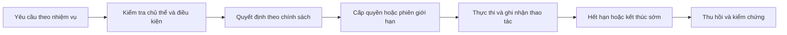

# Privilege elevation: nâng quyền có kiểm soát

## 1. Từ quyền làm việc thường ngày đến quyền cho một nhiệm vụ

**Privilege elevation** là việc chuyển một chủ thể từ mức quyền hiện tại sang một ngữ cảnh có quyền cao hơn để thực hiện nhiệm vụ được cho phép. Trong quản lý truy cập đặc quyền, quá trình này cần xác định rõ ai được nâng quyền, để làm gì, trên tài nguyên nào, trong bao lâu và quyền được kết thúc như thế nào.

Ví dụ, kỹ sư trực vận hành thường chỉ được đọc trạng thái một dịch vụ Java trong production. Khi xử lý sự cố, người đó có thể cần khởi động lại đúng dịch vụ. Thay vì giữ quyền quản trị toàn môi trường cả ngày, kỹ sư yêu cầu một quyền tạm thời cho thao tác khởi động lại trong phạm vi cụ thể.

Nâng quyền không nhất thiết phải là trở thành `root`, quản trị viên hệ thống hoặc administrator của toàn bộ tổ chức. Chuyển từ quyền đọc sang quyền sửa một cấu hình nhạy cảm, đóng vai một principal có quyền mạnh hơn hoặc mở một phiên quản trị đều có thể là nâng quyền.

Chủ thể cũng không chỉ là con người. Pipeline triển khai, job bảo trì hoặc công cụ tự động có thể nhận một tập quyền bổ sung cho một execution. Khi đó cần xác minh danh tính workload, nguồn khởi chạy và phạm vi nhiệm vụ, thay vì áp dụng máy móc mọi bước xác thực tương tác của người dùng.

## 2. Nâng quyền hợp lệ khác với leo thang đặc quyền trái phép

Trong thực tế, “privilege elevation” và “privilege escalation” đôi khi được dùng gần nghĩa. Bài này dùng **nâng quyền** để chỉ một quy trình được ủy quyền và kiểm soát. **Leo thang đặc quyền trái phép** là việc có được quyền vượt ngoài chính sách, chẳng hạn thông qua lỗ hổng hoặc cấu hình sai.

| Khía cạnh | Nâng quyền hợp lệ | Leo thang đặc quyền trái phép |
|---|---|---|
| Cơ sở | Chính sách cho phép và điều kiện đã thỏa mãn | Vượt qua hoặc lợi dụng điểm yếu của kiểm soát |
| Phạm vi | Hành động, tài nguyên, môi trường được xác định | Vượt ngoài phạm vi được phép |
| Thời gian | Có vòng đời và cách kết thúc rõ ràng | Có thể cố duy trì truy cập không được phép |
| Truy vết | Nối được yêu cầu, quyết định, phiên và thao tác | Có thể không có quyết định cấp quyền hợp lệ |

Một giao diện có nút “Activate admin” chưa chứng minh quy trình an toàn. Nếu người dùng tự nâng quyền không đúng điều kiện, chọn phạm vi tùy ý hoặc giữ quyền sau khi hết hạn, cơ chế đó vẫn có thể tạo đường leo thang trái phép.

## 3. Những khái niệm cần tách riêng

### Quyền nền, điều kiện được nâng quyền và quyền đang hoạt động

**Quyền nền** là quyền chủ thể sử dụng trong hoạt động bình thường. **Eligibility** là điều kiện hoặc tư cách để yêu cầu một quyền cao hơn. **Active grant** là quyền đã được cấp và đang có hiệu lực.

Một kỹ sư đủ điều kiện yêu cầu quyền khởi động lại dịch vụ chưa có nghĩa mọi yêu cầu restart của người đó đều phải được chấp nhận ngay. Chính sách có thể còn yêu cầu xác thực bổ sung, phê duyệt, môi trường thiết bị phù hợp hoặc kiểm tra sự cố liên quan.

Eligibility cũng là một khả năng nhạy cảm. Nếu bất kỳ ai được đưa vào nhóm eligible đều tự nhận được quyền rất mạnh mà không có điều kiện khác, việc quản lý nhóm đó trở thành một phần quan trọng của ranh giới đặc quyền.

### Xác thực bổ sung không tự cấp thêm quyền

Step-up authentication, chẳng hạn yêu cầu một bằng chứng xác thực mạnh hơn hoặc gần thời điểm thao tác, giúp xác minh chủ thể theo mức rủi ro. Nó không tự trả lời chủ thể được phép sửa tài nguyên nào.

MFA thành công không thay thế chính sách phân quyền. Tương tự, một ticket được phê duyệt không thay thế việc hệ thống đích kiểm tra quyền của yêu cầu thực tế.

### Just-in-time và just-enough access

**Just-in-time access** giới hạn việc quyền có hiệu lực vào thời điểm cần dùng. **Just-enough access** giới hạn quyền đến mức cần thiết cho nhiệm vụ. Hai yếu tố bổ sung nhau:

- Quyền toàn hệ thống trong thời gian ngắn vẫn có phạm vi thiệt hại lớn.
- Quyền hẹp nhưng tồn tại vô thời hạn vẫn có thể trở thành quyền dư thừa.

Nâng quyền hiệu quả cần xét cả phạm vi, thời gian và ngữ cảnh, không chỉ gắn thời hạn cho một role quản trị rộng.

## 4. Một yêu cầu nâng quyền phải ràng buộc những gì?

| Thành phần | Ví dụ minh họa | Ý nghĩa |
|---|---|---|
| Chủ thể | Kỹ sư có định danh ổn định hoặc principal của pipeline | Quyền chỉ dành cho đúng chủ thể được xét |
| Nhiệm vụ | Khởi động lại dịch vụ khi xử lý sự cố | Giải thích nhu cầu, không chỉ ghi “cần admin” |
| Hành động | Restart một dịch vụ | Giới hạn thao tác thay vì cấp cả nhóm quyền không cần thiết |
| Tài nguyên | Dịch vụ `billing-api` trong môi trường production | Tránh nhầm môi trường hoặc mở rộng sang tài nguyên khác |
| Khoảng hiệu lực | Một cửa sổ sử dụng đã xác định | Giới hạn thời gian được thực hiện quyền |
| Điều kiện | Xác thực phù hợp, thiết bị, nguồn thực thi, quyết định phê duyệt | Ràng buộc ngữ cảnh sử dụng |
| Cơ chế thực thi | Grant tạm, phiên được môi giới hoặc execution được ủy quyền | Xác định nơi thực sự áp dụng giới hạn |
| Cơ chế kết thúc | Gỡ grant, chặn credential, kết thúc phiên theo thiết kế | Tránh quyền tiếp tục tồn tại ngoài cửa sổ |

Các giá trị này phải được kiểm tra phía hệ thống có thẩm quyền. Một client tự gửi `admin=true`, tự khai role hoặc sửa thời điểm hết hạn không tạo ra một quyền hợp lệ.

Nếu người phê duyệt đồng ý restart một dịch vụ trong 20 phút, không được biến quyết định đó thành quyền triển khai tùy ý trên cả cluster. Con số 20 phút ở đây chỉ minh họa cho sự ràng buộc phạm vi và thời gian, không phải thời hạn chuẩn cho mọi nhiệm vụ.

## 5. Quy trình nâng quyền từ yêu cầu đến thu hồi



### Bước 1: Gửi yêu cầu có phạm vi

Yêu cầu chỉ rõ hành động, tài nguyên, môi trường, lý do và thời gian mong muốn. Một mã sự cố hoặc mã thay đổi giúp liên kết bằng chứng, nhưng bản thân chuỗi mã đó không phải quyền truy cập.

Nên ưu tiên các quyền hoặc thao tác đã được thiết kế phù hợp với nhiệm vụ. Nếu người dùng phải chọn một role rất rộng vì không có quyền hẹp tương ứng, đó là vấn đề thiết kế cần được nhận diện.

### Bước 2: Kiểm tra danh tính và điều kiện

Hệ thống xác minh chủ thể, eligibility và các điều kiện phù hợp với rủi ro. Với người dùng, có thể cần xác thực bổ sung. Với workload, có thể cần kiểm tra danh tính runtime, nguồn pipeline, môi trường và tham chiếu đến execution đã được cho phép.

Phải xử lý tình huống quyền nền hoặc tư cách thay đổi giữa lúc gửi yêu cầu và lúc kích hoạt. Một người đủ điều kiện hôm qua có thể đã chuyển nhóm hoặc bị thu hồi quyền hôm nay.

### Bước 3: Đưa ra quyết định theo chính sách

Tùy mức rủi ro, một yêu cầu có thể được chính sách tự động chấp thuận, cần người có thẩm quyền phê duyệt hoặc bị từ chối. Không phải mọi nhiệm vụ đều cần một người duyệt thủ công, nhưng cơ sở cho quyết định phải rõ và có thể kiểm tra.

Đối với nhiệm vụ cần phân tách trách nhiệm, người yêu cầu không được tự phê duyệt chính yêu cầu đó. Quyền sửa policy nâng quyền và quyền quyết định ai được duyệt cũng cần kiểm soát, vì chúng có thể trở thành đường tự cấp đặc quyền.

Nếu thay đổi tài nguyên, hành động hoặc thời gian sau khi đã được duyệt, phải đánh giá lại phần thay đổi. Không tái sử dụng một quyết định cũ cho một nhiệm vụ khác chỉ vì mã ticket không đổi.

### Bước 4: Cấp quyền hoặc tạo phiên có ràng buộc

Hệ thống có thể tạo grant tạm, cấp credential ngắn hạn, mở phiên được môi giới hoặc khởi chạy một tác vụ giới hạn. Dù dùng mô hình nào, kết quả phải gắn với đúng chủ thể, hành động, tài nguyên và thời hạn đã được quyết định.

Không nên chỉ trả một secret quản trị dùng chung rồi trông chờ người dùng tự hạn chế thao tác. Khi credential cho phép nhiều hành động hơn phạm vi đã duyệt, khả năng thực thi giới hạn phải được đánh giá lại.

### Bước 5: Kiểm tra tại nơi thực hiện thao tác

Tài nguyên hoặc thành phần thực thi đáng tin cậy phải kiểm tra quyền của yêu cầu thật. Việc cổng nâng quyền đã đồng ý không có nghĩa mọi lời gọi tiếp theo đều hợp lệ.

Ví dụ, một quyền restart không được chấp nhận cho endpoint sửa policy. Resource ID trong yêu cầu cũng phải khớp phạm vi, thay vì chỉ kiểm tra người dùng có một role “operator” chung.

Cần xét những quyền khác đang tồn tại. Nếu người dùng vẫn có một role quản trị thường trực qua group khác, hết hạn grant tạm không làm họ mất quyền quản trị đó. Muốn giới hạn một khả năng, phải hiểu quyền hiệu lực từ tất cả các đường cấp liên quan.

### Bước 6: Kết thúc khi xong hoặc khi điều kiện không còn đúng

Khi nhiệm vụ hoàn thành, người dùng kết thúc sớm, cửa sổ hết hạn hoặc có tín hiệu cần thu hồi, hệ thống phải thực hiện cơ chế kết thúc đã thiết kế. Không chờ người dùng tự nhớ rời group đặc quyền.

Gia hạn cần được đánh giá theo chính sách. Một chuỗi gia hạn tự động không giới hạn có thể biến quyền tạm thành quyền thường trực trên thực tế.

### Bước 7: Kiểm chứng trạng thái sau thu hồi

Xác minh grant đã bị loại bỏ và chủ thể không còn thực hiện được hành động đó qua đường quyền tạm. Kiểm tra phiên, token và execution còn tồn tại theo đặc điểm của hệ thống, đồng thời đối chiếu các thao tác đã thực hiện.

Kết thúc yêu cầu trong giao diện là một sự kiện quản lý. Nó chưa chứng minh mọi điểm thực thi đều đã áp dụng trạng thái thu hồi.

## 6. Nơi nâng quyền được thực thi quyết định mức kiểm soát

| Mô hình | Cách hoạt động | Điểm cần chú ý |
|---|---|---|
| Grant hoặc thành viên role tạm | Bổ sung quyền cho principal trong một khoảng thời gian | Độ trễ policy, cache, token và các đường quyền khác |
| Đóng vai principal khác | Chủ thể nhận khả năng hành động dưới một danh tính có quyền mạnh hơn | Điều kiện đóng vai, quyền đích và liên kết actor với principal thực thi |
| Phiên quản trị được môi giới | Một thành phần quản lý phiên cung cấp truy cập đến đích | Phạm vi được kiểm soát thực tế, ghi nhận và chấm dứt phiên |
| Tác vụ hoặc lệnh được ủy quyền | Hệ thống thực hiện một hành động giới hạn thay cho người yêu cầu | Kiểm tra tham số, danh sách thao tác và quyền của bộ thực thi |
| Nâng quyền tiến trình cục bộ | Tiến trình chạy dưới ngữ cảnh hệ điều hành mạnh hơn | Tiến trình con, handle đã mở, thao tác tồn tại sau phiên và quyền cục bộ thực tế |

Những mô hình này không tương đương. Một phiên có ghi hình chưa chắc đã chặn được thao tác ngoài phạm vi. Một lệnh có tên hẹp nhưng nhận tham số tùy ý có thể tạo ra khả năng rộng hơn dự kiến.

Đặc biệt, quyền sửa mã nguồn thực thi, cấu hình triển khai hoặc danh tính runtime có thể gián tiếp cho phép hành động với quyền của workload đích. Không chỉ nhìn tên role để kết luận mức đặc quyền; cần xét những khả năng mà quyền đó tạo ra.

## 7. Ví dụ: cho phép restart một dịch vụ Java

Giả sử kỹ sư trực vận hành có quyền xem trạng thái `billing-api` nhưng không được sửa cấu hình production. Trong một sự cố, kỹ sư cần restart đúng dịch vụ này.

Một yêu cầu có thể được mô tả như sau. Đây là mô hình minh họa, không phải schema hay API của một sản phẩm IAM cụ thể:

```yaml
request_id: elevation-example-001
subject: operator-stable-id
reason_reference: incident-example-001
action: restart_service
resource: production/billing-api
requested_duration_minutes: 20
```

Hệ thống không lấy thời hạn và phạm vi client gửi làm quyết định cuối cùng. Nó kiểm tra eligibility, sự cố liên quan và điều kiện xác thực, rồi quyết định phạm vi thực tế được cấp.

Một bộ thực thi giới hạn có thể chỉ cung cấp thao tác restart với định danh dịch vụ được kiểm tra. Nó không cung cấp shell tùy ý, không nhận một chuỗi lệnh do client ghép và không cho sửa cấu hình IAM.

Giả mã dưới đây thể hiện các ràng buộc cần có; đây không phải triển khai hoàn chỉnh của bộ xác thực hoặc bộ đánh giá policy:

```text
trước khi thực hiện restart:
    lấy danh tính caller từ ngữ cảnh xác thực đáng tin cậy
    tra quyết định nâng quyền bằng định danh do server quản lý
    kiểm tra quyết định còn hiệu lực và chưa bị thu hồi
    kiểm tra caller đúng là chủ thể được cấp
    kiểm tra action đúng là restart_service
    kiểm tra resource đúng là production/billing-api
    kiểm tra các điều kiện sử dụng còn được thỏa mãn
    kiểm tra policy hiện hành theo mô hình hệ thống
    ghi nhận quyết định và kết quả thực thi
```

Nếu kỹ sư gửi yêu cầu restart một dịch vụ khác, yêu cầu phải bị từ chối dù cửa sổ nâng quyền chưa hết. Nếu kỹ sư gọi endpoint sửa quyền người dùng, endpoint đó không được chấp nhận chỉ vì cùng một request ID.

Sau khi hoàn thành, quyền tạm được kết thúc. Nếu công cụ thực thi bằng một service account, audit cần nối được kỹ sư yêu cầu với execution và principal máy thực hiện restart; chỉ ghi tên service account sẽ làm mất một phần trách nhiệm.

## 8. Hết hạn quyền không luôn đồng nghĩa hết khả năng truy cập

Một quyền tạm có thể tạo ra nhiều trạng thái tiếp tục tồn tại:

- Token đã cấp chứa claim hoặc phạm vi quyền cũ.
- Phiên quản trị hoặc kết nối dài hạn đã xác thực.
- Tiến trình đang chạy với quyền hệ điều hành cao hơn.
- Tác vụ nền, credential mới hoặc grant khác được tạo trong cửa sổ đặc quyền.
- Cache của thành phần phân quyền chưa cập nhật việc thu hồi.

Do đó cần tách **thời hạn grant**, **thời hạn credential**, **thời hạn phiên** và **vòng đời tác động của thao tác**.

Nếu token tự chứa còn được tài nguyên chấp nhận dựa trên chữ ký và thời hạn, việc bỏ chủ thể khỏi group chưa chắc làm token đó mất quyền ngay. Có thể cần kiểm tra trạng thái quyền hiện hành, cơ chế thu hồi hoặc thiết kế thời hạn token và phiên phù hợp với cửa sổ cho phép.

Nếu muốn quyền chỉ dùng được đến một thời điểm xác định, phải xét cả credential được cấp gần cuối cửa sổ. Không nên cấp một token sống lâu hơn cửa sổ rồi mặc định rằng nhãn hết hạn trong cổng quản lý sẽ chặn mọi yêu cầu tiếp theo.

Ở lớp hệ điều hành, bỏ quyền được phép nâng quyền không tự làm một tiến trình đã chạy với đặc quyền cao trở về quyền thấp. Cần quản lý phiên, tiến trình và những tác vụ tồn tại sau đó theo cơ chế thực tế. Tương tự, đóng một phiên không tự đảo ngược dữ liệu đã sửa hoặc credential đã tạo.

Quyền tạo tài khoản, phát hành credential dài hạn hoặc sửa policy đặc biệt nhạy cảm vì có thể tạo đường truy cập tồn tại sau khi grant tạm hết hạn. Nếu nhiệm vụ không cần những khả năng này, nên loại chúng khỏi phạm vi; nếu có cần, phải đưa trạng thái sinh ra vào kiểm chứng kết thúc.

## 9. Xử lý lỗi, mất kết nối và trường hợp khẩn cấp

Nếu hệ thống không thể xác minh một điều kiện bắt buộc cho yêu cầu nâng quyền mới, không nên tự coi điều kiện đó đã đạt. Cách xử lý cần được định nghĩa trong chính sách, bao gồm trạng thái yêu cầu đang chờ và các phiên đã hoạt động.

Ví dụ, timeout khi gọi bộ phê duyệt không phải bằng chứng yêu cầu đã được duyệt. Retry cũng không được tạo nhiều grant chồng nhau hoặc kéo dài cửa sổ ngoài quyết định ban đầu. Cần định danh yêu cầu, trạng thái và thao tác cấp quyền có thể đối chiếu để xử lý các lỗi một phần.

Hệ thống thu hồi có thể gặp lỗi: grant đã hết hạn trong cổng quản lý nhưng chưa gỡ được tại đích. Trường hợp này cần cảnh báo, trạng thái chưa hoàn tất và biện pháp chặn phù hợp; không ghi “đã thu hồi” chỉ vì tác vụ cleanup đã được đưa vào hàng đợi.

Break-glass là một quy trình khẩn cấp được chuẩn bị riêng khi đường bình thường không hoạt động. Nó cần điều kiện kích hoạt, phạm vi, người chịu trách nhiệm và audit tương ứng. Không tự chuyển mọi lỗi của quy trình nâng quyền thành một đường bỏ qua phê duyệt hoặc dùng tài khoản toàn quyền.

## 10. Audit và kiểm chứng quy trình

Audit phải cho phép nối từ lý do cấp quyền đến hoạt động thực tế, rồi đến bằng chứng thu hồi.

| Bằng chứng | Câu hỏi cần trả lời |
|---|---|
| Chủ thể, request ID và lý do | Ai cần quyền và cho nhiệm vụ nào? |
| Điều kiện và quyết định | Vì sao hệ thống cho phép, từ chối hoặc yêu cầu bổ sung? |
| Người phê duyệt khi áp dụng | Ai chịu trách nhiệm cho quyết định cần duyệt? |
| Quyền, tài nguyên và thời gian thực tế được cấp | Kết quả có khớp phạm vi đã quyết định không? |
| Principal thực thi, phiên hoặc execution ID | Hành động diễn ra dưới danh tính nào? |
| Hành động và kết quả tại đích | Quyền đã được dùng để làm gì? |
| Thu hồi và kiểm chứng sau đó | Khả năng truy cập có thực sự kết thúc theo thiết kế không? |

Không ghi mật khẩu, access token hoặc khóa riêng vào audit. Có thể dùng credential ID, principal ID và tham chiếu sự kiện để đối chiếu mà không giữ bí mật.

Một đợt kiểm thử có kiểm soát nên kiểm tra cả hành vi được phép và bị cấm: thiếu điều kiện thì không kích hoạt; sai tài nguyên thì bị từ chối; hết hạn thì không thực hiện được thao tác qua grant tạm; gia hạn phải tuân thủ policy; phiên cũ và lỗi cleanup được xử lý đúng.

Nên theo dõi những dấu hiệu như yêu cầu tự phê duyệt không hợp lệ, nhiều lần gia hạn liên tiếp, cấp quyền quá rộng so với nhiệm vụ, hoạt động ngoài cửa sổ và thu hồi thất bại. Việc không thấy log truy cập sau hết hạn chỉ có ý nghĩa khi biết nguồn log bao phủ các đường truy cập cần kiểm tra.

## 11. Những thiết kế thường làm mất ý nghĩa của nâng quyền

| Thiết kế sai | Hậu quả | Hướng điều chỉnh |
|---|---|---|
| Có quyền admin thường trực rồi thêm một nút nâng quyền | Nút không giới hạn được quyền hiệu lực đang có | Kiểm kê và thu hẹp các đường đặc quyền thường trực |
| MFA thành công là cho mọi quyền | Nhầm xác thực với phân quyền | Đánh giá hành động, tài nguyên và điều kiện riêng |
| Phê duyệt bằng ticket nhưng tài nguyên không kiểm tra | Quy trình chỉ tồn tại trên giấy | Ràng buộc quyết định vào cơ chế thực thi đáng tin cậy |
| Role hẹp theo tên nhưng cho sửa code hoặc IAM | Tạo khả năng mạnh hơn phạm vi dự kiến | Đánh giá quyền gián tiếp và tác động sau thao tác |
| Hết hạn grant nhưng bỏ qua token, phiên và tiến trình | Đặc quyền có thể tiếp tục được sử dụng | Thiết kế kết thúc cho từng lớp trạng thái |
| Gia hạn tự động không giới hạn | Quyền tạm trở thành thường trực | Đánh giá lại nhu cầu, điều kiện và tổng thời gian |
| Chỉ ghi principal dùng chung ở đích | Khó xác định người yêu cầu và execution | Liên kết actor, quyết định, phiên và hành động |
| Lỗi policy thì tự dùng tài khoản khẩn cấp | Tạo đường nâng quyền không kiểm soát | Giữ quy trình khẩn cấp riêng với điều kiện rõ ràng |

Privilege elevation giúp giảm thời gian và phạm vi đặc quyền chỉ khi quyền được ràng buộc vào nhiệm vụ, thực thi ở đúng nơi và kết thúc có kiểm chứng. Yêu cầu, xác thực, phê duyệt, grant và phiên là những thành phần khác nhau; quản lý được mối liên hệ giữa chúng mới biến nâng quyền thành một kiểm soát IAM có tác dụng.
