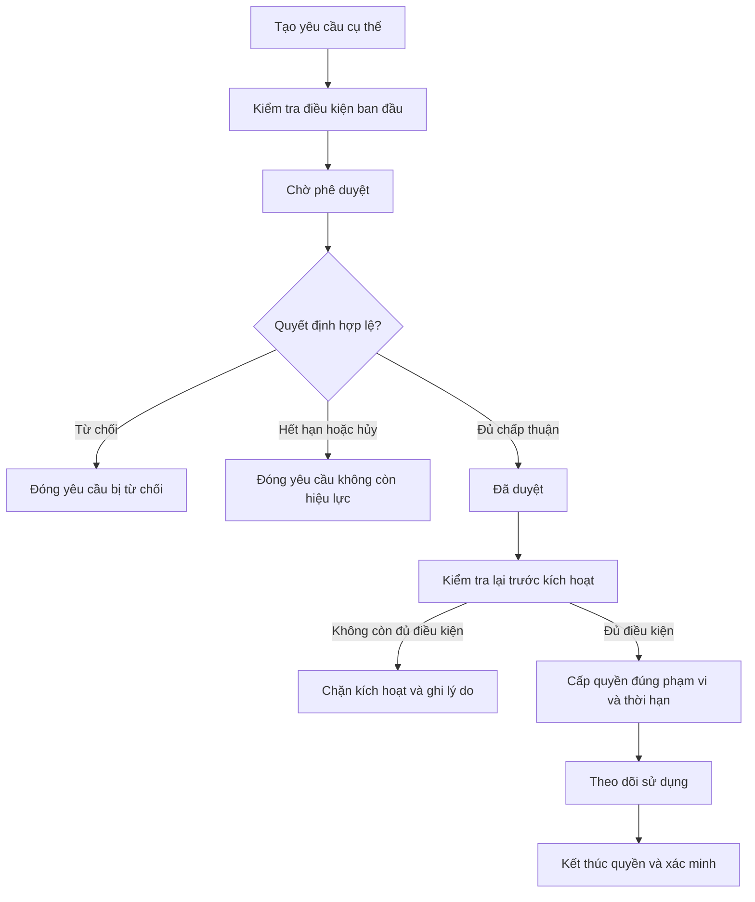

# Approval trước elevation: phê duyệt trước khi nâng quyền

Một kỹ sư trực có thể đủ điều kiện quản trị production khi có sự cố, nhưng không cần giữ quyền đó cả ngày. Trước khi quyền được kích hoạt, tổ chức có thể yêu cầu một người có thẩm quyền xem xét nhu cầu và chấp thuận phạm vi truy cập.

**Approval trước elevation** là bước phê duyệt được thực hiện trước khi một danh tính được nâng lên mức quyền cao hơn hoặc kích hoạt một vai trò đặc quyền. Bước này tạo cơ hội kiểm tra độc lập lý do, tài nguyên, hành động và thời gian cần quyền.

Approval có ý nghĩa bảo vệ khi quyết định phê duyệt được gắn với một yêu cầu cụ thể và được hệ thống thực thi. Một tin nhắn “đồng ý” không giới hạn được quyền nếu người yêu cầu vẫn có thể tự cấp một role rộng hơn bằng đường khác.

## 1. Phân biệt đủ điều kiện, được duyệt và đang có quyền

Ba trạng thái này cần được hiểu riêng:

| Khái niệm | Ý nghĩa | Không được suy luận |
| --- | --- | --- |
| Eligible — đủ điều kiện | Danh tính được phép yêu cầu kích hoạt một quyền theo chính sách | Đã có thể sử dụng quyền đó ngay |
| Approved — đã được duyệt | Một yêu cầu cụ thể đã nhận đủ quyết định chấp thuận hợp lệ | Mọi điều kiện kỹ thuật để kích hoạt vẫn đang thỏa mãn |
| Active — đang có hiệu lực | Quyền đã được cấp hoặc kích hoạt trên hệ thống đích trong phạm vi xác định | Quyền tồn tại vĩnh viễn hoặc cho phép mọi thao tác |

Một hệ thống có thể tự kích hoạt ngay sau khi nhận đủ approval; hệ thống khác yêu cầu thêm một bước kích hoạt. Dù giao diện thể hiện thế nào, vẫn phải phân biệt quyết định phê duyệt với việc quyền thực sự có hiệu lực tại tài nguyên.

Approval cũng khác MFA. MFA giúp xác thực người đang thực hiện bước đăng nhập hoặc nâng quyền theo cơ chế được triển khai. Approval trả lời câu hỏi một yêu cầu có được người có thẩm quyền chấp thuận hay không. Hai kiểm soát này có thể cùng cần thiết, nhưng không thay thế nhau.

## 2. Người duyệt đang phê duyệt chính xác điều gì?

Một yêu cầu nâng quyền cần đủ thông tin để người duyệt đánh giá tác động, đồng thời đủ rõ để hệ thống giới hạn quyền theo quyết định đó.

| Thông tin | Vì sao cần? |
| --- | --- |
| Request ID | Phân biệt các yêu cầu và liên kết quyết định với đúng yêu cầu |
| Danh tính người yêu cầu hoặc người được nâng quyền | Ngăn việc duyệt cho một người nhưng cấp cho người khác |
| Role hoặc tập hành động | Cho biết khả năng kỹ thuật sẽ được cấp |
| Phạm vi tài nguyên và môi trường | Phân biệt một dịch vụ staging với toàn bộ production |
| Thời điểm được kích hoạt và thời lượng | Giới hạn lúc nào và bao lâu đặc quyền được sử dụng |
| Lý do và tham chiếu công việc | Cung cấp ngữ cảnh nghiệp vụ, thay đổi hoặc sự cố |
| Điều kiện bổ sung | Chẳng hạn xác thực bổ sung, thiết bị phù hợp hoặc cửa sổ bảo trì |
| Chính sách áp dụng | Xác định người có quyền duyệt và các giới hạn liên quan |

Ví dụ, yêu cầu “cần quyền admin để xử lý lỗi” chưa đủ rõ. Một yêu cầu tốt hơn có thể là: kỹ sư trực cần quyền khởi động lại `order-api` trong production trong tối đa 20 phút, để xử lý sự cố được tham chiếu, không bao gồm sửa IAM policy hoặc đọc secret của dịch vụ khác.

Hệ thống cần dùng định danh ổn định của người, role và tài nguyên. Tên hiển thị có thể trùng nhau hoặc thay đổi; chỉ hiển thị một tên dễ đọc mà không xác định được đối tượng thật có thể dẫn đến duyệt sai đích.

### Thay nội dung yêu cầu sau khi duyệt

Không được dùng approval cho quyền hẹp để cấp quyền rộng hơn. Nếu thay người nhận, tăng scope, đổi role hoặc tăng thời lượng, phải đánh giá lại theo chính sách; thông thường cần một phiên bản yêu cầu mới hoặc approval mới cho thay đổi đó.

Những thông tin mà người duyệt đã xem cần được lưu thành bằng chứng có thể đối chiếu. Nếu định nghĩa role thay đổi làm tăng quyền trong khi yêu cầu đang chờ, hệ thống cần có cách phát hiện và xử lý thay đổi ảnh hưởng đến quyết định, thay vì chỉ giữ nguyên một tên role.

### Ticket chỉ là một phần ngữ cảnh

Nhập một mã ticket không chứng minh ticket tồn tại, thuộc đúng người hoặc đã cho phép đúng thao tác. Nếu quy trình dựa vào trạng thái ticket, cần có bước đối chiếu đáng tin cậy. Chẳng hạn, tài liệu cấu hình PIM cho Azure resource roles nêu field ticket là thông tin tham khảo và không tự thực thi việc liên kết với hệ thống ticket. [Nguồn: Configure Azure resource role settings in PIM](https://learn.microsoft.com/en-us/entra/id-governance/privileged-identity-management/pim-resource-roles-configure-role-settings).

## 3. Ai được duyệt và mức độc lập cần có?

Người duyệt phải có thẩm quyền cho phạm vi yêu cầu và đủ ngữ cảnh để ra quyết định. Đó có thể là chủ dịch vụ, đầu mối vận hành hoặc người trực được phân công theo chính sách. Không nhất thiết mọi approver đều phải có chính role mà họ được phép phê duyệt.

Cần phân biệt các quyền sau:

- Quyền yêu cầu nâng quyền.
- Quyền duyệt một yêu cầu trong phạm vi nhất định.
- Quyền thực hiện cấp phát kỹ thuật.
- Quyền thay cấu hình role, approver hoặc chính sách approval.

Một người có thể giữ nhiều vai trò nếu mô hình rủi ro cho phép, nhưng những tổ hợp có khả năng làm vô hiệu kiểm soát cần được xem xét. Ví dụ, người yêu cầu có thể tự sửa danh sách approver rồi tự duyệt sẽ làm mất sự độc lập dự kiến.

### Không tự phê duyệt yêu cầu của mình

Quy tắc phân tách trách nhiệm thường yêu cầu người duyệt khác người được nâng quyền. Cần xét cả tài khoản phụ của cùng một người nếu tổ chức dùng nhiều danh tính cho một cá nhân; khác chuỗi username chưa chắc là độc lập về trách nhiệm.

Microsoft Entra PIM là một ví dụ cụ thể: hệ thống cho cấu hình approver theo người dùng hoặc nhóm và không cho approver tự duyệt yêu cầu kích hoạt role của chính mình. Tài liệu cũng mô tả yêu cầu được giải quyết bởi approver đầu tiên quyết định; vì vậy, chọn nhiều approver trong một danh sách không mặc nhiên có nghĩa là cần nhiều phiếu chấp thuận. [Nguồn: Approve or deny requests for Microsoft Entra roles in PIM](https://learn.microsoft.com/en-us/entra/id-governance/privileged-identity-management/pim-approval-workflow).

Nếu tổ chức yêu cầu hai người duyệt độc lập hoặc nhiều cấp duyệt, phải xác nhận nền tảng hỗ trợ và thực thi đúng mô hình đó. Không suy ra cơ chế đồng thuận chỉ từ việc giao diện cho chọn nhiều tên.

### Nhóm approver cũng có vòng đời

Nhóm bị xóa, thành viên đã nghỉ việc hoặc không có người trực có thể làm yêu cầu bị treo. Cần review thành viên, quyền được duyệt và đường escalation. Người có thể sửa nhóm approver cũng cần được quản lý phù hợp, vì họ có thể ảnh hưởng trực tiếp đến quyết định cấp quyền.

## 4. Luồng phê duyệt trước khi nâng quyền

Sơ đồ sau mô tả một mô hình khái niệm, không phải tên trạng thái bắt buộc của một sản phẩm:



### Khi gửi yêu cầu

Hệ thống xác thực người gửi, kiểm tra quyền được yêu cầu, giới hạn scope và thời lượng theo chính sách. Một người không đủ điều kiện không nên có thể vượt qua điều kiện đó chỉ bằng cách có một approver bấm duyệt.

### Khi ra quyết định

Người duyệt xem đúng yêu cầu đang chờ, kiểm tra nhu cầu, chọn duyệt hoặc từ chối và ghi lý do phù hợp. Hệ thống kiểm tra thẩm quyền approver ở thời điểm quyết định, không chỉ tin rằng người đó từng có mặt trong danh sách khi yêu cầu được tạo.

Thông báo email hoặc chat có thể giúp định tuyến công việc. Quyết định cần được xác thực qua cơ chế được kiểm soát và liên kết với Request ID; một phản hồi rời rạc thiếu xác thực không nên trở thành nguồn cấp quyền.

### Khi kích hoạt

Hệ thống kiểm tra yêu cầu còn hiệu lực và đủ các điều kiện hiện tại, rồi tạo quyền có phạm vi và thời hạn không vượt quá phần đã duyệt. Chỉ báo active khi có bằng chứng cấp phát tương ứng; gửi thông báo “đã duyệt” không chứng minh tài nguyên đích đã áp dụng quyền.

## 5. Kiểm tra lại để tránh dùng quyết định đã lỗi thời

Giữa lúc tạo yêu cầu, lúc duyệt và lúc cấp quyền, hệ thống có thể thay đổi. Đây là vấn đề kiểm tra ở một thời điểm nhưng sử dụng kết quả ở thời điểm khác, thường được gọi là time-of-check/time-of-use.

Ví dụ:

- Người yêu cầu đã rời ca trực hoặc bị đình chỉ tài khoản.
- Quyền eligible đã bị thu hồi do thay nhiệm vụ.
- Tài nguyên đã chuyển từ staging sang phạm vi production khác.
- Role được duyệt đã bị mở rộng thêm những hành động nhạy cảm.
- Yêu cầu đã bị hủy hoặc một quyết định cuối cùng khác đã được ghi nhận.
- Các điều kiện xác thực, thiết bị hoặc rủi ro cần thiết không còn đạt.

Approval không nên đóng băng toàn bộ các kiểm tra còn lại. Trước khi cấp quyền, cần đánh giá lại những điều kiện mà chính sách yêu cầu còn đúng ở thời điểm sử dụng. Không phải nền tảng nào cũng có cùng dữ liệu hoặc hành vi; thiết kế phải xác định rõ kiểm tra nào nằm ở đâu.

Nếu thay đổi khiến yêu cầu không còn hợp lệ, hệ thống chặn kích hoạt và giải thích lý do. Lịch sử vẫn có thể ghi rằng yêu cầu từng được duyệt; điều đó không mâu thuẫn với việc hiện tại không được cấp quyền.

### Hai approver cùng thao tác

Quy tắc quyết định phải rõ ràng: quyết định đầu tiên thắng, cần đủ số phiếu, hay cần các cấp tuần tự. Hệ thống phải xử lý đồng thời theo quy tắc đó, tránh một yêu cầu vừa bị từ chối vừa được cấp quyền vì hai thao tác chạy đua.

Gửi lại một thao tác do lỗi mạng cũng không được tạo nhiều grant hoặc kéo dài thời hạn ngoài quyết định. Cần cơ chế idempotency và liên kết yêu cầu với lần cấp quyền thực tế.

## 6. Phân biệt ba mốc thời gian

Quy trình approval thường liên quan ít nhất ba khoảng thời gian khác nhau:

| Khoảng thời gian | Điều nó giới hạn |
| --- | --- |
| Thời hạn chờ và sử dụng quyết định phê duyệt | Yêu cầu hoặc approval còn có thể được xử lý, sử dụng đến lúc nào |
| Thời hạn quyền được kích hoạt | Đặc quyền được cấp cho nhiệm vụ tồn tại đến lúc nào |
| Thời hạn token, phiên hoặc kết nối | Bằng chứng hoặc trạng thái truy cập đã tạo còn được chấp nhận bao lâu |

Một lịch minh họa có thể là:

```text
09:00  Tạo yêu cầu; phải hoàn thành kích hoạt trước 09:10
09:05  Nhận đủ approval
09:06  Kích hoạt; quyền có hiệu lực tối đa đến 09:26
09:10  Yêu cầu chưa được kích hoạt thì không còn dùng được
09:26  Kết thúc grant theo chính sách; xử lý token và phiên liên quan
```

Các con số này chỉ để minh họa cách phân biệt thời gian, không phải mặc định của một sản phẩm. Quy trình phải định nghĩa rõ quyền bắt đầu tính thời lượng từ lúc nào và không được vượt cửa sổ đã được phép.

Một approval cũ không nên trở thành vé nâng quyền không giới hạn cho mọi lần sau. Tái sử dụng hoặc gia hạn phải có quy tắc rõ và được hệ thống thực thi. Hết thời hạn grant cũng không mặc nhiên chấm dứt tức thì mọi phiên hoặc token đã cấp; cần biết cơ chế thu hồi và độ trễ của hệ thống đích.

## 7. Người duyệt cần kiểm tra gì?

Một quyết định có chất lượng cần dựa vào nội dung cụ thể, không chỉ mức độ khẩn cấp được người yêu cầu mô tả.

| Câu hỏi | Ví dụ cần làm rõ |
| --- | --- |
| Đúng người và đúng nhiệm vụ không? | Người yêu cầu có trong nhóm xử lý sự cố hoặc thay đổi này không? |
| Đúng tài nguyên không? | Cần quyền cho một dịch vụ hay đang yêu cầu cả subscription hoặc toàn cụm? |
| Đúng hành động không? | Nhu cầu chỉ restart nhưng role cho cả sửa IAM và đọc secret? |
| Thời lượng có hợp lý không? | Công việc ngắn nhưng yêu cầu quyền suốt ngày? |
| Có xung đột trách nhiệm không? | Người đó vừa yêu cầu vừa duyệt hoặc có thể tự bỏ điều kiện phê duyệt? |
| Điều kiện vận hành có sẵn không? | Có kế hoạch thay đổi, đường truy cập phù hợp và người phối hợp cần thiết không? |

Nếu phạm vi quá rộng, người duyệt không nên chỉ ghi vào comment “chỉ được dùng một phần” rồi duyệt role rộng. Cần thu hẹp bằng cơ chế được thực thi hoặc yêu cầu gửi lại với role, scope và thời lượng phù hợp. Nếu công cụ hỗ trợ sửa yêu cầu trong lúc duyệt, thay đổi phải được thể hiện rõ trong bằng chứng và kết quả cấp phát.

Không có người duyệt nào có thể bảo đảm tuyệt đối rằng mọi thao tác sau đó đều đúng. Approval bổ sung một quyết định trước hành động; giám sát, audit, giới hạn quyền và ứng cứu vẫn cần hoạt động sau khi kích hoạt.

## 8. Bảo vệ đường phê duyệt và tránh đi vòng

### 8.1. Bảo vệ danh tính approver

Tài khoản approver cần cơ chế xác thực và môi trường sử dụng phù hợp với mức rủi ro. Một approver bị chiếm có thể chấp thuận yêu cầu không hợp lệ. Cần biết ai có thể thay danh sách approver, đổi điều kiện duyệt hoặc làm mất dấu quyết định.

Giao diện duyệt nên thể hiện rõ người nhận quyền, scope, thời lượng và tác động. Tránh một thông báo chỉ có nút “Approve” nhưng thiếu ngữ cảnh khiến người duyệt không biết mình đang chấp thuận điều gì.

### 8.2. Bảo vệ các đường cấp quyền khác

Một cổng yêu cầu có approval không đủ nếu cùng người dùng còn có quyền trực tiếp gán role, thêm mình vào nhóm đặc quyền hoặc sử dụng credential quản trị thường trực. Phải kiểm kê các đường có thể dẫn đến cùng quyền.

Các tích hợp tự động cũng cần giới hạn quyền. Thành phần cấp phát thay mặt hệ thống có thể rất mạnh; nếu có thể bỏ qua ràng buộc request và cấp quyền tùy ý, nó là một phần quan trọng của ranh giới bảo mật.

### 8.3. Không biến timeout thành đồng ý

Khi approver vắng mặt, cần có đầu mối dự phòng, lịch trực, escalation và trạng thái chờ rõ ràng. Tự chấp thuận chỉ vì đã chờ lâu làm mất mục đích của bước kiểm tra độc lập, trừ khi có một chính sách tự động riêng được thiết kế và kiểm soát rõ cho trường hợp đó.

Nếu yêu cầu hết hạn, không được lặng lẽ cấp quyền khi một thông điệp approval đến muộn. Người yêu cầu cần một yêu cầu còn hợp lệ theo quy trình.

## 9. Trường hợp khẩn cấp và break-glass

Một quy trình approval có thể không sử dụng được trong sự cố làm hỏng chính hệ thống danh tính hoặc kênh phê duyệt. Cần chuẩn bị đường truy cập khẩn cấp phù hợp trước khi xảy ra sự cố.

Break-glass không phải cách người dùng tự gắn nhãn “khẩn cấp” để bỏ mọi kiểm soát. Quy trình cần xác định ai được dùng, điều kiện kích hoạt, phạm vi, thời gian, nơi nhận cảnh báo và cách review sau sự kiện. Cơ chế phải xét cả khả năng hoạt động khi một số phụ thuộc bị gián đoạn.

Khi đường bình thường hoạt động trở lại, cần chấm dứt quyền khẩn cấp, xử lý credential hoặc phiên liên quan và đối chiếu các hành động đã thực hiện. Việc review sau sự kiện không được mô tả nhầm thành approval đã tồn tại trước elevation.

## 10. Bằng chứng cần lưu và cách theo dõi

Audit nên cho phép nối được chuỗi yêu cầu, quyết định, cấp quyền và sử dụng. Một bộ thông tin minh họa gồm:

```text
requestId
requesterId và subjectId được nâng quyền
roleId, scopeId và phiên bản nội dung được duyệt khi cần
lý do hoặc tham chiếu công việc
thời điểm tạo, quyết định và hết hiệu lực
approverId, quyết định và lý do quyết định
chính sách hoặc điều kiện đã được đánh giá
grantId, thời điểm kích hoạt và thời điểm kết thúc
kết quả cấp phát, lỗi hoặc hành động thu hồi
```

Không ghi password, private key hoặc bearer token vào bằng chứng. Lý do và ticket có thể chứa thông tin nhạy cảm, nên cũng cần được thu thập và phân quyền truy cập thích hợp.

Một số tín hiệu vận hành có ích là thời gian chờ theo mức độ yêu cầu, tỷ lệ hết hạn, số lần kích hoạt thất bại sau approval và các yêu cầu phạm vi rộng bất thường. Nhiều yêu cầu hết hạn có thể chỉ ra thiếu người trực; nhiều lần duyệt quá nhanh mà không đọc nội dung có thể làm giảm chất lượng kiểm soát.

Không tối ưu duy nhất tốc độ duyệt. Cần cân bằng khả năng xử lý công việc với độ chính xác của quyết định và việc cấp đúng phần quyền đã chấp thuận.

## 11. Ví dụ: phê duyệt đúng nhưng chưa được phép nâng quyền

Kỹ sư Lan gửi yêu cầu `REQ-EXAMPLE-042` để restart một dịch vụ production trong tối đa 20 phút. Người duyệt có thẩm quyền chấp thuận lúc 09:05. Trước khi kích hoạt, tài khoản Lan bị tạm khóa do một cảnh báo đã được xác minh theo quy trình của tổ chức.

Hệ thống không nên bỏ qua trạng thái hiện tại chỉ vì đã có approval. Nó chặn kích hoạt, lưu lý do và giữ lịch sử rằng yêu cầu từng được phê duyệt. Nếu sau này Lan được mở khóa, việc có dùng lại quyết định cũ hay cần yêu cầu mới phụ thuộc thời hạn và chính sách đã định; không tự động xem quyết định cũ là còn giá trị.

Một tình huống khác là quyền đã được cấp nhưng phản hồi mạng đến client bị mất. Retry cần tìm được grant liên quan đến cùng Request ID và trả trạng thái phù hợp, thay vì cấp thêm một grant có thời hạn mới. Khi hệ thống workflow và hệ thống đích không cùng transaction, phải có cơ chế đối soát để tránh báo thành công sai hoặc để lại quyền không được quản lý.

Hai tình huống này cho thấy approval là một phần của luồng kiểm soát, không phải một cờ `approved=true` được tin vô điều kiện ở mọi bước sau đó.

## 12. Những hiểu nhầm và câu hỏi tự kiểm tra

| Hiểu nhầm | Cách hiểu phù hợp hơn |
| --- | --- |
| Eligible nghĩa là có thể dùng đặc quyền ngay | Có thể còn phải xác thực bổ sung, được duyệt và kích hoạt |
| Chọn ba approver nghĩa là cần cả ba đồng ý | Phải kiểm tra cơ chế quyết định thực tế của nền tảng |
| Có mã ticket thì nhu cầu đã được xác minh | Field tham chiếu có thể chưa được đối chiếu với hệ thống ticket |
| Approval cho một role dùng được ở mọi scope | Quyết định phải gắn với đúng tài nguyên và môi trường |
| Hết thời gian chờ thì nên tự duyệt để tránh chậm | Cần escalation hoặc quy trình khẩn cấp được kiểm soát |
| Đã approved thì chắc chắn đang active | Cấp phát có thể chưa xảy ra, thất bại hoặc bị chặn bởi điều kiện hiện tại |
| Đã từ chối hoặc hủy request thì mọi quyền đang dùng cũng mất | Quyền đã cấp cần được xử lý qua cơ chế thu hồi tương ứng |

**Vì sao người duyệt khác username chưa chắc bảo đảm phân tách trách nhiệm?**

Hai tài khoản có thể thuộc cùng một người hoặc nằm dưới cùng một quyền kiểm soát cho phép tự thay điều kiện. Cần xem sự độc lập theo mô hình danh tính và quản trị thực tế của tổ chức.

**Vì sao cần kiểm tra lại trước elevation khi đã có approval?**

Vì eligibility, tài khoản, role, tài nguyên hoặc điều kiện xác thực có thể thay đổi sau quyết định. Quyền chỉ nên được cấp nếu những điều kiện hiện hành mà chính sách yêu cầu vẫn được đáp ứng.

**Người duyệt đồng ý cho restart một dịch vụ, nhưng role kỹ thuật cho phép quản trị toàn cụm. Approval đã đủ chưa?**

Chưa. Ý định trong comment không làm hẹp quyền hiệu lực. Cần một role hoặc điểm thực thi giới hạn đúng hành động và phạm vi, hoặc đánh giá lại yêu cầu rộng hơn theo quy trình thích hợp.

**Dấu hiệu nào cho thấy approval thực sự kiểm soát elevation?**

Không thể kích hoạt yêu cầu chưa được duyệt hợp lệ qua các đường trong phạm vi quản lý; quyết định ràng buộc đúng người, quyền, scope và thời gian; điều kiện được kiểm tra khi cấp; và bằng chứng nối được approval với grant thực tế cùng việc kết thúc quyền.
