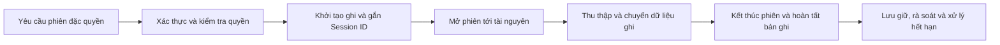

# Session recording trong truy cập đặc quyền

## 1. Session recording ghi lại điều gì?

**Session recording** là việc ghi lại diễn biến của một phiên truy cập để người được phép có thể xem xét sau đó hoặc quan sát trong khi phiên đang diễn ra. Trong quản lý truy cập đặc quyền, bản ghi giúp hiểu một quản trị viên hoặc một bên được ủy quyền đã tương tác với hệ thống đích như thế nào.

Tùy loại phiên và cơ chế triển khai, dữ liệu có thể gồm nội dung terminal, lệnh cùng đầu ra, hình ảnh màn hình, sự kiện tương tác, thời điểm kết nối và metadata về danh tính, tài nguyên đích, phê duyệt hoặc lý do truy cập.

Ví dụ, một kỹ sư được phép bảo trì máy chủ production trong một phiên có kiểm soát. Hệ thống ghi nhận danh tính cá nhân của kỹ sư, account sử dụng trên máy chủ, thời gian bắt đầu và các tương tác mà bộ ghi có thể quan sát. Khi điều tra một thay đổi bất thường, người rà soát có thể đối chiếu bản ghi với audit log của máy chủ và yêu cầu thay đổi đã được duyệt.

Session recording bổ sung khả năng quan sát. Nó không tự cấp quyền, không thay việc xác thực và cũng không bảo đảm mọi hành động diễn ra trong phiên đều hợp lệ.

## 2. Phân biệt bản ghi phiên và các loại log khác

| Nguồn dữ liệu | Thường trả lời câu hỏi nào? | Giới hạn cần nhớ |
| --- | --- | --- |
| Log xác thực | Ai đăng nhập, bằng cách nào, thành công hay thất bại? | Không nhất thiết mô tả hành động sau đăng nhập |
| Log quyết định phân quyền | Yêu cầu nào được cho phép hoặc từ chối theo policy? | Không luôn có toàn bộ ngữ cảnh tương tác |
| Audit log tại tài nguyên | Hệ thống đã xử lý thao tác gì, với đối tượng nào? | Phụ thuộc mức ghi nhận và khả năng bảo vệ log của tài nguyên |
| Bản ghi phiên | Người dùng đã thấy hoặc tương tác với điều gì trong phạm vi quan sát? | Có thể không phản ánh đầy đủ mọi hành động bên trong hệ thống |
| Log vận hành và metric | Dịch vụ thay đổi trạng thái hoặc hiệu năng thế nào? | Không tự xác định người chịu trách nhiệm cho từng thay đổi |

Một đoạn video cho thấy người quản trị nhấn nút “Save” chưa chứng minh thay đổi đã được lưu thành công. Cần đối chiếu kết quả tại hệ thống đích. Ngược lại, audit log có thể ghi một thay đổi cấu hình nhưng không thể hiện thông báo lỗi hoặc ngữ cảnh mà người dùng đã nhìn thấy trước đó.

Các nguồn này hỗ trợ nhau. Không nên bỏ audit log của cơ sở dữ liệu chỉ vì phiên truy cập cơ sở dữ liệu đã được ghi màn hình.

## 3. Các hình thức ghi phiên

### Ghi terminal

Bộ ghi có thể lưu luồng văn bản hiển thị, đầu vào và đầu ra qua terminal cùng thông tin thời gian. Người rà soát có thể phát lại diễn biến theo thời gian hoặc tìm kiếm nội dung nếu hệ thống hỗ trợ.

Luồng terminal không đồng nghĩa một danh sách lệnh đã được thực thi. Người dùng có thể sửa dòng nhập trước khi gửi; shell có thể mở rộng biến; một script có thể thực hiện nhiều thao tác mà nội dung script không xuất hiện trong phiên. Lệnh được nhập cũng có thể thất bại hoặc không bao giờ được thực thi.

### Ghi sự kiện lệnh

Một cơ chế ghi lệnh có thể cung cấp thông tin cấu trúc tốt hơn cho tìm kiếm, nhưng phải biết nó quan sát ở đâu: trên shell, tại hệ điều hành, trong gateway hay ở ứng dụng đích. Mỗi vị trí có phạm vi bao phủ khác nhau.

Ví dụ, một shell ghi nhận lệnh gọi script không tự chứng minh đã ghi đủ mọi tiến trình con hoặc thao tác mạng mà script tạo ra. Một câu lệnh gọi stored procedure cũng không thể hiện đầy đủ các thay đổi dữ liệu bên trong procedure.

### Ghi màn hình hoặc phiên đồ họa

Bản ghi có thể lưu khung hình hoặc biểu diễn giao thức đủ để tái hiện màn hình của một phiên quản trị. Hình thức này hữu ích với giao diện đồ họa, nhưng có thể tốn dung lượng và khó tìm kiếm hơn dữ liệu sự kiện có cấu trúc.

Nội dung trên màn hình có thể chứa dữ liệu khách hàng, secret hoặc thông tin của bên thứ ba. Vì vậy, bản ghi màn hình cần được quản lý như dữ liệu nhạy cảm, không chỉ như một video hỗ trợ kỹ thuật.

### Ghi phiên qua trình duyệt hoặc ứng dụng

Cơ chế có thể ghi tương tác với giao diện quản trị hoặc một tập sự kiện ở ứng dụng. Cần xác định rõ nó có ghi các tab mới, cửa sổ bật lên, thao tác tải tệp, clipboard hoặc kết nối được mở ngoài phiên hay không.

Không có một dạng bản ghi duy nhất bao phủ mọi hành vi. Thiết kế cần ghi rõ phần quan sát được và phần cần kiểm soát hoặc đối chiếu bằng nguồn khác.

## 4. Chọn vị trí ghi và xác định ranh giới tin cậy

Ba vị trí thường được cân nhắc là máy người dùng, gateway hoặc môi giới truy cập, và máy đích.

| Vị trí | Điểm thuận lợi | Câu hỏi về ranh giới tin cậy |
| --- | --- | --- |
| Máy người dùng | Có thể quan sát giao diện người dùng nhìn thấy | Người dùng hoặc mã độc trên máy có thể dừng hay sửa bộ ghi không? |
| Gateway hoặc bastion | Gắn bản ghi với một đường truy cập tập trung | Có thể kết nối trực tiếp đến đích để đi vòng không? Gateway thực sự thấy nội dung nào? |
| Máy đích | Có thể gần với sự kiện thực thi | Người có quyền quản trị đích có thể sửa agent hoặc xóa dữ liệu ghi không? |

Một gateway thụ động chỉ nhìn thấy lưu lượng đã mã hóa không mặc nhiên đọc được nội dung phiên. Muốn ghi nội dung, kiến trúc phải có điểm quan sát phù hợp, chẳng hạn môi giới giao thức hoặc thành phần tại endpoint được phép ghi. Thiết kế này vẫn cần bảo vệ mã hóa trên từng chặng và xác thực đúng bên tham gia.

Đặt recorder trên máy đích nhưng cho người dùng toàn quyền vô hiệu hóa recorder có thể làm mất độ tin cậy của bằng chứng. Đặt recorder tại gateway nhưng vẫn cho phép đăng nhập trực tiếp bằng cùng credential tạo ra một khoảng trống khác.

Vì vậy, cần kiểm soát cả **đường đi của phiên** và **quyền thay đổi cơ chế ghi**. Khi có ngoại lệ truy cập trực tiếp, ngoại lệ phải được nhận diện và có cơ chế quan sát phù hợp, thay vì được coi là đã ghi bởi một gateway mà phiên không hề đi qua.

## 5. Liên kết người dùng, account đích và bản ghi

Một bản ghi có giá trị điều tra cần trả lời được ai đã khởi tạo phiên, họ đại diện cho ai trên tài nguyên và phiên đó gắn với quyết định truy cập nào.

Metadata có thể gồm:

```text
Session ID: mã định danh duy nhất của phiên trong hệ thống ghi
Actor: danh tính đã được xác thực ở điểm truy cập
Target account: account thực sự sử dụng tại hệ thống đích
Target resource: tài nguyên và môi trường được truy cập
Access request: mã yêu cầu hoặc phê duyệt nếu có
Start/end time: thời gian bắt đầu và kết thúc quan sát
Recording state: trạng thái và mức hoàn chỉnh của bản ghi
Correlation IDs: định danh để đối chiếu log gateway và tài nguyên
```

Đây là mô tả trường dữ liệu, không phải schema bắt buộc của một sản phẩm. Không đưa mật khẩu, token hoặc private key vào metadata.

### Khi account đích được dùng chung

Nếu nhiều người dùng cùng một account kỹ thuật ở máy đích, hệ thống cần giữ quan hệ giữa danh tính cá nhân ban đầu và từng phiên được môi giới. Việc chỉ ghi `admin` ở mọi bản ghi không đủ phân biệt người thực hiện.

Session ID nên được tạo bởi thành phần đáng tin cậy và liên kết với ngữ cảnh xác thực thật. Một trường `actor` do client tự gửi không thể thay cho danh tính đã được xác minh.

### Khi kết nối bị gián đoạn hoặc được mở lại

Phiên kết nối lại có thể cần bản ghi mới hoặc một segment mới tùy thiết kế. Cần thể hiện rõ quan hệ giữa các phần, không tự ghép chúng thành một luồng liên tục nếu đã có khoảng thời gian không quan sát được.

Thời gian giữa các hệ thống phải được đồng bộ trong giới hạn phù hợp. Dữ liệu nên có thông tin thời gian nhất quán, chẳng hạn timestamp UTC cùng thứ tự sự kiện. Một mốc giờ trên gateway không tự chứng minh máy đích có cùng đồng hồ; khi đối chiếu cần xét sai lệch và độ trễ thu thập.

## 6. Vòng đời của bản ghi



Trình tự trên mô tả một thiết kế yêu cầu việc ghi được khởi tạo trước khi cho phép tương tác. Cách thực thi cụ thể phụ thuộc hệ thống và chính sách xử lý lỗi.

### Khởi tạo

Trước khi mở phiên nhạy cảm, kiểm tra bộ ghi, cấu hình đích lưu và khả năng gắn đúng danh tính. Nếu chính sách bắt buộc ghi, việc kiểm tra chỉ rằng tiến trình recorder đang chạy là chưa đủ; cần biết dữ liệu có thể được thu và lưu theo yêu cầu hay không.

### Thu thập

Các phần dữ liệu có thể được truyền liên tục hoặc lưu đệm trong giới hạn. Cần theo dõi phần đã được lưu, phần đang chờ chuyển, mất kết nối và dung lượng bộ đệm. Nếu dùng lưu đệm cục bộ, phải bảo vệ dữ liệu và kiểm soát người có thể xóa hoặc đọc nó.

### Kết thúc và hoàn tất

Phiên kết nối đã đóng không đồng nghĩa bản ghi đã hoàn tất. Có thể còn dữ liệu chưa tải lên, segment chưa được xác nhận hoặc metadata chưa được chốt.

Nên phân biệt trạng thái như đang ghi, suy giảm, kết thúc nhưng chờ hoàn tất, hoàn chỉnh hoặc không hoàn chỉnh theo mô hình của hệ thống. Không hiển thị một bản ghi thiếu dữ liệu như một phiên đầy đủ chỉ vì đã có tệp video mở được.

### Lưu giữ và kết thúc vòng đời

Bản ghi được lưu theo thời hạn và mục đích đã xác định. Khi có yêu cầu bảo toàn phục vụ điều tra, cơ chế lưu giữ cần xử lý đúng theo chính sách tổ chức. Khi hết thời hạn, việc xóa cần xét cả bản gốc, bản xuất, bản sao và dữ liệu phụ thuộc trong phạm vi quản lý.

Không có một thời hạn lưu duy nhất phù hợp cho mọi hệ thống. Cần cân bằng nhu cầu điều tra, độ nhạy cảm của nội dung, chi phí lưu trữ và các yêu cầu quản trị dữ liệu được áp dụng.

## 7. Bảo vệ tính toàn vẹn và khả năng sử dụng làm bằng chứng

Người có quyền trong phiên không nên đồng thời có khả năng tùy ý sửa hoặc xóa bản ghi của chính mình. Có thể tách quyền quản trị tài nguyên, vận hành recorder, quản lý lưu trữ và rà soát bằng chứng theo mức rủi ro.

Các cơ chế thường được kết hợp gồm:

- Mã hóa khi truyền và khi lưu để giới hạn bên đọc được dữ liệu.
- Kiểm soát ghi, sửa và xóa tại kho bản ghi.
- Theo dõi thứ tự, số lượng hoặc trạng thái segment để phát hiện phần thiếu.
- Hash hoặc chữ ký với metadata được bảo vệ để hỗ trợ phát hiện thay đổi.
- Audit độc lập cho thao tác xem, tải xuống, xuất hoặc xóa bản ghi.

Hash chỉ có ích nếu giá trị đối chiếu được bảo vệ. Nếu một người sửa cả bản ghi lẫn hash đi kèm mà không để lại dấu vết, việc tính lại hash không phát hiện được sự thay đổi đó.

Chữ ký có thể hỗ trợ chứng minh rằng một tập byte được ký bởi một khóa nhất định, trong phạm vi tin cậy đối với khóa và quy trình ký. Nó không tự chứng minh mọi nội dung màn hình là sự thật đầy đủ tại máy đích hoặc người đứng trước máy đúng là chủ account.

Khi xuất bản ghi cho điều tra, cần giữ nguồn, thời điểm xuất, phạm vi segment, người thực hiện và thông tin kiểm tra toàn vẹn phù hợp. Việc chuyển qua nhiều bên mà không theo dõi có thể làm mất khả năng xác định bản nào là nguồn hoặc bản nào đã được xử lý.

## 8. Bảo vệ bí mật và quyền riêng tư trong bản ghi

Bản ghi phiên có thể nhạy cảm hơn log sự kiện thông thường vì nó chứa nội dung mà quản trị viên đã nhìn thấy. Người được phép quản trị máy không mặc nhiên được phép đọc mọi bản ghi chứa dữ liệu của hệ thống khác.

### Giảm dữ liệu ngay từ nguồn

Nên tránh để credential xuất hiện trong luồng tương tác khi thiết kế cho phép. Chẳng hạn, một cơ chế môi giới có thể đưa credential tới hệ thống đích mà không hiển thị cho người sử dụng. Tuy nhiên, credential vẫn có thể bị ứng dụng in ra trong một thông báo hoặc bị người dùng yêu cầu hiển thị nếu quyền cho phép.

Không nên kiểm tra khả năng che secret bằng secret production thật. Có thể dùng dữ liệu tổng hợp để xác minh cơ chế hoạt động với terminal, clipboard, thông báo lỗi và các bề mặt liên quan.

### Giới hạn của che nội dung

Che trường mật khẩu ở giao diện không bảo đảm token xuất hiện trong đầu ra của một lệnh cũng được che. Che sau khi ghi cũng không loại bỏ bản gốc nếu bản gốc đã được lưu ở một nơi khác.

Cần biết cơ chế che hoạt động trước khi lưu, trên bản xem hay chỉ trên bản xuất. Nếu có bản gốc không che, quyền truy cập và mục đích giữ bản đó phải được kiểm soát riêng.

Cho người đang bị ghi tự dừng ghi tùy ý có thể làm mất phần nhạy cảm nhất của phiên. Nếu nghiệp vụ cần một khoảng tạm ngừng hoặc khu vực không ghi, cần chính sách rõ ràng, metadata về khoảng trống và cách hạn chế hành động trong thời gian đó. Không được trình bày khoảng trống đã được cho phép như thể đã có quan sát đầy đủ.

### Kiểm soát người xem

Quyền tìm kiếm, xem lại, tải xuống và xóa nên được tách theo nhu cầu. Việc tải bản ghi ra ngoài hệ thống làm tăng số bản sao và có thể làm mất một phần khả năng kiểm soát truy cập sau đó.

Mỗi lượt xem hoặc xuất nên có audit phù hợp. Nội dung bản ghi cần được sử dụng đúng mục đích, giới hạn người tiếp cận và thông báo cho người tham gia theo chính sách của tổ chức.

## 9. Xử lý lỗi ghi và các khoảng trống

Recorder có thể bị lỗi, kho lưu trữ đầy, mạng bị gián đoạn hoặc một loại tương tác không nằm trong phạm vi hỗ trợ. Chính sách cần quy định hệ thống làm gì trong từng tình huống.

| Tình huống | Quyết định cần xác định trước |
| --- | --- |
| Không khởi tạo được bản ghi | Có từ chối phiên mới hay dùng đường khẩn cấp được quản lý riêng? |
| Đang ghi nhưng không chuyển được dữ liệu | Có bộ đệm được bảo vệ không, giới hạn dung lượng và thời gian là gì? |
| Mất khả năng ghi trong phiên | Có chặn tương tác, kết thúc phiên hay cho tiếp tục theo ngoại lệ đã định nghĩa? |
| Thiếu một segment sau kết thúc | Đánh dấu không hoàn chỉnh và thông báo cho bên nào? |
| Tải tệp hoặc mở kết nối ngoài kênh ghi | Kiểm soát hoặc đối chiếu bằng cơ chế nào? |

Chính sách chặn truy cập khi không thể ghi có thể phù hợp với tài nguyên rất nhạy cảm nhưng cũng ảnh hưởng khả năng xử lý sự cố. Chính sách cho tiếp tục có thể giúp duy trì vận hành nhưng tạo khoảng trống bằng chứng. Cần quyết định theo kịch bản và mức tác động, không âm thầm chuyển giữa hai cách khi có lỗi.

Nếu cho phép tiếp tục theo ngoại lệ, hệ thống cần cảnh báo, lưu metadata về thời điểm mất ghi và giữ được nguồn audit bổ sung khi có thể. Đường khẩn cấp không nên trở thành phương thức thường xuyên để tránh recorder.

Một metric chỉ cho thấy số phiên có tệp ghi chưa đủ. Cần theo dõi tính hoàn chỉnh, độ trễ chuyển dữ liệu, lỗi ghi, phiên không có bản ghi và các trường hợp truy cập ngoài đường được kiểm soát.

## 10. Rà soát và đối chiếu khi điều tra

Một quy trình rà soát có thể bắt đầu từ một thay đổi tại tài nguyên, tìm Session ID hoặc thông tin tương quan, rồi xem bản ghi đúng phạm vi thời gian.

Ví dụ:

```text
Audit tài nguyên: cấu hình dịch vụ thay đổi lúc T
    -> xác định principal và mã yêu cầu
    -> tìm phiên quản trị liên quan
    -> kiểm tra danh tính gốc, account đích và phê duyệt
    -> xem các tương tác trước và sau thời điểm T
    -> đối chiếu kết quả, lỗi và các sự kiện ngoài phiên
```

Cần phân biệt thao tác được nhìn thấy, yêu cầu đã gửi và thay đổi thực sự đã xảy ra. Nếu bản ghi chỉ cho thấy một script được gọi, có thể cần thêm audit hệ điều hành hoặc ứng dụng để biết script đã tác động những gì.

Quan sát trực tiếp và xem lại sau đó là hai khả năng khác nhau. Một hệ thống cho xem lại chưa chắc hỗ trợ ngắt phiên tức thời; một chức năng ngắt phiên cũng chưa chắc thu hồi mọi token hoặc dừng công việc đã được khởi chạy ở nền.

Nội dung được phát lại cũng cần được xử lý như dữ liệu không đáng tin cậy. Terminal có thể chứa ký tự điều khiển và nội dung do bên đích cung cấp. Công cụ xem nên hiển thị trong môi trường được bảo vệ, tránh tự thực thi lệnh, tự mở liên kết hoặc đưa nội dung nhạy cảm vào clipboard mà không có kiểm soát.

Không dùng một bản ghi đơn lẻ để kết luận vượt quá khả năng của nó. Cần kiểm tra mức hoàn chỉnh, nguồn ghi, tính toàn vẹn, sai lệch đồng hồ và các đường truy cập mà recorder không quan sát.

## 11. Ví dụ thiết kế cho phiên bảo trì production

Lan cần đổi một cấu hình của dịch vụ production theo yêu cầu đã được duyệt. Lan xác thực bằng danh tính cá nhân, nhận quyền phù hợp trong thời hạn được cấp rồi kết nối qua cổng quản trị.

Thiết kế minh họa có các thành phần:

| Thành phần | Trách nhiệm |
| --- | --- |
| Hệ thống danh tính | Xác minh Lan và các điều kiện xác thực cần thiết |
| Cơ chế cấp quyền | Giới hạn tài nguyên, hành động và thời gian được phép |
| Cổng quản trị | Gắn actor, account đích, Session ID và khởi tạo recorder |
| Kho bản ghi | Lưu nội dung cùng trạng thái hoàn chỉnh và cơ chế bảo vệ |
| Dịch vụ production | Thực thi quyền và tạo audit về thay đổi thực tế |
| Người rà soát | Xem bằng chứng theo quyền được cấp, có audit lượt xem |

Trong phiên, Lan nhìn thấy kết quả thay cấu hình; audit ở dịch vụ ghi trạng thái thành công. Hai nguồn được liên kết bằng metadata đáng tin cậy khi hệ thống hỗ trợ, hoặc được đối chiếu với mức chắc chắn phù hợp nếu không có định danh chung.

Nếu mạng chuyển bản ghi bị ngắt, hệ thống thực hiện chính sách đã thiết kế và thể hiện rõ trạng thái suy giảm. Khi phiên đóng, trạng thái chỉ chuyển sang hoàn chỉnh sau khi các phần dữ liệu cần thiết đã được xác nhận. Người quản trị dịch vụ không có quyền tùy ý xóa bản ghi của chính phiên đó.

Khi rà soát, nhóm kiểm toán kiểm tra cả hành động trong phiên và sự kiện tại tài nguyên. Họ không suy luận rằng mọi thao tác đều đúng chỉ vì Lan đã đăng nhập thành công hoặc bản ghi phát lại được.

## 12. Những ngộ nhận cần tránh

| Ngộ nhận | Cách hiểu phù hợp |
| --- | --- |
| Có bản ghi nghĩa là hành động đã được phê duyệt | Phê duyệt và phân quyền là các kiểm soát riêng |
| Ghi terminal là ghi đủ mọi lệnh thực thi | Script, tiến trình con và đường đi khác có thể không hiện đầy đủ |
| Video cho thấy thao tác là đủ chứng minh kết quả | Cần đối chiếu với trạng thái và audit của tài nguyên |
| Có tệp ghi là phiên đã hoàn chỉnh | Phải kiểm tra segment thiếu, lỗi chuyển và trạng thái hoàn tất |
| Hash đi kèm bảo đảm không ai sửa được bản ghi | Giá trị đối chiếu và đường tạo bằng chứng cũng cần được bảo vệ |
| Chỉ cần recorder tại gateway | Cần ngăn hoặc quản lý truy cập đi vòng và biết giới hạn quan sát |
| Che mật khẩu trên màn hình là hết nguy cơ lộ secret | Secret có thể xuất hiện ở nhiều bề mặt khác hoặc trong bản gốc |
| Ngắt phiên là thu hồi toàn bộ quyền và token | Cần xử lý riêng credential, phiên khác và công việc đã khởi chạy |

Session recording hỗ trợ trách nhiệm giải trình khi bản ghi được gắn với danh tính đã xác minh, phản ánh trung thực mức quan sát và được bảo vệ trong toàn bộ vòng đời. Giá trị của nó đến từ khả năng kết hợp với xác thực, phân quyền và audit tại tài nguyên, cùng việc nhận diện rõ những khoảng trống còn tồn tại.
