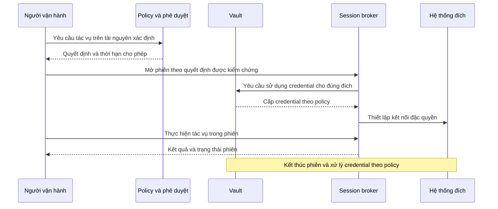

# Privileged credential vault

## 1. Kho credential đặc quyền giải quyết vấn đề gì?

Một tổ chức có thể cần quản lý mật khẩu quản trị máy chủ, tài khoản quản trị cơ sở dữ liệu, khóa SSH hoặc credential của hệ thống mạng. Nếu chúng được giữ trong bảng tính, trao đổi qua chat hay dùng chung không kiểm soát, tổ chức khó trả lời ai đang có quyền sử dụng, credential còn nằm ở đâu và phải thay đổi gì khi có sự cố.

**Privileged credential vault** là kho và cơ chế quản lý có kiểm soát dành cho credential đặc quyền. Nó bảo vệ giá trị bí mật, xác thực bên yêu cầu, kiểm tra quyền sử dụng và hỗ trợ quản lý vòng đời cùng bằng chứng truy cập. Tùy sản phẩm, vault còn phối hợp với phê duyệt, rotation, cấp credential tạm thời hoặc kết nối phiên đặc quyền.

Vault không chỉ là một cơ sở dữ liệu có cột mật khẩu được mã hóa. Giá trị của nó nằm ở việc kiểm soát cách credential được đưa vào, được sử dụng, được thay đổi và được thu hồi.

Trong IAM, cần phân biệt:

- **Danh tính:** tài khoản hoặc principal được hệ thống đích nhận diện.
- **Credential:** bằng chứng cho phép bên sử dụng xác thực dưới danh tính đó, chẳng hạn mật khẩu hoặc khóa.
- **Quyền:** những hành động danh tính được phép thực hiện trên tài nguyên.
- **Vault:** một lớp kiểm soát việc quản lý và sử dụng credential, không tự thay thế policy phân quyền của hệ thống đích.

Đưa mật khẩu của một tài khoản toàn quyền vào vault không biến tài khoản đó thành tài khoản ít quyền. Cần đồng thời giới hạn danh tính đích và các chủ thể được phép sử dụng nó.

## 2. Phân biệt các khả năng thường được gọi chung là vault

| Khả năng | Chức năng chính | Điều không tự được bảo đảm |
| --- | --- | --- |
| Lưu bí mật có mã hóa | Giữ và bảo vệ một giá trị credential | Credential đã bị thay đổi hoặc thu hồi ở hệ thống đích |
| Phân quyền lấy bí mật | Giới hạn principal được đọc hoặc nhận credential | Người đã đọc không giữ một bản sao |
| Checkout/check-in | Quản lý lượt sử dụng credential theo quy trình | Mọi bản sao và phiên đã tồn tại đều biến mất khi check-in |
| Rotation | Thay đổi credential và đồng bộ trạng thái liên quan | Không gián đoạn nếu dependency chưa được quản lý |
| Session brokering | Kết nối người dùng tới đích thông qua thành phần trung gian | Mọi hành động ngoài đường broker đều bị chặn |
| Dynamic credential | Cấp credential theo nhu cầu với phạm vi hoặc thời hạn | Mọi hệ thống đích đều hỗ trợ cùng cơ chế thu hồi |

Một hệ thống quản lý secret tổng quát có thể cung cấp một phần các khả năng này. Một nền tảng PAM có thể kết hợp vault với quản lý phiên, phê duyệt và kiểm toán. Không nên suy luận tính năng chỉ từ tên gọi sản phẩm hoặc từ việc nó có API đọc secret.

Khi đánh giá thiết kế, hãy xác định thành phần nào thực thi mỗi kiểm soát: vault, identity provider, policy engine, connector, broker hay hệ thống đích.

## 3. Các thành phần và ranh giới cần bảo vệ

Một mô hình điển hình gồm:

| Thành phần | Vai trò |
| --- | --- |
| Identity provider hoặc cơ chế xác thực | Xác nhận người hoặc workload đang yêu cầu truy cập |
| Policy và quy trình phê duyệt | Quyết định chủ thể được sử dụng credential nào, theo cách nào |
| Kho credential được mã hóa | Bảo vệ giá trị bí mật và metadata cần thiết |
| Cơ chế quản lý khóa mã hóa | Bảo vệ khả năng giải mã và phục hồi kho theo kiến trúc được chọn |
| Connector hoặc bộ phận rotation | Tương tác với đích để kiểm tra, thay đổi hoặc thu hồi credential |
| Session broker nếu có | Thiết lập và quản lý đường kết nối đặc quyền |
| Hệ thống đích | Xác thực credential và thực thi quyền trên tài nguyên |
| Nguồn audit | Ghi lại quyết định truy cập, thao tác quản trị và hoạt động liên quan |

Mã hóa khi lưu và khi truyền là những lớp bảo vệ cần thiết, nhưng thành phần sử dụng credential có thể cần tiếp cận giá trị bí mật trong quá trình vận hành. Vì vậy, vẫn phải bảo vệ runtime, connector, đường truyền nội bộ và các quyền có thể tác động đến quá trình giải mã.

Quản trị hạ tầng vault, quản lý khóa mã hóa và quyền nhận credential là những khả năng khác nhau. Việc tách các quyền này có thể giảm rủi ro, nhưng không nên khẳng định một quản trị viên mạnh luôn không thể tiếp cận bí mật nếu chưa kiểm tra mô hình bảo mật và khả năng thực tế của sản phẩm.

## 4. Đưa một credential vào quản lý

Onboarding cần xác định không chỉ giá trị bí mật mà còn tài khoản đích và mục đích sử dụng.

Thông tin cần làm rõ gồm tài nguyên đích, danh tính đăng nhập, chủ sở hữu, mức đặc quyền, workload hoặc nhóm người cần dùng, cơ chế rotation và dependency có thể bị ảnh hưởng. Định danh ổn định giúp tránh nhầm hai tài khoản cùng tên trên các máy hoặc môi trường khác nhau.

Ví dụ, `dbadmin` trên cơ sở dữ liệu thử nghiệm không phải cùng đối tượng với `dbadmin` trên cơ sở dữ liệu production. Một đường dẫn secret có tên rõ ràng hỗ trợ quản trị nhưng không tự giới hạn được quyền tại đích.

Khi tiếp nhận một credential đã từng được phân phối rộng, việc lưu vào vault không xóa các bản sao cũ. Cần đánh giá việc thay đổi credential tại đích, dọn đường phân phối cũ và xác minh các dependency theo quy trình chuyển đổi phù hợp.

Vòng đời secret cần bao gồm tạo, cấp phát, sử dụng, rotation và thu hồi, thay vì dừng ở lưu trữ tập trung. Đây cũng là cách tiếp cận được trình bày trong hướng dẫn quản lý secret của OWASP. [OWASP Secrets Management Cheat Sheet](https://cheatsheetseries.owasp.org/cheatsheets/Secrets_Management_Cheat_Sheet.html)

## 5. Quyền sử dụng khác quyền xem hoặc xuất credential

Một thiết kế có thể phân biệt những khả năng sau:

| Khả năng | Nhu cầu có thể phù hợp |
| --- | --- |
| Xem metadata | Biết credential thuộc hệ thống nào và ai chịu trách nhiệm |
| Yêu cầu sử dụng | Đề nghị truy cập tài nguyên theo một nhiệm vụ |
| Kết nối qua broker | Thực hiện phiên mà không cần hiển thị mật khẩu cho người dùng |
| Reveal hoặc đọc giá trị bí mật | Nhận credential trực tiếp khi thật sự cần và được cho phép |
| Rotation hoặc reconcile | Thay đổi hoặc khôi phục đồng bộ credential với đích |
| Thay policy | Thay chủ thể, điều kiện và cách sử dụng credential |
| Quản trị kho hoặc phục hồi | Vận hành hạ tầng và khả năng khôi phục theo phạm vi được cấp |

Một kỹ sư cần vận hành máy chủ không mặc nhiên cần xuất khóa riêng. Một kiểm toán viên cần xem lịch sử truy cập cũng không mặc nhiên cần đọc mật khẩu. Tương tự, quyền sửa policy truy cập cần được đánh giá riêng với quyền sử dụng credential.

Đối với người dùng tương tác, có thể áp dụng xác thực bổ sung và phê duyệt phù hợp mức rủi ro. Đối với workload, cần dùng cơ chế xác thực máy phù hợp, chẳng hạn danh tính runtime hoặc federation được hỗ trợ, thay vì yêu cầu một luồng MFA tương tác mà workload không thể thực hiện.

Phê duyệt phải gắn với tài nguyên, mục đích và thời hạn xác định. Một trường chứa mã ticket không tự chứng minh ticket hợp lệ hoặc người dùng đã được phép truy cập.

## 6. Checkout và kết nối qua broker

### Checkout trực tiếp

Trong một mô hình checkout, người dùng được nhận credential sau khi vượt qua các điều kiện truy cập. Hệ thống ghi nhận lượt cấp và thời hạn dự kiến; khi kết thúc, người dùng check-in hoặc hệ thống thực hiện hành động theo policy.

Một số thiết kế có thể giới hạn một lượt checkout đang hoạt động để dễ quy trách nhiệm. Tuy vậy, điều này không ngăn người đã nhận mật khẩu sao chép nó hoặc sử dụng đồng thời qua một đường khác nếu đích vẫn chấp nhận.

Check-in là sự kiện quản trị lượt sử dụng, không tự thay đổi mật khẩu tại đích. Nếu cần ngăn dùng lại credential đã tiết lộ, phải có rotation hoặc cơ chế vô hiệu phù hợp và xác minh kết quả.

### Kết nối qua broker

Trong một mô hình brokered access, thành phần trung gian nhận credential theo quyền của nó và thiết lập phiên tới đích. Người dùng có thể sử dụng phiên mà không được hiển thị giá trị bí mật, nếu sản phẩm và giao thức hỗ trợ cách vận hành đó.



Đây là luồng khái niệm; các sản phẩm có thể gộp hoặc tổ chức thành phần khác nhau. Broker phải kiểm chứng quyết định cấp quyền, không làm theo một cờ “đã phê duyệt” do client tự gửi.

Broker giảm nhu cầu tiết lộ credential cho người dùng nhưng không thay thế quyền tại đích. Một phiên toàn quyền vẫn có thể thực hiện hành động nguy hiểm. Cần xem khả năng giới hạn lệnh, truyền tệp, tạo credential mới, ghi nhận phiên và chặn đường kết nối trực tiếp theo cơ chế thực tế.

## 7. Ví dụ policy sử dụng credential

Giả sử nhóm trực ca cần truy cập một máy chủ production để xử lý sự cố. Yêu cầu thiết kế là dùng broker, chỉ được truy cập máy đã duyệt, không hiển thị mật khẩu và giới hạn thời gian phiên.

```yaml
# Pseudoconfiguration: không phải schema của một sản phẩm.
credentialReference: credentials/prod/invoice-host/operator
target: servers/invoice-prod-01
allowedRequesterGroup: operations/oncall

accessPolicy:
  connectionMode: brokered
  allowSecretReveal: false
  requireIndependentApproval: true
  requireIncidentReference: true
  maximumSessionMinutes: 30

lifecyclePolicy:
  afterSession: rotate-if-supported-and-required
  verifyTargetState: true
```

Các giá trị chỉ diễn đạt ý định. Thời hạn 30 phút không phải chuẩn chung. Cần ánh xạ sang khả năng policy, broker, rotation và kiểm tra tại đích của nền tảng triển khai.

Ví dụ này cần được kiểm chứng bằng các tình huống như: người ngoài nhóm không mở được phiên; người trong nhóm không chọn được máy khác; không có quyền reveal ngoài dự kiến; một lượt bị từ chối không nhận được credential; phiên hết hạn được xử lý theo policy đã công bố.

Nếu người dùng vẫn có một bản sao mật khẩu cũ hợp lệ hoặc một đường đăng nhập trực tiếp khác, các trường trong policy không tự loại bỏ đường đó. Kiểm soát vault cần được kết nối với việc quản lý tài khoản và đường truy cập của hệ thống đích.

## 8. Rotation phải đồng bộ với hệ thống đích

Rotation là thay credential đang được hệ thống đích chấp nhận và quản lý trạng thái mới một cách nhất quán. Chỉ ghi một giá trị mới vào kho không đủ nếu mật khẩu hoặc khóa ở đích vẫn chưa thay đổi.

Một quy trình rotation ở mức ý tưởng cần:

1. Xác định tài khoản đích, credential hiện tại và các nơi đang sử dụng.
2. Chuẩn bị giá trị hoặc phương thức thay thế theo policy của đích.
3. Thực hiện thay đổi tại đích và cập nhật trạng thái kho theo cơ chế của sản phẩm.
4. Xác minh credential mới hoạt động và trạng thái cũ được xử lý đúng yêu cầu.
5. Cập nhật dependency, ghi nhận kết quả và xử lý trường hợp không đồng bộ.

Đây không phải thứ tự giao dịch bắt buộc cho mọi sản phẩm. Vault và hệ thống đích thường là hai thành phần khác nhau; không thể mặc định rằng mọi bước tạo thành một giao dịch nguyên tử.

Ví dụ, connector có thể đã thay mật khẩu tại đích nhưng mất kết nối trước khi xác nhận trạng thái trong vault. Nếu chỉ đánh dấu “thất bại” rồi tiếp tục cấp mật khẩu cũ, người dùng sẽ gặp lỗi. Nếu thử liên tục không kiểm soát, tài khoản có thể bị khóa hoặc tình trạng không đồng bộ trở nên khó xử lý hơn.

Hệ thống cần có cách phát hiện, cảnh báo và reconcile theo cơ chế được hỗ trợ. Không che giấu trạng thái không chắc chắn bằng một nhãn thành công. Khả năng reconcile thường có quyền mạnh tại đích nên cũng cần được giới hạn, bảo vệ và kiểm toán.

Với ứng dụng hoặc dịch vụ dùng credential này, phải xem cache, connection pool, lịch job và thời điểm nạp lại cấu hình. Đổi mật khẩu có thể ảnh hưởng các lần xác thực mới nhưng không nhất thiết chấm dứt mọi kết nối đã mở.

## 9. Credential tĩnh và credential động

Credential tĩnh là giá trị được dùng lại cho một tài khoản trong một khoảng thời gian cho tới khi được thay đổi hoặc thu hồi. Vault có thể quản lý chúng an toàn hơn, nhưng vẫn phải xử lý bản sao, vòng đời và các dependency.

Credential động được cấp theo nhu cầu và thường gắn với thời hạn hoặc lease, tùy khả năng sản phẩm và hệ thống đích. Việc cấp riêng cho từng lượt hoặc workload có thể hỗ trợ giới hạn quyền và truy vết tốt hơn một tài khoản dùng chung, nếu đích và nguồn log hỗ trợ.

HashiCorp Vault là một ví dụ quản lý lease cho dynamic secrets, với các khái niệm thời hạn, renew và revoke. Những khả năng này cần được hiểu theo secrets engine và hệ thống đích tương ứng, không áp dụng mặc định cho mọi giá trị lưu trong kho. [HashiCorp Vault: Lease, renew, and revoke](https://developer.hashicorp.com/vault/docs/concepts/lease)

Cần phân biệt ba thời hạn:

- Thời hạn được phép lấy hoặc sử dụng credential qua vault.
- Thời hạn bản thân credential được đích chấp nhận.
- Thời gian tồn tại của phiên hoặc kết nối đã được tạo từ credential đó.

Một TTL lưu trong metadata không tự bảo đảm đích sẽ từ chối credential sau đúng mốc đó. Việc thu hồi động cũng cần khả năng tương tác với hệ thống đích; lỗi mạng hoặc lỗi connector có thể khiến trạng thái thu hồi cần được xử lý thêm. Phải quan sát kết quả thực tế thay vì chỉ dựa vào đồng hồ của yêu cầu.

Nếu nền tảng hỗ trợ danh tính workload và credential ngắn hạn mà không cần phân phối khóa tĩnh, có thể giảm nhu cầu giữ một số loại credential trong vault. Không phải mọi bài toán IAM đều nên được giải bằng cách tạo thêm mật khẩu dài hạn rồi đưa vào kho.

## 10. Bảo vệ khả năng vận hành và khôi phục vault

Vault tập trung credential giá trị cao nên là một thành phần quan trọng của hạ tầng tin cậy. Cần bảo vệ các đường truy cập quản trị, hệ thống xác thực, runtime, backup và khả năng sử dụng khóa mã hóa theo kiến trúc được chọn.

Việc khôi phục phải xem đồng thời dữ liệu kho, vật liệu hoặc cơ chế giải mã cần thiết, cấu hình policy và trạng thái tài khoản ở đích. Một backup còn dữ liệu nhưng không thể giải mã không đáp ứng mục tiêu khôi phục. Ngược lại, khôi phục kho về một bản cũ sau nhiều lần rotation có thể khiến credential trong backup không còn khớp đích.

Cần kiểm tra tình huống vault, identity provider, hệ thống khóa mã hóa hoặc connector không hoạt động. Luồng truy cập mới nên xử lý lỗi theo chính sách rõ ràng; việc có cho tiếp tục phiên hiện có hay không cần được quyết định theo rủi ro và khả năng kỹ thuật.

Không nên tự động phát tán một mật khẩu quản trị dùng chung khi vault gặp sự cố. Nếu tổ chức cần truy cập khẩn cấp, phải có cơ chế được thiết kế riêng, được bảo vệ, được kiểm tra khả năng sử dụng và được rà soát sau mỗi lần kích hoạt.

Workload cũng cần một cách xác thực ban đầu vào vault. Cơ chế dựa trên danh tính runtime hoặc federation có thể giảm nhu cầu nhúng một bootstrap secret tĩnh vào ứng dụng. Tuy nhiên, nó chuyển sự tin cậy tới nền tảng phát hành danh tính và policy nhận diện workload, không làm mọi vấn đề bảo vệ credential biến mất.

## 11. Audit việc cấp và sử dụng credential

Bằng chứng cần giúp trả lời: ai yêu cầu credential nào, cho đích nào, vì mục đích gì, quyết định ra sao và điều gì xảy ra khi kết thúc.

Các sự kiện quan trọng có thể gồm onboarding, thay policy, yêu cầu và quyết định truy cập, reveal, mở hoặc đóng phiên, rotation, revoke, reconcile và thao tác phục hồi. Các nguồn này cần được liên kết với log tại đích theo khả năng thực tế.

Không ghi mật khẩu, khóa riêng, bearer token hoặc giá trị secret vào audit log. Có thể sử dụng định danh credential, phiên, yêu cầu và đối tượng đích để đối chiếu mà không biến log thành một kho bí mật thứ hai.

Một log ghi “credential đã được cấp cho kỹ sư A” không tự chứng minh mọi hành động tiếp theo dưới tài khoản đích đều do A thực hiện. Nếu credential được tiết lộ và có thể sao chép, vẫn cần xem các nguồn bằng chứng khác. Brokered session có thể hỗ trợ truy vết tốt hơn nhưng phải xác minh độ bao phủ, đường đi và các trường liên kết mà hệ thống cung cấp.

Quyền đọc, xuất, xóa hoặc đổi cấu hình log cần được bảo vệ phù hợp. Người sử dụng credential đặc quyền không nên mặc nhiên có khả năng xóa mọi bằng chứng liên quan đến lượt sử dụng của mình.

## 12. Những nhầm lẫn cần tránh

| Nhận định | Cách hiểu chính xác hơn |
| --- | --- |
| Có vault thì tài khoản đích đã ít quyền | Vault kiểm soát credential; quyền tại đích vẫn cần được giới hạn |
| Check-in là mật khẩu đã mất hiệu lực | Cần rotation hoặc revoke tại đích nếu muốn chặn dùng lại |
| Không reveal thì không còn rủi ro đặc quyền | Phiên vẫn có thể thực hiện hành động mạnh; broker và policy cần được bảo vệ |
| Đổi giá trị secret trong kho là đã rotation | Phải xác minh credential tại đích và dependency liên quan |
| TTL hết là mọi phiên đã đóng | Thời hạn truy cập vault, credential và phiên có thể khác nhau |
| Credential được mã hóa nên mọi quản trị viên đều không thể tiếp cận | Phải xem quyền giải mã, runtime và khả năng quản trị thực tế |
| Backup khôi phục được là credential chắc chắn còn đúng | Trạng thái backup có thể không khớp đích sau các lần rotation |

Một privileged credential vault có hiệu quả khi quyền lấy hoặc sử dụng credential được giới hạn, trạng thái credential ở đích được quản lý và bằng chứng có thể kiểm chứng. Cần đánh giá cả quá trình cấp, sử dụng, thay đổi và kết thúc truy cập, thay vì chỉ kiểm tra rằng bí mật đã nằm trong một nơi lưu trữ được mã hóa.
