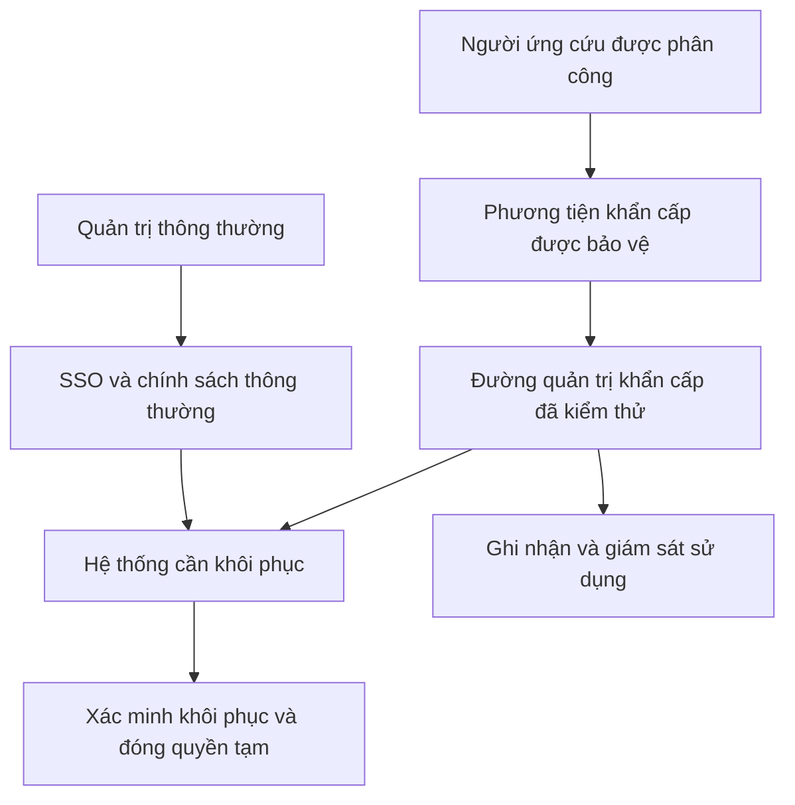

# Emergency access: truy cập khẩn cấp khi đường quản trị thông thường không sử dụng được

## 1. Emergency access giải quyết vấn đề gì?

**Emergency access** là khả năng truy cập được chuẩn bị trước để người có trách nhiệm xử lý một tình huống nghiêm trọng khi đường truy cập hoặc quy trình quản trị thông thường không đáp ứng được nhu cầu khôi phục. Trong quản lý truy cập đặc quyền, khái niệm này thường được gọi là **break-glass access**.

Ví dụ, tổ chức sử dụng SSO để quản trị hệ thống production. Một thay đổi chính sách đăng nhập khiến toàn bộ quản trị viên bị từ chối truy cập. Muốn sửa chính sách phải đăng nhập, nhưng chính sách đang lỗi lại chặn đăng nhập. Emergency access tạo ra một đường khôi phục đã được thiết kế để không mắc cùng vòng phụ thuộc đó.

Mục tiêu không phải là mở một cổng quản trị không kiểm soát. Mục tiêu là duy trì khả năng khôi phục có chủ đích, với chủ thể được xác định, quyền phù hợp, phương tiện xác thực được bảo vệ, dấu vết sử dụng và quy trình đưa hệ thống trở lại trạng thái bình thường.

Truy cập khẩn cấp cũng không đồng nghĩa mọi sự cố đều cần tài khoản đặc biệt. Nếu đường quản trị bình thường còn hoạt động và đáp ứng được công việc, sử dụng quyền thông thường hoặc quyền vừa đủ có thời hạn thường giữ được phạm vi kiểm soát rõ hơn.

## 2. Phân biệt với các hình thức truy cập đặc quyền khác

| Hình thức | Mục đích | Ví dụ |
| --- | --- | --- |
| Truy cập quản trị hằng ngày | Thực hiện nhiệm vụ vận hành theo quy trình thông thường | Kiểm tra cấu hình một dịch vụ được giao |
| Just-in-time privilege | Kích hoạt quyền khi có nhu cầu, trong phạm vi và thời hạn cụ thể | Nhận quyền bảo trì production trong một cửa sổ xử lý |
| Emergency access | Duy trì khả năng ứng cứu khi đường hoặc cơ chế thông thường không đáp ứng được tình huống nghiêm trọng | Khôi phục cấu hình xác thực đang làm quản trị viên bị khóa ngoài |
| Tài khoản dùng chung không quản lý | Không có chủ thể và vòng đời sử dụng rõ ràng | Mật khẩu admin được truyền trong nhóm chat để ai cần cũng dùng |

Emergency access có thể dùng quyền tạm thời, credential chuyên dụng hoặc một tài khoản khôi phục đã được chuẩn bị. Tuy nhiên, nếu cơ chế kích hoạt khẩn cấp vẫn phụ thuộc hoàn toàn vào chính hệ thống đang hỏng, nó có thể không đáp ứng được mục tiêu khôi phục.

Ví dụ, một quy trình yêu cầu phê duyệt trong cổng quản trị sử dụng cùng SSO bị lỗi có thể không kích hoạt được. Cần thiết kế các điều kiện sử dụng và đường chấp nhận phù hợp từ trước, thay vì đợi đến sự cố mới tìm cách bỏ qua từng bước.

## 3. Xác định những tình huống cần hỗ trợ

Một thiết kế emergency access phải bắt đầu từ tình huống lỗi cụ thể. Không thể khẳng định một tài khoản dự phòng giải quyết mọi loại sự cố.

| Tình huống | Khả năng khôi phục cần có | Giới hạn cần xét |
| --- | --- | --- |
| Nhà cung cấp danh tính hoặc đường liên kết SSO không khả dụng | Xác thực qua một đường đã được chuẩn bị không phụ thuộc cùng điểm lỗi | Tài nguyên đích vẫn phải hoạt động và chấp nhận cơ chế đó |
| Chính sách đăng nhập cấu hình sai | Một danh tính hoặc đường quản trị có thể sửa chính sách trong phạm vi đã xác định | Ngoại lệ quá rộng có thể trở thành đường truy cập ngoài kiểm soát |
| Quản trị viên mất phương tiện xác thực | Khả năng sử dụng phương tiện dự phòng hoặc quy trình khôi phục được kiểm soát | Không để việc khôi phục chỉ dựa trên một lời tự nhận danh tính |
| Hệ thống JIT hoặc phê duyệt đặc quyền gặp lỗi | Cách ứng cứu được chuẩn bị trước để thực hiện nhiệm vụ khẩn cấp | Không biến sự cố thành lý do cấp quyền rộng cho mọi người |
| Có dấu hiệu tài khoản quản trị bị xâm nhập | Đường ứng cứu có cơ sở tin cậy không cùng bị kiểm soát | Một tài khoản khác trong cùng môi trường bị chiếm có thể chưa đủ an toàn |
| Hạ tầng đích hoặc toàn bộ vùng dịch vụ không hoạt động | Phương án khôi phục hạ tầng phù hợp | Credential dự phòng không tự làm dịch vụ đang ngừng hoạt động chạy lại |

Những trường hợp này giúp xác định đường truy cập nào phải độc lập, tài nguyên nào cần quản trị được và giới hạn nào phải được ghi nhận. Thiết kế cho lỗi SSO không tự động là thiết kế cho một tình huống toàn bộ môi trường quản trị đã bị xâm nhập.

## 4. Tránh vòng phụ thuộc trong đường khôi phục

### 4.1. Độc lập ở đúng điểm lỗi

Giả sử quản trị viên phải lấy credential khẩn cấp từ một kho bí mật. Nếu đăng nhập vào kho đó cũng yêu cầu cùng SSO đang không hoạt động, credential có tồn tại nhưng không thể lấy được khi cần.

Một vòng phụ thuộc khác là tài liệu khôi phục chỉ nằm trong cổng nội bộ mà tài khoản quản trị không đăng nhập được. Tương tự, thiết bị xác thực dự phòng có thể không giúp ích nếu không ai được phân công có thể tiếp cận nó trong thời gian cần thiết.



Sơ đồ thể hiện hai đường logic. Mức độc lập thực tế phải được kiểm tra ở từng phụ thuộc: xác thực, kho credential, thiết bị, mạng, DNS, tài nguyên đích và khả năng tiếp cận tài liệu.

### 4.2. Độc lập không có nghĩa bỏ mọi kiểm soát

Đường emergency có thể cần được xử lý khác một chính sách đang là điểm lỗi, nhưng không vì thế mà không cần xác thực hoặc phân quyền. Nếu phải tạo ngoại lệ, cần mô tả chính xác ngoại lệ cho điều kiện nào, principal nào, tài nguyên nào và vì sao vẫn đạt mục tiêu bảo vệ.

Chẳng hạn, tránh phụ thuộc vào một cơ chế SSO không đồng nghĩa phải chấp nhận một mật khẩu yếu. Có thể dùng một cơ chế xác thực riêng phù hợp với đường khôi phục và có phương tiện dự phòng được quản lý. Mọi lựa chọn phải được kiểm thử trong tình huống lỗi mà nó được thiết kế để hỗ trợ.

### 4.3. Ghi nhận các phụ thuộc không thể loại bỏ

Một đường quản trị dự phòng vẫn có thể phụ thuộc cùng nhà cung cấp hạ tầng hoặc cùng tài nguyên đích. Điều này không nhất thiết khiến thiết kế vô ích, nhưng phải ghi rõ nó giải quyết sự cố nào và không giải quyết sự cố nào.

Không nên mô tả một tài khoản ở cùng hệ thống là “hoàn toàn độc lập” chỉ vì không dùng cùng màn hình đăng nhập.

## 5. Danh tính và phương tiện xác thực khẩn cấp

### 5.1. Danh tính phải có mục đích và chủ sở hữu

Một danh tính emergency cần được đăng ký mục đích, tài nguyên quản lý, đội sở hữu và người có trách nhiệm sử dụng hoặc bảo quản. Không dùng danh tính này cho email, duyệt web hoặc công việc vận hành thường ngày nếu các hoạt động đó không thuộc thiết kế khôi phục.

Việc tách khỏi công việc thường ngày giúp các sự kiện sử dụng có ý nghĩa rõ hơn. Nếu tài khoản khẩn cấp xuất hiện trong hàng nghìn tác vụ định kỳ, một lần sử dụng bất thường sẽ khó được nhận diện.

### 5.2. Bảo vệ credential và phương tiện dự phòng

Phương tiện xác thực có thể là khóa, chứng thư, thiết bị xác thực hoặc bí mật phù hợp với nền tảng. Cần bảo vệ cả khả năng chống sử dụng trái phép và khả năng lấy được khi cần.

Các câu hỏi phải trả lời là:

- Ai được tiếp cận phương tiện khẩn cấp?
- Họ chứng minh thẩm quyền và danh tính bằng cách nào trong tình huống lỗi?
- Nếu người giữ chính không có mặt, ai có thể ứng cứu?
- Nếu phương tiện chính bị mất hoặc hỏng, phương tiện dự phòng nằm ở đâu?
- Việc lấy ra và hoàn trả hoặc thay thế được ghi nhận ra sao?

Nếu dùng bản lưu ngoại tuyến, việc mã hóa chỉ có ích khi khóa giải mã cũng có thể được tiếp cận qua một quy trình an toàn khi sự cố xảy ra. Cất credential và phương tiện duy nhất để mở credential phía sau cùng hệ thống bị lỗi chỉ chuyển vòng phụ thuộc sang một vị trí khác.

### 5.3. Khả năng quy trách nhiệm cá nhân

Một tài khoản riêng cho từng người ứng cứu có thể giúp tách dấu vết sử dụng. Trong một số kiến trúc, credential khôi phục là tài sản được dùng theo cơ chế lấy ra có kiểm soát. Khi đó cần liên hệ được lần lấy credential, người sử dụng, phiên quản trị và sự kiện tại tài nguyên.

Log chỉ hiển thị tên tài khoản dùng chung không tự xác định được người thực hiện từng hành động. Cơ chế quản lý bên ngoài có thể bổ sung dấu vết, nhưng không nên tuyên bố có mức quy trách nhiệm mà dữ liệu thực tế không cung cấp.

## 6. Cấp quyền đủ để khôi phục

Đặc quyền emergency cần đủ để giải quyết tình huống đã xác định. Nếu tài khoản chỉ có quyền đọc cấu hình, nó không thể sửa một chính sách đang khóa toàn bộ quản trị viên. Ngược lại, quyền khôi phục đăng nhập không nhất thiết phải đi kèm khả năng đọc mọi dữ liệu nghiệp vụ.

Cần phân tích quyền theo các câu hỏi:

1. Phải sửa được thành phần hoặc chính sách nào để khôi phục?
2. Phải truy cập được tài nguyên quản trị nào trong tình huống lỗi?
3. Quyền có thể giới hạn theo môi trường, tài nguyên hoặc thao tác không?
4. Những quyền nào có thể tạo credential, danh tính hoặc đường truy cập lâu dài?
5. Ai có thể thay đổi chính đường emergency và cơ chế giám sát nó?

Một số nền tảng có thể yêu cầu đặc quyền rộng để thực hiện khôi phục. Khi đó, cần thừa nhận phạm vi quyền và bảo vệ đường sử dụng tương xứng. Không nên gọi một vai trò là “recovery-only” nếu quyền thực tế của nó vẫn bao gồm quản trị toàn bộ hệ thống.

Thời hạn của quyền và trạng thái sẵn sàng của đường khẩn cấp cũng cần được phân biệt. Tự động vô hiệu hóa mọi tài khoản emergency trước sự cố có thể làm mất đường khôi phục nếu không còn cách kích hoạt độc lập. Ngược lại, giữ một tài khoản sẵn sàng có quyền rộng tạo ra rủi ro cần được quản lý rõ. Cách cân bằng phụ thuộc mô hình lỗi và khả năng của nền tảng, không thể giải quyết chỉ bằng một quy tắc “luôn disable” hoặc “luôn cấp admin”.

## 7. Điều kiện sử dụng và quyền quyết định

Quy trình nên được chuẩn bị khi hệ thống còn hoạt động bình thường, với tiêu chí sử dụng đủ rõ để người trực có thể quyết định trong tình huống khẩn cấp.

Ví dụ tiêu chí có thể là: sự cố nghiêm trọng ảnh hưởng khả năng quản trị hoặc dịch vụ quan trọng; đường thông thường không thể đáp ứng thời gian khôi phục; người sử dụng thuộc danh sách được phân công; hành động nằm trong phạm vi ứng cứu đã xác định.

Nếu quy trình cần một người thứ hai chấp nhận, phải biết cách liên hệ và cách ghi nhận quyết định khi hệ thống nhắn tin, ticket hoặc SSO có thể không hoạt động. Nếu chính sách cho phép người trực được ủy quyền kích hoạt ngay trong một số tình huống, điều kiện và nghĩa vụ ghi nhận sau đó phải được định nghĩa từ trước.

Không nên đặt một bước chấp nhận không thể thực hiện làm điều kiện bắt buộc rồi mặc định mọi người sẽ tự tìm cách bỏ qua nó. Cũng không nên để người dùng chỉ nhập một chuỗi `emergency=true` là được cấp quyền khẩn cấp.

Lý do sử dụng cần giải thích được tình huống và mục tiêu, nhưng không nhất thiết phải tạo ticket trực tuyến trước nếu chính hệ thống ticket là một phụ thuộc đang hỏng. Trong trường hợp đó, một cách ghi nhận thay thế đã được chấp nhận cần giữ thời điểm, người quyết định và phạm vi hành động để bổ sung khi hệ thống trở lại.

## 8. Vòng đời một lần sử dụng emergency access

| Giai đoạn | Mục tiêu | Kết quả cần có |
| --- | --- | --- |
| Nhận diện tình huống | Xác định vì sao đường thông thường không đáp ứng | Mô tả sự cố và mục tiêu khôi phục |
| Kích hoạt hoặc lấy phương tiện | Trao khả năng truy cập cho đúng người có thẩm quyền | Dấu vết người sử dụng và phương tiện được cấp |
| Xác thực | Chứng minh danh tính qua đường khẩn cấp | Sự kiện đăng nhập hoặc mở phiên có thể đối chiếu |
| Thực hiện khôi phục | Chỉ làm những thay đổi cần thiết cho mục tiêu | Dấu vết thao tác và kết quả tại tài nguyên |
| Xác minh | Kiểm tra đường thông thường và chức năng liên quan | Bằng chứng đã khôi phục, các giới hạn còn tồn tại |
| Kết thúc lần sử dụng | Dừng quyền, phiên hoặc credential theo thiết kế | Không còn đường truy cập tạm ngoài ý định |
| Rà soát sau sự cố | Giải thích hành động và cải thiện khả năng ứng cứu | Báo cáo, cập nhật phương tiện và quy trình khi cần |

Các giai đoạn này là mô hình quản lý, không phải tên trạng thái trong một sản phẩm. Một lần sử dụng có thể cần nhiều người và nhiều hệ thống, nhưng cần giữ được quan hệ giữa quyết định kích hoạt, principal thực thi và các hành động đã thực hiện.

## 9. Ví dụ: chính sách đăng nhập khóa toàn bộ quản trị viên

### 9.1. Tình huống

Sau một thay đổi cấu hình, mọi quản trị viên đều bị từ chối truy cập cổng quản lý production. Đội trực đã xác định tài nguyên đích vẫn hoạt động, nhưng đường đăng nhập thông thường không sử dụng được.

Thiết kế dự phòng đã có một đường xác thực khẩn cấp được kiểm thử cho loại sự cố này. Người trực có phương tiện được bảo quản độc lập với đường SSO đang lỗi và có quyền sửa đúng cấu hình cần khôi phục theo khả năng của hệ thống.

### 9.2. Kích hoạt

Người trực ghi nhận sự cố, sử dụng quyền ứng cứu theo chính sách và lấy phương tiện khẩn cấp qua cơ chế đã chuẩn bị. Việc sử dụng tạo sự kiện giám sát hoặc dấu vết thay thế nếu kênh giám sát trực tuyến đang gặp lỗi.

Người trực xác thực qua đường emergency, kiểm tra lại đúng môi trường và cấu hình bị ảnh hưởng. Tài khoản có thể mang quyền rất cao, nên việc định vị tài nguyên và hiểu thay đổi cần thực hiện vẫn quan trọng trong lúc khẩn cấp.

### 9.3. Khôi phục và xác nhận

Người trực thực hiện thay đổi cần thiết để khôi phục đường đăng nhập, rồi kiểm tra bằng một tài khoản quản trị thông thường phù hợp. Nếu nghi ngờ thay đổi ban đầu do kẻ tấn công tạo ra, việc khôi phục cần đồng thời xét căn nguyên và phạm vi xâm nhập; không chỉ hoàn tác một giá trị rồi coi sự cố đã kết thúc.

Một lần đăng nhập thành công bằng tài khoản emergency chỉ chứng minh đường dự phòng dùng được. Nó chưa chứng minh đường thông thường đã được sửa. Tương tự, một màn hình thông báo cấu hình đã lưu chưa thay thế việc kiểm tra chính sách có hiệu lực như mong muốn.

### 9.4. Kết thúc

Sau khi đường bình thường hoạt động, người trực kết thúc phiên khẩn cấp và xử lý credential hoặc quyền tạm theo thiết kế. Các thay đổi, thời điểm, người thực hiện và kết quả được đối chiếu trong báo cáo. Phương tiện dự phòng phải được đưa về trạng thái sẵn sàng phù hợp cho lần ứng cứu tiếp theo.

Ví dụ này chỉ minh họa quy trình, không phải hướng dẫn thao tác trên một nền tảng cụ thể và không thể hiện một sự cố thực tế đã được xử lý.

## 10. Kết thúc quyền và chuẩn bị lại khả năng ứng cứu

Sau một lần sử dụng, cần tách ba đối tượng: quyền tạm đã cấp, phiên đang tồn tại và phương tiện xác thực khẩn cấp lâu dài.

### 10.1. Quyền hoặc grant tạm thời

Nếu lần ứng cứu tạo role assignment hoặc grant tạm, cần kết thúc nó theo cơ chế đã định và kiểm tra hiệu lực ở các điểm liên quan. Việc bản ghi điều phối chuyển sang closed không tự chứng minh tài nguyên đã từ chối quyền.

### 10.2. Phiên, token và kết nối

Đổi mật khẩu hoặc cất lại thiết bị xác thực không nhất thiết làm token đã phát hành hay phiên đã mở mất hiệu lực ngay. Hành vi phụ thuộc cơ chế xác thực, hạn dùng, thu hồi, cache và chính sách phiên của từng tài nguyên.

Nếu mục tiêu yêu cầu không còn phiên khẩn cấp hoạt động, cần một cách kết thúc hoặc xác minh phù hợp. Một công việc nền hoặc thay đổi đã được tạo trong phiên cũng có thể tiếp tục tồn tại sau khi phiên đóng; chúng cần được rà soát theo nội dung công việc.

### 10.3. Credential và phương tiện dự phòng

Credential đã được tiết lộ cho người dùng hoặc có khả năng bị sao chép cần được xử lý theo loại credential và chính sách: thay thế, xoay, thu hồi hoặc xác minh lại tình trạng bảo quản. Không phải mọi loại phương tiện đều cần cùng một thao tác sau sử dụng.

Sau khi thay phương tiện, cần xác nhận phương tiện mới dùng được và nơi lưu trữ được cập nhật. Xóa mọi phương tiện cũ mà chưa xác nhận phương tiện mới có thể khiến tổ chức mất đường khôi phục cho sự cố tiếp theo.

Enable hoặc duy trì lại đường emergency cũng không nên phục hồi nguyên vẹn các quyền tạm đã phát sinh trong sự cố. Cần phân biệt cấu hình sẵn sàng lâu dài với quyền chỉ được cấp cho lần ứng cứu vừa kết thúc.

## 11. Giám sát và kiểm toán phải hoạt động trong điều kiện lỗi

Việc sử dụng danh tính emergency nên là sự kiện có thể được nhận biết rõ. Các sự kiện cần quan sát có thể gồm lấy credential, đăng nhập thành công hoặc thất bại, thay đổi phương tiện xác thực, thay đổi quyền và sửa chính sách của chính đường khẩn cấp.

Thông tin kiểm toán hữu ích gồm:

```text
event: emergency_access_use
incident_id: INC-318
operator: responder-17
emergency_principal: recovery-admin-prod
target: production-identity-management
purpose: restore_normal_admin_sign_in
session_id: session-862
normal_access_verification: recorded_separately
credential_recovery_actions: recorded_separately
```

Đây là ví dụ khái niệm, không phải schema của một sản phẩm. Không cần ghi toàn bộ token, mật khẩu hay khóa riêng vào log. Dữ liệu nên đủ để liên hệ người sử dụng, quyết định, phiên và hành động mà không tạo thêm nguồn rò rỉ credential.

Kênh cảnh báo cũng có thể là một điểm lỗi. Nếu cảnh báo chỉ gửi đến một hệ thống cần cùng SSO để đọc, khả năng nhận biết khi SSO gặp sự cố bị hạn chế. Thiết kế cần xác định cách thông báo hoặc lưu bằng chứng thay thế phù hợp với các tình huống đã chọn.

Khi hệ thống ghi log trung tâm không khả dụng, không được âm thầm coi mọi yêu cầu là không cần ghi nhận. Chính sách cần nêu cách xử lý, bằng chứng có thể giữ ở đâu và cách đối chiếu sau đó. Những biện pháp này phải được chuẩn bị trước, vì trong sự cố có thể không còn điều kiện thiết kế lại luồng kiểm toán.

Người có thể sử dụng đặc quyền cũng có thể có khả năng tác động lên một số log. Vì vậy, nơi lưu bằng chứng, quyền đọc hoặc sửa và cách phát hiện thay đổi cần được thiết kế để phù hợp với mô hình tin cậy, thay vì chỉ dựa vào một file do chính người thao tác có toàn quyền quản lý.

## 12. Kiểm thử khả năng sẵn sàng

Một đường emergency chưa từng được kiểm thử có thể thất bại vì credential hết hạn, tài khoản bị vô hiệu hóa, thiết bị hỏng, người giữ không còn ở tổ chức hoặc đường mạng đã thay đổi.

Việc kiểm thử cần có phạm vi và cách thực hiện được quản lý để xác nhận khả năng ứng cứu mà không tạo ra sự cố thật ngoài ý định. Không cần cố tình làm hỏng SSO production để chứng minh mọi thành phần trong mọi lần kiểm tra.

| Nội dung kiểm tra | Câu hỏi cần được giải đáp |
| --- | --- |
| Định danh và trạng thái | Tài khoản hoặc cơ chế khẩn cấp còn đúng mục đích và trạng thái sẵn sàng không? |
| Khả năng tiếp cận phương tiện | Người được phân công có thể lấy và sử dụng phương tiện khi đường thường gặp lỗi không? |
| Xác thực | Cơ chế dự phòng có thực sự được tài nguyên chấp nhận không? |
| Quyền khôi phục | Có đủ quyền cho công việc cần thiết và có giới hạn nào chưa rõ không? |
| Phụ thuộc | Có kho credential, tài liệu, thiết bị hoặc kênh chấp nhận nào phụ thuộc lại vào điểm lỗi không? |
| Giám sát | Việc sử dụng và thay đổi có được phát hiện hoặc lưu bằng chứng như dự kiến không? |
| Kết thúc | Phiên, grant và phương tiện sau sử dụng có được xử lý đúng không? |
| Người và tài liệu | Đầu mối, phương án thay thế và hướng dẫn còn cập nhật không? |

Thay đổi lớn về IdP, chính sách truy cập, phương tiện xác thực hoặc đội vận hành có thể làm giả định của thiết kế cũ không còn đúng. Cần kiểm tra lại những phần bị ảnh hưởng và lưu kết quả, thay vì mặc định một lần thử trước đây có giá trị mãi mãi.

## 13. Những sai lầm thường gặp

| Sai lầm | Hệ quả | Cách tiếp cận phù hợp hơn |
| --- | --- | --- |
| Credential dự phòng chỉ lấy được qua SSO cần khôi phục | Không thể tiếp cận khi xảy ra sự cố mục tiêu | Kiểm tra và loại bỏ đúng vòng phụ thuộc |
| Dùng tài khoản emergency cho công việc hằng ngày | Tăng bề mặt phơi lộ và khó nhận biết sử dụng bất thường | Tách mục đích và giám sát mọi lần dùng |
| Cho ngoại lệ với mọi chính sách | Tạo một đường quản trị quá rộng ngoài kiểm soát | Xác định ngoại lệ hẹp theo tình huống lỗi |
| Chỉ một người giữ phương tiện duy nhất | Không thể ứng cứu khi người hoặc phương tiện không sẵn sàng | Chuẩn bị người và phương tiện dự phòng được quản lý |
| Quy trình bắt buộc đi qua hệ thống phê duyệt đang hỏng | Đường emergency bị chặn bởi cùng sự cố | Chuẩn bị điều kiện và cách chấp nhận thay thế từ trước |
| Chỉ kiểm tra đăng nhập emergency thành công | Chưa chứng minh đủ quyền hoặc đường bình thường đã hồi phục | Kiểm tra mục tiêu khôi phục và hiệu lực thực tế |
| Cất lại credential rồi coi mọi phiên đã đóng | Bỏ sót token, kết nối hoặc grant còn hoạt động | Xử lý riêng các lớp truy cập và xác minh |
| Thay credential nhưng không kiểm tra khả năng lấy hoặc dùng bản mới | Mất đường khôi phục trong sự cố tiếp theo | Xác nhận và cập nhật trạng thái sẵn sàng sau thay đổi |
| Xem mọi lỗi vận hành là lý do dùng break-glass | Đường khẩn cấp dần trở thành cách làm thường xuyên | Dùng tiêu chí rõ và rà soát nguyên nhân sử dụng |

## 14. Những điểm cần ghi nhớ

Emergency access duy trì khả năng khôi phục khi đường quản trị thông thường không đáp ứng được tình huống nghiêm trọng. Giá trị của nó nằm ở việc chuẩn bị đúng mô hình lỗi, tránh vòng phụ thuộc và giữ được quyền ứng cứu có kiểm soát.

Một thiết kế đầy đủ phải kết nối danh tính người ứng cứu, phương tiện xác thực, phạm vi đặc quyền, điều kiện sử dụng, giám sát và kết thúc truy cập. Sau mỗi lần dùng hoặc thay đổi quan trọng, khả năng ứng cứu cần được xác nhận lại để đường khẩn cấp vừa sử dụng được khi cần, vừa không trở thành một đường truy cập đặc quyền bị bỏ quên.
