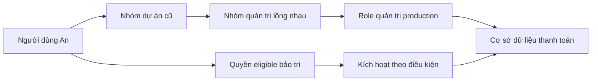

# Privilege review

## 1. Rà soát đặc quyền là gì?

**Privilege review** là quá trình đánh giá lại những quyền có khả năng tác động lớn để xác định chúng còn cần thiết, đúng chủ thể, đúng phạm vi và đáp ứng các điều kiện kiểm soát hay không. Kết quả không chỉ là một dấu xác nhận: quyền thừa phải được điều chỉnh hoặc thu hồi, và thay đổi phải được xác minh tại hệ thống thực thi.

Ví dụ, một kỹ sư từng được cấp quyền quản trị cơ sở dữ liệu production để hỗ trợ chuyển đổi hệ thống. Sau khi công việc kết thúc, quyền đó vẫn tồn tại qua một nhóm lồng nhau. Người quản lý có thể không nhìn thấy quyền trong danh sách cấp trực tiếp, nhưng kỹ sư vẫn có khả năng tác động tới dữ liệu thật.

Rà soát giúp phát hiện những quyền tích lũy như vậy, quyền của tài khoản không còn owner, khả năng tự nâng quyền và ngoại lệ đã hết lý do tồn tại. Mục tiêu là đưa quyền hiệu lực trở về nhu cầu hiện tại theo nguyên tắc ít quyền nhất.

Trong bài học này, “đặc quyền” không chỉ là role có tên `Administrator`. Nó bao gồm cả quyền quản lý danh tính, cấp credential, sửa policy, kiểm soát workload hoặc tác động tới tài nguyên quan trọng theo cách có thể dẫn tới hậu quả lớn.

## 2. Phân biệt rà soát đặc quyền với các hoạt động liên quan

| Hoạt động | Câu hỏi chính | Kết quả điển hình |
|---|---|---|
| Phê duyệt cấp quyền | Có nên cấp quyền cho nhu cầu được đề nghị? | Cho phép hoặc từ chối yêu cầu ban đầu |
| Privilege review | Quyền hiện có còn phù hợp với nhu cầu và rủi ro hiện tại không? | Giữ, giảm, thu hồi hoặc ngoại lệ có điều kiện |
| Giám sát truy cập | Có hành vi bất thường đang xảy ra không? | Cảnh báo và điều tra sự kiện |
| Kiểm toán | Có đủ bằng chứng về thiết kế và việc vận hành kiểm soát không? | Phát hiện, kết luận và yêu cầu khắc phục |
| Ứng phó sự cố | Làm sao ngăn tác động của truy cập nghi bị xâm nhập? | Cách ly, thu hồi khẩn cấp và điều tra |

Một quyền từng được phê duyệt không mặc nhiên hợp lệ mãi mãi. Công việc, hệ thống, owner hoặc mức nhạy cảm của tài nguyên có thể đã thay đổi.

Tương tự, log không có dấu hiệu bất thường không chứng minh quyền là cần thiết. Một tài khoản có thể giữ đặc quyền không sử dụng trong nhiều tháng và vẫn tạo ra rủi ro nếu bị chiếm quyền. Nếu có dấu hiệu xâm nhập, phải sử dụng quy trình ứng phó phù hợp thay vì chờ đợt rà soát định kỳ tiếp theo.

## 3. Xác định phạm vi đặc quyền cần rà soát

### 3.1. Danh tính con người và danh tính máy

Phạm vi thường cần bao gồm tài khoản quản trị cá nhân, tài khoản dùng chung còn tồn tại, service account, danh tính pipeline, tài khoản nhà cung cấp và tài khoản khẩn cấp. Mỗi loại cần bằng chứng khác nhau về mục đích và trách nhiệm quản lý.

| Loại chủ thể | Câu hỏi cần trả lời |
|---|---|
| Nhân viên có tài khoản quản trị | Người này còn làm nhiệm vụ cần quyền không? Tài khoản có gắn với cá nhân xác định không? |
| Nhà thầu hoặc bên hỗ trợ | Hợp đồng và nhu cầu hỗ trợ còn hiệu lực không? Phạm vi và thời hạn có đúng không? |
| Service account | Owner là ai, workload nào dùng nó và quyền có vượt chức năng không? |
| Danh tính triển khai | Ai có thể kích hoạt pipeline hoặc thay mã được chạy dưới danh tính đó? |
| Tài khoản khẩn cấp | Có được quản lý, giám sát và kiểm tra khả năng sử dụng theo mục đích khẩn cấp không? |

Không nên coi tài khoản máy là ngoại lệ khỏi rà soát vì nó không thuộc một nhân viên. Nó vẫn cần owner, mục đích, điều kiện nhận credential và quyền trên tài nguyên đích.

### 3.2. Quyền trực tiếp, quyền kế thừa và quyền đủ điều kiện kích hoạt

Quyền có thể đến từ nhiều đường: gán trực tiếp, nhóm lồng nhau, role kế thừa từ phạm vi cha, policy trên tài nguyên hoặc quyền nhận danh tính khác. Một số hệ thống còn có quyền **eligible**: chủ thể đủ điều kiện kích hoạt quyền khi đáp ứng các điều kiện nhất định.

Quyền eligible chưa hoạt động không giống quyền thường trực đang có hiệu lực, nhưng vẫn là một khả năng truy cập cần rà soát. Phải xem chủ thể có còn cần quyền kích hoạt không, có thể kích hoạt trong điều kiện nào và ai phê duyệt.



Trong ví dụ, gỡ một role gán trực tiếp không loại bỏ đường truy cập qua nhóm. Thu hồi đường qua nhóm cũng chưa chứng minh An không còn khả năng kích hoạt quyền bảo trì. Rà soát cần hiểu từng đường cấp quyền và kết quả tổng hợp tại tài nguyên.

### 3.3. Quyền quản lý quyền và khả năng leo thang

Một principal có thể không mang role quản trị dữ liệu nhưng có quyền sửa policy, tạo khóa của service account mạnh hơn hoặc triển khai mã dưới danh tính đặc quyền. Những khả năng này có thể tạo quyền gián tiếp.

Do đó, cần tìm cả những quyền như quản lý membership, gán role, impersonation, thay đổi quan hệ federation, quản lý credential và sửa thành phần được thực thi trong ngữ cảnh đặc quyền. Tên role có vẻ hẹp không đủ để kết luận mức ảnh hưởng là thấp.

## 4. Xây dựng danh mục và bằng chứng đáng tin cậy

Một đợt rà soát cần phạm vi rõ ràng: những hệ thống, tài nguyên, loại principal và loại đặc quyền nào được đưa vào. Nếu một hệ thống chưa cung cấp đủ dữ liệu, phải ghi nhận khoảng trống đó thay vì diễn giải dữ liệu thiếu thành không có quyền.

Đối với mỗi quyền hoặc đường truy cập, cần thu thập các thông tin liên quan:

| Nhóm bằng chứng | Thông tin hữu ích |
|---|---|
| Danh tính | ID ổn định, loại principal, trạng thái và owner |
| Quyền | Role, action, phạm vi tài nguyên, điều kiện và thời hạn |
| Nguồn cấp | Gán trực tiếp, nhóm, kế thừa, policy tài nguyên, eligible hoặc impersonation |
| Nhu cầu | Chức năng công việc, workload hoặc nhiệm vụ đang cần quyền |
| Lịch sử | Yêu cầu cấp ban đầu, người phê duyệt, thay đổi và ngoại lệ liên quan |
| Sử dụng | Lần dùng gần đây, loại thao tác, phạm vi log và độ tin cậy của dữ liệu |
| Kiểm soát | MFA hoặc cơ chế workload, JIT, giới hạn thao tác, quản lý credential và giám sát |
| Khắc phục | Người thực hiện, thay đổi dự kiến, kết quả và bằng chứng xác minh |

Nên sử dụng ID ổn định để tránh nhầm hai tài khoản trùng tên hiển thị. Dữ liệu lấy từ các nguồn khác nhau cũng cần ghi thời điểm chụp và phạm vi bao phủ, vì membership hoặc policy có thể thay đổi trong lúc rà soát.

Không đưa mật khẩu, private key hoặc nguyên access token vào hồ sơ rà soát. Cần biết credential nào tồn tại, ai có quyền tạo hoặc sử dụng, thời hạn và trạng thái quản lý; không cần thu thập giá trị bí mật để chứng minh quyền.

### Không sử dụng “lần dùng gần nhất” như tiêu chí duy nhất

Không có log sử dụng có thể do quyền không cần thiết, nhưng cũng có thể do log chưa bật, phạm vi thu thập thiếu hoặc hoạt động khẩn cấp hiếm xảy ra. Ngược lại, một quyền được dùng thường xuyên có thể vẫn quá rộng so với nhiệm vụ.

Ví dụ, tác vụ chỉ cần tạo báo cáo nhưng đang dùng role quản trị mỗi ngày. Tần suất sử dụng cao chứng minh tài khoản đang hoạt động, không chứng minh role quản trị là mức quyền tối thiểu.

Tín hiệu sử dụng giúp ưu tiên xem xét và đối chiếu nhu cầu; kết luận cuối cùng cần dựa trên chức năng, phạm vi và rủi ro thực tế.

## 5. Phân công người rà soát và trách nhiệm

Người rà soát cần hiểu nhu cầu và có đủ thông tin để quyết định. Chỉ gửi danh sách tên role cho quản lý rồi yêu cầu bấm “giữ tất cả” dễ tạo ra xác nhận hình thức.

Một cách phân công theo trách nhiệm:

| Vai trò | Trách nhiệm |
|---|---|
| Quản lý hoặc owner nghiệp vụ | Xác nhận chủ thể còn thực hiện nhiệm vụ cần quyền |
| Owner tài nguyên | Đánh giá phạm vi và mức quyền phù hợp trên hệ thống |
| Nhóm IAM hoặc an ninh | Cung cấp đường cấp quyền, kiểm tra policy và xung đột |
| Nhóm thực hiện thay đổi | Áp dụng điều chỉnh đã được quyết định |
| Người xác minh | Kiểm tra quyền hiệu lực sau thay đổi và lưu bằng chứng |

Một tổ chức nhỏ có thể có người kiêm nhiều vai trò, nhưng vẫn cần nhận diện xung đột lợi ích. Chủ thể không nên tự phê duyệt việc giữ đặc quyền của chính mình nếu yêu cầu tách nhiệm vụ đòi hỏi người đánh giá độc lập.

Quản lý nhân sự có thể xác nhận một kỹ sư đã chuyển nhóm, nhưng owner tài nguyên mới là người hiểu role nào đủ cho công việc còn lại. Với service account, owner ứng dụng xác nhận chức năng workload, còn owner tài nguyên giúp kiểm tra quyền đích.

Nếu không xác định được owner hoặc người đủ thẩm quyền đánh giá, cần có trạng thái xử lý và cơ chế chuyển cấp rõ ràng. Không được mặc định giữ vô thời hạn hoặc ghi đã hoàn thành chỉ vì không ai trả lời.

## 6. Đưa ra quyết định dựa trên nhu cầu và mức ảnh hưởng

Với từng đường truy cập, người rà soát nên trả lời các câu hỏi:

1. Principal còn tồn tại hợp lệ và có owner chịu trách nhiệm không?
2. Nhiệm vụ nào hiện tại cần quyền này, trên tài nguyên nào?
3. Có thể thay quyền hiện tại bằng tập thao tác hoặc phạm vi hẹp hơn không?
4. Quyền cần thường trực hay chỉ cần kích hoạt trong một khoảng thời gian?
5. Có quyền kế thừa, quyền trùng lặp hoặc khả năng tự nâng quyền nào khác không?
6. Có xung đột tách nhiệm vụ hoặc điều kiện kiểm soát chưa đáp ứng không?
7. Nếu thay đổi, phụ thuộc vận hành nào cần được xử lý để không gây gián đoạn ngoài dự kiến?

Những quyết định thường gặp gồm:

| Quyết định | Ý nghĩa | Bằng chứng cần có |
|---|---|---|
| Giữ | Quyền vẫn cần và có phạm vi phù hợp | Nhu cầu hiện tại, owner và lý do |
| Giảm | Chức năng còn cần nhưng quyền quá rộng | Tập quyền hoặc phạm vi thay thế |
| Thu hồi | Không còn nhu cầu hoặc cấp sai | Đường cấp phải loại bỏ và người thực hiện |
| Chuyển sang JIT hoặc quyền eligible có kiểm soát | Nhu cầu không thường xuyên | Điều kiện kích hoạt, thời hạn và cách xác minh |
| Ngoại lệ có thời hạn | Chưa thể đáp ứng đầy đủ policy vì lý do cụ thể | Owner rủi ro, hạn kết thúc, biện pháp và kế hoạch khắc phục |
| Chưa đủ bằng chứng | Chưa thể ra quyết định đáng tin cậy | Dữ liệu thiếu, người bổ sung và thời hạn xử lý |

“Chưa đủ bằng chứng” là trạng thái còn mở, không phải một lần xác nhận quyền. Quyền có thể cần biện pháp tạm thời theo rủi ro và policy của tổ chức trong khi chờ làm rõ.

Khi xem xét tách nhiệm vụ, cần đánh giá các quyền kết hợp. Chẳng hạn, quyền tự sửa policy và quyền tự phê duyệt kích hoạt có thể cho phép một người vượt qua kiểm soát mà từng role riêng lẻ không thể hiện rõ.

## 7. Quy trình rà soát từ đầu đến cuối

```text
Xác định phạm vi và owner
    → Chụp danh mục quyền và các đường cấp
    → Thu thập bằng chứng nhu cầu, sử dụng và kiểm soát
    → Người có thẩm quyền đánh giá
    → Ra quyết định có lý do
    → Áp dụng thay đổi hoặc quản lý ngoại lệ
    → Xác minh quyền hiệu lực và truy cập còn tồn tại
    → Đóng các mục đã hoàn tất, theo dõi mục còn mở
```

### 7.1. Chuẩn bị phạm vi và tiêu chí

Chọn tài nguyên và nhóm quyền theo mức ảnh hưởng. Quyền quản lý IAM, kiểm soát môi trường production hoặc đọc dữ liệu nhạy cảm cần được nhận diện rõ. Xác định thời điểm dữ liệu, người chịu trách nhiệm, hạn phản hồi và điều kiện đóng đợt rà soát.

Tần suất nên dựa trên rủi ro và yêu cầu áp dụng tại tổ chức. Một lịch hằng quý có thể là ví dụ cho một nhóm quyền, nhưng không phải chuẩn chung cho mọi hệ thống. Sự kiện chuyển nhóm, chấm dứt hợp đồng, ngừng ứng dụng hoặc thay đổi lớn về quyền có thể kích hoạt rà soát ngay mà không chờ lịch định kỳ.

### 7.2. Thu thập và đối chiếu

Đối chiếu danh mục quyền với trạng thái nhân sự, danh mục ứng dụng, owner tài nguyên và dữ liệu hoạt động. Giữ được nguồn cấp và các đường truy cập để người rà soát biết một thay đổi sẽ tác động ở đâu.

Nếu một nhóm dùng chung cấp quyền cho nhiều hệ thống, gỡ một thành viên khỏi nhóm có thể ảnh hưởng nhiều tài nguyên. Cần xác định đúng mục tiêu thay đổi và quyền nào còn cần bằng đường cấp khác, thay vì chỉ thao tác theo tên role trong bảng rà soát.

### 7.3. Quyết định và thực thi

Mỗi quyết định cần lý do, người quyết định và phạm vi thay đổi đủ cụ thể. Các yêu cầu giảm hoặc thu hồi được chuyển thành công việc có owner, thời hạn và trạng thái áp dụng.

Không coi việc bấm “revoke” trong một công cụ rà soát là bằng chứng quyền đã bị gỡ trên tài nguyên. Hệ thống tích hợp có thể lỗi, có độ trễ hoặc không quản lý một đường cấp quyền khác. Phải theo dõi kết quả thực thi.

### 7.4. Xác minh và đóng

Đọc lại membership, binding hoặc policy tại nguồn thực thi và đánh giá quyền hiệu lực theo khả năng của nền tảng. Có thể dùng công cụ phân tích quyền, mô phỏng policy hoặc kiểm tra truy cập an toàn đã được cho phép; không cần thực hiện một hành động phá hủy để chứng minh quyền đã mất.

Nếu quyền bị loại bỏ nhưng phiên hoặc token đã cấp vẫn có thể dùng, ghi nhận hành vi đó và xử lý theo yêu cầu thu hồi của hệ thống. Chỉ đóng mục khi điều kiện xác minh đã đáp ứng hoặc ngoại lệ có thẩm quyền đã ghi nhận giới hạn còn lại.

## 8. Ví dụ: kỹ sư chuyển nhóm vẫn có quyền production

An từng hỗ trợ migration của hệ thống thanh toán. Hiện An đã chuyển sang nhóm phát triển nội bộ nhưng vẫn thuộc nhóm dự án cũ. Nhóm này được lồng vào nhóm quản trị production. An còn có một quyền eligible bảo trì cơ sở dữ liệu, có thể kích hoạt theo điều kiện đã cấu hình.

Hồ sơ rà soát cần thể hiện các mục riêng:

| Mục | Bằng chứng | Quyết định minh họa |
|---|---|---|
| Quyền quản trị qua nhóm dự án cũ | Migration đã kết thúc, An không còn nhiệm vụ vận hành | Loại bỏ đường cấp không còn cần |
| Quyền eligible bảo trì | Owner xác nhận không còn trách nhiệm bảo trì | Thu hồi điều kiện kích hoạt |
| Quyền đọc tài liệu kỹ thuật | Vẫn cần cho công việc mới và không kéo theo quyền production | Giữ theo phạm vi phù hợp |

Không nên chỉ xóa toàn bộ nhóm dự án vì nhóm có thể còn được dùng bởi những thành viên khác hoặc cho tài nguyên khác. Cần chọn thay đổi đúng với quyền của An và thiết kế cấp quyền hiện có. Nếu cấu trúc nhóm đang trộn nhiều mục đích, có thể cần một công việc tái cấu trúc riêng với đánh giá ảnh hưởng.

Sau áp dụng, nhóm xác minh kiểm tra:

- An không còn nhận quyền production qua nhóm trực tiếp hoặc lồng nhau khác.
- Quyền eligible đã bị thu hồi và không thể kích hoạt lại theo đường đó.
- Những phiên, token hoặc credential liên quan được xử lý theo khả năng và policy của nền tảng.
- Quyền cần cho công việc mới vẫn hoạt động trong phạm vi được phê duyệt.

Trạng thái cuối không chỉ là “owner đã đồng ý”. Nó cần bằng chứng quyền thừa đã được điều chỉnh và tác động đã được kiểm tra.

## 9. Rà soát service account và danh tính triển khai

Với danh tính máy, cần xem đồng thời hai phía: ai có thể sử dụng danh tính và danh tính đó được làm gì.

Ví dụ, `svc:prod:release` được phép triển khai một ứng dụng. Một role triển khai hẹp vẫn có rủi ro nếu bất kỳ nhánh mã hoặc runner nào cũng có thể nhận credential của nó. Ngược lại, điều kiện nhận token chặt không bù cho role quản trị toàn tổ chức vượt nhu cầu triển khai.

Các câu hỏi đặc thù gồm:

- Workload nào đang sử dụng tài khoản và owner có xác nhận được không?
- Ai có thể sửa mã, cấu hình hoặc pipeline chạy bằng danh tính này?
- Ai được tạo khóa, nhận token, impersonate hoặc thay đổi cấu hình federation?
- Quyền có được giới hạn theo môi trường và tài nguyên không?
- Credential dài hạn còn tồn tại ở đâu, có còn cần và có được quản lý không?
- Khi workload ngừng hoạt động, quyền nhận credential mới và quyền trên tài nguyên đã được kết thúc chưa?

Một lần sử dụng token gần đây chỉ chứng minh có hoạt động mang danh tính đó. Cần đối chiếu workload, nguồn cấp token và hành động đích để xác nhận hoạt động đúng dự kiến.

Không vội thu hồi một tài khoản máy chỉ vì không thấy owner phản hồi mà chưa xử lý phụ thuộc và policy của tổ chức. Tuy nhiên, thiếu owner phải được coi là vấn đề còn mở, có người xử lý và biện pháp theo mức rủi ro; không được trở thành lý do giữ đặc quyền vô hạn.

## 10. Ngoại lệ và quyền khẩn cấp

Một hệ thống cũ có thể chưa hỗ trợ role hẹp hoặc cơ chế cấp quyền có thời hạn. Nếu phải giữ quyền rộng để duy trì hoạt động, ngoại lệ cần mô tả rõ giới hạn kỹ thuật, nhu cầu và mức ảnh hưởng.

Ngoại lệ nên có owner rủi ro, thời hạn, biện pháp giảm thiểu, kế hoạch khắc phục và điều kiện đánh giá lại. Lý do như “đã cấp từ lâu” hoặc “có thể sẽ cần” không đủ để giải thích một đặc quyền tồn tại lâu dài.

Tài khoản break-glass phục vụ sự cố hiếm gặp có thể không xuất hiện trong log sử dụng thường xuyên. Không nên tự động xóa chỉ vì không dùng gần đây. Cần đánh giá tính cần thiết, cơ chế bảo vệ credential, khả năng sử dụng khi hệ thống chính gặp lỗi, giám sát việc dùng và rà soát sau mỗi lần sử dụng.

Giữ quyền khẩn cấp không có nghĩa cho mọi người sử dụng như đường quản trị thường ngày. Phải biết ai có khả năng tiếp cận credential hoặc kích hoạt tài khoản và cách truy vết đến người đã sử dụng.

## 11. Bằng chứng hoàn thành và các chỉ số hữu ích

Một hồ sơ hoàn thành cần nối được các sự kiện:

```text
Quyền quan sát được
    → Nguồn cấp và nhu cầu đã đánh giá
    → Người có thẩm quyền ra quyết định
    → Thay đổi được áp dụng
    → Quyền hiệu lực được xác minh
```

Các mục giữ nguyên cũng cần lý do và người xác nhận. Các mục chưa thực thi, xác minh thất bại hoặc thiếu dữ liệu phải tiếp tục được theo dõi; không gộp vào tổng hoàn tất chỉ vì đã có câu trả lời.

| Chỉ số | Ý nghĩa và giới hạn |
|---|---|
| Tỷ lệ mục đã được đánh giá | Cho biết tiến độ ra quyết định, chưa chứng minh thay đổi đã hoàn thành |
| Tỷ lệ quyết định thu hồi/giảm đã xác minh | Phản ánh mức hoàn thành khắc phục thực tế |
| Số mục thiếu owner hoặc quá hạn | Cho thấy khoảng trống trách nhiệm và xử lý |
| Thời gian từ quyết định đến xác minh | Giúp nhận diện quyền thừa còn tồn tại sau phê duyệt |
| Số ngoại lệ hết hạn chưa xử lý | Cho thấy rủi ro ngoại lệ trở thành thường trực |
| Phạm vi hệ thống được bao phủ | Giúp tránh kết luận toàn tổ chức từ dữ liệu chỉ của một phần hệ thống |

Không đặt mục tiêu phải thu hồi một tỷ lệ cố định để chứng minh rà soát có hiệu quả. Điều đó có thể khuyến khích gỡ quyền cần thiết hoặc tạo quyết định hình thức. Chất lượng nằm ở bằng chứng, phạm vi và việc thực hiện đúng quyết định.

Log và hồ sơ rà soát có thể chứa thông tin nhạy cảm về cấu trúc quyền. Cần kiểm soát quyền đọc, bảo vệ khỏi sửa trái phép và áp dụng thời hạn lưu giữ phù hợp với yêu cầu của tổ chức.

## 12. Các lỗi thường gặp

| Lỗi | Hệ quả | Cách cải thiện |
|---|---|---|
| Chỉ xem role gán trực tiếp | Bỏ sót nhóm lồng nhau, kế thừa và impersonation | Thu thập các đường dẫn tạo quyền hiệu lực |
| Người dùng tự xác nhận quyền của mình | Khó kiểm soát xung đột lợi ích | Chỉ định reviewer có thẩm quyền và mức độc lập phù hợp |
| Giữ vì quyền đã được phê duyệt trước đây | Không phản ánh nhu cầu đã thay đổi | Yêu cầu bằng chứng về nhiệm vụ hiện tại |
| Thu hồi chỉ dựa vào không có log | Có thể ảnh hưởng quyền khẩn cấp hoặc hệ thống thiếu log | Đánh giá mức bao phủ log và nhu cầu thực tế |
| Bỏ qua service account | Đặc quyền của phần mềm không có owner rõ ràng | Rà soát cả quyền sử dụng danh tính và quyền đích |
| Đóng ngay sau quyết định | Quyền có thể vẫn còn do lỗi áp dụng | Xác minh tại nguồn thực thi |
| Không đánh giá phiên hoặc token đã cấp | Thu hồi danh nghĩa chưa chặn truy cập như dự kiến | Xem cơ chế phiên, token và yêu cầu thu hồi |
| Ngoại lệ không có thời hạn | Quyền rộng tồn tại vô hạn | Owner, thời hạn, biện pháp và kế hoạch xử lý |

## 13. Bài tập áp dụng

Một tổ chức rà soát quyền production và phát hiện bốn tình huống: một kỹ sư đã chuyển nhóm nhưng còn quyền qua nhóm lồng nhau; một service account không rõ owner nhưng vẫn gọi API; một quyền eligible không được kích hoạt trong nhiều tháng; một tài khoản khẩn cấp không có log sử dụng trong kỳ.

Với mỗi tình huống, hãy:

1. Xác định bằng chứng còn thiếu trước khi quyết định.
2. Chỉ ra người hoặc nhóm phù hợp để rà soát.
3. Liệt kê các đường cấp quyền phải xem xét.
4. Đề xuất giữ, giảm, thu hồi, ngoại lệ hoặc trạng thái cần làm rõ, kèm lý do.
5. Mô tả thay đổi cần áp dụng và cách xác minh an toàn.
6. Giải thích điều kiện nào cho phép đóng mục rà soát.

Một phương án tốt không xử lý cả bốn bằng cùng một quy tắc “không dùng thì xóa”. Nó phân biệt nhu cầu công việc, trạng thái owner, khả năng kích hoạt, mục đích khẩn cấp và độ đầy đủ của bằng chứng. Mọi quyết định thay đổi đều cần theo đến kết quả hiệu lực.

## 14. Các điểm cần ghi nhớ

Privilege review là việc đánh giá lại nhu cầu và tính phù hợp của đặc quyền trong hiện tại. Phạm vi phải bao gồm quyền hiệu lực, quyền đủ điều kiện kích hoạt, khả năng nhận danh tính khác và các principal không phải con người.

Một đợt rà soát có giá trị cần người đánh giá có thẩm quyền, bằng chứng đủ rõ, quyết định có lý do và xác minh sau thực thi. Phê duyệt giữ quyền, quyết định thu hồi và quyền thực sự đã thay đổi là những trạng thái khác nhau; chỉ khi phân biệt được chúng, tổ chức mới kiểm soát được đặc quyền trong toàn bộ vòng đời IAM.
