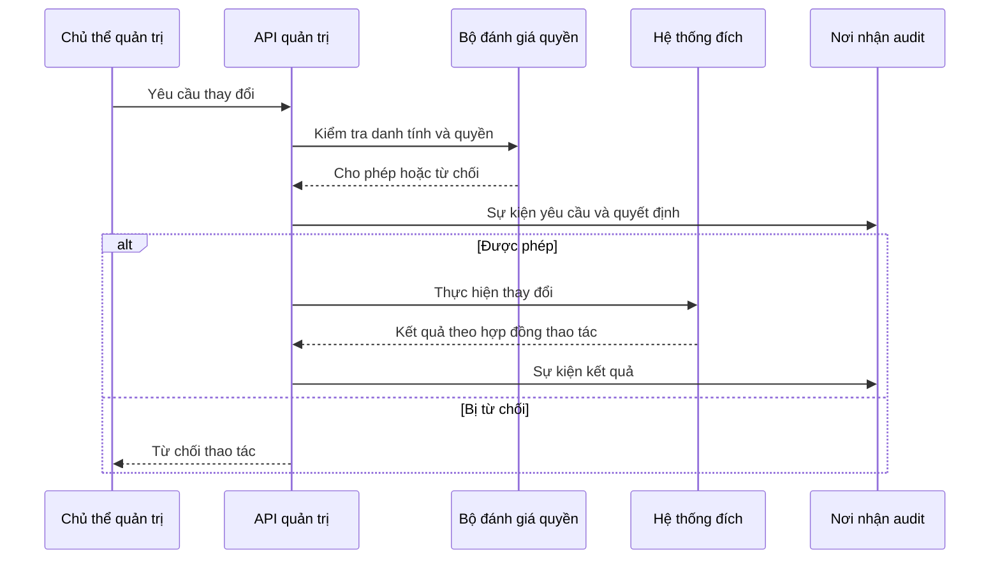

# Admin action audit

## 1. Ghi lại việc sử dụng quyền quản trị để có thể giải thích và kiểm chứng

**Admin action audit** là việc tạo và quản lý bằng chứng về các hành động quản trị: ai thực hiện, dưới danh tính và quyền nào, đối với tài nguyên nào, thay đổi điều gì, khi nào và kết quả ra sao.

Trong IAM, một thao tác nhỏ trên giao diện có thể tạo tác động lớn. Thêm người vào group đặc quyền, cho phép một workload đóng vai service account hoặc thay đổi chính sách MFA đều có thể mở thêm đường truy cập. Nếu chỉ biết “có quản trị viên đăng nhập”, nhóm vận hành chưa thể giải thích ai đã thay đổi quyền và vì sao.

Ví dụ, một người vận hành cấp role quản lý production cho một tài khoản khác. Audit cần giúp xác định ít nhất:

- Người khởi tạo yêu cầu là ai và hệ thống đã xác thực danh tính đó như thế nào ở mức thông tin cần thiết.
- Principal nào thực sự thực hiện thay đổi ở hệ thống đích.
- Role nào được cấp, cho ai, trên phạm vi nào và có thời hạn không.
- Quyết định phân quyền có cho phép thao tác hay yêu cầu bị từ chối.
- Thay đổi đã được áp dụng, đang chờ xử lý hay thất bại.
- Yêu cầu phê duyệt, sự cố hoặc lần nâng quyền nào liên quan nếu quy trình yêu cầu.

Audit hỗ trợ truy vết trách nhiệm, điều tra sự cố và kiểm tra việc sử dụng đặc quyền. Nó không tự ngăn được thao tác trái phép; việc chặn vẫn thuộc về xác thực, phân quyền và những kiểm soát thực thi liên quan.

## 2. Audit khác log ứng dụng và access log như thế nào?

| Loại dữ liệu | Câu hỏi thường trả lời | Giới hạn nếu dùng riêng cho audit quản trị |
|---|---|---|
| Log kỹ thuật của ứng dụng | Vì sao chương trình lỗi hoặc chạy chậm? | Có thể thiếu actor, thay đổi quyền và kết quả nghiệp vụ |
| Access log HTTP | Request nào đi đến endpoint nào, trả mã gì? | Không luôn biết đối tượng nào bị sửa và thay đổi có thực sự hoàn tất không |
| Audit hành động quản trị | Ai dùng quyền gì để thực hiện thay đổi nào, kết quả ra sao? | Cần thiết kế ngữ nghĩa, độ bao phủ và bảo vệ bằng chứng |
| Cảnh báo bảo mật | Sự kiện hoặc chuỗi sự kiện nào cần xử lý? | Là kết quả phân tích; không thay thế dữ liệu audit gốc |

Một dòng `POST /admin/roles 200` chưa cho biết role nào được cấp và cho principal nào. Mã HTTP thành công cũng có thể chỉ thể hiện việc nhận một yêu cầu xử lý bất đồng bộ, chưa phản ánh thay đổi đã được áp dụng tại đích.

Ngược lại, audit không cần chứa toàn bộ stack trace hoặc mọi byte của request. Mục tiêu là lưu bằng chứng có cấu trúc đủ để giải thích hành động, với dữ liệu nhạy cảm được giới hạn phù hợp.

## 3. Xác định hành động nào phải được ghi nhận

Không nên chỉ bắt đầu từ danh sách endpoint có chữ `admin`. Cần kiểm kê những khả năng làm thay đổi quyền truy cập hoặc làm suy yếu cơ chế kiểm soát.

| Nhóm hành động | Ví dụ cần xem xét |
|---|---|
| Quản lý danh tính | Tạo, vô hiệu hóa, xóa hoặc khôi phục tài khoản |
| Cấp và thu hồi quyền | Thêm thành viên group, gán role, sửa ACL, thay phạm vi tài nguyên |
| Quản lý credential | Tạo khóa, reset secret, cấp chứng thư, thu hồi credential |
| Xác thực và liên kết | Sửa MFA, trust federation, ánh xạ subject hoặc cấu hình đăng nhập |
| Truy cập đặc quyền | Yêu cầu và kích hoạt nâng quyền, đóng vai principal, mở phiên quản trị |
| Thay đổi điều kiện bảo vệ | Sửa chính sách thiết bị, nguồn truy cập hoặc kiểm soát phiên |
| Quản lý audit | Tắt nguồn log, đổi nơi gửi, sửa retention hoặc quyền đọc và xóa bằng chứng |
| Thao tác tài nguyên nhạy cảm | Export dữ liệu, thay danh tính runtime hoặc triển khai code có thể hành động với quyền cao |

Phải xem cả thao tác thành công, bị từ chối và thất bại. Một chuỗi yêu cầu cấp quyền bị từ chối có thể là dấu hiệu cần điều tra; một yêu cầu được phép nhưng thất bại giữa chừng có thể để lại trạng thái cần đối chiếu.

Phạm vi còn gồm giao diện, API, CLI, pipeline, đường quản trị trực tiếp và công cụ khẩn cấp. Nếu chỉ ghi sự kiện ở giao diện web, một admin dùng API hoặc công cụ nền tảng có thể thay đổi trạng thái mà không đi qua nguồn audit đó.

## 4. Một sự kiện audit cần trả lời những gì?

### 4.1. Định danh sự kiện và thời gian

Mỗi sự kiện nên có định danh ổn định để chống xử lý trùng ở hệ thống thu thập và phục vụ đối chiếu. Cần phân biệt ID của sự kiện với ID của yêu cầu, của thao tác dài hạn và của phiên.

Ghi thời điểm sự kiện xảy ra và thời điểm hệ thống thu thập tiếp nhận khi phù hợp. Dùng định dạng thời gian có múi giờ rõ ràng và quản lý đồng hồ của nguồn ghi. Log được nhận sau không nhất thiết là hành động xảy ra sau.

### 4.2. Actor và principal thực thi

**Actor** là chủ thể khởi tạo hành động theo ngữ cảnh đáng tin cậy. **Principal thực thi** là danh tính mà hệ thống đích dùng để thực hiện hoặc đánh giá thao tác.

Khi một kỹ sư chạy công cụ, rồi công cụ dùng service account để sửa policy, audit cần nối được cả hai. Nếu là pipeline tự động, cần ghi danh tính workload cùng execution hoặc nguồn khởi chạy có thể xác minh, không tự gán một con người làm actor nếu không có bằng chứng.

Không lấy tên người dùng từ một header tự khai để coi là actor đã xác thực. Danh tính phải đến từ ngữ cảnh xác thực hoặc chuỗi ủy quyền đã được kiểm tra. Địa chỉ IP, tên thiết bị hoặc user-agent là tín hiệu hỗ trợ, không phải bằng chứng độc lập đủ để nhận diện con người.

### 4.3. Hành động, đối tượng và phạm vi

Dùng tên hành động nhất quán, chẳng hạn `role_binding.create`, thay vì chỉ `update`. Đối tượng cần có ID đủ ổn định để tránh nhầm khi tên hiển thị thay đổi hoặc được tái sử dụng.

Phân biệt principal được cấp quyền với principal thực hiện cấp quyền. Ghi môi trường, tenant hoặc phạm vi tài nguyên khi chúng quyết định ý nghĩa của hành động. Role “operator” trong staging và role cùng tên trong production có thể mang mức rủi ro khác nhau.

### 4.4. Cơ sở quyền và quyết định

Khi cần, lưu tham chiếu đến grant nâng quyền, phiên quản trị, quyết định policy, phê duyệt hoặc lý do thay đổi. Có thể ghi phương thức hoặc mức xác thực theo dữ liệu hệ thống cung cấp, nhưng không ghi mã OTP, token hay dữ liệu bí mật dùng để xác thực.

Một mã phê duyệt trong request chỉ là dữ liệu đầu vào cho đến khi server xác minh nó. Audit nên thể hiện quyết định đã được hệ thống kiểm tra, không chỉ sao chép tuyên bố của client.

### 4.5. Kết quả và thay đổi thực tế

Cần phân biệt thao tác được yêu cầu với thao tác thực sự xảy ra. Trạng thái như `denied`, `accepted`, `succeeded`, `failed` hoặc `partially_applied` phải có ý nghĩa được định nghĩa rõ trong hệ thống.

Nếu lưu before/after hoặc diff, chỉ ghi các trường cần thiết và đã được lọc. Với thay đổi quyền, role ID, phạm vi, thời hạn và version policy thường hữu ích hơn toàn bộ request chứa dữ liệu nhạy cảm.

## 5. Ví dụ sự kiện cấp role qua một công cụ quản trị

Giả sử kỹ sư vận hành đã được phép cấp một role giới hạn cho tài khoản xử lý sự cố. Công cụ quản trị Java gửi yêu cầu đến hệ thống đích bằng service account riêng. Một sự kiện hoàn tất có thể được mô tả như sau:

```json
{
  "schemaVersion": 1,
  "eventId": "audit-example-002",
  "eventType": "admin.action.completed",
  "occurredAt": "2026-01-15T03:10:00Z",
  "requestId": "request-example-001",
  "operationId": "operation-example-001",
  "actor": {
    "type": "human",
    "id": "operator-stable-id"
  },
  "effectivePrincipal": {
    "type": "service_account",
    "id": "access-management-tool-prod"
  },
  "action": "role_binding.create",
  "target": {
    "principalId": "responder-stable-id",
    "roleId": "service-restart-role",
    "resourceId": "production/billing-api"
  },
  "authorization": {
    "decision": "allow",
    "elevationGrantId": "grant-example-001",
    "approvalReference": "approval-example-001"
  },
  "change": {
    "bindingId": "binding-example-001",
    "previousState": "absent",
    "newState": "active",
    "expiresAt": "2026-01-15T03:30:00Z"
  },
  "result": {
    "status": "succeeded",
    "resourceVersion": "policy-version-example-018"
  }
}
```

Đây là schema và thời gian minh họa, không phải định dạng bắt buộc của một sản phẩm. Một hệ thống thực tế cần chuẩn hóa theo nguồn sự kiện và các quan hệ ủy quyền mà nó có thể xác minh.

Sự kiện trên chỉ nên được ghi là `succeeded` khi thay đổi đã được xác nhận theo hợp đồng của hệ thống đích. Nếu API chỉ xếp yêu cầu vào hàng đợi, cần ghi trạng thái nhận yêu cầu và tạo sự kiện kết quả sau đó. Không đổi nghĩa `accepted` thành `succeeded` để dashboard trông thuận tiện hơn.

Nếu thao tác bị từ chối, không ghi before/after như thể role đã được cấp. Sự kiện bị từ chối vẫn cần nêu actor đã xác định được, hành động yêu cầu, đối tượng trong phạm vi được phép ghi và lý do dạng mã đã được làm sạch.

## 6. Ghi sự kiện ở đâu để phản ánh đúng kết quả?

Một luồng quản trị thường có nhiều mốc:



Sơ đồ thể hiện các mốc logic, không yêu cầu mỗi lần ghi đều phải gọi đồng bộ một hệ thống log từ xa. Cơ chế lưu và chuyển tiếp cần được thiết kế theo mức rủi ro và khả năng chịu lỗi.

### Ghi ý định không thay thế ghi kết quả

Một sự kiện `role change requested` chỉ chứng minh hệ thống ghi nhận ý định. Nếu tiến trình lỗi trước khi gọi đích, role chưa chắc đã thay đổi. Ngược lại, nếu thay đổi thành công rồi tiến trình lỗi trước khi gửi log, có thể thiếu sự kiện kết quả dù trạng thái đích đã đổi.

Khi thay đổi dữ liệu và tạo sự kiện có thể nằm trong cùng một transaction, một cơ chế lưu sự kiện bền vững cùng giao dịch, chẳng hạn transactional outbox phù hợp, giúp giảm khoảng trống giữa hai việc. Nếu đích là hệ thống bên ngoài, không thể mặc định một transaction cục bộ bao phủ luôn thao tác từ xa; cần ID đối chiếu, trạng thái thao tác và cơ chế xác minh kết quả.

### Retry và thao tác bất đồng bộ

Gắn request hoặc operation ID giúp nối các lần thử với một ý định. Mỗi sự kiện vẫn cần ID riêng. Nếu hệ thống chuyển tiếp cùng một sự kiện nhiều lần, bên nhận có thể loại trùng theo event ID mà không làm mất những lần thử thực sự khác nhau.

Không retry một thay đổi đặc quyền chỉ vì gửi log bị lỗi, vì lần thay đổi đầu tiên có thể đã hoàn tất. Cần biết trạng thái thực tế và khả năng xử lý lặp của thao tác trước khi thực hiện lại.

Với thao tác nhiều tài nguyên, phải thể hiện kết quả từng phần hoặc các sự kiện con có thể đối chiếu. Một dòng “failed” chung có thể che việc một nửa số quyền đã được cấp.

## 7. Audit phải được bảo vệ khỏi chính đặc quyền đang được giám sát

Quản trị viên có thể có quyền thay hệ thống được theo dõi. Nếu cùng người đó cũng có thể sửa hoặc xóa toàn bộ bằng chứng mà không để lại dấu vết, giá trị kiểm toán bị suy giảm.

Một thiết kế phù hợp thường kết hợp:

- Chuyển log sang nơi lưu trữ có quyền quản lý tách biệt phù hợp với mức rủi ro.
- Cho nguồn ghi quyền gửi sự kiện cần thiết, không mặc định có quyền sửa hoặc xóa mọi sự kiện đã lưu.
- Giới hạn quyền đọc, export, thay retention và quản lý nơi lưu audit.
- Có cơ chế hạn chế sửa hoặc xóa theo thời gian lưu giữ khi hạ tầng hỗ trợ và chính sách yêu cầu.
- Ghi nhận, cảnh báo các thay đổi đối với cấu hình audit và quyền trên kho bằng chứng.
- Theo dõi nguồn ngừng gửi, độ trễ và khoảng trống dữ liệu.

Lưu trữ append-only hoặc có cơ chế bảo toàn tính toàn vẹn giúp phát hiện hay hạn chế thay đổi sau khi ghi, nhưng không tự chứng minh sự kiện ban đầu là đầy đủ và đúng sự thật. Một nguồn bị chiếm quyền có thể ngừng phát hoặc tạo sự kiện sai trước khi chuyển đến kho bảo vệ.

Hash hoặc chữ ký cũng chỉ có ý nghĩa trong mô hình tin cậy cụ thể: ai giữ khóa, thành phần nào tạo dữ liệu và bằng chứng được chuyển đi khi nào. Không nên gọi một file log là “không thể giả mạo” chỉ vì có trường hash.

Đối chiếu nguồn độc lập, chẳng hạn audit tại tài nguyên đích với log của công cụ quản trị, giúp tăng khả năng phát hiện sai khác. Không mặc định hai nguồn là độc lập nếu chúng cùng bị một đường quản trị kiểm soát.

## 8. Tránh biến audit thành nơi rò rỉ dữ liệu

Một log quản trị có thể rất nhạy cảm vì chứa sơ đồ quyền, thông tin tài khoản và chi tiết truy cập. Lưu nhiều hơn không luôn tạo bằng chứng tốt hơn.

| Dữ liệu | Hướng xử lý |
|---|---|
| Mật khẩu, client secret, access token, khóa riêng | Không ghi giá trị; dùng ID hoặc version phù hợp khi cần đối chiếu |
| Secret vừa tạo hoặc reset | Ghi sự kiện tạo/reset, đối tượng và kết quả; không ghi secret mới vào before/after |
| Policy hoặc dữ liệu cấu hình | Chỉ ghi trường, diff hoặc tham chiếu version cần thiết sau khi lọc |
| Thông tin định danh cá nhân | Chỉ giữ mức cần cho mục đích audit, giới hạn người đọc và cách export |
| Lý do tự do hoặc thông báo lỗi | Giới hạn kích thước, làm sạch và tránh đưa dữ liệu client thành cấu trúc log tin cậy |
| Payload nghiệp vụ | Không sao chép toàn bộ vào audit chỉ vì request có quyền quản trị |

Ưu tiên log có cấu trúc với schema rõ. Dữ liệu do client nhập có thể chứa ký tự xuống dòng hoặc nội dung giống một bản ghi khác; hệ thống cần mã hóa và xử lý đúng để không tạo log giả qua việc ghép chuỗi.

Quyền đọc audit không nên mặc định đi cùng quyền vận hành ứng dụng. Một người được restart dịch vụ chưa chắc cần xem toàn bộ lịch sử truy cập của mọi người dùng. Việc tìm kiếm, export và xóa bằng chứng cũng cần được kiểm soát theo chính sách.

Retention phải có mục đích và phạm vi rõ, gồm cả nguồn gốc, bản sao và dữ liệu đã export. Không tự đặt thời hạn cố định cho mọi loại audit và cũng không giữ vô hạn chỉ vì chưa có người chịu trách nhiệm.

## 9. Từ dữ liệu audit đến phát hiện hành vi cần điều tra

Audit hữu ích hơn khi có thể tìm và nối các sự kiện theo actor, principal đích, phạm vi tài nguyên và operation ID. Các dấu hiệu cần xem xét có thể gồm:

- Cấp đặc quyền cao ngoài phạm vi phê duyệt hoặc không có quyết định nâng quyền hợp lệ khi policy yêu cầu.
- Một actor vừa cấp role cho principal khác, vừa tạo credential cho principal đó.
- Thay đổi trust để một nguồn mới có thể đóng vai danh tính production.
- Tắt audit hoặc thay quyền xóa log ngay trước một thao tác nhạy cảm.
- Hành động thành công sau khi grant tạm đã hết hạn theo nguồn quyền dự kiến.
- Dùng tài khoản khẩn cấp mà không có kích hoạt tương ứng.

Những dấu hiệu này không tự chứng minh hành vi độc hại. Pipeline được cho phép có thể thực hiện nhiều thay đổi liên tiếp; một principal cũng có thể có quyền từ đường khác. Phải đối chiếu ngữ cảnh, quyền hiệu lực và dữ liệu nguồn trước khi kết luận.

Một quy tắc minh họa có thể diễn đạt như sau:

```text
Tìm một chuỗi sự kiện trong phạm vi cần giám sát:
    actor X cấp role nhạy cảm cho principal Y
    VÀ có sự kiện tạo credential cho Y liên quan sau đó
    VÀ chưa tìm thấy cơ sở phê duyệt phù hợp theo policy

Kết quả:
    tạo tín hiệu điều tra với event ID và operation ID
    không đưa giá trị credential vào cảnh báo
```

Khoảng thời gian, mức nhạy cảm và điều kiện đối chiếu cần được chọn theo hệ thống. Việc chưa tìm thấy phê duyệt có thể do thiếu log hoặc dữ liệu đến chậm, nên cảnh báo phải phản ánh mức chắc chắn thay vì biến thiếu dữ liệu thành kết luận đã có vi phạm.

Cảnh báo cần có người hoặc quy trình tiếp nhận. Thu thập rất nhiều sự kiện nhưng không ai xử lý hành động nhạy cảm hoặc nguồn log bị mất sẽ làm giảm giá trị thực tế của audit.

## 10. Xử lý khi hệ thống audit gặp lỗi

Cần quyết định trước thao tác nào yêu cầu bằng chứng bền vững trước khi thực hiện, thao tác nào có thể tiếp tục với buffer hoặc cơ chế chuyển tiếp có kiểm soát. Quyết định phụ thuộc tác động của thao tác và khả năng phục hồi, không nên ngầm phát sinh từ một khối `catch` bỏ qua lỗi ghi log.

Ví dụ, tạo credential quản trị mới có thể cần điều kiện audit chặt hơn một thao tác xem trạng thái ít nhạy cảm. Nếu hệ thống cho phép tiếp tục trong một điều kiện suy giảm cụ thể, phải xác định độ bền, giới hạn dung lượng, thời gian và cảnh báo cho cơ chế lưu tạm.

Không dùng bộ nhớ không bền vững rồi tuyên bố mọi hành động đều đã có bằng chứng an toàn. Nếu có mất dữ liệu, cần ghi nhận khoảng trống, truy nguồn từ các nguồn khác và báo trạng thái đúng thực tế.

Nếu thay đổi tại đích đã thành công nhưng ghi audit thất bại, không báo rằng thay đổi đã bị hủy trừ khi thực sự có rollback được xác minh. Có thể phải trả trạng thái chưa xác định hoặc cần đối chiếu theo hợp đồng API. Sự thật về dữ liệu và sự thật về bằng chứng phải được xử lý riêng, không được sửa cách mô tả để che lỗi.

## 11. Kiểm chứng độ bao phủ và chất lượng bằng chứng

Một kế hoạch kiểm tra audit quản trị nên đi từ các loại hành động và đường truy cập đã kiểm kê. Với mỗi đường, thực hiện thao tác được phép và bị từ chối trong môi trường phù hợp, sau đó kiểm tra sự kiện thực tế.

Những điều cần kiểm chứng gồm:

1. Actor, principal thực thi và principal đích không bị nhầm lẫn.
2. Quyết định quyền và kết quả thay đổi có đúng ngữ nghĩa.
3. Sự kiện nhận yêu cầu được phân biệt với sự kiện hoàn tất bất đồng bộ.
4. Request, operation, session và event ID nối được qua các thành phần.
5. Không có secret trong payload, diff, thông báo lỗi hoặc cảnh báo.
6. Gửi lặp, nguồn lỗi và mất kết nối được xử lý có thể đối chiếu.
7. Thay đổi qua API, CLI, pipeline và đường khẩn cấp đều được bao phủ theo phạm vi.
8. Quyền sửa, xóa, đọc và export bằng chứng được giới hạn đúng thiết kế.
9. Nguồn ngừng gửi hoặc cấu hình audit bị thay đổi có thể được phát hiện.

Ngoài sự kiện, có thể đối chiếu trạng thái quyền thực tế với lịch sử thay đổi. Một role binding hiện diện mà không có sự kiện tạo tương ứng có thể phản ánh nguồn chưa được bao phủ, dữ liệu lịch sử ngoài thời hạn lưu hoặc một khoảng trống cần điều tra. Không tự kết luận chắc chắn nguyên nhân trước khi kiểm tra.

Admin action audit có giá trị khi bằng chứng nối được danh tính, quyền, thay đổi và kết quả thực tế, đồng thời được bảo vệ và có thể sử dụng để điều tra. Một hệ thống có nhiều log chưa chắc có audit đầy đủ; điều quyết định là có giải thích được việc sử dụng đặc quyền trên mọi đường truy cập thuộc phạm vi hay không.
