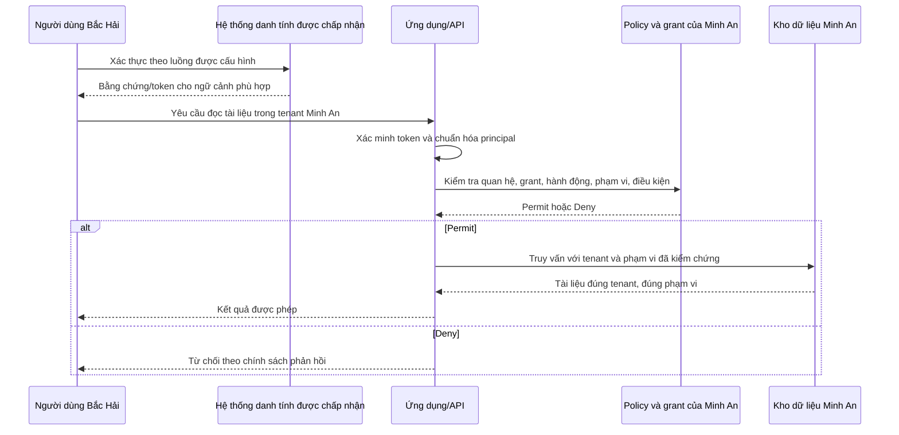

# Cross-tenant access

## 1. Truy cập xuyên tenant là gì?

**Cross-tenant access** là việc một danh tính có quan hệ với tenant A được phép truy cập một tập tài nguyên thuộc tenant B. Quyền này có thể phục vụ cộng tác với đối tác, kiểm toán bên ngoài, nhà cung cấp dịch vụ vận hành hoặc tích hợp giữa hai tổ chức.

Trong hệ thống SaaS, tenant thường là một khách hàng hoặc một không gian tổ chức có ranh giới dữ liệu và quản trị riêng. Trong nền tảng danh tính, tenant có thể là một thư mục danh tính. Hai khái niệm này không nhất thiết ánh xạ một-một: một thư mục doanh nghiệp có thể phục vụ nhiều workspace SaaS, hoặc một workspace tiếp nhận người dùng từ nhiều nhà cung cấp danh tính.

Vì vậy, ứng dụng phải định nghĩa rõ tenant nào đang được nói đến, thay vì sử dụng một trường `tenantId` cho mọi mục đích.

Ví dụ, công ty Minh An sử dụng hệ thống quản lý dự án và mời một kiểm toán viên của công ty Bắc Hải đọc chứng từ thuộc dự án `audit-2027`. Kiểm toán viên tiếp tục đăng nhập bằng danh tính do Bắc Hải quản lý. Minh An cấp quyền đọc một phần tài nguyên của mình trong thời gian hợp đồng. Việc đăng nhập thành công không làm kiểm toán viên trở thành quản trị viên Minh An.

Mục tiêu thiết kế là mở một đường truy cập được phê duyệt qua ranh giới tenant, đồng thời giữ ranh giới đó có hiệu lực với mọi tài nguyên ngoài phạm vi được cấp.

## 2. Tách danh tính nguồn, ngữ cảnh truy cập và tài nguyên đích

Một quyết định truy cập xuyên tenant cần phân biệt các thông tin sau:

| Thành phần | Ý nghĩa | Ví dụ |
|---|---|---|
| Home tenant | Tổ chức hoặc miền danh tính gốc của chủ thể theo mô hình đã định nghĩa | Bắc Hải |
| Issuer và subject | Cặp định danh đã xác minh từ bên phát hành danh tính | Issuer Bắc Hải, subject `user-93` |
| Resource tenant | Tenant sở hữu tài nguyên được truy cập | Minh An |
| Local principal | Đại diện của chủ thể trong hệ thống hoặc tenant đích, nếu mô hình có dùng | Guest `guest-482` tại Minh An |
| Grant | Bản ghi cấp quyền có phạm vi, điều kiện và thời hạn | Đọc chứng từ dự án `audit-2027` |
| Resource owner | Tenant sở hữu đối tượng cụ thể trong kho dữ liệu | `document.tenant_id = minh-an` |
| Actor | Danh tính thực sự thực hiện lời gọi, cần phân biệt với người được ủy quyền | Ứng dụng xuất báo cáo thay mặt kiểm toán viên |

`subject` không phải mã người dùng toàn cục độc lập với issuer. Hai issuer có thể phát hành cùng một giá trị subject nhưng chỉ hai danh tính khác nhau. Không tự gộp tài khoản theo email, tên hiển thị hoặc miền email: các thuộc tính đó không thay thế bằng chứng kiểm soát danh tính và quy trình liên kết tài khoản.

Một số mô hình tạo guest trong tenant đích; một số sử dụng chủ thể liên kết trực tiếp mà không tạo tài khoản guest theo cùng cách. Token dùng khi truy cập có thể do home tenant hoặc một bên phát hành được tenant đích chấp nhận cấp, tùy giao thức và kiến trúc. Vì vậy, không suy ra home tenant chỉ từ `iss`, và không mặc định mọi claim tên `tid` đều có ý nghĩa giống nhau.

Ứng dụng nên chuẩn hóa danh tính đã xác minh thành ngữ cảnh nội bộ, chẳng hạn:

```text
verifiedPrincipal = {
  issuer,
  subject,
  principalType,
  sourceOrganizationId,
  authenticationContext
}

accessContext = {
  actor,
  verifiedPrincipal,
  targetTenantId,
  effectiveGrantId
}
```

`sourceOrganizationId` phải được xác lập bằng cơ chế đã cấu hình và kiểm chứng. Header, tham số URL và dữ liệu người dùng tự nhập không được tự biến thành các thuộc tính danh tính đã xác minh.

## 3. Trust chỉ là một phần của quyết định cho phép

Tenant B có thể chấp nhận kết quả xác thực từ một nhà cung cấp danh tính liên quan đến tenant A. Điều đó trả lời câu hỏi “B có chấp nhận bằng chứng danh tính này không?”. Quyết định còn lại là “chủ thể này được làm gì với tài nguyên nào của B?”.

Một quy tắc khái niệm có thể biểu diễn như sau:

```text
ALLOW = validAuthentication
    AND acceptedExternalIdentity
    AND applicableOrganizationPolicies
    AND activeTargetGrant
    AND permittedActionAndResource
    AND satisfiedAccessConditions
```

Các điều kiện cần được đánh giá trong đúng ngữ cảnh tenant đích. Không tìm thấy grant, không xác định được tenant tài nguyên hoặc không kiểm tra được một điều kiện bắt buộc thì từ chối.

Có ba lớp dễ bị nhầm lẫn:

1. **Trust xác thực:** chấp nhận issuer, loại bằng chứng, mức xác thực hoặc một số tín hiệu từ tổ chức ngoài.
2. **Admission:** cho phép một tổ chức, tập người dùng hoặc ứng dụng ngoài tham gia quan hệ cộng tác.
3. **Authorization:** cấp quyền cụ thể lên tài nguyên của tenant đích.

Ví dụ, Minh An chấp nhận kết quả MFA của Bắc Hải không có nghĩa mọi nhân viên Bắc Hải được đọc chứng từ Minh An. Chỉ kiểm toán viên có grant phù hợp mới được truy cập, và Minh An vẫn có thể yêu cầu điều kiện bổ sung theo chính sách của mình.

Trong Microsoft Entra, outbound kiểm soát người dùng của tổ chức truy cập tài nguyên ngoài, inbound kiểm soát người dùng ngoài vào tài nguyên của tổ chức, còn inbound trust có thể chấp nhận một số claim MFA và thiết bị. Đây là cách phân chia của sản phẩm cụ thể; cần đối chiếu loại hình cộng tác khi cấu hình, không áp đặt cơ chế này cho mọi SaaS. [Microsoft Learn: Cross-tenant access overview](https://learn.microsoft.com/en-us/entra/external-id/cross-tenant-access-overview/).

Quan hệ A → B có tính định hướng. Việc B tiếp nhận người dùng A không tự cho phép người dùng B truy cập A, và quan hệ A → B cùng B → C không tạo quyền A → C. Mọi quyền xuyên qua một ranh giới mới cần căn cứ riêng.

## 4. Chọn mô hình cấp quyền theo nhu cầu cộng tác

| Mô hình | Cách biểu diễn | Điểm cần kiểm soát |
|---|---|---|
| Guest hoặc external membership | Tenant đích tạo một đại diện và gán quyền cục bộ | Sponsor, trạng thái guest, vai trò và vòng đời |
| Chia sẻ theo tài nguyên | Grant gắn với tài liệu, dự án hoặc tập đối tượng cụ thể | Không mở rộng quyền ra toàn tenant |
| Vai trò bên ngoài có phạm vi | Vai trò thuộc tenant đích, giới hạn trong một phạm vi | Tránh ánh xạ thẳng vai trò quản trị nguồn |
| Workload integration | Ứng dụng hoặc service principal được cấp quyền truy cập tenant đích | Audience, credential, quyền ứng dụng và tenant binding |

Một người dùng có thể có membership ở nhiều tenant. Khi họ chọn một tenant trên giao diện, hệ thống phải tạo hoặc kiểm tra lại ngữ cảnh quyền cho tenant đó. Quyền `project-editor` tại A không được sử dụng như quyền `project-editor` tại B chỉ vì tên vai trò giống nhau.

Nếu cho phép tài nguyên của A xuất hiện trong workspace B, cần mô hình hóa rõ quyền chia sẻ, tenant sở hữu tài nguyên và tenant tiêu thụ. Không sửa `resource.tenant_id` thành B chỉ để vượt qua bộ lọc tenant. Thay đổi quyền xem và chuyển quyền sở hữu là hai nghiệp vụ khác nhau.

Đối với nhà cung cấp dịch vụ quản trị nhiều khách hàng, một tài khoản vận hành trung tâm cũng cần grant riêng cho từng khách hàng. Quyền quản trị nền tảng, nếu thực sự tồn tại, phải được thiết kế thành đường đặc quyền riêng có phê duyệt và kiểm toán; không giấu trong một nhánh “bỏ qua tenant check”.

## 5. Thiết kế một grant đủ thông tin

Grant nên trả lời được ai được cấp quyền, ai phê duyệt, quyền áp dụng ở đâu và khi nào hết hiệu lực. Ví dụ dưới đây là schema minh họa của ứng dụng, không phải cấu hình của một nhà cung cấp IAM:

```yaml
grantId: grant-482
targetTenantId: minh-an
externalPrincipal:
  issuer: https://id.bac-hai.example
  subject: user-93
  sourceOrganizationId: bac-hai
principalType: HUMAN
permissions:
  - document:read
resourceScope:
  type: PROJECT
  id: audit-2027
validFrom: 2027-01-10T00:00:00Z
expiresAt: 2027-02-10T00:00:00Z
requirements:
  authenticationProfile: partner-auditor-mfa
sponsorId: employee-17
approvedBy: security-approver-6
status: ACTIVE
```

Tên `partner-auditor-mfa` tham chiếu một chính sách do ứng dụng quản lý; nó không phải một giá trị chuẩn tự có ý nghĩa trong token. Thành phần thực thi phải biết bằng chứng nào đáp ứng chính sách, issuer nào được phép khẳng định bằng chứng đó và trường hợp nào cần xác thực bổ sung.

Grant nên gắn với chủ thể cụ thể hoặc một tập chủ thể được quản lý rõ ràng. Cấp cho nhóm có thể đơn giản hóa vận hành, nhưng phải xác định ai được thay đổi thành viên nhóm và cách cập nhật hiệu lực của thay đổi đó.

Không cấp `tenant-admin` chỉ để một kiểm toán viên tải báo cáo. Với nhu cầu đọc, giới hạn theo dự án, hành động và thời gian. Các quyền nhạy cảm như sửa cấu hình IAM, tạo API key, mời thêm người hoặc chia sẻ tiếp cần được xét riêng.

Nếu vai trò cục bộ và grant cùng tham gia quyết định, phải định nghĩa cách kết hợp: quyền nào cộng gộp, điều kiện nào bắt buộc và explicit deny có ưu tiên hay không. Một nhánh có grant rộng không được vô tình vô hiệu hóa chính sách cấm của tenant đích.

## 6. Luồng truy cập từ đăng nhập đến tài nguyên



Tại API, chữ ký hợp lệ mới chỉ là một phần của xác minh token. Phải kiểm tra issuer được chấp nhận, audience dành cho API, thời hạn, loại token và các ràng buộc của giao thức đang dùng. Không dùng ID token làm access token cho API chỉ vì cả hai đều có thể mang định dạng JWT.

RFC 8725 nêu yêu cầu kiểm tra issuer/subject và audience để tránh chấp nhận JWT trong sai ngữ cảnh. Đây là cơ sở cho bước xác minh token; quyền xuyên tenant vẫn cần chính sách ứng dụng. [RFC 8725, mục 3.8 và 3.9](https://www.rfc-editor.org/rfc/rfc8725.html#section-3.8).

Không lấy issuer trong token chưa kiểm chứng rồi tùy ý tải metadata hoặc khóa từ địa chỉ đó. Bộ xác minh phải sử dụng registry hoặc cơ chế discovery được kiểm soát, ràng buộc issuer với khóa và cấu hình đã chấp thuận.

Đường dẫn như `/tenants/minh-an/documents/doc-41` chỉ là yêu cầu của client. API cần kiểm tra người gọi có quyền tại `minh-an`, sau đó truy xuất tài liệu trong chính tenant này. UUID khó đoán không thay thế kiểm tra quyền.

## 7. Ví dụ thực thi tại backend

Đoạn mã giả Java sau minh họa vị trí các kiểm tra. Các kiểu và dịch vụ là thành phần giả định của ứng dụng; đây không phải mã thư viện có thể chạy nguyên trạng.

```java
DocumentView readDocument(
        String bearerToken,
        TenantId requestedTenant,
        DocumentId documentId,
        Instant now) {

    // Verifier kiểm tra token theo cấu hình tin cậy, không chỉ giải mã JWT.
    VerifiedPrincipal principal = tokenVerifier.verifyForThisApi(bearerToken);

    // Tenant từ request phải được phân giải thành tenant hợp lệ trong hệ thống.
    Tenant target = tenantRegistry.requireActive(requestedTenant);

    ExternalRelationship relationship = relationships.requireActive(
            principal.sourceOrganizationId(), target.id());
    organizationPolicy.requireAccessAllowed(principal, target, relationship);

    // Chỉ truy vấn tài liệu trong tenant đích, không tìm toàn cục rồi trả nhầm.
    Document document = documents.findByTenantAndId(target.id(), documentId)
            .orElseThrow(NotFound::new);

    CrossTenantGrant grant = grants.requireApplicable(
            principal.stableKey(), target.id(), "document:read",
            document.projectId());

    grant.requireActiveAt(now);
    authenticationPolicy.requireSatisfied(principal, grant.requirements());
    resourcePolicy.requireAllowed(principal, grant, document, "document:read");

    audit.recordPermit(principal, target, grant, document.id());
    return document.toView();
}
```

Đường từ chối cũng cần ghi sự kiện qua cơ chế chung, tránh chỉ ghi những lần thành công. API có thể chọn trả `404` cho tài nguyên ngoài phạm vi để hạn chế lộ sự tồn tại của đối tượng, hoặc `403` trong ngữ cảnh phù hợp; log nội bộ vẫn cần phân biệt nguyên nhân.

Một mẫu truy vấn minh họa cho hệ thống mà dự án thuộc duy nhất một tenant:

```sql
SELECT id, tenant_id, project_id, title
FROM document
WHERE tenant_id = :verified_target_tenant
  AND project_id = :authorized_project
  AND id = :document_id;
```

`:verified_target_tenant` và `:authorized_project` phải được ràng buộc với quyết định quyền đã kiểm tra. Không lấy một danh sách project do client gửi rồi coi đó là phạm vi được cấp. Truy vấn có lọc tenant cũng chưa đủ nếu người gọi chưa được phép truy cập tenant đó.

Với cập nhật dữ liệu, dùng điều kiện tenant và phạm vi quyền trong chính thao tác ghi, kiểm tra số hàng bị tác động và tránh khoảng trống giữa kiểm tra quyền với cập nhật. Nếu dữ liệu hoặc quyền có thể thay đổi đồng thời, cần cơ chế phiên bản, transaction hoặc kiểm tra điều kiện phù hợp với nghiệp vụ.

## 8. Chuyển tenant, bộ nhớ đệm và tác vụ nền

Cross-tenant access thường lỗi ở những nơi tái sử dụng ngữ cảnh cũ.

**Chuyển tenant trên giao diện.** Sau khi chuyển từ A sang B, giao diện phải làm mới dữ liệu và quyền tương ứng. Backend vẫn đánh giá mỗi yêu cầu dựa trên tenant đích đã kiểm tra; không tin rằng người dùng đã chọn đúng tenant vì giao diện hiển thị tên B.

**Bộ nhớ đệm quyết định quyền.** Khóa chỉ gồm `userId` và `action` có thể đưa quyền của A sang B. Một khóa phù hợp cần phản ánh chủ thể đã chuẩn hóa, tenant đích, hành động, phạm vi tài nguyên và những yếu tố chính sách làm thay đổi quyết định. Có thể kết hợp phiên bản grant/chính sách với thời gian lưu ngắn và invalidation. Thời gian lưu cache không được làm grant đã hết hạn tiếp tục có hiệu lực.

**Cache dữ liệu.** Khóa `document:41` dễ gây nhầm khi ID chỉ duy nhất trong tenant. Khóa cache và mọi tầng đọc phải giữ tenant context. Cả CDN hoặc URL tải tệp ký sẵn cũng cần phạm vi và thời hạn thích hợp; việc thu hồi grant không tự vô hiệu hóa mọi URL đã phát hành nếu cơ chế lưu trữ không hỗ trợ điều đó.

**Hàng đợi và tác vụ nền.** Job xuất báo cáo phải mang tenant đích, định danh chủ thể/actor, phạm vi công việc và tham chiếu grant được thiết lập từ yêu cầu đã xác minh. Consumer không nhận dữ liệu này từ một nguồn tùy ý rồi tin ngay. Với mô hình yêu cầu quyền còn hiệu lực khi chạy, worker nền phải kiểm tra lại grant lúc thực thi, không dựa vào quyền đã có khi job được tạo.

Khi một tiến trình xử lý liên tiếp nhiều tenant, phải truyền ngữ cảnh rõ ràng và dọn sạch ngữ cảnh sau mỗi đơn vị công việc. Trạng thái tenant trong biến toàn cục, thread-local hoặc connection pool có thể làm yêu cầu sau kế thừa sai tenant nếu không được quản lý đúng.

## 9. Phân biệt quyền người dùng và quyền workload

Ứng dụng đối tác đọc báo cáo theo lịch có thể dùng danh tính workload riêng, thay vì tài khoản người dùng có mật khẩu lưu trong cấu hình.

Hai trường hợp cần phân biệt:

- **App-only:** ứng dụng truy cập bằng quyền được cấp cho chính nó tại tenant đích. Không có người dùng hiện diện trong từng lần gọi.
- **Delegated:** ứng dụng hành động thay mặt một người dùng. Cần giữ được quan hệ giữa actor ứng dụng, người dùng và quyền có hiệu lực.

Với delegated access, quyền ứng dụng không được tự cộng thêm quyền vượt quá người dùng hoặc grant đích khi mô hình ủy quyền yêu cầu giới hạn đó. Với app-only, không giả tạo user context để đi qua các kiểm tra dành cho người dùng.

Grant cho workload nên ràng buộc với danh tính ứng dụng đã xác minh, tenant khách hàng, API đích và tập hành động cụ thể. Một credential dùng được với nhiều khách hàng làm tăng phạm vi tác động khi lộ; có thể giảm rủi ro bằng danh tính hoặc credential tách biệt, quyền hẹp và cơ chế thu hồi theo khách hàng.

Không chuyển access token dành cho API A sang API B chỉ vì hai API cùng nhà cung cấp. Nếu cần token exchange hoặc luồng thay mặt người dùng, phải dùng cơ chế được cấu hình và kiểm tra audience, chủ thể, actor cùng phạm vi ở từng chặng. Quyền ủy quyền lại cũng cần được cấp rõ ràng.

## 10. Vòng đời và thu hồi quyền

Một quy trình cấp quyền xuyên tenant có thể gồm các bước:

1. Xác minh đối tác và nhu cầu công việc; xác định tenant đích, chủ thể và sponsor chịu trách nhiệm.
2. Phê duyệt quyền với phạm vi và ngày hết hạn; kiểm tra điều kiện tiếp nhận danh tính ngoài.
3. Thiết lập guest hoặc grant theo mô hình đã chọn; kiểm thử một trường hợp được phép và một trường hợp bị từ chối.
4. Theo dõi sử dụng, rà soát quyền định kỳ và xử lý thay đổi nhân sự, dự án hoặc hợp đồng.
5. Khi kết thúc, thu hồi grant, dừng quyền phát sinh liên quan và kiểm chứng hiệu lực thu hồi.

Không coi xóa người dùng tại tổ chức nguồn là bằng chứng mọi quyền tại tổ chức đích đã biến mất. Tài khoản guest, membership cục bộ, phiên ứng dụng và token đã phát hành có vòng đời riêng. Ngay cả khi đồng bộ danh tính đã được triển khai, cần hiểu độ trễ và phạm vi thu hồi của cơ chế đó.

Thu hồi một grant cần xét những đường truy cập còn tồn tại: phiên đăng nhập, access token, refresh token, cache quyết định, job đang chờ, API key phát sinh và liên kết chia sẻ. Không phải hệ thống nào cũng vô hiệu hóa ngay access token tự chứa; phải biết cửa sổ hiệu lực còn lại và chọn biện pháp phù hợp như kiểm tra grant trực tuyến, thời hạn token ngắn hoặc cơ chế kiểm soát phiên được hỗ trợ.

Nếu tài liệu đã được tải về, thu hồi quyền truy cập tương lai không xóa được bản sao đã nằm ngoài hệ thống. Cần phân biệt kiểm soát truy cập với kiểm soát sử dụng dữ liệu và điều khoản chia sẻ thông tin.

Với partner-wide suspension, tenant đích cần khả năng chặn quan hệ đối tác hoặc các grant liên quan, đồng thời giữ tài khoản nội bộ cần thiết để vận hành và phục hồi. Thao tác đình chỉ nên có người chịu trách nhiệm, lý do và dấu vết kiểm toán.

## 11. Kiểm toán và những tình huống cần kiểm chứng

Một sự kiện truy cập nên giúp trả lời: ai thực hiện, xuất phát từ tổ chức nào, truy cập tenant nào, dùng grant nào và vì sao được phép hoặc bị từ chối.

Ví dụ sự kiện minh họa:

```json
{
  "event": "cross_tenant_access",
  "requestId": "req-702",
  "principalId": "external-principal-93",
  "sourceOrganizationId": "bac-hai",
  "actorId": "reporting-client-8",
  "targetTenantId": "minh-an",
  "resourceId": "doc-41",
  "action": "document:read",
  "grantId": "grant-482",
  "decision": "DENY",
  "reason": "GRANT_EXPIRED",
  "policyVersion": "v19"
}
```

Không ghi raw access token, refresh token, mật khẩu hay bí mật ứng dụng vào log. Với dữ liệu định danh và tên tài nguyên, chỉ ghi thông tin cần thiết và áp dụng quyền đọc log, thời hạn lưu phù hợp.

| Tình huống | Kết quả mong đợi |
|---|---|
| Đúng chủ thể, đúng tenant đích, đúng tài nguyên, grant hiệu lực | Cho phép theo quyền đã cấp |
| Giữ token nhưng sửa tenant đích trên URL | Đánh giá lại quyền; từ chối nếu không có grant tương ứng |
| Giữ tenant đích nhưng thay ID tài liệu sang tenant khác | Không trả về dữ liệu tenant khác |
| Subject giống nhau nhưng issuer khác | Không coi là cùng principal nếu chưa có liên kết được xác minh |
| Có vai trò admin ở home tenant nhưng chỉ có grant đọc tại tenant đích | Chỉ được đọc trong phạm vi grant |
| Token có chữ ký hợp lệ nhưng audience không dành cho API | Từ chối token |
| Grant bị thu hồi trong khi cache vẫn còn | Chặn theo cơ chế và giới hạn trễ thu hồi đã thiết kế |
| Job được tạo trước khi grant hết hạn, chạy sau khi hết hạn | Áp dụng quy tắc tái kiểm tra đã định nghĩa; không tự giữ quyền cũ |
| Tổ chức nguồn gửi claim MFA nhưng chưa có trust phù hợp | Không tự coi yêu cầu MFA của tenant đích đã được đáp ứng |
| Có quyền A → B và B → C | Không tự suy ra quyền A → C |
| Đối tác bị đình chỉ | Các đường truy cập thuộc phạm vi đình chỉ bị chặn và có dấu vết |

Nên kiểm chứng cả API, tải tệp, tìm kiếm, export, cache và tác vụ nền. Việc trang danh sách đã lọc đúng tenant không chứng minh endpoint lấy chi tiết hoặc tải báo cáo cũng thực thi đúng quyền.

## 12. Điểm cần ghi nhớ

Truy cập xuyên tenant cần đồng thời xác định danh tính đã được chứng minh, tenant sở hữu tài nguyên và quyền cụ thể do phía tài nguyên chấp nhận. Trust xác thực giúp sử dụng danh tính ngoài; grant và chính sách tenant đích quyết định phạm vi truy cập.

Thiết kế vững chắc giữ tenant context xuyên suốt từ xác minh token, phân giải principal, kiểm tra grant đến truy vấn dữ liệu, cache và tác vụ nền. Quyền có người chịu trách nhiệm, điều kiện rõ ràng, thời hạn và đường thu hồi kiểm chứng được sẽ giúp cộng tác qua nhiều tổ chức mà vẫn duy trì nguyên tắc ít quyền nhất.
