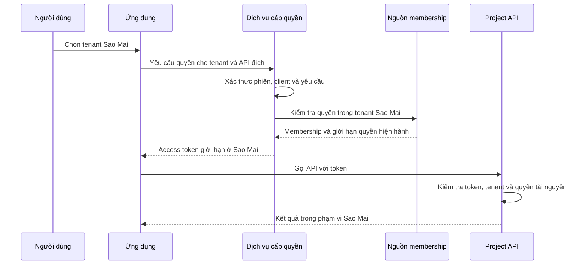

# Tenant-scoped token

## 1. Token có phạm vi tenant là gì?

Trong hệ thống nhiều tenant, cùng một người có thể thuộc nhiều tổ chức và có quyền khác nhau ở mỗi tổ chức. Nếu API chỉ biết người gọi là ai mà không biết quyền đang áp dụng cho tenant nào, một vai trò như `ADMIN` rất dễ bị hiểu sai thành quyền quản trị trên toàn nền tảng.

**Tenant-scoped token** là token có hiệu lực trong phạm vi một tenant được xác định rõ. Trong bài này, thuật ngữ chủ yếu chỉ **access token** dùng để gọi API. API phải kiểm tra phạm vi tenant của token cùng danh tính, đối tượng nhận token, quyền hành động và tài nguyên được truy cập.

Ví dụ, Lan có hai membership:

| Tenant | Vai trò của Lan | Hành động điển hình được phép |
| --- | --- | --- |
| Công ty Sao Mai, `tnt_sao_mai` | Quản trị dự án | Đọc, tạo và cập nhật dự án theo policy |
| Công ty Đại Dương, `tnt_dai_duong` | Người xem | Đọc những dự án được cấp quyền |

Khi Lan thao tác ở Sao Mai, hệ thống có thể cấp token chỉ dành cho `tnt_sao_mai`. Token đó không được dùng để thực hiện thao tác tại Đại Dương, kể cả Lan cũng là thành viên Đại Dương.

Điều này phân biệt hai câu hỏi:

- **Danh tính:** người hoặc workload nào đang gọi?
- **Phạm vi ủy quyền:** bên gọi được làm gì, trên API nào, trong tenant nào?

Tenant-scoped token giúp biểu đạt phạm vi thứ hai. Nó không làm biến mất trách nhiệm kiểm tra quyền tại API.

## 2. Tenant, audience và scope là ba chiều khác nhau

Một access token có thể mang thông tin liên quan đến nhiều chiều ủy quyền:

| Thành phần | Câu hỏi cần trả lời | Ví dụ |
| --- | --- | --- |
| Issuer | Ai phát hành và chịu trách nhiệm về token? | `https://identity.example.com/` |
| Subject hoặc principal | Danh tính nào được biểu diễn? | `user_lan` |
| Audience | API hoặc resource server nào được nhận token? | `project-api` |
| Tenant | Phạm vi tổ chức nào được phép thao tác? | `tnt_sao_mai` |
| Scope hoặc permission | Nhóm hành động nào được cấp? | `projects:read` |
| Thời hạn | Token được chấp nhận trong khoảng nào? | Thời điểm hết hạn |
| Client hoặc bên được ủy quyền | Ứng dụng nào tham gia luồng cấp quyền? | Ứng dụng quản lý dự án |

Các trường cụ thể phụ thuộc loại token, bên phát hành và hợp đồng giữa các thành phần. Không phải mọi access token đều có đầy đủ thông tin ở cùng một định dạng.

Một token dành cho đúng tenant nhưng sai audience vẫn phải bị từ chối. Một token dành cho đúng API và tenant nhưng chỉ có quyền đọc không được dùng để xóa dữ liệu.

Có thể diễn đạt quyết định truy cập bằng mô hình:

```text
Cho phép khi:
  token được xác thực và còn hiệu lực
  AND issuer được tin cậy cho phạm vi đang xét
  AND audience phù hợp API hiện tại
  AND tenant token khớp tenant đích
  AND trạng thái tenant và quan hệ truy cập cho phép
  AND quyền token cùng policy cho phép hành động
  AND tài nguyên thuộc đúng tenant và thỏa điều kiện truy cập
```

Đây là mô hình tư duy, không phải một biểu thức thay thế toàn bộ thiết kế policy. Một số hệ thống kiểm tra thêm độ mạnh xác thực, điều kiện thiết bị, chủ sở hữu tài nguyên hoặc yêu cầu phê duyệt.

## 3. Biểu diễn tenant trong token

### 3.1. Ví dụ access token dạng JWT

Payload minh họa:

```json
{
  "iss": "https://identity.example.com/",
  "sub": "user_lan",
  "aud": "project-api",
  "iat": 2000000000,
  "exp": 2000000600,
  "jti": "at_f83b12",
  "tenant_id": "tnt_sao_mai",
  "scope": "projects:read projects:write",
  "tenant_roles": ["PROJECT_ADMIN"]
}
```

`tenant_id` và `tenant_roles` trong ví dụ là các claim theo hợp đồng của ứng dụng. Không được giả định mọi nhà cung cấp danh tính đều dùng chúng, hoặc một claim tên tương tự luôn có cùng ý nghĩa.

Ví dụ dùng thời hạn mười phút chỉ để minh họa. Thời hạn thực tế phải dựa trên rủi ro, yêu cầu thu hồi quyền và cách hệ thống kiểm tra trạng thái.

Ý nghĩa của role ở đây phải rõ ràng:

```text
PROJECT_ADMIN trong tnt_sao_mai
```

Không được diễn giải thành:

```text
PROJECT_ADMIN trong mọi tenant mà user_lan biết mã
```

Claim `jti` có thể giúp nhận diện một token để theo dõi hoặc xây dựng cơ chế chặn, nhưng việc có claim này không tự tạo ra khả năng thu hồi token. Các dịch vụ cần thực sự kiểm tra nguồn trạng thái tương ứng nếu thiết kế dựa vào nó.

JWT có chữ ký thường chỉ bảo vệ tính toàn vẹn và nguồn phát hành; phần payload không mặc nhiên được mã hóa. Không đặt secret, mật khẩu hoặc dữ liệu nhạy cảm không cần thiết vào token.

### 3.2. Tenant-scoped không đồng nghĩa với JWT

Một opaque access token cũng có thể được ràng buộc với tenant. Khi đó, tenant và quyền được lưu ở phía máy chủ hoặc được API lấy qua một cơ chế xác minh trạng thái token, chẳng hạn introspection khi hệ thống hỗ trợ.

```text
Opaque token
   → xác minh hoặc tra trạng thái đáng tin cậy
   → principal + tenant + audience + permissions + hiệu lực
```

Thuộc tính quan trọng là **phạm vi ủy quyền được xác lập và được thực thi**, không phải client có đọc được tenant trong chuỗi token hay không.

Client không cần tự phân tích access token để quyết định quyền thực sự. Giao diện có thể hiển thị tenant đang chọn, nhưng API vẫn là nơi thực thi kiểm soát truy cập.

## 4. Cấp token cho đúng tenant

### 4.1. Tenant đầu vào là một yêu cầu lựa chọn

Khi Lan chọn Sao Mai, giá trị `tnt_sao_mai` từ giao diện hoặc URL chỉ thể hiện ý định. Bên cấp token cần kiểm tra:

1. Danh tính hoặc phiên đăng nhập đã được xác thực.
2. Tenant đích tồn tại và ở trạng thái cho phép cấp quyền.
3. Người dùng có membership hoặc quan hệ truy cập phù hợp với tenant.
4. Client được phép tham gia luồng cấp quyền này.
5. API đích và quyền được yêu cầu nằm trong các giới hạn được cấp.
6. Các điều kiện bổ sung như MFA hoặc chính sách phiên đã được đáp ứng nếu hành động yêu cầu.

Bên cấp token không được chép tenant từ tham số client vào token rồi ký mà bỏ qua các kiểm tra trên.

Ví dụ một luồng ở mức khái niệm:



Sơ đồ không quy định một endpoint hay tham số OAuth tiêu chuẩn để chuyển tenant. Cơ chế cụ thể phụ thuộc hệ thống cấp quyền và giao thức được hỗ trợ.

### 4.2. Quyền cấp ra phải nằm trong giao của các giới hạn

Không phải mọi scope mà client yêu cầu đều được cấp.

```text
Quyền được cấp
  nằm trong quyền hiện hành của principal tại tenant
  và quyền client được phép yêu cầu
  và quyền API đích hỗ trợ
  và các giới hạn của policy cấp token.
```

Nếu Lan chỉ có quyền đọc ở Đại Dương, việc gửi `projects:write` trong yêu cầu không được tạo ra token ghi dữ liệu ở Đại Dương.

Nếu tenant sử dụng IdP riêng, bên cấp quyền phải xác định chính xác kết nối hoặc issuer nào có thẩm quyền cho tenant ấy. Không chỉ dựa vào email người dùng hoặc tên domain do client gửi để xác lập membership và vai trò.

Một chữ ký hợp lệ từ một IdP đã biết chưa đủ để tin rằng IdP đó được phép khẳng định quyền quản trị cho mọi tenant trong nền tảng.

## 5. Kiểm tra token tại resource server

### 5.1. Xác thực token trước khi tin claim

Với JWT, resource server cần thực hiện validation theo hợp đồng token của mình, bao gồm các điều kiện phù hợp như:

- Đúng loại token mà API chấp nhận.
- Chữ ký hợp lệ với thuật toán và khóa được cho phép.
- Issuer khớp nguồn tin cậy đã cấu hình.
- Audience dành cho API hiện tại.
- Token còn hạn và thỏa các điều kiện thời gian liên quan.
- Các claim bắt buộc có mặt, đúng kiểu dữ liệu và đúng ý nghĩa.

Không coi việc decode payload thành công là xác thực. Cũng không dùng ID token của luồng đăng nhập để thay cho access token của API.

Đối với opaque token, API cần dùng kết quả xác minh từ nguồn tin cậy theo hợp đồng của hệ thống; không suy ra tenant từ các ký tự trong chuỗi token.

Khóa hoặc địa chỉ xác minh phải được lấy theo cấu hình tin cậy. Không tùy ý truy cập một URL do token chưa được xác thực cung cấp rồi coi kết quả đó là bằng chứng tin cậy.

### 5.2. Kiểm tra tenant token với tenant đích

Giả sử request là:

```http
GET /tenants/tnt_dai_duong/projects/project_42
Authorization: Bearer <access-token-for-sao-mai>
```

Token hợp lệ cho Sao Mai không được dùng cho request này. API phải từ chối do tenant đích khác tenant token.

Không âm thầm sửa request thành Sao Mai để tiếp tục xử lý, vì các thành phần có thể đã dùng tenant trong URL để tạo cache key, chọn kho dữ liệu hoặc ghi audit. Sự không nhất quán này có thể dẫn đến đọc hoặc ghi sai phạm vi.

Tenant từ header hoặc body cũng phải chịu cùng quy tắc. Việc một claim tenant đã được xác thực không biến mọi tenant khác xuất hiện trong request thành dữ liệu đáng tin cậy.

### 5.3. Gắn tài nguyên với tenant đã xác lập

Sau khi xác định tenant hợp lệ, truy vấn tài nguyên phải giữ ràng buộc tenant:

```sql
SELECT id, name, owner_id
FROM projects
WHERE tenant_id = :verified_tenant_id
  AND id = :project_id;
```

`:verified_tenant_id` đến từ ngữ cảnh đã được máy chủ xác minh. Không lấy nguyên giá trị trong body làm phạm vi truy vấn.

Việc tìm đúng tài nguyên trong tenant vẫn chưa thay thế policy theo hành động. Người có quyền xem một dự án không mặc nhiên có quyền sửa, xóa hoặc cấp quyền cho người khác.

Một pseudocode theo phong cách Java:

```java
ProjectView readProject(
    HttpRequest request,
    String requestedTenant,
    String projectId
) {
    VerifiedAccessToken token =
        accessTokens.requireValidFor(request, "project-api");

    String tenantId = tenantIds.requireCanonical(
        token.requireStringClaim("tenant_id")
    );

    if (!tenantId.equals(tenantIds.requireCanonical(requestedTenant))) {
        throw accessDenied();
    }

    tenantAuthority.requireIssuerAllowed(token.issuer(), tenantId);
    tenantRegistry.requireActive(tenantId);

    TenantAccessContext context =
        tenantAccess.requireCurrentAccess(token, tenantId);

    Project project = projects.findByTenantAndId(tenantId, projectId)
        .orElseThrow(this::notFound);

    permissions.require(context, "projects:read", project);

    return views.forAuthorizedReader(context, project);
}
```

Ví dụ trên là mã minh họa kiến trúc, không phải chương trình hoàn chỉnh. `requireCurrentAccess` thể hiện yêu cầu kiểm tra trạng thái theo mô hình mà hệ thống đã chọn; không nhất thiết mọi API đều truy vấn trực tiếp cơ sở dữ liệu membership ở mỗi request.

API có thể sử dụng cache hoặc trạng thái ủy quyền trong token, nhưng phải xác định rõ độ trễ thu hồi quyền, cơ chế vô hiệu hóa và hành vi khi không xác minh được điều kiện bắt buộc.

## 6. Chuyển tenant là thay đổi phạm vi ủy quyền

### 6.1. Không sửa claim ở client

Token Sao Mai đã được phát hành cho một phạm vi cụ thể. Client không được sửa `tenant_id` thành Đại Dương rồi tiếp tục dùng token. Với JWT có chữ ký, việc sửa payload sẽ làm token không còn vượt qua kiểm tra chữ ký.

Cách chuyển tenant phù hợp là đi qua luồng cấp quyền mà hệ thống hỗ trợ:

```text
Phiên hoặc danh tính hiện tại
  → yêu cầu chuyển sang tenant đích
  → kiểm tra quyền tại tenant đích
  → cấp ngữ cảnh hoặc token mới với phạm vi phù hợp.
```

Nếu dùng token exchange, hệ thống phải hỗ trợ và kiểm soát luồng đó một cách rõ ràng. Không giả định mọi authorization server đều cho phép đổi token sang tenant khác.

Token cũ vẫn mang ý nghĩa cũ cho đến khi hết hạn hoặc bị vô hiệu hóa theo thiết kế. Việc đổi tenant trên giao diện không tự đổi nội dung hoặc hiệu lực của token đã phát hành.

### 6.2. Nhiều tab và request đang chạy

Giả sử tab A mở Sao Mai và tab B mở Đại Dương. Nếu ứng dụng lưu một biến `currentToken` chung mà không quản lý phạm vi, tab B có thể thay token trong khi tab A vẫn hiển thị dữ liệu và URL của Sao Mai.

Cần giữ sự nhất quán giữa:

- Tenant hiển thị trên giao diện.
- Tenant đích trong request.
- Tenant của access token dùng cho request đó.
- Cache dữ liệu ở client.
- Các request đang chạy và kết quả trả về.

Khi chuyển tenant, ứng dụng cần ngăn kết quả của request tenant cũ bị hiển thị dưới tenant mới. Có thể hủy request cũ hoặc bỏ qua kết quả nếu ngữ cảnh đã thay đổi.

Resource server vẫn phải kiểm tra tenant token với tenant đích, vì sự nhất quán ở client chỉ hỗ trợ trải nghiệm và giảm lỗi; nó không phải ranh giới bảo mật.

### 6.3. Refresh token không phải quyền chọn mọi tenant

Một refresh token đại diện cho quan hệ cấp quyền được authorization server quản lý. Việc nó có thể cấp access token cho một hay nhiều tenant phụ thuộc hợp đồng và policy của hệ thống.

Không mặc định chấp nhận yêu cầu:

```text
refresh token của grant tenant A
  + tenant_id=B
  → access token tenant B
```

Trước khi cấp token mới, bên cấp quyền phải kiểm tra tenant đích có nằm trong phạm vi grant hay không và quyền hiện hành còn cho phép hay không. Nếu cần một luồng chuyển tenant riêng, client phải dùng đúng luồng đó.

Nếu refresh token được lưu trong trình duyệt hoặc phiên web, endpoint sử dụng nó cần được bảo vệ theo cách lưu credential và cơ chế phiên thực tế, bao gồm chống yêu cầu giả mạo khi cookie tự động được gửi.

## 7. Quyền thay đổi trong khi token còn hạn

### 7.1. Access token có thể mang ảnh chụp quyền cũ

Tình huống:

```text
09:00  Lan nhận token có quyền ghi tại Sao Mai.
09:02  Quản trị viên thu hồi quyền ghi.
09:03  Lan gửi request bằng token cũ.
09:10  Token đến thời điểm hết hạn.
```

Nếu API chỉ xác minh chữ ký, thời hạn và quyền đã ghi trong token, quyền cũ có thể tiếp tục được chấp nhận đến khi token hết hạn. Đây là đặc tính cần được thiết kế và công bố, không thể khắc phục chỉ bằng việc đặt tên token là tenant-scoped.

Các lựa chọn có thể phối hợp:

| Cơ chế | Tác dụng | Điều cần cân nhắc |
| --- | --- | --- |
| Access token có thời hạn ngắn | Giới hạn khoảng thời gian dùng ảnh chụp quyền cũ | Không bảo đảm thu hồi ngay lập tức |
| Kiểm tra trạng thái token từ máy chủ | Có thể phản ánh việc token hoặc grant bị vô hiệu hóa | Phụ thuộc độ sẵn sàng và cache trạng thái |
| Kiểm tra membership hoặc policy hiện hành | Đánh giá quyền dựa trên nguồn mới hơn token | Chi phí truy cập và nhất quán dữ liệu |
| Kiểm tra phiên bản quyền | Phát hiện token thuộc phiên bản quyền cũ nếu triển khai đầy đủ | Phải có nguồn phiên bản hiện hành đáng tin cậy |
| Danh sách token hoặc phiên bị thu hồi | Chặn các định danh đã bị vô hiệu hóa | Cần phân phối trạng thái và quản lý vòng đời |

Một claim tùy biến như `authorization_version` không có tác dụng thu hồi nếu API không đối chiếu với phiên bản hiện hành.

Cache membership, introspection hoặc phiên bản quyền cũng tạo ra độ trễ. Thời gian sống của cache phải nằm trong mục tiêu thu hồi quyền của hệ thống.

### 7.2. Thu hồi membership khác với vô hiệu hóa danh tính toàn cục

Lan có thể bị gỡ khỏi Sao Mai nhưng vẫn là thành viên hợp lệ của Đại Dương. Quy trình thu hồi phải xác định đúng phạm vi:

- Chặn cấp mới token cho Sao Mai.
- Xử lý token, refresh grant hoặc phiên liên quan đến Sao Mai theo thiết kế.
- Cập nhật hoặc vô hiệu hóa cache quyền Sao Mai.
- Giữ hay thu hồi quyền ở tenant khác theo đúng sự kiện nghiệp vụ.

Không mặc định xóa danh tính toàn cục khi chỉ một membership bị thu hồi. Ngược lại, khi danh tính bị vô hiệu hóa toàn cục, chỉ chặn một tenant có thể là chưa đủ.

Tenant bị tạm khóa cũng cần một quy tắc thực thi rõ ràng đối với token còn hạn. Logout ở client không tự bảo đảm mọi access token đã phát hành đều bị thu hồi trên mọi dịch vụ.

## 8. Workload token và quyền hỗ trợ đặc biệt

### 8.1. Workload cũng cần phạm vi tenant

Một dịch vụ đồng bộ dữ liệu hoặc tác vụ xuất báo cáo có thể không có người dùng tương tác. Khi dùng workload identity, hệ thống vẫn cần xác định:

```text
Workload nào?
Được truy cập tenant nào?
Gọi API nào?
Thực hiện những hành động nào?
Trong khoảng thời gian nào?
```

Không suy ra rằng client đã xác thực thành công thì được chọn bất kỳ `tenant_id` nào.

Ví dụ, dịch vụ `billing-exporter` có grant đọc hóa đơn cho Sao Mai. Nếu nó gửi yêu cầu cấp token cho Đại Dương, bên cấp quyền phải kiểm tra một grant độc lập hoặc policy cho phép tương ứng.

Đối với job nền, access token của người dùng có thể hết hạn trước khi job chạy. Không giải quyết bằng cách sao chép token người dùng vào hàng đợi rồi tùy ý kéo dài hiệu lực. Hãy xác định job chạy thay mặt người dùng, bằng workload identity, hay theo một cơ chế ủy quyền có giới hạn.

### 8.2. Quyền xuyên tenant cần được mô hình hóa riêng

Nhân viên hỗ trợ hoặc dịch vụ vận hành có thể cần thao tác trên nhiều tenant. Trường hợp này nên có cơ chế cấp quyền đặc biệt được quản trị, thay vì biến token tenant thông thường thành quyền toàn cục.

Cần ghi rõ danh tính thực hiện, tenant bị tác động, hành động được phép, thời hạn và căn cứ cấp quyền. Nếu token vẫn đại diện cho một người khác, phải giữ khả năng phân biệt người được đại diện và người thực sự khởi tạo thao tác.

Một giá trị như `tenant_id="*"` không tự có ý nghĩa chuẩn. Nếu sản phẩm có token quản trị xuyên tenant, API phải có hợp đồng và policy riêng để kiểm soát nó; không để các endpoint tenant thông thường tự diễn giải wildcard thành bỏ qua tenant isolation.

## 9. Truyền token và ngữ cảnh qua nhiều dịch vụ

Giả sử API A nhận token dành cho A, sau đó gọi API B. Token đó không mặc nhiên hợp lệ tại B, dù hai API cùng phục vụ một tenant.

Có thể dùng cơ chế cấp hoặc trao đổi token được hệ thống hỗ trợ để có credential phù hợp với B. Quyền downstream phải được giới hạn theo tenant, hành động và quan hệ ủy quyền được phép.

```text
Client
  → token dành cho API A, tenant Sao Mai
  → API A xác minh request
  → credential phù hợp cho API B theo cơ chế được hỗ trợ
  → API B tự xác minh caller, tenant và quyền.
```

Tránh để API A có credential rất rộng rồi thực hiện mọi tenant mà client yêu cầu. Dịch vụ có quyền cao có thể trở thành trung gian thực hiện hành động vượt quyền của caller.

Nếu gateway chuyển tenant bằng header nội bộ, cần xác thực nguồn header và ngăn client giả mạo hoặc đi đường tắt tới backend. Tên header không đủ để biến dữ liệu thành đáng tin cậy.

Cache, audit và truy vấn dữ liệu downstream cũng cần dùng cùng tenant context đã xác lập. Không để một tầng dùng tenant trong token trong khi tầng khác dùng tenant không được kiểm tra trong body.

## 10. Kiểm tra các ranh giới của tenant-scoped token

| Tình huống | Kết quả cần đạt |
| --- | --- |
| Token tenant A được gửi tới đường dẫn tenant B | Bị từ chối vì phạm vi tenant không khớp |
| Token tenant A đúng chữ ký nhưng sai audience | Bị từ chối tại API không phải đối tượng nhận |
| Token có claim tenant nhưng chữ ký không hợp lệ | Không tin bất kỳ claim nào để cấp quyền |
| Token chỉ có quyền đọc được dùng để cập nhật | Bị từ chối bởi kiểm tra quyền hành động |
| Issuer của tenant A khẳng định quyền cho tenant B ngoài thẩm quyền | Bị từ chối theo ánh xạ tin cậy issuer và tenant |
| Token hợp lệ nhưng project thuộc tenant khác | Không đọc hoặc sửa được project đó |
| Người dùng sửa tenant trong yêu cầu cấp token | Chỉ được cấp nếu quyền tenant đích được xác minh |
| Refresh token được dùng để chuyển tenant ngoài grant | Không được mở rộng phạm vi tùy ý |
| Membership bị gỡ trong khi token còn hạn | Hành vi đáp ứng mục tiêu thu hồi đã thiết kế |
| Hai tab chuyển tenant độc lập | Token, URL và dữ liệu hiển thị không bị trộn phạm vi |
| Workload yêu cầu tenant chưa được cấp quyền | Không được cấp hoặc sử dụng quyền tenant đó |
| Token của API A được chuyển nguyên sang API B | B không chấp nhận nếu audience và hợp đồng không phù hợp |
| Nguồn xác minh trạng thái bắt buộc không truy cập được | Không mặc định bỏ qua điều kiện cấp quyền chưa xác minh |

Tenant-scoped token phát huy tác dụng khi phạm vi được bảo toàn từ lúc cấp token đến lúc truy cập tài nguyên. Token phải được cấp sau khi kiểm tra quyền tenant, được API xác minh theo đúng hợp đồng, và được kết hợp với trạng thái quyền, policy cùng ràng buộc dữ liệu. Chỉ thêm một claim tenant vào payload mà không thực thi các điều kiện này sẽ không tạo ra sự cô lập giữa các tenant.
