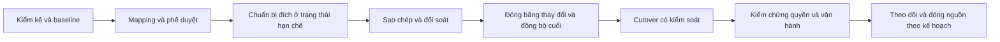

# Tenant migration

## 1. Di chuyển tenant là một thay đổi về quyền quản trị và truy cập

**Tenant migration** là quá trình chuyển một tenant, hoặc một phần danh tính và tài nguyên của tenant, sang một ngữ cảnh vận hành hay quản trị mới. Trong IAM, việc hoàn thành không chỉ được xác định bằng số tài khoản hoặc số tệp đã sao chép. Hệ thống còn phải bảo đảm đúng người đăng nhập, đúng quyền được áp dụng, đúng tổ chức kiểm soát tài nguyên và những đường truy cập cũ được xử lý theo kế hoạch.

Các tình huống thường gặp gồm hợp nhất doanh nghiệp, tách một bộ phận thành tổ chức mới, chuyển nhà cung cấp danh tính hoặc chuyển một khách hàng SaaS sang cụm hạ tầng riêng.

Ví dụ, Minh An tách bộ phận Logistics sang công ty mới. Một số nhân viên, dự án và ứng dụng tích hợp cần chuyển từ tenant `minh-an` sang `logistics`. Những người này không mặc nhiên giữ quyền quản trị toàn bộ Minh An tại Logistics; người ở lại Minh An cũng không mặc nhiên được truy cập dữ liệu đã chuyển.

Kết quả mong muốn là một trạng thái truy cập mới đã được phê duyệt, có thể giải thích và kiểm chứng. “Giữ nguyên mọi quyền cũ” không phải mục tiêu mặc định nếu ranh giới tổ chức đã thay đổi.

## 2. Xác định loại migration trước khi thiết kế

Từ tenant có thể chỉ workspace của ứng dụng, thư mục danh tính hoặc ranh giới triển khai. Cần làm rõ mình đang chuyển thành phần nào:

| Tình huống | Thứ thay đổi | Ý nghĩa IAM chính |
|---|---|---|
| Chuyển tenant SaaS sang database hoặc cụm mới | Vị trí lưu trữ và định tuyến | Tenant logic có thể giữ nguyên; phải giữ quyền và cách ly xuyên hai môi trường |
| Đổi IdP cho cùng một tenant ứng dụng | Nguồn xác thực, issuer, cấu hình SSO | Liên kết danh tính mới với principal nội bộ bằng quy trình đã xác minh |
| Chuyển người dùng và dữ liệu A → B | Membership, tài nguyên sở hữu, role assignment | Cần ánh xạ chủ thể và cấp lại quyền trong tenant B |
| Hợp nhất nhiều tenant | Nhiều không gian quản trị thành một | Xử lý tài khoản trùng, role khác ngữ nghĩa và quyền cộng gộp |
| Tách một tenant | Một số danh tính và tài nguyên sang tổ chức khác | Phân tách dữ liệu, quyền, nhóm và tích hợp theo phạm vi được duyệt |

Chuyển hạ tầng có thể giữ `logicalTenantId` nhưng đổi nơi phục vụ. Chuyển giữa hai tenant nghiệp vụ có thể cần ID mới và quy trình chuyển quyền sở hữu dữ liệu. Không thay toàn bộ `tenant_id` trong database trước khi xác định rõ ý nghĩa của từng trường.

Cross-tenant collaboration trong giai đoạn chuyển tiếp cũng khác migration hoàn tất. Cho người dùng A truy cập B qua guest hoặc federation có thể giúp duy trì công việc, nhưng chưa chứng minh dữ liệu, quyền quản trị và các phụ thuộc đã chuyển sang B.

Hướng dẫn lập kế hoạch Microsoft 365 cũng yêu cầu xác định ánh xạ danh tính, domain, phụ thuộc workload và thời gian hai tenant cùng tồn tại. Đây là ví dụ của một nền tảng cụ thể; danh sách thành phần cần di chuyển phụ thuộc hệ thống đang dùng. [Microsoft Learn: Plan a tenant-to-tenant migration](https://learn.microsoft.com/en-us/microsoft-365/migration/microsoft-365-tenant-to-tenant-migrations?view=o365-worldwide).

## 3. Những bất biến an toàn cần giữ

Trước khi chọn công cụ, nên xác định các điều kiện không được phá vỡ trong suốt quá trình:

1. Mỗi quyền ở đích có căn cứ từ kế hoạch được phê duyệt; đối tượng chưa ánh xạ rõ không được tự nhận quyền.
2. Tenant ngoài phạm vi migration không bị thay đổi dữ liệu, membership hoặc chính sách truy cập.
3. Trong mô hình một nơi có quyền ghi, không có hai môi trường đồng thời chấp nhận ghi cho cùng phạm vi dữ liệu sau cutover.
4. Tài khoản bị đình chỉ, grant đã thu hồi hoặc assignment hết hạn không được khôi phục thành quyền đang hoạt động do dùng snapshot cũ.
5. Bằng chứng kiểm toán giữ được mối liên hệ giữa danh tính nguồn, danh tính đích và các thay đổi đã thực hiện.
6. Mọi đường truy cập trong giai đoạn cùng tồn tại đều có phạm vi và ngày kết thúc rõ ràng.

Tính sẵn sàng và quyền truy cập là hai chiều khác nhau. Đăng nhập thất bại hàng loạt là sự cố vận hành; đăng nhập thành công nhưng cấp quá nhiều quyền là sự cố bảo mật. Tiêu chí nghiệm thu phải kiểm tra cả hai.

## 4. Kiểm kê toàn bộ bề mặt IAM

Một inventory hữu ích phải bao quát nhiều hơn bảng người dùng:

| Nhóm đối tượng | Những gì cần kiểm kê | Rủi ro nếu bỏ sót |
|---|---|---|
| Danh tính con người | Principal, issuer/subject, membership, guest, trạng thái tài khoản | Liên kết nhầm người hoặc khôi phục tài khoản đã khóa |
| Quyền | Role definition, assignment, nhóm, ACL, ABAC, grant chia sẻ, đặc quyền tạm thời | Mất quyền cần thiết hoặc tăng quyền ngoài ý muốn |
| Xác thực | SSO, federation, domain, MFA, recovery, chính sách phiên | Không đăng nhập được hoặc xuất hiện đường xác thực yếu hơn |
| Ứng dụng và workload | Client, service principal, managed identity, scope, consent, credential | Tích hợp hỏng hoặc ứng dụng cũ tiếp tục có quyền |
| Tài nguyên | Tenant owner, owner principal, project, file, secret, khóa mã hóa | Dữ liệu thuộc sai tenant hoặc không giải mã được |
| Đường truy cập phụ | API key, URL ký sẵn, webhook, job, cache, session | Thu hồi quyền ở bảng chính nhưng vẫn còn lối vào |
| Vận hành | Admin phục hồi, logging, provisioning, tác vụ định kỳ | Mất khả năng quản trị hoặc connector cũ sửa ngược dữ liệu |

Phải xác định nguồn chuẩn cho từng loại dữ liệu. Ví dụ, nhân sự có thể quản lý trạng thái làm việc, IdP quản lý xác thực và ứng dụng SaaS quản lý vai trò theo dự án. Sao chép một bảng local mà bỏ qua nguồn provisioning đang chạy có thể khiến lần đồng bộ kế tiếp xóa hoặc tạo lại tài khoản sai.

Chụp baseline có phiên bản hoặc mốc thời gian để biết trạng thái nào được dùng khi lập kế hoạch. Với thay đổi sau baseline, cần cơ chế ghi nhận delta hoặc một cửa sổ tạm dừng thay đổi thích hợp.

## 5. Ánh xạ danh tính bằng định danh đã xác minh

Không dùng email như khóa duy nhất để kết luận hai tài khoản ở hai tenant là cùng một người. Email có thể đổi, bị tái cấp hoặc trùng cách biểu diễn giữa các nguồn. Tên hiển thị càng không phải bằng chứng liên kết tài khoản.

Một bản ghi mapping có thể chứa:

```yaml
mappingId: map-person-93
source:
  identityTenant: minh-an-directory
  issuer: https://id.minh-an.example
  subject: source-user-93
  applicationPrincipalId: principal-93
target:
  identityTenant: logistics-directory
  issuer: https://id.logistics.example
  subject: target-user-208
  applicationPrincipalId: principal-208
verification:
  method: approved-directory-reconciliation
  evidenceRef: identity-review-27
  approvedBy: identity-owner-6
state: VERIFIED
```

Đây là schema minh họa của một hệ thống migration. `approved-directory-reconciliation` chỉ có ý nghĩa khi quy trình thực sự quy định ai xác minh, dùng nguồn nào và lưu bằng chứng gì.

Một principal nội bộ có thể được giữ nguyên khi chỉ đổi IdP cho cùng một người và cùng tenant ứng dụng. Nếu chuyển sang ranh giới tổ chức khác, hệ thống có thể tạo principal hoặc membership mới. Hai lựa chọn phải được quyết định theo mô hình danh tính, không theo mong muốn tránh sửa ID.

Các trường hợp không ánh xạ được, một nguồn trỏ tới nhiều đích hoặc nhiều nguồn trỏ vào cùng một đích đều cần được phân loại. Many-to-one có thể hợp lệ khi hợp nhất tài khoản, nhưng phải được duyệt riêng vì có thể cộng quyền của nhiều danh tính vào một người.

Mapping còn cần cho nhóm, workload identity, owner của tài nguyên và các tài khoản guest. Không chỉ chuyển người dùng rồi để ACL tiếp tục tham chiếu object ID không tồn tại tại đích.

## 6. Chuyển quyền theo ngữ nghĩa thay vì tên vai trò

Role `Administrator` ở nguồn và role cùng tên ở đích có thể chứa hai tập permission khác nhau. Migration phải so sánh quyền, scope, điều kiện, trạng thái và khả năng ủy quyền, thay vì chỉ ghép theo tên.

Một phép biến đổi quyền nên có dạng:

```text
source assignment
  -> verified principal mapping
  -> approved role/permission mapping
  -> approved target resource scope
  -> target assignment in staged state
```

Ví dụ, quyền `Project Editor` trên một dự án nguồn chỉ được chuyển thành quyền chỉnh sửa dự án đích tương ứng. Không vì ID dự án chưa ánh xạ được mà cấp `Tenant Administrator` làm phương án tạm.

| Trạng thái ở nguồn | Cách xử lý dự kiến ở đích |
|---|---|
| Assignment còn hiệu lực, chủ thể và scope đã xác minh | Tạo assignment theo mapping được duyệt |
| Assignment đã hết hạn | Không kích hoạt lại như quyền hiện hành |
| Tài khoản bị đình chỉ | Giữ trạng thái hạn chế theo kế hoạch; không tự mở khóa |
| Vai trò đặc quyền hoặc quyền ủy quyền tiếp | Kiểm tra và phê duyệt riêng |
| Role hoặc tài nguyên chưa ánh xạ | Đưa vào danh sách ngoại lệ, không tự cấp quyền rộng hơn |
| Quyền qua nhóm | Ánh xạ cả assignment lẫn membership và ngữ nghĩa nhóm |

Nên lập báo cáo chênh lệch quyền hiệu lực: quyền cần giữ nhưng bị thiếu, quyền mới ngoài kế hoạch và quyền cố ý loại bỏ. Hai tenant có số assignment bằng nhau không có nghĩa quyền tương đương.

Việc chuyển quyền cũng phụ thuộc sản phẩm. Chẳng hạn, Microsoft nêu rằng khi chuyển Azure subscription sang directory khác, Azure RBAC role assignment và custom role không tự chuyển theo; cần ánh xạ principal và tái tạo các cấu hình liên quan. Điều này không phải quy tắc của mọi nền tảng, nhưng cho thấy đổi liên kết tenant không đồng nghĩa di chuyển đầy đủ IAM. [Microsoft Learn: Transfer an Azure subscription](https://learn.microsoft.com/en-us/azure/role-based-access-control/transfer-subscription).

## 7. Chuẩn bị xác thực và workload ở đích

**SSO và federation.** Kiểm tra issuer, audience, client ID, redirect URI, chứng thư ký, metadata, claim mapping và cách người dùng chọn tenant. Nếu tạm chấp nhận hai issuer, giới hạn chủ thể và thời gian áp dụng; không biến cửa sổ migration thành trust vô thời hạn với toàn bộ tổ chức nguồn.

**MFA và recovery.** Không giả định mật khẩu, phương thức MFA, credential gắn thiết bị hoặc recovery code có thể sao chép giữa hai hệ thống. Khả năng chuyển phụ thuộc giao thức và nhà cung cấp. Có thể cần enrollment lại hoặc một cơ chế chuyển tiếp được hỗ trợ. Không xuất bí mật MFA vào file migration thông thường để giữ trải nghiệm đăng nhập.

**Phiên và token.** Token đã cấp ở nguồn không tự trở thành token hợp lệ tại đích. Không sửa claim, tái ký tùy tiện hoặc bỏ kiểm tra issuer/audience để “giữ phiên”. Nếu muốn duy trì một phiên ứng dụng qua thay đổi IdP, phải có thiết kế liên kết và đánh giá lại quyền rõ ràng; các thao tác nhạy cảm có thể cần xác thực lại.

**Workload.** Tạo hoặc liên kết đúng danh tính ứng dụng tại đích, cấp quyền và consent cần thiết, cập nhật credential hoặc workload federation theo cơ chế được hỗ trợ. Giữ phân biệt app-only với truy cập thay mặt người dùng. Không chuyển quyền ứng dụng thành quyền người dùng để lách việc cấu hình tích hợp.

**Provisioning.** Điều phối connector nguồn và đích để tránh hai hệ thống tranh quyền tạo, sửa, đình chỉ cùng tài khoản. Xác định thời điểm chuyển nguồn chuẩn, cách xử lý event đang chờ và cách ngăn connector cũ ghi đè trạng thái mới.

**Khóa mã hóa.** Xác nhận workload đích có quyền sử dụng khóa cần thiết để đọc dữ liệu. Quyền truy cập bản sao dữ liệu không bảo đảm giải mã được. Không xóa khóa nguồn khi dữ liệu, backup hoặc kế hoạch phục hồi vẫn phụ thuộc vào khóa đó.

## 8. Tổ chức migration thành các trạng thái có cổng kiểm tra

Một luồng tổng quát có thể như sau:



### 8.1. Chuẩn bị và chạy thử

Chuẩn bị môi trường đích nhưng chưa mở rộng truy cập sản xuất. Cấu hình các tài khoản quản trị phục hồi được kiểm soát và kiểm tra chúng trước cutover. Danh tính phục hồi cần tách khỏi điểm lỗi SSO đang được di chuyển nếu mô hình vận hành cho phép.

Chạy thử trên một phạm vi đại diện: người dùng thông thường, quản trị viên, guest, workload, tài nguyên có quyền kế thừa và tài khoản bị đình chỉ. Một pilot chỉ gồm tài khoản mới không phản ánh những trường hợp khó của tenant đã vận hành lâu.

### 8.2. Sao chép và đối soát

Tạo đối tượng theo mapping, ghi nhận kết quả từng mục và kiểm tra tính toàn vẹn. Với dữ liệu thay đổi trong lúc sao chép, cần delta đồng bộ hoặc cửa sổ ngừng ghi. Không giả định công cụ nào cũng hỗ trợ incremental migration.

Runbook nên có tính idempotent: chạy lại cùng một mục không tạo thêm principal hoặc assignment trùng. Nhưng “đã tồn tại” chỉ được coi là thành công khi đối tượng hiện có khớp kế hoạch; nếu khác baseline hoặc có chỉnh sửa ngoài luồng, phải báo conflict thay vì ghi đè mù.

### 8.3. Cutover

Cutover là thời điểm chuyển nơi phục vụ hoặc thẩm quyền vận hành. Cần điều phối routing, nguồn provisioning, token/session, quyền ghi, cache và tác vụ nền. Đổi DNS hoặc một URL đăng nhập chưa đủ để hoàn thành tất cả thành phần này.

Với mô hình một nơi có quyền ghi, chặn nhận ghi mới tại nguồn, xử lý yêu cầu đang chạy, chốt delta cuối và đối soát trước khi mở ghi tại đích. Các hệ thống nhiều thành phần có thể cần quãng dừng dịch vụ; không mặc định một thay đổi cấu hình sẽ tạo transaction nguyên tử trên mọi thành phần.

### 8.4. Ổn định và đóng nguồn

Theo dõi đăng nhập, từ chối quyền, tác vụ nền và hoạt động đặc quyền. Đóng quyền cũ theo đúng điều kiện đã đặt, giữ bản ghi cần thiết cho đối soát và phục hồi. Việc dọn đối tượng, bản sao dữ liệu và khóa phải theo thời hạn và phụ thuộc thực tế, không theo một lệnh xóa toàn tenant mặc định.

## 9. Ngăn hai nơi cùng nhận quyền ghi

Khi di chuyển tenant logic giữa hai cụm, nguồn cũ có thể vẫn nhận request vì cache routing, kết nối đang mở hoặc message cũ. Cần cơ chế fencing để một thành phần đã hết quyền phục vụ không tiếp tục ghi.

Một bản ghi điều phối minh họa:

```yaml
logicalTenantId: customer-93
migrationId: migration-2027-14
authorityGeneration: 8
activeDeployment: cluster-new
sourceDeployment: cluster-old
sourceMode: RETIRED
targetMode: ACTIVE
```

API hoặc worker phải kiểm tra generation và chế độ phục vụ bằng cơ chế có mức nhất quán phù hợp. Chỉ ghi trường `authorityGeneration` vào một file cấu hình không tự tạo ra fencing nếu instance cũ vẫn sử dụng cache vô thời hạn hoặc không kiểm tra nó.

Với chuyển dữ liệu A → B, kiểm tra còn phải giữ ánh xạ tenant nghiệp vụ nguồn và đích. Generation không thay thế tenant authorization và không phải quyền cho phép một người đọc dữ liệu cả hai tenant.

Các yêu cầu đang chạy, giao dịch dài và job đã nhận trước cutover cần chiến lược riêng: drain, hủy, kiểm tra lại hoặc retry tại nơi mới. Nếu không thể thu hồi quyền ghi một cách an toàn, phải giữ đích chưa nhận ghi cho đến khi xác lập được ranh giới chuyển đổi.

Không bật dual-write như một biện pháp chữa cháy. Ghi ở hai nơi đòi hỏi thiết kế xử lý xung đột, thứ tự, idempotency, thay đổi quyền và phục hồi; thiếu những cơ chế đó có thể làm hai bản sao cùng tin mình là nguồn chuẩn.

## 10. Token cũ, cache và những đường truy cập thường bị quên

**Access token và session cũ.** Chặn phát hành mới không tự vô hiệu hóa token đã phát hành. Cần biết thời hạn còn lại, khả năng thu hồi của hệ thống và việc backend có kiểm tra membership, grant hoặc trạng thái migration trực tuyến hay không. Kế hoạch chuyển đổi phải đặt giới hạn thời gian chấp nhận đường cũ một cách rõ ràng.

**Cache quyền và dữ liệu.** Invalidate hoặc thay phiên bản các cache chịu ảnh hưởng của tenant, principal mapping và role mapping. Cache theo ID cũ có thể trả nhầm quyền hoặc dữ liệu sau khi ID được ánh xạ. Giữ tenant context và phiên bản phù hợp trong khóa cache.

**Hàng đợi.** Message cần giữ tenant, chủ thể/actor nếu có, phạm vi nghiệp vụ và thông tin định tuyến có thể xác minh. Không sửa hàng loạt tenant ID trong message chưa biết ý nghĩa. Những job yêu cầu quyền còn hiệu lực khi chạy cần kiểm tra lại quyền tại nơi thực thi mới.

**Webhook và tích hợp.** Kiểm tra URL callback, tenant binding, quyền đọc sự kiện, chữ ký và secret xác minh. Event từ nguồn trong giai đoạn chuyển tiếp không được tự được coi là event tin cậy của tenant đích.

**API key và URL chia sẻ.** Một khóa hoặc URL ký sẵn có thể tiếp tục sử dụng sau khi membership đã đổi. Kiểm kê nơi phát hành, phạm vi, thời hạn, cơ chế thu hồi và nhu cầu cấp lại. Không coi việc đổi SSO đã xử lý toàn bộ đường truy cập máy-máy hoặc tải tệp.

**Audit và tham chiếu lịch sử.** Bản ghi lịch sử nên giữ thông tin gốc và mapping có thể truy vết. Không sửa người thực hiện trong log cũ thành principal đích rồi làm mất căn cứ xác định danh tính tại thời điểm xảy ra sự kiện.

## 11. Rollback phải tính đến trạng thái dữ liệu và quyền

“Trỏ lại nguồn” chỉ là rollback hợp lệ khi nguồn còn có thể phục vụ đúng dữ liệu, danh tính và chính sách hiện hành.

| Thời điểm gặp lỗi | Cách xử lý cần cân nhắc |
|---|---|
| Đích chưa mở phục vụ, nguồn còn là nguồn chuẩn | Dừng kế hoạch, xử lý conflict và chuẩn bị lại |
| Nguồn đã đóng ghi, đích chưa nhận ghi | Có thể phục hồi nguồn sau khi kiểm tra trạng thái và quyền |
| Đích đã nhận thay đổi nghiệp vụ | Cần đối soát hoặc đồng bộ ngược trước khi quay về; có thể chọn sửa tiếp tại đích |
| Có thay đổi IAM nhạy cảm sau cutover | Phải giữ hiệu lực đình chỉ, thu hồi hoặc thay credential khi phục hồi |
| Nền tảng có thao tác không đảo ngược được | Cần phương án phục hồi thay thế và cổng phê duyệt trước thao tác đó |

Ví dụ, một tài khoản bị thu hồi ở đích sau cutover không được tự được mở lại khi phục hồi snapshot nguồn từ hôm trước. Tương tự, không khôi phục credential đã lộ hoặc grant đã hết hạn chỉ vì chúng có trong backup.

Kế hoạch nên quy định tiêu chí dừng, người có quyền quyết định, thời gian chấp nhận gián đoạn, mức mất dữ liệu chấp nhận được và điểm sau đó phải xử lý tiến thay vì rollback đơn giản. Các mục tiêu phục hồi cần gắn với khả năng của công cụ và dữ liệu thực tế.

Đường rollback cũng phải được kiểm thử trong phạm vi cho phép. Một bản sao cấu hình chưa đọc lại, mapping chưa đầy đủ hoặc khóa mã hóa không còn truy cập được không phải bằng chứng phục hồi thành công.

## 12. Kiểm chứng thành công và kết thúc migration

Nên có bộ kiểm chứng theo persona và tình huống, không chỉ một tài khoản admin đăng nhập thử:

| Tình huống | Điều cần chứng minh |
|---|---|
| Người dùng đã ánh xạ hợp lệ | Đăng nhập được và chỉ có quyền đã duyệt tại đích |
| Hai người có email giống nhau hoặc tài khoản trùng | Không bị gộp nếu thiếu xác minh |
| Người dùng bị đình chỉ trước hoặc trong migration | Không được kích hoạt lại ngoài kế hoạch |
| Role cùng tên nhưng khác permission | Mapping sử dụng ngữ nghĩa và scope đúng |
| Chủ thể thiếu mapping | Không nhận quyền bằng fallback rộng |
| Người dùng hoặc workload tenant không liên quan | Không đọc hoặc sửa được dữ liệu đang di chuyển |
| Token nguồn, session cũ hoặc API key cũ | Bị xử lý theo chính sách chuyển tiếp và kết thúc đã đặt |
| Request hoặc job đến cụm cũ sau cutover | Không tạo ghi ngoài thẩm quyền |
| Tích hợp máy-máy tại đích | Có đúng audience, danh tính, tenant binding và quyền cần thiết |
| Thu hồi quyền tại đích rồi thử phục hồi nguồn | Không làm sống lại quyền đã thu hồi |

Đối soát số lượng đối tượng, checksum dữ liệu và liên kết tham chiếu giúp xác định việc sao chép. Đối soát quyền hiệu lực, thử truy cập được phép và thử truy cập bị cấm mới giúp xác định IAM hoạt động đúng. Cả hai nhóm bằng chứng đều cần thiết.

Một migration được đóng khi phạm vi đã chuyển được nghiệm thu, các ngoại lệ có quyết định rõ ràng, hoạt động đích ổn định và đường truy cập nguồn được thu hẹp hoặc chấm dứt theo kế hoạch. Công cụ migration, tài khoản tạm, trust chuyển tiếp và credential đặc quyền cũng phải được thu hồi khi không còn cần thiết.

Tenant migration an toàn giữ được chuỗi giải thích từ danh tính nguồn đến principal đích, từ quyền cũ đến quyền được duyệt và từ tài nguyên nguồn đến chủ sở hữu mới. Chính chuỗi liên kết đó giúp tổ chức chuyển đổi mà vẫn duy trì cách ly tenant, khả năng kiểm toán và nguyên tắc ít quyền nhất.
