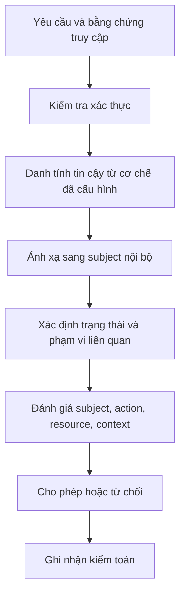

# Subject

Khi một API nhận yêu cầu “duyệt hóa đơn”, biết hành động và mã hóa đơn vẫn chưa đủ để quyết định cho phép. Hệ thống còn phải xác định **chủ thể nào đang yêu cầu hành động**, chủ thể đó thuộc phạm vi nào, đang sử dụng quyền gì và có được đại diện cho bên khác hay không.

Trong mô hình kiểm soát truy cập, chủ thể đó thường được gọi là **subject**. Subject là một thành phần trung tâm của IAM: xác thực cung cấp căn cứ nhận diện chủ thể, RBAC và ABAC đánh giá quyền của chủ thể, còn quản lý phiên và vòng đời danh tính duy trì hoặc thu hồi căn cứ truy cập.

Từ “subject” cũng xuất hiện trong token và các framework bảo mật với ý nghĩa cụ thể của từng mô hình. Vì vậy, cần phân biệt định nghĩa khái niệm với cách một sản phẩm hoặc giao thức biểu diễn nó.

## 1. Subject trong một quyết định cấp quyền

### 1.1. Chủ thể yêu cầu thực hiện hành động

Trong mô hình cấp quyền phổ biến, **subject là thực thể được đánh giá khi yêu cầu thực hiện một hành động trên tài nguyên**.

Một quyết định có thể được mô tả như sau:

```text
authorize(subject, action, resource, context)
    → PERMIT hoặc DENY
```

Ví dụ:

```text
subject: Lan trong ngữ cảnh truy cập của tenant A
action: invoice.approve
resource: hóa đơn invoice-9001 của tenant A
context: thời điểm hiện tại, trạng thái phiên, mức xác thực
```

Subject có thể đại diện cho con người, tiến trình, dịch vụ hoặc workload. Một số mô hình biểu diễn tiến trình đang thực thi là subject và liên kết nó với danh tính người dùng; mô hình ứng dụng khác trực tiếp biểu diễn người dùng là subject của quyết định.

Điều cần xác định không phải tên lớp trong mã nguồn mà là: **quyền của thực thể nào đang được sử dụng để quyết định yêu cầu này?**

### 1.2. Subject và resource có vai trò khác nhau

Trong yêu cầu đọc hồ sơ của nhân viên Minh:

- Subject có thể là Lan, người đang gọi API.
- Resource là hồ sơ của Minh.
- Action là đọc hồ sơ.
- Context có thể gồm tenant, quan hệ quản lý và thời điểm truy cập.

Không được lấy identifier của Minh trong URL rồi coi Minh là subject của yêu cầu. Người có dữ liệu được truy cập và người thực hiện truy cập là hai vị trí khác nhau trong quyết định.

Một thực thể có thể nằm ở các vị trí khác nhau trong những quyết định khác nhau. Account của Lan là subject khi Lan đọc tài liệu; bản ghi account đó lại có thể là resource khi quản trị viên thay đổi trạng thái của nó.

### 1.3. Subject không đồng nghĩa đã được phép

Subject là đầu vào cho authorization, không phải kết quả cho phép.

Một subject đã xác thực vẫn có thể bị từ chối vì:

- Thiếu quyền đối với hành động.
- Không thuộc tenant của tài nguyên.
- Account hoặc membership đã bị vô hiệu hóa.
- Phiên không đáp ứng mức xác thực cần thiết.
- Điều kiện ủy quyền không phù hợp.
- Trạng thái nghiệp vụ của tài nguyên không cho phép thao tác.

Một số yêu cầu công khai cũng có subject chưa xác thực hoặc subject ẩn danh. Khi đó, hệ thống vẫn cấp quyền theo chính sách công khai; nó không cần giả tạo một người dùng đã đăng nhập.

## 2. Phân biệt subject với các khái niệm liên quan

| Khái niệm | Trọng tâm | Quan hệ với subject |
|---|---|---|
| Identity | Biểu diễn một thực thể trong ngữ cảnh | Cung cấp định danh và thuộc tính để nhận diện chủ thể |
| Account | Bản ghi do hệ thống quản lý | Có thể được ánh xạ thành chủ thể trong ngữ cảnh truy cập |
| Principal | Danh tính được cơ chế bảo mật nhận diện | Thường cung cấp căn cứ danh tính cho subject |
| Subject | Chủ thể mà mô hình hoặc quyết định đang đánh giá | Có thể gồm danh tính và thuộc tính cần cho quyết định |
| Actor | Bên thực tế thực hiện một hành động hoặc lời gọi theo mô hình đang dùng | Có thể trùng với subject hoặc là bên gọi thay subject |
| Client | Ứng dụng tham gia luồng giao thức hoặc gọi dịch vụ | Có thể là actor, chủ thể workload hoặc ứng dụng gọi thay người dùng |
| Role | Tập quyền hoặc vị trí trong mô hình phân quyền | Được gán hoặc sử dụng trong ngữ cảnh của subject, có phạm vi |
| Credential | Bằng chứng hoặc phương tiện tham gia xác thực/truy cập | Được kiểm tra để thiết lập ngữ cảnh; không phải bản thân chủ thể |
| Session | Ngữ cảnh truy cập được duy trì qua nhiều tương tác | Mang liên kết tới chủ thể và dữ liệu xác thực của phiên |

Không có ánh xạ một–một bắt buộc giữa các khái niệm này.

Ví dụ, cùng một người có account thường và account quản trị. Hai yêu cầu từ hai account đó có thể tạo hai subject với quyền khác nhau. Việc cùng liên quan tới một người không khiến quyền tự hợp nhất.

Trong một framework, `principal` có thể là đối tượng đại diện trực tiếp cho người dùng. Trong Java JAAS, `Subject` có thể chứa nhiều `Principal` cùng thông tin xác thực. Một mô hình policy lại có thể dùng subject như một tập thuộc tính được đưa vào bộ đánh giá quyền.

Vì vậy, không nên đặt quy tắc tổng quát “subject luôn bằng principal” hoặc “subject luôn là một hàng user”. Cần ghi rõ cách ánh xạ trong hệ thống cụ thể.

Một số nền tảng còn cho phép nhận một role để tạo danh tính phiên hiệu lực. Trong trường hợp đó, phải đọc ngữ nghĩa của nền tảng: role trong cấu hình RBAC và principal của phiên được cấp từ role không phải cùng một loại đối tượng, dù tên gọi có liên quan.

## 3. Những loại subject thường gặp

### 3.1. Chủ thể con người

Subject có thể là một người dùng đã được ánh xạ vào account nội bộ, chẳng hạn:

```text
type: human
account_id: account-2048
tenant_id: tenant-a
```

Ứng dụng sử dụng identifier ổn định để tham chiếu. Tên hiển thị hoặc email không nên là căn cứ duy nhất vì có thể thay đổi, trùng nhau hoặc được tái cấp.

Đăng nhập thành công không tự chứng minh mọi thuộc tính về người dùng. Một account có mật khẩu hợp lệ không có nghĩa danh tính pháp lý đã được xác minh hoặc phòng ban tự khai báo là chính xác.

### 3.2. Chủ thể workload

Một tác vụ xuất báo cáo hoặc dịch vụ xử lý hóa đơn có thể gọi API mà không có người dùng đang tương tác.

```text
type: workload
workload_id: workload-invoice-exporter
environment: production
```

Quyền của workload cần được quản lý theo mục đích, môi trường, chủ sở hữu vận hành và phạm vi tài nguyên. Không dùng credential cá nhân của lập trình viên để biến mọi tác vụ nền thành hành động của người đó.

Chủ sở hữu workload chịu trách nhiệm quản trị danh tính; quan hệ này không tự cấp cho workload toàn bộ quyền của người sở hữu.

### 3.3. Chủ thể ẩn danh

Một trang công khai có thể cho phép đọc mà không cần account đã xác thực.

```text
type: anonymous
authentication_state: unauthenticated
account_id: absent
```

Subject ẩn danh có thể là một đối tượng dùng chung để áp chính sách. Nó không phân biệt từng khách và không nên được dùng làm khóa sở hữu dữ liệu tạm.

Nếu chức năng cần phiên khách, ngữ cảnh phiên phải được quản lý riêng. Có cookie phiên khách không có nghĩa hệ thống đã xác thực danh tính account của người đang dùng trình duyệt.

### 3.4. Chủ thể trong một lời gọi được ủy quyền

Ứng dụng báo cáo có thể gọi API thay Lan. Khi đó, cần giữ được cả:

- Danh tính người dùng được đại diện.
- Danh tính ứng dụng thực hiện lời gọi.
- Phạm vi quyền được ủy quyền.
- Tài nguyên và tenant đích.
- Các điều kiện liên quan của phiên hoặc luồng ủy quyền.

Không nên ép mọi thông tin này vào một trường `userId` rồi bỏ phần còn lại. Trong một mô hình, Lan là subject hiệu lực và ứng dụng là actor; mô hình khác có thể đánh giá nhiều chủ thể hoặc nhiều chính sách liên tiếp.

Quan trọng là không làm mất thông tin cần thiết để quyết định và giải thích quyền.

## 4. Subject context: danh tính đi cùng phạm vi và căn cứ

### 4.1. Không chỉ có một chuỗi identifier

Một chuỗi `2048` không đủ nếu nó có thể thuộc nhiều issuer, tenant hoặc loại chủ thể.

Ngữ cảnh subject thường cần xác định:

- Loại chủ thể.
- Identifier ổn định và miền định danh.
- Account hoặc danh tính nội bộ được ánh xạ.
- Trạng thái xác thực.
- Membership và phạm vi tổ chức liên quan.
- Thuộc tính có nguồn tin cậy.
- Ngữ cảnh ủy quyền hoặc actor, nếu có.
- Liên kết tới thông tin phiên cần cho chính sách.

Không phải mọi dữ liệu phải nằm trực tiếp trong cùng một đối tượng. Một số giá trị có thể được tra cứu khi đánh giá quyền. Điều quan trọng là nguồn và ý nghĩa của từng giá trị phải rõ ràng.

### 4.2. Ví dụ ngữ cảnh đã được thiết lập phía server

```json
{
  "subject": {
    "type": "human",
    "account_id": "account-2048",
    "identity_reference": {
      "issuer": "https://login.example.test",
      "subject": "person-7f31"
    },
    "authentication_state": "authenticated"
  },
  "membership": {
    "tenant_id": "tenant-a",
    "status": "active",
    "roles": ["invoice_viewer"]
  },
  "authentication_context": {
    "authenticated_at": "2026-10-01T08:00:00Z",
    "assurance_profile": "application-profile-basic"
  },
  "delegation": null
}
```

Đây là cấu trúc minh họa, không phải schema token hoặc chuẩn IAM bắt buộc. Tên `application-profile-basic` là nhãn chính sách nội bộ trong ví dụ, không phải một mức bảo đảm tiêu chuẩn.

Các dữ liệu trên chỉ có ý nghĩa bảo mật sau khi được thiết lập từ cơ chế xác thực, ánh xạ và tra cứu đáng tin cậy. Cùng một JSON do client tự gửi không tạo ra subject đáng tin.

### 4.3. Thuộc tính cần có nguồn và độ mới phù hợp

ABAC có thể dùng phòng ban hoặc trạng thái làm việc của subject. Khi đó cần biết:

- Nguồn nào có thẩm quyền quản lý thuộc tính.
- Giá trị đã được kiểm tra hoặc đồng bộ thế nào.
- Giá trị có thể cũ tối đa bao lâu.
- Điều gì xảy ra nếu nguồn lỗi hoặc thuộc tính thiếu.
- Người dùng có được tự chỉnh sửa thuộc tính đó không.

Không dùng `department=finance` trong request body để kết luận người gọi thuộc phòng tài chính. Một thuộc tính hiện diện trong token cũng cần được kiểm tra về nguồn phát hành và thẩm quyền trước khi dùng cho chính sách.

### 4.4. Tách danh tính ổn định khỏi dữ liệu thay đổi

Identifier của subject có thể ổn định trong khi role, membership, trạng thái account hoặc mức xác thực của phiên thay đổi.

Nếu nhúng mọi quyền vào một token dài hạn rồi không có cách cập nhật hay giới hạn dữ liệu cũ, việc thu hồi quyền có thể không có hiệu lực như mong đợi.

Một thiết kế rõ ràng nên xác định đâu là dữ liệu ổn định, đâu là dữ liệu cần kiểm tra hiện hành và đâu là dữ liệu chấp nhận có độ trễ trong giới hạn nhất định.

## 5. Thiết lập subject từ một yêu cầu

### 5.1. Ranh giới tin cậy

Client có thể gửi username, account ID hoặc tenant muốn truy cập. Những giá trị đó giúp mô tả yêu cầu, nhưng không tự thiết lập danh tính của người gọi.

Một luồng có xác thực thường gồm:

1. Nhận bằng chứng qua cơ chế mà endpoint hỗ trợ.
2. Kiểm tra bằng chứng và các điều kiện sử dụng.
3. Xác định danh tính hoặc principal mà cơ chế xác thực cung cấp.
4. Ánh xạ sang subject nội bộ theo chính sách.
5. Kiểm tra trạng thái và các quan hệ liên quan.
6. Đánh giá quyền cho hành động và tài nguyên cụ thể.
7. Ghi nhận quyết định với các định danh cần thiết.



Đây là mô hình trách nhiệm, không bắt buộc mọi kiến trúc phải có một dịch vụ riêng cho mỗi bước.

### 5.2. Credential thiếu và credential lỗi không phải cùng một trạng thái

Nếu endpoint cho phép công khai và request không có credential, hệ thống có thể tạo subject ẩn danh.

Nếu endpoint yêu cầu xác thực, thiếu credential phải được xử lý theo hợp đồng xác thực của endpoint.

Nếu client gửi credential không hợp lệ, hệ thống không được lấy các claim chưa xác minh từ đó để thiết lập subject. Endpoint có xác thực tùy chọn cần quy định rõ có tiếp tục phục vụ phần công khai hay trả lỗi; không được giữ lại một phần quyền từ credential đã kiểm tra thất bại.

Ví dụ nguy hiểm:

```text
Token không hợp lệ
    nhưng vẫn đọc account_id từ phần payload
    rồi tạo subject "đã đăng nhập"
```

Đọc được dữ liệu và tin cậy dữ liệu là hai việc khác nhau.

### 5.3. Không nhận subject trực tiếp từ header tùy ý

```http
POST /api/invoices/invoice-9001/approve
X-Subject-Id: account-admin
```

Nếu client được tự đặt header này, server không được coi nó là bằng chứng người gọi có danh tính `account-admin`.

Một hệ thống có gateway tin cậy có thể truyền ngữ cảnh bảo mật qua header hoặc thông điệp nội bộ, nhưng cần bảo vệ quan hệ đó: xác thực bên truyền, kiểm soát đường đi và ngăn việc giả mạo hoặc bỏ qua gateway.

Tên header không tạo ra sự tin cậy. Nguồn đã xác thực và hợp đồng truyền dữ liệu mới xác định giá trị có thể dùng.

### 5.4. Giả mã cho một ứng dụng hóa đơn

```text
function approveInvoice(request, invoiceId):
    authResult = authenticateRequest(request)
    if authResult is not valid:
        rejectUnauthenticatedAndStop()

    subject = resolveApplicationSubject(authResult.trustedIdentity)
    if subject is missing or subject is disabled:
        denyAndStop()

    invoice = loadInvoice(invoiceId)
    membership = loadActiveMembership(subject.id, invoice.tenantId)
    if membership is missing:
        denyAndStop()

    decision = authorize(
        subject = subject,
        membership = membership,
        actor = authResult.trustedActor,
        delegation = authResult.trustedDelegation,
        action = "invoice.approve",
        resource = invoice,
        context = trustedRequestContext(authResult)
    )

    if decision != PERMIT:
        recordDeniedDecision()
        denyAndStop()

    applyApprovalWithApplicationConsistencyRules(invoice, subject)
    recordSuccessfulAction()
```

Giả mã mô tả một ứng dụng yêu cầu chủ thể được ánh xạ và có membership tại tenant của hóa đơn. Mô hình workload hoặc truy cập công khai có thể cần chính sách khác.

Các trường `trustedActor`, `trustedDelegation` chỉ được sử dụng nếu hệ thống có cơ chế tin cậy để thiết lập chúng. Không thể bổ sung một trường vào request rồi mặc định thông tin đã có hiệu lực bảo mật.

## 6. Subject trong RBAC và ABAC

### 6.1. RBAC: quyền qua role, có phạm vi

Trong RBAC, subject thường được gán role trực tiếp hoặc thông qua nhóm, membership hay quan hệ tương tự.

```text
Subject: account-2048
Role: invoice_viewer
Scope: tenant-a
```

Khi subject yêu cầu đọc hóa đơn thuộc tenant A, hệ thống kiểm tra role có cung cấp quyền đọc trong phạm vi đó không.

Nếu cùng account có role `invoice_approver` tại tenant B, role này không tự có hiệu lực với hóa đơn của tenant A.

Một cách mô hình hóa sai là lấy hợp tất cả role của mọi tenant rồi đặt vào subject mà không giữ phạm vi:

```text
subject.roles = [invoice_viewer, invoice_approver]
```

Nếu chính sách chỉ nhìn tên role, subject có thể nhận quyền ở nơi chưa được cấp. Cần giữ hoặc tra cứu được quan hệ giữa subject, role và phạm vi áp dụng.

### 6.2. ABAC: thuộc tính của subject kết hợp tài nguyên và ngữ cảnh

Một chính sách minh họa:

```text
Cho phép invoice.read khi:
  subject.type == "human"
  và membership.status == "active"
  và membership.tenant_id == resource.tenant_id
  và subject.department == resource.department
  và subject có quyền invoice.read trong phạm vi tài nguyên
```

Ở đây, thuộc tính phòng ban không thay thế mọi kiểm tra còn lại. Việc cùng phòng ban không tự tạo quyền đọc mọi tài nguyên.

ABAC cũng có thể áp dụng cho workload, chẳng hạn kiểm tra môi trường triển khai, loại dịch vụ hoặc phạm vi dữ liệu được cho phép. Những thuộc tính này phải được thiết lập từ nguồn mà chính sách tin cậy.

Khi thuộc tính bắt buộc bị thiếu, không nên mặc định thành giá trị rộng hơn như “mọi tenant” hoặc “mọi phòng ban”. Chính sách cần quy định cách xử lý thiếu dữ liệu.

### 6.3. Điều kiện xác thực thuộc ngữ cảnh, không phải quyền cố định

Một hành động nhạy cảm có thể yêu cầu xác thực bổ sung hoặc xác thực gần đây.

Ví dụ:

```text
Subject có quyền invoice.approve
nhưng phiên hiện tại chưa đáp ứng điều kiện xác thực bổ sung
    → chưa cho thực hiện hành động
```

Sau khi hoàn tất MFA theo cơ chế được hỗ trợ, subject vẫn là chủ thể đó, nhưng ngữ cảnh xác thực thay đổi. Hệ thống cần đánh giá lại chính sách.

Không nên coi `mfa_enabled=true` trong hồ sơ là bằng chứng phiên hiện tại đã hoàn tất MFA. Đăng ký phương thức MFA và sử dụng thành công phương thức đó trong một luồng xác thực là hai sự kiện khác nhau.

Cũng không nên biến việc hoàn tất MFA thành một role quản trị vĩnh viễn. Quyền và mức bảo đảm xác thực là các thành phần riêng của quyết định.

## 7. Subject và actor trong ủy quyền

### 7.1. Khi hai bên trùng nhau

Trong một mô hình ứng dụng đơn giản, Lan đăng nhập trực tiếp rồi tự yêu cầu đọc hóa đơn. Log có thể ghi subject là Lan và không cần một actor riêng nếu không có ngữ nghĩa bổ sung.

Tuy nhiên, ứng dụng vẫn có thể ghi client hoặc kênh truy cập để phục vụ vận hành. Client không nhất thiết là một người dùng khác.

### 7.2. Khi ứng dụng gọi thay người dùng

Ứng dụng báo cáo gọi API thay Lan:

```text
Subject hiệu lực: account của Lan
Actor/client: ứng dụng báo cáo
Phạm vi ủy quyền: invoice.read
Tài nguyên: hóa đơn của tenant A
```

Trong ví dụ này, quyết định đọc cần xét đồng thời:

- Lan có quyền đọc tài nguyên đó không.
- Ứng dụng có được phép sử dụng quyền đọc thay Lan trong luồng này không.
- Phạm vi ủy quyền có bao gồm hành động không.
- Các ràng buộc tenant, tài nguyên và ngữ cảnh có được đáp ứng không.

Không cộng quyền của Lan với quyền của ứng dụng để tạo ra quyền rộng hơn ngoài ý định ủy quyền. Đây là các ràng buộc cần được thỏa mãn theo mô hình đã chọn, không phải một công thức hợp quyền áp dụng cho mọi loại grant và mọi API.

Nếu ứng dụng được ủy quyền đọc, việc Lan có quyền xóa không tự cho ứng dụng quyền xóa.

### 7.3. Khi dịch vụ dùng quyền riêng

Một tác vụ nền có thể sử dụng danh tính workload để đọc dữ liệu tổng hợp theo chính sách dành riêng cho dịch vụ.

Khi đó, subject có thể là workload; không nhất thiết tồn tại một người dùng được đại diện.

Không được tự đặt subject thành người tạo tác vụ để tránh thiết kế quyền workload. Nếu việc tạo tác vụ cần quyền của con người, có thể có hai quyết định riêng:

1. Người dùng có được tạo hoặc cấu hình tác vụ không?
2. Workload có được thực hiện thao tác dữ liệu khi tác vụ chạy không?

Hai quyết định diễn ra ở hai thời điểm và không nhất thiết sử dụng cùng subject.

### 7.4. Mạo danh có kiểm soát cần giữ người thực hiện thật

Một công cụ hỗ trợ có thể cho nhân viên được cấp quyền mở giao diện theo ngữ cảnh khách hàng.

Nếu hệ thống chỉ thay subject thành account khách hàng rồi bỏ danh tính nhân viên hỗ trợ, log sẽ khiến hành động trông như do khách hàng tự thực hiện.

Một mô hình kiểm toán cần giữ được:

```text
Effective subject: account khách hàng
Actual actor: account nhân viên hỗ trợ
Mode: controlled impersonation
Scope: tập thao tác được cho phép
Approval/reference: căn cứ vận hành nếu cần
```

Không phải sản phẩm nào cũng dùng cùng tên field hoặc cùng cơ chế token. Điều bắt buộc về mặt thiết kế là không mất danh tính thực hiện và không cho quyền mạo danh lan ra ngoài phạm vi được cấp.

## 8. Subject trong token không phải luôn là subject của mọi quyết định

### 8.1. Claim sub phải được đọc theo loại token

Trong một ID token OIDC hợp lệ, `sub` định danh người dùng tại issuer theo ngữ cảnh cấp token. Để liên kết danh tính ngoài, ứng dụng thường cần cặp `iss` và `sub`, không chỉ `sub` trần.

Identifier này không mặc định là:

- Account ID nội bộ của ứng dụng.
- Email.
- Role.
- Tenant ID.
- Client ID.
- Identifier phiên.

Issuer có thể cấp subject dạng pairwise, khiến cùng một người được biểu diễn bằng các giá trị subject khác nhau ở các ngữ cảnh client phù hợp. Không tự gộp hoặc liên kết account chỉ dựa trên giả định mọi ứng dụng sẽ thấy cùng một chuỗi `sub`.

### 8.2. Access token có ngữ nghĩa riêng

Chủ thể được mô tả trong access token có thể là người dùng hoặc ứng dụng/workload, tùy luồng và quy ước của hệ thống phát hành.

Không áp nghĩa của `sub` trong ID token cho mọi access token. Một access token cũng có thể là chuỗi opaque, không phải JWT để API tự đọc.

API phải biết:

- Loại token nào được chấp nhận.
- Issuer và mục đích sử dụng nào được tin.
- Token có dành cho API này không.
- Cách xác định subject và client/actor theo hợp đồng.
- Cách diễn giải scope và các ràng buộc liên quan.
- Cách ánh xạ vào chính sách nội bộ.

ID token phục vụ kết quả xác thực tại client trong OIDC; không dùng làm token truy cập API chỉ vì nó chứa thông tin người dùng.

### 8.3. Từ token tới subject là một bước có chính sách

Ví dụ:

```text
Token đã được kiểm tra hợp lệ
    ↓
Danh tính ngoài theo issuer và subject
    ↓
Ánh xạ account hoặc workload được ứng dụng chấp nhận
    ↓
Kiểm tra trạng thái và quan hệ hiện hành
    ↓
Subject context cho quyết định cụ thể
```

Một chữ ký hợp lệ hỗ trợ xác minh nguồn và tính toàn vẹn theo cơ chế đang dùng. Nó không tự bảo đảm issuer có thẩm quyền cấp mọi role trong ứng dụng.

Tương tự, `aud` mô tả bên nhận dự kiến theo ngữ nghĩa token; nó không phải danh tính của người gọi và không thay cho kiểm tra quyền đối với tài nguyên.

## 9. Vòng đời subject context và thay đổi quyền

### 9.1. Subject tồn tại trong một ngữ cảnh xử lý

Account có thể tồn tại nhiều năm, nhưng subject context của một yêu cầu là biểu diễn được sử dụng tại một thời điểm xử lý.

Một ứng dụng có thể khôi phục thông tin từ phiên để tạo subject context mới cho mỗi request. Các dữ liệu như role hoặc membership có thể được lấy từ cache, token hoặc nguồn quyền hiện hành theo thiết kế.

Do đó, cần quy định rõ:

- Giá trị nào được giữ từ thời điểm đăng nhập.
- Giá trị nào được kiểm tra lại khi xử lý yêu cầu.
- Cache có thời hạn và cơ chế cập nhật ra sao.
- Trạng thái account hoặc membership bị thu hồi ảnh hưởng thế nào.
- Hệ thống có thể chấp nhận dữ liệu cũ trong bao lâu.

Việc một người vẫn là cùng subject về identifier không có nghĩa họ luôn giữ cùng tập quyền.

### 9.2. Thu hồi account không tự thu hồi mọi ngữ cảnh đã cấp

Giả sử Lan đăng nhập lúc 09:00, bị vô hiệu hóa lúc 09:10 và gửi một token còn hạn lúc 09:12.

Nếu API chỉ dựa vào dữ liệu trong token mà không có cơ chế cập nhật hoặc thu hồi phù hợp, yêu cầu có thể tiếp tục được chấp nhận.

Một thiết kế cần xem xét account, session, refresh token, access token, cache quyền và các bản sao dữ liệu ở hệ thống liên kết.

Không nên báo “thu hồi tức thì” chỉ vì trạng thái ở một bảng đã đổi. Cần xác định nơi ra quyết định cấp quyền đã nhận hoặc kiểm tra thay đổi bằng cách nào.

### 9.3. Giữ ngữ cảnh tách biệt giữa các yêu cầu

Một subject context có quyền phải được gắn đúng yêu cầu và có vòng đời rõ ràng.

Ví dụ nguy hiểm là lưu người dùng hiện tại vào biến dùng chung cho toàn ứng dụng:

```text
global currentSubject = subjectOfLatestRequest
```

Hai request đồng thời có thể dùng nhầm subject. Hệ thống có thể ghi dữ liệu của Lan thành hành động của Minh hoặc áp quyền quản trị cho request khác.

Nên dùng cơ chế quản lý ngữ cảnh của framework và hiểu cách nó hoạt động với xử lý bất đồng bộ. Việc truyền ngữ cảnh sang luồng, tác vụ hoặc callback không được dựa vào giả định rằng “current user” luôn tự đi theo.

Trong phạm vi đánh giá một yêu cầu, hạn chế thay đổi tùy ý identifier, actor hoặc membership của subject. Nếu cần đổi ngữ cảnh, phải có bước chuyển rõ ràng và được kiểm soát.

### 9.4. Với tác vụ trong hàng đợi, phân biệt người yêu cầu và chủ thể thực thi

Một người dùng có thể tạo yêu cầu xuất báo cáo, còn worker thực hiện sau đó vài phút.

Có thể có các thông tin riêng:

```text
requested_by: người tạo yêu cầu
executing_subject: workload đang thực thi
represented_subject: người được đại diện, nếu thiết kế có
target_scope: tenant và tài nguyên của tác vụ
```

Không mặc định `requested_by` luôn là chủ thể hiệu lực khi worker chạy.

Nếu mô hình yêu cầu quyền của người dùng vẫn còn hiệu lực tại thời điểm thực thi, worker cần đánh giá lại điều kiện đó. Nếu đây là tác vụ được dịch vụ tiếp nhận và thực hiện bằng quyền riêng, cần chính sách tương ứng cho workload và phạm vi công việc đã chấp nhận.

Sao chép nguyên subject context cùng mọi role từ lúc tạo tác vụ rồi sử dụng vô thời hạn dễ làm quyền cũ tiếp tục có hiệu lực ngoài ý định.

## 10. Kiểm toán subject và actor

Bản ghi kiểm toán cần giúp trả lời: chủ thể nào được đánh giá, ai thực hiện lời gọi, dùng phạm vi nào, yêu cầu hành động gì và kết quả ra sao.

Ví dụ:

```json
{
  "event": "authorization_decision",
  "subject_type": "human",
  "subject_account_id": "account-2048",
  "actor_client_id": "reporting-app",
  "delegation_mode": "on_behalf_of_user",
  "target_tenant_id": "tenant-a",
  "action": "invoice.read",
  "resource_id": "invoice-9001",
  "decision": "DENY",
  "reason": "MISSING_DELEGATED_PERMISSION",
  "request_id": "request-c82a",
  "occurred_at": "2026-10-01T08:00:00Z"
}
```

Đây là schema minh họa. Một tác vụ workload có thể không có `subject_account_id` của con người; một lời gọi trực tiếp có thể không cần trường ủy quyền.

Những nguyên tắc cần giữ:

- Dùng identifier ổn định thay vì chỉ ghi tên hiển thị.
- Giữ phạm vi cần thiết để phân biệt tenant hoặc miền danh tính.
- Ghi cả subject hiệu lực và actor khi mô hình có sự khác biệt.
- Phân biệt quyết định cho phép với kết quả thao tác thực sự.
- Dùng request ID hoặc liên kết sự kiện phù hợp để nối các bước.
- Không ghi mật khẩu, khóa riêng, session cookie hoặc toàn bộ bearer token.
- Chỉ ghi thông tin cần thiết, với quyền truy cập và thời gian lưu phù hợp.

Một sự kiện “Lan đọc hóa đơn” thiếu actor có thể che mất việc ứng dụng báo cáo hoặc nhân viên hỗ trợ thực hiện thay Lan. Ngược lại, chỉ ghi tên dịch vụ có thể làm mất người dùng được đại diện trong quyết định.

Định danh dùng trong log cũng có thể cho phép liên kết hoạt động. Không nên coi việc bỏ tên thật là đã loại bỏ mọi yếu tố nhạy cảm.

## 11. Ví dụ suy luận về subject

### 11.1. Tự xem hồ sơ cá nhân

Lan gọi endpoint xem hồ sơ của mình.

Một quy tắc có thể yêu cầu subject đã xác thực và identifier account của subject trùng với account sở hữu hồ sơ, hoặc subject có quyền hỗ trợ/quản trị thích hợp.

Không lấy `accountId` do client gửi làm subject rồi so sánh chính giá trị đó với URL. Cách làm ấy chỉ so sánh hai dữ liệu do client kiểm soát.

Ngoài ra, việc trùng chủ sở hữu chỉ đáp ứng một phần chính sách. Một số trường hoặc hành động nhạy cảm vẫn có thể có điều kiện bổ sung.

### 11.2. Cùng người, hai ngữ cảnh đặc quyền

Lan có account thường và account quản trị.

Khi đăng nhập account thường, subject không được tự nhận quyền của account quản trị chỉ vì hai account liên kết tới cùng hồ sơ nhân sự.

Khi cần thao tác đặc quyền, hệ thống phải thiết lập đúng danh tính hoặc ngữ cảnh được phép, kiểm tra điều kiện kích hoạt quyền và ghi nhận phù hợp.

Liên kết tới cùng một con người giúp kiểm toán; nó không phải lệnh hợp nhất quyền.

### 11.3. Ứng dụng có quyền đọc, người dùng có quyền xóa

Lan có quyền xóa hóa đơn, còn ứng dụng báo cáo chỉ được ủy quyền đọc thay Lan.

Yêu cầu xóa do ứng dụng gửi phải bị từ chối nếu không đáp ứng phạm vi ủy quyền. Subject là Lan không làm mất các giới hạn áp dụng cho actor/client.

Nếu ứng dụng cần thao tác bằng quyền workload riêng, đó là một mô hình quyền khác và phải được thiết kế, xác thực, cấp quyền cùng kiểm toán tương ứng.

### 11.4. Một workload phục vụ nhiều người dùng

Backend dùng cùng một danh tính dịch vụ để gọi API cho nhiều người dùng.

Không thể chỉ nhìn danh tính workload rồi kết luận mọi người dùng đều được đọc cùng dữ liệu. Cần cơ chế tin cậy để bảo toàn ngữ cảnh người dùng hoặc thiết kế chính sách tại lớp chịu trách nhiệm cấp quyền tương ứng.

Dữ liệu `userId` tự khai báo qua nhiều tầng không tự trở thành một danh tính đã được xác thực. Từng ranh giới cần biết bên nào có quyền khẳng định chủ thể và phạm vi ủy quyền.

### 11.5. Membership hết hạn trước khi tác vụ chạy

Lan tạo tác vụ xuất báo cáo ở tenant A lúc membership còn hiệu lực. Trước lúc worker thực thi, membership hết hạn.

Hệ thống cần áp dụng chính sách thời điểm thực thi đã xác định. Nếu tác vụ yêu cầu Lan vẫn có quyền tại thời điểm chạy, phải kiểm tra lại và từ chối hoặc hủy theo quy trình khi điều kiện không còn đáp ứng.

Nếu dịch vụ có quyền hoàn tất một quy trình đã được tiếp nhận độc lập với quyền hiện tại của Lan, cần ghi rõ chủ thể workload, căn cứ tiếp nhận và phạm vi cho phép. Không giải quyết bằng cách âm thầm giữ một bản sao quyền người dùng cũ.

## 12. Các lỗi thường gặp

| Lỗi | Hậu quả | Cách thiết kế phù hợp |
|---|---|---|
| Dùng account ID do client gửi làm subject đã xác thực | Giả mạo danh tính người khác | Thiết lập subject từ cơ chế xác thực và ánh xạ tin cậy |
| Nhầm người có dữ liệu với người truy cập | Kiểm tra quyền sai chủ thể | Tách subject, resource và chủ sở hữu resource |
| Dùng tên/email làm định danh duy nhất | Gộp sai chủ thể hoặc trao nhầm quyền | Dùng identifier ổn định và có phạm vi |
| Lấy mọi role từ mọi tenant vào một danh sách | Quyền lan sang tenant chưa được cấp | Giữ scope của role assignment và membership |
| Coi mọi claim có chữ ký là quyền nội bộ | Tin quá mức vào issuer hoặc thuộc tính | Kiểm tra nguồn, mục đích và quy tắc ánh xạ |
| Xóa thông tin actor trong lời gọi thay | Không giải thích được ủy quyền và trách nhiệm | Giữ subject hiệu lực, actor và phạm vi liên quan |
| Coi MFA đã đăng ký là MFA đã thực hiện | Bỏ qua điều kiện xác thực của phiên | Kiểm tra ngữ cảnh xác thực đáng tin tại thời điểm cần |
| Lưu subject vào biến dùng chung giữa request | Trộn danh tính và quyền khi xử lý đồng thời | Dùng ngữ cảnh có phạm vi phù hợp |
| Sao chép quyền vào tác vụ vô thời hạn | Thực thi với quyền đã hết hiệu lực | Quy định chính sách tái đánh giá và chủ thể thực thi |
| Khóa account nhưng bỏ qua phiên/token | Truy cập cũ vẫn tiếp tục | Thiết kế thu hồi và giới hạn dữ liệu cũ |
| Ghi token thay cho identifier kiểm toán | Log trở thành nguồn lộ credential | Ghi tham chiếu cần thiết, tách khỏi bí mật truy cập |

## 13. Câu hỏi thiết kế cần trả lời được

1. Subject của từng loại request là con người, workload, chủ thể ẩn danh hay một ngữ cảnh được ủy quyền?
2. Identifier duy nhất trong miền nào, và được ánh xạ từ principal hoặc danh tính ngoài ra sao?
3. Nguồn nào có thẩm quyền với từng thuộc tính dùng để cấp quyền?
4. Tenant là phạm vi của account, membership hay tài nguyên, và các quan hệ được kiểm tra thế nào?
5. Role, permission và điều kiện xác thực nào áp dụng cho hành động đang xét?
6. Khi actor khác subject hiệu lực, thông tin đó được thiết lập và bảo vệ bằng cơ chế nào?
7. Account bị vô hiệu hóa hoặc role bị thu hồi ảnh hưởng tới phiên, token và cache trong bao lâu?
8. Ngữ cảnh subject có bị dùng chung hoặc truyền nhầm giữa request và tác vụ bất đồng bộ không?
9. Log có phân biệt được người yêu cầu, chủ thể được đại diện và workload thực thi không?
10. Khi không xác định đủ subject hoặc thiếu thuộc tính bắt buộc, hệ thống từ chối hay xử lý theo chính sách nào?

Câu trả lời nên được thể hiện trong mô hình dữ liệu, ranh giới tin cậy và cách thực thi chính sách, thay vì chỉ nằm trong tên biến `currentUser`.

## 14. Những điểm cần ghi nhớ

Subject là chủ thể mà mô hình cấp quyền đang đánh giá đối với một hành động và tài nguyên. Danh tính, principal, account và phiên cung cấp các phần căn cứ để thiết lập chủ thể; role và thuộc tính góp phần quyết định quyền.

Subject cần identifier có phạm vi, dữ liệu có nguồn tin cậy và ngữ cảnh phù hợp với thời điểm xử lý. Chủ thể đã xác thực không tự có mọi quyền, và subject trong token không mặc nhiên là account nội bộ hay bên thực hiện thực tế của mọi hành động.

Trong luồng ủy quyền, workload và tác vụ bất đồng bộ, phải giữ rõ subject hiệu lực, actor và phạm vi trách nhiệm. Đây là nền tảng để áp dụng ít quyền nhất, quản lý đặc quyền, thu hồi truy cập và kiểm toán một cách giải thích được.
