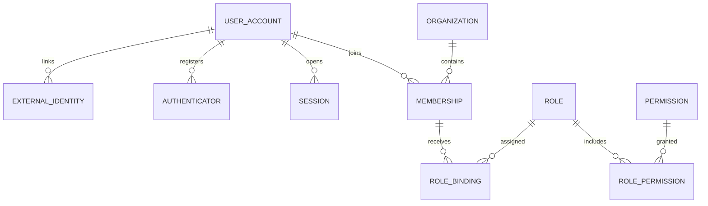
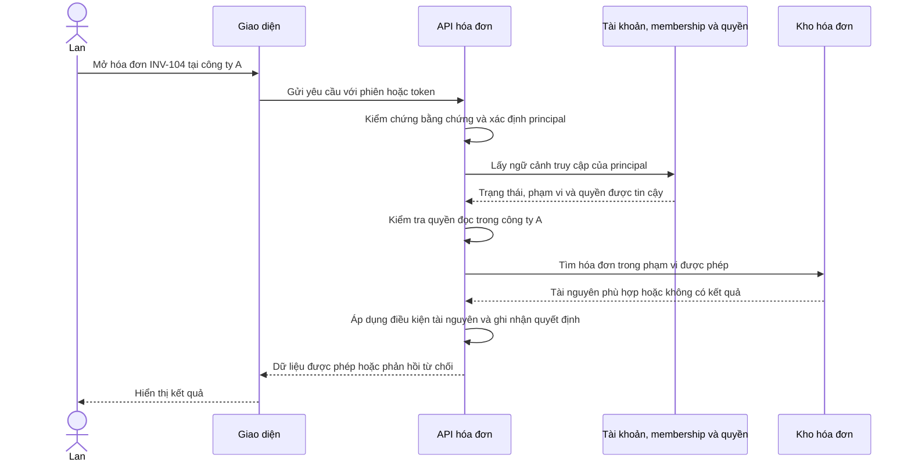
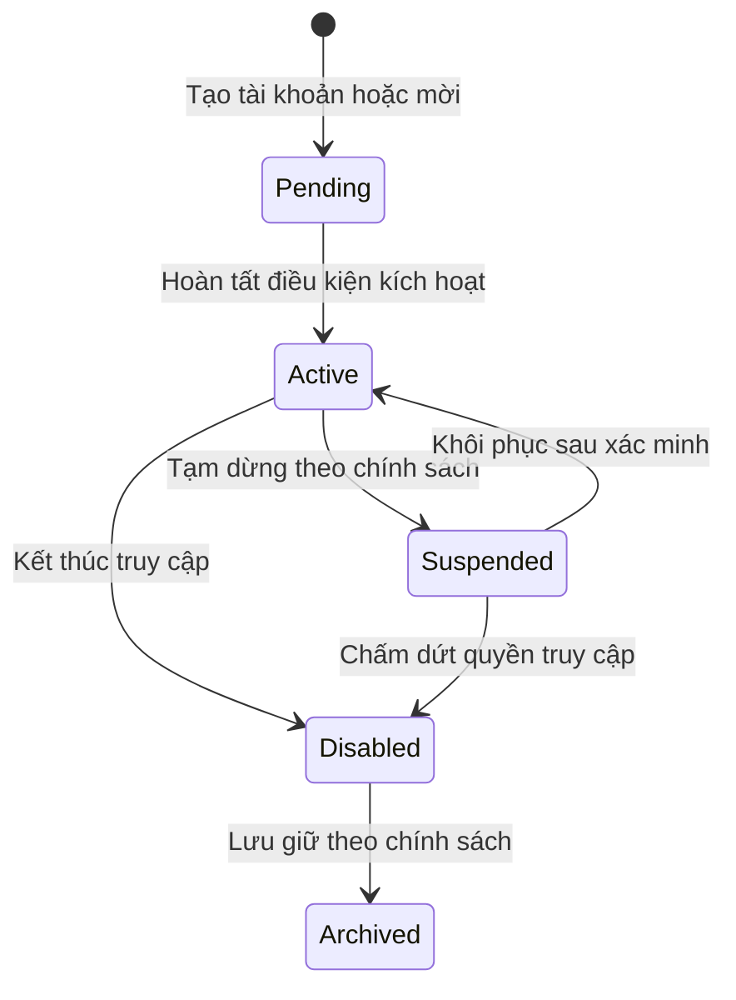

# User

## Mục tiêu bài học

Trong chương **Actor và vai trò**, bài học này làm rõ vị trí của user trong quản lý danh tính và quyền truy cập — Identity and Access Management (IAM). Sau khi học, bạn có thể:

- Giải thích user là ai và phân biệt user với người thực, tài khoản, principal, vai trò và workload.
- Xác định những dữ liệu cần quản lý để người dùng được nhận diện, xác thực và phân quyền đúng phạm vi.
- Mô tả quan hệ giữa một user với nhiều tổ chức, phương thức đăng nhập, phiên và quyền truy cập.
- Phân tích thay đổi quyền khi user gia nhập, đổi nhiệm vụ, rời tổ chức hoặc bị nghi ngờ mất tài khoản.
- Nhận biết các rủi ro như tin vào `userId` do client gửi, cộng dồn quyền giữa tổ chức, dùng chung tài khoản và liên kết tài khoản sai.

## 1. User là ai trong IAM?

Trong bài học này, **user — người dùng** là actor đại diện cho một con người tương tác với ứng dụng hoặc yêu cầu hệ thống thực hiện công việc. User có thể là nhân viên, khách hàng, đối tác, cộng tác viên hoặc người vận hành có đặc quyền.

Một số sản phẩm dùng từ `user` cho cả tài khoản dịch vụ hoặc đối tượng kỹ thuật. Vì thế, khi đọc mô hình hoặc API của một hệ thống, cần kiểm tra định nghĩa của sản phẩm. Trong phạm vi bài này, chủ thể phần mềm được phân biệt là **workload** hoặc tài khoản dịch vụ; trọng tâm là danh tính và truy cập của con người.

Ví dụ, Lan dùng ứng dụng hóa đơn để xem các khoản phải trả của công ty A. Lan là người khởi tạo yêu cầu. Ứng dụng cần nhận diện Lan, kiểm tra bằng chứng đăng nhập, xác định quyền của Lan và quyết định có cho xem hóa đơn cụ thể hay không.

User không chỉ xuất hiện ở màn hình đăng nhập. User còn là đối tượng trong quy trình cấp tài khoản, khôi phục truy cập, gán quyền, phê duyệt, kết thúc phiên, kiểm toán và thu hồi quyền khi không còn nhu cầu.

### User là actor, vai trò là trách nhiệm được gán

“Người dùng” mô tả bên tham gia. “Kế toán”, “người phê duyệt” hoặc “quản trị viên” mô tả trách nhiệm và quyền trong một phạm vi.

Lan có thể là người nhập hóa đơn ở công ty A và người chỉ xem báo cáo ở công ty B. Không thể chỉ dựa vào việc Lan là user để biết Lan được làm gì. Hệ thống phải xét tài khoản, quan hệ thành viên, quyền được gán và tài nguyên đang được truy cập.

## 2. Phân biệt người thực, identity, account và principal

Các khái niệm này có liên quan nhưng không nên dùng thay thế tùy tiện.

| Khái niệm | Câu hỏi được trả lời | Ví dụ |
| --- | --- | --- |
| Người thực — person | Con người ngoài đời là ai? | Nhân viên Lan trong tổ chức |
| Danh tính — identity | Hệ thống biểu diễn thực thể bằng những định danh và thuộc tính nào? | Danh tính nhân viên có mã nội bộ và phòng ban |
| Tài khoản — account | Bản ghi nào cho phép tương tác với một hệ thống? | Tài khoản ứng dụng hóa đơn của Lan |
| User trong ứng dụng | Ứng dụng gọi đối tượng người dùng của mình là gì? | Bản ghi `user-781`, gắn với hồ sơ và quan hệ truy cập |
| Principal | Chủ thể nào đang được hệ thống xét khi quyết định bảo mật? | Principal được nhận diện từ phiên hợp lệ của Lan |
| Vai trò — role | Chủ thể được giao tập trách nhiệm hoặc quyền nào? | Kế toán của công ty A |
| Phiên — session | Ngữ cảnh truy cập nào đang được duy trì sau xác thực? | Phiên của Lan trên một trình duyệt |

Một người có thể có nhiều tài khoản: tài khoản công việc thông thường, tài khoản quản trị riêng và tài khoản tại một đối tác. Việc cùng thuộc một người không có nghĩa mọi tài khoản tự động chia sẻ quyền.

Một tài khoản có thể có nhiều cách đăng nhập, chẳng hạn xác thực tại IdP doanh nghiệp và một phương thức được liên kết theo chính sách. Ngược lại, hai phản hồi đăng nhập từ hai nguồn không tự chứng minh chúng thuộc cùng một tài khoản.

Trong nhiều ứng dụng, bản ghi user cũng đóng vai trò tài khoản và là principal dùng cho các yêu cầu đã xác thực. Điều đó là một lựa chọn mô hình hợp lệ nếu ý nghĩa được định nghĩa rõ. Không bắt buộc mọi khái niệm phải thành một bảng riêng, nhưng không được vì gộp bảng mà gộp luôn trách nhiệm bảo mật.

### Một quy ước cho các ví dụ trong bài

Các phần sau dùng `UserAccount` để chỉ tài khoản con người trong ứng dụng, có định danh nội bộ ổn định. Sau khi xác thực, hệ thống dùng tài khoản này làm principal để kiểm tra quyền. Quan hệ thành viên tổ chức, phương thức đăng nhập và phiên được mô hình hóa riêng về mặt trách nhiệm.

Đây là quy ước minh họa, không phải tên thực thể bắt buộc cho mọi sản phẩm IAM.

## 3. Những nhóm user thường gặp

| Nhóm | Đặc điểm cần xét | Ví dụ chính sách |
| --- | --- | --- |
| Nhân viên nội bộ | Có thể gắn với nguồn nhân sự, phòng ban và vòng đời công việc | Quyền thay đổi khi chuyển bộ phận hoặc nghỉ việc |
| Khách hàng cá nhân | Có thể tự đăng ký, cần quản lý xác minh và khôi phục tài khoản | Chỉ xem dữ liệu cá nhân hoặc tài nguyên được chia sẻ hợp lệ |
| Khách hàng doanh nghiệp | Truy cập trong phạm vi tổ chức, có thể dùng IdP riêng | Vai trò và dữ liệu giới hạn theo từng công ty |
| Đối tác hoặc cộng tác viên | Có người bảo trợ, thời hạn hợp tác và phạm vi công việc | Membership hoặc quyền có thời hạn và cần rà soát |
| Người vận hành có đặc quyền | Có khả năng thay đổi hệ thống, dữ liệu hoặc quyền của người khác | Tách quyền quản trị, xác thực phù hợp và ghi nhận hoạt động nhạy cảm |

Các nhóm này không phải thứ bậc tin cậy cố định. “Nhân viên” không có nghĩa được đọc mọi dữ liệu nội bộ; “khách hàng” không có nghĩa chỉ có quyền thấp; “đối tác” không có nghĩa có quyền truy cập mọi tài nguyên được chia sẻ với tổ chức đối tác.

Nhóm người dùng giúp thiết kế quy trình và chính sách. Quyết định truy cập thực tế vẫn phải dựa trên danh tính, quyền, tài nguyên và điều kiện cụ thể.

### Khách chưa đăng nhập

Một người có thể sử dụng phần công khai của ứng dụng trước khi đăng nhập. Hệ thống có thể duy trì giỏ hàng hoặc một phiên ẩn danh, nhưng trạng thái đó chưa chứng minh danh tính người thực hoặc quyền của một tài khoản đã đăng ký.

Nếu ứng dụng gộp dữ liệu từ phiên ẩn danh vào tài khoản sau đăng nhập, cần quy tắc rõ về quyền sở hữu và liên kết. Không được tin một `userId` do client khai chỉ để biến phiên ẩn danh thành phiên của tài khoản đó.

## 4. Dữ liệu nào mô tả user?

Một mô hình user thường phải quản lý nhiều lớp thông tin khác nhau.

| Lớp dữ liệu | Ví dụ | Ý nghĩa trong IAM |
| --- | --- | --- |
| Định danh nội bộ | `user-781` | Tham chiếu ổn định trong phiên, quyền và kiểm toán |
| Hồ sơ | Tên hiển thị, ngôn ngữ, địa chỉ liên hệ | Hỗ trợ trải nghiệm và liên lạc; không tự chứng minh quyền |
| Nguồn danh tính | IdP, issuer, subject hoặc nguồn quản lý nhân sự | Xác định bên có thẩm quyền xác nhận từng thông tin |
| Trạng thái tài khoản | Chờ kích hoạt, hoạt động, bị vô hiệu hóa | Giới hạn khả năng thiết lập hoặc sử dụng truy cập theo chính sách |
| Quan hệ tổ chức | Thành viên công ty A, đối tác dự án B | Xác định phạm vi và điều kiện tham gia |
| Vai trò, quyền và thuộc tính | Kế toán, quyền đọc hóa đơn, hạn mức duyệt | Đầu vào cho quyết định phân quyền |
| Phương thức xác thực | Mật khẩu, khóa xác thực, phương thức MFA đã đăng ký | Cơ sở kiểm tra bằng chứng và quản lý khôi phục |
| Phiên và phương tiện truy cập | Phiên trình duyệt, thiết bị, token được cấp | Quản lý thời hạn, xác thực lại và thu hồi |
| Lịch sử quản trị và kiểm toán | Ai tạo tài khoản, ai đổi vai trò, sự kiện đăng nhập | Quy trách nhiệm và điều tra |

### Định danh ổn định và thông tin có thể thay đổi

Tên hiển thị và email có thể thay đổi. Chúng không nên là cơ sở duy nhất để liên kết lịch sử quyền và dữ liệu nghiệp vụ. Một định danh nội bộ ổn định giúp giữ liên hệ với tài khoản khi người dùng thay tên hoặc địa chỉ liên hệ.

Với danh tính OIDC từ bên ngoài, cần xét cặp nhà phát hành và subject theo cấu hình tin cậy, thay vì coi mọi chuỗi `sub` hoặc email là duy nhất trên toàn hệ thống. Một số cấu hình còn cung cấp subject khác nhau giữa các ứng dụng; không nên mặc định cùng một người có cùng giá trị ở mọi nơi.

Không phải mọi user đều cần cung cấp cùng lượng dữ liệu cá nhân. Hệ thống nên thu thập thông tin phục vụ mục đích thực tế và xác định rõ nguồn, người được sửa, chính sách lưu trữ và quyền đọc cho từng loại dữ liệu.

### Hồ sơ không phải kho bí mật đăng nhập

Thông tin xác thực cần được bảo vệ riêng theo cơ chế tương ứng. Không đưa mật khẩu, khóa riêng, mã khôi phục hoặc token còn hiệu lực vào API hồ sơ người dùng. Các giao diện quản trị có thể hiển thị metadata như loại phương thức hoặc thời điểm đăng ký mà không làm lộ bí mật của phương thức đó.

## 5. Mô hình quan hệ giữa user, tổ chức, quyền và phiên



Sơ đồ minh họa các quan hệ logic. Hệ thống có thể tổ chức dữ liệu khác, nhưng cần giữ được phạm vi của việc gán quyền. Trong ví dụ này, vai trò được gán thông qua membership để tránh tự động áp dụng cho mọi công ty mà user tham gia.

Một số ứng dụng có thêm quyền trực tiếp hoặc vai trò ở phạm vi nền tảng. Các trường hợp đó phải được biểu diễn rõ, có lý do và quản lý vòng đời riêng; không nên xuất hiện ngầm vì một trường `isAdmin` không có phạm vi.

### Ví dụ tài khoản của Lan

```text
UserAccount
    userId: user-781
    kind: HUMAN
    status: ACTIVE
    displayName: Lan

ExternalIdentity
    userId: user-781
    issuer: https://idp.company-a.example
    subject: employee-482

Membership
    membershipId: member-a-781
    userId: user-781
    organizationId: company-a
    status: ACTIVE

RoleBinding
    membershipId: member-a-781
    role: ACCOUNTANT
    scope: company-a

Session
    userId: user-781
    authenticationSource: company-a-idp
    status: ACTIVE
```

Đây là dữ liệu khái niệm, không phải cấu hình của một sản phẩm. Không có mật khẩu hoặc token thật trong ví dụ. Nếu Lan tham gia công ty B, hệ thống cần một membership và các ràng buộc quyền phù hợp cho B, thay vì sao chép toàn bộ quyền ở A.

### Tài khoản quản trị riêng

Nếu tổ chức cấp cho Lan một tài khoản quản trị riêng, tài khoản đó có định danh, phương thức bảo vệ và phiên tương ứng. Có thể có liên kết để phục vụ quy trách nhiệm tới cùng một người, nhưng liên kết này không được làm tài khoản thông thường kế thừa đặc quyền.

Việc chuyển sang ngữ cảnh quản trị cần được xử lý theo chính sách rõ ràng. Cùng một con người không có nghĩa mọi phiên của người đó được thực hiện mọi hành động quản trị.

## 6. User tham gia luồng xác thực như thế nào?

### 6.1. Khai danh tính và cung cấp bằng chứng

Khi Lan nhập email hoặc tên đăng nhập, hệ thống mới nhận một lời khai về danh tính. Xác thực kiểm tra bằng chứng theo cơ chế được chấp nhận, như mật khẩu, khả năng sử dụng một khóa riêng hoặc kết quả từ IdP tin cậy.

Nếu dùng MFA, các yếu tố phải thuộc những nhóm khác nhau theo cơ chế triển khai. Hai mật khẩu không trở thành hai yếu tố chỉ vì được nhập ở hai màn hình. MFA làm tăng độ tin cậy về quá trình xác thực, nhưng không cấp thêm quyền nghiệp vụ cho tài khoản.

Đăng nhập thành công cũng không luôn chứng minh người đó là một cá nhân ngoài đời đã được kiểm chứng đầy đủ. Mức liên hệ với danh tính thực phụ thuộc quy trình ghi danh và xác minh của hệ thống. Với tài khoản tự đăng ký, kết quả có thể chủ yếu chứng minh quyền kiểm soát tài khoản đã tạo.

### 6.2. Đăng nhập qua IdP, SSO và federation

Một ứng dụng có thể giao phần xác thực cho IdP thay vì tự giữ thông tin xác thực của doanh nghiệp. Khi dùng federation, ứng dụng kiểm chứng kết quả từ nguồn được tin, rồi ánh xạ về user nội bộ.

SSO có thể giúp user truy cập nhiều ứng dụng dựa trên ngữ cảnh xác thực đã có. Mỗi ứng dụng vẫn có tài khoản hoặc biểu diễn principal, membership, quyền và phiên của mình. User đăng nhập thành công tại IdP nhưng bị ứng dụng từ chối do membership đã hết hạn là một kết quả hợp lệ.

OAuth 2.0 cung cấp khung ủy quyền truy cập tài nguyên; OIDC bổ sung lớp danh tính để ứng dụng nhận kết quả xác thực. Trong luồng phù hợp, ID token và access token có mục đích khác nhau. User không trở nên có quyền trên mọi API chỉ vì một ứng dụng đã nhận được kết quả đăng nhập.

### 6.3. Khôi phục và đăng ký phương thức mới

Khôi phục tài khoản, thay email và thêm phương thức xác thực có thể làm thay đổi ai kiểm soát tài khoản. Chúng cần được coi là thao tác bảo mật, không chỉ là chỉnh sửa hồ sơ.

Nếu một tài khoản có MFA mạnh nhưng quy trình khôi phục cho phép người không đủ bằng chứng thay phương thức xác thực, mức bảo vệ thực tế vẫn có thể suy yếu. Hệ thống cần quy định bằng chứng, thông báo, quyền quản trị và xử lý phiên liên quan khi có thay đổi nhạy cảm.

## 7. User đã đăng nhập chưa chắc có quyền truy cập

**Xác thực** trả lời hệ thống có chấp nhận bằng chứng về chủ thể không. **Phân quyền** trả lời chủ thể được làm gì trong yêu cầu hiện tại.

```text
Danh tính: user-781 là tài khoản nào?
Xác thực: phiên này có được thiết lập và duy trì hợp lệ không?
Phân quyền: user-781 có được đọc hóa đơn INV-104 thuộc công ty A không?
```

Một API không nên nhận `userId` từ trình duyệt rồi dùng giá trị đó làm danh tính người gọi. Principal phải đến từ phiên hoặc bằng chứng truy cập đã được kiểm chứng. `userId` trong tham số có thể là đối tượng mục tiêu của một thao tác quản trị, nhưng không vì vậy trở thành actor thực hiện thao tác.

### 7.1. Kết hợp RBAC và thuộc tính

RBAC tổ chức quyền thành vai trò. ABAC đánh giá thuộc tính của chủ thể, tài nguyên, hành động và ngữ cảnh. Trong nền tảng hóa đơn, vai trò kế toán có thể cho phép đọc, còn membership và thuộc tính công ty giới hạn hóa đơn được đọc.

Một chính sách khái niệm:

```text
Cho phép user đọc hóa đơn khi:
    tài khoản được phép hoạt động
    AND membership tại công ty đích còn hiệu lực
    AND có quyền invoice:read trong phạm vi đó
    AND hóa đơn thuộc phạm vi dữ liệu được giao
```

Chức danh “kế toán” hoặc tên vai trò trong một token không tự thay thế tất cả điều kiện này. Những thuộc tính dùng cho quyền phải đến từ nguồn đáng tin và được quản lý cập nhật theo chính sách.

### 7.2. Quyền sở hữu cũng cần được định nghĩa

Việc user tạo một tài nguyên không luôn có nghĩa họ được sửa, xóa hoặc chia sẻ tài nguyên đó mãi mãi. Ví dụ, người tạo hóa đơn có thể không được tự duyệt; sau khi hóa đơn được chốt, cả người tạo và kế toán đều bị giới hạn sửa.

Do đó, `createdBy` là dữ liệu có thể phục vụ chính sách, không phải một quy tắc cho phép tất cả hành động. Cần xét trạng thái tài nguyên và phân tách nhiệm vụ khi nghiệp vụ yêu cầu.

## 8. Từ yêu cầu của user tới quyết định truy cập

Xét Lan xem hóa đơn trong công ty A. Ứng dụng cần sử dụng principal đã được kiểm chứng và đánh giá quyền trên dữ liệu cụ thể.



Giả mã minh họa:

```text
function readInvoice(request):
    actor = requireVerifiedPrincipal(request)
    access = loadTrustedUserAccess(actor.userId)
    require(access.accountStatus == "ACTIVE")

    requestedCompany = request.companyId
    membership = requireActiveMembership(access, requestedCompany)
    require(hasPermission(membership, "invoice:read"))

    invoice = findInvoice(request.invoiceId, membership.companyId)
    require(invoice exists)
    require(resourcePolicyAllows(actor, "read", invoice))

    recordDecision(actor, "invoice.read", invoice.id, "ALLOW")
    return permittedFields(invoice)
```

Đây là mô hình trách nhiệm, không phải mã tích hợp một nền tảng IAM. Các trường hợp từ chối và lỗi cũng cần xử lý, ghi nhận theo chính sách; đoạn mã chỉ nêu các kiểm tra chính trên đường cho phép.

`request.companyId` là tài nguyên hoặc phạm vi mà user muốn truy cập. Hệ thống chỉ dùng nó sau khi kiểm tra membership tương ứng. Việc giao diện đang hiển thị công ty A không đủ để cho phép API đọc dữ liệu A.

Nếu Lan thay mã hóa đơn sang tài nguyên thuộc công ty B, truy vấn và chính sách phải ngăn dữ liệu ngoài phạm vi được trả về. Các chức năng danh sách, tìm kiếm, tải tệp và xuất báo cáo cũng phải tuân thủ phạm vi này.

## 9. Một user có thể có nhiều phiên và thiết bị

Tài khoản và phiên không có quan hệ một-một. Lan có thể đồng thời sử dụng máy tính công việc và điện thoại. Mỗi phiên có thể khác về thời điểm xác thực, phương thức sử dụng, thời hạn và phạm vi được chấp nhận.

| Đối tượng | Thay đổi điển hình | Điều cần tránh suy ra tự động |
| --- | --- | --- |
| Tài khoản | Bị vô hiệu hóa, thay thông tin hồ sơ, thêm phương thức xác thực | Mọi phiên đã bị kết thúc tức thời |
| Membership | Chuyển công ty, hết thời hạn cộng tác | Mọi quyền của user ở các công ty khác cũng bị xóa |
| Phiên ứng dụng | Hết hạn hoặc đăng xuất tại một ứng dụng | Phiên tại IdP và mọi ứng dụng khác đã kết thúc |
| Access token | Hết hạn hoặc bị cơ chế kiểm tra từ chối | Refresh token, khóa API hoặc phiên khác cũng không còn dùng được |
| Phương thức xác thực | Mất thiết bị, thu hồi khóa hoặc đổi mật khẩu | Mọi phương tiện truy cập đã phát hành tự động mất hiệu lực |

### Phiên là ngữ cảnh, không phải ảnh chụp quyền vĩnh viễn

Một ứng dụng có thể lưu vai trò hoặc thuộc tính vào phiên để giảm số lần tra cứu. Nếu những dữ liệu đó thay đổi, phiên có thể tiếp tục sử dụng quyền cũ cho tới khi được cập nhật hoặc hết hiệu lực.

Kiến trúc cần xác định khi nào quyền được nạp lại, dữ liệu nào được phép lưu đệm, và cơ chế kết thúc hoặc giới hạn phiên khi có thay đổi quan trọng. Nội dung token đã phát hành cũng không tự thay đổi sau khi quyền trong cơ sở dữ liệu bị thu hồi.

Không nên giải quyết mọi vấn đề bằng cách buộc user đăng nhập lại ở từng yêu cầu. Hệ thống cần một chính sách cân bằng phù hợp giữa mức bảo vệ, độ trễ cập nhật quyền và trải nghiệm sử dụng, đồng thời vẫn có cơ sở cho quyết định truy cập hiện tại.

### Thao tác nhạy cảm có thể yêu cầu xác thực bổ sung

Thay phương thức MFA, cấp quyền quản trị hoặc thay tài khoản nhận thanh toán có thể yêu cầu xác thực lại hoặc đáp ứng mức bảo đảm cao hơn. Tuy vậy, xác thực bổ sung chỉ giúp củng cố bằng chứng về người đang thao tác; quyền thực hiện hành động vẫn cần được kiểm tra riêng.

## 10. Vòng đời của user và vòng đời của quyền

Với nhân sự, vòng đời truy cập thường được nhìn qua ba nhóm: **Joiner, Mover, Leaver**. Với khách hàng hoặc đối tác, tên gọi có thể khác nhưng vẫn có các sự kiện bắt đầu, thay đổi và kết thúc nhu cầu truy cập.

### 10.1. Gia nhập hoặc đăng ký

Một user có thể đến từ quy trình tuyển dụng, lời mời cộng tác, đăng ký khách hàng hoặc cấp phát tự động. Hệ thống cần xác định:

- Ai được tạo tài khoản hoặc mời thành viên vào tổ chức.
- Danh tính và thông tin liên lạc được xác minh đến mức nào.
- Tài khoản được kích hoạt khi nào và cần đăng ký phương thức xác thực nào.
- Quyền ban đầu được cấp theo cơ sở nào, trong phạm vi nào và có thời hạn không.

Xác minh quyền kiểm soát một email không tự chứng minh người đó là nhân viên được phép truy cập mọi dữ liệu doanh nghiệp. Với federation, xác thực thành công từ một provider cũng chưa đủ để tạo membership ở bất kỳ tổ chức nào.

### 10.2. Thay đổi nhiệm vụ hoặc quan hệ tổ chức

Khi Lan chuyển từ kế toán sang hỗ trợ khách hàng, hệ thống cần xem lại quyền cũ, không chỉ cộng thêm quyền mới. Quyền trực tiếp, vai trò tạm thời, nhóm nguồn và các tài khoản đích đều có thể liên quan.

Khi Lan chỉ rời công ty A nhưng vẫn có membership hợp lệ ở công ty B, có thể cần chấm dứt truy cập A trong khi giữ truy cập B. Nếu chủ thể bị nghi ngờ chiếm tài khoản trên toàn hệ thống, phạm vi xử lý lại có thể rộng hơn một membership.

Vì thế, phải phân biệt sự kiện thuộc tài khoản, thuộc quan hệ tổ chức hay thuộc một quyền cụ thể. Gộp mọi thay đổi vào một cờ chung dễ gây thu hồi thiếu hoặc thu hồi quá mức.

### 10.3. Kết thúc nhu cầu truy cập

Khi user nghỉ việc hoặc hợp đồng kết thúc, cần xử lý tài khoản, quyền, phiên và phương tiện truy cập theo phạm vi và thời hạn yêu cầu. Cần theo dõi kết quả ở hệ thống đích, không chỉ ghi nhận đã gửi yêu cầu thu hồi.

Vô hiệu hóa khả năng truy cập không đồng nghĩa phải xóa ngay mọi dữ liệu liên quan. Hóa đơn do user tạo, lịch sử phê duyệt và sự kiện kiểm toán có thể cần được giữ theo chính sách. Bản ghi tài khoản có thể được giữ để tham chiếu trong khi khả năng đăng nhập đã bị chặn.

### 10.4. Trạng thái là một mô hình có chủ đích



Sơ đồ là ví dụ về trạng thái tài khoản, không phải danh sách bắt buộc. Membership, phiên và phương thức xác thực có thể có trạng thái riêng. Một tài khoản `ACTIVE` không tự làm membership đã hết hạn trở lại có hiệu lực.

Khóa tạm do đăng nhập bất thường cũng có thể khác với vô hiệu hóa do nghỉ việc. Việc mở khóa không nên vô tình tái cấp các quyền đã bị thu hồi vì lý do nghiệp vụ.

## 11. User khi ứng dụng hoặc workload hành động thay mặt

Không phải mọi yêu cầu do user khởi tạo đều được xử lý trực tiếp trong một lần gọi API. Lan có thể nhấn “xuất báo cáo”, sau đó hệ thống đưa tác vụ vào hàng đợi để một workload xử lý.

Lúc này có ít nhất hai thông tin cần phân biệt:

- **Người khởi tạo hoặc người được phục vụ:** Lan, với phạm vi quyền tương ứng.
- **Bên thực sự kết nối và thực hiện:** workload xuất báo cáo, với danh tính và quyền kỹ thuật riêng.

Xác thực workload không tự chứng minh Lan có quyền đọc mọi hóa đơn mà workload truy cập được. Ngược lại, việc biết Lan là ai không tự cho phép một dịch vụ bất kỳ sử dụng quyền của Lan.

### 11.1. Tránh biến workload thành bên làm thay vượt quyền

Giả sử workload có quyền đọc dữ liệu toàn hệ thống để thực hiện một số nhiệm vụ vận hành. Nếu nó nhận mã công ty tùy ý từ user rồi xuất toàn bộ dữ liệu mà không kiểm tra ủy quyền, user có thể lợi dụng quyền rộng của workload.

Cần xác định công việc đang thực hiện cho ai, phạm vi nào đã được cho phép và chính sách nào áp dụng ở thời điểm chạy. Dữ liệu về user trong job phải đến từ một luồng đáng tin, không phải chỉ tin trường `requestedBy` do client gửi.

### 11.2. Quyền có thể thay đổi khi job đang chờ

Lan có quyền yêu cầu báo cáo lúc 09:00 nhưng bị thu hồi quyền công ty A trước khi tác vụ chạy. Hệ thống cần chính sách rõ: kiểm tra lại quyền hiện tại, hủy tác vụ, hoặc tiếp tục dựa trên một ủy quyền nghiệp vụ độc lập đã được phê duyệt với phạm vi riêng.

Không nên để quyết định phụ thuộc ngẫu nhiên vào việc token của Lan còn hạn hay không. Khả năng tải kết quả báo cáo cũng cần được kiểm tra; tạo được job không có nghĩa được nhận dữ liệu mãi mãi.

### 11.3. Đồng ý và ủy quyền không phải cấp quyền vô hạn

Trong những luồng có sự đồng ý của user, ứng dụng chỉ được sử dụng khả năng truy cập được cấp theo chính sách và phạm vi tương ứng. Một lần user chấp thuận không tự cho ứng dụng quyền quản trị nền tảng hoặc quyền trên dữ liệu mà user vốn không được truy cập.

Scope có thể giới hạn nhóm hành động, nhưng API vẫn cần kiểm tra quyền trên tài nguyên cụ thể. Trình bày màn hình đồng ý cũng không thay cho việc kiểm chứng giao thức và thực thi quyền tại bên giữ tài nguyên.

## 12. Phân biệt actor và tài khoản mục tiêu trong thao tác quản trị

Xét yêu cầu quản trị viên vô hiệu hóa một tài khoản:

```text
POST /organizations/company-a/users/user-781/disable
```

Trong yêu cầu này:

- Principal từ phiên hoặc token là **actor thực hiện**.
- `user-781` là **tài khoản mục tiêu**.
- `company-a` là **phạm vi tổ chức mà yêu cầu nhắm tới**.

Backend phải xác định actor có quyền quản lý user mục tiêu trong phạm vi đó hay không. Không được coi `user-781` trong URL là người đang gọi, cũng không được cho phép actor quản lý user ở công ty khác chỉ vì họ là quản trị viên tại công ty A.

Thay vai trò, thêm phương thức đăng nhập, liên kết danh tính và đổi thông tin khôi phục đều có thể tác động đến quyền kiểm soát tài khoản. Một vai trò “quản lý hồ sơ” không nên mặc nhiên bao gồm khả năng đặt lại mọi yếu tố xác thực hoặc tự cấp quyền nhạy cảm.

### Truy cập hỗ trợ và mạo danh có kiểm soát

Một số ứng dụng cho nhân viên hỗ trợ xem trải nghiệm của người dùng. Nếu có khả năng hành động thay hoặc mạo danh, cần xác định rõ phạm vi, thời hạn, phê duyệt và các hành động bị cấm theo nhu cầu sản phẩm.

Kiểm toán nên giữ được cả nhân viên hỗ trợ thực hiện lẫn user được đại diện. Nếu mọi sự kiện chỉ ghi user mục tiêu, hệ thống có thể quy nhầm một thao tác của nhân viên hỗ trợ cho khách hàng.

## 13. Trách nhiệm của user và các bên quản lý

User tham gia bảo vệ tài khoản, nhưng không thể tự thay thế các cơ chế kiểm soát ở hệ thống.

| Bên tham gia | Trách nhiệm điển hình |
| --- | --- |
| User | Sử dụng tài khoản cá nhân đúng quy định, bảo vệ phương tiện xác thực, báo mất hoặc nghi ngờ chiếm tài khoản, yêu cầu quyền theo nhiệm vụ |
| Người quản lý hoặc chủ sở hữu dữ liệu | Xác nhận nhu cầu truy cập, phê duyệt phạm vi phù hợp và rà soát quyền theo trách nhiệm |
| Bộ phận IAM hoặc quản trị được ủy quyền | Quản lý tài khoản, nguồn danh tính, phương thức xác thực và việc cấp, thu hồi theo quy trình |
| Ứng dụng sở hữu tài nguyên | Kiểm chứng ngữ cảnh truy cập và thực thi quyền trên dữ liệu, hành động thực tế |
| Đội vận hành và an ninh | Theo dõi sự kiện, xử lý sự cố và kiểm chứng việc chấm dứt truy cập theo phạm vi được giao |

User yêu cầu một quyền không có nghĩa hệ thống phải cấp quyền đó. Người quản lý phê duyệt cũng cần nằm trong thẩm quyền phù hợp với dữ liệu hoặc tổ chức; một phê duyệt ngoài phạm vi không tạo cơ sở hợp lệ.

### Vì sao cần tránh tài khoản dùng chung?

Nếu nhiều người dùng cùng một tài khoản, hệ thống có thể chỉ biết tài khoản đó đã thao tác, không biết người cụ thể nào thực hiện. Việc một người rời nhóm cũng khó xử lý nếu những người còn lại vẫn cần cùng bí mật đăng nhập.

Các tài khoản đặc biệt hoặc truy cập khẩn cấp, nếu có, cần cơ chế quản lý người sử dụng, phạm vi và kiểm toán rõ ràng. Chúng không nên trở thành đường truy cập thường xuyên nằm ngoài vòng đời user.

## 14. Kiểm toán hành động của user

Một sự kiện có thể cần phân biệt:

```text
actor: user-admin-19
calling_workload: account-management-service
action: membership.disable
target_user: user-781
organization: company-a
result: SUCCESS
request_id: mã tương quan
```

Đây là cấu trúc minh họa, không phải các trường bắt buộc cho mọi sản phẩm. Tùy hành động, hệ thống cần lưu thời điểm, tài nguyên, kết quả, nguồn xác thực hoặc lý do quản trị để phục vụ điều tra.

Những sự kiện đáng chú ý gồm tạo tài khoản, đăng nhập, khôi phục, liên kết danh tính, thêm hoặc xóa phương thức xác thực, cấp quyền, thu hồi membership, kết thúc phiên và thao tác đặc quyền.

Dùng định danh ổn định giúp liên kết sự kiện ngay cả khi user đổi email hoặc tên. Nhật ký cũng cần bảo vệ quyền đọc và tính toàn vẹn; không ghi mật khẩu, cookie phiên, khóa bí mật hoặc toàn bộ bearer token.

Cần phân biệt **một yêu cầu bị từ chối** với **một hành động đã thực hiện thành công**. Một dòng log ghi user đã gửi yêu cầu không đủ để kết luận dữ liệu đã được thay đổi. Với thao tác quan trọng, sự kiện nên phản ánh đúng kết quả mà hệ thống đã xác nhận.

## 15. Các sai lầm thường gặp

| Sai lầm | Hệ quả | Cách hiểu đúng |
| --- | --- | --- |
| Coi email là định danh bất biến của user | Đổi hoặc tái cấp email có thể làm đứt liên kết hay gộp nhầm tài khoản | Dùng định danh nội bộ ổn định và quy tắc liên kết nguồn rõ ràng |
| Tin `userId` hoặc `role` do client gửi | Người gọi có thể tự nhận danh tính hoặc quyền của người khác | Principal và quyền phải được xác minh từ nguồn được tin cậy |
| Gán một vai trò toàn cục cho user nhiều tổ chức | Quyền ở công ty A có thể bị áp dụng nhầm ở công ty B | Gắn quyền với đúng membership và phạm vi |
| Cho rằng MFA đồng nghĩa đủ quyền | User đã xác thực vẫn có thể truy cập sai tài nguyên | Kiểm tra phân quyền và điều kiện nghiệp vụ riêng |
| Chỉ thêm quyền khi user chuyển việc | Quyền tích lũy vượt nhu cầu hiện tại | Xem lại và thu hồi quyền không còn phù hợp |
| Chỉ khóa tài khoản ở IdP khi nghỉ việc | Phiên, token hoặc tài khoản đích có thể còn sử dụng được | Xử lý vòng đời trên các đường truy cập liên quan |
| Xem phương thức khôi phục như thông tin hồ sơ bình thường | Người không đủ thẩm quyền có thể chiếm quyền kiểm soát tài khoản | Bảo vệ thay đổi thông tin xác thực và khôi phục như thao tác nhạy cảm |
| Dùng quyền workload để đáp ứng mọi yêu cầu của user | Workload có thể bị lợi dụng để đọc hoặc sửa dữ liệu ngoài quyền user | Ràng buộc phạm vi công việc, người yêu cầu và chính sách ủy quyền |
| Xóa user là xóa luôn mọi dấu vết | Mất liên kết nghiệp vụ và khả năng điều tra | Tách chấm dứt truy cập khỏi xử lý dữ liệu theo chính sách lưu giữ |

## 16. Ví dụ tổng hợp: Lan chuyển nhiệm vụ

Ban đầu Lan là kế toán công ty A và có quyền chỉ xem báo cáo tại công ty B. Lan đăng nhập qua IdP doanh nghiệp, có phiên trên máy tính và một job xuất báo cáo đang chờ.

Sau đó, Lan chuyển sang bộ phận hỗ trợ của công ty A. Mô hình IAM cần phản ánh đúng từng đối tượng:

1. **Tài khoản:** vẫn là cùng tài khoản con người đang hoạt động, nếu không có lý do phải chấm dứt tài khoản.
2. **Membership công ty A:** vẫn còn nhưng trách nhiệm và quyền thay đổi; quyền kế toán cũ được xem lại và thu hồi theo quy trình.
3. **Membership công ty B:** chỉ thay đổi nếu sự kiện hoặc chính sách có tác động đến quan hệ này; không được tự động cộng quyền hỗ trợ của A sang B.
4. **Phiên hiện có:** quyền cũ lưu trong phiên, token hoặc bộ nhớ đệm được xử lý theo cơ chế cập nhật và thu hồi đã xác định.
5. **Job đang chờ:** được đánh giá theo chính sách cho tác vụ chưa thực thi và quyền nhận kết quả, không chỉ theo quyền tại lúc nhấn nút.
6. **Kiểm toán:** ghi nhận người hoặc nguồn kích hoạt thay đổi, quyền bị thu hồi, quyền mới và kết quả trên các hệ thống liên quan.

Ví dụ này cho thấy vòng đời của một user không chỉ là tạo và xóa một dòng dữ liệu. Cần quản lý các quan hệ truy cập và phương tiện đang cho phép user tương tác với hệ thống.

## 17. Các câu hỏi khi mô hình hóa user trong IAM

Khi gặp một đối tượng tên `User`, hãy xác định:

- Đối tượng đại diện cho một người, một tài khoản hay một principal trong một phạm vi cụ thể?
- Định danh nào ổn định, nguồn nào xác nhận danh tính và ai được thay đổi từng thuộc tính?
- User có thể có nhiều tài khoản, nguồn đăng nhập, tổ chức hoặc phiên hay không?
- Vai trò và quyền được gắn ở phạm vi nào; đâu là nguồn quyết định khi quyền thay đổi?
- Xác thực, khôi phục và liên kết tài khoản được kiểm soát ra sao?
- Khi workload hoặc người hỗ trợ hành động thay, hệ thống giữ được danh tính các bên và cơ sở ủy quyền không?
- Khi user đổi nhiệm vụ hoặc kết thúc nhu cầu, những quyền, phiên và phương tiện truy cập nào phải được xử lý?
- Có thể truy ra ai đã thực hiện hành động gì, trên đối tượng nào và với kết quả nào không?

Trả lời những câu hỏi này giúp mô hình user kết nối đúng với xác thực, MFA, phiên, RBAC, ABAC, SSO, OAuth/OIDC, vòng đời quyền, đặc quyền và kiểm toán trong hệ thống IAM.
