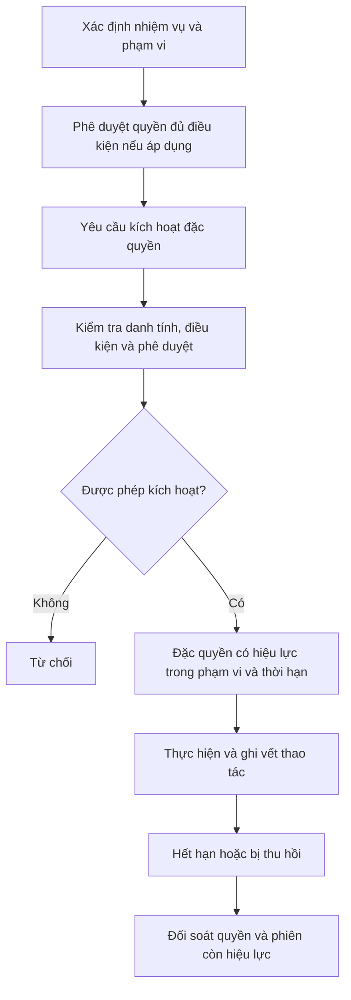

# Administrator

## Mục tiêu bài học

Trong IAM, administrator là chủ thể thực hiện các hoạt động quản trị như tạo tài khoản, cấu hình xác thực, cấp quyền hoặc vận hành hệ thống danh tính. Những hoạt động này có thể ảnh hưởng đến quyền truy cập của nhiều người và workload, nên cần được giới hạn theo nhiệm vụ, phạm vi và thời gian.

Một người quản trị tenant không mặc nhiên được quản trị toàn nền tảng. Người có quyền đặt lại phương thức MFA cũng không nhất thiết được phê duyệt quyền quản trị. Thiết kế đúng cần xác định administrator được quản trị **đối tượng nào**, **bằng hành động nào** và **dưới điều kiện nào**.

Sau bài học này, bạn có thể:

- Phân biệt người quản trị, tài khoản quản trị, vai trò và đặc quyền.
- Phân chia trách nhiệm quản trị danh tính theo phạm vi cụ thể.
- Nhận diện quyền nhạy cảm có thể tạo ra khả năng leo thang gián tiếp.
- Mô tả vòng đời cấp, kích hoạt, sử dụng và thu hồi đặc quyền.
- Áp dụng xác thực, phân quyền, tách biệt nhiệm vụ và kiểm toán cho thao tác quản trị.

## 1. Administrator là actor, không phải một quyền toàn năng mặc định

**Actor** là bên tham gia vào một luồng hoạt động. Trong bài học, administrator là actor thực hiện nhiệm vụ quản trị. Khi triển khai, hệ thống nhận diện actor qua một principal, tức biểu diễn chủ thể dùng để xác thực và đánh giá quyền.

Một người có thể dùng tài khoản thường để đọc tài liệu và một tài khoản quản trị riêng để cấu hình IAM. Hệ thống khác có thể dùng cùng principal nhưng chỉ cho kích hoạt đặc quyền trong một phiên hoặc ngữ cảnh đáp ứng điều kiện. Dù chọn cách nào, cần phân biệt người thực hiện với tập quyền đang có hiệu lực.

| Khái niệm | Ý nghĩa | Ví dụ |
|---|---|---|
| Người quản trị | Con người chịu trách nhiệm thực hiện công việc | Hà thuộc nhóm vận hành IAM |
| Tài khoản hoặc principal | Danh tính hệ thống dùng để nhận diện chủ thể | `principal-admin-27` |
| Vai trò quản trị | Tập quyền được tổ chức theo nhiệm vụ | Quản trị người dùng của tenant A |
| Đặc quyền | Khả năng thực hiện một hành động nhạy cảm | Cấp vai trò, đặt lại MFA, sửa cấu hình IdP |
| Phạm vi | Những đối tượng mà quyền có thể tác động | Tenant A, một ứng dụng, một môi trường |
| Điều kiện sử dụng | Ràng buộc để quyền được áp dụng | Xác thực gần đây, quyền đang được kích hoạt, phê duyệt hợp lệ |

Tên vai trò `admin` không mô tả đầy đủ các yếu tố này. Hai sản phẩm có thể dùng cùng tên nhưng cho phép những hành động rất khác nhau.

Administrator vẫn phải được xác thực và phân quyền. Không nên có quy tắc chung kiểu “nếu là admin thì bỏ qua toàn bộ chính sách” nếu hệ thống cần duy trì giới hạn tenant, tách biệt nhiệm vụ hoặc bảo vệ một số tài khoản đặc biệt.

## 2. Những trách nhiệm quản trị thường gặp

Một nền tảng có thể phân chia công việc như sau. Các tên dưới đây là cách tổ chức minh họa, không phải bộ vai trò bắt buộc cho mọi hệ thống.

| Vai trò theo nhiệm vụ | Công việc điển hình | Giới hạn cần xác định |
|---|---|---|
| Quản trị tài khoản | Tạo, vô hiệu hóa, cập nhật tài khoản | Loại tài khoản, đơn vị, tenant; có được tác động tài khoản đặc quyền không |
| Help desk | Hỗ trợ mở khóa và khôi phục truy cập | Quy trình xác minh người yêu cầu và các trường hợp phải chuyển cấp |
| Quản trị xác thực | Cấu hình MFA, phiên, chính sách đăng nhập | Ứng dụng hoặc nhóm áp dụng; quyền tạo ngoại lệ |
| Quản trị cấp quyền | Quản lý vai trò, membership và gán quyền | Tập quyền được phép cấp, đối tượng nhận và phạm vi tài nguyên |
| Quản trị liên kết danh tính | Cấu hình SSO, OAuth/OIDC, SAML hoặc nguồn danh tính | IdP được chấp nhận, ánh xạ thuộc tính, bên nhận và phạm vi tin cậy |
| Quản trị workload identity | Cấp danh tính, credential và quyền cho dịch vụ | Workload, môi trường, chủ sở hữu, mục đích sử dụng |
| Quản trị hệ thống đặc quyền | Vận hành thành phần hạ tầng hoặc nền tảng quan trọng | Môi trường, thời hạn, cơ chế truy cập và kiểm soát thay đổi |
| Người kiểm toán | Xem và đánh giá lịch sử hoạt động | Quyền đọc bằng chứng; tách khỏi khả năng sửa hoặc xóa bằng chứng |

Một người có thể đảm nhiệm nhiều vai trò trong tổ chức nhỏ. Khi đó vẫn cần nhận diện quyền đang tập trung ở đâu và bổ sung kiểm soát cho những thao tác rủi ro cao. Đặt nhiều tên vai trò nhưng giao tất cả cho cùng một người không tự tạo ra sự độc lập.

### Quản trị IAM không tự đồng nghĩa đọc dữ liệu nghiệp vụ

Quyền quản lý tài khoản và quyền đọc hồ sơ khách hàng có thể được tách riêng. Một quản trị viên tenant có thể được mời người dùng mà không được xuất toàn bộ tài liệu của tenant.

Tuy nhiên, phải xem xét cả khả năng gián tiếp. Người có thể tự cấp quyền đọc, thay đổi cơ chế đăng nhập hoặc sửa ứng dụng có thể tạo đường truy cập dữ liệu dù không có quyền đọc thường trực. Việc tách tên vai trò chỉ có ý nghĩa khi các đường gián tiếp này cũng được kiểm soát.

## 3. Quyền quản trị có thể tạo quyền mới

Một số đặc quyền tác động trực tiếp lên cơ chế bảo vệ của hệ thống. Đây là lý do quản trị IAM có mức ảnh hưởng lớn hơn nhiều thao tác nghiệp vụ thông thường.

Ví dụ:

- Gán vai trò quản trị cho bản thân hoặc một tài khoản khác.
- Đặt lại mật khẩu, MFA hoặc phương thức khôi phục của người có quyền cao.
- Tạo credential mới cho workload đang có quyền production.
- Sửa ánh xạ nhóm từ IdP ngoài thành vai trò nội bộ.
- Chấp thuận một ứng dụng hoặc quan hệ đại diện có quyền rộng.
- Sửa chính sách phiên, tắt kiểm tra hoặc loại bỏ bản ghi kiểm toán.

Không phải mọi thao tác trong danh sách đều luôn được một vai trò cụ thể cho phép. Điểm cần phân tích là **hành động này có thể dẫn đến quyền nào tiếp theo**.

### Quyền cấp không giống quyền sử dụng

Một quản trị viên cấp quyền có thể được phép cấp vai trò nghiệp vụ cho người khác mà bản thân không được thực hiện hành động nghiệp vụ đó. Vì vậy, không nên chỉ áp dụng quy tắc đơn giản “được cấp mọi quyền mà bản thân đang có”.

Cần định nghĩa riêng:

```text
Ai được cấp quyền?
  -> Được cấp những vai trò hoặc permission nào?
  -> Cho những loại chủ thể nào?
  -> Trong tenant, ứng dụng hoặc tài nguyên nào?
  -> Với thời hạn và điều kiện nào?
  -> Có cần người khác phê duyệt không?
```

Tập quyền được phép cấp là một phần của chính sách ủy quyền quản trị. Nó phải được kiểm soát độc lập với quyền sử dụng tài nguyên của người quản trị.

## 4. Nguyên tắc ít quyền nhất cho administrator

Ít quyền nhất nghĩa là cấp khả năng cần thiết cho nhiệm vụ, trên đúng đối tượng và trong thời gian cần thiết. Với administrator, cần xem xét đồng thời nhiều chiều:

| Chiều giới hạn | Ví dụ |
|---|---|
| Hành động | Được vô hiệu hóa tài khoản thường nhưng không sửa chính sách MFA |
| Đối tượng | Được hỗ trợ nhân viên của một đơn vị, không tác động tài khoản đặc quyền |
| Tenant hoặc tài nguyên | Được quản trị tenant A, không quản trị tenant B |
| Môi trường | Được vận hành staging, không tự có quyền production |
| Thời gian | Quyền được kích hoạt cho một phiên xử lý sự cố có thời hạn |
| Ngữ cảnh | Thao tác nhạy cảm yêu cầu xác thực lại và phê duyệt phù hợp |

RBAC có thể dùng để tổ chức các tập quyền quản trị. ABAC có thể bổ sung điều kiện về tenant, trạng thái tài khoản đích, thời hạn hoặc mức xác thực. Tên vai trò chỉ là một đầu vào, không thay thế các ràng buộc còn lại.

Ví dụ, vai trò `tenant-user-admin` có thể cho Hà tạo thành viên thường trong tenant A. Nó không cần cho Hà quản lý liên kết IdP toàn nền tảng, sửa vai trò của quản trị viên cấp cao hoặc tạo API key cho dịch vụ thanh toán.

## 5. Xác thực và phiên quản trị

Do khả năng tác động lớn, phiên quản trị cần có điều kiện sử dụng phù hợp với mức rủi ro. Những thành phần thường được xem xét gồm MFA, xác thực lại cho thao tác quan trọng, quản lý thời hạn phiên và bảo vệ credential.

### Tách hoạt động thường ngày và hoạt động quản trị

Một cách tổ chức là dùng tài khoản riêng cho công việc thường ngày và quản trị. Cách khác là chỉ kích hoạt vai trò quản trị khi cần. Mục đích là giảm thời gian đặc quyền có hiệu lực và làm rõ ngữ cảnh sử dụng.

Tài khoản riêng vẫn cần quy trình bảo vệ, cấp phát và thu hồi. Nếu hai tài khoản dùng chung credential bị lộ hoặc cùng một đường khôi phục yếu, việc tách tài khoản không tự giải quyết rủi ro.

### MFA không thay thế kiểm tra quyền

Hà hoàn thành MFA không có nghĩa Hà được sửa mọi tenant. Hệ thống vẫn phải kiểm tra hành động, tài nguyên đích và đặc quyền đang có hiệu lực.

Với thao tác yêu cầu mức xác thực cao hoặc xác thực gần đây, ứng dụng cần diễn giải đúng bằng chứng từ cơ chế xác thực. Một trường `mfa=true` do client gửi không phải bằng chứng. SSO cũng không tự mở quyền quản trị cho mọi ứng dụng mà người dùng có thể đăng nhập.

### Khôi phục tài khoản cũng là đường quản trị nhạy cảm

Đặt lại MFA hoặc thêm phương thức khôi phục có thể cho phép một người khác tiếp quản tài khoản. Help desk không được chỉ dựa vào việc người gọi biết email, chức danh hay mã nhân viên rồi cho khôi phục tài khoản đặc quyền.

Quy trình cần xác minh người yêu cầu theo mức bảo đảm phù hợp, giới hạn đối tượng mà nhân viên hỗ trợ được tác động và lưu vết. Các tài khoản quyền cao có thể cần chuyển cấp hoặc phê duyệt độc lập theo chính sách.

## 6. Vòng đời đặc quyền: đủ điều kiện, kích hoạt, sử dụng, thu hồi

**Privileged Access Management — PAM** là tập hợp khả năng quản lý truy cập đặc quyền, có thể bao gồm cấp quyền có thời hạn, quản lý credential, kiểm soát phiên và kiểm toán. Một số hệ thống dùng khái niệm quản lý đặc quyền danh tính để phân biệt quyền đủ điều kiện với quyền đang kích hoạt. Tên gọi và chức năng cụ thể tùy sản phẩm.



**Đủ điều kiện** không đồng nghĩa quyền đã có hiệu lực. **Kích hoạt** cũng không đồng nghĩa mọi thao tác đều được phép: từng API vẫn phải áp dụng giới hạn của quyền.

Khi hết hạn, hệ thống cần xác định ảnh hưởng đến phiên, token, cache và phiên quản trị đang mở. Nếu API tiếp tục chấp nhận quyền nằm trong token cũ đến khi token hết hạn, việc đóng bản ghi kích hoạt chưa bảo đảm đặc quyền mất hiệu lực ngay.

Một thao tác tạo quyền lâu dài trong lúc kích hoạt tạm thời có thể để lại ảnh hưởng sau khi phiên kết thúc. Chính sách cần kiểm soát quyền được cấp, thời hạn, chủ sở hữu và điều kiện phê duyệt của các thay đổi đó; không chỉ kiểm soát thời hạn đăng nhập của người quản trị.

## 7. Tách biệt nhiệm vụ và kiểm soát thay đổi

**Separation of duties — SoD**, hay tách biệt nhiệm vụ, phân chia những quyền hoặc bước mà nếu tập trung vào một bên sẽ tạo rủi ro không chấp nhận được.

Ví dụ, người đề nghị cấp vai trò quản trị cấp cao không được tự phê duyệt yêu cầu đó. Người vận hành hệ thống không đồng thời có toàn quyền xóa bằng chứng kiểm toán về chính hoạt động của mình.

Cần đánh giá sự độc lập ở cấp người hoặc đơn vị chịu trách nhiệm khi nghiệp vụ yêu cầu. Hai tài khoản do cùng một người kiểm soát không tạo ra phê duyệt độc lập chỉ vì chúng có ID khác nhau.

### Phê duyệt phải gắn với nội dung cụ thể

Một phê duyệt “cho phép thay đổi quyền” quá chung có thể bị dùng sai. Kết quả phê duyệt nên gắn với:

- Chủ thể được cấp hoặc bị thu hồi quyền.
- Vai trò, permission và phạm vi tài nguyên.
- Tenant, môi trường và thời hạn.
- Người đề nghị, người phê duyệt và điều kiện có hiệu lực.
- Nội dung thay đổi hoặc phiên bản yêu cầu đã được xem xét.

Nếu người thực hiện đổi vai trò từ `reader` thành `platform-admin` sau phê duyệt, hệ thống không được tiếp tục coi phê duyệt cũ là hợp lệ. Cách sử dụng một lần, thời hạn hoặc tái phê duyệt phụ thuộc thiết kế quy trình.

Mọi thao tác không nhất thiết cần hai người phê duyệt. Mức kiểm soát cần tương xứng với ảnh hưởng, nhưng những đường tạo quyền cao hoặc thay đổi nguồn tin cậy phải được nhận diện rõ.

## 8. Ví dụ: quản trị thành viên trong nền tảng nhiều tenant

Giả sử nền tảng có tenant A và tenant B. Hà được cấp vai trò quản trị người dùng của tenant A, với các giới hạn:

- Được mời và vô hiệu hóa thành viên thường trong tenant A.
- Được cấp vai trò `reader` hoặc `editor` trong tenant A.
- Không được tự nâng quyền hoặc sửa tài khoản quản trị được bảo vệ.
- Không được cấp vai trò quản trị nền tảng.
- Không được tác động tài khoản hoặc tài nguyên của tenant B.

Chính sách này khác với việc cho Hà một cờ `isAdmin=true` rồi bỏ qua các kiểm tra còn lại.

### Một yêu cầu cấp quyền

Hà muốn cấp `editor` cho Minh trong tenant A trong thời hạn được chính sách cho phép. Máy chủ cần đánh giá tối thiểu:

```text
subject:
  principal = Hà đã được xác thực
  đặc quyền quản trị = đang có hiệu lực

action:
  role_assignment:create

target:
  principal = Minh
  tenant = A
  role = editor
  thời hạn = giá trị được yêu cầu

conditions:
  Hà được quản trị đối tượng đích trong tenant A
  editor thuộc tập vai trò Hà được phép cấp
  thời hạn và phạm vi không vượt chính sách
  không vi phạm tự nâng quyền hoặc tách biệt nhiệm vụ
  có phê duyệt hợp lệ nếu loại thay đổi này yêu cầu
```

Thông tin về Hà phải đến từ credential hoặc phiên được kiểm tra đúng. Vai trò hiện tại, phạm vi được ủy quyền và trạng thái tài khoản phải lấy từ nguồn có thẩm quyền. Client có thể gửi yêu cầu về đối tượng và vai trò mong muốn, nhưng không tự quyết định các dữ kiện đó đã được cho phép.

Giả mã xử lý:

```text
function grantRole(request):
    actor = requireAuthenticatedPrincipal(request)
    change = validateRequestedRoleAssignment(request.body)

    transaction:
        currentState = loadAuthoritativeAdministrativeState(actor, change)
        approval = loadAndVerifyRequiredApproval(currentState, change)

        decision = evaluateAdministrativePolicy(
            actor,
            "role_assignment:create",
            change,
            currentState,
            approval,
            trustedAuthenticationContext(request)
        )

        if decision != PERMIT:
            denyAdministrativeChange()

        applyRoleAssignment(change)
        persistRequiredAuditEvent(actor, change, decision)

    return success
```

Đây là giả mã trách nhiệm, không phải mã hoàn chỉnh. Cơ chế lưu dữ liệu phải bảo đảm trạng thái quan trọng không bị thay đổi trái với quyết định trước lúc ghi, bằng giao dịch, kiểm soát phiên bản hoặc cách tương đương phù hợp. Bản ghi kiểm toán bắt buộc cần được bảo đảm cùng thay đổi, chẳng hạn lưu sự kiện bền vững trong giao dịch rồi chuyển đến kho kiểm toán.

Nếu Hà sửa `tenant=A` thành `tenant=B`, đổi vai trò thành `platform-admin` hoặc chọn chính mình làm đối tượng để nâng quyền, yêu cầu phải được đánh giá lại trên nội dung thực sự được gửi và bị từ chối theo chính sách tương ứng.

### Bảo vệ mọi đường thay đổi

Ẩn nút quản trị chỉ hỗ trợ giao diện. API trực tiếp, nhập hàng loạt, CLI, tác vụ nền và công cụ hỗ trợ đều phải chịu kiểm soát thích hợp. Một API nhập danh sách thành viên có thể trở thành đường đi vòng nếu không áp dụng giới hạn cấp vai trò giống API thông thường.

## 9. Administrator, IdP và workload identity

Quản trị cấu hình SSO hoặc OAuth/OIDC có thể thay đổi nguồn mà ứng dụng tin cậy. Ví dụ, thêm một issuer không được kiểm soát hoặc ánh xạ mọi nhóm `admin` từ đối tác thành quản trị nền tảng có thể mở quyền ngoài dự kiến.

Cần tách việc được cấu hình kết nối danh tính với việc được quyết định mọi quyền nghiệp vụ. Các thay đổi nguồn tin cậy, khóa, ứng dụng khách hoặc ánh xạ thuộc tính cần được xem như thay đổi nhạy cảm, có phạm vi và kiểm toán phù hợp.

Workload như dịch vụ tự động cấp tài khoản cũng có thể nắm đặc quyền quản trị. Nó cần danh tính riêng, chủ sở hữu, phạm vi và cơ chế thu hồi; không dùng tài khoản quản trị cá nhân dùng chung cho tất cả tác vụ.

Nếu workload hành động thay người dùng, hệ thống cần kiểm tra quan hệ đại diện và phân biệt danh tính workload với người được đại diện. Nếu nó chạy bằng quyền hệ thống đã cấp, quyền đó phải được mô tả rõ. Không suy ra quyền quản trị từ tên dịch vụ hoặc trường `actingUser` tự khai.

## 10. Truy cập khẩn cấp và kiểm toán

### Truy cập khẩn cấp

Một cơ chế **break-glass** có thể được thiết kế để phục hồi khi luồng quản trị thông thường không sử dụng được. Nó cần được xác định trước: ai được dùng, dùng trong điều kiện nào, credential được bảo vệ ra sao và cách thu hồi sau sự cố.

Cơ chế này phải xét các phụ thuộc có thể cùng hỏng, chẳng hạn IdP hoặc hệ thống phê duyệt. Đồng thời, việc sử dụng phải được phát hiện, ghi nhận, giới hạn theo thiết kế và rà soát sau sự kiện. Không để một ngoại lệ khẩn cấp trở thành đường đăng nhập thường xuyên không có trách nhiệm giải trình.

### Bằng chứng kiểm toán

Một sự kiện quản trị thường cần ghi:

- Ai thực hiện, bằng principal nào; có workload hoặc quan hệ đại diện không.
- Hành động, đối tượng đích, tenant và phạm vi.
- Nội dung thay đổi trước–sau ở mức phù hợp, tránh ghi bí mật.
- Thời điểm, kết quả, mã yêu cầu và căn cứ phê duyệt khi có.
- Ngữ cảnh kích hoạt đặc quyền hoặc mức xác thực liên quan.

Không ghi mật khẩu, OTP, private key, token hoặc cookie phiên vào log. Kho kiểm toán cần được bảo vệ trước việc sửa hoặc xóa trái phép; quyền vận hành và quyền quản lý bằng chứng nên được phân chia phù hợp.

Nếu administrator có quyền hạ tầng rất cao, chỉ giới hạn trong giao diện ứng dụng có thể chưa bảo vệ được log hoặc dữ liệu khỏi mọi đường truy cập. Cần đánh giá quyền thực tế ở các lớp lưu trữ, hệ điều hành và nền tảng, cùng cơ chế bảo vệ bằng chứng tương ứng.

## 11. Những tình huống cần tự phân tích

| Tình huống | Điều cần nhận diện |
|---|---|
| Quản trị tenant A sửa được tenant B | Phạm vi quản trị không được thực thi đầy đủ |
| Người chỉ được cấp `reader` có thể tự cấp `platform-admin` | Tập quyền được phép cấp và đối tượng nhận chưa được giới hạn |
| Help desk đặt lại MFA của quản trị viên chỉ từ một cuộc gọi | Quy trình khôi phục chưa bảo đảm đúng người và đúng thẩm quyền |
| Quyền tạm thời hết hạn nhưng API vẫn chấp nhận token cũ | Cần xem thời gian hiệu lực và cơ chế thu hồi thực tế |
| Phê duyệt cấp `reader` được dùng để cấp `editor` | Phê duyệt chưa được ràng buộc với nội dung thay đổi |
| Một người dùng hai tài khoản để tự đề nghị và phê duyệt | Kiểm soát SoD chưa bảo đảm sự độc lập theo yêu cầu |
| Tác vụ tự động dùng credential quản trị cá nhân dùng chung | Thiếu danh tính workload và trách nhiệm giải trình riêng |
| Administrator có thể xóa log về chính thao tác của mình | Bằng chứng kiểm toán chưa được bảo vệ phù hợp |

Khi mô tả một administrator, hãy ghi rõ chủ thể, hành động được phép, đối tượng có thể tác động, tập quyền có thể cấp và điều kiện sử dụng. Quản lý được những giới hạn đó trong toàn bộ vòng đời giúp đặc quyền phục vụ công việc mà vẫn giữ được nguyên tắc ít quyền nhất và khả năng giải trình.
