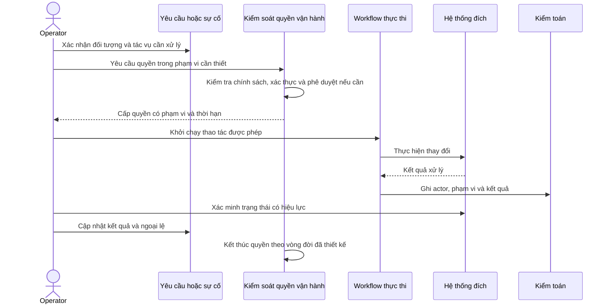

# Operator

## 1. Operator là ai trong IAM?

**Operator — người vận hành** là actor thực hiện các công việc duy trì, giám sát, khôi phục và hỗ trợ hoạt động của hệ thống theo phạm vi được giao. Trong quản lý danh tính và quyền truy cập (Identity and Access Management — IAM), operator có thể vận hành dịch vụ xác thực, kết nối cấp phát tài khoản, quy trình thu hồi quyền hoặc các thành phần hỗ trợ truy cập.

Operator cũng có thể vận hành một ứng dụng nghiệp vụ sử dụng IAM. Ví dụ, người trực vận hành cần kiểm tra vì sao tài khoản đã bị vô hiệu hóa ở nguồn nhân sự nhưng vẫn hoạt động trong ứng dụng. Họ phải hiểu cả đường xử lý danh tính và giới hạn quyền của mình khi can thiệp.

Vai trò này thường gắn với công việc vận hành sau triển khai: theo dõi trạng thái, xử lý hàng đợi lỗi, thực hiện thay đổi đã được phép, xác minh kết quả và chuyển cấp khi vượt phạm vi. Chức danh operator không tự động đồng nghĩa với quyền quản trị toàn bộ hệ thống.

Trong bài này, operator là actor vận hành trong mô hình trách nhiệm IAM. Thuật ngữ không chỉ một mẫu phần mềm điều khiển tài nguyên tự động của một nền tảng cụ thể. Nếu công việc được tự động hóa, tiến trình thực thi có workload identity riêng; người quản lý tiến trình và workload vẫn là hai chủ thể khác nhau.

Sau bài học, bạn có thể xác định trách nhiệm của operator, thiết kế phạm vi truy cập phù hợp và mô tả cách vận hành IAM có thể kiểm toán mà vẫn giữ nguyên tắc ít quyền nhất.

## 2. Trách nhiệm vận hành và quyền quyết định

### 2.1. Operator chịu trách nhiệm về điều gì?

Các trách nhiệm thường gặp gồm:

- Theo dõi khả năng phục vụ của dịch vụ xác thực, phiên và các kết nối IAM.
- Phát hiện bất thường ở cấp phát, cập nhật hoặc thu hồi tài khoản.
- Điều tra lỗi bằng dữ liệu được phép truy cập.
- Thực hiện quy trình vận hành đã được phê duyệt hoặc cho phép trước.
- Xác minh trạng thái ở hệ thống đích sau thao tác.
- Ghi lại kết quả, bằng chứng và các ngoại lệ còn tồn tại.
- Chuyển cấp khi không đủ quyền, không đủ bằng chứng hoặc có dấu hiệu xâm phạm.

Ví dụ, operator có thể thử lại một sự kiện vô hiệu hóa tài khoản đã được nguồn có thẩm quyền xác nhận. Việc đó khác với tự quyết định một người còn quan hệ lao động hay được giữ quyền sau khi nghỉ việc.

### 2.2. Phân biệt với các actor liên quan

| Actor | Trách nhiệm điển hình | Quan hệ với operator |
|---|---|---|
| Người yêu cầu | Nêu nhu cầu truy cập hoặc báo sự cố | Cung cấp yêu cầu, không tự xác lập quyền vận hành |
| Chủ sở hữu ứng dụng hoặc dữ liệu | Xác định mục đích sử dụng và phạm vi quyền nghiệp vụ | Làm rõ tác động và điều kiện truy cập của tài nguyên |
| Người phê duyệt | Chấp thuận yêu cầu theo thẩm quyền | Phê duyệt các thao tác cần xét duyệt theo chính sách |
| Người quản trị chính sách IAM | Thiết kế hoặc thay đổi chính sách quyền và quan hệ tin cậy | Cung cấp cấu hình, ranh giới và quy trình mà operator sử dụng |
| Operator | Thực thi, theo dõi, khôi phục và xác minh hoạt động | Làm việc trong phạm vi được cấp và ghi nhận kết quả |
| Nhóm an ninh | Điều phối các vấn đề bảo mật theo phân công | Hướng dẫn hoặc phối hợp khi có dấu hiệu xâm phạm |
| Người kiểm toán | Đánh giá bằng chứng và việc tuân thủ chính sách | Kiểm tra dấu vết mà operator và hệ thống tạo ra |

Đây là phân chia trách nhiệm minh họa. Một người có thể đảm nhận nhiều vai trò trong tổ chức nhỏ, nhưng hệ thống vẫn cần thể hiện họ đang hành động với vai trò nào. Các yêu cầu phân tách nhiệm vụ không biến mất chỉ vì hai trách nhiệm cùng thuộc một người.

### 2.3. Thực thi yêu cầu không có nghĩa được tự phê duyệt

Operator có thể được giao thực thi thay đổi quyền sau khi yêu cầu đã được xét duyệt. Nếu đồng thời được sửa yêu cầu, tự phê duyệt rồi thực thi cho chính mình, ranh giới kiểm soát có thể bị mất.

Với thay đổi nhạy cảm, cần tách hoặc bổ sung kiểm soát cho các bước yêu cầu, phê duyệt và thực hiện. Mức độ tách phụ thuộc rủi ro; không cần biến mọi thao tác đọc trạng thái thành một quy trình phê duyệt thủ công.

Một mã ticket chỉ là tham chiếu. Hệ thống phải kiểm tra ticket hoặc quyết định phê duyệt theo quy trình đáng tin cậy, thay vì coi việc người gọi tự gửi một chuỗi mã là đủ để cấp quyền.

## 3. Phạm vi quyền của operator

### 3.1. Bắt đầu từ công việc cần thực hiện

Quyền operator nên được suy ra từ nhiệm vụ cụ thể, hành động và tài nguyên, thay vì từ nhãn chung như `ops-admin`.

Ví dụ, “xử lý lỗi thu hồi tài khoản ở ứng dụng hóa đơn production” có thể cần xem trạng thái sự kiện, đọc log đã lọc và thử lại tác vụ cho đúng tài khoản. Nó không mặc nhiên cần quyền xuất toàn bộ người dùng, đọc mọi bí mật hoặc thay đổi chính sách đăng nhập toàn tổ chức.

Một phạm vi quyền cần trả lời được:

1. Được thực hiện hành động nào?
2. Trên ứng dụng, tenant, môi trường hoặc tài khoản nào?
3. Trong khoảng thời gian nào?
4. Dưới điều kiện xác thực, phê duyệt hoặc xử lý sự cố nào?
5. Ai chịu trách nhiệm kiểm tra kết quả?

### 3.2. Ma trận quyền minh họa

| Công việc | Quyền thường cần | Giới hạn hoặc kiểm soát cần xem xét |
|---|---|---|
| Xem sức khỏe dịch vụ IAM | Đọc chỉ số vận hành | Hạn chế dữ liệu nhận diện và dữ liệu nhạy cảm không cần thiết |
| Điều tra một sự kiện đăng nhập lỗi | Đọc log trong phạm vi phù hợp | Che credential, giới hạn thời gian và đối tượng tra cứu |
| Thử lại tác vụ vô hiệu hóa bị lỗi | Chạy lại tác vụ đã xác nhận | Đúng tài khoản, đúng trạng thái nguồn, có bảo vệ khỏi xử lý lặp sai |
| Tạm ngừng tài khoản nghi bị xâm phạm | Thực hiện hành động ứng phó được cho phép | Có căn cứ sự cố, ghi nhận tác động và chuyển cấp theo quy trình |
| Khôi phục cấu hình connector | Áp dụng cấu hình đã được duyệt | Kiểm tra phiên bản, phạm vi và khả năng quay lại an toàn |
| Xoay credential hoặc khóa theo kế hoạch | Kích hoạt quy trình chuyên biệt | Phân quyền riêng, hạn chế lộ vật liệu bí mật, xác minh bên sử dụng |
| Đặt lại MFA của tài khoản đặc quyền | Quyền hỗ trợ nhạy cảm riêng | Xác minh danh tính và phê duyệt theo chính sách tương ứng |
| Tạo vai trò quản trị hoặc sửa quan hệ tin cậy | Quyền quản trị chính sách | Không gộp mặc định vào quyền vận hành thường ngày |
| Tắt MFA cho toàn miền | Thay đổi có phạm vi ảnh hưởng lớn | Không coi là biện pháp xử lý lỗi đăng nhập thông thường |

Bảng thể hiện cách phân tích, không phải bộ quyền bắt buộc cho mọi tổ chức. Một công việc có thể bị cấm đối với operator thông thường và chỉ được thực hiện bởi vai trò chuyên trách.

### 3.3. Quyền gián tiếp cũng có thể tạo đặc quyền

Một operator không được đọc cơ sở dữ liệu vẫn có thể tiếp cận dữ liệu nếu họ được triển khai mã tùy ý dưới workload có quyền đọc cơ sở dữ liệu đó. Tương tự, quyền sửa nhóm, gắn vai trò vào workload hoặc thay cấu hình tin cậy có thể tạo đường tăng quyền.

Cần xem xét cả khả năng:

- Điều khiển ứng dụng hoặc pipeline có quyền mạnh.
- Sửa nội dung quy trình tự động đang được tin cậy.
- Thay nguồn thuộc tính được dùng để cấp quyền.
- Đặt lại credential hoặc MFA của người có quyền cao hơn.
- Sửa đích thu thập log hoặc làm mất dấu hoạt động.

Chỉ rà soát những quyền có tên chứa `admin` sẽ bỏ sót nhiều đường truy cập quan trọng.

## 4. Các nhóm công việc IAM mà operator thường tham gia

### 4.1. Giám sát xác thực và phiên

Operator theo dõi lỗi đăng nhập, lỗi kết nối với nhà cung cấp danh tính, lỗi cấp token và bất thường trong quản lý phiên. Cần phân biệt lỗi kỹ thuật với việc từ chối đúng chính sách.

Ví dụ, người dùng bị từ chối vì không có quyền vào ứng dụng không nhất thiết là sự cố cần “sửa cho đăng nhập được”. Nếu operator xóa điều kiện MFA hoặc thêm người dùng vào nhóm rộng để làm giảm số lỗi, hệ thống có thể hoạt động dễ hơn nhưng sai về bảo mật.

Khi điều tra phiên hoặc token, operator không nên yêu cầu người dùng gửi mật khẩu, mã MFA hay toàn bộ token đang sử dụng. Có thể dùng mã sự kiện, mã yêu cầu và thông tin được phép chia sẻ để tìm dấu vết phía hệ thống.

### 4.2. Cấp phát và thu hồi tài khoản

Quy trình gia nhập, thay đổi nhiệm vụ và rời tổ chức thường đi qua nhiều hệ thống. Operator xử lý lỗi đồng bộ, sự kiện bị kẹt và chênh lệch giữa trạng thái mong muốn với trạng thái tại đích.

Trước khi thử lại, cần biết sự kiện còn phù hợp với trạng thái hiện tại hay không. Một yêu cầu kích hoạt cũ đến trễ không được vô tình mở lại tài khoản đã bị thu hồi bởi sự kiện mới hơn.

Việc sửa lỗi cũng phải giữ đúng ánh xạ danh tính. Không tạo một tài khoản mới rồi sao chép quyền cũ chỉ để vượt qua lỗi liên kết khi chưa xác minh chủ thể và nhu cầu truy cập.

### 4.3. Vận hành credential và quan hệ tin cậy

Hệ thống IAM có thể cần thay chứng thư, xoay khóa, cập nhật kết nối hoặc xử lý credential sắp hết hạn. Những thay đổi này có thể ảnh hưởng nhiều ứng dụng nên cần quy trình chuyên biệt và kế hoạch xác minh.

Operator có thể được phép kích hoạt một workflow xoay khóa mà không được xuất khóa riêng. Tuy nhiên, nếu họ cũng có quyền sửa tùy ý mã của workflow, ranh giới đó có thể bị phá vỡ. Cần xét cả quyền thực thi lẫn quyền thay đổi cơ chế thực thi.

Sau thay đổi, phải kiểm tra các thành phần phụ thuộc theo thiết kế. Không chỉ xác nhận rằng dịch vụ trung tâm đã lưu cấu hình mới mà bỏ qua khả năng ứng dụng đích còn dùng cấu hình cũ.

### 4.4. Vận hành workload identity

Operator có thể quản lý danh mục service account, theo dõi việc nhận credential và kiểm tra các danh tính không còn chủ sở hữu rõ ràng. Mỗi workload cần mục đích, nhóm sở hữu và phạm vi môi trường phù hợp.

Không dùng tài khoản cá nhân của operator làm danh tính chạy job. Khi người đó đổi ca hoặc nghỉ việc, tác vụ tự động cần tiếp tục có vòng đời riêng, đồng thời quyền quản lý tác vụ của cá nhân phải được thu hồi đúng.

Với liên kết danh tính workload, operator cần biết những điều kiện nào cho phép tác vụ nhận vai trò. Chỉ nhìn tên ứng dụng là chưa đủ nếu cấu hình thực tế chấp nhận cả nguồn mã hoặc môi trường không được tin cậy.

## 5. Mô hình cấp quyền vận hành

### 5.1. RBAC để tổ chức quyền theo nhiệm vụ

RBAC — kiểm soát truy cập theo vai trò — có thể biểu diễn các nhóm công việc như đọc trạng thái, xử lý connector hoặc thực hiện hành động khẩn cấp. Một người nhận vai trò phù hợp với nhiệm vụ đang đảm nhận.

Nên tách quyền quan sát thường xuyên khỏi quyền thay đổi nhạy cảm. Nếu ca trực chỉ cần xem trạng thái trong phần lớn thời gian, không nhất thiết giữ quyền ghi mạnh suốt cả ca.

Tách môi trường và phạm vi cũng quan trọng. Quyền vận hành development không nên mặc định có hiệu lực ở production; quyền của tenant A không nên cho phép thao tác tenant B.

### 5.2. ABAC để xét điều kiện truy cập

ABAC — kiểm soát truy cập theo thuộc tính — có thể bổ sung điều kiện như môi trường, trạng thái ca trực, mức xác thực, cửa sổ thay đổi hoặc phạm vi sự cố.

Thuộc tính dùng để ra quyết định cần đến từ nguồn được tin cậy. Trường `on_call=true` hoặc `approved=true` do client tự gửi không chứng minh người đó đang trực hoặc đã được phê duyệt.

Lịch trực giúp xác định người có trách nhiệm, nhưng việc có tên trên lịch không tự động trả lời mọi câu hỏi về tài nguyên và hành động được phép. Chính sách vẫn cần ánh xạ nhiệm vụ thành quyền cụ thể.

### 5.3. Truy cập đặc quyền theo nhu cầu và thời hạn

Quản lý truy cập đặc quyền (Privileged Access Management — PAM) có thể hỗ trợ cấp quyền có thời hạn, kiểm soát phiên hoặc quản lý credential nhạy cảm. Cách triển khai phụ thuộc nền tảng và mức rủi ro.

Một luồng điển hình là operator dùng quyền đọc để xác định vấn đề, sau đó nhận quyền thay đổi cho đúng phạm vi trong khoảng thời gian cần thiết. Khi hết hạn, quyền được thu hồi theo cơ chế đã thiết kế.

Hết hạn một lần cấp quyền không phải lúc nào cũng kết thúc mọi phiên hoặc token đã nhận trước đó. Cần kiểm tra hành vi thực tế của hệ thống và xác định thời điểm quyền không còn sử dụng được tại tài nguyên đích.

MFA và xác thực lại có thể bảo vệ bước nhận đặc quyền. Tuy nhiên, MFA không thay thế kiểm tra quyền; người đăng nhập bằng phương thức mạnh vẫn chỉ được làm việc trong phạm vi đã cấp.

## 6. Luồng thực hiện một thao tác vận hành



Sơ đồ là luồng khái niệm. Công việc thường lệ có thể đã được cho phép trước; công việc nhạy cảm có thể cần người phê duyệt riêng. Điều quan trọng là hệ thống kiểm tra điều kiện trước khi thay đổi và ghi nhận kết quả sau khi thực hiện.

Đối với thao tác có tác động lớn, cần xác định trước điều kiện dừng, cách chuyển cấp và kế hoạch phục hồi. Không nên vừa phát hiện thao tác ngoài phạm vi vừa tiếp tục thử các quyền rộng hơn mà không có căn cứ.

## 7. Ví dụ: tài khoản đã nghỉ việc vẫn hoạt động ở ứng dụng

Giả sử nguồn nhân sự đã ghi nhận một nhân viên rời tổ chức. Dịch vụ danh tính đã vô hiệu hóa đăng nhập, nhưng connector gửi yêu cầu ngừng tài khoản ở ứng dụng hóa đơn bị lỗi. Một phiên ứng dụng vẫn còn hiệu lực.

### 7.1. Xác nhận sự kiện và danh tính

Operator kiểm tra sự kiện thu hồi từ nguồn có thẩm quyền, định danh của người dùng và ánh xạ sang tài khoản ứng dụng. Email giống nhau chưa đủ để xác nhận đích nếu có khả năng đổi hoặc tái sử dụng địa chỉ.

Cần xem phiên bản hoặc thứ tự sự kiện liên quan. Nếu dữ liệu đang mâu thuẫn, operator chuyển cấp hoặc xử lý theo quy trình, không tự chọn một trạng thái để mở lại tài khoản.

### 7.2. Khoanh vùng lỗi

Operator xác định lỗi nằm ở đâu: connector không kết nối được, yêu cầu bị từ chối, ánh xạ không đúng, tài khoản chưa chuyển trạng thái hay phiên ứng dụng chưa bị thu hồi.

Khóa ở nhà cung cấp danh tính không bảo đảm mọi phiên độc lập của ứng dụng đã kết thúc. Việc ứng dụng hỗ trợ SSO cũng không tự giải quyết toàn bộ vòng đời tài khoản và phiên của nó.

### 7.3. Thực hiện trong phạm vi đã cấp

Nếu quy trình cho phép, operator nhận quyền thử lại đúng tác vụ vô hiệu hóa hoặc thu hồi phiên tại ứng dụng. Việc thử lại phải tránh tạo tác dụng ngoài dự kiến khi yêu cầu trước đó thực ra đã thành công nhưng phản hồi bị mất.

Nếu connector không thể hoạt động kịp yêu cầu xử lý sự cố, có thể cần đường can thiệp khác đã được tổ chức cho phép. Không nên tự tạo tài khoản quản trị mới hoặc dùng credential của người khác để vượt qua lỗi.

### 7.4. Xác minh quyền truy cập đã bị chặn

Kết quả “yêu cầu được tiếp nhận” khác với “tài khoản đã bị vô hiệu hóa và các đường truy cập trong phạm vi đã bị chặn”. Operator cần xác nhận trạng thái tại ứng dụng và hành vi của phiên, token liên quan theo khả năng hệ thống.

Việc kiểm tra nên dựa trên tín hiệu phía hệ thống đích hoặc phép thử đã được cho phép. Không yêu cầu người dùng cung cấp mật khẩu hoặc token để operator đăng nhập thay.

Nếu một token vẫn được chấp nhận đến thời điểm hết hạn theo thiết kế, phải ghi nhận khoảng thời gian còn hiệu lực và chuyển xử lý theo mức rủi ro. Không báo hoàn tất toàn bộ nếu vẫn còn đường truy cập chưa được kiểm soát trong phạm vi yêu cầu.

### 7.5. Kết thúc và sửa nguyên nhân

Sau khi xử lý, operator kết thúc phiên đặc quyền, cập nhật yêu cầu và lưu bằng chứng. Nhóm có trách nhiệm tiếp tục xử lý nguyên nhân connector lỗi, bổ sung cảnh báo hoặc đối soát nếu cần.

Mục tiêu không chỉ là sửa một tài khoản. Hệ thống cần phát hiện và xử lý được những trường hợp tương tự để tránh việc thu hồi phụ thuộc hoàn toàn vào phát hiện thủ công.

## 8. Bảo vệ danh tính và công cụ của operator

### 8.1. Danh tính cá nhân và xác thực phù hợp

Mỗi operator nên sử dụng danh tính cá nhân để có thể quy trách nhiệm. Tài khoản vận hành dùng chung làm giảm khả năng xác định ai đã thực hiện, dù hệ thống có lưu log theo tên tài khoản.

Với thao tác đặc quyền, cần phương thức xác thực tương ứng với rủi ro và kiểm soát quy trình khôi phục. Một phương thức đăng nhập mạnh vẫn có thể bị suy yếu nếu hỗ trợ có thể đặt lại nó qua quy trình không đủ chặt chẽ.

Trong nhiều môi trường, có thể tách ngữ cảnh sử dụng thông thường và ngữ cảnh đặc quyền. Điểm cần đạt là giảm khả năng phiên làm việc thường ngày vô tình mang quyền mạnh, đồng thời giữ dấu vết liên hệ với cá nhân thực hiện.

### 8.2. Thiết bị, phiên và credential

Công cụ quản trị, thiết bị truy cập và phiên đặc quyền là một phần của bề mặt bảo vệ. Cần quản lý điều kiện sử dụng, thời hạn phiên và việc lưu credential theo thiết kế của tổ chức.

Không sao chép bí mật vào ticket, tài liệu hỗ trợ hoặc đoạn log chia sẻ. Nếu cần cung cấp bằng chứng điều tra, dùng thông tin đã lọc và mã tương quan phù hợp.

Credential tạm thời giúp giới hạn thời gian lạm dụng, nhưng trong thời gian còn hiệu lực nó vẫn có thể bị sử dụng. Phạm vi quyền, môi trường thực thi và cách bảo vệ credential vẫn quan trọng.

### 8.3. Tự động hóa có danh tính riêng

Một workflow được operator khởi chạy nên thực thi bằng workload identity được thiết kế cho nhiệm vụ đó. Log cần liên kết được người khởi chạy với phiên hoặc mã job của workload.

Không chỉ lưu tên service account rồi kết luận đã biết người thực hiện. Cũng không chỉ lưu tên operator mà bỏ qua danh tính workload đã sử dụng quyền ở hệ thống đích.

Quyền sửa workflow cần được quản lý tương xứng với quyền mà workflow có thể sử dụng. Một bước phê duyệt khởi chạy sẽ ít giá trị nếu cùng người đó có thể thay mã sau phê duyệt để thực hiện hành động khác ngoài phạm vi.

## 9. Tình huống nhạy cảm và truy cập khẩn cấp

### 9.1. Khôi phục hoặc đặt lại MFA

Đặt lại MFA có thể thay đổi khả năng kiểm soát tài khoản. Operator không nên coi đây chỉ là thao tác hỗ trợ đơn giản dựa trên một tin nhắn tự nhận là người dùng.

Cần xác minh theo quy trình phù hợp, kiểm tra loại tài khoản và áp dụng thẩm quyền tương ứng. Tài khoản đặc quyền có thể cần đường xử lý khác với tài khoản thông thường. Sau thao tác, cần ghi nhận và xử lý các phiên, phương thức hoặc thông báo liên quan theo chính sách.

### 9.2. Thay đổi ảnh hưởng toàn miền

Sửa bên phát hành tin cậy, phương thức xác thực, nhóm quản trị hoặc cấu hình khóa ký có thể ảnh hưởng nhiều ứng dụng. Những thay đổi này cần được nhận diện là thay đổi bảo mật có phạm vi lớn, dù giao diện thực hiện chỉ có một nút hoặc một trường cấu hình.

Operator chỉ thực hiện khi có đúng thẩm quyền và quy trình tương ứng. Việc đang xử lý sự cố không tự động cho phép tắt mọi điều kiện bảo vệ hoặc chấp nhận mọi nguồn danh tính.

### 9.3. Truy cập khẩn cấp

Một số hệ thống cần phương án khẩn cấp khi đường quản trị thông thường không khả dụng. Phương án phải có mục đích, đối tượng được dùng, phạm vi quyền, bảo vệ credential và cách ghi nhận hoạt động rõ ràng.

Cần kiểm tra rằng quy trình khôi phục không phụ thuộc hoàn toàn vào thành phần đang lỗi. Ví dụ, nếu mọi bước nhận quyền khẩn cấp đều cần đăng nhập qua dịch vụ đang ngừng hoạt động, phương án chưa giải quyết được tình huống dự kiến.

Sau sử dụng, phải rà soát hành động, kết thúc truy cập và xử lý credential theo quy trình. Tài khoản khẩn cấp không nên trở thành đường làm việc hằng ngày để bỏ qua quy trình cấp quyền thông thường.

### 9.4. Khi công cụ kiểm toán hoặc phê duyệt lỗi

Cần có quy định trước về các thao tác được tiếp tục, bị trì hoãn hoặc phải dùng quy trình thay thế. Operator không nên tự quyết rằng thiếu log hoặc thiếu phê duyệt thì được bỏ qua kiểm soát.

Quy trình thay thế, nếu có, vẫn cần giữ bằng chứng đủ để rà soát sau sự cố và bảo vệ dữ liệu ghi nhận. Khả năng phục hồi phải được diễn tập cùng các ràng buộc bảo mật, không chỉ kiểm tra ứng dụng có chạy lại hay không.

## 10. Kiểm toán hoạt động vận hành

Một sự kiện thay đổi cần cho biết người khởi chạy, vai trò hoặc lần cấp quyền, tác vụ, đối tượng, phạm vi và kết quả. Nếu có workflow tự động, cần cả danh tính thực thi và mã job.

Ví dụ bản ghi minh họa cho thời điểm yêu cầu thử lại được tiếp nhận:

```json
{
  "event": "provisioning.disable_retry_requested",
  "actor_type": "human",
  "actor_id": "operator_27",
  "access_grant_id": "grant_531",
  "execution_principal": "deprovisioning-worker-prod",
  "target_application": "invoice-service",
  "target_account_id": "acct_584",
  "tenant_id": "company-a",
  "environment": "production",
  "source_event_id": "departure_882",
  "ticket_id": "incident_146",
  "job_id": "job_739",
  "execution_status": "accepted",
  "access_revocation_status": "pending_verification"
}
```

Tên trường do hệ thống tự quy định. Các định danh actor, quyền và phạm vi phải được lấy từ ngữ cảnh đã kiểm tra. Không tin một trường `actor_id` do client tự khai như bằng chứng về người thực hiện.

Bản ghi trên chưa chứng minh quyền truy cập đã bị thu hồi. Cần sự kiện hoặc bằng chứng tiếp theo về kết quả thực thi và trạng thái tại hệ thống đích, được liên kết bằng mã tương quan.

Log cần được bảo vệ khỏi sửa hoặc xóa trái phép. Quyền vận hành một dịch vụ không nên mặc nhiên bao gồm khả năng xóa dấu vết của chính các thao tác đó. Hạn chế ghi dữ liệu nhận diện không cần thiết và không ghi credential có thể sử dụng lại.

## 11. Đánh giá hiệu quả vận hành

| Khía cạnh | Dữ liệu có ích | Cách diễn giải cần tránh |
|---|---|---|
| Khả năng phục vụ | Lỗi kỹ thuật của đăng nhập, cấp token hoặc connector | Coi mọi lần từ chối đúng chính sách là lỗi hệ thống |
| Thu hồi truy cập | Thời gian từ sự kiện có thẩm quyền đến khi bị chặn tại đích | Chỉ đo thời điểm gửi yêu cầu vô hiệu hóa |
| Cấp phát và đồng bộ | Tác vụ thất bại, chênh lệch trạng thái, lỗi lặp lại | Chỉ báo số tác vụ đã chạy |
| Đặc quyền | Quyền đang có hiệu lực, thời hạn, phiên và ngoại lệ | Coi hết hạn yêu cầu là mọi token đã mất hiệu lực |
| Danh tính workload | Tài khoản không rõ chủ sở hữu, credential không còn nhu cầu | Chỉ kiểm kê tài khoản cá nhân |
| Xử lý sự cố | Kết quả khôi phục và việc tuân thủ ranh giới truy cập | Giảm thời gian xử lý bằng cách bỏ kiểm soát |
| Khả năng truy vết | Liên kết được người, lần cấp quyền, job và kết quả | Coi có một dòng log là đã đủ bằng chứng |

Mục tiêu cụ thể cần được đặt theo phạm vi và rủi ro của hệ thống. Khi một tác vụ chưa có kết quả tại đích, phải giữ trạng thái chưa hoàn tất thay vì loại khỏi báo cáo.

Các chỉ số nên giúp phát hiện nguyên nhân và cải thiện quy trình. Nếu operator thường xuyên cần quyền rộng ngoài thiết kế, cần xem lại công cụ, phạm vi vai trò và quy trình hỗ trợ, thay vì duy trì đặc quyền lâu dài như một ngoại lệ mặc định.

## 12. Nội dung cần có trong một runbook IAM

Runbook là hướng dẫn thực hiện một công việc vận hành trong điều kiện xác định. Một runbook hữu ích cần đủ thông tin để operator biết khi nào được làm, làm đến đâu và khi nào phải dừng.

Các nội dung chính gồm:

1. Mục đích và phạm vi: loại sự cố, hệ thống, tenant và môi trường áp dụng.
2. Điều kiện đầu vào: sự kiện hoặc bằng chứng cần có, nguồn được chấp nhận.
3. Quyền cần thiết: hành động, tài nguyên, thời hạn và điều kiện phê duyệt.
4. Định danh đích: cách xác nhận đúng tài khoản hoặc workload.
5. Các bước thực hiện và tác động dự kiến.
6. Điều kiện dừng: dữ liệu mâu thuẫn, tác động ngoài phạm vi hoặc thiếu bằng chứng.
7. Cách xác minh kết quả tại hệ thống đích.
8. Phương án phục hồi hoặc chuyển cấp.
9. Dấu vết cần lưu và cách kết thúc truy cập đặc quyền.

Không nên để bí mật thực trong runbook. Tham chiếu đến cơ chế lấy quyền hoặc credential được phép sẽ giúp tài liệu không trở thành một nguồn phát tán thông tin xác thực.

Khi quy trình thay đổi, cần xem lại cả quyền của người thực hiện và quyền của tự động hóa liên quan. Một runbook đúng về nghiệp vụ vẫn có thể không an toàn nếu công cụ cho phép thay đối tượng hoặc hành động ngoài phạm vi đã duyệt.

## 13. Những sai lầm thường gặp

| Sai lầm | Hệ quả | Cách tiếp cận phù hợp hơn |
|---|---|---|
| Gán quyền quản trị toàn bộ cho mọi operator | Sự cố hoặc tài khoản bị chiếm có phạm vi ảnh hưởng lớn | Cấp quyền theo nhiệm vụ, tài nguyên và thời hạn |
| Dùng chung tài khoản trực ca | Khó quy trách nhiệm cá nhân | Dùng danh tính cá nhân và liên kết ca trực với hoạt động |
| Operator tự yêu cầu, tự phê duyệt mọi đặc quyền | Mất kiểm soát phân tách nhiệm vụ | Áp dụng thẩm quyền và phê duyệt theo rủi ro |
| Sửa chính sách để làm hết lỗi đăng nhập | Có thể mở truy cập ngoài dự kiến | Phân biệt lỗi kỹ thuật với từ chối đúng chính sách |
| Chỉ kiểm tra quyền trực tiếp | Bỏ sót quyền điều khiển workload hoặc đặt lại tài khoản mạnh | Xét cả đường leo thang qua cấu hình và tự động hóa |
| Báo hoàn tất khi yêu cầu mới được nhận | Tài khoản hoặc phiên tại đích vẫn có thể hoạt động | Xác minh hiệu lực và ghi rõ ngoại lệ |
| Cho job dùng tài khoản của operator | Vòng đời cá nhân và tự động hóa bị trộn lẫn | Dùng workload identity riêng và giữ liên hệ với người khởi chạy |
| Ghi token, mật khẩu vào ticket để hỗ trợ | Làm lộ credential qua hệ thống hỗ trợ | Dùng mã tương quan và dữ liệu đã lọc |
| Xóa liên kết lỗi mà không xét quyền hạ nguồn | Tác động cấp nhầm quyền vẫn còn | Xử lý cả ánh xạ, quyền, phiên và kết quả tại đích |
| Dùng đường khẩn cấp cho công việc hằng ngày | Ngoại lệ trở thành đường truy cập không được kiểm soát | Giới hạn mục đích và rà soát từng lần sử dụng |

## 14. Tự kiểm tra qua tình huống

**Tình huống 1:** Operator được quyền xem trạng thái connector. Khi connector lỗi, người đó tự thêm mình vào nhóm quản trị để sửa. Vấn đề nằm ở đâu?

Quyền quan sát không bao gồm quyền tự mở rộng phạm vi. Cần yêu cầu quyền hoặc chuyển cấp theo quy trình. Nếu operator có thể tự sửa nhóm để nhận đặc quyền, thiết kế đang có một đường tăng quyền cần được kiểm soát.

**Tình huống 2:** Người dùng bị từ chối truy cập một ứng dụng vì thiếu vai trò. Operator tắt điều kiện kiểm tra vai trò để giảm số lỗi. Đây có phải xử lý vận hành đúng không?

Không. Cần xác định người dùng có nhu cầu và được phép nhận quyền hay không. Từ chối đúng chính sách không nên được xử lý bằng cách bỏ kiểm tra truy cập.

**Tình huống 3:** Một workflow có thể vô hiệu hóa tài khoản ở production. Operator chỉ được khởi chạy workflow đã duyệt nhưng cũng được sửa tùy ý mã thực thi. Quyền có thực sự hẹp không?

Chưa chắc. Quyền sửa mã có thể cho phép biến workflow thành công cụ thực hiện hành động khác bằng đặc quyền sẵn có. Cần kiểm soát cả thay đổi workflow và nội dung được thực thi sau phê duyệt.

**Tình huống 4:** Ticket cho biết thu hồi đã thành công vì API trả về “accepted”, nhưng tài khoản đích chưa đổi trạng thái. Có thể đóng sự cố không?

Chưa có đủ bằng chứng hoàn tất trong phạm vi đó. Cần theo dõi kết quả xử lý, xác minh trạng thái và ghi nhận các phiên hoặc token còn hiệu lực theo thiết kế.

**Tình huống 5:** Quyền đặc quyền hết hạn sau ca trực, nhưng phiên với hệ thống đích vẫn còn dùng được. Cần xem lại điều gì?

Cần xem cơ chế thu hồi phiên và credential tại đích, thời hạn thực tế và cách hệ thống kiểm tra quyền. Hết hạn một lần cấp quyền ở lớp quản trị không tự chứng minh mọi khả năng sử dụng quyền đã kết thúc.

## 15. Những điểm cần ghi nhớ

- Operator thực thi và duy trì hoạt động trong phạm vi được giao; chức danh không tự xác lập quyền quản trị toàn bộ.
- Phải phân biệt trách nhiệm yêu cầu, phê duyệt, thiết kế chính sách, thực thi và kiểm toán.
- Quyền vận hành cần giới hạn theo hành động, tài nguyên, môi trường, thời gian và điều kiện đáng tin cậy.
- Quyền điều khiển workload, sửa workflow hoặc đặt lại credential có thể tạo đặc quyền gián tiếp.
- MFA, RBAC, ABAC và PAM hỗ trợ bảo vệ hoạt động vận hành khi được gắn với mô hình quyền và vòng đời cụ thể.
- Thao tác được tiếp nhận khác với thay đổi đã có hiệu lực; operator cần xác minh tại nơi thực thi truy cập.
- Danh tính cá nhân và workload identity phải tách biệt, đồng thời được liên kết trong dấu vết hoạt động.
- Xử lý sự cố và truy cập khẩn cấp vẫn cần thẩm quyền, giới hạn, bằng chứng và quy trình kết thúc rõ ràng.
