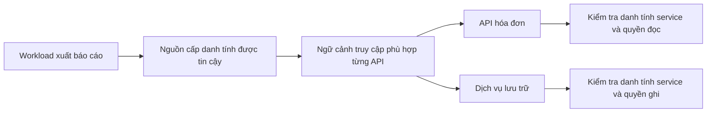

# Service

Một hệ thống không chỉ có con người đăng nhập rồi thao tác. Dịch vụ hóa đơn gọi dịch vụ lưu trữ, tác vụ đêm xuất báo cáo, worker đọc hàng đợi và ứng dụng báo cáo gọi API thay người dùng. Trong các tương tác đó, **service — dịch vụ phần mềm** là một actor cần được nhận diện, cấp quyền và kiểm toán.

Trong IAM, câu hỏi quan trọng không chỉ là “service này có gọi được API không?” mà còn là:

- Service đang chứng minh danh tính nào?
- Nó thực hiện bằng quyền riêng hay thay một người dùng?
- Nó được phép thao tác trên tài nguyên và tenant nào?
- Ai chịu trách nhiệm quản lý danh tính, credential và quyền của nó?
- Khi service ngừng hoạt động hoặc bị xâm phạm, quyền truy cập được thu hồi thế nào?

Bài học này xem service như một actor trong hệ thống quản lý danh tính và quyền truy cập. Trọng tâm là quan hệ giữa chức năng dịch vụ, danh tính kỹ thuật, chủ thể hiệu lực và phạm vi quyền.

## 1. Service trong mô hình actor của IAM

### 1.1. Dịch vụ phần mềm có khả năng hành động

Service là thành phần phần mềm cung cấp hoặc thực hiện một chức năng. Nó có thể nhận request, xử lý sự kiện, chạy tác vụ nền hoặc gọi hệ thống khác.

Ví dụ:

- Dịch vụ hóa đơn tiếp nhận và xử lý nghiệp vụ hóa đơn.
- Dịch vụ báo cáo tổng hợp dữ liệu.
- Worker chuyển đổi tài liệu từ hàng đợi.
- Tác vụ định kỳ đồng bộ trạng thái nhân viên.
- Bộ điều khiển triển khai tạo hoặc thay đổi tài nguyên hạ tầng.

Một service không nhất thiết tương ứng với một tiến trình duy nhất. Một chức năng logic có thể có nhiều instance chạy đồng thời hoặc nhiều tác vụ ngắn hạn.

Ngược lại, việc hai chức năng cùng chạy trong một ứng dụng không bắt buộc chúng phải dùng chung một danh tính có mọi quyền. Mức tách danh tính cần phù hợp ranh giới chức năng, độ tin cậy và khả năng vận hành.

### 1.2. Service có thể vừa gọi vừa cung cấp tài nguyên

Một service có thể đảm nhiệm hai vị trí:

| Vị trí | Câu hỏi IAM chính | Ví dụ |
|---|---|---|
| Bên gọi | Bên nhận nhận diện và giới hạn quyền của service thế nào? | Dịch vụ báo cáo gọi API hóa đơn |
| Bên cung cấp tài nguyên | Service xác thực và cấp quyền cho người gọi thế nào? | API hóa đơn kiểm tra yêu cầu đọc hóa đơn |
| Cả hai trong cùng luồng | Ngữ cảnh nào được giữ và quyền nào được dùng khi gọi tiếp? | API hóa đơn gọi dịch vụ lưu trữ để trả tệp |

Trong OAuth, một service có thể đóng vai trò client khi yêu cầu hoặc sử dụng token, và resource server khi cung cấp API được bảo vệ. Đây là vai trò trong giao thức, không phải kết luận rằng service luôn có một kiểu quyền duy nhất.

Việc service đã xác thực được người gọi ở đầu vào không tự làm mọi lời gọi đầu ra hợp lệ. Mỗi ranh giới cần kiểm tra đúng danh tính, mục đích và quyền.

### 1.3. Service cũng có thể là tài nguyên được quản trị

Khi dịch vụ báo cáo đọc hóa đơn, dịch vụ báo cáo là actor gọi.

Khi quản trị viên thay đổi cấu hình hoặc danh tính của dịch vụ báo cáo, cấu hình dịch vụ lại là tài nguyên trong một quyết định khác.

Vì vậy, cần phân biệt:

- Quyền mà service sử dụng để làm việc.
- Quyền mà con người hoặc công cụ quản trị sử dụng để điều khiển service.
- Quyền tạo credential hoặc nhận danh tính của service.
- Quyền sửa chính sách cấp quyền cho service.

Một người không trực tiếp có quyền đọc dữ liệu vẫn có thể tiếp cận dữ liệu nếu được tự do thay mã chạy dưới danh tính có quyền đọc. Quyền triển khai và thay cấu hình có thể mang tác động bảo mật tương đương với quyền sử dụng danh tính workload.

## 2. Service, workload và service account không phải một khái niệm

| Khái niệm | Ý nghĩa | Ví dụ |
|---|---|---|
| Service | Chức năng hoặc thành phần phần mềm | Dịch vụ xuất báo cáo |
| Workload | Đơn vị thực thi phần mềm trong môi trường vận hành | Một worker hoặc nhóm instance đang chạy |
| Service identity | Danh tính logic dùng để nhận diện service hoặc workload | `service:report-exporter` |
| Service account | Bản ghi tài khoản kỹ thuật mà nền tảng quản lý | Account chuyên dùng cho tác vụ xuất báo cáo |
| Principal | Danh tính mà cơ chế bảo mật nhận diện trong request hoặc policy | Principal của dịch vụ gọi API |
| Credential | Bằng chứng hoặc phương tiện để xác thực/truy cập | Khóa riêng, client secret, token truy cập |
| Owner | Người hoặc nhóm chịu trách nhiệm quản trị | Nhóm vận hành báo cáo |
| Instance reference | Tham chiếu một lần chạy hoặc instance | `worker-instance-27` |

Tên và quan hệ giữa các đối tượng phụ thuộc nền tảng.

Một service account không phải chính tiến trình đang chạy. Nó là đối tượng quản lý có thể được tiến trình sử dụng để thiết lập danh tính. Một nền tảng khác có thể cấp danh tính workload qua quan hệ tin cậy mà không yêu cầu tạo account người dùng trong cơ sở dữ liệu ứng dụng.

Một service cũng có thể cần nhiều danh tính cho các chức năng hoặc môi trường khác nhau. Ví dụ, tác vụ xuất báo cáo và tác vụ quản trị danh tính không nên tự động dùng chung toàn bộ quyền chỉ vì cùng thuộc một nhóm phát triển.

Không nhận diện loại chủ thể chỉ bằng tên. Account kết thúc bằng `-svc` không tự trở thành danh tính service được quản lý tốt; cần loại chủ thể, chủ sở hữu, mục đích và vòng đời rõ ràng.

## 3. Ba cách service tham gia một yêu cầu

### 3.1. Thực hiện bằng danh tính riêng

Một tác vụ định kỳ tự đọc dữ liệu đã được tổ chức cho phép để tạo báo cáo.

```text
Subject hiệu lực: service báo cáo
Actor thực hiện: workload chạy tác vụ
Người dùng đang tương tác: không có
Phạm vi: dữ liệu và thao tác được cấp cho service
```

Đây là truy cập bằng quyền của service. Không cần gắn một người dùng giả định vào request.

Người viết hoặc triển khai service có thể được ghi nhận ở lịch sử quản trị. Người đó không tự động là subject của mọi tác vụ chạy sau này.

### 3.2. Gọi thay người dùng

Lan sử dụng ứng dụng báo cáo để xem hóa đơn. Ứng dụng gọi API thay Lan thông qua một cơ chế ủy quyền được hỗ trợ.

```text
Người dùng được đại diện: Lan
Actor/client: ứng dụng báo cáo
Phạm vi ủy quyền: invoice.read
Tài nguyên đích: hóa đơn trong tenant A
```

Quyết định cần xét quyền của Lan đối với tài nguyên cùng các giới hạn áp dụng cho ứng dụng và quan hệ ủy quyền.

Việc service có credential riêng không đủ để nói rằng nó được gọi thay mọi người dùng. Cơ chế thiết lập và bảo vệ ngữ cảnh đại diện phải được thiết kế riêng.

### 3.3. Dùng quyền riêng để phục vụ một yêu cầu người dùng

Một ứng dụng có thể kiểm tra quyền của Lan ở lớp API, sau đó dùng danh tính riêng để truy cập kho dữ liệu nội bộ.

Đây là một lựa chọn kiến trúc khác với việc truyền token người dùng tới mọi tầng. Nó có thể phù hợp nếu ranh giới cấp quyền được xác định và thực thi rõ ràng.

Tuy nhiên, hệ thống phải trả lời:

- Lớp nào chịu trách nhiệm kiểm tra quyền theo người dùng và tenant?
- Service được phép truy cập những tài nguyên nào bằng quyền riêng?
- Làm sao ngăn client chọn tùy ý account hoặc tài nguyên ngoài phạm vi?
- Log có giữ được người yêu cầu và service thực thi không?
- Các đường gọi khác có bỏ qua lớp kiểm tra đó không?

Không được lấy lý do “đây là request nội bộ” để bỏ qua toàn bộ ràng buộc dữ liệu.

## 4. Thiết kế danh tính cho service

### 4.1. Bắt đầu từ mục đích và ranh giới quyền

Một mô tả danh tính minh họa:

```json
{
  "service_id": "service-report-exporter",
  "subject_type": "workload",
  "environment": "production",
  "owner_team": "reporting-platform",
  "purpose": "Export approved reports",
  "status": "active"
}
```

Đây là schema nội bộ minh họa, không phải claim chuẩn của một giao thức.

Thông tin cần quản lý thường gồm:

- Mục đích tồn tại.
- Chủ sở hữu và người liên hệ vận hành.
- Môi trường được phép chạy.
- Ứng dụng hoặc API được gọi.
- Quyền và phạm vi tài nguyên.
- Cơ chế nhận danh tính.
- Quy trình rà soát và ngừng sử dụng.

Owner là quan hệ trách nhiệm. Nó không có nghĩa service thừa hưởng mọi quyền của nhóm hoặc cá nhân được ghi làm owner.

### 4.2. Tách môi trường và chức năng khi có ranh giới cần bảo vệ

Danh tính thử nghiệm không nên tự có quyền trên dữ liệu sản xuất.

Nếu một token hoặc credential của môi trường phát triển bị lộ, việc tách danh tính và quyền giúp hạn chế phạm vi tác động.

Tương tự, service chỉ đọc dữ liệu để tạo báo cáo không nên dùng chung danh tính quản trị account. Nếu hai chức năng có rủi ro và trách nhiệm khác nhau, tách danh tính giúp quyền, thu hồi và kiểm toán rõ hơn.

Không nhất thiết mỗi instance phải có một account tồn tại vĩnh viễn. Có thể dùng danh tính logic theo workload và bổ sung tham chiếu instance trong log, tùy mô hình nền tảng.

### 4.3. Quyền nhận danh tính cũng phải được kiểm soát

Quyền truy cập dữ liệu không chỉ nằm ở role gán cho service. Cần kiểm soát cả bên có thể:

- Nhận hoặc sử dụng credential của service.
- Thay cấu hình liên kết danh tính.
- Triển khai mã chạy dưới danh tính đó.
- Thay image, mã tác vụ hoặc cấu hình khởi động.
- Cấp thêm quyền hoặc nhận một role mạnh hơn.

Nếu mọi người đều có thể tạo workload mang danh tính đặc quyền, việc hạn chế quyền trực tiếp của account cá nhân sẽ không còn đủ.

## 5. Service chứng minh danh tính bằng cách nào?

### 5.1. Không dựa vào tên, địa chỉ mạng hoặc lời tự khai báo

Các giá trị như `X-Service-Name: reporting`, tên máy hoặc đường dẫn gọi không tự chứng minh service nào đang gửi request.

Một API cần cơ chế phù hợp để thiết lập danh tính người gọi, chẳng hạn:

| Cơ chế | Căn cứ sử dụng | Điểm cần quản lý |
|---|---|---|
| Chứng thư và mTLS | Bằng chứng sử dụng khóa cùng quan hệ tin cậy chứng thư | Cấp phát, kiểm tra, ánh xạ danh tính, thời hạn và thu hồi |
| OAuth với luồng phù hợp cho client | Token do hệ thống ủy quyền phát hành theo danh tính và quyền của client | Xác thực client, phạm vi, bên nhận dự kiến, thời hạn |
| Danh tính workload do nền tảng cấp | Bằng chứng gắn với workload theo quan hệ tin cậy của nền tảng | Điều kiện nhận danh tính, môi trường và quyền của workload |
| Credential tĩnh được quản lý | Bí mật hoặc khóa được cấp cho service | Lưu trữ, phân phối, xoay vòng, thu hồi và giới hạn sử dụng |

Danh sách này mô tả các hướng tiếp cận, không nói rằng mọi hệ thống phải dùng tất cả chúng.

API key có ý nghĩa khác nhau giữa các nền tảng. Có nơi nó nhận diện ứng dụng để tính hạn mức; có nơi nó là credential có khả năng truy cập. Cần hiểu chính xác ý nghĩa trước khi dùng nó làm căn cứ xác thực hoặc cấp quyền.

### 5.2. OAuth client credentials không đại diện cho một người đang đăng nhập

Với luồng client credentials, client nhận token để truy cập theo phạm vi được cấp cho chính client trong mô hình đang dùng.

Không nên diễn giải token đó thành “người quản lý service đã đăng nhập” hoặc “service được thay mặt mọi nhân viên”.

Người dùng được đại diện, nếu có, cần được thiết lập bằng cơ chế ủy quyền tương ứng. Thêm `user_id` vào request không biến token của service thành token gọi thay người đó.

Access token có thể là JWT hoặc chuỗi opaque. API sử dụng cơ chế kiểm tra được hỗ trợ thay vì mặc định mọi token đều có thể giải mã và tin ngay phần payload.

### 5.3. mTLS không thay thế kiểm tra quyền nghiệp vụ

mTLS có thể giúp các bên xác thực theo chứng thư và bảo vệ kết nối. Sau bước đó, API vẫn cần ánh xạ danh tính được chấp nhận và quyết định service có được thực hiện hành động cụ thể không.

Ví dụ, service báo cáo được nhận diện hợp lệ không có nghĩa nó có quyền duyệt hóa đơn.

Nếu có proxy hoặc service mesh, cần biết danh tính nào đã được xác thực ở từng chặng và ứng dụng nhận ngữ cảnh đó bằng cách nào. Xác thực một proxy không tự chứng minh danh tính người dùng ban đầu hoặc mọi actor trong chuỗi.

### 5.4. MFA của con người và xác thực workload có mục đích khác nhau

Một workload không tương tác thường cần cơ chế nhận danh tính và credential phù hợp cho phần mềm, thay vì phụ thuộc vào một nhân viên nhập mã MFA cho mọi lần chạy.

Điều đó không có nghĩa giảm kiểm soát. Quyền quản trị service, thay cấu hình tin cậy, nhận đặc quyền hoặc truy cập credential có thể cần MFA, phê duyệt và giới hạn thời gian đối với con người.

Không giải quyết tác vụ nền bằng cách dùng chung account người dùng rồi tắt MFA để service chạy được. Cách đó làm lẫn danh tính con người với danh tính phần mềm và gây khó cho thu hồi, kiểm toán.

## 6. Cấp quyền tối thiểu cho service

### 6.1. Tách quyền theo hành động, tài nguyên và điều kiện

Xét service xuất báo cáo cho tenant A:

| Hành động | Phạm vi | Quyền dự kiến |
|---|---|---|
| Đọc dữ liệu hóa đơn đã được phép xuất | Tenant A, đúng loại dữ liệu | Cho phép theo chính sách |
| Ghi tệp báo cáo | Vùng lưu trữ và prefix báo cáo của tenant A | Cho phép theo chính sách |
| Duyệt hoặc xóa hóa đơn | Dữ liệu nghiệp vụ | Không cấp cho tác vụ xuất |
| Đọc báo cáo của tenant B | Tenant khác | Không cấp nếu không có nhu cầu được phê duyệt |
| Thay đổi role người dùng | Cấu hình IAM | Không cấp |
| Cấp credential hoặc thay quan hệ tin cậy | Quản trị danh tính | Không cấp cho chức năng xuất |

Không cấp quyền quản trị chỉ để tránh tìm hiểu quyền tối thiểu mà tác vụ cần.

Quyền có thể được biểu diễn qua role, scope, policy tài nguyên hoặc tổ hợp cơ chế. Điều cần bảo toàn là ý nghĩa và phạm vi, không phải tên gọi của mô hình.

### 6.2. Scope không tự giải quyết toàn bộ quyền tài nguyên

Token có scope `invoice.read` có thể cho biết một loại thao tác được cho phép. API vẫn cần xác định ý nghĩa scope và ràng buộc tài nguyên theo hợp đồng của hệ thống.

Một scope đọc chung không tự chứng minh service có quyền đọc mọi tenant. Cần kiểm tra các điều kiện như tenant được cấp, tập tài nguyên, trạng thái dữ liệu và quan hệ ủy quyền nếu có.

Tương tự, role tên `report_exporter` cần có định nghĩa rõ. Tên role không đủ để giải thích quyền nếu policy phía sau chứa quyền rộng ngoài mục đích.

### 6.3. Token dành cho API nào phải được kiểm tra ở API đó

Một token được cấp để gọi API hóa đơn không tự có hiệu lực ở dịch vụ quản trị danh tính hoặc kho lưu trữ.

Bên nhận phải kiểm tra token theo cơ chế đang dùng, bao gồm nguồn tin cậy, mục đích, thời hạn và bên nhận dự kiến. Không chấp nhận mọi token có chữ ký hợp lệ từ một issuer rồi bỏ qua phạm vi sử dụng.

Không chuyển token người dùng qua mọi service chỉ vì thuận tiện. Nếu cần gọi tiếp, phải xác định token hiện tại có dành cho bên nhận tiếp theo không và mô hình có cho phép việc đó không.

### 6.4. Ngăn service trở thành nơi thực hiện thay ngoài ý muốn

Một lỗi thường gặp là service có quyền rộng nhưng tin dữ liệu đầu vào do bên ít quyền kiểm soát.

Ví dụ:

```text
Client chọn account bất kỳ
    ↓
Service đọc dữ liệu bằng quyền riêng
    ↓
Service gửi dữ liệu tới địa chỉ đích do client cung cấp
```

Dù service xác thực đúng bằng credential của nó, luồng này vẫn có thể làm lộ dữ liệu nếu không kiểm tra quyền người yêu cầu, phạm vi nguồn và đích nhận.

Đây là dạng rủi ro confused deputy: một bên có quyền bị lợi dụng để thực hiện việc mà bên yêu cầu không được phép tự làm.

Biện pháp thiết kế gồm giới hạn thao tác, kiểm tra tài nguyên thực tế, bảo toàn ngữ cảnh ủy quyền và kiểm soát cả đầu ra. Xác thực service là một lớp căn cứ; nó không giải quyết toàn bộ bài toán này.

## 7. Ví dụ: service xuất báo cáo gọi API và kho lưu trữ

### 7.1. Các chủ thể và ranh giới

Trong ví dụ này, service báo cáo chạy bằng quyền riêng đã được cấp cho công việc xuất dữ liệu của tenant A. Nó không hoạt động thay một người dùng cụ thể.



“Ngữ cảnh truy cập phù hợp từng API” có thể sử dụng các token hoặc cơ chế riêng theo kiến trúc. Sơ đồ không yêu cầu một token dùng chung cho mọi bên.

API hóa đơn kiểm tra quyền đọc nguồn dữ liệu. Kho lưu trữ kiểm tra quyền ghi đích. Cả hai cần nhận diện đúng service theo quan hệ tin cậy của mình.

### 7.2. Quyết định phía API hóa đơn

Giả mã minh họa:

```text
function exportInvoice(request, invoiceId):
    authentication = validateServiceCredential(request)
    if authentication is not valid:
        rejectAndStop()

    serviceSubject = resolveTrustedServiceIdentity(authentication)
    if serviceSubject is missing or serviceSubject is disabled:
        denyAndStop()

    invoice = loadInvoiceMetadata(invoiceId)

    decision = authorize(
        subject = serviceSubject,
        action = "invoice.export",
        resource = invoice,
        context = trustedRequestContext(authentication)
    )

    if decision != PERMIT:
        recordDeniedDecision()
        denyAndStop()

    destination = resolveApprovedReportDestination(
        serviceSubject,
        invoice.tenantId
    )

    if destination is not allowed for this export:
        denyAndStop()

    data = loadAllowedExportFields(invoice)
    result = writeReportUsingAppropriateStorageCredential(data, destination)
    recordExportResult(serviceSubject, invoice, destination, result)
    return result
```

Các tên hàm mô tả trách nhiệm, không phải API triển khai sẵn.

Những ranh giới quan trọng:

- Danh tính service không được lấy từ một trường tự khai báo.
- Tenant của dữ liệu được xác định từ tài nguyên thực tế.
- Chỉ xuất các trường được phép.
- Đích ghi được xác định hoặc kiểm tra theo chính sách.
- Credential gọi kho lưu trữ phải phù hợp với kho lưu trữ.
- Kết quả thao tác được kiểm toán riêng với quyết định cho phép.

### 7.3. Khi yêu cầu bắt đầu từ một người dùng

Nếu Lan bấm xuất báo cáo, ứng dụng cần thêm quyết định xem Lan có được yêu cầu xuất dữ liệu đó không.

Sau khi chấp nhận, tác vụ có thể chạy bằng quyền riêng của service hoặc tiếp tục theo mô hình đại diện người dùng. Hai lựa chọn có cách kiểm tra và thu hồi khác nhau.

Cần ghi rõ:

```text
requested_by: account của Lan
executed_by: danh tính workload
represented_subject: chỉ có nếu mô hình cần và có căn cứ
target_scope: tenant và dữ liệu được xuất
```

Không gán `requested_by` thành subject hiệu lực một cách máy móc. Cũng không bỏ nó nếu cần giải thích ai đã khởi tạo tác vụ.

Nếu chính sách yêu cầu Lan vẫn có quyền tại lúc worker chạy, phải đánh giá lại điều kiện đó. Nếu service được phép hoàn tất tác vụ đã tiếp nhận bằng quyền riêng, cần chính sách riêng cho quyền thực thi và phạm vi công việc.

## 8. Quản lý credential và quan hệ tin cậy

### 8.1. Ưu tiên giảm bí mật dài hạn phải phân phối

Khi nền tảng hỗ trợ cơ chế danh tính workload phù hợp, có thể giảm nhu cầu lưu một bí mật tĩnh trong mỗi bản triển khai.

Cơ chế này vẫn cần quản lý:

- Workload nào được nhận danh tính.
- Điều kiện về môi trường hoặc cấu hình triển khai.
- Phạm vi quyền được cấp.
- Thời hạn bằng chứng hoặc token.
- Bên có quyền thay cấu hình tin cậy.
- Cách chấm dứt khả năng nhận danh tính khi workload không còn hợp lệ.

Token ngắn hạn giúp giới hạn thời gian sử dụng của một token đã lộ, nhưng không tự khắc phục việc kẻ tấn công vẫn có khả năng nhận token mới. Cần xử lý cả nguồn cấp danh tính và workload bị kiểm soát.

### 8.2. Nếu dùng bí mật tĩnh, quản lý như một tài sản bảo mật

Client secret, khóa API hoặc khóa riêng không nên được:

- Ghi vào mã nguồn hoặc tệp cấu hình được chia sẻ rộng.
- Đưa vào image để mọi môi trường dùng chung.
- In ra log khi khởi động hoặc khi request lỗi.
- Gửi qua kênh không phù hợp chỉ để tiện vận hành.
- Dùng chung cho nhiều service mà không có căn cứ rõ ràng.

Có thể dùng hệ thống quản lý secret hoặc cơ chế phân phối được nền tảng hỗ trợ. Bản thân quyền đọc secret cũng phải được giới hạn và kiểm toán.

Việc lưu bí mật trong một biến môi trường không tự làm nó an toàn. Cần xem ai đọc được môi trường tiến trình, cấu hình triển khai, bản dump hoặc thông tin gỡ lỗi.

Đối với khóa riêng, giảm khả năng xuất hoặc sao chép khóa khi nền tảng có khả năng phù hợp cũng có thể giúp kiểm soát rủi ro.

### 8.3. Xoay vòng cần có kế hoạch chuyển tiếp

Một quy trình xoay vòng có thể gồm:

1. Tạo hoặc cấp credential mới theo cơ chế được hỗ trợ.
2. Phân phối tới đúng workload hoặc thay quan hệ tin cậy tương ứng.
3. Xác minh service sử dụng được credential mới.
4. Kết thúc khả năng sử dụng credential cũ.
5. Kiểm tra nơi còn giữ bản sao hoặc vẫn gọi bằng credential cũ.

Khoảng chồng lấn, nếu cần, phải được kiểm soát. Không giữ credential cũ vô thời hạn chỉ vì chưa biết service nào còn dùng.

Credential thay đổi không bắt buộc đổi danh tính logic của service. Định danh ổn định giúp tiếp tục theo dõi quyền và lịch sử trong khi bằng chứng xác thực được thay thế.

### 8.4. Thu hồi credential không luôn thu hồi token đã phát hành

Vô hiệu hóa một client secret có thể ngăn việc lấy token mới bằng secret đó, nhưng không mặc nhiên làm mọi access token đã cấp mất hiệu lực ngay.

Tương tự, thu hồi một chứng thư hoặc thay cấu hình nhận danh tính cần được thực thi tại các nơi kiểm tra liên quan. Phiên kết nối, token, cache và cơ chế kiểm tra của từng thành phần có thể ảnh hưởng thời gian tác động.

Thiết kế phải xác định rõ:

- Ngăn lần xác thực hoặc cấp token tiếp theo bằng cách nào.
- Xử lý bằng chứng truy cập đã cấp bằng cách nào.
- API nào cần cập nhật chính sách hoặc kiểm tra trạng thái.
- Mức trễ tối đa chấp nhận được.

Không nên dùng một thao tác duy nhất rồi giả định toàn bộ chuỗi truy cập đã dừng.

### 8.5. Khi nghi ngờ credential bị lộ

Ứng phó cần xét cả credential và phạm vi service có thể truy cập.

Các hành động có thể gồm cô lập workload bị ảnh hưởng, thu hồi hoặc thay credential, ngăn cấp token mới, xử lý token còn hiệu lực, giới hạn quyền và kiểm tra hoạt động bất thường.

Đổi secret mà giữ nguyên một workload đã bị kiểm soát có thể khiến secret mới tiếp tục bị lấy. Cần xác định và xử lý nguồn lộ, không chỉ thay giá trị bí mật.

## 9. Vòng đời một danh tính service

### 9.1. Khởi tạo

Trước khi cấp quyền, cần xác định service phục vụ chức năng nào, ai chịu trách nhiệm và nó sẽ chạy ở đâu.

Một yêu cầu tạo danh tính nên mô tả được:

```text
Mục đích: xuất báo cáo đã được cho phép
Chủ sở hữu: nhóm reporting-platform
Môi trường: production
API đích: hóa đơn và lưu trữ báo cáo
Phạm vi: tenant A và vùng báo cáo được cấp
Cơ chế xác thực: theo nền tảng vận hành
Rà soát: theo chính sách của tổ chức
```

Đây là thông tin quản trị, không phải credential.

Không tạo account kỹ thuật không có owner hoặc không biết chức năng sử dụng. Khi cần thu hồi hoặc xử lý sự cố, danh tính không rõ chủ sở hữu rất khó đánh giá.

### 9.2. Vận hành và thay đổi

Khi service thay chức năng, môi trường hoặc nhóm phụ trách, cần xem lại quyền và quan hệ tin cậy.

Không chỉ cộng thêm quyền mới rồi giữ toàn bộ quyền cũ. Một service chuyển từ chức năng quản trị sang chỉ đọc vẫn cần được thu hẹp quyền theo chức năng hiện tại.

Các thay đổi đáng chú ý gồm:

- Thêm API đích.
- Mở rộng tenant hoặc loại dữ liệu.
- Bổ sung thao tác ghi, xóa hoặc quản trị.
- Cho phép một workload khác nhận cùng danh tính.
- Thay owner hoặc nhà cung cấp vận hành.
- Thay nguồn mã, image hoặc cơ chế triển khai.

Quyền quản trị việc cấp phát account hoặc role là đặc quyền có ảnh hưởng lớn. Một service đồng bộ danh tính cần quyền đúng nghiệp vụ đồng bộ, thay vì mặc định quản trị toàn bộ hệ thống IAM.

### 9.3. Rà soát và ngừng sử dụng

Rà soát cần xem cả quyền được cấu hình và cách sử dụng thực tế.

Một credential chưa có hoạt động gần đây có thể là thành phần dự phòng hoặc tác vụ chạy thưa. Ngược lại, credential vẫn có hoạt động không chứng minh nó còn có mục đích được chấp thuận. Dữ liệu sử dụng là căn cứ hỗ trợ, không thay thế trách nhiệm xác nhận.

Khi ngừng service, cần xem xét:

- Dừng workload, lịch chạy và các trigger liên quan.
- Ngăn nhận danh tính hoặc phát hành token mới.
- Thu hồi credential và quyền không còn cần.
- Xử lý token, kết nối hoặc tác vụ còn tồn tại.
- Xóa các bản sao secret và cấu hình không còn dùng.
- Lưu dấu vết quản trị cần thiết theo chính sách.
- Cập nhật owner và phụ thuộc để tránh khôi phục ngoài ý muốn.

Không tái sử dụng tùy tiện identifier của service cũ cho một chức năng mới. Việc đó có thể làm chức năng mới nhận quyền cũ hoặc khiến lịch sử hoạt động khó phân biệt.

## 10. Kiểm toán hành động của service

Một sự kiện hữu ích có thể ghi:

```json
{
  "event": "report_export_completed",
  "executing_subject_type": "workload",
  "service_id": "service-report-exporter",
  "instance_ref": "worker-instance-27",
  "environment": "production",
  "requested_by_account_id": "account-2048",
  "execution_mode": "service_own_authority",
  "tenant_id": "tenant-a",
  "action": "report.export",
  "resource_ref": "report-job-91",
  "authorization_decision": "PERMIT",
  "operation_result": "SUCCESS",
  "request_id": "request-71f",
  "occurred_at": "2026-10-01T08:00:00Z"
}
```

Đây là schema minh họa. Tác vụ chạy theo lịch có thể không có `requested_by_account_id`; luồng đại diện người dùng có thể cần thêm subject được đại diện và căn cứ ủy quyền.

Những điểm cần bảo toàn:

- Danh tính logic của service để theo dõi xuyên các lần triển khai.
- Tham chiếu instance hoặc tác vụ nếu cần truy vết chi tiết.
- Môi trường và tenant liên quan.
- Người yêu cầu, nếu có và nếu thông tin được thiết lập tin cậy.
- Quyền riêng hay chế độ đại diện người dùng.
- Hành động, tài nguyên, kết quả cấp quyền và kết quả thực thi.

Cho phép không đồng nghĩa thao tác đã thành công. Một API có thể cho phép ghi nhưng kho lưu trữ lỗi; log cần phân biệt hai kết quả.

Không ghi token, client secret, khóa riêng hoặc toàn bộ dữ liệu xuất vào log chỉ để chứng minh service đã chạy. Credential dùng để truy cập và identifier dùng cho kiểm toán phải được phân biệt.

Owner của service có thể được tra cứu qua hệ thống quản lý danh tính hoặc cấu hình. Không nên ghi một người thành actor thực thi chỉ vì họ là owner.

## 11. Các tình huống thường gặp

### 11.1. Nhân viên tạo service nghỉ việc

Một worker dùng credential cá nhân của người viết. Khi người đó nghỉ việc, nhóm vận hành muốn giữ account để worker tiếp tục chạy.

**Phân tích:** đây là dấu hiệu danh tính phần mềm bị gắn sai với vòng đời con người. Cần chuyển sang danh tính service được quản lý, xác nhận quyền cần thiết và xử lý credential cũ.

Không nên giữ khả năng đăng nhập của người đã nghỉ chỉ để bảo toàn một tác vụ nền.

### 11.2. Service thử nghiệm có quyền trên sản xuất

Một service phát triển sử dụng chung credential với production.

**Phân tích:** sự cố ở môi trường thử nghiệm có thể mở đường tới dữ liệu sản xuất. Cần tách danh tính, credential hoặc quan hệ tin cậy và chính sách theo ranh giới môi trường.

Chỉ đổi tên cấu hình thành `dev` không đủ nếu danh tính thực tế vẫn có cùng quyền production.

### 11.3. Service có scope đọc nhưng API cho phép ghi

API chỉ kiểm tra token hợp lệ rồi cho thực hiện mọi endpoint.

**Phân tích:** xác thực đã có nhưng cấp quyền chưa được thực thi đầy đủ. API phải kiểm tra quyền cho hành động và tài nguyên, bao gồm giới hạn scope và các điều kiện nội bộ.

Việc hai endpoint cùng thuộc một service không có nghĩa quyền đọc ở endpoint này cho phép ghi ở endpoint kia.

### 11.4. Job giữ quyền người dùng cũ

Lan yêu cầu xuất dữ liệu, nhưng membership của Lan hết hạn trước khi worker chạy. Worker giữ nguyên một bản sao role từ lúc tạo job.

**Phân tích:** cách xử lý phải theo chính sách thời điểm thực thi. Nếu cần quyền người dùng hiện hành, phải kiểm tra lại. Nếu job chạy bằng quyền riêng đã được chấp nhận cho service, cần xác định rõ căn cứ và giới hạn của chế độ đó.

Không âm thầm dùng quyền cũ vô thời hạn rồi ghi mọi hành động như Lan vẫn đang trực tiếp thực hiện.

## 12. Những lỗi thiết kế cần tránh

| Lỗi | Hậu quả | Cách thiết kế phù hợp |
|---|---|---|
| Dùng account cá nhân cho service | Lẫn trách nhiệm và vòng đời | Dùng danh tính service/workload được quản lý |
| Dùng chung danh tính cho nhiều chức năng khác quyền | Phạm vi tác động lớn, khó thu hồi | Tách theo ranh giới chức năng và tin cậy cần thiết |
| Dùng chung quyền giữa thử nghiệm và sản xuất | Sự cố môi trường yếu ảnh hưởng production | Tách danh tính và phạm vi theo môi trường |
| Tin tên service trong header | Giả mạo actor | Xác thực bằng cơ chế tin cậy và ánh xạ rõ |
| Token hợp lệ thì cho mọi hành động | Thiếu authorization | Kiểm tra action, resource, scope và điều kiện |
| Có credential service thì được thay mọi người dùng | Mất ranh giới đại diện | Giữ cơ chế ủy quyền và subject được đại diện |
| Cấp quyền quản trị để tác vụ dễ chạy | Vượt xa nhu cầu công việc | Cấp đúng quyền tối thiểu và rà soát |
| Cho phép tự do triển khai dưới danh tính mạnh | Vượt quyền qua mã được chạy | Kiểm soát bên có thể nhận và sử dụng danh tính |
| Đổi secret nhưng bỏ qua token và workload bị xâm phạm | Truy cập trái phép tiếp tục | Xử lý nguồn lộ, cấp phát và bằng chứng còn hiệu lực |
| Không có owner hoặc mục đích | Không ai chịu trách nhiệm thu hồi | Quản lý danh tính như một đối tượng có vòng đời |
| Chỉ log tên service | Thiếu ngữ cảnh đại diện và tài nguyên | Ghi chủ thể thực thi, người yêu cầu, phạm vi và kết quả |

## 13. Câu hỏi thiết kế cần trả lời được

1. Service làm gì và cần truy cập những API, hành động, tài nguyên nào?
2. Danh tính logic, workload đang chạy và instance cụ thể được phân biệt ra sao?
3. Mỗi luồng dùng quyền riêng hay quyền đại diện người dùng?
4. Ai được nhận danh tính, đọc credential hoặc triển khai mã chạy dưới danh tính đó?
5. Phạm vi tenant, môi trường và dữ liệu được thực thi tại đâu?
6. Credential được cấp, lưu, xoay vòng và thu hồi bằng cách nào?
7. Sau khi thu hồi, token hoặc ngữ cảnh cũ có thể còn được chấp nhận trong bao lâu?
8. Ai là owner và khi nào phải rà soát lại quyền?
9. Log có giải thích được service đã làm gì, cho ai, trên phạm vi nào và với kết quả nào không?
10. Khi service ngừng hoạt động, những account, policy, secret, lịch chạy và quan hệ tin cậy nào cần được dọn?

## 14. Những điểm cần ghi nhớ

Service là một actor phần mềm có thể vừa gọi vừa cung cấp tài nguyên. Service, workload, service account, principal và credential là các thành phần liên quan nhưng không đồng nhất.

Cần xác định rõ service đang dùng quyền riêng hay đại diện người dùng. Xác thực service không tự cấp mọi quyền, không chứng minh danh tính người dùng và không thay việc kiểm tra hành động, tài nguyên, tenant cùng phạm vi ủy quyền.

Một danh tính service cần mục đích, owner, quyền tối thiểu và vòng đời rõ ràng. Kiểm soát cả bên được sử dụng danh tính, quản lý credential và giữ dấu vết kiểm toán là nền tảng để vận hành an toàn các tác vụ không có con người đăng nhập trực tiếp.
