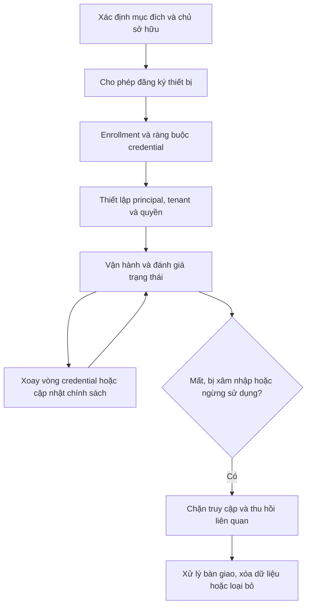

# Device

## Mục tiêu bài học

Trong IAM, thiết bị có thể là nơi người dùng đăng nhập, là phương tiện chứa authenticator hoặc là một chủ thể tự gọi API. Laptop của nhân viên, máy POS và cảm biến IoT đều liên quan đến truy cập, nhưng không nhất thiết được xác thực và cấp quyền theo cùng một cách.

**Device** là thiết bị vật lý hoặc môi trường thiết bị được hệ thống quản lý theo mô hình của mình. Khi tham gia luồng IAM, thiết bị có thể có danh tính riêng, trạng thái quản lý và quyền được giới hạn theo mục đích sử dụng.

Sau bài học này, bạn có thể:

- Phân biệt thiết bị với người dùng, workload và authenticator.
- Xác định khi nào device là chủ thể, ngữ cảnh hoặc tài nguyên được quản trị.
- Giải thích vì sao mã thiết bị và trạng thái “đã đăng ký” chưa chứng minh quyền truy cập.
- Mô tả vòng đời đăng ký, cấp credential, vận hành, thu hồi và ngừng sử dụng thiết bị.
- Kết hợp danh tính thiết bị với quyền người dùng và trạng thái bảo mật theo chính sách ít quyền nhất.

## 1. Thiết bị đóng vai trò gì trong một yêu cầu?

Một thiết bị có thể xuất hiện ở nhiều vị trí trong cùng hệ thống:

| Vai trò của device | Ý nghĩa | Ví dụ |
|---|---|---|
| Chủ thể truy cập | Thiết bị dùng credential riêng để yêu cầu một hành động | Cảm biến gửi dữ liệu đo lên API |
| Ngữ cảnh của người dùng | Trạng thái thiết bị là một đầu vào cho quyết định truy cập của người dùng | Nhân viên mở tài liệu từ laptop được quản lý |
| Nơi chứa authenticator | Thiết bị giữ hoặc vận hành phương tiện xác thực | Điện thoại chứa ứng dụng OTP hoặc passkey |
| Tài nguyên được quản trị | Một chủ thể khác yêu cầu cấu hình, khóa hoặc xóa dữ liệu thiết bị | Quản trị viên thu hồi quyền của laptop bị mất |

Không nên suy ra rằng mọi request từ điện thoại đều là request được cấp quyền cho principal của điện thoại. Khi người dùng thao tác trong ứng dụng, hệ thống thường cần danh tính người dùng, có thể kèm bằng chứng hoặc trạng thái của thiết bị.

Ngược lại, cảm biến gửi số đo tự động có thể được cấp quyền như một chủ thể máy, không có người dùng tương tác tại thời điểm đó.

### Principal thiết bị là biểu diễn trong hệ thống

**Principal** là biểu diễn chủ thể dùng để đánh giá quyền. Một principal thiết bị có thể gắn với một bản ghi đăng ký, một tenant, một chủ sở hữu và các credential đang có hiệu lực.

Quan hệ giữa thiết bị vật lý và principal cần được định nghĩa rõ. Một máy vật lý có thể chứa nhiều môi trường hoặc ứng dụng được tách biệt. Việc cài lại hệ điều hành, chuyển chủ sở hữu hay thay bộ phận phần cứng có thể yêu cầu đăng ký lại theo chính sách. Không mặc định một bản ghi phần mềm luôn chứng minh duy nhất một vật thể vật lý trong mọi hoàn cảnh.

## 2. Device, user, workload và authenticator khác nhau thế nào?

| Khái niệm | Đại diện cho điều gì? | Câu hỏi chính |
|---|---|---|
| User identity | Người sử dụng hệ thống | Ai đang thao tác và người đó được làm gì? |
| Device identity | Thiết bị hoặc đối tượng đăng ký thiết bị | Thiết bị nào đang tham gia, credential được gắn với bản ghi nào? |
| Workload identity | Dịch vụ, tiến trình hoặc tác vụ phần mềm | Thành phần phần mềm nào đang gọi và có quyền gì? |
| Authenticator | Phương tiện tạo bằng chứng xác thực | Bằng chứng nào được dùng để xác thực một chủ thể? |

Một laptop có thể chạy nhiều workload thuộc các nhóm khác nhau. Xác thực được laptop không có nghĩa mọi tiến trình trên nó đều được nhận quyền của mọi workload.

Điện thoại có passkey cũng không nhất thiết được ứng dụng quản lý như một device có quyền riêng. Đăng nhập bằng passkey xác thực tài khoản theo cơ chế đó; nó không tự chứng minh điện thoại đã được đăng ký vào hệ thống quản lý thiết bị của công ty. Một số credential có thể được đồng bộ giữa các thiết bị, nên cần hiểu đúng đặc tính của cơ chế đang dùng.

Tương tự, việc yêu cầu người dùng đăng nhập từ một thiết bị cụ thể không tự tạo thành MFA. Các yếu tố xác thực và cách ràng buộc bằng chứng phải được đánh giá theo cơ chế thực tế. Không chỉ đếm số lượng trường dữ liệu “user” và “device” trong request.

## 3. Định danh thiết bị không phải bằng chứng xác thực

Thiết bị thường có nhiều mã: serial, MAC address, tên máy, ID trong hệ thống quản lý hoặc ID mà ứng dụng tự tạo. Những giá trị này hữu ích để tìm bản ghi, nhưng có mức tin cậy khác nhau.

| Dữ kiện | Có thể hỗ trợ việc gì? | Điều không tự chứng minh |
|---|---|---|
| Serial hoặc mã tài sản | Đối chiếu thiết bị trong kho quản lý | Người gửi request đang kiểm soát thiết bị được đăng ký |
| MAC address, IP | Vận hành mạng và quan sát kết nối | Danh tính có thể tin cậy xuyên mọi mạng hoặc phiên |
| User-Agent, tên máy | Hiển thị hoặc phân tích ngữ cảnh | Thiết bị đã được quản lý hoặc còn an toàn |
| `deviceId` trong body | Chỉ ra bản ghi client muốn đề cập | Client có quyền hành động như device đó |
| Chứng chỉ cùng giao thức chứng minh sở hữu khóa | Xác thực theo quan hệ tin cậy đã cấu hình | Thiết bị không có mã độc hoặc được phép truy cập mọi dữ liệu |
| Attestation được kiểm tra đúng | Cung cấp bằng chứng về các đặc tính mà cơ chế attestation xác nhận | Mọi thành phần và hành vi sau đó đều an toàn |

Một client có thể gửi:

```json
{
  "deviceId": "device-42",
  "managed": true,
  "compliant": true
}
```

Nếu các giá trị do client tự khai, máy chủ không được coi chúng là bằng chứng có thẩm quyền. Nó phải xác thực credential phù hợp, ánh xạ sang device đã đăng ký và lấy trạng thái cần thiết từ nguồn được chấp nhận.

### Credential phải được ràng buộc với thiết bị

Một cơ chế có thể sử dụng cặp khóa và chứng chỉ. Trong kết nối mTLS, bên xác minh cần kiểm tra chứng chỉ theo trust profile phù hợp, hiệu lực, danh tính dự kiến và bằng chứng sở hữu khóa theo giao thức. Cách kiểm tra trạng thái thu hồi cũng cần được cấu hình theo thiết kế; không mặc định mọi thư viện tự kiểm tra đầy đủ.

Private key không được gửi cho máy chủ như một trường trong request. Chứng chỉ công khai có thể được trình bày, còn bằng chứng sử dụng khóa được tạo theo giao thức.

Nếu cùng một khóa bí mật được sao chép cho toàn bộ đội thiết bị, hệ thống khó phân biệt từng thiết bị và khó thu hồi riêng một thiết bị bị lộ. Khóa được bảo vệ bằng phần cứng có thể giảm khả năng trích xuất, nhưng vẫn cần xem xét việc kẻ tấn công sử dụng khóa qua một thiết bị đã bị kiểm soát.

## 4. Đã đăng ký, được quản lý và tuân thủ là các trạng thái khác nhau

Một thiết bị xuất hiện trong danh sách không có nghĩa nó đang được quản lý hoặc đáp ứng chính sách bảo mật hiện tại.

| Thuộc tính hoặc trạng thái | Cách hiểu |
|---|---|
| Registered — đã đăng ký | Có bản ghi và quan hệ nhận diện theo quy trình của hệ thống |
| Managed — được quản lý | Có quan hệ quản lý với nền tảng như MDM hoặc cơ chế quản trị tương ứng |
| Compliant — đáp ứng chính sách | Những kiểm tra được định nghĩa đã đạt tại thời điểm đánh giá |
| Attested — có bằng chứng attestation | Một số thuộc tính đã được xác nhận theo cơ chế, nguồn và thời điểm cụ thể |
| Active — được phép hoạt động | Trạng thái vòng đời cho phép thiết bị tham gia theo chính sách |

Các thuộc tính này không phải một chuỗi nâng cấp tự động. Thiết bị được quản lý vẫn có thể không tuân thủ chính sách; thiết bị tuân thủ hôm qua có thể không còn đạt hôm nay. Một kết quả attestation cũng chỉ có ý nghĩa trong phạm vi những gì nó thực sự xác nhận.

**Device posture** là tập dữ kiện về trạng thái thiết bị được dùng trong chính sách, chẳng hạn phiên bản phần mềm, trạng thái mã hóa hoặc kết quả đánh giá bảo mật. Từng dữ kiện cần có nguồn, thời điểm quan sát và giới hạn độ mới phù hợp.

```text
posture:
  device_id = device-42
  source = nguồn đánh giá được chấp nhận
  observed_at = thời điểm quan sát
  valid_until = giới hạn sử dụng theo chính sách
  result = các kết quả kiểm tra cụ thể
```

Không dựa vào timestamp do request tự khai để kết luận dữ liệu còn mới. Nguồn cung cấp posture và cách dữ kiện được ràng buộc với đúng device đều cần được kiểm tra.

Nếu một thao tác yêu cầu posture hợp lệ mà hệ thống không lấy được dữ liệu hoặc dữ liệu đã quá cũ, không tự chuyển trạng thái thành “an toàn”. Chính sách có thể từ chối, giới hạn chức năng hoặc yêu cầu cập nhật đánh giá tùy loại truy cập. Với dấu hiệu thiết bị bị xâm nhập, chỉ yêu cầu thêm OTP không tự khôi phục độ tin cậy của thiết bị.

## 5. Vòng đời danh tính thiết bị



### 5.1. Cho phép đăng ký

Trước enrollment, cần xác định ai được đăng ký thiết bị, thiết bị phục vụ mục đích gì và tenant hoặc môi trường nào được phép nhận nó.

Nếu dùng mã kích hoạt hoặc credential bootstrap, nó cần phạm vi, thời hạn và cơ chế chống tái sử dụng phù hợp. Một mã được dùng để bắt đầu đăng ký không nên trở thành credential dùng chung lâu dài cho toàn bộ thiết bị.

Không cho client tự chọn một tenant bất kỳ rồi nhận quyền của tenant đó chỉ bằng cách gửi tên tổ chức trong request. Quan hệ tenant phải được xác nhận qua quy trình cấp phát có thẩm quyền.

### 5.2. Enrollment và cấp credential

Enrollment thiết lập mối liên hệ giữa bản ghi thiết bị và bằng chứng mà hệ thống chấp nhận. Tùy môi trường, quy trình có thể dựa trên người quản trị, hệ thống quản lý tài sản, credential ban đầu hoặc attestation.

Cần lưu được quan hệ:

```text
Credential đã xác minh
  -> device principal
  -> tenant hoặc phạm vi môi trường
  -> chủ sở hữu chịu trách nhiệm
  -> quyền được cấp và mục đích sử dụng
```

ID của chứng chỉ hoặc dấu vân tay credential có thể thay đổi khi xoay vòng. Vì vậy, nên phân biệt bản ghi device ổn định với các credential được gắn vào nó theo thời gian.

### 5.3. Vận hành và xoay vòng

Thiết bị cần được cập nhật trạng thái, quyền và credential theo vòng đời. Nếu hỗ trợ khoảng chuyển tiếp giữa credential cũ và mới, thời gian đó phải được giới hạn và cả hai credential vẫn gắn đúng chủ thể.

Việc cấp credential mới không tự vô hiệu hóa credential cũ trừ khi cơ chế được triển khai như vậy. Cần xác định trạng thái nào được API, broker hoặc cổng truy cập thực sự kiểm tra.

### 5.4. Bàn giao hoặc ngừng sử dụng

Khi thiết bị đổi người sử dụng, tenant hoặc mục đích, phải rà soát membership, credential, dữ liệu và quyền còn tồn tại. Có thể cần đăng ký lại hoặc tạo principal mới theo mô hình của hệ thống.

Không để thiết bị chuyển sang khách hàng mới nhưng vẫn giữ quyền của khách hàng cũ. Lịch sử kiểm toán cần giữ đúng quan hệ tại thời điểm sự kiện, thay vì bị viết lại theo chủ sở hữu hiện tại.

## 6. Thiết bị và người dùng cùng tham gia quyết định truy cập

Trong ứng dụng dành cho nhân viên, yêu cầu có thể mang cả danh tính người dùng và ngữ cảnh thiết bị:

```text
user = principal-user-81
device = device-laptop-42
action = document:export
resource = tài liệu thuộc tenant A
context = phiên và dữ kiện thiết bị đã được xác minh
```

Một chính sách minh họa có thể yêu cầu:

```text
Cho phép xuất tài liệu khi:
  người dùng có quyền export trên tài liệu
  VÀ thuộc đúng phạm vi tenant
  VÀ phiên đáp ứng mức xác thực cần thiết
  VÀ thiết bị đáp ứng điều kiện áp dụng cho thao tác export.
```

Quyền người dùng không được thay bằng quyền thiết bị, và trạng thái thiết bị không được thay bằng vai trò của người dùng. Một laptop tuân thủ chính sách không làm nhân viên trở thành người được duyệt tài liệu. Người dùng có quyền duyệt cũng có thể bị hạn chế một thao tác cụ thể nếu thiết bị không đáp ứng yêu cầu của thao tác đó.

Quan hệ user–device có thể là nhiều–nhiều: một người dùng nhiều thiết bị; một thiết bị dùng chung phục vụ nhiều người. Không tự suy ra người đang thao tác chỉ từ trường “chủ sở hữu” trong danh sách tài sản.

### Thiết bị cá nhân và thiết bị dùng chung

BYOD là mô hình người dùng sử dụng thiết bị cá nhân. Quyền sở hữu tài sản không tự quyết định toàn bộ mức tin cậy: hệ thống cần xác định chức năng nào được phép, dữ kiện thiết bị nào thực sự cần thu thập và điều kiện nào áp dụng.

Với kiosk hoặc POS dùng chung, quyền của thiết bị phục vụ vận hành máy không tự thay thế danh tính nhân viên thực hiện nghiệp vụ. Nếu cần giải trình ai thực hiện giao dịch, phải có cơ chế nhận diện người thao tác phù hợp thay vì gán mọi hành động cho tài khoản máy dùng chung.

## 7. Ví dụ: cảm biến chỉ được gửi dữ liệu của chính nó

Một nền tảng quản lý tòa nhà có hai tenant. Cảm biến `device-42` thuộc tenant A, được cấp quyền gửi nhiệt độ cho khu vực Z-1. Nó không có quyền đọc hồ sơ nhân viên, gửi dữ liệu cho cảm biến khác hoặc điều khiển thiết bị chấp hành.

Thông tin có thẩm quyền của hệ thống:

```text
device_id = device-42
tenant_id = tenant-A
purpose = temperature-sensor
status = ACTIVE
permission = telemetry:publish cho chính device-42
```

Client gửi:

```json
{
  "deviceId": "device-42",
  "tenantId": "tenant-A",
  "temperature": 26.5
}
```

Máy chủ không tin `deviceId` và `tenantId` chỉ vì chúng trùng định dạng mong muốn. Nó xác thực credential rồi xác định device tương ứng từ nguồn có thẩm quyền.

Giả mã xử lý:

```text
function publishTelemetry(request):
    credentialIdentity = authenticateDeviceConnection(request.connection)
    device = resolveRegisteredDevice(credentialIdentity)

    requireDeviceActive(device)
    requireCredentialAllowedForDevice(credentialIdentity, device)

    payload = validateTelemetry(request.body)
    requireEqual(payload.deviceId, device.id)
    requireEqual(payload.tenantId, device.tenantId)

    requireDevicePolicyConditions(device, request.trustedContext)
    requirePermission(device.principalId, "telemetry:publish", device)

    persistTelemetry(device.tenantId, device.id, payload.temperature)
    recordDeviceAccessDecision(device, "telemetry:publish", "PERMIT")
```

Các hàm xác thực và kiểm tra điều kiện đại diện cho cơ chế được triển khai theo môi trường. `trustedContext` phải được máy chủ thiết lập từ nguồn đã kiểm tra, không phải một trường đặc biệt mà client có thể tự điền. Nếu cần posture, hàm kiểm tra phải xác nhận nguồn, liên kết với thiết bị và độ mới theo chính sách.

Nếu client sửa `deviceId` thành `device-99` hoặc tenant thành B, máy chủ phải từ chối. Một thiết kế khác có thể không nhận các trường đó từ client mà tự gắn từ device đã xác thực, qua đó giảm đầu vào dư thừa.

Ví dụ thể hiện cả RBAC và giới hạn theo thuộc tính: vai trò cảm biến cung cấp quyền gửi telemetry, còn điều kiện device, tenant và mục đích thu hẹp phạm vi. Từng cảm biến không cần quyền quản trị toàn nền tảng.

### Xác thực được cảm biến không bảo đảm số đo đúng

Credential hợp lệ cho biết request đáp ứng cơ chế xác thực được chấp nhận. Nó không chứng minh cảm biến chưa hỏng, chưa bị can thiệp hoặc số đo phản ánh chính xác thế giới vật lý. Kiểm tra dữ liệu, phát hiện bất thường và bảo đảm chất lượng đo là những trách nhiệm bổ sung.

Nếu nền tảng gửi lệnh xuống thiết bị, chiều nhận lệnh cũng cần xác thực nguồn lệnh và kiểm tra hành động được phép. Quyền publish telemetry không tự đồng nghĩa quyền phát lệnh điều khiển.

## 8. SSO, OAuth/OIDC và trạng thái thiết bị

SSO giúp người dùng tiếp cận ứng dụng trong một quan hệ tin cậy phù hợp. Nó không tự chứng minh mọi thiết bị mà người dùng sử dụng đều được quản lý hoặc đáp ứng chính sách.

Nếu hệ thống dùng claim về thiết bị trong token, cần biết bên phát hành có thẩm quyền cung cấp dữ kiện đó không, claim có ý nghĩa gì và còn đủ mới không. Chữ ký hợp lệ bảo vệ nguồn và tính toàn vẹn theo cơ chế được kiểm tra; nó không tự làm một thông tin posture cũ trở thành hiện tại.

Không mặc định mọi token OIDC đều có cùng claim thiết bị hoặc cùng ngữ nghĩa. Ứng dụng phải kiểm tra token đúng giao thức và ngữ cảnh, sau đó áp dụng chính sách của mình.

**OAuth device authorization grant** hỗ trợ tình huống người dùng cấp quyền cho ứng dụng trên thiết bị có hạn chế tương tác. Bản thân flow này không chứng minh phần cứng thiết bị là đáng tin, không thay thế enrollment và không tự tạo ra trạng thái managed hoặc compliant.

## 9. Thiết bị bị mất, bị xâm nhập hoặc mất kết nối

Khi laptop hoặc cảm biến bị mất, chỉ đổi mật khẩu người dùng có thể chưa đủ. Thiết bị có thể còn credential riêng, phiên đang mở hoặc token có hiệu lực.

Phạm vi xử lý có thể bao gồm:

- Vô hiệu hóa device principal hoặc chặn các hành động nhạy cảm.
- Thu hồi credential, token và phiên liên quan theo khả năng hệ thống.
- Cập nhật nguồn trạng thái, cache và các điểm thực thi như API hoặc broker.
- Đánh giá credential hay dữ liệu khác từng có mặt trên thiết bị.
- Khôi phục hoặc đăng ký lại sau khi thiết bị được xử lý theo quy trình.

Độ trễ thu hồi phụ thuộc cơ chế xác minh và các thành phần đang sử dụng thông tin cũ. Chứng chỉ hoặc token còn hạn có thể tiếp tục được chấp nhận nếu bên nhận không kiểm tra trạng thái thu hồi theo thiết kế. Việc đánh dấu “disabled” trong cổng quản trị cần được đối chiếu với hành vi thực tế của đường truy cập.

Thiết bị hoạt động ngoại tuyến cần chính sách riêng về dữ liệu lưu cục bộ, thời hạn quyền có thể dùng và cách đồng bộ khi kết nối lại. Không thể coi một thiết bị ngoại tuyến là đã nhận và thực thi ngay lệnh khóa từ máy chủ. Khi nhận dữ liệu sau thời gian gián đoạn, hệ thống cũng cần xử lý thời điểm sự kiện và trạng thái credential theo chính sách đã xác định.

## 10. Quản trị, kiểm toán và quyền riêng tư

Quyền enrollment, đổi tenant, cấp credential và gỡ trạng thái bị chặn đều là quyền nhạy cảm. Người được xem danh sách thiết bị không mặc nhiên được tạo credential mới hoặc khôi phục thiết bị bị vô hiệu hóa.

Đối với thiết bị có đặc quyền như máy vận hành hoặc thiết bị triển khai hệ thống, cần giới hạn quyền quản trị theo mục đích và bảo vệ quy trình khôi phục. Không bỏ kiểm tra chỉ vì thiết bị nằm trong mạng nội bộ.

Một sự kiện truy cập có thể cần ghi:

- Device ID ổn định và tham chiếu credential phù hợp, không ghi bí mật.
- User principal nếu có người dùng tham gia.
- Workload identity nếu cần phân biệt thành phần phần mềm gọi trực tiếp.
- Tenant, hành động, tài nguyên, kết quả và mã tương quan.
- Nguồn hoặc phiên bản đánh giá posture liên quan khi cần giải thích quyết định.

Không ghi private key, token, OTP hoặc cookie phiên vào log. Thông tin thiết bị có thể giúp theo dõi hoạt động cá nhân, đặc biệt với BYOD; cần giới hạn thu thập, quyền truy cập và thời hạn lưu theo mục đích của hệ thống.

## 11. Những tình huống cần tự phân tích

| Tình huống | Điều cần nhận diện |
|---|---|
| Client gửi `managed=true` rồi được mở tài liệu nhạy cảm | Dữ liệu tự khai bị coi là trạng thái có thẩm quyền |
| Chứng chỉ hợp lệ cho phép cảm biến đọc mọi tenant | Xác thực device bị nhầm thành quyền truy cập rộng |
| Nhân viên dùng máy POS chung nhưng mọi giao dịch chỉ ghi ID máy | Thiếu danh tính người thực hiện nếu nghiệp vụ cần trách nhiệm cá nhân |
| Một khóa chung được cấp cho toàn bộ cảm biến | Khó phân biệt thiết bị và thu hồi riêng khi có sự cố |
| Thiết bị đã đăng ký nhưng đánh giá bảo mật quá cũ | Registered không thay thế posture hiện tại |
| Khóa người dùng nhưng thiết bị vẫn gọi API bằng credential riêng | Vòng đời user và device chưa được xử lý theo từng đường truy cập |
| Thiết bị đổi tenant nhưng còn quyền cũ | Quy trình bàn giao chưa thu hồi đầy đủ quan hệ và credential |
| Đăng nhập bằng passkey được hiểu là laptop công ty đã compliant | Authenticator bị nhầm với quan hệ quản lý và trạng thái device |

Khi đưa device vào mô hình IAM, hãy xác định nó đang là chủ thể hay ngữ cảnh, bằng chứng nào nhận diện nó và nguồn nào chịu trách nhiệm về trạng thái. Sau đó giới hạn quyền theo mục đích, tenant và vòng đời, đồng thời giữ rõ danh tính người dùng và workload khi chúng cùng tham gia yêu cầu.
