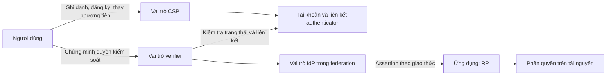
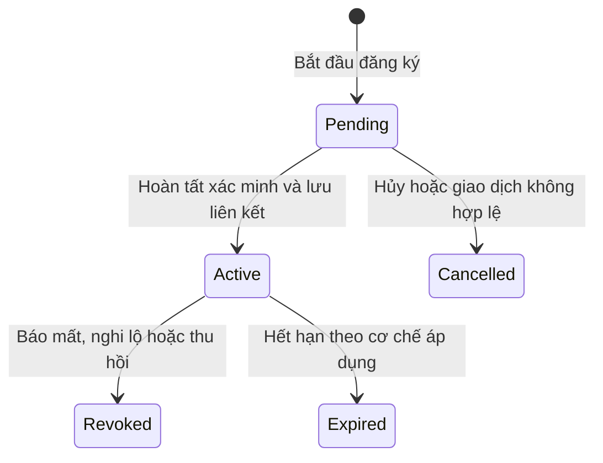

# Credential Service Provider

## Mục tiêu bài học

Trong chương **Actor và vai trò**, bài học này giải thích vai trò của Credential Service Provider trong hệ thống quản lý danh tính và quyền truy cập — IAM. Sau khi học, bạn có thể:

- Mô tả trách nhiệm của CSP từ ghi danh tới quản lý mối liên kết giữa tài khoản và phương tiện xác thực.
- Phân biệt credential, authenticator, bằng chứng danh tính và kết quả xác thực.
- Phân biệt CSP với verifier, Identity Provider, Relying Party và thành phần cấp quyền nghiệp vụ.
- Theo dõi các tình huống đăng ký, thêm phương thức xác thực, khôi phục và thu hồi.
- Nhận biết rủi ro khi tài khoản có phương tiện xác thực mạnh nhưng quy trình ghi danh, liên kết hoặc khôi phục yếu.

## 1. Credential Service Provider là gì?

**Credential Service Provider (CSP)** là một bên được tin cậy để quản lý việc ghi danh và đăng ký phương tiện xác thực cho tài khoản của người sử dụng dịch vụ danh tính. Trong mô hình NIST, trách nhiệm này bao gồm identity proofing theo yêu cầu, tạo subscriber account và liên kết authenticator với tài khoản. CSP có thể là một bên thứ ba hoặc một phần của hệ thống cung cấp dịch vụ. [NIST SP 800-63-4 — Digital Identity Model](https://pages.nist.gov/800-63-4/sp800-63/model/)

Câu hỏi trung tâm mà vai trò này phải giải quyết là:

> Tài khoản này đại diện cho chủ thể nào theo quy trình đã áp dụng, và những authenticator nào được công nhận là phương tiện đăng nhập của tài khoản đó?

Trong chương này, CSP là **Credential Service Provider**. Chữ viết tắt này không mang nghĩa Cloud Service Provider hay Content Security Policy.

### Ví dụ mở đầu

Công ty A cho nhân viên Lan sử dụng cổng hóa đơn. Trước lần đăng nhập đầu tiên, tổ chức cần tạo hoặc ghi danh tài khoản, kiểm tra điều kiện nhận tài khoản và đăng ký phương tiện xác thực cho Lan.

Giả sử Lan dùng một khóa xác thực mà thiết bị của Lan quản lý. Hệ thống cần kiểm tra quá trình đăng ký hợp lệ và lưu mối liên kết tới đúng tài khoản. Nếu kẻ tấn công có thể đăng ký khóa của họ vào tài khoản Lan, các lần kiểm tra chữ ký sau đó có thể vẫn đúng về mặt kỹ thuật nhưng người có quyền kiểm soát tài khoản đã bị thay đổi.

Ví dụ cho thấy bảo vệ đăng nhập không chỉ là chọn một thuật toán tốt. Cần bảo vệ cả việc ai được đăng ký, thay thế và thu hồi phương tiện xác thực cho tài khoản.

## 2. Các thuật ngữ cần phân biệt

Trong cách dùng thông thường, “credential” đôi khi chỉ mật khẩu, khóa API hoặc một tập thông tin đăng nhập. Khi đọc mô hình NIST, cần dùng nghĩa chính xác hơn: credential là cấu trúc gắn danh tính, thông qua định danh, với ít nhất một authenticator. Authenticator là phương tiện dùng để chứng minh quyền sở hữu hoặc kiểm soát yếu tố xác thực. [NIST SP 800-63B-4 — Glossary](https://pages.nist.gov/800-63-4/sp800-63b/glossary/)

| Đối tượng | Vai trò trong một ví dụ đăng ký khóa xác thực |
| --- | --- |
| Bằng chứng hoặc thông tin phục vụ kiểm chứng danh tính | Thông tin được kiểm tra để xác lập Lan là người đủ điều kiện nhận tài khoản theo quy trình |
| Subscriber account | Bản ghi dịch vụ danh tính dùng để quản lý Lan, thuộc tính liên quan và phương tiện đã đăng ký |
| Authenticator | Phương tiện mà Lan dùng để chứng minh khả năng sử dụng khóa xác thực |
| Thông tin liên kết credential | Bản ghi có thẩm quyền gắn tài khoản với phương tiện xác thực được chấp nhận |
| Authenticator output | Kết quả tạo ra cho một giao dịch xác thực, chẳng hạn phản hồi được ký trên một challenge |
| Phiên ứng dụng | Ngữ cảnh ứng dụng thiết lập và duy trì sau khi chấp nhận kết quả xác thực |

Các dòng trong bảng là những đối tượng khác nhau. Tệp ảnh giấy tờ không tự trở thành phương tiện đăng nhập. Một mã định danh người dùng không phải bằng chứng họ kiểm soát authenticator. Một phiên ứng dụng cũng không phải toàn bộ hồ sơ credential của CSP.

### CSP không nhất thiết giữ bí mật của mọi authenticator

Trong ví dụ dùng cặp khóa bất đối xứng do thiết bị quản lý, khóa riêng có thể nằm ở phía authenticator; bên kiểm tra sử dụng khóa công khai và dữ liệu đăng ký phù hợp. Không nên hiểu “CSP quản lý credential” thành “CSP phải lưu bản sao khóa riêng của mọi người dùng”.

Các loại authenticator có nhu cầu lưu trữ khác nhau. Thiết kế phải xác định dữ liệu nào là bí mật, dữ liệu nào dùng để kiểm tra và bên nào được phép đọc hoặc sử dụng chúng. Không thể áp một mô hình lưu trữ duy nhất cho mọi phương thức.

## 3. CSP, verifier, IdP và RP khác nhau thế nào?

Các vai trò dưới đây mô tả trách nhiệm logic. Một sản phẩm có thể thực hiện nhiều trách nhiệm hoặc phân chia chúng qua nhiều thành phần.

| Vai trò | Câu hỏi trọng tâm trong kiến trúc minh họa |
| --- | --- |
| CSP | Tài khoản nào đã được thiết lập, phương tiện nào được liên kết hợp lệ và trạng thái của chúng ra sao? |
| Verifier | Người đang đăng nhập có chứng minh được quyền kiểm soát authenticator hợp lệ của tài khoản không? |
| Identity Provider — IdP | Trong federation, kết quả xác thực và thông tin nào được cung cấp cho ứng dụng qua assertion? |
| Relying Party — RP | Ứng dụng có chấp nhận kết quả, nhận diện được principal và thiết lập truy cập theo chính sách của mình không? |
| Thành phần phân quyền nghiệp vụ | Principal đó có được thực hiện hành động trên tài nguyên cụ thể không? |

Trong federation, CSP quản lý tài khoản và thông tin liên quan, còn IdP làm cầu nối tới RP bằng assertion. Việc tách vai trò không bắt buộc chúng phải là những nhà cung cấp khác nhau. [NIST SP 800-63C-4 — Roles](https://pages.nist.gov/800-63-4/sp800-63c/Federation/#roles)

### Hai cách bố trí minh họa

**Trong một ứng dụng nhỏ:** cùng một backend có thể quản lý tài khoản, đăng ký phương thức xác thực, kiểm tra đăng nhập và cung cấp chức năng nghiệp vụ. Các vai trò vẫn cần được phân biệt để biết phần nào xử lý mất khóa, phần nào kiểm tra đăng nhập và phần nào bảo vệ hóa đơn.

**Trong kiến trúc liên kết:** tổ chức vận hành dịch vụ danh tính kết hợp CSP, verifier và IdP. Ứng dụng hóa đơn đóng vai RP, nhận kết quả theo giao thức và áp dụng quyền trên dữ liệu của mình.



Sơ đồ mô tả cách phân trách nhiệm trong một kiến trúc thông thường, không phải toàn bộ thông điệp của một giao thức. Đặc biệt, không nên suy ra mọi lần xác thực đều bắt buộc có lời gọi mạng đồng bộ tới một máy chủ CSP riêng.

### CSP không mặc nhiên là nơi cấp mọi quyền

Trong ví dụ hóa đơn, CSP có thể quản lý tài khoản Lan và phương tiện đăng nhập. Quyền đọc hóa đơn công ty A hay quyền duyệt một khoản tiền cụ thể còn phụ thuộc membership, vai trò, thuộc tính và quy tắc nghiệp vụ.

Nếu cùng một sản phẩm quản lý cả danh tính và vai trò, vẫn cần phân biệt hai loại thao tác. Đăng ký thêm khóa xác thực không nên làm Lan tự trở thành người duyệt hóa đơn. Thu hồi vai trò kế toán cũng không nhất thiết đồng nghĩa xóa toàn bộ tài khoản danh tính của Lan.

## 4. Ghi danh: từ người đề nghị tới tài khoản được quản lý

### 4.1. Identity proofing khác xác thực đăng nhập

Identity proofing nhằm kiểm chứng danh tính được khai theo quy trình đã chọn. Xác thực đăng nhập về sau kiểm tra khả năng kiểm soát phương tiện đã liên kết. Hai quá trình trả lời hai câu hỏi khác nhau. NIST SP 800-63A-4 tập trung vào quá trình proofing và enrollment. [NIST SP 800-63A-4 — Identity Proofing and Enrollment](https://csrc.nist.gov/pubs/sp/800/63/A/4/final)

Trong ví dụ công ty A, dữ liệu nhân sự và quy trình ghi danh có thể làm cơ sở để tạo tài khoản nhân viên. Nếu ứng dụng chỉ xác nhận người đăng ký kiểm soát một hộp thư, không nên mô tả kết quả đó như đã kiểm chứng đầy đủ mọi thông tin nhân viên hoặc thẩm quyền nghiệp vụ của họ.

Không phải mọi dịch vụ đều cần thu thập cùng loại bằng chứng cá nhân. Cần xác định nhu cầu và mức bảo đảm trước khi lựa chọn quy trình; không mặc định mọi tài khoản đều phải nộp giấy tờ hoặc dữ liệu sinh trắc học.

### 4.2. Một luồng ghi danh minh họa

1. Lan bắt đầu quy trình qua một kênh được chấp nhận, chẳng hạn lời mời hoặc cổng nhân viên.
2. Hệ thống xác định điều kiện ghi danh, thông tin cần kiểm tra và kết quả xử lý.
3. Dịch vụ danh tính tạo subscriber account hoặc gắn quy trình vào tài khoản phù hợp theo chính sách chống trùng.
4. Một authenticator được đăng ký và liên kết qua giao dịch hợp lệ.
5. Hệ thống hoàn tất trạng thái, ghi sự kiện và cung cấp thông tin cần thiết cho người sử dụng.

Đây là ví dụ phân rã trách nhiệm, không phải danh sách đầy đủ để công bố đáp ứng một mức bảo đảm cụ thể. Các lựa chọn về bằng chứng, ngoại lệ và kiểm tra phải được xác định theo bối cảnh triển khai.

### 4.3. Tài khoản không proofing phải được hiểu đúng

Một dịch vụ có thể hỗ trợ tài khoản chưa trải qua identity proofing, chẳng hạn danh tính giả danh, và cần ghi nhận rõ đặc điểm đó. Hồ sơ tài khoản không tự chứng minh danh tính ngoài đời chỉ vì có trường tên hoặc ngày sinh. [NIST SP 800-63A-4 — Subscriber Accounts](https://pages.nist.gov/800-63-4/sp800-63a/accounts/)

Ví dụ, tên hiển thị “Lan — Giám đốc tài chính” do người dùng nhập không thể được dùng như bằng chứng để cấp quyền duyệt hóa đơn. Nguồn và quy trình xác nhận thuộc tính quan trọng hơn hình thức hiển thị của trường dữ liệu.

## 5. Liên kết authenticator là một thao tác bảo mật

**Authenticator binding** tạo quan hệ giữa một authenticator cụ thể với subscriber account. Authenticator có thể do CSP cấp hoặc do người dùng cung cấp và được CSP chấp nhận; vì vậy, không nên đồng nhất binding với việc CSP sản xuất hoặc phát một thiết bị. [NIST SP 800-63B-4 — Authenticator Binding](https://pages.nist.gov/800-63-4/sp800-63b/events/#authenticator-binding)

### 5.1. Ba điều cần chứng minh trong một ví dụ thêm khóa

Giả sử Lan đang thêm một khóa xác thực mới. Thiết kế cần làm rõ:

- **Thẩm quyền thao tác:** giao dịch này có đủ cơ sở để thêm phương tiện vào đúng tài khoản Lan không?
- **Quyền kiểm soát phương tiện:** bên thực hiện có chứng minh được khả năng sử dụng phương tiện mới theo giao thức không?
- **Liên kết chính xác:** kết quả xác minh có được gắn vào chính tài khoản và giao dịch đã khởi tạo không?

Một giao dịch chỉ yêu cầu nhập `userId` rồi tải lên khóa công khai sẽ thiếu cơ sở về người có thẩm quyền đăng ký. Ngược lại, chỉ có phiên đăng nhập cũng chưa thay cho toàn bộ kiểm tra dành cho phương tiện mới.

### 5.2. Giả mã về phân chia trách nhiệm

```text
function bindNewAuthenticator(request):
    actor = requireVerifiedPrincipal(request)
    account = loadSubscriberAccount(actor.accountId)
    require(account.canManageAuthenticators)

    transaction = requireBoundRegistrationTransaction(request, account.id)
    requireRegistrationAuthorization(account, actor, transaction)

    result = authenticatorLibrary.verifyRegistration(
        request.registrationResponse,
        transaction.expectedContext
    )
    requireAuthenticatorAcceptedByPolicy(result, account)

    binding = persistVerifiedBinding(account.id, result)
    completeTransactionOnce(transaction)
    recordAuthenticatorChange(actor, account.id, binding.id)
    scheduleIndependentNotification(account.id, binding.id)

    return permittedBindingMetadata(binding)
```

Đây là mô hình minh họa, không phải mã triển khai giao thức hoặc tiêu chí đầy đủ của NIST. Các thao tác hoàn tất giao dịch và lưu liên kết cần tránh trạng thái nửa chừng hoặc bị sử dụng lại trái phép. Không nên tự viết phần kiểm chứng mật mã chỉ từ đoạn giả mã.

Điểm quan trọng là tài khoản đích được xác định từ ngữ cảnh đã kiểm chứng hoặc từ thẩm quyền quản trị rõ ràng, không phải tin một mã tài khoản do client tự chọn. Nếu quản trị viên thao tác cho người khác, actor và tài khoản đích phải được phân biệt trong quyền và nhật ký.

## 6. CSP cần quản lý những dữ liệu nào?

Mô hình dưới đây phân biệt các trách nhiệm dữ liệu, không bắt buộc ánh xạ thành đúng các bảng vật lý:

| Nhóm dữ liệu | Ví dụ trong kiến trúc minh họa | Mục đích |
| --- | --- | --- |
| Tài khoản thuê bao | Định danh nội bộ, trạng thái, thời điểm thiết lập | Tham chiếu tới đúng tài khoản qua vòng đời |
| Kết quả ghi danh | Quy trình đã hoàn tất, nguồn xác nhận, tham chiếu bằng chứng khi cần | Hiểu mức tin cậy và cơ sở quản lý danh tính |
| Thuộc tính được quản lý | Thông tin đã xác minh, nguồn cập nhật, mức được chia sẻ | Cung cấp dữ liệu phù hợp cho các bên được phép |
| Liên kết authenticator | Tài khoản, định danh phương tiện, loại và trạng thái | Xác định phương tiện nào còn được công nhận |
| Dữ liệu kiểm tra hoặc bí mật liên quan | Khóa công khai hoặc dữ liệu được bảo vệ theo loại phương thức | Hỗ trợ xác thực đúng cơ chế |
| Sự kiện vòng đời | Đăng ký, thay thế, báo mất, thu hồi, khôi phục | Truy vết các thay đổi quyền kiểm soát tài khoản |
| Thông tin hỗ trợ liên lạc và xử lý sự cố | Kênh đã được xác nhận theo quy trình | Thông báo và hỗ trợ khôi phục phù hợp |

Cần tránh hai cách thiết kế cực đoan: lưu mọi dữ liệu nhận được “để dùng sau”, hoặc chỉ giữ tên phương thức mà không có trạng thái và lịch sử thay đổi cần thiết. Một thiết kế phù hợp phải đủ để kiểm tra và quy trách nhiệm, đồng thời giới hạn dữ liệu cá nhân và bí mật được lưu.

### Dữ liệu minh họa không chứa bí mật

```text
SubscriberAccount
    accountId: subscriber-482
    status: ACTIVE
    identityRecord: tham chiếu kết quả ghi danh

AuthenticatorBinding
    bindingId: binding-91
    accountId: subscriber-482
    type: PUBLIC_KEY_AUTHENTICATOR
    status: ACTIVE
    verificationDataRef: tham chiếu dữ liệu kiểm tra
    boundAt: thời điểm đăng ký

AuthenticatorEvent
    actorId: subscriber-482
    targetBinding: binding-91
    eventType: BOUND
    transactionRef: tham chiếu giao dịch đã kiểm chứng
```

Tên trường và trạng thái trong ví dụ chỉ phục vụ diễn giải. Không phải mọi hệ thống dùng cùng loại kho lưu trữ hoặc cùng cách biểu diễn credential. Các API thông thường chỉ nên trả metadata cần thiết, không trả khóa bí mật hoặc dữ liệu khôi phục có thể sử dụng trực tiếp.

## 7. Vai trò của CSP trong một lần đăng nhập

Khi Lan đăng nhập, verifier kiểm tra bằng chứng từ authenticator và cần có cơ sở về liên kết với tài khoản còn hoạt động. CSP cung cấp hoặc quản lý phần thông tin nền tảng này; việc triển khai có thể dùng dữ liệu cục bộ hoặc thành phần tách biệt. [NIST SP 800-63-4 — Authentication Process](https://pages.nist.gov/800-63-4/sp800-63/model/#authentication-process)

Trong kiến trúc minh họa của công ty A:

1. Lan bắt đầu truy cập ứng dụng hóa đơn.
2. Dịch vụ xác thực đưa ra giao dịch phù hợp với phương thức đã đăng ký.
3. Authenticator của Lan tạo phản hồi cho giao dịch.
4. Verifier kiểm tra phản hồi, trạng thái và liên kết liên quan.
5. Nếu dùng federation, vai trò IdP phát hành kết quả theo quan hệ tin cậy với ứng dụng.
6. Ứng dụng kiểm chứng kết quả, nhận diện principal và áp dụng quyền trên hóa đơn.

CSP, verifier và IdP có thể nằm trong cùng một dịch vụ danh tính. Các bước trên được tách để thấy rõ trách nhiệm, không khẳng định phải có một lời gọi mạng riêng cho từng bước.

### Mối liên kết sai có thể làm xác thực đúng trở nên nguy hiểm

Nếu khóa của kẻ tấn công đã bị gắn sai vào tài khoản Lan, một phản hồi hợp lệ từ khóa đó có thể vượt qua kiểm tra mật mã. Verifier không thể tự sửa sai lầm ghi danh chỉ bằng cách kiểm tra chữ ký cẩn thận hơn.

Ngược lại, liên kết đúng cũng chưa đủ nếu verifier chấp nhận phản hồi không hợp lệ hoặc bỏ qua điều kiện giao thức. Độ tin cậy cần được duy trì từ ghi danh, đăng ký phương tiện tới xác thực và sử dụng kết quả.

## 8. Quản lý vòng đời authenticator

Việc đăng ký lần đầu chỉ bắt đầu vòng đời. Quản lý xác thực còn phải xét thay thế, mất, hỏng, nghi lộ, hết hạn và thu hồi phương tiện. Đây là một phần của phạm vi quản lý authenticator trong NIST SP 800-63B-4. [NIST SP 800-63B-4 — Authentication and Authenticator Management](https://pages.nist.gov/800-63-4/sp800-63b.html)

Bảng sau là các tình huống thiết kế cho hệ thống minh họa, không phải bản liệt kê đầy đủ yêu cầu tiêu chuẩn:

| Sự kiện | Câu hỏi hệ thống cần trả lời |
| --- | --- |
| Thêm phương tiện | Ai được phép thêm, vào tài khoản nào, giao dịch đã được ràng buộc chưa? |
| Thay phương tiện cũ | Phương tiện mới đã dùng được chưa, phương tiện cũ còn được chấp nhận đến khi nào? |
| Báo mất hoặc nghi lộ | Liên kết nào bị ảnh hưởng, cần dừng khả năng sử dụng và xử lý truy cập đã có thế nào? |
| Hết hạn theo cơ chế áp dụng | Có cần đăng ký thay thế, kiểm tra lại dữ liệu hay kết thúc liên kết không? |
| Đóng tài khoản | Phương tiện và phiên nào còn hiệu lực, dữ liệu nào cần lưu hoặc xóa theo chính sách? |

### 8.1. Trạng thái phương tiện và trạng thái tài khoản

Lan có hai phương tiện đăng nhập. Nếu một phương tiện bị mất, tài khoản có thể vẫn được sử dụng qua phương tiện còn lại theo chính sách. Điều này khác với tình huống tài khoản bị xác định đã bị chiếm quyền và cần dừng truy cập rộng hơn.

Một mô hình trạng thái liên kết minh họa:



Không phải mọi loại authenticator đều có thời hạn cố định hoặc dùng đúng các trạng thái này. Điểm cần giữ là hệ thống biết phương tiện nào được chấp nhận ở thời điểm hiện tại và không vô tình kích hoạt lại liên kết đã thu hồi.

### 8.2. Thu hồi phương tiện không tự kết thúc mọi phiên

Giả sử Lan báo mất khóa sau khi đã đăng nhập ở nhiều ứng dụng. Dừng chấp nhận khóa cho xác thực mới là một phần xử lý; những phiên, token và tác vụ đã được tạo có thể vẫn có vòng đời riêng.

Kiến trúc cần xác định sự kiện được truyền đến verifier, IdP và các ứng dụng ra sao, trạng thái được lưu đệm bao lâu và những phiên nào phải kết thúc. Không nên coi việc đổi một trạng thái trong cơ sở dữ liệu CSP là bằng chứng mọi đường truy cập đã bị chặn ngay.

Tương tự, nghỉ việc có thể yêu cầu chấm dứt membership hoặc tài khoản ứng dụng đích, ngay cả khi một phương tiện xác thực còn hợp lệ cho những dịch vụ khác. Thu hồi danh tính, phương tiện và quyền nghiệp vụ cần phối hợp theo đúng phạm vi.

## 9. Khôi phục tài khoản khác đăng nhập thông thường

Khôi phục xử lý tình huống người dùng không còn kiểm soát đủ authenticator để xác thực theo mức cần thiết. Phương thức và yêu cầu khôi phục phụ thuộc hồ sơ tài khoản và chính sách áp dụng; không thể thiết kế chỉ như một nút bỏ qua xác thực. NIST cũng phân biệt khôi phục với việc thay mật khẩu khi người dùng vẫn xác thực được bằng phương tiện khác. [NIST SP 800-63B-4 — Account Recovery](https://pages.nist.gov/800-63-4/sp800-63b/events/#account-recovery)

### Tình huống minh họa

Lan mất toàn bộ phương tiện đang dùng để đăng nhập theo yêu cầu của tổ chức. Bộ phận hỗ trợ nhận được một yêu cầu “xin bỏ MFA”. Nếu chỉ dựa vào việc người gọi biết tên, email hoặc số nhân viên, kẻ tấn công có thể giành quyền đăng ký phương tiện mới.

Quy trình cần xác định bằng chứng khôi phục được chấp nhận, người có thẩm quyền xử lý, cách đối chiếu với tài khoản có sẵn và cách phát hiện yêu cầu bất thường. Không nên tạo một tài khoản mới có cùng email rồi chuyển toàn bộ quyền sang đó mà không có cơ sở liên kết.

Một phương án thiết kế minh họa chia trách nhiệm thành:

- Tiếp nhận yêu cầu và xác định tài khoản đích theo quy trình được bảo vệ.
- Kiểm tra các điều kiện khôi phục đã được định nghĩa, xử lý ngoại lệ qua thẩm quyền rõ ràng.
- Đăng ký phương tiện thay thế bằng giao dịch hợp lệ sau khi đủ điều kiện.
- Xử lý phương tiện, phiên và quyền bị ảnh hưởng theo kết quả điều tra và chính sách.
- Ghi nhận sự kiện và gửi thông tin cần thiết để chủ tài khoản có thể phát hiện thay đổi trái phép.

Các bước này thể hiện cách phân rã công việc; chúng không tự tạo thành một phương thức khôi phục đạt mức bảo đảm cụ thể. Không nên mặc định “có nhân viên hỗ trợ tham gia” đồng nghĩa mức bảo vệ đã cao hơn một quy trình tự động.

## 10. Ba mặt bảo đảm không nên gộp làm một

Trong bộ hướng dẫn NIST, **IAL** liên quan đến identity proofing, **AAL** liên quan đến xác thực và **FAL** liên quan đến bảo vệ quá trình federation. Chúng mô tả các mặt khác nhau của chuỗi tin cậy. [NIST SP 800-63-4 — Assurance Levels](https://pages.nist.gov/800-63-4/sp800-63.html#assurance-levels)

| Góc nhìn | Câu hỏi để phân tích hệ thống minh họa |
| --- | --- |
| Danh tính được thiết lập | Cơ sở nào cho thấy tài khoản này gắn với người được khai theo quy trình cần thiết? |
| Xác thực hiện tại | Người đang thao tác chứng minh khả năng kiểm soát phương tiện đã liên kết ra sao? |
| Chuyển kết quả tới ứng dụng | Ứng dụng kiểm chứng nguồn, đối tượng nhận và giao dịch liên kết như thế nào? |

Ví dụ, Lan có khóa xác thực với cơ chế kiểm tra mạnh nhưng khóa đã được đăng ký vào sai tài khoản. Cải thiện giao thức xác thực không tự khắc phục sai sót liên kết ban đầu.

Ở một tình huống khác, tài khoản và phương tiện đều đúng, nhưng ứng dụng chấp nhận một kết quả đăng nhập được gửi sai bên nhận. Vấn đề nằm ở cách tiếp nhận kết quả qua ranh giới hệ thống.

Không nên tự công bố một mức AAL, IAL hoặc FAL chỉ vì sản phẩm có MFA, khóa công khai hay một loại token. Việc đáp ứng mức cụ thể cần xét đầy đủ điều kiện của quá trình tương ứng. Trong bài học này, các nhãn trên giúp phân tích trách nhiệm, không phải kết luận chứng nhận cho kiến trúc ví dụ.

## 11. CSP trong bức tranh IAM rộng hơn

### 11.1. MFA và lựa chọn phương thức

CSP quản lý những phương tiện đã được liên kết và thông tin cần thiết về chúng. Cấu hình đăng nhập và verifier phải sử dụng chúng đúng chính sách. Số lượng phương tiện đã đăng ký không bằng số yếu tố đã thực sự được dùng trong một lần xác thực.

Ví dụ, Lan đăng ký hai phương thức nhưng chỉ dùng một phương thức đơn yếu tố để đăng nhập. Không thể ghi nhận lần đăng nhập đó là MFA chỉ vì hồ sơ có hai dòng phương thức.

### 11.2. SSO, federation và OAuth/OIDC

Một dịch vụ danh tính có thể kết hợp các vai trò để cung cấp SSO. Trong tích hợp OIDC thông thường, vai trò IdP cung cấp kết quả đăng nhập cho ứng dụng; CSP hỗ trợ nền tảng tài khoản và phương tiện phía sau. OAuth giải quyết ủy quyền truy cập tài nguyên, còn OIDC cung cấp lớp danh tính trên OAuth.

Nếu gọi mọi thành phần là CSP, đội triển khai có thể không biết ai chịu trách nhiệm kiểm chứng token tại ứng dụng, ai quản lý phiên và ai xử lý thu hồi. Cần mô tả trách nhiệm theo hành vi thực tế, dù chúng nằm trong một sản phẩm.

### 11.3. RBAC, ABAC và ít quyền nhất

Sau xác thực, ứng dụng vẫn cần kiểm tra vai trò, membership, thuộc tính và tài nguyên. CSP xác nhận hoặc quản lý một thuộc tính không mặc nhiên cho thuộc tính đó quyền điều khiển mọi chính sách.

Chẳng hạn, thuộc tính phòng ban do người dùng tự sửa không nên trở thành đường tự cấp vai trò quản trị. Nguồn có thẩm quyền với tên hiển thị không nhất thiết có thẩm quyền với hạn mức phê duyệt hóa đơn.

### 11.4. Provisioning và danh tính workload

Tạo tài khoản ở ứng dụng đích, đồng bộ membership và cấp quyền là các trách nhiệm vòng đời truy cập có liên quan, nhưng không đồng nhất với đăng ký authenticator. Một đồng bộ tài khoản thành công không chứng minh mọi phương tiện xác thực đã được quản lý đúng, và ngược lại.

Mô hình CSP được trình bày ở đây tập trung vào danh tính con người. Với workload, cũng cần cơ chế liên kết bằng chứng với đúng chủ thể kỹ thuật, có chủ sở hữu và vòng đời thu hồi; không nên mặc nhiên coi mọi dịch vụ lưu khóa API là CSP theo đầy đủ mô hình trên.

## 12. Bảo vệ các đường quản trị credential

Các API hoặc giao diện thêm, thay và thu hồi phương tiện có thể làm thay đổi ai kiểm soát tài khoản. Chúng cần được đối xử như chức năng nhạy cảm.

| Rủi ro trong hệ thống ví dụ | Điểm kiểm soát cần làm rõ |
| --- | --- |
| Người dùng truyền tài khoản đích tùy ý khi đăng ký khóa | Ràng buộc tài khoản với principal hoặc thẩm quyền quản trị đã xác minh |
| Phản hồi đăng ký bị dùng cho giao dịch khác | Kiểm chứng ngữ cảnh và hoàn tất giao dịch theo cơ chế chống sử dụng lại |
| Phiên bị chiếm được dùng để thêm phương tiện mới | Chính sách xác thực bổ sung và điều kiện cho thay đổi nhạy cảm |
| Nhân viên hỗ trợ thay phương tiện ngoài phạm vi | Quyền quản trị giới hạn, phân tách actor và đối tượng đích, quy trình ngoại lệ có kiểm soát |
| Xóa phương tiện cuối cùng khiến người dùng mất truy cập | Xử lý rõ điều kiện kết thúc, thay thế hoặc chuyển sang khôi phục |
| Thu hồi đã lưu nhưng verifier vẫn dùng bản sao cũ | Xác định hiệu lực, làm mất bộ nhớ đệm và kiểm chứng đường truy cập |
| Hồ sơ hoặc log làm lộ bí mật | Giới hạn dữ liệu trả về, quyền đọc và dữ liệu được ghi nhận |

Những điểm trên là phân tích kiến trúc cho ví dụ. Một thư viện xác thực tốt không tự bảo vệ API quản trị nếu API đó bỏ qua quyền hoặc cho phép thay tài khoản đích bằng tham số.

Đặc biệt, quyền quản lý credential của người khác có thể trở thành khả năng chiếm quyền tài khoản. Người chỉ được xem hồ sơ không nên mặc nhiên được đặt lại phương tiện của người dùng có đặc quyền. Các thao tác khẩn cấp, nếu có, cần người chịu trách nhiệm và khả năng truy vết.

## 13. Kiểm toán và bảo vệ dữ liệu

Cần nối được những sự kiện quan trọng: tài khoản được ghi danh theo quy trình nào, phương tiện được đăng ký lúc nào, ai thực hiện thay đổi và khả năng sử dụng đã chấm dứt khi nào.

Ví dụ một sự kiện quản trị:

```text
actor: support-agent-19
target_account: subscriber-482
target_binding: binding-91
action: authenticator.revoke
reason: reported_loss
result: SUCCESS
transaction_ref: tham chiếu quy trình được chấp thuận
```

Ví dụ không bao gồm khóa riêng, token hoặc mã khôi phục. Actor thực hiện và tài khoản đích là hai trường khác nhau để tránh quy nhầm thao tác hỗ trợ cho chính người dùng.

Nhật ký nên phản ánh đúng kết quả: nhận yêu cầu thu hồi, lưu thay đổi và kiểm chứng hiệu lực là những sự kiện có thể khác nhau. Một log “đã nhận yêu cầu” không đủ chứng minh phương tiện đã bị mọi nơi từ chối.

CSP còn có thể giữ dữ liệu cá nhân nhạy cảm. Cần xác định người được đọc, mục đích sử dụng, phạm vi chia sẻ và việc lưu giữ hoặc xóa dữ liệu khi kết thúc tài khoản. Việc duy trì subscriber account và xử lý thông tin sau khi đóng tài khoản là các trách nhiệm được NIST đề cập trong quản lý tài khoản. [NIST SP 800-63A-4 — Subscriber Account Management](https://pages.nist.gov/800-63-4/sp800-63a/accounts/)

Không nên mặc định ứng dụng hóa đơn cần nhận bản sao toàn bộ hồ sơ proofing. Nếu chỉ cần định danh và một tập thuộc tính đã được chấp thuận, việc chia sẻ có thể được giới hạn ở mức đó theo thiết kế.

## 14. Ví dụ tổng hợp: đăng ký, sử dụng và mất phương tiện

Công ty A sử dụng một dịch vụ danh tính kết hợp vai trò CSP, verifier và IdP. Ứng dụng hóa đơn là RP và quản lý quyền nghiệp vụ riêng.

1. **Ghi danh Lan:** quy trình xác lập tài khoản theo nguồn và điều kiện được công ty chấp nhận. Membership tại công ty A được quản lý theo nhiệm vụ của Lan.
2. **Đăng ký phương tiện:** Lan hoàn tất giao dịch liên kết khóa xác thực với tài khoản. Dịch vụ ghi trạng thái và sự kiện, không lấy một khóa bất kỳ gắn vào mã tài khoản do client tự khai.
3. **Đăng nhập:** verifier kiểm tra bằng chứng từ phương tiện; IdP cung cấp kết quả cho ứng dụng theo giao thức; ứng dụng kiểm chứng và thiết lập phiên.
4. **Đọc hóa đơn:** API kiểm tra quyền đọc và công ty sở hữu hóa đơn. Kết quả đăng nhập không cho phép Lan đọc hóa đơn công ty khác.
5. **Báo mất khóa:** dịch vụ xử lý liên kết bị ảnh hưởng. Các phiên và phương tiện truy cập liên quan được xem xét theo chính sách sự cố, thay vì giả định đã chấm dứt tất cả.
6. **Đăng ký thay thế hoặc khôi phục:** hệ thống dùng quy trình tương ứng với khả năng xác thực còn lại của Lan, ghi được actor, tài khoản đích và kết quả.
7. **Chuyển nhiệm vụ:** quyền hóa đơn được thay đổi theo nghiệp vụ; việc này không tự làm mọi phương tiện xác thực của Lan mất hiệu lực ở mọi dịch vụ.

Trong từng bước, câu hỏi “phương tiện này được liên kết hợp lệ với tài khoản nào?” thuộc trách nhiệm cốt lõi của CSP. Câu hỏi “lần đăng nhập này chứng minh điều gì?” thuộc verifier và luồng xác thực. Câu hỏi “được làm gì với hóa đơn?” thuộc chính sách và nơi thực thi quyền của ứng dụng.

## 15. Các câu hỏi khi xác định vai trò CSP

Khi khảo sát một hệ thống, hãy tìm câu trả lời cụ thể:

- Ai ghi danh và tạo subscriber account; nguồn nào xác nhận từng thông tin danh tính?
- Ai có thể đăng ký, thay thế hoặc thu hồi authenticator, và việc đó được ràng buộc với tài khoản thế nào?
- Verifier lấy thông tin liên kết và trạng thái ở đâu; độ trễ cập nhật là bao nhiêu theo thiết kế?
- Khi mất phương tiện, user còn xác thực được bằng cách nào; khi nào phải chuyển sang khôi phục?
- Thu hồi phương tiện ảnh hưởng đến phiên, token và tài khoản ứng dụng đích như thế nào?
- CSP, IdP và RP chia sẻ những thuộc tính nào; bên nào vẫn chịu trách nhiệm kiểm tra quyền trên tài nguyên?
- Có thể truy ra actor, tài khoản đích, thay đổi đã thực hiện và hiệu lực thực tế mà không làm lộ bí mật không?

Trả lời các câu hỏi này giúp đặt CSP đúng vị trí trong IAM: bảo vệ nền tảng tài khoản và mối liên kết với phương tiện xác thực, phối hợp với xác thực, federation, vòng đời truy cập và phân quyền nghiệp vụ.
