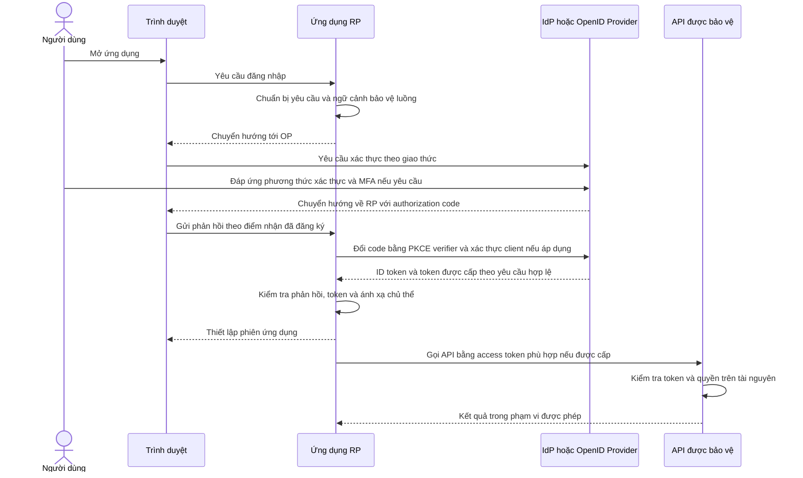

# Identity Provider

## 1. Identity Provider là actor nào trong IAM?

**Identity Provider — nhà cung cấp danh tính, viết tắt IdP** là hệ thống cung cấp kết quả xác thực và thông tin về chủ thể cho một bên tin cậy sử dụng. Trong đăng nhập liên kết, ứng dụng dựa vào bằng chứng do IdP phát hành để nhận biết người đang đăng nhập theo quan hệ tin cậy đã thiết lập.

Ví dụ, nhân viên mở ứng dụng hóa đơn. Ứng dụng chuyển người dùng sang hệ thống đăng nhập của tổ chức. Sau khi người dùng đáp ứng yêu cầu xác thực, hệ thống đó trả kết quả theo giao thức. Ứng dụng kiểm tra kết quả, ánh xạ chủ thể vào tài khoản của mình và thiết lập phiên.

IdP là một **vai trò trong kiến trúc**, không nhất thiết là một sản phẩm riêng hoặc một máy chủ duy nhất. Một nền tảng có thể đồng thời quản lý tài khoản, thực hiện xác thực và cung cấp dịch vụ liên kết danh tính. Một tổ chức cũng có thể sử dụng nhiều IdP cho nhân viên, khách hàng, đối tác hoặc các miền quản trị khác nhau.

Trong chương “Actor và vai trò”, IdP được nhìn nhận như một actor hệ thống có trách nhiệm và ranh giới tin cậy rõ ràng. Người quản trị IdP, người vận hành IdP, người dùng và ứng dụng nhận kết quả xác thực là các actor khác nhau.

Sau bài học, bạn có thể giải thích trách nhiệm của IdP, phân biệt nó với kho danh tính và authorization server, mô tả quan hệ với ứng dụng, đồng thời nhận ra những giới hạn của SSO và việc thu hồi truy cập.

## 2. Những thành phần thường bị nhầm với IdP

| Thành phần | Trách nhiệm chính | Quan hệ với IdP |
|---|---|---|
| Nguồn danh tính có thẩm quyền | Xác lập thông tin như quan hệ làm việc và trạng thái nhân sự | Có thể cung cấp dữ liệu vòng đời cho IdP |
| Directory hoặc kho người dùng | Lưu tài khoản, thuộc tính và quan hệ nhóm | Có thể là nguồn mà IdP sử dụng khi xác thực hoặc phát hành claim |
| IdP | Cung cấp kết quả xác thực và thông tin chủ thể theo quan hệ tin cậy | Là bên phát hành bằng chứng danh tính cho bên sử dụng |
| Relying Party hoặc Service Provider | Nhận và kiểm tra bằng chứng danh tính | Là ứng dụng tin cậy IdP theo cấu hình cụ thể |
| OAuth authorization server | Cấp token trong các luồng ủy quyền | Có thể cùng sản phẩm với IdP, nhưng vai trò không đồng nhất |
| Resource server | Bảo vệ API hoặc tài nguyên bằng chính sách truy cập | Kiểm tra access token và quyền tương ứng theo thiết kế |
| Dịch vụ provisioning | Tạo, cập nhật hoặc vô hiệu hóa tài khoản tại hệ thống đích | Xử lý vòng đời tài khoản, khác với việc đăng nhập |
| Dịch vụ quyết định quyền | Đánh giá chính sách cho một yêu cầu truy cập | Có thể sử dụng thuộc tính danh tính nhưng không được thay bằng việc xác thực đơn thuần |

Một directory chứa người dùng chưa tự trở thành IdP nếu không có cơ chế cung cấp kết quả xác thực theo giao thức và quan hệ tin cậy. Tương tự, một authorization server chỉ cấp access token cho ứng dụng không mặc nhiên cung cấp chức năng đăng nhập người dùng.

Trong OpenID Connect (OIDC), vai trò cung cấp dịch vụ xác thực được gọi là **OpenID Provider — OP**, còn ứng dụng sử dụng là **Relying Party — RP**. Trong SAML, các vai trò thường được gọi trực tiếp là **Identity Provider — IdP** và **Service Provider — SP**.

## 3. IdP chịu trách nhiệm về điều gì?

### 3.1. Xử lý xác thực trong phạm vi được quản lý

IdP có thể trực tiếp xác thực tài khoản cục bộ hoặc chuyển tiếp việc xác thực sang một nguồn danh tính khác được tin cậy. Cơ chế có thể bao gồm mật khẩu, passkey, MFA hoặc phương thức phù hợp với chính sách.

Nếu IdP quản lý phương thức xác thực, nó cũng phải quản lý việc đăng ký, thay đổi, vô hiệu hóa và khôi phục phương thức đó. Một bước đăng nhập mạnh có thể bị suy yếu nếu quy trình khôi phục cho phép người khác dễ dàng chiếm tài khoản.

Xác thực thành công thể hiện chủ thể đã đáp ứng cơ chế được áp dụng trong ngữ cảnh đó. Nó không tự chứng minh mọi thông tin ngoài đời thực của người dùng. Ví dụ, việc chứng minh kiểm soát một địa chỉ email không tự xác nhận chức vụ hoặc quyền phê duyệt của người đó.

### 3.2. Phát hành bằng chứng cho bên được phép nhận

IdP cung cấp bằng chứng theo giao thức, gắn với chủ thể, bên phát hành, bên nhận và các điều kiện hiệu lực cần thiết. Bên nhận phải kiểm tra bằng chứng trước khi sử dụng.

Không nên hiểu IdP chỉ là nơi trả về một JSON chứa tên người dùng. Nếu ứng dụng có thể chấp nhận dữ liệu tự khai mà không kiểm tra nguồn, ngữ cảnh và tính toàn vẹn, quan hệ tin cậy đã bị bỏ qua.

### 3.3. Quản lý phiên xác thực tại IdP

IdP thường duy trì phiên đăng nhập của riêng mình. Phiên này giúp hỗ trợ SSO: khi người dùng truy cập một ứng dụng khác, IdP có thể sử dụng ngữ cảnh xác thực hiện có nếu chính sách cho phép.

Ứng dụng vẫn có thể yêu cầu xác thực mới hoặc mức xác thực phù hợp cho thao tác nhạy cảm. Việc có phiên SSO không có nghĩa mọi yêu cầu sau đó đều được phép bỏ qua các điều kiện xác thực bổ sung.

### 3.4. Cung cấp thuộc tính và dấu vết liên quan

IdP có thể cung cấp định danh, một số thuộc tính hồ sơ hoặc thông tin ngữ cảnh xác thực mà ứng dụng đã được phép nhận. Claim là một phát biểu về chủ thể hoặc ngữ cảnh, không phải bằng chứng rằng ứng dụng có thể bỏ qua chính sách quyền của mình.

IdP cũng ghi nhận các sự kiện như đăng nhập, thất bại xác thực, thay đổi phương thức và phát hành bằng chứng theo khả năng hệ thống. Tuy nhiên, IdP thường không quan sát được mọi hành động nghiệp vụ diễn ra trong ứng dụng sau đăng nhập. Kiểm toán đầy đủ cần dữ liệu từ cả hai phía.

## 4. Quan hệ tin cậy giữa ứng dụng và IdP

### 4.1. Tin một IdP phải có phạm vi

Ứng dụng không nên chấp nhận mọi token có chữ ký hợp lệ ở đâu đó. Nó cần biết bằng chứng được phát hành bởi ai, dành cho ai và được sử dụng trong luồng nào.

Các thành phần thường cần xác định gồm:

| Thành phần | Câu hỏi cần trả lời |
|---|---|
| Bên phát hành | Ứng dụng chấp nhận chính xác miền danh tính nào? |
| Khóa hoặc metadata tin cậy | Dữ liệu kiểm tra tính toàn vẹn được lấy và cập nhật từ nguồn nào? |
| Bên nhận | Bằng chứng có thực sự được phát hành cho client hoặc tài nguyên này không? |
| Luồng và điểm nhận phản hồi | Kết quả được trả về đúng nơi đã đăng ký và đúng yêu cầu đang xử lý chưa? |
| Chủ thể | Định danh có ý nghĩa và tính ổn định trong phạm vi nào? |
| Thời hạn | Bằng chứng còn hiệu lực và đáp ứng điều kiện thời gian không? |
| Ngữ cảnh xác thực | Có đủ thông tin để đánh giá mức hoặc độ mới của xác thực khi cần không? |
| Tenant và loại tài khoản | Chủ thể thuộc miền được phép truy cập tài nguyên hay không? |
| Thuộc tính được sử dụng | Bên phát hành có thẩm quyền xác lập các thuộc tính đó không? |

Thông tin nguồn và khóa tin cậy cần được quản lý bằng cấu hình hoặc cơ chế khám phá đã được kiểm tra theo giao thức. Không lấy một địa chỉ khóa tùy ý từ dữ liệu người gọi gửi rồi coi mọi token kiểm tra được bằng khóa đó là đáng tin cậy.

### 4.2. Chữ ký hợp lệ chưa đủ để chấp nhận

Một token có thể có chữ ký hợp lệ nhưng được phát hành cho ứng dụng khác, từ miền không được chấp nhận hoặc đã hết hạn. Việc kiểm tra phải tuân theo loại token và giao thức đang sử dụng.

Tương tự, token từ môi trường thử nghiệm không nên được chấp nhận ở production chỉ vì cùng một đơn vị vận hành. Quan hệ tin cậy cần giữ đúng ranh giới môi trường và tài nguyên.

### 4.3. Định danh người dùng phải có nguồn

Trong OIDC, cặp bên phát hành và `sub` là dữ liệu quan trọng để nhận diện chủ thể trong ngữ cảnh token đã được kiểm tra. Một giá trị `sub` đứng riêng không phải định danh toàn cục cho mọi IdP.

Một số cấu hình dùng định danh khác nhau theo client hoặc nhóm client. Không nên giả định cùng một người luôn có cùng `sub` ở mọi ứng dụng, cũng không tự động hợp nhất tài khoản theo email để bù cho khác biệt đó.

Ứng dụng nên lưu ánh xạ rõ ràng giữa danh tính bên ngoài và tài khoản nội bộ ổn định. Việc tạo hoặc thay đổi ánh xạ là thao tác bảo mật vì nó có thể quyết định người nào nhận dữ liệu và quyền của một tài khoản đã tồn tại.

## 5. Ví dụ luồng OIDC với Authorization Code và PKCE

Một mô hình phổ biến là ứng dụng sử dụng luồng Authorization Code cùng PKCE. Sơ đồ dưới đây mô tả trách nhiệm ở mức khái niệm, không thay thế yêu cầu triển khai chi tiết của giao thức.

Một số điểm cần hiểu đúng:

- Authorization code là kết quả trung gian, không phải bằng chứng để ứng dụng tự giải mã thành danh tính.
- PKCE ràng buộc việc đổi code với dữ liệu đã chuẩn bị cho lần khởi tạo luồng đó; nó không thay thế mọi kiểm tra khác của giao thức.
- Ứng dụng cần bảo vệ và kiểm tra ngữ cảnh luồng, bao gồm các giá trị như `state` hoặc `nonce` khi được sử dụng theo thiết kế giao thức.
- Việc xác thực client phụ thuộc loại client. Không thể coi một bí mật được nhúng trong mã chạy công khai trên trình duyệt là bí mật chỉ client biết.
- RP phải kiểm tra ID token theo OIDC, gồm những điều kiện liên quan như bên phát hành, bên nhận, thời hạn và ngữ cảnh yêu cầu.
- Phiên ứng dụng chỉ được thiết lập sau khi các kiểm tra cần thiết đã thành công.

Nên dùng thành phần giao thức đã được kiểm chứng và cấu hình đúng thay vì tự triển khai việc xử lý token dựa trên thao tác giải mã chuỗi. Đọc được nội dung token không chứng minh token hợp lệ.

### Phân biệt ID token và access token

| Đối tượng | Mục đích | Bên sử dụng chính |
|---|---|---|
| ID token trong OIDC | Truyền kết quả xác thực và thông tin chủ thể theo giao thức | RP nhận kết quả đăng nhập |
| Access token | Cho phép truy cập tài nguyên theo phạm vi được cấp | Resource server bảo vệ API hoặc tài nguyên |
| Refresh token nếu được cấp | Xin token mới theo điều kiện của authorization server | Client được phép sử dụng nó |
| Cookie hoặc định danh phiên ứng dụng | Liên kết các yêu cầu với phiên tại ứng dụng | Ứng dụng quản lý phiên đó |

Không mặc định dùng ID token làm access token cho mọi API. API cần nhận loại bằng chứng mà nó được thiết kế để kiểm tra, với bên nhận và quyền phù hợp.

Access token cũng không nhất thiết có định dạng JWT. Một hệ thống có thể dùng token mờ và cơ chế kiểm tra trực tuyến, hoặc token tự chứa được xác minh theo cấu hình tin cậy. Cách xử lý không được suy ra chỉ từ việc token trông giống một chuỗi có thể giải mã.

## 6. IdP trong SAML và liên kết qua nhiều miền

### 6.1. IdP và Service Provider trong SAML

Trong SAML, IdP cung cấp assertion cho SP theo cấu hình liên kết. SP phải kiểm tra thông điệp và assertion theo giao thức, gồm những điều kiện liên quan như bên phát hành, tính toàn vẹn, bên nhận, thời hạn và ngữ cảnh yêu cầu.

Không nên chỉ đọc một trường tên người dùng trong thông điệp SAML rồi tạo phiên. Việc xử lý cần dùng thành phần hỗ trợ giao thức phù hợp, bởi tính đúng đắn của kiểm tra quan trọng hơn việc trích xuất được một thuộc tính.

Sau khi nhận assertion hợp lệ, SP vẫn ánh xạ tài khoản, thiết lập phiên và áp dụng quyền của mình. SAML không tự động giải quyết việc tạo hoặc vô hiệu hóa mọi tài khoản ở ứng dụng.

### 6.2. IdP cũng có thể dựa vào IdP khác

Một tổ chức có thể vận hành tầng trung gian nhận danh tính từ đối tác rồi phát hành kết quả cho ứng dụng nội bộ. Tầng này thường được gọi là identity broker hoặc federation broker tùy kiến trúc.

Ứng dụng nhận kết quả từ bên phát hành trực tiếp mà nó tin cậy. Bên trung gian phải chịu trách nhiệm kiểm tra bằng chứng đầu vào, ánh xạ chủ thể và truyền các thuộc tính hoặc mức bảo đảm đúng với chính sách.

Không nên mặc định mọi thuộc tính từ nguồn bên ngoài đều có cùng độ tin cậy như dữ liệu do tổ chức tự quản lý. Ví dụ, một đối tác được phép xác thực nhân viên của họ không có nghĩa họ được tự gán vai trò quản trị tài nguyên nội bộ của tổ chức tiếp nhận.

## 7. SSO và các vòng đời phiên độc lập

**SSO — Single Sign-On** giúp người dùng truy cập nhiều ứng dụng dựa trên phiên hoặc ngữ cảnh xác thực có thể sử dụng lại tại IdP. Ứng dụng vẫn có phiên riêng và các điều kiện truy cập riêng.

Một hệ thống có thể tồn tại đồng thời:

| Trạng thái hoặc đối tượng | Do bên nào quản lý? | Điều cần chú ý |
|---|---|---|
| Tài khoản tại IdP | IdP và quy trình vòng đời liên quan | Tài khoản bị vô hiệu hóa có thể ngăn xác thực mới |
| Phiên SSO | IdP | Kết thúc phiên này không mặc nhiên kết thúc mọi phiên ứng dụng |
| Phiên ứng dụng | Ứng dụng hoặc dịch vụ phiên | Có thời hạn, điều kiện và cơ chế thu hồi riêng |
| Grant và refresh token | Authorization server cùng client theo giao thức | Khả năng sử dụng tiếp phụ thuộc chính sách và cơ chế thu hồi |
| Access token đã phát hành | Bên phát hành và resource server theo thiết kế | Có thể tiếp tục được chấp nhận trong thời hạn còn lại |
| Tài khoản và quyền ở ứng dụng | Ứng dụng và quy trình cấp phát | Không tự biến mất khi người dùng không đăng nhập được ở IdP |

Vì vậy, cần phân biệt đăng xuất ứng dụng, đăng xuất ở IdP, thu hồi token và vô hiệu hóa tài khoản. Các cơ chế đăng xuất liên kết có thể hỗ trợ phối hợp, nhưng chỉ có hiệu lực trong phạm vi các bên đã triển khai và cấu hình tương ứng.

Thay mật khẩu hoặc đặt lại MFA cũng không tự chứng minh mọi phiên và token cũ đã mất hiệu lực. Khi cần thu hồi khẩn cấp, phải biết những đường truy cập nào được chặn ngay, những đường nào có độ trễ và cơ chế nào hỗ trợ chặn bổ sung.

## 8. IdP và quản lý vòng đời danh tính

### 8.1. Nguồn dữ liệu và trách nhiệm phải rõ ràng

IdP có thể nhận dữ liệu từ hệ thống nhân sự, directory, quy trình đối tác hoặc nguồn đăng ký khách hàng. Cần xác định nguồn nào có thẩm quyền với từng thông tin.

Ví dụ, hệ thống nhân sự xác nhận quan hệ làm việc; nhóm ứng dụng quyết định quyền nghiệp vụ; IdP sử dụng những thông tin được phép để áp dụng chính sách đăng nhập và phát hành claim. Không nên để một trường phòng ban do người dùng tự sửa trở thành nguồn tự động cấp quyền nhạy cảm.

### 8.2. Đăng nhập và provisioning là hai luồng khác nhau

Ứng dụng có thể tạo tài khoản khi người dùng đăng nhập lần đầu nếu được thiết kế như vậy. Cách này thường được gọi là cấp phát tại thời điểm đăng nhập. Nó vẫn cần chính sách xác định ai được tạo tài khoản, nhận quyền ban đầu nào và được ánh xạ ra sao.

Trong kiến trúc khác, một quy trình provisioning tạo tài khoản trước và đồng bộ trạng thái sau đó. SCIM là một giao thức có thể được dùng cho cấp phát, cập nhật tài khoản và nhóm khi các bên hỗ trợ.

Dù sử dụng cách nào, cần kiểm tra vòng đời sau đăng ký: chuyển vai trò, kết thúc hợp đồng, đóng tài khoản và quyền còn tồn tại. Bật SSO không tự động hoàn thành những việc này.

### 8.3. Thay đổi quyền và thu hồi có thể có độ trễ

Một claim nhóm hoặc vai trò được đưa vào token phản ánh dữ liệu tại thời điểm phát hành theo cách hệ thống tạo token. Nếu nhóm thay đổi sau đó, token cũ không nhất thiết tự thay đổi nội dung.

Ứng dụng và API cần quyết định cách cập nhật quyền: đọc trạng thái trực tuyến, dùng phiên hoặc token có thời hạn phù hợp, xử lý thông báo thay đổi hoặc áp dụng cơ chế thu hồi được hỗ trợ. Lựa chọn cần phản ánh rủi ro và yêu cầu vận hành của từng tài nguyên.

## 9. IdP hỗ trợ phân quyền nhưng không thay thế nó

IdP có thể cung cấp thuộc tính và thông tin vai trò, nhưng ứng dụng vẫn cần quyết định các hành động được phép trên tài nguyên cụ thể.

Giả sử ID token hợp lệ cho biết người dùng thuộc nhóm `finance`. Điều đó chưa đủ để kết luận người dùng được đọc mọi hóa đơn của mọi khách hàng. Ứng dụng còn cần kiểm tra tenant, quan hệ công việc, phạm vi dữ liệu và trạng thái tài nguyên theo chính sách.

| Thông tin nhận được | Có thể hỗ trợ điều gì? | Không nên tự suy ra |
|---|---|---|
| Định danh chủ thể | Ánh xạ về đúng tài khoản | Chủ thể có mọi quyền trong ứng dụng |
| Nhóm hoặc vai trò đã được quản lý | Đánh giá một phần chính sách RBAC | Tên vai trò có cùng ý nghĩa ở mọi ứng dụng |
| Thuộc tính tổ chức | Đánh giá điều kiện ABAC khi nguồn có thẩm quyền | Người dùng được truy cập mọi tenant có cùng tên tổ chức |
| Thông tin ngữ cảnh xác thực | Kiểm tra yêu cầu về mức hoặc độ mới xác thực | Mọi thao tác nhạy cảm đều được cho phép |
| Email đã xác minh | Hỗ trợ hồ sơ hoặc liên lạc trong phạm vi cơ chế xác minh | Người dùng là chủ tài khoản lịch sử trùng email hoặc có chức vụ đã khai |

RBAC tổ chức quyền theo vai trò; ABAC xét thêm thuộc tính và ngữ cảnh. Cả hai đều cần định nghĩa rõ nguồn dữ liệu và cách thực thi. Không nên tin một claim do client tự gửi nếu chưa có cơ chế kiểm tra hợp lệ.

Những giá trị về mức xác thực cũng cần có ý nghĩa đã thống nhất giữa các bên. Một chuỗi mang tên “MFA” không tự có cùng mức bảo đảm ở mọi nguồn danh tính.

## 10. Phạm vi với workload identity

Không chỉ con người cần bằng chứng danh tính. Một workload như dịch vụ, pipeline hoặc job có thể nhận bằng chứng từ môi trường thực thi và trao đổi nó lấy credential tạm thời ở hệ thống đích.

Trong các kiến trúc này, thuật ngữ nhà cung cấp danh tính workload có thể được dùng cho bên phát hành bằng chứng mà dịch vụ đích chấp nhận. Cần xem giao thức, loại bằng chứng và điều kiện tin cậy cụ thể; không mặc định đây là một phiên đăng nhập OIDC tương tác của con người.

Các câu hỏi quan trọng gồm:

- Bên phát hành chứng minh được điều gì về workload và nơi nó chạy?
- Bằng chứng dành cho đối tượng nhận nào?
- Repository, môi trường, namespace hoặc các thuộc tính nào thực sự được bảo đảm và kiểm tra?
- Workload nào được nhận vai trò và trong thời hạn nào?
- Quyền tại tài nguyên đích đã được giới hạn theo nhiệm vụ chưa?

Chỉ tin rằng bằng chứng đến từ một nền tảng CI quen thuộc là quá rộng nếu nhiều dự án không liên quan đều có thể lấy bằng chứng từ nền tảng đó. Quan hệ tin cậy cần giới hạn đúng nguồn và ngữ cảnh được phép.

MFA tương tác phù hợp với người quản lý cấu hình hoặc khởi chạy thao tác nhạy cảm; workload cần cơ chế nhận credential tự động phù hợp. Không dùng tài khoản cá nhân của người vận hành làm danh tính chạy dịch vụ chỉ vì tài khoản đó đã có SSO.

## 11. Vận hành IdP như một thành phần quan trọng

### 11.1. Bảo vệ quyền quản trị

Quản trị IdP có thể thay đổi phương thức xác thực, liên kết tài khoản, bên phát hành được chấp nhận hoặc dữ liệu dùng để cấp quyền. Một tài khoản quản trị bị xâm phạm có thể ảnh hưởng nhiều ứng dụng cùng tin cậy IdP đó.

Cần phân chia quyền theo nhiệm vụ, bảo vệ xác thực của quản trị viên, kiểm soát thay đổi nhạy cảm và ghi nhận hoạt động. Quyền hỗ trợ người dùng, đặt lại MFA, sửa client và quản lý khóa không nhất thiết phải thuộc cùng một vai trò.

Quyền triển khai mã hoặc điều khiển workload vận hành IdP cũng cần được xét như một đường đặc quyền. Không chỉ rà soát những tài khoản có nhãn quản trị trong giao diện.

### 11.2. Quản lý khóa và metadata tin cậy

Khóa ký hoặc vật liệu mật mã liên quan cần được bảo vệ, có vòng đời và quy trình thay đổi. Bên nhận phải có cách cập nhật dữ liệu kiểm tra từ nguồn tin cậy.

Khi xoay khóa bình thường, cần tính đến token hoặc bằng chứng đã phát hành và cách bên nhận lưu cache. Việc thay khóa ở IdP không bảo đảm mọi ứng dụng đã cập nhật ngay. Ngược lại, bỏ khóa kiểm tra quá sớm có thể làm các bằng chứng còn hợp lệ không dùng được ngoài dự kiến.

Khi khóa bị nghi xâm phạm, cách xử lý có thể khác với xoay khóa theo lịch. Cần biết khả năng ngừng chấp nhận bằng chứng liên quan ở các bên nhận và giới hạn của từng cơ chế. Không mặc định mọi resource server sẽ phản ánh thay đổi tức thời.

### 11.3. Tính sẵn sàng và hành vi khi lỗi

Sự cố IdP có thể ngăn đăng nhập mới hoặc khiến việc lấy token mới thất bại. Một số phiên ứng dụng hoặc access token còn hiệu lực có thể tiếp tục sử dụng được, tùy thiết kế.

API xác minh token tự chứa có thể tiếp tục hoạt động nếu đã có dữ liệu tin cậy cần thiết. API phụ thuộc kiểm tra token trực tuyến có thêm phụ thuộc vào dịch vụ kiểm tra. Mỗi lựa chọn có ảnh hưởng khác nhau đến tính sẵn sàng và tốc độ phản ánh thay đổi trạng thái.

Cần định nghĩa trước hành vi khi lỗi cho đăng nhập, xác thực bổ sung, làm mới token và thao tác nhạy cảm. Không bỏ kiểm tra xác thực hoặc phân quyền chỉ vì IdP tạm thời không sẵn sàng.

Nếu có phương án quản trị khẩn cấp, phải giới hạn mục đích, bảo vệ credential, lưu dấu sử dụng và kiểm tra khả năng phục hồi. Đường khẩn cấp không nên trở thành cách đăng nhập thông thường để đi vòng chính sách.

### 11.4. Kiểm toán và dữ liệu cá nhân

Nên có khả năng liên kết sự kiện ở IdP với phiên ứng dụng và hành động tại tài nguyên bằng các định danh phù hợp. Không ghi toàn bộ token, mật khẩu hoặc mã khôi phục vào log để phục vụ việc nối sự kiện.

Ứng dụng chỉ nên nhận các thuộc tính cần cho mục đích đã xác định. Phát hành toàn bộ hồ sơ và danh sách nhóm cho mọi client có thể làm tăng dữ liệu nhạy cảm bị chia sẻ và tạo phụ thuộc không cần thiết.

IdP có thể biết nhiều hoạt động đăng nhập của cùng người qua các ứng dụng. Vì vậy, quyền truy cập log, mục đích sử dụng và thời gian lưu cần được quản lý, không chỉ tập trung vào việc bảo vệ credential.

## 12. Ví dụ: nhân viên nghỉ việc nhưng còn phiên ứng dụng

Giả sử công ty có một IdP cho nhân viên và ứng dụng hóa đơn sử dụng OIDC. Quy trình provisioning duy trì tài khoản ứng dụng; API hóa đơn kiểm tra access token theo thiết kế riêng.

### 12.1. Trước khi nghỉ việc

Nhân viên đăng nhập qua IdP và đáp ứng MFA. Ứng dụng kiểm tra ID token, ánh xạ về tài khoản nội bộ, tạo phiên và áp dụng quyền trên hóa đơn. API kiểm tra access token dành cho mình cùng quyền trên tài nguyên.

### 12.2. Khi nguồn có thẩm quyền ghi nhận nghỉ việc

Quy trình vòng đời yêu cầu ngừng tài khoản ở IdP và ứng dụng. Tuy nhiên, connector cập nhật ứng dụng bị lỗi. Phiên ứng dụng vẫn tồn tại; một access token đã cấp còn thời hạn.

Nếu chỉ kết luận “đã khóa ở IdP nên không thể truy cập nữa”, tổ chức có thể bỏ sót các đường đang hoạt động. Cần xử lý riêng:

1. Xác nhận tài khoản tại IdP không được xác thực mới theo yêu cầu.
2. Xử lý phiên, grant và refresh token liên quan theo cơ chế được hỗ trợ.
3. Hoàn tất vô hiệu hóa hoặc hạn chế tài khoản tại ứng dụng.
4. Kết thúc phiên ứng dụng trong phạm vi cần thiết.
5. Xác định access token cũ còn được API chấp nhận đến khi nào và khả năng chặn bổ sung.
6. Xác minh kết quả ở các hệ thống đích, ghi rõ phần chưa hoàn tất.

Các hành động cụ thể phụ thuộc khả năng hệ thống và chính sách đã thiết kế. Mục tiêu là hiểu toàn bộ đường truy cập, không mặc định một thay đổi tài khoản sẽ tự lan đến mọi nơi ngay lập tức.

### 12.3. Trách nhiệm của các actor

Nguồn nhân sự xác lập sự kiện vòng đời. Nhóm quản trị IAM quản lý chính sách và tích hợp. Operator xử lý lỗi và xác minh kết quả theo phạm vi quyền. Nhóm ứng dụng chịu trách nhiệm về phiên và kiểm tra truy cập của ứng dụng. IdP thực hiện phần xác thực và phát hành bằng chứng trong phạm vi của mình.

Nếu nhân viên từng sở hữu một workload vẫn còn cần thiết, cần chuyển giao trách nhiệm và thu hồi quyền quản lý cá nhân. Workload nên có danh tính riêng; không nên phụ thuộc vào tài khoản đăng nhập của người đó.

## 13. Những hiểu nhầm thường gặp

| Hiểu nhầm | Cách hiểu đúng |
|---|---|
| “IdP là cơ sở dữ liệu users.” | Kho danh tính và dịch vụ cung cấp kết quả xác thực là các trách nhiệm khác nhau, dù có thể nằm cùng sản phẩm. |
| “Mọi OAuth server đều là IdP cho người dùng.” | Cấp access token không tự đồng nghĩa cung cấp đăng nhập hoặc kết quả xác thực người dùng. |
| “Token có chữ ký hợp lệ thì ứng dụng nào cũng dùng được.” | Phải kiểm tra bên phát hành, bên nhận, thời hạn và điều kiện của giao thức. |
| “ID token dùng để gọi mọi API.” | API cần loại bằng chứng, bên nhận và quyền phù hợp với thiết kế bảo vệ tài nguyên. |
| “Có SSO thì không cần quản lý tài khoản ứng dụng.” | Tài khoản, quyền và phiên tại ứng dụng vẫn có vòng đời riêng. |
| “IdP xác thực thành công nghĩa là có mọi quyền.” | Ứng dụng và API vẫn phải phân quyền trên hành động và tài nguyên. |
| “Khóa tài khoản IdP lập tức kết thúc mọi truy cập.” | Phiên và token ở các bên liên quan có thể còn hiệu lực theo thiết kế. |
| “Email giống nhau nghĩa là cùng tài khoản.” | Cần ánh xạ và bằng chứng được xác minh trong đúng phạm vi. |
| “IdP dự phòng nghĩa là lúc lỗi được bỏ kiểm tra.” | Tính sẵn sàng phải đi cùng hành vi khi lỗi đã thiết kế, vẫn bảo vệ truy cập. |
| “IdP ghi được toàn bộ hoạt động của người dùng.” | Hành động nghiệp vụ cần log từ ứng dụng và tài nguyên, cùng cơ chế liên kết phù hợp. |

## 14. Những câu hỏi cần trả lời trước khi tích hợp

Một tích hợp IdP có thể được đánh giá bằng các câu hỏi sau:

1. Ứng dụng chấp nhận chính xác bên phát hành, tenant và loại chủ thể nào?
2. Giao thức, loại token hoặc assertion và cách kiểm tra đã được xác định chưa?
3. Client, điểm nhận phản hồi và yêu cầu bảo vệ luồng được cấu hình ra sao?
4. Định danh bên ngoài được ánh xạ vào tài khoản nội bộ thế nào?
5. Những thuộc tính nào được tin cho hồ sơ, những thuộc tính nào được dùng để cấp quyền?
6. Ai tạo, cập nhật và vô hiệu hóa tài khoản ứng dụng?
7. Phiên và token có thời hạn, điều kiện làm mới và cơ chế thu hồi nào?
8. Khi người dùng chuyển nhiệm vụ hoặc nghỉ việc, việc thu hồi có hiệu lực tại đâu và sau bao lâu?
9. Khi IdP hoặc kênh đồng bộ lỗi, từng loại truy cập sẽ có hành vi gì?
10. Có thể liên kết sự kiện xác thực với hành động ứng dụng mà không làm lộ credential không?
11. Ai được sửa cấu hình tin cậy, client, phương thức khôi phục và khóa?
12. Các đường đăng nhập cục bộ hoặc ngoại lệ còn tồn tại được quản lý thế nào?

Danh sách này giúp làm rõ trách nhiệm và thiết kế. Việc người dùng đăng nhập thành công một lần chỉ chứng minh một phần nhỏ của tích hợp, chưa bao phủ phân quyền, vòng đời và sự cố.

## 15. Những điểm cần ghi nhớ

- IdP cung cấp kết quả xác thực và thông tin chủ thể cho bên tin cậy theo giao thức và phạm vi cụ thể.
- Directory, IdP, authorization server, dịch vụ provisioning và hệ thống phân quyền có thể cùng sản phẩm nhưng có trách nhiệm khác nhau.
- Bên nhận phải kiểm tra bằng chứng; chữ ký hợp lệ hoặc nội dung đọc được chưa đủ để chấp nhận.
- ID token, access token, refresh token và phiên ứng dụng phục vụ các mục đích khác nhau.
- SSO hỗ trợ trải nghiệm đăng nhập; tài khoản, quyền, phiên và token vẫn cần quản lý vòng đời.
- Claim chỉ có giá trị theo nguồn và ngữ nghĩa được tin cậy; ứng dụng vẫn thực thi quyền trên tài nguyên.
- Quản trị, khóa, khôi phục, tính sẵn sàng và kiểm toán của IdP cần được bảo vệ tương xứng với phạm vi ảnh hưởng.
- Thu hồi truy cập phải được xác minh xuyên các đường liên quan, thay vì chỉ dựa vào trạng thái tài khoản ở IdP.
