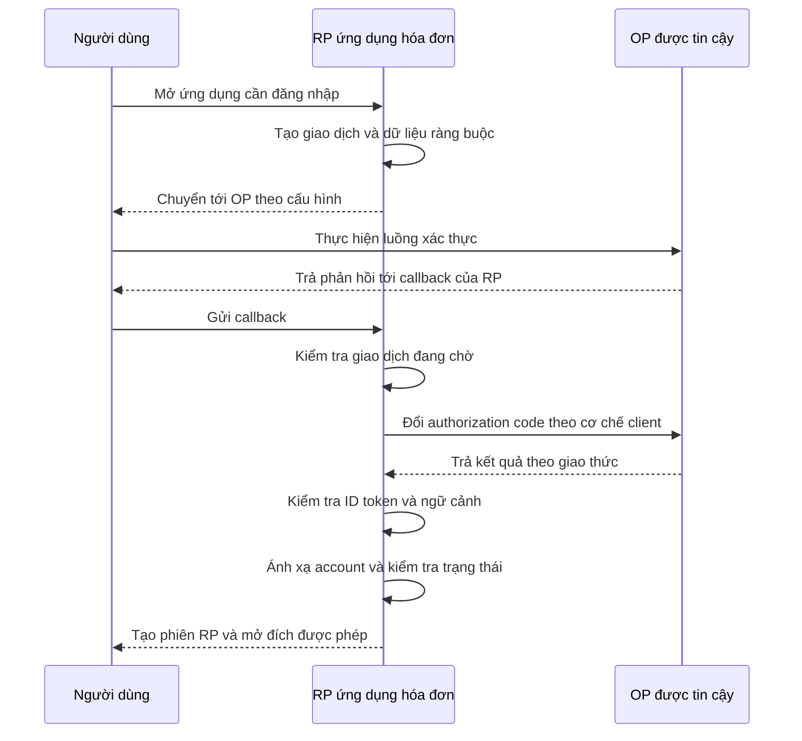

# Relying Party

Khi người dùng chọn “Đăng nhập bằng tài khoản công ty”, ứng dụng thường không trực tiếp kiểm tra mật khẩu hay điều khiển mọi bước MFA. Thay vào đó, ứng dụng chuyển người dùng tới hệ thống đăng nhập, nhận kết quả rồi quyết định có tạo phiên truy cập hay không.

Trong quan hệ đó, ứng dụng đóng vai trò **Relying Party**, thường viết tắt là **RP**: bên dựa vào kết quả xác thực hoặc khẳng định danh tính từ một bên được tin cậy để cung cấp dịch vụ.

“Dựa vào” không có nghĩa nhận gì cũng tin. RP phải thiết lập đúng quan hệ tin cậy, kiểm tra kết quả theo giao thức, ánh xạ đúng danh tính và tiếp tục chịu trách nhiệm về phiên cùng quyền truy cập tại ứng dụng.

Trong nền tảng IAM, hiểu vai trò RP giúp phân biệt SSO với cấp quyền, kết nối danh tính ngoài với account nội bộ và xác định trách nhiệm giữa ứng dụng, nhà cung cấp danh tính, API và người dùng.

## 1. RP là bên nào trong một lần đăng nhập?

### 1.1. Ví dụ ứng dụng hóa đơn dùng SSO

Lan mở ứng dụng hóa đơn của công ty:

1. Ứng dụng chưa có phiên của Lan.
2. Ứng dụng bắt đầu luồng đăng nhập với nhà cung cấp danh tính được cấu hình.
3. Lan hoàn tất xác thực tại bên đó.
4. Ứng dụng nhận và kiểm tra kết quả.
5. Ứng dụng ánh xạ danh tính ngoài vào account nội bộ.
6. Nếu đáp ứng điều kiện, ứng dụng tạo phiên và áp dụng quyền phù hợp.

Ở đây, ứng dụng hóa đơn là RP. Nó dựa vào kết quả xác thực bên ngoài nhưng vẫn quyết định Lan có được sử dụng ứng dụng và truy cập hóa đơn nào.

RP có thể là một ứng dụng web, ứng dụng di động hoặc loại client khác tùy giao thức và kiến trúc. Không phải mọi RP đều có backend giữ được bí mật theo cùng cách.

### 1.2. Thuật ngữ phụ thuộc giao thức

| Ngữ cảnh | Cách hiểu vai trò |
|---|---|
| Liên kết danh tính nói chung | RP sử dụng kết quả xác thực hoặc khẳng định danh tính theo quan hệ tin cậy |
| OpenID Connect, OIDC | RP là OAuth client sử dụng OIDC để xác thực người dùng và nhận thông tin về người dùng |
| SAML SSO | Vai trò Service Provider, SP, thường tương ứng với phía cung cấp ứng dụng và dựa vào assertion từ IdP |
| WebAuthn | RP là bên sử dụng WebAuthn để đăng ký hoặc xác thực credential trong phạm vi của mình |

Các cách dùng liên quan nhưng không đồng nhất toàn bộ cơ chế.

Ví dụ, RP trong WebAuthn không nhất thiết đang nhận một ID token từ một nhà cung cấp OIDC. Không nên lấy luồng của một giao thức áp vào mọi chỗ có từ “Relying Party”.

Bài học này tập trung vào RP trong liên kết danh tính và dùng OIDC làm ví dụ xuyên suốt.

### 1.3. RP là vai trò, không phải một sản phẩm riêng

Một hệ thống có thể đóng nhiều vai trò ở các quan hệ khác nhau.

Ứng dụng hóa đơn là RP khi dùng OIDC để đăng nhập. Cùng ứng dụng đó có thể là client khi gọi một API bằng access token. API của ứng dụng có thể là resource server khi nhận lời gọi được bảo vệ bằng token.

Một nền tảng cũng có thể nhận danh tính từ phía ngoài rồi cung cấp danh tính cho các ứng dụng phía trong. Khi đó, cần phân tích từng quan hệ tin cậy riêng, thay vì gọi toàn bộ nền tảng bằng một nhãn rồi giả định mọi token đều có cùng ý nghĩa.

## 2. Phân biệt RP với các actor liên quan

| Actor hoặc vai trò | Trách nhiệm chính trong ví dụ OIDC | Không nên đồng nhất |
|---|---|---|
| Người dùng | Thực hiện tương tác đăng nhập và sử dụng ứng dụng | Không phải mọi thông tin người dùng tự gửi đều đã được xác minh |
| OpenID Provider, OP | Cung cấp chức năng OIDC, xác thực người dùng theo cơ chế của mình và phát hành kết quả tương ứng | Không mặc nhiên quản lý mọi quyền nghiệp vụ trong RP |
| Identity Provider, IdP | Tên gọi rộng cho bên cung cấp danh tính/xác thực theo ngữ cảnh | Không phải mọi IdP đều dùng cùng giao thức |
| Relying Party, RP | Khởi tạo và kiểm tra luồng đăng nhập, ánh xạ danh tính, quản lý truy cập ứng dụng | Không phải API nào nhận token cũng là RP của luồng đăng nhập |
| OAuth authorization server | Cấp token theo luồng OAuth và chính sách của hệ thống | OAuth riêng lẻ không tự định nghĩa đầy đủ một kết quả đăng nhập OIDC |
| Resource server | Bảo vệ API hoặc tài nguyên và kiểm tra quyền truy cập | Không nên dùng ID token dành cho RP như access token của API |

Trong OIDC, OP đảm nhiệm các chức năng liên quan của hệ thống ủy quyền. Tuy vậy, trách nhiệm xác thực người dùng và trách nhiệm cấp quyền cho API vẫn cần được phân biệt về mặt thiết kế.

Cũng không nên coi `client_id` là danh tính người dùng. Nó nhận diện client trong quan hệ giao thức; người dùng được biểu diễn theo quy tắc khác, chẳng hạn `sub` tại issuer.

## 3. RP tin điều gì và chịu trách nhiệm điều gì?

### 3.1. Tin có phạm vi

Một quan hệ tin cậy có thể cho phép RP dựa vào OP để kết luận:

- Kết quả được phát hành bởi đúng nguồn đã cấu hình.
- Nó nói về một subject theo miền định danh của nguồn đó.
- Nó dành cho RP hoặc ngữ cảnh nhận tương ứng.
- Các thông tin xác thực và thuộc tính được diễn giải theo thỏa thuận phù hợp.

Quan hệ này không tự cho phép RP kết luận:

- Mọi người dùng tại OP đều được dùng ứng dụng.
- Subject có quyền quản trị nội bộ.
- Email là bất biến và có thể dùng thay identifier.
- Mọi thuộc tính đều đủ mới và đủ thẩm quyền cho mọi nghiệp vụ.
- Đăng xuất ở một nơi sẽ lập tức kết thúc mọi phiên ở mọi nơi.

Tin một OP để xác thực không có nghĩa giao toàn bộ quyết định bảo mật của ứng dụng cho OP.

### 3.2. Trách nhiệm thường thuộc RP

RP cần quản lý các phần như:

- Cấu hình nguồn danh tính được chấp nhận.
- Đăng ký client và địa chỉ callback phù hợp.
- Bảo vệ giao dịch đăng nhập và dữ liệu tạm.
- Kiểm tra kết quả theo giao thức.
- Liên kết danh tính ngoài với account.
- Quyết định tạo mới account hoặc từ chối khi chưa có liên kết.
- Kiểm tra trạng thái account và membership.
- Tạo, bảo vệ và chấm dứt phiên ứng dụng.
- Áp dụng RBAC, ABAC cùng điều kiện nghiệp vụ.
- Ghi nhận kiểm toán và xử lý thay đổi quyền.

Có thể dùng thư viện hoặc nền tảng để thực hiện nhiều phần, nhưng cần hiểu cấu hình và ranh giới trách nhiệm. Việc cài một thư viện đăng nhập không tự xác định chính sách account, tenant hay quyền của ứng dụng.

### 3.3. Nhà cung cấp danh tính và RP có owner khác nhau

Nhóm vận hành OP chịu trách nhiệm các phần của hệ thống xác thực mà họ quản lý. Nhóm ứng dụng chịu trách nhiệm dữ liệu, phiên và quyết định truy cập tại RP.

Ví dụ, OP có thể xác thực đúng Lan nhưng ứng dụng lại gán nhầm account do dùng email làm khóa liên kết không an toàn. Lỗi nằm ở bước ánh xạ của RP, không được giải quyết chỉ bằng việc bật MFA tại OP.

Ngược lại, RP kiểm tra đúng giao thức nhưng cần biết giới hạn của nguồn thuộc tính nếu dùng thuộc tính đó để cấp quyền. Cả hai phía phải có hợp đồng rõ về dữ liệu và cơ chế thay đổi.

## 4. Thiết lập quan hệ tin cậy trước khi đăng nhập

### 4.1. Cấu hình nguồn được chấp nhận

RP cần biết OP hoặc issuer nào được phép tham gia.

Thông tin có thể gồm:

- Identifier của issuer.
- Các endpoint theo giao thức.
- Nguồn khóa và cơ chế kiểm tra kết quả.
- Client ID, loại client và phương thức xác thực client nếu có.
- Callback đã đăng ký.
- Claim được sử dụng và ý nghĩa ánh xạ.
- Chính sách phiên, mức xác thực và liên kết account.

Không lấy một issuer tùy ý từ callback rồi tự động tin nguồn đó chỉ vì nó cung cấp metadata hoặc token có vẻ hợp lệ.

Trong hệ thống nhiều issuer, việc chọn issuer có thể là một phần của hành trình đăng nhập, nhưng kết quả phải được ràng buộc với cấu hình được chấp nhận và giao dịch đã khởi tạo.

### 4.2. Metadata và khóa cũng có ranh giới tin cậy

Metadata và bộ khóa giúp RP biết endpoint hoặc khóa kiểm tra token. Chúng cần được lấy từ nguồn gắn với cấu hình tin cậy theo giao thức.

Một token không được quyền tự chỉ định một URL khóa bất kỳ rồi buộc RP truy cập và tin URL đó. Các giá trị như key identifier hỗ trợ lựa chọn trong cơ chế đã được chấp nhận; chúng không thay thế việc xác định nguồn khóa.

Cần có cách cập nhật khóa, cache và xử lý chuyển khóa. Đồng thời, không để mọi token có key identifier lạ gây truy xuất không giới hạn tới nguồn bên ngoài.

### 4.3. Callback và địa chỉ quay lại có mục đích khác nhau

Callback, thường là `redirect_uri` trong OIDC, là nơi nhận kết quả giao thức theo đăng ký và kiểm tra tương ứng.

Địa chỉ người dùng muốn mở sau đăng nhập là trạng thái điều hướng của ứng dụng. Nó không nên trở thành một callback tùy ý hoặc một open redirect.

Ví dụ:

```text
Callback được đăng ký:
  https://invoice.example.test/login/callback

Đường dẫn sau đăng nhập:
  /invoices
```

RP cần kiểm tra đích điều hướng theo chính sách của ứng dụng. Không chuyển người dùng tới một URL bên ngoài tùy ý chỉ vì URL đó được gửi kèm ở đầu luồng.

## 5. Luồng OIDC minh họa từ góc nhìn RP

Ví dụ sau dùng authorization code flow với PKCE và các dữ liệu ràng buộc giao dịch phù hợp. Đây là mô hình để hiểu trách nhiệm, không phải hướng dẫn tự viết toàn bộ giao thức.

### 5.1. Khởi tạo một giao dịch đăng nhập

RP tạo bản ghi tạm cho một lần đăng nhập, gắn với ngữ cảnh trình duyệt hoặc client tương ứng.

Bản ghi có thể chứa:

```text
Issuer dự kiến
Cấu hình client được sử dụng
Callback được phép
State cho việc ràng buộc phản hồi
Nonce dự kiến trong kết quả xác thực
PKCE code verifier được bảo vệ
Thời hạn giao dịch
Đích điều hướng nội bộ đã kiểm tra
Trạng thái chờ xử lý hoặc đã sử dụng
```

RP gửi yêu cầu tới endpoint đã cấu hình. Nó không gửi mọi bí mật tạm ra ngoài theo cùng một cách: ví dụ, code challenge được dùng ở yêu cầu ủy quyền, còn code verifier được giữ để dùng khi đổi code.

Nếu RP là confidential client, credential xác thực client phải được bảo vệ ở nơi phù hợp. Ứng dụng public client không được coi một secret nhúng trong gói ứng dụng là bí mật mà mọi người dùng đều không thể lấy.

### 5.2. Người dùng xác thực tại OP

OP có thể sử dụng phiên đăng nhập sẵn có hoặc yêu cầu Lan thực hiện xác thực. Có thể có MFA hoặc điều kiện bổ sung theo chính sách.

RP không nên suy ra phương thức đã dùng chỉ từ việc giao diện OP từng hiện một màn hình. Nếu quyền truy cập yêu cầu mức xác thực cụ thể, RP phải kiểm tra dữ liệu ngữ cảnh được giao thức và hợp đồng tin cậy hỗ trợ.

### 5.3. Nhận callback và kiểm tra giao dịch

RP nhận phản hồi, xác định đúng giao dịch đang chờ và kiểm tra các ràng buộc tương ứng.

Không được coi mọi callback có `code` là một lần đăng nhập hợp lệ.

Cần xử lý các trường hợp như:

- Không tìm thấy giao dịch.
- Giao dịch hết hạn hoặc đã dùng.
- Phản hồi không khớp ngữ cảnh đã khởi tạo.
- Lỗi từ OP.
- Issuer hoặc cấu hình client không đúng với giao dịch.

Với nhiều OP, RP cần giữ được liên hệ giữa phản hồi và OP đã chọn. Không để callback làm ứng dụng đổi sang một nguồn khác ngoài ý định của giao dịch.

### 5.4. Đổi code và kiểm tra kết quả

RP thực hiện bước đổi authorization code theo cơ chế của client, sử dụng callback và PKCE verifier tương ứng.

Sau đó, thư viện hoặc thành phần giao thức kiểm tra kết quả, bao gồm ID token theo các quy tắc áp dụng.

Bước này phải hoàn tất trước khi tạo account link hoặc phiên đã xác thực. Một JSON được decode thành công chỉ là dữ liệu; nó chưa phải kết quả đăng nhập được tin cậy.

### 5.5. Ánh xạ account rồi tạo phiên của RP

Sau khi có kết quả hợp lệ, RP xác định subject bên ngoài, áp dụng chính sách liên kết và kiểm tra account nội bộ.

RP tạo ngữ cảnh phiên mới, xử lý phiên trước đó theo cơ chế chống session fixation và chuyển người dùng tới đích đã được kiểm tra.



Sơ đồ mô tả trường hợp RP có backend thực hiện bước đổi code. Client khác có thể có cách triển khai khác nhưng vẫn phải bảo toàn các ràng buộc giao thức tương ứng.

## 6. Những kiểm tra RP không được bỏ qua

### 6.1. State, nonce và PKCE có vai trò khác nhau

| Thành phần | Mục đích trong mô hình minh họa | Lưu ý |
|---|---|---|
| State | Ràng buộc phản hồi với giao dịch đã khởi tạo và hỗ trợ bảo vệ luồng callback | Phải được kiểm tra trong ngữ cảnh của giao dịch, không chỉ nhìn thấy field là đủ |
| Nonce | Ràng buộc ID token với yêu cầu xác thực và hỗ trợ chống sử dụng lại kết quả ngoài giao dịch dự kiến | Khi giao dịch yêu cầu nonce, phải kiểm tra giá trị tương ứng trong kết quả |
| PKCE | Ràng buộc việc đổi authorization code với bên giữ code verifier của giao dịch | Không thay việc kiểm tra issuer, token hoặc chính sách account |
| Client authentication | Chứng minh client với endpoint theo phương thức được cấu hình, khi áp dụng | Không tự chứng minh người dùng và không thay mọi ràng buộc giao dịch |

Các cơ chế có vai trò liên quan nhưng không phải ba tên cho cùng một việc. Cấu hình phải theo giao thức và thư viện đang sử dụng; không tự thay toàn bộ cơ chế bằng một chuỗi tùy ý gọi là “token chống giả mạo”.

Dữ liệu giao dịch cần thời hạn, bảo vệ và cơ chế sử dụng phù hợp để tránh việc một phản hồi cũ tiếp tục tạo phiên ngoài ý định.

### 6.2. ID token cần được kiểm tra theo cấu hình dự kiến

Các nhóm kiểm tra thường liên quan gồm:

| Nhóm | Câu hỏi cần trả lời |
|---|---|
| Nguồn phát hành | Issuer có đúng nguồn được giao dịch và cấu hình chấp nhận không? |
| Tính xác thực và toàn vẹn | Token có vượt qua cơ chế kiểm tra với thuật toán, khóa và nguồn tin cậy được phép không? |
| Bên nhận | Audience có phù hợp với client của RP không, và các quy tắc như `azp` có được kiểm tra khi áp dụng không? |
| Thời gian | Token còn hợp lệ và đáp ứng các quy tắc thời gian của giao thức, profile và chính sách không? |
| Ràng buộc giao dịch | Nonce và các điều kiện liên quan có khớp giao dịch đang xử lý không? |
| Subject | Có identifier hợp lệ để diễn giải theo issuer và loại kết quả không? |
| Yêu cầu xác thực | Kết quả có đáp ứng điều kiện về thời điểm hoặc mức xác thực mà RP thực sự cần không? |

Không chỉ kiểm tra một mục rồi bỏ các mục khác. Ví dụ, chữ ký hợp lệ nhưng token dành cho một client khác vẫn không phải kết quả đăng nhập của RP này.

Việc kiểm tra nên do thư viện giao thức phù hợp thực hiện theo cấu hình rõ ràng. Không nên tự xây bộ kiểm tra token bằng cách chỉ decode payload, xem email rồi tạo session.

### 6.3. Phân biệt các claim về thời gian và mức xác thực

Những dữ liệu như `iat`, `auth_time`, `acr` và `amr` không có cùng ý nghĩa:

- Thời điểm phát hành token không nhất thiết là thời điểm người dùng vừa xác thực lại.
- Thông tin thời điểm xác thực giúp đánh giá yêu cầu xác thực gần đây khi giao thức và luồng hỗ trợ.
- Mức hoặc lớp xác thực cần được diễn giải theo nguồn phát hành và hợp đồng áp dụng.
- Phương thức được ghi nhận không nên tự ánh xạ thành một quyền nghiệp vụ.

Nếu ứng dụng cần MFA cho thao tác nhạy cảm, không nên chỉ gửi yêu cầu mong muốn rồi giả định OP đã đáp ứng. RP cần kiểm tra kết quả theo cơ chế và chính sách được hỗ trợ.

Cũng không nên mặc định một chuỗi `acr` từ issuer A có cùng nghĩa với chuỗi giống hệt từ issuer B.

### 6.4. Kết quả lỗi không được tạo phiên một phần

Nếu kết quả không hợp lệ, RP không được tạo session dựa trên phần dữ liệu “có vẻ đúng” như email, tên hoặc `sub`.

Một luồng lỗi cần kết thúc an toàn, ghi nhận lý do cần thiết và cho phép bắt đầu lại theo thiết kế. Không tiếp tục dùng giao dịch cũ vô hạn hoặc chuyển lỗi kiểm tra thành “đăng nhập khách” nhưng vẫn giữ account đã đọc từ token.

Thông báo cho người dùng có thể đơn giản, còn log vận hành lưu mức chi tiết phù hợp và không chứa credential hay toàn bộ token.

## 7. Ánh xạ danh tính ngoài vào account nội bộ

### 7.1. Dùng định danh có phạm vi

Một liên kết minh họa:

```text
Issuer: https://login.example.test
Subject: user-19c
    ↓
Account nội bộ: account-2048
```

Trong OIDC, cặp `iss` và `sub` thường là căn cứ liên kết danh tính ngoài. Không dùng `sub` trần làm khóa toàn cục cho mọi issuer.

Không tự sửa identifier để ép chúng khớp, chẳng hạn chuyển đổi tùy ý hoa/thường hoặc bỏ một phần issuer mà không theo quy tắc của giao thức và nguồn danh tính.

Subject có thể khác nhau giữa những ngữ cảnh client theo cơ chế pairwise. Vì vậy, không giả định mọi RP sẽ thấy cùng một `sub` cho cùng một người.

### 7.2. Email và tên hiển thị không phải khóa liên kết mặc định

Email có thể thay đổi hoặc được tái cấp. Hai nguồn có thể đưa ra cùng email nhưng không có cùng mức xác minh hoặc thẩm quyền quản lý.

Ngay cả thông tin email đã xác nhận cũng chỉ hỗ trợ kết luận trong phạm vi quy trình xác nhận; nó không tự chứng minh quyền quản trị, quan hệ lao động hiện hành hoặc việc hai account phải được gộp.

Liên kết thêm một phương thức đăng nhập vào account có thể làm thay đổi bên có khả năng kiểm soát account. Vì vậy, đây là thao tác bảo mật cần quy trình sở hữu và kiểm tra phù hợp.

### 7.3. Chưa có account không có nghĩa phải tự động tạo

RP có thể áp dụng một trong các chính sách:

- Chỉ cho phép account đã được cấp phát.
- Tạo account khi đăng nhập theo điều kiện được phê duyệt.
- Yêu cầu lời mời hoặc membership trước.
- Chuyển tới quy trình đăng ký hoặc xét duyệt.
- Từ chối khi nguồn danh tính hoặc quan hệ không đáp ứng.

Cấp phát account khi đăng nhập, thường được gọi là just-in-time provisioning, cần quy tắc rõ về nguồn được chấp nhận, loại account, membership và quyền khởi tạo.

Không cấp role quản trị chỉ vì claim có giá trị `admin` nếu RP chưa tin nguồn đó cho mục đích cấp quyền tương ứng.

### 7.4. Giả mã ranh giới trách nhiệm

```text
function finishLogin(request):
    transaction = consumeBoundLoginTransaction(request)
    if transaction is missing or expired:
        rejectAndStop()

    result = oidcLibrary.completeAuthorizationCodeFlow(
        request = request,
        expectedIssuer = transaction.issuer,
        clientConfiguration = transaction.clientConfiguration,
        expectedRedirectUri = transaction.redirectUri,
        expectedNonce = transaction.nonce,
        pkceVerifier = transaction.pkceVerifier
    )

    if result is not valid:
        recordLoginFailureWithoutSecrets()
        rejectAndStop()

    externalIdentity = {
        issuer: result.validatedClaims.iss,
        subject: result.validatedClaims.sub
    }

    account = resolveAccountAccordingToProvisioningPolicy(externalIdentity)
    if account is missing or account.status != ACTIVE:
        denyAndStop()

    replaceSessionWithAuthenticatedContext(
        account,
        result.validatedAuthenticationContext
    )

    recordLoginSuccess(account, externalIdentity)
    redirectToValidatedInternalDestination(transaction.returnPath)
```

Đây là giả mã, không phải API của một thư viện cụ thể. Bước tiêu thụ giao dịch biểu diễn việc kiểm tra và sử dụng giao dịch theo cơ chế chống xử lý lại; một giao dịch thất bại có thể cần khởi tạo mới.

Mã cũng không có nghĩa mọi RP phải có cùng backend hoặc schema account. Nó làm rõ rằng kiểm tra giao thức phải đi trước việc tin danh tính, còn chính sách account phải đi trước việc tạo phiên ứng dụng.

## 8. RP vẫn phải cấp quyền tại ứng dụng

### 8.1. Đăng nhập thành công chưa đủ để truy cập dữ liệu

Sau khi Lan đăng nhập, ứng dụng hóa đơn cần kiểm tra những quan hệ như:

```text
Account nội bộ đang hoạt động
+ membership tại tenant của hóa đơn
+ quyền invoice.read trong phạm vi đó
+ điều kiện tài nguyên và ngữ cảnh
→ quyết định cho phép hoặc từ chối
```

OP có thể xác thực Lan hoàn toàn đúng, nhưng Lan không có membership tại tenant B. RP phải từ chối dữ liệu của tenant B dù phiên đăng nhập hợp lệ.

Một issuer được chấp nhận cho nhóm khách hàng cũng không tự có thẩm quyền tạo membership ở mọi tổ chức.

### 8.2. Claim chỉ trở thành đầu vào chính sách theo quy tắc rõ ràng

Nếu RP dùng role hoặc phòng ban từ bên ngoài, cần xác định:

- Nguồn nào được khẳng định giá trị đó.
- Giá trị có ý nghĩa gì trong ứng dụng.
- Nó áp dụng cho tenant hoặc phạm vi nào.
- Nó được cập nhật và thu hồi ra sao.
- Khi thiếu hoặc xung đột, chính sách xử lý thế nào.

Ví dụ, role `admin` từ tổ chức đối tác có thể chỉ có nghĩa quản trị trong tổ chức đó. Nó không mặc định là quản trị toàn bộ ứng dụng.

RBAC và ABAC của RP cần giữ phạm vi và nguồn dữ liệu. Không nhập mọi claim vào session rồi dùng chúng như những quyền đã được phê duyệt.

### 8.3. Phân biệt ID token, phiên ứng dụng và access token

| Thành phần | Mục đích chính | Không thay thế |
|---|---|---|
| ID token | Kết quả xác thực người dùng dành cho RP theo OIDC | Token truy cập mọi API |
| Phiên RP | Duy trì ngữ cảnh người dùng tại ứng dụng theo chính sách RP | Mọi phiên của OP hoặc các RP khác |
| Access token | Truy cập resource server theo phạm vi và điều kiện của token | Một kết quả đăng nhập OIDC tự động hợp lệ cho RP bất kỳ |
| Refresh token, khi được cấp | Cho phép yêu cầu token mới theo chính sách của hệ thống phát hành | Quyền vĩnh viễn hoặc bảo đảm account nội bộ còn được phép truy cập |

Nếu trình duyệt gửi request tới API, API cần cơ chế xác thực và cấp quyền đúng với thiết kế của nó. Không nhận một ID token chỉ vì token có tên hoặc email đúng.

Một ứng dụng có cả vai trò RP và resource server vẫn phải phân biệt loại bằng chứng, audience và chính sách tại từng điểm nhận.

## 9. Phiên và đăng xuất là trách nhiệm riêng của RP

### 9.1. Phiên OP và phiên RP là hai ngữ cảnh khác nhau

Phiên tại OP giúp người dùng đăng nhập vào các ứng dụng mà không cần nhập lại thông tin ở mọi lần chuyển ứng dụng, tùy chính sách.

Phiên tại RP quyết định cách người dùng tiếp tục sử dụng ứng dụng đó.

Hai phiên có thể có thời hạn và điều kiện khác nhau. Việc ID token từng hợp lệ tại lúc đăng nhập không có nghĩa phiên RP được phép tồn tại vô hạn. Ngược lại, thời hạn của một ID token cũng không tự định nghĩa toàn bộ vòng đời phiên ứng dụng.

RP cần chính sách rõ cho thời gian không hoạt động, thời hạn tuyệt đối, xác thực lại và thao tác nhạy cảm.

### 9.2. Bảo vệ phiên sau khi nhận danh tính

Với ứng dụng web dùng cookie, RP cần xem xét:

- HTTPS và cookie bảo mật.
- `Secure`, `HttpOnly` và `SameSite` theo chức năng và cách triển khai.
- Tạo hoặc thay ngữ cảnh phiên sau đăng nhập để tránh giữ nguyên khả năng truy cập từ phiên trước.
- Bảo vệ CSRF cho các thao tác phù hợp.
- Hủy phiên và xử lý dữ liệu phía client khi đăng xuất.
- Hạn chế lộ session identifier qua URL, log hoặc kênh không cần thiết.

Cấu hình cookie phải phù hợp luồng callback và cơ chế được thư viện hỗ trợ. Không đặt một giá trị máy móc rồi giả định mọi luồng đăng nhập đều hoạt động hoặc được bảo vệ.

Token chỉ cần dùng ở backend nên được giữ và bảo vệ trong phạm vi đó. Không phát toàn bộ token và claim ra trình duyệt chỉ để giao diện có thông tin hiển thị.

### 9.3. Đăng xuất có nhiều phạm vi

Cần phân biệt:

- Đăng xuất khỏi RP hiện tại.
- Kết thúc phiên tại OP.
- Thông báo hoặc xử lý kết thúc phiên ở các RP liên quan.
- Thu hồi token và quyền truy cập API đã cấp.

Một hành động không tự thực hiện toàn bộ các việc còn lại.

Nếu chỉ hủy phiên RP nhưng phiên OP vẫn còn, lần đăng nhập tiếp theo có thể hoàn tất mà không yêu cầu nhập lại credential, tùy chính sách OP. Nếu chỉ đăng xuất OP mà RP không nhận hoặc không xử lý cơ chế liên quan, phiên RP có thể vẫn còn.

Các cơ chế đăng xuất và thu hồi phải được hỗ trợ, cấu hình và vận hành theo kiến trúc cụ thể. Không hứa “đăng xuất mọi nơi ngay lập tức” chỉ vì ứng dụng có nút logout.

### 9.4. Cấp phát khi đăng nhập không thay thế thu hồi vòng đời

RP có thể tạo account khi nhận một kết quả đăng nhập hợp lệ. Nhưng người dùng nghỉ việc hoặc membership hết hạn có thể không đăng nhập lại trước khi tiếp tục dùng phiên đang có.

Vì vậy, ứng dụng cần cơ chế phù hợp để nhận hoặc kiểm tra thay đổi, chẳng hạn đồng bộ cấp phát, cập nhật trạng thái, kiểm tra hiện hành hoặc giới hạn độ cũ của phiên và quyền.

Cần trả lời rõ: sau khi thu hồi, phiên, token hoặc cache nào còn có thể được chấp nhận, và tối đa trong bao lâu?

## 10. Ví dụ những quyết định RP phải tự xử lý

### 10.1. Hai issuer trả cùng một email

RP hỗ trợ đăng nhập từ hai tổ chức. Cả hai kết quả có email `lan@example.test`.

**Cách suy luận:** hai danh tính ngoài vẫn được phân biệt theo nguồn và subject. RP không tự gộp account chỉ dựa vào email.

Nếu cần liên kết, phải có chính sách và bằng chứng phù hợp. Nếu không, một nguồn có thẩm quyền thấp hơn đối với email có thể trở thành đường đăng nhập vào account không thuộc quyền kiểm soát của nó.

### 10.2. Token hợp lệ nhưng dành cho client khác

Một ID token có chữ ký đúng và chưa hết hạn được phát hành cho một ứng dụng khác.

**Cách suy luận:** token đó không đáp ứng kết quả đăng nhập dành cho RP hiện tại. Kiểm tra chữ ký và thời hạn chưa đủ; cần kiểm tra bên nhận cùng các quy tắc ràng buộc áp dụng.

RP phải từ chối, không tạo phiên dựa trên việc email trông đúng.

### 10.3. Có SSO nhưng chưa có membership

Lan đăng nhập thành công nhưng chưa được mời vào tenant A.

**Cách suy luận:** xác thực bên ngoài hợp lệ không tạo membership nội bộ nếu chính sách không cho phép. RP có thể hiển thị luồng yêu cầu quyền hoặc từ chối truy cập theo thiết kế.

Không tự lấy tenant trong query string rồi gắn Lan vào tenant đó.

### 10.4. Thao tác yêu cầu xác thực gần đây

Lan đã có phiên RP từ trước nhưng muốn thực hiện một thao tác nhạy cảm.

**Cách suy luận:** RP xem xét điều kiện xác thực lại hoặc mức xác thực cần thiết. Nếu khởi tạo luồng bổ sung, phải kiểm tra kết quả có đáp ứng yêu cầu, thay vì chỉ nhận một token mới rồi coi như Lan vừa hoàn tất MFA.

Thời điểm token được phát hành không tự chứng minh người dùng vừa xác thực lại.

### 10.5. OP đã khóa người dùng nhưng phiên RP còn hoạt động

Tài khoản nguồn bị khóa sau lúc RP đã tạo phiên.

**Cách suy luận:** cần xem thiết kế thu hồi và cập nhật trạng thái. Khóa ở OP có thể ngăn lần xác thực tiếp theo nhưng không mặc nhiên chấm dứt mọi ngữ cảnh RP đã cấp.

RP phải áp dụng cơ chế và giới hạn độ trễ đã xác định, thay vì dựa vào việc “đã dùng SSO” như một bảo đảm thu hồi.

## 11. Kiểm toán và vận hành quan hệ tin cậy

### 11.1. Ghi nhận đủ để giải thích kết quả

Một sự kiện minh họa:

```json
{
  "event": "federated_login_accepted",
  "rp_client_ref": "invoice-web",
  "identity_issuer": "https://login.example.test",
  "identity_subject_ref": "user-19c",
  "local_account_id": "account-2048",
  "mapping_result": "existing_link",
  "session_action": "new_authenticated_context",
  "request_id": "request-71f",
  "occurred_at": "2026-10-01T08:00:00Z"
}
```

Đây là schema minh họa. Hệ thống có thể lưu tham chiếu khác phù hợp yêu cầu dữ liệu, miễn vẫn giải thích được nguồn danh tính và kết quả ánh xạ.

Cần phân biệt các nhóm lỗi như lỗi giao dịch, lỗi kiểm tra giao thức, account bị vô hiệu hóa và thiếu quyền tại ứng dụng. Chúng có nguyên nhân, owner và cách xử lý khác nhau.

### 11.2. Không biến log thành kho credential

Không ghi toàn bộ authorization code, code verifier, client secret, session cookie hoặc token chỉ để hỗ trợ gỡ lỗi.

Cũng không cần ghi mọi claim về người dùng vào mọi sự kiện. Identifier và các quan hệ ánh xạ vẫn có thể cho phép liên kết hoạt động, nên cần quyền truy cập cùng thời gian lưu phù hợp.

Dữ liệu đầu vào từ callback chưa được tin cậy cũng cần được xử lý theo cách không làm hỏng hoặc gây hiểu nhầm log.

### 11.3. Quản lý thay đổi cấu hình như thay đổi bảo mật

Những thay đổi sau có thể tác động trực tiếp tới bên có khả năng đăng nhập:

- Thêm issuer.
- Thay nguồn metadata hoặc khóa.
- Thay callback và client configuration.
- Đổi quy tắc liên kết account.
- Cho phép một claim cấp role hoặc membership.
- Đổi mức xác thực yêu cầu.
- Thay chính sách phiên và thu hồi.

Cần biết ai được thay, ai rà soát và cách phát hiện sai cấu hình.

Khi OP chuyển khóa, đổi cấu hình hoặc gặp sự cố, RP cần có cách quan sát và xử lý lỗi rõ ràng. Không khắc phục bằng việc bỏ kiểm tra issuer, audience, chữ ký hoặc thời hạn để “cho người dùng đăng nhập tạm”.

## 12. Những lỗi thiết kế thường gặp

| Lỗi | Hậu quả | Cách thiết kế phù hợp |
|---|---|---|
| Gọi mọi bên nhận token là RP với cùng cơ chế | Nhầm vai trò và loại bằng chứng | Xác định giao thức và vai trò tại từng ranh giới |
| Decode ID token rồi tin email | Tạo phiên từ dữ liệu chưa được kiểm tra | Hoàn tất kiểm tra giao thức trước khi ánh xạ |
| Chỉ kiểm tra chữ ký | Nhận kết quả sai issuer, client hoặc giao dịch | Kiểm tra toàn bộ điều kiện áp dụng |
| Tin issuer hoặc URL khóa tùy ý từ đầu vào | Mở rộng quan hệ tin cậy ngoài ý định | Giới hạn theo cấu hình và giao dịch đã chấp nhận |
| Gộp account theo email mặc định | Gắn nhầm phương thức đăng nhập | Liên kết bằng định danh có phạm vi và quy trình sở hữu |
| Xem SSO thành công là đủ quyền | Truy cập tenant hoặc chức năng chưa được cấp | Thực hiện authorization tại ứng dụng |
| Dùng ID token để gọi mọi API | Sai mục đích và bên nhận token | Dùng cơ chế truy cập phù hợp từng resource server |
| Giữ nguyên khả năng truy cập từ phiên trước | Tăng rủi ro session fixation | Tạo ranh giới phiên sau xác thực |
| Coi logout một nơi là logout mọi nơi | Phiên hoặc token khác tiếp tục có hiệu lực | Thiết kế rõ phạm vi đăng xuất và thu hồi |
| Dùng cấp phát khi đăng nhập thay toàn bộ deprovisioning | Quyền cũ còn tồn tại sau thay đổi | Quản lý vòng đời account, membership và phiên |
| Bỏ kiểm tra khi OP lỗi | Mở đường đăng nhập không đủ căn cứ | Xử lý lỗi theo chính sách, giữ ranh giới tin cậy |

## 13. Câu hỏi thiết kế cần trả lời được

1. RP đang dựa vào nguồn nào, theo giao thức nào và để kết luận điều gì?
2. Issuer, client, callback, metadata và khóa được quản lý từ đâu?
3. Phản hồi được ràng buộc với đúng giao dịch đăng nhập bằng cơ chế nào?
4. Thành phần nào kiểm tra token và các điều kiện giao thức áp dụng?
5. Danh tính ngoài được liên kết với account bằng identifier nào?
6. Khi chưa có account, chính sách tạo mới, lời mời hoặc từ chối là gì?
7. Role, membership và thuộc tính cấp quyền do nguồn nào quản lý?
8. Phiên RP có thời hạn, điều kiện xác thực lại và cách thu hồi ra sao?
9. Đăng xuất tác động tới RP, OP và token API trong phạm vi nào?
10. Khi nguồn danh tính hoặc quyền thay đổi, tối đa bao lâu ứng dụng cập nhật?
11. Log có phân biệt được lỗi xác thực liên kết, lỗi account và lỗi cấp quyền không?
12. Ai có thể thay quan hệ tin cậy và quy tắc ánh xạ?

## 14. Những điểm cần ghi nhớ

RP là bên sử dụng kết quả xác thực hoặc khẳng định danh tính theo một quan hệ tin cậy. Trong OIDC, RP là client sử dụng kết quả của OP để xác thực người dùng; nó không đơn giản là nơi đọc một token có thông tin cá nhân.

Trách nhiệm của RP bao gồm ràng buộc giao dịch, kiểm tra kết quả theo giao thức, ánh xạ danh tính và bảo vệ phiên. Định danh có phạm vi như issuer và subject giúp giữ đúng liên kết, trong khi email hoặc tên hiển thị không nên tự quyết định việc gộp account.

SSO giúp dùng chung cơ chế xác thực, nhưng quyền theo tenant, phiên ứng dụng, vòng đời account và kiểm toán vẫn cần được thiết kế rõ tại RP. Quan hệ tin cậy càng cụ thể, khả năng áp dụng ít quyền nhất và giải thích quyết định truy cập càng tốt.
