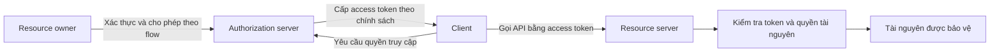

# Resource owner

## Mục tiêu bài học

Một người tạo tài liệu có thể được sửa và chia sẻ tài liệu đó. Tuy nhiên, tổ chức vẫn có thể cấm chia sẻ ra ngoài tenant hoặc giới hạn quyền xóa. Trong một luồng OAuth, người dùng có thể cho ứng dụng truy cập một phần tài nguyên của mình mà không trao mật khẩu cho ứng dụng.

Cả hai tình huống đều liên quan đến **resource owner**, nhưng nghĩa cụ thể của thuật ngữ phụ thuộc mô hình quyền và giao thức đang xét. Thiết kế IAM cần làm rõ ai có thẩm quyền cho phép truy cập, thẩm quyền đó giới hạn đến đâu và thành phần nào thực thi quyết định.

Sau bài học này, bạn có thể:

- Giải thích resource owner trong mô hình quyền ứng dụng và trong OAuth.
- Phân biệt owner với người tạo, người quản trị, người lưu giữ dữ liệu và người có quyền truy cập.
- Mô tả việc cấp quyền trực tiếp, ủy quyền cho ứng dụng và giới hạn chia sẻ.
- Thiết kế quan hệ ownership, chuyển giao và thu hồi mà không làm mất phạm vi tenant.
- Phân biệt các bên liên quan trong một sự kiện kiểm toán truy cập tài nguyên.

## 1. Resource owner là ai?

**Resource** là tài nguyên được bảo vệ: tài liệu, ảnh, lịch, bản ghi nghiệp vụ, API hoặc một tập dữ liệu. Hành động được bảo vệ có thể là đọc, sửa, xóa, chia sẻ, duyệt hoặc thực hiện một thao tác riêng của nghiệp vụ.

Trong mô hình quyền của ứng dụng, **resource owner** thường là chủ thể được xác định có trách nhiệm hoặc một tập quyền quản lý đối với tài nguyên. Owner có thể là người dùng, nhóm hoặc tổ chức theo thiết kế của ứng dụng. Tên gọi này không tự xác định mọi quyền; hệ thống phải mô tả rõ chính sách áp dụng.

Trong **OAuth 2.0**, resource owner là thực thể có khả năng cấp quyền truy cập đến một tài nguyên được bảo vệ. Khi resource owner là một người, thực thể đó thường được gọi là end-user. Đây là vai trò trong mô hình giao thức, không phải kết luận về quyền sở hữu pháp lý của dữ liệu.

Một ứng dụng có thể ánh xạ resource owner của luồng OAuth vào principal nội bộ, rồi sử dụng quan hệ ownership hoặc quyền nghiệp vụ để xác định phạm vi có thể cấp. Nhưng không nên mặc định hai cách dùng thuật ngữ luôn trùng nhau trên mọi tài nguyên.

### Ownership là quan hệ có ngữ nghĩa

Một trường như `owner_id=principal-801` chỉ có tác dụng khi chính sách nói rõ quan hệ đó cho phép những hành động nào. Nó không tự tạo ra quyền bằng cách xuất hiện trong cơ sở dữ liệu.

Ví dụ, “owner được đọc, sửa và mời người xem, nhưng không được chia sẻ công khai” là một chính sách cụ thể. “Owner được làm tất cả” dễ che giấu các giới hạn của tổ chức và khả năng cấp quyền gián tiếp.

## 2. Những khái niệm không nên gộp với resource owner

| Khái niệm | Ý nghĩa | Vì sao không luôn là owner? |
|---|---|---|
| Creator — người tạo | Chủ thể thực hiện hành động tạo tài nguyên | Quyền sở hữu có thể được gán cho nhóm hoặc chuyển giao sau đó |
| Administrator | Chủ thể quản trị một phạm vi hệ thống | Quyền quản trị không tự đồng nghĩa có quyền nghiệp vụ trên mọi tài nguyên |
| Data subject | Người mà dữ liệu đang mô tả | Quan hệ với dữ liệu không tự ánh xạ thành vai trò owner trong ứng dụng |
| Custodian — bên lưu giữ hoặc vận hành | Bên quản lý nơi lưu hoặc hạ tầng | Vận hành kho lưu không tự xác định quyền cấp truy cập nghiệp vụ |
| Người được cấp quyền | Chủ thể có một số hành động được phép | Được đọc hoặc sửa không nhất thiết được chia sẻ hay chuyển ownership |
| Người chịu trách nhiệm dịch vụ | Bên quản lý mục đích và vòng đời của dịch vụ | Không nhất thiết là principal thực thi lời gọi API của dịch vụ |
| OAuth client | Ứng dụng yêu cầu truy cập tài nguyên | Client thường là bên nhận quyền, không phải resource owner của dữ liệu người dùng |

Một actor có thể đảm nhận nhiều vai trò trong một tình huống. Mai có thể vừa tạo vừa là owner của tài liệu cá nhân. Trong một thư mục nhóm, Mai có thể là creator còn nhóm mới là owner theo mô hình sản phẩm.

Cũng cần phân biệt **người chịu trách nhiệm phê duyệt truy cập** với **quan hệ owner dùng trực tiếp trong bộ đánh giá quyền**. Một tổ chức có thể chỉ định data owner xét duyệt yêu cầu, còn quyền thực tế được thực thi bằng vai trò, nhóm hoặc policy. Người xét duyệt không nhất thiết được đọc toàn bộ dữ liệu đó thường trực.

## 3. Thẩm quyền của owner phải có giới hạn

Resource owner không nằm ngoài chính sách IAM. Hệ thống vẫn cần xác thực owner, kiểm tra trạng thái tài khoản và đánh giá hành động trên tài nguyên cụ thể.

Một chính sách có thể giới hạn theo:

- **Hành động:** được đọc và sửa nhưng không được xóa tài nguyên đã khóa.
- **Đối tượng nhận quyền:** chỉ chia sẻ cho thành viên được chấp thuận.
- **Tenant hoặc dự án:** quyền chỉ áp dụng trong phạm vi tương ứng.
- **Thời gian:** quyền chia sẻ có ngày hết hạn.
- **Loại dữ liệu:** tài liệu nhạy cảm không được chia sẻ công khai.
- **Ngữ cảnh:** thao tác quan trọng yêu cầu xác thực gần đây hoặc phê duyệt bổ sung.

Ví dụ, Mai là owner của tài liệu thuộc tenant A. Điều đó không cho Mai chuyển tài liệu sang tenant B nếu chính sách không cho phép. Đăng nhập SSO thành công hoặc hoàn thành MFA cũng không tự mở rộng thẩm quyền của Mai.

### Quyền sử dụng không tự bao gồm quyền cấp lại

Một người được cấp `document:read` không mặc nhiên được cấp lại quyền đọc cho người khác. Tương tự, quyền sửa nội dung không nhất thiết bao gồm quyền đổi owner.

Cần định nghĩa riêng quyền chia sẻ hoặc ủy quyền:

```text
Ai được cấp quyền truy cập?
  -> Cho principal hoặc ứng dụng nào?
  -> Những hành động nào được cấp?
  -> Trên tài nguyên hoặc tập tài nguyên nào?
  -> Trong thời hạn và điều kiện nào?
  -> Có cho phép bên nhận tiếp tục cấp lại không?
```

Trong nhiều thiết kế, quyền có thể cấp được giới hạn bởi giao của thẩm quyền owner, phạm vi ứng dụng được phép yêu cầu và chính sách tổ chức. Không chỉ kiểm tra owner hiện có quyền gì rồi mặc định được chuyển toàn bộ quyền đó cho mọi bên nhận.

## 4. Biểu diễn ownership tách khỏi quyền truy cập

Một mô hình khái niệm có thể gồm:

```text
Resource
  resource_id
  tenant_id
  resource_type
  classification
  status

OwnershipRelation
  resource_id
  owner_principal_id
  owner_kind
  status

AccessGrant
  grant_id
  resource_scope
  grantee_principal_id
  allowed_actions
  granted_by
  valid_until
  status
```

Đây là ví dụ phân chia trách nhiệm, không phải lược đồ bắt buộc. Nếu owner là nhóm, hệ thống cần xác định thành viên nào của nhóm được thực hiện từng hành động; không mặc định mọi thành viên đều được chuyển ownership.

Một tài nguyên có thể có một owner, nhiều co-owner hoặc thuộc một phạm vi tổ chức thay vì cá nhân. Mô hình phải quy định cách xử lý khi không có owner hoạt động và ai được phép khôi phục quan hệ này.

Các liên kết nên dùng định danh principal ổn định và đầy đủ phạm vi, không dùng tên hiển thị hoặc email làm khóa lâu dài. Nếu danh tính đến từ IdP ngoài, việc ánh xạ sang principal phải được xác minh theo cơ chế liên kết danh tính trước khi dùng quan hệ ownership.

### Vì sao không chỉ có một cờ `isOwner`?

Một cờ gắn chung lên tài khoản không chỉ ra người đó sở hữu tài nguyên nào. Quyền owner cần được đánh giá trên đối tượng hoặc phạm vi thực sự được yêu cầu.

Trong ứng dụng nhiều tenant, tra cứu resource chỉ bằng ID rồi bỏ qua tenant có thể làm lộ dữ liệu. Ngay cả khi ID khó đoán hoặc duy nhất toàn cục, API vẫn phải kiểm tra phạm vi và quyền của chủ thể.

## 5. Ví dụ: owner chia sẻ một tài liệu

Giả sử nền tảng cộng tác có quy tắc:

- Mai là owner của tài liệu D-42 trong tenant A.
- Mai được cấp quyền đọc cho thành viên đang hoạt động của tenant A.
- Tài liệu D-42 không được chia sẻ công khai hoặc ra tenant khác.
- Người được cấp quyền đọc không được tự cấp lại quyền.
- Việc chuyển owner là hành động riêng, không nằm trong quyền chia sẻ thông thường.

Mai muốn cho Nam đọc tài liệu. Máy chủ cần đánh giá cả quyền thực hiện hành động chia sẻ của Mai lẫn điều kiện của Nam và tài liệu.

```text
subject = Mai đã được xác thực
action = document:share
resource = D-42 thuộc tenant A
grantee = Nam
requested_actions = [document:read]
requested_duration = thời hạn được yêu cầu
```

Các trường `ownerId`, `tenantId` hay `role=owner` do client gửi không phải bằng chứng rằng Mai có thẩm quyền. Máy chủ phải lấy quan hệ ownership và chính sách từ nguồn có thẩm quyền.

Giả mã minh họa:

```text
function shareDocument(request):
    actor = requireAuthenticatedPrincipal(request)
    change = validateRequestedShare(request.body)

    transaction:
        document = loadDocumentForProtectedChange(request.documentId)
        ownership = loadCurrentOwnership(document.id)
        recipient = loadRecipientAndMembership(change.granteeId)
        policy = loadApplicableSharingPolicy(document)

        decision = evaluateSharingPermission(
            actor,
            document,
            ownership,
            recipient,
            change,
            policy,
            trustedAuthenticationContext(request)
        )

        if decision != PERMIT:
            denyShare()

        grant = createScopedAccessGrant(document, recipient, change, actor)
        persistRequiredAuditEvent(actor, document, grant)

    return success
```

Giả mã nêu các trách nhiệm, không phải mã hoàn chỉnh. Quy trình lưu phải bảo đảm những trạng thái quan trọng không thay đổi trái với quyết định trước lúc ghi, bằng giao dịch, khóa hoặc kiểm soát phiên bản phù hợp. Bản ghi kiểm toán bắt buộc cần được lưu bền vững cùng thay đổi theo thiết kế.

### Những yêu cầu phải bị từ chối theo ví dụ

| Yêu cầu | Lý do |
|---|---|
| Người chỉ có quyền đọc tự chia sẻ D-42 | Không có quyền cấp lại |
| Mai chia sẻ D-42 cho thành viên tenant B | Vượt phạm vi chia sẻ cho phép |
| Mai gửi quyền `document:transfer-owner` trong request chia sẻ | Hành động khác với thẩm quyền chia sẻ đã cấp |
| Client tự khai Mai là owner của tài liệu D-99 | Quan hệ ownership phải được xác nhận phía máy chủ |
| Tài khoản Mai bị vô hiệu hóa nhưng dùng phiên cũ | Cần áp dụng trạng thái và cơ chế thu hồi theo thiết kế |

Ẩn nút Chia sẻ không bảo vệ API khỏi request trực tiếp. Các đường nhập hàng loạt, ứng dụng di động hoặc tác vụ nền cũng phải thực thi cùng giới hạn cần thiết.

## 6. Resource owner trong OAuth 2.0

OAuth phân biệt các vai trò liên quan đến việc cấp và sử dụng quyền truy cập:

| Vai trò | Trách nhiệm trong ví dụ ứng dụng xử lý tài liệu |
|---|---|
| Resource owner | Có khả năng cho phép truy cập phần tài nguyên trong thẩm quyền của mình |
| Client | Ứng dụng muốn đọc tài liệu để cung cấp chức năng cho người dùng |
| Authorization server | Xử lý yêu cầu cấp quyền và phát hành token theo chính sách |
| Resource server | API lưu hoặc cung cấp tài liệu, tiếp nhận token và bảo vệ tài nguyên |

Một hệ thống có thể triển khai nhiều vai trò trong cùng sản phẩm, nhưng các trách nhiệm vẫn cần được phân biệt.

Sơ đồ dưới đây mô tả quan hệ ở mức khái niệm, không liệt kê toàn bộ các bước của một OAuth flow:



### Consent không đồng nghĩa cấp mọi quyền

Trong một luồng có consent, người dùng có thể chấp thuận cho client đọc một phần tài nguyên. Authorization server vẫn phải giới hạn phạm vi được cấp theo đăng ký client, thẩm quyền resource owner và chính sách áp dụng.

Không phải mỗi lần dùng OAuth đều có một màn hình consent mới. Việc chấp thuận có thể đã tồn tại hoặc được quản lý theo chính sách tổ chức. Client credentials là một trường hợp khác, trong đó client truy cập theo quyền của chính nó hoặc quyền đã được sắp xếp trước; không nên bịa thêm một người dùng đang bấm đồng ý trong mọi lần gọi máy–máy.

Điểm quan trọng là có căn cứ cấp quyền phù hợp với flow, không phải luôn có một giao diện giống nhau.

### Scope là một phần của giới hạn

Giả sử client nhận scope `documents:read`. Scope này không tự cho phép đọc mọi tài liệu của mọi tenant. API còn phải kiểm tra token có phù hợp với bên nhận, chủ thể hoặc quan hệ đại diện liên quan, tập tài nguyên được phép và chính sách hiện hành.

```text
Quyết định truy cập có thể phụ thuộc đồng thời:
  token hợp lệ trong ngữ cảnh API
  VÀ hành động nằm trong phạm vi được cấp
  VÀ chủ thể hoặc client có quyền trên tài nguyên cụ thể
  VÀ tenant và các điều kiện chính sách đều phù hợp.
```

Không suy ra resource owner của một tài liệu chỉ từ tên đăng nhập hoặc một claim chưa xác minh. Token phải được kiểm tra đúng giao thức và loại token trước khi các dữ kiện được dùng trong đánh giá quyền.

OIDC bổ sung lớp danh tính để ứng dụng xử lý kết quả xác thực người dùng. ID token không mặc nhiên thay thế access token dành cho API. Xác thực được một subject cũng không biến subject đó thành owner của mọi tài nguyên trong ứng dụng.

### Client không nhận mật khẩu chỉ vì được ủy quyền

Mục tiêu của các luồng ủy quyền phù hợp là cho client nhận quyền giới hạn thông qua cơ chế giao thức, thay vì yêu cầu resource owner giao credential tài khoản để client có thể hành động với toàn bộ khả năng đăng nhập.

Quyền đã cấp cho client cần có phạm vi, vòng đời và khả năng thu hồi theo thiết kế. Việc client nắm token không làm nó trở thành owner mới của dữ liệu.

## 7. Chủ thể được đại diện và bên thực hiện lời gọi

Khi client gọi API thay người dùng, hệ thống có thể cần phân biệt:

- Resource owner hoặc người dùng liên quan đến việc cấp quyền.
- Client được cấp quyền truy cập.
- Workload đang trực tiếp gửi request.
- Principal hiệu lực và quan hệ đại diện mà API chấp nhận.

Các bên này không nhất thiết là một. Cách thể hiện phụ thuộc giao thức và mô hình token; API không được tự suy luận quan hệ đại diện từ một trường `actingUser` do client gửi.

Ví dụ, ứng dụng tổng hợp tài liệu gọi API thay Mai. Một bản ghi chỉ có “Mai đã đọc tài liệu” có thể thiếu thông tin rằng hành động được thực hiện qua client đó. Ngược lại, chỉ ghi tên dịch vụ cũng không cho biết quyền đại diện xuất phát từ người dùng hoặc grant nào.

Trong một tác vụ nền chạy bằng quyền hệ thống, principal workload có thể là bên được cấp quyền trực tiếp. Người chịu trách nhiệm vận hành dịch vụ không mặc nhiên là resource owner theo OAuth của mọi lần gọi. Cần mô tả flow và căn cứ cấp quyền thực tế.

## 8. Chuyển ownership và vòng đời quyền

Ownership có thể thay đổi khi nhân viên chuyển nhóm, rời tổ chức, dự án đổi đơn vị phụ trách hoặc tài nguyên được chuyển sang phạm vi khác.

Một quy trình chuyển giao cần xác định:

1. Ai có thẩm quyền đề nghị và thực hiện chuyển giao?
2. Principal nhận có hợp lệ, hoạt động và thuộc phạm vi được phép không?
3. Có cần bên nhận chấp thuận hoặc một bên khác phê duyệt không?
4. Các grant, liên kết chia sẻ, token và tác vụ phụ thuộc bị ảnh hưởng như thế nào?
5. Người cũ còn giữ quyền nào sau chuyển giao và căn cứ là gì?

Không tự thay `owner_id` bằng email của người mới mà bỏ qua xác minh danh tính. Không tự coi email được tái cấp là cùng một owner trước đây.

### Đổi owner không tự thu hồi mọi grant

Một quyền chia sẻ có thể được lưu độc lập với quan hệ ownership. Sau khi đổi owner, grant cũ có thể còn hiệu lực nếu thiết kế không rà soát hoặc thu hồi. Ngược lại, cũng không nên mặc định mọi grant phải bị xóa trong mọi trường hợp; cần chính sách rõ về quyền nào được giữ và quyền nào phải đánh giá lại.

Tương tự, thu hồi consent hoặc grant không bảo đảm access token đã phát hành mất hiệu lực ngay. Thời hạn token, cơ chế kiểm tra trạng thái, refresh token, cache và phiên phải được xem xét để xác định độ trễ thực tế.

### Owner không còn hoạt động

Tài khoản owner bị vô hiệu hóa không nhất thiết có nghĩa tài nguyên phải bị xóa. Một tài liệu của tổ chức có thể cần chuyển cho nhóm hoặc người chịu trách nhiệm mới theo quy trình.

Hệ thống nên có đường xử lý tài nguyên không còn owner hoạt động, với người có thẩm quyền, giới hạn và kiểm toán. Không khôi phục quyền truy cập bằng cách chia sẻ tài khoản của người đã nghỉ việc hoặc đăng nhập thay họ.

## 9. Owner, administrator và tách biệt nhiệm vụ

Owner có thể hiểu nhu cầu nghiệp vụ của tài nguyên; administrator vận hành cơ chế tài khoản hoặc quyền. Hai bên có thể phối hợp mà không cần trao toàn bộ quyền cho nhau.

Ví dụ:

- Owner xét duyệt ai cần đọc một tập dữ liệu.
- Hệ thống hoặc quản trị viên thực hiện thay đổi theo yêu cầu đã được chấp thuận.
- Chính sách giới hạn vai trò, tenant và thời hạn được cấp.
- Người kiểm toán xem lại căn cứ và lịch sử thực hiện.

Nếu một người có thể tự tạo yêu cầu, tự phê duyệt, tự cấp quyền và xóa bằng chứng, việc đặt bốn tên vai trò không tạo ra tách biệt nhiệm vụ thực tế.

Một administrator có thể được cấp khả năng chuyển ownership hoặc truy cập khẩn cấp theo chính sách. Đó là quyền riêng cần được kiểm soát, không phải khả năng tự động tồn tại vì tên tài khoản có chữ `admin`.

Khi owner thuộc tổ chức hoặc IdP ngoài, tổ chức nhận vẫn cần quản lý membership, hợp đồng, trạng thái và quyền cục bộ. Việc tài khoản ở nguồn ngoài còn hoạt động không chứng minh quyền quản lý tài nguyên trong ứng dụng vẫn còn phù hợp.

## 10. Kiểm toán và các lỗi thường gặp

Một sự kiện liên quan đến ownership hoặc ủy quyền có thể cần ghi:

- Principal thực hiện và nguồn danh tính đã xác minh khi liên quan.
- Tài nguyên, tenant và quan hệ owner tại thời điểm quyết định.
- Client hoặc workload thực hiện lời gọi và quan hệ đại diện nếu có.
- Bên nhận quyền, hành động được cấp, phạm vi, thời hạn và grant liên quan.
- Kết quả, căn cứ phê duyệt, phiên bản chính sách hoặc mã tương quan phù hợp.

Không ghi mật khẩu, token, mã xác thực hoặc cookie phiên vào log. Dữ liệu về tài nguyên và quan hệ chia sẻ cũng cần được bảo vệ theo mục đích và thời hạn lưu.

| Lỗi thiết kế | Vấn đề | Hướng xử lý |
|---|---|---|
| Coi creator luôn là owner hiện tại | Không phản ánh chuyển giao hoặc tài nguyên thuộc nhóm | Lưu và kiểm tra quan hệ ownership hiện hành |
| Tin `ownerId` từ client | Người gọi tự gán thẩm quyền | Đọc quan hệ từ nguồn có thẩm quyền |
| Cho owner bỏ qua mọi giới hạn tenant | Ownership bị mở rộng thành quyền toàn nền tảng | Áp dụng đầy đủ phạm vi và chính sách tổ chức |
| Coi quyền đọc bao gồm quyền chia sẻ | Người nhận có thể cấp lại ngoài dự kiến | Tách hành động sử dụng và cấp quyền |
| Coi consent là quyền truy cập mọi tài liệu | Bỏ qua phạm vi tài nguyên và quyền của resource owner | Giới hạn grant và thực thi quyền tại API |
| Đổi owner rồi bỏ qua grant và token cũ | Truy cập trước đây có thể tiếp tục ngoài dự kiến | Rà soát phụ thuộc và thiết kế thu hồi |
| Gộp owner, client và workload thành một actor trong log | Không xác định được đường truy cập và căn cứ ủy quyền | Ghi đủ các chủ thể liên quan theo mô hình thực tế |

Khi xác định resource owner, hãy nói rõ đang dùng nghĩa nào, owner có thể cấp quyền gì và phạm vi đó được thực thi ở đâu. Quan hệ sở hữu, quyền truy cập và quyền đại diện cần được quản lý riêng nhưng nhất quán để giữ nguyên tắc ít quyền nhất trong suốt vòng đời tài nguyên.
