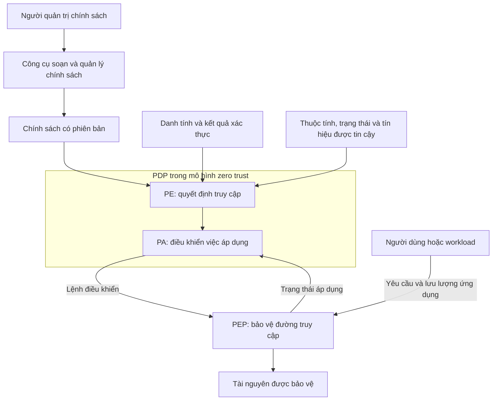
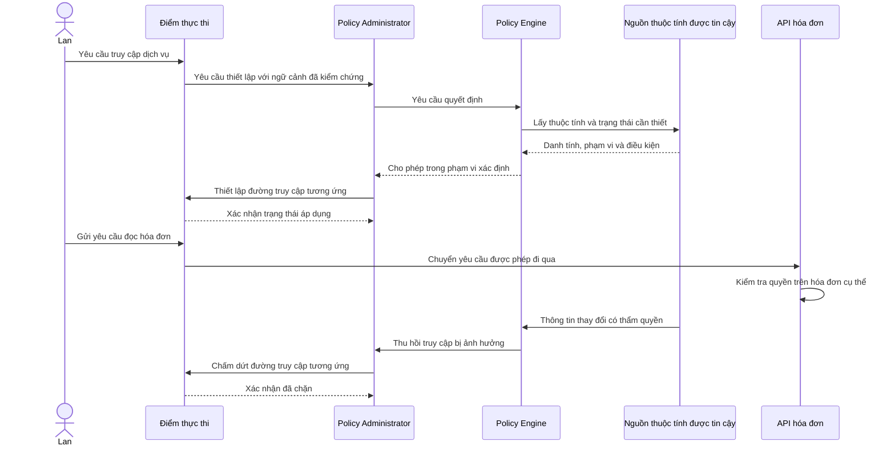
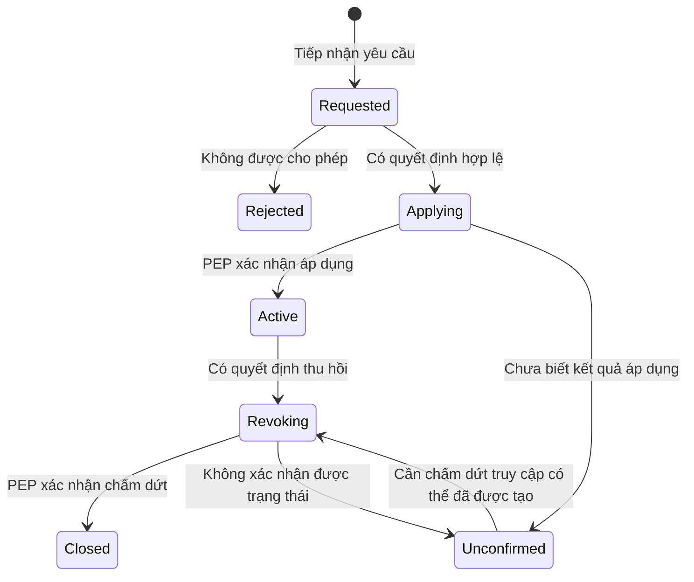

# Policy administrator

## Mục tiêu bài học

Trong chương **Actor và vai trò**, bài học này đặt Policy administrator vào chuỗi quản lý danh tính và quyền truy cập — IAM. Sau khi học, bạn có thể:

- Giải thích vai trò kỹ thuật của Policy Administrator trong kiến trúc zero trust.
- Phân biệt PA với Policy Engine, Policy Enforcement Point và Policy Administration Point.
- Mô tả cách một quyết định cho phép hoặc thu hồi trở thành trạng thái truy cập thực tế.
- Nhận diện ranh giới giữa điều khiển đường truy cập, xác thực danh tính và phân quyền nghiệp vụ.
- Phân tích việc bảo vệ PA, quản lý thay đổi chính sách, xử lý lỗi và kiểm toán.

## 1. Policy administrator là gì?

Trong kiến trúc zero trust của NIST, **Policy Administrator (PA)** là thành phần thực hiện quyết định của Policy Engine bằng cách điều khiển các Policy Enforcement Point để thiết lập hoặc kết thúc đường truyền thông giữa chủ thể và tài nguyên. **Policy Engine quyết định; PA tổ chức thực hiện quyết định đó.** [NIST SP 800-207 — Zero Trust Architecture, mục 3](https://nvlpubs.nist.gov/nistpubs/SpecialPublications/NIST.SP.800-207.pdf)

Ví dụ, một nhân viên được phép kết nối tới ứng dụng hóa đơn trong phạm vi nhất định. Quyết định cho phép chưa tự mở một đường truy cập. Cần có thành phần chuyển quyết định thành cấu hình hoặc lệnh cho điểm kiểm soát. Khi quyền bị thu hồi, cần chuyển thay đổi đó thành hành vi chặn hoặc kết thúc truy cập tương ứng.

Đó là khoảng cách PA giúp xử lý:

```text
Chính sách và dữ liệu đầu vào
    -> quyết định truy cập
    -> lệnh điều khiển phù hợp
    -> trạng thái thực thi tại điểm bảo vệ tài nguyên
```

### Phân biệt với người quản trị chính sách

Trong giao tiếp thông thường, “policy administrator” cũng có thể được dùng để gọi người quản trị chính sách. Người này có thể soạn, sửa hoặc phê duyệt các quy tắc IAM theo thẩm quyền.

Bài học lấy **PA kỹ thuật trong kiến trúc zero trust** làm trọng tâm. Khi nói tới con người, bài dùng cụm **người quản trị chính sách**. Hai bên có liên quan nhưng không phải một vai trò: người quản trị thay đổi chính sách; PA kỹ thuật điều khiển việc áp dụng quyết định trong luồng truy cập.

## 2. Phân biệt PA, PE, PDP, PEP, PAP và PIP

Các tên gần nhau dễ gây hiểu nhầm. Trước hết, cần nhận diện đang dùng mô hình kiến trúc nào.

### 2.1. Nhóm thành phần trong mô hình zero trust

Trong mô hình NIST, **Policy Engine (PE)** và **Policy Administrator (PA)** hợp thành trách nhiệm của **Policy Decision Point (PDP)**. **Policy Enforcement Point (PEP)** thực thi việc kiểm soát truy cập ở nơi bảo vệ đường tới tài nguyên. [NIST — Glossary: Implementing a Zero Trust Architecture](https://pages.nist.gov/zero-trust-architecture/glossary.html)

| Thành phần | Câu hỏi trọng tâm | Ví dụ trong hệ thống hóa đơn |
| --- | --- | --- |
| PE — Policy Engine | Dựa trên chính sách và ngữ cảnh, có cho phép, từ chối hoặc thu hồi không? | Đánh giá tài khoản, phạm vi công ty và điều kiện truy cập |
| PA — Policy Administrator | Cần điều khiển điểm thực thi thế nào để quyết định có hiệu lực? | Yêu cầu gateway thiết lập hoặc chấm dứt đường truy cập đã xác định |
| PEP — Policy Enforcement Point | Có thực sự cho lưu lượng đi qua, giám sát hoặc chặn đường truy cập không? | Gateway hoặc thành phần bảo vệ tài nguyên thực thi lệnh trong phạm vi được giao |
| PDP — Policy Decision Point | Trách nhiệm quyết định và điều phối quyết định nằm ở đâu trong mô hình? | Ranh giới logic bao gồm PE và PA trong kiến trúc này |

Các vai trò logic có thể nằm trong cùng một sản phẩm hoặc được phân bố qua nhiều thành phần. Không bắt buộc phải triển khai một microservice riêng cho từng chữ viết tắt.

### 2.2. PAP không phải tên khác của PA

Trong XACML, **Policy Administration Point (PAP)** tạo policy hoặc policy set; PDP đánh giá chính sách; PEP thực thi quyết định; **Policy Information Point (PIP)** cung cấp thuộc tính. [OASIS XACML 3.0 Plus Errata 01 — Terminology](https://docs.oasis-open.org/xacml/3.0/xacml-3.0-core-spec-en.html)

Vì thế, không nên đổi tên PAP thành PA chỉ vì cùng có từ “administration”. PAP nằm ở trách nhiệm tạo hoặc quản lý biểu diễn chính sách; PA trong mô hình zero trust nói tới việc điều khiển đường truy cập theo quyết định.

Các mô hình có thể được kết hợp trong một hệ thống, nhưng sơ đồ phải chỉ rõ ý nghĩa của từng khối. Nếu một nhóm dùng PDP để chỉ bộ đánh giá chính sách, còn nhóm khác dùng PDP để chỉ PE cùng PA, hai nhóm cần thống nhất ranh giới trước khi chia việc triển khai.

## 3. PA nằm ở đâu trong kiến trúc?

Một cách biểu diễn kiến trúc minh họa:



Đây là sơ đồ trách nhiệm cho bài học, không phải sơ đồ đầy đủ của một giao thức hoặc một sản phẩm. Dữ liệu về danh tính và trạng thái có thể được cung cấp qua nhiều thành phần trung gian được tin cậy.

### Control plane và data plane

Trong ví dụ này:

- **Control plane** mang thông tin quyết định, lệnh thiết lập, lệnh thu hồi và phản hồi trạng thái giữa các thành phần điều khiển.
- **Data plane** mang lưu lượng ứng dụng giữa chủ thể và tài nguyên qua PEP.

PA không nhất thiết đứng trên đường truyền mọi byte dữ liệu nghiệp vụ. PEP mới là nơi phải bảo đảm lưu lượng không đi vòng qua quyết định được áp dụng.

Ví dụ, một proxy có thể thực thi đường truy cập do thành phần điều khiển thiết lập. Ứng dụng hóa đơn phía sau vẫn có thể kiểm tra quyền trên từng hóa đơn. Việc phân tách này không có nghĩa kiểm soát kết nối đã thay cho phân quyền dữ liệu.

## 4. PA cần làm gì với một quyết định truy cập?

Một quyết định trừu tượng như `ALLOW` chưa đủ để điều khiển an toàn. PA cần biết quyết định đó áp dụng cho ai, tài nguyên nào, phạm vi nào và trong điều kiện nào.

### 4.1. Nhận quyết định từ nguồn có thẩm quyền

Trong thiết kế minh họa, PA chỉ chấp nhận quyết định từ PE hoặc nguồn điều khiển đã được cấu hình tin cậy. Một trường `decision=ALLOW` do client gửi không phải quyết định của hệ thống.

PA cần giữ được mối liên hệ giữa quyết định và yêu cầu tương ứng. Nếu quyết định dành cho Lan bị áp vào đường truy cập của Minh, hoặc quyết định cho dịch vụ A bị áp vào dịch vụ B, kết quả thực thi có thể sai dù PE đã đánh giá đúng.

### 4.2. Chuyển quyết định thành lệnh có phạm vi

Giả sử PE cho phép Lan truy cập dịch vụ hóa đơn công ty A. PA cần điều khiển đúng PEP và đúng đường truy cập, không tạo một cấu hình rộng hơn như mở toàn bộ dịch vụ tài chính cho mọi người dùng.

Tùy kiến trúc, công việc có thể liên quan tới cấu hình phiên, đường truyền hoặc các hiện vật bảo mật gắn với phiên. Không nên suy ra PA của mọi sản phẩm đều phải phát hành cùng một loại token hoặc dùng cùng một giao thức điều khiển.

### 4.3. Theo dõi việc áp dụng

Một thiết kế có thể phân biệt:

```text
PE đã cho phép
    -> PA đã yêu cầu thiết lập
    -> PEP đã nhận yêu cầu
    -> PEP đã áp dụng và đường truy cập sẵn sàng
```

Đây là các trạng thái minh họa để vận hành, không phải tên trạng thái do NIST bắt buộc. Sự phân biệt giúp tránh báo “đã cấp truy cập” khi cấu hình thực tế chưa có hiệu lực.

Với thu hồi, cũng cần phân biệt đã phát lệnh với đã chặn thành công. Nếu PEP không phản hồi, không nên ghi nhận hoàn tất chỉ vì PA đã gửi một thông điệp.

### 4.4. Thực hiện thay đổi hoặc kết thúc truy cập

Một quyết định trước đó có thể bị thay đổi do tài khoản bị vô hiệu hóa, thiết bị không còn đáp ứng điều kiện, quyền tạm thời hết hạn hoặc phát hiện sự kiện an ninh. PA cần chuyển quyết định mới thành hành vi tại điểm thực thi theo thiết kế.

Việc điều khiển lại phải nhắm đúng phiên hoặc phạm vi bị ảnh hưởng. Thu hồi truy cập công ty A không nhất thiết đồng nghĩa chấm dứt mọi công việc hợp lệ của cùng người dùng tại công ty B.

## 5. Ví dụ: thiết lập rồi thu hồi đường truy cập

Lan là kế toán công ty A. Chính sách cho phép Lan kết nối tới dịch vụ hóa đơn khi tài khoản và membership còn hoạt động, đồng thời đáp ứng điều kiện truy cập của tổ chức.



Sơ đồ là một luồng minh họa. Trong triển khai khác, PE có thể nhận cập nhật bằng cách tra cứu, sự kiện hoặc cơ chế riêng; quy trình thiết lập cũng có thể có thêm bước giao thức. Không nên coi mọi thông tin thay đổi là lệnh thu hồi trước khi xác định nguồn và thẩm quyền của nó.

### Vì sao API vẫn kiểm tra quyền?

Một đường truy cập tới dịch vụ không tự biểu diễn đầy đủ quyền trên mọi đối tượng của dịch vụ. Lan có thể được kết nối tới API hóa đơn nhưng chỉ được đọc dữ liệu của công ty A, không được duyệt hóa đơn hoặc xem dữ liệu công ty B.

Nếu PEP được thiết kế để kiểm soát ở mức API cụ thể, cần xác định mức chi tiết mà nó thực sự đánh giá. Những điều kiện phụ thuộc dữ liệu nghiệp vụ vẫn phải được thực thi ở nơi có đủ thông tin và thẩm quyền.

## 6. Phạm vi quyết định và dữ liệu điều khiển

Một cấu trúc khái niệm cho ví dụ có thể là:

```text
AccessDecision
    decisionId: decision-482
    requestId: request-104
    subjectId: user-781
    organizationScope: company-a
    resource: invoice-service
    permittedActions: [connect]
    effect: ALLOW
    policyVersion: invoice-entry-v12
    validity: thời hạn do chính sách xác định

AppliedAccess
    decisionId: decision-482
    enforcementPoint: gateway-a
    accessHandle: access-91
    desiredState: ACTIVE
    observedState: ACTIVE
```

Đây là mô hình dữ liệu tự thiết kế cho bài học, không phải định dạng NIST, XACML hoặc OAuth. Các tên `connect` và `ACTIVE` chỉ giúp biểu diễn phạm vi, không phải quyền nghiệp vụ phổ quát.

### Những ràng buộc cần giữ trong ví dụ

- `subjectId` đến từ ngữ cảnh danh tính đã được kiểm chứng, không lấy làm actor chỉ vì client khai.
- `resource` và phạm vi tổ chức được ánh xạ tới tài nguyên thực, tránh dùng nhầm tên hoặc môi trường.
- `validity` giới hạn việc áp dụng quyết định; một lệnh cũ không được làm truy cập sống lại ngoài hiệu lực.
- `decisionId` và `requestId` giúp liên kết quyết định với thao tác, nhưng tự có mã định danh không chứng minh thông điệp đến từ nguồn tin cậy.
- Trạng thái mong muốn và trạng thái quan sát được được lưu riêng để biết nơi nào chưa áp dụng thành công.

Nếu kiến trúc dùng hiện vật bảo mật gắn với phiên, cần bảo vệ việc cấp, chuyển, sử dụng và hết hiệu lực của hiện vật đó. Không ghi bí mật hoặc bearer token đầy đủ vào log chỉ để thuận tiện đối chiếu.

## 7. Chính sách, quyết định và quyền được gán là các đối tượng khác nhau

Xét ba thông tin:

```text
Chính sách:
    Kế toán được truy cập dịch vụ hóa đơn của công ty được phân công,
    khi tài khoản và membership còn hiệu lực.

Dữ liệu gán quyền:
    Lan có vai trò kế toán trong công ty A.

Quyết định cho yêu cầu hiện tại:
    Cho Lan thiết lập đường truy cập đã xác định tới dịch vụ hóa đơn,
    trong phạm vi và thời hạn được đánh giá.
```

Người quản trị chính sách có thể thay đổi quy tắc. Người được ủy quyền quản lý thành viên có thể thay đổi vai trò của Lan. PE đánh giá các đầu vào cho yêu cầu hiện tại. PA tổ chức áp dụng kết quả tại PEP.

Trong hệ thống nhỏ, một nhóm hoặc sản phẩm có thể làm nhiều việc trên. Vẫn cần phân biệt chúng để tránh tự cấp quyền qua một đường quản trị khác. Ví dụ, một người không được sửa chính sách nhưng có thể tự sửa thuộc tính quyết định vai trò vẫn có thể làm thay đổi quyền hiệu lực.

### RBAC và ABAC nằm ở đâu?

RBAC tổ chức quyền theo vai trò; ABAC đánh giá các thuộc tính của chủ thể, tài nguyên, hành động và ngữ cảnh. Chúng ảnh hưởng cách biểu diễn và đánh giá chính sách, không làm PA trở thành nơi tùy ý thêm điều kiện nghiệp vụ ngoài quyết định đã được phê duyệt.

Trong ví dụ, vai trò kế toán là một đầu vào; công ty sở hữu dữ liệu và trạng thái tài khoản là những điều kiện khác. PA cần giữ nguyên giới hạn từ quyết định, thay vì chuyển một quyền hẹp thành cấu hình truy cập rộng hơn.

## 8. Quản lý trạng thái và lệnh điều khiển

PA thường phải phối hợp với thành phần khác qua ranh giới tiến trình hoặc mạng. Vì thế, không thể giả định mỗi lệnh luôn đến đúng một lần, đúng thứ tự và được áp dụng ngay.

### 8.1. Một mô hình trạng thái minh họa



Đây là một cách thiết kế để diễn giải hành vi, không phải máy trạng thái bắt buộc. `Unconfirmed` biểu thị không biết chắc trạng thái thực tế. Hệ thống không nên biến sự thiếu phản hồi thành khẳng định truy cập đang mở hoặc đã đóng.

Mô hình triển khai cần bổ sung xử lý hết hạn, hủy yêu cầu và đối chiếu trạng thái. Điều quan trọng là giữ được bằng chứng cho mỗi chuyển đổi có ý nghĩa bảo mật.

### 8.2. Lệnh lặp và lệnh đến muộn

Giả sử PA gửi yêu cầu thiết lập, PEP áp dụng thành công nhưng phản hồi bị mất. PA thử lại. Nếu PEP tạo thêm một đường truy cập độc lập mỗi lần nhận, việc thu hồi một đường có thể bỏ sót đường còn lại.

Một thiết kế có thể dùng định danh thao tác ổn định và hành vi xử lý lặp an toàn, để các lần gửi lại vẫn gắn với cùng mục tiêu. Việc đó cần được thực hiện tại các bên tham gia, không chỉ bằng cách ghi một mã vào log.

Một tình huống khác: lệnh cho phép cũ đến sau lệnh thu hồi mới. Nếu bên nhận không kiểm tra hiệu lực hoặc thứ tự trạng thái, đường truy cập có thể bị mở lại. Có thể dùng phiên bản trạng thái, thế hệ phiên hoặc cơ chế tương đương để ngăn lệnh cũ đảo ngược quyết định mới theo thiết kế đã thống nhất.

### 8.3. Giả mã cho trách nhiệm điều phối

```text
function applyVerifiedDecision(decision):
    requireTrustedDecisionSource(decision)
    requireDecisionBoundToExpectedRequest(decision)
    requireDecisionCurrentlyApplicable(decision)

    target = resolveAuthorizedEnforcementTarget(decision)
    operation = recordDesiredAccessState(decision, target)

    result = enforcementClient.apply(
        target,
        operation.stableOperationId,
        operation.expectedStateVersion,
        operation.desiredState
    )

    if result confirms expected state:
        recordObservedState(operation, result)
    else:
        recordUnconfirmedState(operation)
        scheduleReconciliation(operation)
```

Đoạn giả mã là ví dụ tự xây dựng về trách nhiệm, không phải API của một sản phẩm hoặc thuật toán NIST. Các bước lưu trạng thái, gửi lệnh và đối chiếu cần được thiết kế cho lỗi từng phần; không thể suy ra chúng là một giao dịch nguyên tử chỉ từ thứ tự các dòng.

PA cần một cơ chế xử lý trạng thái chưa xác nhận, chẳng hạn đối chiếu với PEP và cảnh báo vận hành. Việc thử lại cũng phải có giới hạn và không kéo dài hiệu lực một quyết định đã hết hạn.

## 9. Thu hồi truy cập và vòng đời danh tính

Một thay đổi trong IAM chỉ bảo vệ tài nguyên khi tác động đến những nơi đang quyết định hoặc thực thi truy cập.

### 9.1. Từ sự kiện nghiệp vụ tới hành vi thực thi

Khi Lan chuyển công việc hoặc nghỉ việc, chuỗi xử lý có thể bao gồm:

1. Nguồn có thẩm quyền cập nhật trạng thái tài khoản, membership hoặc quyền.
2. Dữ liệu cập nhật đến nơi đánh giá chính sách qua cơ chế được thiết kế.
3. PE đánh giá ảnh hưởng tới truy cập hiện tại hoặc yêu cầu mới.
4. PA điều khiển thay đổi tại các PEP liên quan.
5. Hệ thống theo dõi kết quả và xử lý nơi chưa áp dụng.

Không phải mọi sự kiện đều có cùng phạm vi. Lan chuyển bộ phận có thể chỉ mất một số quyền; tài khoản bị nghi chiếm quyền có thể đòi hỏi chặn truy cập rộng hơn; workload hết nhiệm vụ có thể cần kết thúc các đường truy cập của chính workload đó.

### 9.2. Những nơi có thể giữ trạng thái cũ

| Nơi giữ thông tin | Rủi ro trong ví dụ | Điều cần làm rõ |
| --- | --- | --- |
| Nguồn thuộc tính hoặc bản sao | PE chưa nhận thay đổi membership | Cơ chế cập nhật, độ trễ và xử lý sai lệch |
| Bộ nhớ đệm quyết định | Quyết định cho phép cũ tiếp tục được dùng | Phạm vi khóa đệm, thời hạn và cơ chế làm mất hiệu lực |
| Trạng thái PA | PA chưa biết đường truy cập nào đang tồn tại | Định danh phiên, trạng thái mong muốn và đối chiếu |
| PEP | Chưa nhận hoặc chưa thực hiện lệnh thu hồi | Cách xác nhận, thời hạn cục bộ và hành vi khi mất kết nối |
| Phiên hoặc token ứng dụng | Ứng dụng vẫn chấp nhận truy cập qua cơ chế khác | Phối hợp thu hồi và kiểm tra quyền tại ứng dụng |

Một PA đã chấm dứt đường truy cập A không chứng minh token của người dùng không còn gọi được đường B. Kiến trúc phải xác định toàn bộ các đường hợp lệ và điểm thực thi tương ứng, tránh để đường trực tiếp tới tài nguyên đi vòng qua PEP.

### 9.3. Hiệu lực thu hồi cần có tiêu chí cụ thể

Thay vì chỉ yêu cầu “thu hồi ngay”, cần xác định phạm vi truy cập, thời gian cho phép theo nhu cầu và bằng chứng hoàn tất. Đó có thể là việc chặn yêu cầu mới, đóng kết nối đang có hoặc kết thúc một loại phiên cụ thể.

Không phải mọi công nghệ đều có cùng khả năng hủy một thao tác đang xử lý. Nếu cần bảo vệ một giao dịch nghiệp vụ quan trọng, ứng dụng phải có ràng buộc phù hợp ở thời điểm thực hiện, không chỉ dựa vào việc kết nối từng được cho phép trước đó.

## 10. Bảo vệ PA như một thành phần có đặc quyền

PA có thể làm thay đổi khả năng đi tới tài nguyên. Nếu một bên trái phép điều khiển được PA, họ có thể tìm cách mở đường truy cập hoặc ngăn các lệnh thu hồi.

### 10.1. Bảo vệ kênh và nguồn lệnh

Trong thiết kế minh họa, cần xác định:

- PE và PEP chứng minh danh tính với PA bằng cơ chế nào.
- PA được phép gửi lệnh cho những PEP, tài nguyên và tổ chức nào.
- Thông điệp được bảo vệ về nguồn, tính toàn vẹn, tính bí mật khi cần và khả năng chống dùng lại ra sao.
- Một quyết định được ràng buộc với đúng chủ thể, yêu cầu và thời hạn thế nào.
- Các đường quản trị và control plane có thể bị truy cập từ đâu.

Kết nối từ mạng nội bộ không tự chứng minh bên gửi có thẩm quyền ra lệnh. Một header tự khai `policyAdmin=true` cũng không có giá trị nếu thiếu cơ chế xác minh và giới hạn quyền tương ứng.

### 10.2. Danh tính workload của PA

Khi PA được triển khai thành dịch vụ, chính dịch vụ đó cần danh tính workload và phương tiện truy cập được quản lý. Quyền kỹ thuật nên giới hạn theo các điểm thực thi mà nó chịu trách nhiệm, thay vì dùng chung một khóa quản trị toàn hạ tầng với nhiều dịch vụ.

Cần có chủ sở hữu, cách xoay vòng hoặc thu hồi phương tiện và cách xử lý khi PA bị nghi xâm phạm. Việc thay một bí mật không tự đảo ngược những cấu hình truy cập mà PA đã tạo trong thời gian bị ảnh hưởng.

### 10.3. Quyền quản trị PA và quyền sửa chính sách

Người vận hành tiến trình PA, người sửa chính sách và người quản lý danh tính có thể là những vai trò khác nhau. Tuy nhiên, một người có quyền triển khai mã hoặc thay cấu hình nguồn tin cậy của PA cũng có thể ảnh hưởng lớn đến truy cập thực tế.

Phân tách nhiệm vụ phải xét khả năng thực tế, không chỉ tên vai trò. Ví dụ, cấm sửa policy trên giao diện nhưng cho phép thay PE được tin cậy bằng một endpoint tùy ý sẽ không giữ được mục tiêu kiểm soát ban đầu.

## 11. Khi PA hoặc thành phần liên quan gặp lỗi

### 11.1. Yêu cầu mới không có cơ sở cho phép

Nếu không nhận được quyết định hợp lệ hoặc không áp dụng được điều kiện bắt buộc, hệ thống không nên mở quyền mới như một cách dự phòng tự phát. Một lỗi phụ thuộc cần được xử lý như lỗi vận hành phù hợp, không tự chuyển thành `ALLOW`.

Điều này cũng không có nghĩa phải mô tả mọi lỗi kỹ thuật là “người dùng không đủ quyền”. Một người có thể đủ quyền nhưng hệ thống tạm thời không thể thiết lập truy cập. Phản hồi và quan sát vận hành cần phân biệt nguyên nhân để xử lý đúng.

### 11.2. Truy cập đã có khi control plane gián đoạn

Với truy cập đang hoạt động, hành vi phải được xác định trước: thời hạn cục bộ còn được chấp nhận, dữ liệu nào phải cập nhật, loại thao tác nào phải dừng và khi nào PEP tự đóng đường truy cập.

Một cơ chế tiếp tục dựa trên quyết định hoặc trạng thái cục bộ còn hiệu lực khác với bỏ qua kiểm soát. Nếu lựa chọn tiếp tục trong điều kiện gián đoạn, giới hạn đó phải có phạm vi, thời hạn và cách ghi nhận rõ ràng.

### 11.3. Thu hồi chưa được xác nhận

Nếu PA không liên lạc được với PEP sau khi có quyết định thu hồi, trạng thái thực tế có thể chưa biết. Hệ thống cần phản ánh sự chưa chắc chắn, đối chiếu lại và kích hoạt phương án xử lý phù hợp với mức ảnh hưởng.

Một yêu cầu được đưa vào hàng đợi chưa đồng nghĩa tài nguyên đã được bảo vệ. Tương tự, việc PA hoạt động trở lại cần bao gồm đối chiếu các lệnh và phiên còn tồn tại, không chỉ tiếp tục nhận yêu cầu mới.

## 12. Người quản trị chính sách và vòng đời thay đổi

Bên cạnh PA kỹ thuật, tổ chức cần con người và quy trình để quản lý nội dung chính sách. Trong phần này, **người quản trị chính sách** là một vai trò tổ chức được ủy quyền, không phải tên đồng nghĩa của thành phần PA trong NIST.

### 12.1. Phạm vi quản trị cần được giới hạn

Người quản trị của công ty A có thể được sửa một số quy tắc cho A mà không được thay chính sách nền tảng hoặc công ty B. Các thao tác cần phân biệt gồm soạn, xem, phê duyệt, phát hành, thu hồi và quản lý người có quyền sửa.

Quyền sửa chính sách có thể tương đương khả năng làm tăng quyền cho người khác hoặc cho chính mình. Một vai trò không trực tiếp đọc hóa đơn nhưng được phép sửa quy tắc để tự cho đọc vẫn có tác động tới dữ liệu đó.

Với thay đổi nhạy cảm, có thể áp dụng phân tách nhiệm vụ, quyền tạm thời, xác thực bổ sung và quản lý truy cập đặc quyền phù hợp với tổ chức. Không nên coi mọi thao tác trên policy là cấu hình ít ảnh hưởng.

### 12.2. Một quy trình thay đổi minh họa

1. **Nêu yêu cầu:** xác định vấn đề, chủ thể, hành động, tài nguyên, điều kiện và người sở hữu nghiệp vụ.
2. **Soạn thay đổi:** giới hạn phạm vi, nguồn thuộc tính, thời hạn và các trường hợp ngoại lệ.
3. **Đánh giá:** xem các trường hợp phải được phép, phải bị chặn và các ảnh hưởng liên quan.
4. **Phê duyệt:** người có thẩm quyền xác nhận phiên bản cụ thể và phạm vi phát hành.
5. **Phân phối:** đưa phiên bản được duyệt đến nơi đánh giá; xác định thời điểm và trạng thái áp dụng.
6. **Quan sát:** theo dõi quyết định và tác động thực tế; xử lý điểm chưa cập nhật.
7. **Kết thúc hoặc thay thế:** rà soát ngoại lệ, hết hạn chính sách tạm thời và duy trì lịch sử.

Quy trình trên là ví dụ thiết kế vận hành. Nó không yêu cầu mọi ứng dụng phải có cùng một công cụ hay một số bước phê duyệt cố định.

### 12.3. Quay lại phiên bản cũ cũng là thay đổi quyền

Một phiên bản cũ có thể chứa quyền đã chủ động thu hồi. Vì vậy, quay lại bản cũ không chỉ là thao tác kỹ thuật để hết lỗi; cần xem nội dung quyền nào sẽ có hiệu lực trở lại.

Trong triển khai có nhiều nơi đánh giá hoặc thực thi, cũng phải biết thành phần nào đang dùng phiên bản nào. Chỉ đổi nhãn “phiên bản đang hoạt động” ở kho quản lý không chứng minh mọi nơi đã sử dụng cùng nội dung.

## 13. Quan hệ với các thành phần IAM khác

| Chủ đề | Quan hệ với PA và giới hạn cần giữ |
| --- | --- |
| Xác thực và MFA | Cung cấp cơ sở về danh tính và quá trình xác thực; PA không biến một lần xác thực mạnh thành quyền trên mọi tài nguyên |
| IdP, SSO và federation | Có thể cung cấp kết quả đăng nhập được tin cậy; việc nhận diện thành công chưa thay cho quyết định và áp dụng quyền |
| OAuth/OIDC | Có các hiện vật và mục đích giao thức riêng; không được gọi mọi token liên quan tới PA là access token hoặc ID token |
| Phiên | Quyết định có thể gắn với một phạm vi phiên hoặc đường truy cập; cần phân biệt với phiên IdP và phiên ứng dụng |
| RBAC và ABAC | Tổ chức và đánh giá điều kiện quyền; PA phải bảo toàn giới hạn của kết quả được áp dụng |
| Joiner, Mover, Leaver | Tạo thay đổi về danh tính và nhu cầu truy cập; cần phản ánh đến nơi ra quyết định và thực thi |
| Workload identity | Bảo vệ cả danh tính dịch vụ đang truy cập lẫn danh tính của PA, PE và PEP khi chúng giao tiếp |
| PAM và ít quyền nhất | Giới hạn khả năng quản trị chính sách, cấu hình nguồn tin cậy và điều khiển các điểm thực thi |

PA là một trách nhiệm trong kiến trúc điều khiển truy cập, không phải tên chung cho toàn bộ IAM. Một ứng dụng cũng có thể thực hiện kiểm soát quyền mà không có khối độc lập tên PA; khi đó vẫn cần giải thích rõ nơi nào biến quyết định thành hành vi bảo vệ tài nguyên.

## 14. Kiểm toán từ chính sách đến hành vi thực tế

Một chuỗi điều tra hữu ích cần nối được ba lớp:

```text
Phiên bản chính sách và dữ liệu có liên quan
    -> quyết định truy cập
    -> yêu cầu điều khiển và trạng thái thực thi
```

Ví dụ các sự kiện do hệ thống minh họa tự định nghĩa:

```text
Event 1
    type: ACCESS_DECIDED
    decisionId: decision-482
    subject: user-781
    resource: invoice-service
    effect: ALLOW
    policyVersion: invoice-entry-v12

Event 2
    type: ACCESS_APPLY_REQUESTED
    decisionId: decision-482
    enforcementPoint: gateway-a
    accessHandle: access-91
    desiredState: ACTIVE

Event 3
    type: ACCESS_STATE_CONFIRMED
    decisionId: decision-482
    enforcementPoint: gateway-a
    accessHandle: access-91
    observedState: ACTIVE
```

Các tên sự kiện chỉ để diễn giải. Khi vận hành thực tế, cần thêm thời điểm, mã tương quan, kết quả và thông tin cần thiết cho điều tra theo chính sách dữ liệu của hệ thống.

Với thay đổi policy, cần biết ai soạn, ai phê duyệt, phiên bản nào được phát hành và phạm vi nào bị ảnh hưởng. Với lệnh PA, cần phân biệt bên phát quyết định, dịch vụ gửi lệnh và điểm thực thi đích.

Không ghi khóa riêng, bí mật điều khiển hoặc token đầy đủ vào log. Nhật ký phải được giới hạn quyền đọc và bảo vệ tính toàn vẹn; một bên có thể vừa mở quyền vừa xóa mọi dấu vết sẽ làm suy yếu khả năng quy trách nhiệm.

## 15. Những hiểu nhầm thường gặp

| Hiểu nhầm | Cách hiểu đúng |
| --- | --- |
| PA là người tự ngồi duyệt từng yêu cầu truy cập | Trong mô hình zero trust được dùng ở bài này, PA là thành phần kỹ thuật thực hiện quyết định |
| PA, PAP và PE là cùng một khối | Chúng mô tả các trách nhiệm khác nhau; phải xét mô hình và ranh giới thực tế |
| Có quyết định `ALLOW` là truy cập đã được cấp | Cần áp dụng đúng tại điểm thực thi và biết trạng thái thực tế |
| Đã gửi lệnh thu hồi là truy cập chắc chắn đã đóng | Cần xác nhận hoặc đối chiếu; trạng thái chưa biết phải được thể hiện đúng |
| Đi qua PEP là được làm mọi việc trong ứng dụng | Vẫn cần kiểm tra quyền ở mức hành động, đối tượng và dữ liệu theo phạm vi bảo vệ |
| PA hoạt động trong mạng nội bộ nên không cần danh tính riêng | Control plane và quyền điều khiển vẫn cần xác thực, phân quyền và giới hạn phạm vi |
| Lệnh cho phép cũ đến chậm có thể được áp dụng bình thường | Cần kiểm tra hiệu lực và ngăn quyết định cũ đảo ngược trạng thái mới |
| Khi thành phần IAM lỗi thì tạm mở toàn bộ để tiếp tục dịch vụ | Hành vi gián đoạn phải theo chính sách có cơ sở cho phép và giới hạn rõ ràng |
| Người sửa policy không có quyền dữ liệu nên ít rủi ro | Khả năng sửa policy có thể gián tiếp mở quyền trên dữ liệu |

## 16. Ví dụ tổng hợp: thu hồi quyền tạm thời

Minh được phép truy cập một dịch vụ báo cáo nội bộ để xử lý công việc trong thời gian giới hạn. Người có thẩm quyền phê duyệt phạm vi; chính sách có phiên bản được phân phối tới nơi đánh giá.

Khi Minh bắt đầu công việc, PE đánh giá danh tính, quyền tạm thời và điều kiện liên quan. PA điều khiển PEP thiết lập đúng đường truy cập. Ứng dụng báo cáo vẫn kiểm tra tập dữ liệu mà Minh được sử dụng.

Đến khi quyền tạm thời hết hiệu lực, thay đổi được phản ánh tới PE theo cơ chế đã thiết kế. PA yêu cầu PEP chấm dứt truy cập bị ảnh hưởng và theo dõi xác nhận. Nếu một PEP chưa phản hồi, hệ thống giữ trạng thái chưa xác nhận và xử lý theo chính sách vận hành, không báo thu hồi hoàn tất cho điểm đó.

Nếu một lệnh thiết lập cũ được gửi lại sau đó, cơ chế hiệu lực và thứ tự trạng thái phải ngăn nó mở lại đường truy cập đã kết thúc. Nhật ký cần nối được phê duyệt, quyết định, lệnh điều khiển và trạng thái cuối cùng.

Ví dụ này cho thấy ít quyền nhất bao gồm cả **đúng phạm vi** lẫn **đúng thời gian**, và phải thể hiện ở trạng thái truy cập thực tế.

## 17. Các câu hỏi khi xác định trách nhiệm Policy administrator

Khi khảo sát một hệ thống, hãy tìm câu trả lời cụ thể:

- Thuật ngữ PA đang chỉ thành phần kỹ thuật hay vai trò con người; PAP, PE, PDP và PEP được định nghĩa theo mô hình nào?
- Bên nào có thẩm quyền ra quyết định và PA kiểm chứng nguồn, ngữ cảnh, hiệu lực của quyết định thế nào?
- Lệnh điều khiển được ràng buộc với chủ thể, tài nguyên, tổ chức và đường truy cập nào?
- Có thể biết PEP đã thực sự áp dụng hay chỉ mới nhận yêu cầu không?
- Lệnh lặp, đến muộn, mất phản hồi và trạng thái chưa xác nhận được xử lý ra sao?
- Thay đổi danh tính, quyền hoặc điều kiện có hiệu lực tới các nơi thực thi trong phạm vi nào và theo thời hạn nào?
- Ai được sửa chính sách hoặc cấu hình điều khiển, và có thể tự mở quyền qua một đường gián tiếp không?
- Nhật ký có nối được phiên bản chính sách, quyết định, lệnh điều khiển và hành vi thực tế mà không làm lộ bí mật không?

Các câu trả lời này giúp đặt PA đúng trách nhiệm: biến quyết định được cho phép thành việc kiểm soát truy cập có phạm vi, có vòng đời và có khả năng truy vết.
