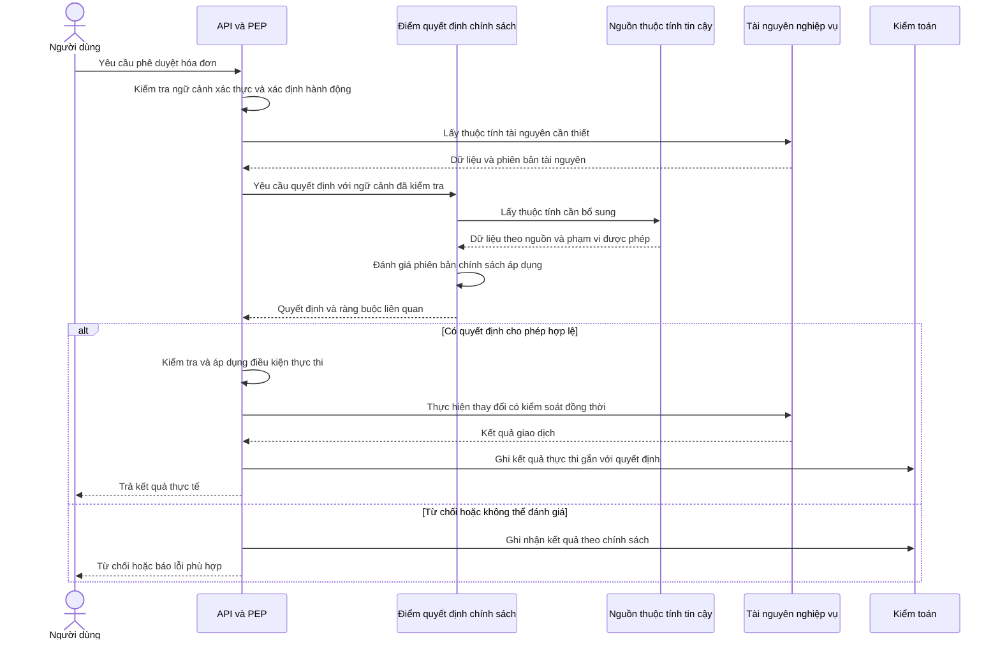

# Policy decision point

## 1. Policy decision point là gì?

**Policy Decision Point — PDP, điểm ra quyết định chính sách** là thành phần đánh giá chính sách truy cập dựa trên chủ thể, hành động, tài nguyên và ngữ cảnh để đưa ra quyết định phân quyền.

Ví dụ, API nhận yêu cầu phê duyệt một hóa đơn. Người dùng đã đăng nhập thành công, nhưng hệ thống vẫn cần biết người đó có quyền phê duyệt hóa đơn này hay không. PDP có thể xét vai trò, tenant, hạn mức phê duyệt, người tạo hóa đơn và trạng thái giao dịch trước khi trả kết quả.

PDP là một **vai trò logic trong kiến trúc IAM**. Nó có thể được triển khai thành dịch vụ riêng, thành phần chạy cạnh ứng dụng hoặc thư viện bên trong ứng dụng. Việc có PDP không bắt buộc mọi yêu cầu phải đi qua một máy chủ trung tâm duy nhất.

Điểm cốt lõi là tách rõ trách nhiệm đánh giá chính sách với trách nhiệm tiếp nhận và thực hiện hành động trên tài nguyên. Quyết định chỉ có giá trị bảo vệ khi được thành phần thực thi áp dụng đúng.

Sau bài học, bạn có thể giải thích trách nhiệm của PDP, phân biệt nó với các thành phần liên quan, thiết kế ngữ cảnh đánh giá đáng tin cậy và nhận ra những rủi ro khi cache, khi có lỗi hoặc khi dữ liệu thay đổi sau quyết định.

## 2. PDP trong mô hình các actor phân quyền

Các kiến trúc phân quyền thường sử dụng những tên gọi sau để phân chia trách nhiệm. Một sản phẩm có thể thực hiện nhiều vai trò, nhưng cần giữ rõ ranh giới khi thiết kế và vận hành.

| Thành phần | Trách nhiệm | Ví dụ |
|---|---|---|
| Policy Administration Point — PAP | Quản lý việc tạo, sửa, phê duyệt và phát hành chính sách | Công cụ xuất bản phiên bản chính sách phê duyệt hóa đơn |
| Policy Decision Point — PDP | Đánh giá chính sách với dữ liệu đầu vào để đưa ra quyết định | Xác định người dùng có được phê duyệt hóa đơn cụ thể không |
| Policy Information Point — PIP | Cung cấp thuộc tính hoặc thông tin phục vụ đánh giá | Nguồn hạn mức phê duyệt, quan hệ tenant và trạng thái tài khoản |
| Policy Enforcement Point — PEP | Chặn hoặc cho phép thao tác theo quyết định và điều kiện liên quan | Middleware hoặc mã nghiệp vụ trước khi cập nhật hóa đơn |
| Identity Provider — IdP | Cung cấp kết quả xác thực và thông tin danh tính theo quan hệ tin cậy | Hệ thống đăng nhập và MFA của tổ chức |
| Tài nguyên hoặc dịch vụ nghiệp vụ | Lưu dữ liệu và thực hiện hành động được bảo vệ | Dịch vụ quản lý hóa đơn |

### 2.1. PDP khác PEP

PDP trả lời câu hỏi “yêu cầu này được phép không?”. PEP chịu trách nhiệm áp dụng câu trả lời vào đường thực thi thực tế.

Nếu PDP trả về từ chối nhưng API vẫn cập nhật cơ sở dữ liệu, chính sách không được bảo vệ. Nếu một endpoint khác truy cập cùng tài nguyên mà không đi qua kiểm tra quyền, endpoint đó có thể tạo đường đi vòng dù PDP hoạt động đúng.

PEP cũng phải cung cấp đúng ngữ cảnh và kiểm tra các điều kiện đi kèm quyết định. Gửi sai tenant hoặc bỏ qua điều kiện giới hạn tài nguyên có thể làm kết quả đánh giá không còn phù hợp với thao tác được thực hiện.

### 2.2. PDP khác IdP

IdP có thể xác nhận người dùng đã đáp ứng phương thức xác thực. PDP sử dụng danh tính và các dữ liệu liên quan để đánh giá quyền đối với một yêu cầu cụ thể.

MFA thành công không tự cho phép xem mọi tài nguyên. Một access token hợp lệ cũng chưa đủ để kết luận mọi hành động nghiệp vụ đều được phép; API vẫn cần kiểm tra phạm vi và chính sách áp dụng.

### 2.3. PDP khác PAP và PIP

Quyền sửa chính sách tại PAP có thể thay đổi cách PDP quyết định cho nhiều người dùng. Quyền sửa thuộc tính tại nguồn PIP cũng có thể thay đổi kết quả, dù nội dung chính sách không đổi.

Ví dụ, một người không được sửa quy tắc phê duyệt nhưng có thể tự nâng hạn mức trong nguồn dữ liệu thì vẫn có đường tăng quyền. Bảo vệ PDP cần đi cùng bảo vệ chính sách và nguồn thuộc tính mà nó tin cậy.

## 3. Đầu vào của một quyết định

### 3.1. Subject, action, resource và environment

Một yêu cầu đánh giá thường có bốn nhóm thông tin chính:

| Nhóm | Nội dung | Ví dụ |
|---|---|---|
| Subject — chủ thể | Danh tính, trạng thái, vai trò hoặc quan hệ của bên cần được đánh giá | Nhân viên `emp_42`, thuộc tenant A, có vai trò phê duyệt |
| Action — hành động | Thao tác được yêu cầu với ngữ nghĩa rõ ràng | `invoice.approve` |
| Resource — tài nguyên | Định danh, loại và thuộc tính liên quan của đối tượng | Hóa đơn `inv_108`, tenant A, đang chờ phê duyệt |
| Environment — ngữ cảnh | Thông tin thời gian, xác thực hoặc điều kiện thực thi | Thời điểm đánh giá, ngữ cảnh xác thực đã kiểm tra |

Không nên dùng một hành động mơ hồ như `write` nếu các thao tác sửa nội dung, phê duyệt và xóa có rủi ro khác nhau. Chính sách cần đủ ngữ nghĩa để phân biệt những hành động quan trọng.

### 3.2. Phân biệt người dùng và workload thực thi

Một ứng dụng có thể gọi API thay mặt người dùng. Khi đó, cần phân biệt chủ thể được đại diện với workload đang thực hiện lời gọi.

Ví dụ, dịch vụ hóa đơn gọi dịch vụ thanh toán thay mặt `emp_42`. Quyết định có thể cần xét cả việc dịch vụ hóa đơn được phép gọi hành động đó và việc `emp_42` có quyền trên giao dịch cụ thể.

Không nên thay mọi yêu cầu bằng danh tính service account có quyền rộng rồi bỏ mất ngữ cảnh người dùng. Ngược lại, một job chạy bằng quyền riêng không nên tự nhận đang đại diện cho một người chỉ vì client gửi trường `user_id`.

### 3.3. Ví dụ ngữ cảnh đánh giá

```json
{
  "request_id": "req_739",
  "subject": {
    "id": "emp_42",
    "status": "active",
    "tenant_id": "tenant-a",
    "role_assignments": [
      {
        "role": "invoice-approver",
        "tenant_id": "tenant-a"
      }
    ]
  },
  "actor": {
    "id": "invoice-api-prod",
    "type": "workload"
  },
  "action": "invoice.approve",
  "resource": {
    "id": "inv_108",
    "type": "invoice",
    "tenant_id": "tenant-a",
    "status": "pending",
    "created_by": "emp_17",
    "amount": 12000000,
    "currency": "VND",
    "version": 7
  },
  "approval_limit": {
    "amount": 20000000,
    "currency": "VND"
  }
}
```

Đây là hợp đồng dữ liệu minh họa, không phải định dạng bắt buộc của một sản phẩm. Trong triển khai thực tế, các trường phải đến từ nguồn đã được kiểm tra. PDP có thể tự lấy một số thuộc tính qua PIP thay vì nhận toàn bộ từ PEP.

Việc JSON có trường `status: active` không chứng minh tài khoản đang hoạt động. Điều quyết định là ai xác lập giá trị đó, nguồn được xác thực thế nào và dữ liệu còn đủ mới cho hành động đang xét hay không.

## 4. Độ tin cậy của dữ liệu quan trọng như nội dung chính sách

### 4.1. Không để client tự quyết định thuộc tính cấp quyền

Các giá trị như vai trò, tenant, hạn mức hoặc chủ sở hữu tài nguyên không nên được tin chỉ vì xuất hiện trong request của người dùng.

Ví dụ, nếu API cho client gửi `resource.tenant_id` rồi chuyển nguyên giá trị đó sang PDP, người gọi có thể khai tenant mình được phép truy cập trong khi `resource.id` thực tế thuộc tenant khác. Quyết định đúng trên dữ liệu giả vẫn tạo truy cập sai.

PEP cần tải hoặc xác nhận thuộc tính tài nguyên từ nguồn có thẩm quyền. Các thuộc tính chủ thể phải được lấy từ ngữ cảnh xác thực và nguồn quản lý quyền phù hợp. Nếu dùng claim từ token, token và ý nghĩa claim phải được kiểm tra theo thiết kế.

### 4.2. PIP cần có nguồn và yêu cầu về độ mới

Mỗi thuộc tính quan trọng nên có nguồn có thẩm quyền. Hệ thống nhân sự có thể quản lý trạng thái làm việc; dịch vụ hóa đơn quản lý số tiền và trạng thái hóa đơn; quy trình cấp quyền quản lý vai trò và hạn mức.

Cần xác định dữ liệu có thể cũ đến mức nào. Một bản sao vai trò từ hôm trước có thể không phù hợp với thao tác đặc quyền cần phản ánh thu hồi nhanh.

Nếu thuộc tính bắt buộc bị thiếu hoặc nguồn cung cấp lỗi, PDP phải có cách biểu diễn tình trạng đó. Không nên thay giá trị thiếu bằng một giá trị thuận lợi như “không giới hạn” hoặc “đang hoạt động”.

### 4.3. Bảo vệ cả đường gọi PDP

PDP cần biết bên nào được phép gửi yêu cầu và cung cấp loại dữ liệu nào. Nếu bất kỳ client nào cũng có thể giả làm PEP tin cậy rồi gửi vai trò tùy ý, việc tách dịch vụ không tạo được ranh giới bảo mật mong muốn.

Cần bảo vệ kênh giao tiếp, xác thực bên gọi và giới hạn phạm vi sử dụng. Phản hồi quyết định cũng phải gắn với đúng yêu cầu và ngữ cảnh mà PEP đang xử lý.

PDP thường tiếp cận dữ liệu nhạy cảm để đánh giá. Không nên biến giao diện hỏi quyền thành công cụ cho bên không được phép suy đoán tài khoản, tài nguyên hoặc quan hệ nội bộ.

## 5. PDP đánh giá chính sách như thế nào?

### 5.1. Kết hợp vai trò, thuộc tính và quan hệ

PDP có thể đánh giá chính sách RBAC, ABAC hoặc các quan hệ với tài nguyên, tùy mô hình.

- **RBAC** tổ chức quyền theo vai trò, chẳng hạn `invoice-approver`.
- **ABAC** xét thuộc tính và ngữ cảnh, chẳng hạn tenant, hạn mức và trạng thái tài nguyên.
- **Quan hệ với tài nguyên** giúp xác định người tạo, người sở hữu hoặc thành viên của phạm vi liên quan.

Các cách này có thể được kết hợp. Có vai trò phê duyệt là một điều kiện, nhưng vẫn phải xét tenant và việc người đó có đang tự phê duyệt hóa đơn do mình tạo hay không.

### 5.2. Ví dụ quy tắc phê duyệt hóa đơn

Giả sử ứng dụng có chính sách minh họa:

1. Tài khoản phải được phép hoạt động.
2. Người dùng có vai trò phê duyệt trong đúng tenant của hóa đơn.
3. Người dùng không được tự phê duyệt hóa đơn mình tạo.
4. Hóa đơn phải đang chờ phê duyệt.
5. Số tiền nằm trong hạn mức được cấp, với cách hiểu đơn vị tiền tệ rõ ràng.
6. Ngữ cảnh xác thực phải đáp ứng yêu cầu của thao tác nếu chính sách đặt ra.

Có thể diễn đạt logic ở mức khái niệm:

```text
Nếu thiếu dữ liệu bắt buộc hoặc dữ liệu không hợp lệ:
    Không đưa ra kết quả cho phép

Nếu tài khoản không hoạt động:
    Từ chối

Nếu không có vai trò phù hợp trong tenant của tài nguyên:
    Từ chối

Nếu người phê duyệt cũng là người tạo hóa đơn:
    Từ chối

Nếu trạng thái hóa đơn không còn là pending:
    Từ chối

Nếu số tiền vượt hạn mức hoặc điều kiện tiền tệ không đáp ứng:
    Từ chối

Nếu điều kiện xác thực bắt buộc chưa được đáp ứng:
    Từ chối hoặc trả kết quả yêu cầu bổ sung theo hợp đồng hệ thống

Nếu tất cả điều kiện cần thiết đều đáp ứng:
    Cho phép với phạm vi và ràng buộc đã đánh giá
```

Đây là giả mã giải thích chính sách, không phải mã có thể triển khai trực tiếp. Hệ thống thực tế cần quy định kiểu dữ liệu, nguồn thuộc tính, cách xử lý lỗi và ngữ nghĩa kết hợp quy tắc.

### 5.3. Kết hợp nhiều chính sách phải có quy tắc rõ ràng

Một yêu cầu có thể đồng thời chịu chính sách tổ chức, tenant, vai trò và tài nguyên. Cần xác định cách xử lý khi các chính sách cho kết quả khác nhau.

Không nên mặc định “chỉ cần một quy tắc cho phép là được” nếu điều đó làm mất ràng buộc cách ly tenant hoặc phân tách nhiệm vụ. Ví dụ, quyền đọc chung không nên vô tình vượt qua một điều kiện cấm truy cập tài nguyên ngoài tenant.

Một thiết kế có thể chọn ưu tiên từ chối cho các ràng buộc bắt buộc, hoặc dùng cơ chế kết hợp khác có ngữ nghĩa đã xác định. Điều quan trọng là người viết chính sách và bên thực thi hiểu cùng một cách, kể cả khi không có quy tắc nào áp dụng.

## 6. Kết quả quyết định và điều kiện thực thi

### 6.1. Không chỉ có một giá trị boolean

Một số hệ thống chỉ cung cấp cho PEP kết quả cho phép hoặc từ chối. Những mô hình khác phân biệt thêm trường hợp không có chính sách áp dụng và trường hợp không thể đánh giá.

| Kết quả khái niệm | Ý nghĩa | Cách xử lý cần xác định |
|---|---|---|
| Permit | Chính sách cho phép trong ngữ cảnh đã đánh giá | PEP chỉ thực hiện đúng hành động và ràng buộc được trả về |
| Deny | Chính sách từ chối | Không thực hiện hành động được yêu cầu |
| Not applicable | Không có chính sách phù hợp để kết luận cho yêu cầu | Không tự chuyển thành cho phép; áp dụng quy tắc mặc định của hệ thống |
| Indeterminate | Không thể đánh giá đầy đủ, chẳng hạn thiếu thuộc tính hoặc có lỗi | Không coi là cho phép; xử lý lỗi hoặc chuyển cấp theo thiết kế |

Tên gọi và cấu trúc cụ thể phụ thuộc công nghệ. PEP phải hiểu hợp đồng của PDP đang dùng. Nếu không nhận được quyết định cho phép hợp lệ, nó không nên thực hiện hành động được bảo vệ.

### 6.2. Quyết định có thể kèm ràng buộc hoặc nghĩa vụ

Một PDP có thể trả về điều kiện giới hạn phạm vi hoặc nghĩa vụ mà PEP phải thực hiện, chẳng hạn kiểm tra phiên bản tài nguyên hoặc ghi dấu vết theo yêu cầu của thao tác.

```json
{
  "decision_id": "dec_215",
  "request_id": "req_739",
  "decision": "permit",
  "policy_revision": "invoice-policy-42",
  "constraints": {
    "resource_id": "inv_108",
    "tenant_id": "tenant-a",
    "expected_resource_version": 7
  },
  "obligations": [
    {
      "type": "record_approval_audit"
    }
  ]
}
```

Phản hồi trên là ví dụ về hợp đồng nội bộ. PEP cần có cơ chế thực thi các trường đó; việc PDP trả ra một ràng buộc không làm cơ sở dữ liệu tự tuân thủ.

Nếu nghĩa vụ là bắt buộc mà PEP không hỗ trợ hoặc không thể thực hiện, không nên bỏ qua rồi tiếp tục như quyết định vô điều kiện. Cách ghi audit trước hoặc cùng giao dịch cần được thiết kế theo yêu cầu của hệ thống.

Với thao tác đọc danh sách, ràng buộc có thể giới hạn tenant, dòng dữ liệu hoặc trường được trả về. PEP phải chuyển những giới hạn đó thành truy vấn và xử lý dữ liệu an toàn. Không thực thi đoạn mã hoặc truy vấn tùy ý chỉ vì nó nằm trong phản hồi chính sách.

### 6.3. Quyết định phải gắn với đúng yêu cầu

Quyết định cho `invoice.approve` trên `inv_108` không được tái sử dụng cho hóa đơn khác hoặc hành động xóa. Nếu chủ thể, actor, tài nguyên, thuộc tính hoặc ngữ cảnh thay đổi, quyết định cũ có thể không còn phù hợp.

`decision_id` chủ yếu hỗ trợ liên kết và kiểm toán trong mô hình này. Nó không tự trở thành một bearer credential cho phép bất kỳ người giữ mã nào thực hiện thao tác.

## 7. Luồng phối hợp giữa PEP, PDP và PIP



Sơ đồ minh họa một khả năng triển khai. PDP có thể đã có thuộc tính cần thiết hoặc dùng cách truy xuất khác. Dù lựa chọn nào, phải biết dữ liệu nào được tin cậy và PEP nào thực thi kết quả.

Một gateway có thể kiểm tra quyền ở mức tuyến API, nhưng ứng dụng vẫn có thể cần PEP gần dữ liệu để đánh giá hóa đơn cụ thể. Không nên coi kiểm tra ở gateway là đủ nếu gateway không có ngữ cảnh nghiệp vụ cần thiết.

## 8. Khi dữ liệu thay đổi sau quyết định

### 8.1. Rủi ro giữa lúc kiểm tra và lúc sử dụng

PDP có thể cho phép phê duyệt khi hóa đơn có giá trị 12 triệu đồng và phiên bản 7. Trước khi API ghi thay đổi, một yêu cầu khác sửa số tiền thành 120 triệu đồng. Nếu API vẫn dùng quyết định cũ, hành động thực tế không còn giống ngữ cảnh đã được cho phép.

Đây là vấn đề **time of check to time of use — TOCTOU**, tức dữ liệu hoặc điều kiện thay đổi giữa lúc kiểm tra và lúc sử dụng kết quả.

### 8.2. Gắn quyết định với điều kiện ghi

Một cách xử lý là thực hiện cập nhật có điều kiện hoặc giao dịch phù hợp, kiểm tra phiên bản và trạng thái tài nguyên tại thời điểm ghi. Nếu tài nguyên thay đổi, thao tác không tiếp tục bằng quyết định cũ mà cần tải lại dữ liệu và đánh giá lại theo thiết kế.

Phiên bản phải phản ánh những thay đổi có thể ảnh hưởng chính sách. Nếu số tiền thay đổi nhưng phiên bản không đổi, ràng buộc phiên bản sẽ không bảo vệ được trường hợp đó.

Cơ chế này giải quyết phần thay đổi tài nguyên, nhưng quyền của chủ thể hoặc chính sách có thể thay đổi ở nguồn độc lập. Hệ thống vẫn cần xác định mô hình nhất quán và khoảng thời gian chấp nhận giữa quyết định với thực thi, đặc biệt đối với thao tác rủi ro cao.

### 8.3. Tác vụ bất đồng bộ phải có chính sách riêng

Một yêu cầu được phép đưa vào hàng đợi không nhất thiết được phép thực hiện nhiều giờ sau với mọi điều kiện mới. Cần quyết định quyền được kiểm tra khi tiếp nhận, khi thực thi hay ở cả hai thời điểm.

Nếu job thực thi thay mặt người dùng, phải bảo toàn ngữ cảnh ủy quyền đáng tin cậy và giới hạn của nó. Không để một trường người dùng tự khai trong thông điệp trở thành căn cứ cấp quyền cho worker có đặc quyền rộng.

## 9. Triển khai PDP tập trung hoặc phân tán

| Cách triển khai | Điểm thuận lợi | Điều phải quản lý |
|---|---|---|
| Dịch vụ PDP dùng chung | Có một nơi đánh giá và quan sát nhiều ứng dụng | Độ trễ mạng, tính sẵn sàng, bảo vệ giao diện và cách ly tenant |
| PDP chạy cạnh ứng dụng | Giảm phụ thuộc mạng cho từng quyết định | Phân phối chính sách, phiên bản và dữ liệu thuộc tính tới từng nơi |
| PDP nhúng trong ứng dụng | Tích hợp trực tiếp với luồng xử lý | Nâng cấp thư viện, tránh khác biệt cấu hình và bỏ sót điểm thực thi |

Quản trị chính sách tập trung có thể đi cùng đánh giá phân tán. Ví dụ, PAP phát hành phiên bản chính sách đã duyệt để nhiều PDP cục bộ sử dụng. Cần kiểm tra nguồn gói chính sách, khả năng cập nhật, quan sát phiên bản và xử lý nơi chưa nhận bản mới.

Không nên chọn kiến trúc chỉ dựa trên độ trễ. Một quyết định nhanh nhưng dựa vào dữ liệu quyền quá cũ có thể không đáp ứng yêu cầu thu hồi. Một dịch vụ tập trung đầy đủ nhưng thường xuyên không sẵn sàng cũng có thể gây gián đoạn thao tác hợp lệ.

## 10. Cache quyết định và xử lý lỗi

### 10.1. Cache phải phản ánh các yếu tố ảnh hưởng quyết định

Cache có thể giảm chi phí đánh giá, nhưng khóa chỉ gồm `user_id` và đường dẫn API thường không đủ.

Tùy chính sách, quyết định có thể phụ thuộc vào:

- Danh tính và miền của chủ thể.
- Workload thực thi và quan hệ ủy quyền.
- Hành động, tài nguyên và tenant.
- Phiên bản thuộc tính tài nguyên, vai trò hoặc quyền liên quan.
- Phiên bản chính sách.
- Ngữ cảnh xác thực và điều kiện thời gian.

Nếu một yếu tố có thể đổi kết quả mà không được phản ánh trong cách cache hoặc cơ chế vô hiệu hóa, cache có thể trả một quyết định không còn hợp lệ.

Thời hạn cache cần phù hợp với mức chấp nhận dữ liệu cũ. Cache kết quả từ chối cũng có tác động: quyền mới được cấp có thể chưa dùng được cho đến khi cache được cập nhật.

Nghĩa vụ theo từng lần truy cập vẫn cần được thực hiện khi tái sử dụng kết quả nếu hợp đồng yêu cầu. Không bỏ ghi nhận một thao tác chỉ vì quyết định cho phép đến từ cache.

### 10.2. Thu hồi phải xét toàn bộ chuỗi dữ liệu

Trạng thái mới có thể đi qua nguồn danh tính, PIP, cache thuộc tính, PDP và cache tại PEP. Token hoặc phiên cũng có thể mang dữ liệu cũ.

Khi cần thu hồi, phải biết các lớp nào đang giữ thông tin và khi nào tài nguyên thực sự ngừng chấp nhận truy cập. Thay đổi ở nguồn không tự chứng minh quyết định tại mọi PEP đã thay đổi.

### 10.3. Khi PDP hoặc PIP không phản hồi

Timeout, dữ liệu thiếu hoặc lỗi đánh giá không phải kết quả cho phép. Với hành động được bảo vệ, PEP cần từ chối hoặc trì hoãn khi không có quyết định hợp lệ đáp ứng chính sách.

Một số kiến trúc cho phép dùng chính sách hoặc dữ liệu dự phòng đã được xác nhận trong phạm vi và thời hạn rõ ràng. Đây phải là hành vi đã thiết kế theo rủi ro, không phải cách tự động bỏ qua kiểm tra khi dịch vụ trung tâm lỗi.

Thao tác nhạy cảm có thể cần điều kiện chặt hơn thao tác ít rủi ro. Cần diễn giải rõ trạng thái lỗi cho vận hành nhưng tránh tiết lộ quá nhiều thông tin tài nguyên cho bên không được phép.

## 11. Quản trị chính sách và phân tách trách nhiệm

Chính sách là thành phần có thể thay đổi quyền truy cập ở quy mô lớn. Cần quản lý người được sửa, người phê duyệt, phiên bản được phát hành và phạm vi áp dụng.

Một vòng đời có thể gồm soạn thảo, đánh giá các trường hợp liên quan, phê duyệt, phát hành, theo dõi và thay thế khi cần. Các quy tắc quan trọng như cách ly tenant hoặc cấm tự phê duyệt cần được xem xét khi có thay đổi có thể ảnh hưởng chúng.

Việc quay lại phiên bản trước phải xét các thay đổi bảo mật đã có từ đó. Khôi phục một bản chính sách cũ có thể vô tình mở lại quyền đã bị thu hồi hoặc loại bỏ một ràng buộc mới.

Trách nhiệm thường cần phân biệt:

| Actor hoặc nhóm | Trách nhiệm |
|---|---|
| Chủ sở hữu nghiệp vụ hoặc dữ liệu | Xác định ý nghĩa quyền, phạm vi tài nguyên và ràng buộc nghiệp vụ |
| Nhóm quản trị chính sách | Biểu diễn, phát hành và quản lý phiên bản chính sách |
| Nhóm ứng dụng | Cung cấp ngữ cảnh đúng, triển khai PEP và áp dụng ràng buộc |
| Chủ sở hữu nguồn thuộc tính | Bảo đảm ý nghĩa, quyền sửa và chất lượng dữ liệu |
| Operator | Vận hành PDP, PIP và đường phân phối trong phạm vi được giao |
| Nhóm kiểm toán hoặc an ninh | Đánh giá dấu vết, rủi ro và các ngoại lệ theo phân công |

Operator không nên cần quyền tự sửa mọi chính sách chỉ để xem trạng thái PDP. Tương tự, quyền đọc log không mặc nhiên bao gồm quyền thay dữ liệu thuộc tính hoặc khóa nguồn tin cậy.

## 12. Kiểm toán quyết định và kết quả thực thi

PDP có thể ghi rằng một yêu cầu được cho phép, nhưng thao tác nghiệp vụ sau đó vẫn có thể thất bại vì tài nguyên đã thay đổi. Ngược lại, nếu ứng dụng có đường đi vòng, có thể xuất hiện hành động mà không có quyết định tương ứng.

Cần phân biệt hai loại bằng chứng:

1. **Bằng chứng quyết định:** PDP nào, chính sách nào, ngữ cảnh hoặc tham chiếu thuộc tính nào và kết quả đánh giá ra sao.
2. **Bằng chứng thực thi:** PEP đã áp dụng điều kiện nào, hành động thực tế thành công hay thất bại và tài nguyên nào bị tác động.

Các định danh như request ID và decision ID giúp nối hai phía. Nếu có workload, cần giữ cả danh tính thực thi và người dùng được đại diện khi phù hợp.

Không lưu mật khẩu, toàn bộ token hoặc mọi thuộc tính cá nhân vào log. Có thể sử dụng tham chiếu đến snapshot thuộc tính được bảo vệ hoặc dữ liệu tối thiểu đủ giải thích quyết định. Log cần được bảo vệ khỏi sửa và xóa trái phép.

Một số tín hiệu vận hành có ích gồm:

| Tín hiệu | Ý nghĩa cần xem xét |
|---|---|
| Độ trễ đánh giá và timeout | PDP hoặc nguồn thuộc tính có đang làm chậm đường truy cập không? |
| Tỷ lệ lỗi hoặc không thể đánh giá | Có thiếu dữ liệu, lỗi kiểu hoặc lỗi nguồn không? |
| Phiên bản chính sách tại các PDP | Có nơi đang đánh giá theo phiên bản ngoài dự kiến không? |
| Độ mới thuộc tính và cache | Thu hồi hoặc thay đổi quyền có phản ánh đúng yêu cầu không? |
| Quyết định và kết quả nghiệp vụ | Có sai khác do bỏ điều kiện hoặc dữ liệu thay đổi không? |
| Phạm vi PEP | Có đường truy cập tài nguyên chưa được bảo vệ phù hợp không? |

Tỷ lệ từ chối tăng không tự chứng minh PDP đang lỗi. Nó có thể phản ánh chính sách mới hoặc truy cập không hợp lệ. Cần xem nguyên nhân trước khi sửa quy tắc để làm số liệu dễ nhìn hơn.

## 13. Các tình huống cần kiểm tra khi triển khai

| Tình huống | Hành vi mong đợi theo chính sách minh họa |
|---|---|
| Đúng vai trò nhưng hóa đơn thuộc tenant khác | Từ chối |
| Người tạo hóa đơn đồng thời có vai trò phê duyệt | Từ chối tự phê duyệt |
| Client tự gửi hạn mức cao hơn dữ liệu nguồn | Không tin giá trị tự khai |
| Thiếu thuộc tính bắt buộc do PIP lỗi | Không cho phép bằng giá trị mặc định thuận lợi |
| Số tiền thay đổi sau khi PDP cho phép | Điều kiện ghi phát hiện thay đổi và xử lý lại theo thiết kế |
| PEP không hiểu nghĩa vụ bắt buộc | Không thực hiện như quyết định cho phép vô điều kiện |
| Cache có kết quả cho tài nguyên khác | Không tái sử dụng sai phạm vi |
| Vai trò bị thu hồi nhưng token hoặc cache còn cũ | Phản ánh đúng giới hạn và cơ chế thu hồi đã đặt ra |
| PDP timeout | Không tự bỏ kiểm tra quyền |
| Endpoint khác hoặc job truy cập cùng dữ liệu | Vẫn có điểm thực thi và ngữ cảnh phù hợp |

Bảng là hướng dẫn thiết kế và xác minh tích hợp. Các trường hợp thực tế phải bám vào mô hình quyền, hợp đồng PDP–PEP và yêu cầu của hệ thống đang triển khai.

## 14. Những hiểu nhầm thường gặp

| Hiểu nhầm | Cách hiểu đúng |
|---|---|
| “Có PDP là tài nguyên tự được bảo vệ.” | PEP phải hiện diện trên đường truy cập và áp dụng đúng quyết định. |
| “PDP chỉ kiểm tra vai trò.” | Nó có thể xét vai trò, thuộc tính, quan hệ và ngữ cảnh. |
| “Người dùng đã MFA nên PDP phải cho phép.” | MFA là thông tin xác thực; quyền vẫn phụ thuộc hành động và tài nguyên. |
| “Dữ liệu gửi vào PDP đều đáng tin vì là JSON nội bộ.” | Phải kiểm tra nguồn, quyền cung cấp và độ mới của từng nhóm dữ liệu. |
| “Permit dùng được cho mọi lần gọi sau.” | Quyết định gắn với ngữ cảnh, phạm vi và điều kiện cụ thể. |
| “PDP trả ràng buộc thì ứng dụng không cần làm gì thêm.” | PEP phải hiểu và thực thi ràng buộc đó. |
| “Cache theo user ID là đủ.” | Hành động, tài nguyên, tenant, phiên bản và ngữ cảnh có thể đổi kết quả. |
| “PDP lỗi thì cho qua để giữ hệ thống hoạt động.” | Khi không có quyết định hợp lệ, phải xử lý theo hành vi an toàn đã thiết kế. |
| “PDP cho phép nghĩa là giao dịch đã thành công.” | Kết quả đánh giá và kết quả thực thi là hai sự kiện khác nhau. |
| “Tập trung chính sách bắt buộc đánh giá tập trung.” | Có thể quản trị tập trung và phân phối tới các PDP phân tán. |

## 15. Những điểm cần ghi nhớ

- PDP đánh giá chính sách; PEP thực thi; PAP quản lý chính sách; PIP cung cấp thông tin phục vụ đánh giá.
- Quyết định cần dựa trên chủ thể, hành động, tài nguyên và ngữ cảnh có nguồn đáng tin cậy.
- Xác thực thành công hoặc token hợp lệ không thay thế phân quyền trên tài nguyên.
- Phải định nghĩa cách kết hợp chính sách, trường hợp không áp dụng và lỗi đánh giá.
- Quyết định có thể kèm ràng buộc hoặc nghĩa vụ mà PEP phải thực hiện đầy đủ theo hợp đồng.
- Cache, dữ liệu cũ và thay đổi giữa kiểm tra với thực thi có thể làm quyết định không còn phù hợp.
- Kiến trúc cần giữ điểm kiểm soát trên mọi đường truy cập liên quan, kể cả tác vụ bất đồng bộ.
- Kiểm toán phải liên kết được quyết định chính sách với hành động và kết quả thực tế tại tài nguyên.
