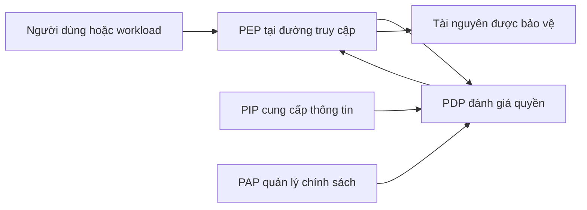

# Policy enforcement point

Một hệ thống có thể xác thực người dùng rất chặt chẽ, quản lý role đầy đủ và đánh giá chính sách chính xác nhưng vẫn để lộ dữ liệu nếu kết quả cấp quyền không được áp dụng ở nơi truy cập thực sự xảy ra.

**Policy enforcement point**, viết tắt **PEP**, là điểm thực thi chính sách: thành phần kiểm soát đường truy cập và áp dụng quyết định cấp quyền đối với thao tác trên tài nguyên.

Nếu bộ đánh giá quyền trả về “từ chối” nhưng API vẫn trả hóa đơn, chính sách đã không được thực thi. Nếu gateway cho phép gọi một endpoint nhưng backend không kiểm tra tenant của hóa đơn, quyền ở cấp đối tượng có thể vẫn bị bỏ sót.

Trong IAM, PEP nối các căn cứ về danh tính, phiên, role, thuộc tính và đặc quyền với hành vi thực tế của ứng dụng. Hiểu PEP giúp thiết kế hệ thống mà một quyết định quyền không chỉ tồn tại trong cấu hình hoặc log, mà thực sự giới hạn điều người dùng và workload có thể làm.

## 1. PEP làm gì?

### 1.1. Đứng trên đường truy cập cần được kiểm soát

PEP nhận hoặc chặn một yêu cầu trước khi thao tác được bảo vệ có hiệu lực. Nó thu thập ngữ cảnh cần thiết, lấy quyết định cấp quyền và áp dụng quyết định đó.

Một luồng khái niệm:

```text
Yêu cầu truy cập
    ↓
PEP xác định chủ thể, hành động, tài nguyên và ngữ cảnh
    ↓
Đánh giá chính sách tại chỗ hoặc gửi tới PDP
    ↓
PEP kiểm tra và thực thi kết quả
    ↓
Cho thao tác diễn ra trong phạm vi được phép, hoặc dừng yêu cầu
```

“Trước khi thao tác có hiệu lực” phụ thuộc loại tài nguyên:

- Với đọc dữ liệu: trước khi dữ liệu được trả cho bên gọi.
- Với ghi dữ liệu: trước khi thay đổi được chấp nhận theo ranh giới nhất quán của ứng dụng.
- Với gửi tác vụ: trước khi tác vụ được tiếp nhận theo chính sách; khi thực thi có thể còn cần một quyết định khác.
- Với gọi dịch vụ bên ngoài: trước khi phát sinh lời gọi có tác động cần bảo vệ.

PEP có thể cần đọc metadata nội bộ để biết tenant hoặc trạng thái tài nguyên. Điều đó khác với việc đã cho bên gọi đọc toàn bộ tài nguyên.

### 1.2. Thực thi cả giới hạn đi kèm quyết định

Quyết định không phải lúc nào cũng chỉ là một giá trị boolean.

Ví dụ, chính sách có thể cho phép:

- Đọc một số field, nhưng che các field nhạy cảm.
- Truy vấn trong phạm vi tenant hiện tại.
- Đọc danh sách đã được lọc theo quyền.
- Thực hiện hành động với điều kiện có bản ghi kiểm toán theo yêu cầu.
- Truy cập một tài nguyên cụ thể trong khoảng thời gian được xác định.

Nếu PEP nhận kết quả cho phép có giới hạn nhưng trả toàn bộ dữ liệu, nó đã mở rộng quyền so với quyết định.

PEP phải hiểu và thực thi các yêu cầu bắt buộc mà cơ chế chính sách trả về. Nếu không thể thực hiện, không nên coi kết quả đó là quyền truy cập không điều kiện.

### 1.3. PEP là vai trò kiến trúc

PEP không nhất thiết là một sản phẩm hoặc dịch vụ riêng.

Nó có thể là:

- Middleware hoặc filter của API.
- Đoạn kiểm soát ở lớp xử lý nghiệp vụ.
- Gateway hoặc proxy.
- Lớp truy cập dữ liệu.
- Cơ chế kiểm soát tại hệ quản trị dữ liệu.
- Thành phần kiểm tra trước khi worker thực thi tác vụ.

Một hệ thống thường có nhiều PEP ở các ranh giới khác nhau. Điều quan trọng là chúng bảo vệ đúng thao tác và không để một đường khác bỏ qua cùng ràng buộc cần thiết.

## 2. Phân biệt PEP, PDP, PIP và PAP

Các tên dưới đây thường xuất hiện trong kiến trúc cấp quyền. Cách đóng gói cụ thể có thể khác giữa các nền tảng.

| Thành phần | Vai trò khái niệm | Ví dụ |
|---|---|---|
| PEP — Policy enforcement point | Kiểm soát truy cập và áp dụng kết quả | API dừng yêu cầu đọc hóa đơn bị từ chối |
| PDP — Policy decision point | Đánh giá yêu cầu theo chính sách và trả quyết định | Bộ máy xác định Lan có quyền đọc hóa đơn không |
| PIP — Policy information point | Cung cấp thông tin dùng để đánh giá | Nguồn membership, trạng thái account hoặc metadata tài nguyên |
| PAP — Policy administration point | Quản lý, cập nhật và phân phối chính sách | Công cụ quản trị policy và quy trình phát hành phiên bản |

### 2.1. Quyết định khác với thực thi

PDP có thể kết luận:

```text
Lan không được duyệt hóa đơn invoice-9001.
```

PEP phải bảo đảm không có bước duyệt hóa đơn xảy ra trên đường xử lý đó.

PDP không tự ngăn được một backend bỏ qua lời gọi kiểm tra quyền. Ngược lại, PEP không thể áp dụng đúng nếu không hiểu action, resource hoặc kết quả trả về.

Hai vai trò có thể nằm trong cùng tiến trình. Một thư viện được API gọi để đánh giá policy có thể đảm nhiệm PDP, còn mã điều khiển luồng xử lý và dữ liệu trả ra đảm nhiệm PEP.

### 2.2. Dữ liệu đúng là điều kiện cho quyết định đúng

Nếu PEP gửi sai tenant của tài nguyên hoặc lấy account ID từ request body làm danh tính người gọi, PDP có thể đánh giá hoàn toàn nhất quán nhưng trên dữ liệu sai.

Do đó, trách nhiệm của PEP thường gồm việc xây dựng hoặc sử dụng đúng yêu cầu cấp quyền từ các nguồn được tin cậy.

PIP có thể cung cấp thuộc tính, nhưng hệ thống vẫn phải xác định nguồn nào có thẩm quyền, độ mới nào được chấp nhận và cách xử lý khi thiếu dữ liệu.

### 2.3. Mối quan hệ tổng thể



Sơ đồ thể hiện trách nhiệm, không bắt buộc mọi PEP phải gọi một PDP từ xa cho từng request. Chính sách có thể được đánh giá tại chỗ hoặc có cơ chế cache, miễn vẫn bảo toàn ngữ nghĩa và giới hạn cập nhật đã thiết kế.

## 3. PEP khác với xác thực như thế nào?

### 3.1. Xác thực thiết lập danh tính; PEP thực thi quyền

Xác thực trả lời câu hỏi về bằng chứng và danh tính của bên truy cập.

Cấp quyền trả lời câu hỏi bên đó có được thực hiện hành động cụ thể trên tài nguyên cụ thể không.

PEP là nơi quyết định cấp quyền được biến thành hành vi cho phép, từ chối hoặc giới hạn kết quả.

Ví dụ:

```text
Token hợp lệ
    → có căn cứ nhận diện bên gọi

Token hợp lệ và có quyền invoice.read trong tenant A
    → có thể đọc hóa đơn phù hợp ở tenant A

Token hợp lệ nhưng yêu cầu hóa đơn thuộc tenant B
    → không tự được phép chỉ vì token hợp lệ
```

Một middleware có thể vừa xác thực vừa thực thi một phần cấp quyền. Hai chức năng vẫn cần được phân biệt khi thiết kế và kiểm tra.

### 3.2. Scope hoặc role không tự thực thi

Có role `invoice_viewer` trong ngữ cảnh request không có tác dụng nếu endpoint không kiểm tra quyền tương ứng.

Tương tự, access token có scope đọc không tự ngăn một API thực hiện thao tác xóa. Resource server phải diễn giải scope và thực thi ràng buộc theo chính sách.

SSO, MFA và chữ ký token giúp cung cấp căn cứ cho ngữ cảnh bảo mật. Chúng không thay thế kiểm tra action, resource và phạm vi tại nơi thực thi.

### 3.3. Giao diện không phải ranh giới thực thi đủ cho API

Ẩn nút “Duyệt hóa đơn” giúp giao diện phù hợp với quyền, nhưng người gọi vẫn có thể gửi request trực tiếp.

Nếu API là nơi thay đổi trạng thái, API cần PEP tương ứng. Kết quả kiểm tra quyền ở giao diện là thông tin trải nghiệm, không phải căn cứ duy nhất để backend bỏ kiểm tra.

## 4. Đặt PEP ở đâu?

| Vị trí | Thường kiểm soát tốt | Giới hạn cần lưu ý |
|---|---|---|
| Gateway | Tuyến API, danh tính service, giới hạn truy cập ở mức tổng quát | Có thể không biết tenant hoặc trạng thái thực của từng đối tượng |
| API middleware | Quyền theo endpoint và ngữ cảnh request | Cần tránh chỉ kiểm tra tên role mà bỏ qua tài nguyên |
| Lớp nghiệp vụ | Quyền theo đối tượng, trạng thái và quy tắc thao tác | Phải bảo đảm mọi đường gọi đều đi qua kiểm soát |
| Lớp dữ liệu | Phạm vi hàng, truy vấn và một số giới hạn dữ liệu | Cần giữ đúng ngữ cảnh danh tính và hiểu giới hạn của cơ chế |
| Worker | Quyền tại thời điểm thực thi tác vụ | Cần phân biệt người yêu cầu với chủ thể thực thi |
| Cổng xuất dữ liệu | Field, phạm vi và đích nhận | Cần kiểm soát trước khi dữ liệu được phát ra |

### 4.1. Gateway và service có thể cùng thực thi

Gateway có thể từ chối request không có quyền gọi API hóa đơn. Sau đó, service kiểm tra Lan có quyền đọc chính hóa đơn đang yêu cầu hay không.

Đây là hai phạm vi bổ sung cho nhau. Không nên suy ra gateway đã cho đi qua thì mọi tài nguyên tại backend đều được phép.

Nếu backend có đường truy cập trực tiếp, nội bộ hoặc qua một gateway khác, các đường đó cũng phải đáp ứng ràng buộc cần thiết. Nhãn “nội bộ” không tự tạo quyền đọc mọi dữ liệu.

### 4.2. Một thay đổi trạng thái có thể có nhiều điểm cần kiểm soát

Ví dụ, cập nhật role người dùng có thể đi qua API, công cụ quản trị và job đồng bộ.

Nếu chỉ bảo vệ API công khai nhưng job chấp nhận role từ nguồn không có thẩm quyền, hệ thống vẫn có đường cấp quyền ngoài ý định.

Cần xem toàn bộ các cách tạo ra cùng tác động, không chỉ một URL phổ biến nhất.

## 5. Xây dựng yêu cầu cấp quyền đúng

### 5.1. Bốn nhóm thông tin

Một yêu cầu tới bộ đánh giá thường có bốn nhóm:

```text
Subject: chủ thể đang được đánh giá
Action: hành động cần thực hiện
Resource: tài nguyên thực tế
Context: điều kiện liên quan của yêu cầu
```

Ví dụ minh họa:

```json
{
  "subject": {
    "type": "human",
    "account_id": "account-2048"
  },
  "actor": {
    "client_id": "invoice-web"
  },
  "action": "invoice.approve",
  "resource": {
    "id": "invoice-9001",
    "tenant_id": "tenant-a",
    "status": "submitted",
    "version": 12
  },
  "context": {
    "authentication_profile": "application-step-up",
    "request_id": "request-71f"
  }
}
```

Đây là cấu trúc minh họa nội bộ, không phải schema chuẩn bắt buộc. Nhãn `application-step-up` có ý nghĩa theo chính sách ứng dụng trong ví dụ.

### 5.2. Nguồn của từng giá trị là một phần của bảo mật

PEP cần phân biệt:

| Giá trị | Nguồn phù hợp trong ví dụ |
|---|---|
| Account của người gọi | Ngữ cảnh đã được thiết lập từ xác thực và ánh xạ tin cậy |
| Actor/client | Cơ chế xác thực hoặc ủy quyền được hỗ trợ |
| Action | Thao tác mà handler thực sự sẽ thực hiện |
| Tenant và trạng thái hóa đơn | Metadata tài nguyên từ nguồn có thẩm quyền |
| Membership và role | Hệ thống quản lý quan hệ/quyền theo phạm vi |
| Mức xác thực | Kết quả hoặc ngữ cảnh xác thực đã được kiểm tra |
| Đích xuất dữ liệu | Cấu hình được phép hoặc đầu vào đã vượt qua kiểm tra tương ứng |

Không lấy `subject_id`, `role` hoặc `mfa=true` từ request body để coi là dữ liệu tin cậy.

Không lấy tenant mà client khai báo làm tenant của hóa đơn nếu chưa đối chiếu tài nguyên thật.

### 5.3. Action phải khớp tác động thực tế

Nếu endpoint được kiểm tra như hành động đọc nhưng sau đó thực hiện xóa hoặc thay role, quyết định đã được áp dụng sai.

Cần ánh xạ rõ route, phương thức và thao tác nghiệp vụ. Với endpoint tổng quát nhận nhiều loại lệnh, phải xác định action cho từng lệnh thực sự được chấp nhận.

Ví dụ:

```text
invoice.read
invoice.update
invoice.approve
invoice.delete
```

Bốn action này có thể có tập quyền và điều kiện khác nhau. Quyền cập nhật một số field không tự bao gồm quyền duyệt hóa đơn.

### 5.4. Cập nhật phải xét những gì có thể thay đổi

Một người có quyền sửa tên hiển thị không mặc nhiên có quyền sửa phòng ban, tenant hoặc role.

PEP hoặc lớp nghiệp vụ phải kiểm soát field được phép và giá trị chuyển đổi phù hợp. Nếu policy phụ thuộc vào trạng thái tài nguyên, cần xem cả trạng thái hiện tại và thay đổi đề xuất khi cần.

Ví dụ, cho sửa “account của mình” rồi chấp nhận mọi field có thể cho người dùng tự nâng role. Kiểm tra đúng chủ sở hữu chưa đủ cho mọi loại cập nhật.

## 6. Nhận và thực thi kết quả PDP

### 6.1. Hiểu đúng trạng thái quyết định

Một số bộ máy chính sách có những kết quả như sau:

| Kết quả | Ý nghĩa khái niệm | Cách PEP cần xử lý theo hợp đồng |
|---|---|---|
| Permit | Yêu cầu được phép theo điều kiện đã đánh giá | Chỉ thực hiện đúng phạm vi và yêu cầu bắt buộc đi kèm |
| Deny | Yêu cầu bị từ chối | Dừng thao tác được bảo vệ |
| Not applicable | Không có chính sách phù hợp cho yêu cầu theo ngữ nghĩa của engine | Không tự suy thành quyền không giới hạn |
| Indeterminate hoặc lỗi | Không xác định được kết quả, chẳng hạn thiếu dữ liệu hoặc lỗi đánh giá | Xử lý lỗi theo chính sách an toàn, không tự coi là Permit |

Không phải mọi engine sử dụng cùng tên hoặc cùng tập kết quả. PEP phải ánh xạ rõ các kết quả của cơ chế thực tế.

Một mặc định phù hợp cho tài nguyên được bảo vệ là chỉ cho phép khi có quyết định cho phép hợp lệ và đủ điều kiện thực thi. Timeout, phản hồi lạ hoặc dữ liệu không đầy đủ không nên trở thành đường mở quyền ngoài ý định.

### 6.2. Quyết định phải thuộc đúng yêu cầu

Nếu PDP ở xa, PEP cần giao tiếp với đúng nguồn quyết định qua cơ chế được bảo vệ và xác thực phù hợp.

Ngoài việc đọc `decision=PERMIT`, cần tránh nhầm phản hồi giữa các request hoặc tái sử dụng cho phạm vi khác. Hợp đồng có thể gồm:

- Identifier hoặc liên kết yêu cầu.
- Subject, action và resource được đánh giá.
- Phiên bản policy.
- Giới hạn thời gian hoặc điều kiện hiệu lực.
- Những yêu cầu thực thi bắt buộc.

Không dùng quyết định “Lan được đọc hóa đơn A” để cho Minh xóa hóa đơn B.

Một request ID giúp liên kết, nhưng không tự là bằng chứng xác thực phản hồi. Quan hệ tin cậy với PDP và tính đúng đắn của giao tiếp vẫn cần được bảo vệ.

### 6.3. Yêu cầu bắt buộc đi kèm quyết định

Một số mô hình gọi các hành động hoặc giới hạn bắt buộc là **obligations**. Ví dụ:

```json
{
  "decision": "PERMIT",
  "request_ref": "request-71f",
  "requirements": {
    "allowed_fields": ["id", "status", "total"],
    "resource_scope": {
      "tenant_id": "tenant-a"
    },
    "audit_required": true
  },
  "policy_version": "invoice-policy-18"
}
```

Đây là một hợp đồng minh họa, không phải định dạng chuẩn.

PEP cần biết cách áp dụng từng yêu cầu. Nếu không biết che field, không thể thay thế bằng việc trả toàn bộ tài liệu. Nếu không thực thi được scope, không được bỏ scope rồi chạy truy vấn rộng.

Thời điểm đáp ứng cũng quan trọng. Các giới hạn dữ liệu phải được áp dụng trước khi dữ liệu phát ra. Nếu chính sách yêu cầu có dấu vết bền vững trước thao tác, kiến trúc phải có cách đáp ứng điều đó; ghi log sau rồi trả lỗi không thể thu hồi một tác động đã xảy ra.

Một số hệ thống phân biệt yêu cầu bắt buộc với lời khuyên tùy chọn. PEP phải hiểu sự khác biệt theo hợp đồng, thay vì xử lý mọi metadata như có thể bỏ qua.

### 6.4. Yêu cầu xác thực bổ sung chưa cho phép thao tác

Nếu kết quả yêu cầu người dùng xác thực lại hoặc hoàn tất MFA, PEP chưa được thực hiện thao tác nhạy cảm.

Ứng dụng khởi tạo bước bổ sung phù hợp, kiểm tra kết quả và đánh giá lại trong ngữ cảnh mới.

Không được nhận một nhãn “cần MFA”, cho thao tác diễn ra trước rồi mới yêu cầu xác thực. Cũng không lấy việc account đã đăng ký MFA làm bằng chứng phiên hiện tại đã đáp ứng.

## 7. Ví dụ PEP tại API duyệt hóa đơn

Giả mã sau dùng một bộ đánh giá quyền và kiểm soát thay đổi theo phiên bản tài nguyên:

```text
function approveInvoice(request, invoiceId):
    authentication = authenticateRequest(request)
    if authentication is not valid:
        rejectUnauthenticatedAndStop()

    subject = resolveSubject(authentication.trustedIdentity)
    if subject is missing or subject is disabled:
        denyAndStop()

    invoice = loadInvoiceMetadata(invoiceId)
    membership = loadMembership(subject.id, invoice.tenantId)

    authorizationRequest = buildTrustedAuthorizationRequest(
        subject = subject,
        actor = authentication.trustedActor,
        delegation = authentication.trustedDelegation,
        membership = membership,
        action = "invoice.approve",
        resource = invoice,
        context = trustedAuthenticationContext(authentication)
    )

    decision = policyDecisionPoint.evaluate(authorizationRequest)

    if decision is not a valid matching PERMIT:
        recordDecisionFailureOrDenial(decision)
        stopAccordingToEndpointContract()

    if requiredControlsCannotBeSatisfied(decision):
        recordEnforcementFailure()
        denyAndStop()

    prepareRequiredControls(decision)

    result = approveInvoiceIfVersionMatches(
        invoiceId = invoice.id,
        expectedVersion = invoice.version,
        allowedTransition = "submitted_to_approved"
    )

    if result indicates changed resource:
        stopWithConflictAndRequireFreshEvaluation()

    recordOperationResult(subject, invoice, result)
    return allowedResponse(result, decision)
```

Các tên hàm thể hiện trách nhiệm, không phải API thư viện thực tế.

### 7.1. Kiểm tra trước tác động

Quyết định được áp dụng trước khi hóa đơn được duyệt. Không cập nhật rồi mới hỏi PDP, cũng không chỉ ghi log “không có quyền” sau khi đã thay đổi.

Các tác động phụ như gửi thông báo, tạo tác vụ hoặc gọi dịch vụ bên ngoài cũng phải được đặt trong luồng phù hợp. Không để một request bị từ chối vẫn kích hoạt công việc mà người gọi không được phép tạo.

### 7.2. Tránh dùng quyết định trên trạng thái đã thay đổi

Nếu policy được đánh giá khi hóa đơn ở phiên bản 12 nhưng một request khác đã thay đổi nó, quyết định cũ có thể không còn phù hợp.

Kiểm tra phiên bản hoặc điều kiện cập nhật giúp ràng buộc thao tác vào trạng thái đã đánh giá. Khi không còn khớp, cần dừng hoặc đánh giá lại theo cơ chế nhất quán của ứng dụng.

Đây là vấn đề **time of check to time of use — TOCTOU**: trạng thái có thể đổi giữa lúc kiểm tra và lúc sử dụng kết quả.

Một khóa hoặc version của hóa đơn không tự giải quyết mọi thay đổi bên ngoài, như membership vừa bị thu hồi ở hệ thống khác. Cần xác định tính nhất quán và giới hạn độ cũ cho các nguồn liên quan theo rủi ro của thao tác.

### 7.3. Phản hồi lỗi cần phản ánh nguyên nhân vận hành

Yêu cầu bị policy từ chối và yêu cầu không thể đánh giá vì PDP lỗi là hai tình huống khác nhau, dù cả hai có thể không được thực hiện.

Endpoint cần quy định phản hồi phù hợp, tránh làm lộ thông tin tài nguyên ngoài quyền, đồng thời để log phân biệt được lỗi chính sách, lỗi hệ thống và lỗi thực thi.

Không nên biến mọi lỗi hạ tầng thành một sự kiện “người dùng không đủ quyền” rồi mất khả năng điều tra.

## 8. PEP cho danh sách, xuất dữ liệu và xử lý hàng loạt

### 8.1. Quyền mở endpoint không có nghĩa được xem mọi dòng

Một người được phép gọi `invoice.list` vẫn có thể chỉ được thấy dữ liệu trong tenant hoặc phạm vi cụ thể.

Có thể thực thi bằng cách:

- Tạo truy vấn đã ràng buộc theo scope được phép.
- Dùng cơ chế lọc dữ liệu có ngữ nghĩa phù hợp.
- Kiểm tra đối tượng trước khi đưa vào kết quả.
- Kết hợp các cách trên theo kiến trúc.

Không trả toàn bộ dữ liệu xuống trình duyệt rồi mới ẩn các dòng không được phép.

Phân trang, tổng số bản ghi và các phép tổng hợp cũng cần được xem xét. Một danh sách đã ẩn nội dung nhưng vẫn tiết lộ số lượng tài nguyên không được phép có thể chưa đáp ứng yêu cầu.

### 8.2. Bộ lọc cần có hợp đồng thực thi an toàn

Nếu PDP trả điều kiện lọc, PEP hoặc lớp dữ liệu cần hiểu và áp dụng nó đúng ngữ nghĩa.

Nên sử dụng cấu trúc hoặc ngôn ngữ điều kiện được kiểm soát và biên dịch an toàn theo cơ chế hỗ trợ. Không nhận một chuỗi tùy ý rồi thực thi như mã hoặc câu truy vấn không được kiểm soát.

Nếu không biểu diễn được điều kiện trong kho dữ liệu đích, hệ thống phải có cách thực thi khác bảo toàn quyền hoặc từ chối, thay vì âm thầm bỏ điều kiện.

### 8.3. Tác vụ hàng loạt cần phạm vi rõ

Yêu cầu duyệt 100 hóa đơn có thể gặp các đối tượng với quyền khác nhau.

Ứng dụng cần xác định xử lý toàn bộ hoặc một phần, và đánh giá các action/resource tương ứng. Không kiểm tra hóa đơn đầu tiên rồi áp quyền đó cho 99 hóa đơn còn lại.

Nếu cho phép một phần, phản hồi và tác động phải thể hiện đúng các đối tượng thực sự được xử lý, đồng thời không làm lộ dữ liệu không được phép.

### 8.4. Xuất dữ liệu và stream kéo dài

Với báo cáo lớn hoặc stream dài, quyết định ban đầu có thể được sử dụng qua một khoảng thời gian đáng kể.

Cần quy định thời hạn, điểm kiểm tra lại và cách dừng khi điều kiện không còn đáp ứng. Một khi dữ liệu đã được gửi ra, không thể thu hồi chỉ bằng việc đổi quyết định sau đó.

PEP phải kiểm soát dữ liệu và đích nhận trước khi phát ra theo ranh giới của chức năng, đồng thời tuân thủ chính sách thay đổi quyền trong quá trình thực thi.

## 9. Cache quyết định, độ mới và lỗi hệ thống

### 9.1. Cache là một phần của chính sách hiệu lực

Cache có thể giảm độ trễ và phụ thuộc mạng, nhưng cũng kéo dài thời gian sử dụng một kết quả cũ.

Một khóa cache chỉ có `account_id` thường không đủ. Quyết định còn có thể phụ thuộc vào:

- Miền định danh và loại chủ thể.
- Actor hoặc quan hệ ủy quyền.
- Action.
- Resource và phiên bản tài nguyên.
- Tenant, membership và role có phạm vi.
- Mức hoặc thời điểm xác thực.
- Phiên bản policy.
- Các thuộc tính và điều kiện liên quan.

Không tái sử dụng một Permit cho yêu cầu khác chỉ vì cùng người dùng.

Nếu cache lưu kết quả có yêu cầu che field hoặc giới hạn scope, phải giữ và thực thi cả các yêu cầu đó. Lưu mỗi giá trị `true` có thể làm mất giới hạn cần thiết.

### 9.2. Thời hạn và thu hồi phải được giải thích được

Khi account bị khóa hoặc role bị thu hồi, cần biết quyết định cache nào có thể còn được sử dụng.

Thiết kế có thể dùng thời hạn, sự kiện vô hiệu hóa, version hoặc kiểm tra lại theo kiến trúc. Không có một TTL đúng cho mọi thao tác.

Quyền đọc nội dung ít nhạy cảm và quyền thay cấu hình IAM có thể cần yêu cầu độ mới khác nhau. Cần lựa chọn theo phạm vi tác động, đồng thời ghi rõ giới hạn chấp nhận dữ liệu cũ.

Cache kết quả từ chối cũng có tác động: người vừa được cấp quyền có thể tiếp tục bị chặn cho tới khi cache cập nhật. Độ trễ cấp quyền và độ trễ thu hồi cần được xem xét riêng.

### 9.3. Timeout không được biến thành Permit ngoài ý định

Nếu PDP không phản hồi, PEP phải có hành vi được thiết kế trước.

Với tài nguyên được bảo vệ, không nên có nhánh như:

```text
Nếu gọi PDP lỗi:
    cho phép để request tiếp tục
```

Nhánh này biến sự cố hoặc khả năng gây lỗi thành đường bỏ kiểm soát.

Một quyết định cache còn hiệu lực theo hợp đồng có thể được sử dụng nếu thiết kế cho phép và đủ căn cứ. Chính sách công khai được đánh giá tại chỗ cũng có thể tiếp tục phục vụ phạm vi công khai. Các trường hợp đó cần điều kiện và giới hạn rõ ràng, thay vì mở toàn bộ quyền khi hệ thống lỗi.

Nếu không có căn cứ cho phép hợp lệ, dừng thao tác và trả lỗi phù hợp với hợp đồng của endpoint.

### 9.4. Thiết kế khả dụng không cần bỏ kiểm soát

Có thể cải thiện khả dụng bằng:

- Đánh giá policy tại chỗ với phiên bản được quản lý.
- Triển khai PDP có khả năng phục hồi phù hợp.
- Cache có phạm vi, thời hạn và điều kiện rõ ràng.
- Giới hạn timeout cùng retry có kiểm soát.
- Theo dõi nguồn thuộc tính và lỗi phân phối policy.
- Phân biệt tải công khai với thao tác cần quyết định nhạy cảm.

PEP cần quan sát được kết quả nào đến từ đánh giá mới, cache hay cơ chế được dự phòng hợp lệ. Nếu không, khó giải thích vì sao một quyền đã thu hồi vẫn được chấp nhận.

## 10. PEP trong luồng workload, ủy quyền và tác vụ nền

### 10.1. Danh tính dịch vụ không thay thế quyền người dùng

Backend có thể gọi API bằng credential workload. API nhận diện được service nhưng chưa chắc biết người dùng nào được đại diện.

Nếu nghiệp vụ cần quyền của người dùng, PEP phải có căn cứ tin cậy cho subject đó cùng phạm vi ủy quyền. Không lấy `user_id` trong thông điệp do bên gọi tự khai báo làm bằng chứng.

Nếu tác vụ chạy bằng quyền riêng của service, PEP cần kiểm tra đúng chính sách dành cho service thay vì gắn một người dùng giả định.

### 10.2. Kiểm soát lúc tạo tác vụ và lúc chạy có thể khác nhau

Lan yêu cầu xuất báo cáo. API kiểm tra Lan có quyền tạo job, sau đó worker chạy vài phút sau.

Có thể cần hai PEP:

1. PEP tiếp nhận kiểm tra quyền tạo tác vụ và phạm vi yêu cầu.
2. PEP tại worker kiểm tra quyền thực thi theo mô hình đã chọn.

Ngữ cảnh có thể phân biệt:

```text
requested_by: Lan
executing_subject: workload báo cáo
represented_subject: chỉ có khi có mô hình đại diện hợp lệ
target_scope: tenant và tài nguyên được chấp nhận
```

Nếu chính sách đòi hỏi quyền của Lan vẫn còn hiệu lực lúc chạy, worker phải kiểm tra lại. Nếu service được phép hoàn tất tác vụ đã tiếp nhận bằng quyền riêng, phải có giới hạn rõ cho quyền service và nội dung job.

Sao chép mọi role người dùng vào message rồi sử dụng vô thời hạn có thể làm quyền cũ tồn tại ngoài ý định.

### 10.3. Message và ngữ cảnh cần được bảo vệ

PEP tại worker cần biết thông điệp đến từ đâu và dữ liệu nào được phép dùng để cấp quyền.

Quyền ghi vào hàng đợi, thay payload, chọn tenant hoặc đích xuất có thể ảnh hưởng tới thao tác worker thực hiện. Xác thực broker không tự làm mọi field trong message trở thành danh tính đáng tin.

Worker phải kiểm tra hợp đồng thông điệp, nguồn được phép và các ràng buộc tài nguyên theo mô hình tin cậy. Những kiểm tra đó đặc biệt quan trọng khi worker có quyền rộng hơn người tạo yêu cầu.

## 11. Kiểm toán và vận hành PEP

### 11.1. Ghi nhận cả quyết định và việc thực thi

Một sự kiện minh họa:

```json
{
  "event": "authorization_enforced",
  "subject_type": "human",
  "subject_account_id": "account-2048",
  "actor_client_id": "invoice-web",
  "action": "invoice.approve",
  "resource_id": "invoice-9001",
  "target_tenant_id": "tenant-a",
  "evaluated_resource_version": 12,
  "policy_version": "invoice-policy-18",
  "decision": "PERMIT",
  "enforcement_result": "APPLIED",
  "operation_result": "SUCCESS",
  "decision_source": "fresh_evaluation",
  "request_id": "request-71f",
  "occurred_at": "2026-10-01T08:00:00Z"
}
```

Đây là schema minh họa.

Ba kết quả cần phân biệt:

- **Decision:** bộ đánh giá kết luận gì?
- **Enforcement result:** PEP có áp dụng đúng quyết định và yêu cầu bắt buộc không?
- **Operation result:** thao tác nghiệp vụ cuối cùng thành công hay thất bại?

PDP trả Permit nhưng PEP không thực hiện được giới hạn bắt buộc là lỗi thực thi, không phải một lần truy cập thành công.

Ngược lại, PEP áp quyền đúng nhưng cơ sở dữ liệu gặp sự cố là lỗi thao tác; không nên ghi thành người dùng bị policy từ chối.

### 11.2. Đủ thông tin, không ghi credential

Log thường cần identifier ổn định, phạm vi, action, resource, phiên bản liên quan và thông tin actor khi có ủy quyền.

Không ghi mật khẩu, private key, session cookie, access token hoặc toàn bộ hồ sơ người dùng chỉ để chứng minh đã kiểm tra quyền.

Nếu cần giải thích nguồn thuộc tính, có thể dùng tham chiếu hoặc version phù hợp thay vì sao chép mọi dữ liệu nhạy cảm vào mỗi sự kiện. Các tham chiếu vẫn có thể cho phép liên kết hoạt động và cần được bảo vệ.

### 11.3. Theo dõi khả năng thực thi thực tế

Những tín hiệu hữu ích có thể gồm:

- Tỷ lệ Permit, Deny và lỗi đánh giá.
- Độ trễ PDP và nguồn thuộc tính.
- Quyết định từ cache và độ mới của dữ liệu liên quan.
- Số lần không áp dụng được yêu cầu bắt buộc.
- Lỗi version hoặc trạng thái đã thay đổi.
- Đường truy cập không đi qua cơ chế kiểm soát dự kiến.
- Chênh lệch giữa quyết định và thao tác thực sự.

Một hệ thống chỉ đếm số lần gọi PDP chưa chứng minh PEP đã chặn đúng. Cần quan sát cả hành vi sau khi có quyết định.

### 11.4. Bảo vệ cấu hình thực thi

Quyền thay cấu hình gateway, middleware, mapping action hoặc chế độ kiểm tra có thể làm thay đổi quyền truy cập thực tế.

Cần kiểm soát bên có thể:

- Tắt hoặc bỏ qua PEP.
- Chọn PDP hoặc nguồn policy khác.
- Thay quy tắc lỗi thành cho phép.
- Thay nguồn danh tính hoặc thuộc tính.
- Gắn nhãn tài nguyên thành công khai.
- Thay mapping từ endpoint sang action.

Một cờ tạm để bỏ kiểm tra có thể trở thành đường truy cập lâu dài nếu không được quản lý. Thay đổi cấu hình thực thi cần được coi là thay đổi bảo mật có owner và dấu vết phù hợp.

## 12. Các tình huống giúp hiểu ranh giới PEP

### 12.1. Gateway cho phép nhưng hóa đơn thuộc tenant khác

Lan có quyền gọi API hóa đơn, nhưng identifier cô gửi trỏ tới hóa đơn của tenant B.

**Phân tích:** gateway có thể đã thực thi đúng quyền gọi API ở mức tổng quát. PEP tại service vẫn phải kiểm tra quyền trên hóa đơn thực tế. Không được lấy Permit ở gateway làm quyền đọc mọi hóa đơn.

### 12.2. PDP cho đọc với danh sách field giới hạn

PDP cho phép đọc `id`, `status` và `total`, nhưng serializer mặc định trả thêm thông tin nội bộ.

**Phân tích:** quyết định đã bị thực thi sai. PEP hoặc lớp kết xuất phải bảo đảm chỉ field được phép đi ra. Nếu không thể bảo đảm, không được trả phản hồi rộng rồi coi việc ghi log là đủ.

### 12.3. Chính sách thay đổi nhưng Permit cũ vẫn nằm trong cache

Một role bị thu hồi, song endpoint tiếp tục dùng Permit được cache theo account ID.

**Phân tích:** cần xem khóa cache, thời hạn, version và cơ chế cập nhật. Quyết định không thể được tái sử dụng ngoài phạm vi và thời gian đã được thiết kế. Nếu thu hồi cần hiệu lực nhanh hơn, kiến trúc cache và cập nhật phải đáp ứng giới hạn đó.

### 12.4. Kiểm tra quyền sau khi gửi email

Endpoint gửi một tài liệu ra email rồi mới kiểm tra quyền đọc tài liệu của người gọi.

**Phân tích:** PEP đứng sau tác động đã không bảo vệ thao tác cần kiểm soát. Từ chối phản hồi HTTP sau đó không lấy lại được dữ liệu đã gửi. Cần kiểm tra quyền nguồn, thao tác gửi và đích nhận trước khi phát sinh tác động.

## 13. Những lỗi thiết kế thường gặp

| Lỗi | Hậu quả | Cách thiết kế phù hợp |
|---|---|---|
| Chỉ hỏi PDP nhưng không chặn thao tác | Policy không có hiệu lực thực tế | Ràng buộc quyết định với luồng xử lý |
| Kiểm tra sau khi tác động đã xảy ra | Dữ liệu hoặc trạng thái đã thay đổi ngoài quyền | Thực thi ở trước ranh giới cần bảo vệ |
| Tin danh tính hoặc tenant tự khai báo | Quyết định dựa trên chủ thể/tài nguyên sai | Dùng ngữ cảnh và metadata có nguồn tin cậy |
| Gateway Permit thì backend cho mọi đối tượng | Truy cập chéo tài nguyên hoặc tenant | Thực thi quyền ở mức cần thiết tại service |
| Có role đọc thì cho endpoint ghi | Sai action | Ánh xạ đúng thao tác thực tế |
| Bỏ qua yêu cầu che field hoặc lọc scope | Trả nhiều dữ liệu hơn được phép | Thực thi đầy đủ hợp đồng kết quả |
| Timeout PDP thì cho phép | Sự cố tạo đường bỏ kiểm soát | Có chính sách lỗi an toàn và căn cứ cho phép rõ |
| Cache chỉ theo tên người dùng | Dùng nhầm quyết định cho action/resource khác | Giữ đầy đủ phạm vi và điều kiện hiệu lực |
| Không xét trạng thái thay đổi trước khi ghi | Dùng quyền trên trạng thái đã cũ | Áp dụng cơ chế nhất quán phù hợp |
| Chỉ kiểm tra lúc tạo job | Worker có thể thực hiện ngoài chính sách lúc chạy | Xác định PEP và subject cho từng giai đoạn |
| Lọc ở giao diện sau khi đã gửi toàn bộ dữ liệu | Dữ liệu bị lộ dù không hiển thị | Lọc trước khi phát ra khỏi ranh giới bảo vệ |

## 14. Câu hỏi thiết kế cần trả lời được

1. Thao tác và tài nguyên nào được bảo vệ, và PEP đứng trước tác động nào?
2. Mọi đường tạo cùng tác động có đi qua kiểm soát cần thiết không?
3. Subject, actor, action, resource và context được lấy từ nguồn nào?
4. PEP dùng PDP tại chỗ, từ xa hay một cơ chế khác, và phản hồi được tin cậy ra sao?
5. Kết quả ngoài Permit, timeout hoặc thiếu thuộc tính được xử lý thế nào?
6. Các yêu cầu bắt buộc như scope, field và audit được thực thi tại đâu?
7. Cache có giữ đúng điều kiện, giới hạn thời gian và ảnh hưởng thu hồi không?
8. Thao tác ghi được ràng buộc với trạng thái đã đánh giá bằng cơ chế nào?
9. Danh sách, export, stream và batch có bảo toàn cùng ngữ nghĩa quyền không?
10. Tác vụ nền dùng quyền người yêu cầu hay quyền workload, và kiểm tra lại khi nào?
11. Log có phân biệt quyết định, thực thi và kết quả nghiệp vụ không?
12. Ai được thay hoặc bỏ qua cấu hình PEP?

## 15. Những điểm cần ghi nhớ

PEP là nơi biến quyết định cấp quyền thành kiểm soát truy cập thực tế. PDP đánh giá quyền; PEP bảo đảm đúng thao tác và đúng dữ liệu được cho phép, từ chối hoặc giới hạn.

Một PEP hiệu quả cần đầu vào tin cậy, mapping action rõ ràng, kiểm soát tài nguyên thực tế và thực thi đầy đủ các yêu cầu bắt buộc. Xác thực thành công, token hợp lệ hoặc gateway cho đi qua chưa đủ để chứng minh quyền trên từng đối tượng.

Vòng đời danh tính, thay đổi role, cache, lỗi PDP và xử lý bất đồng bộ đều ảnh hưởng tới kết quả thực thi. Thiết kế phải giữ rõ phạm vi và độ mới của quyết định, đặt kiểm soát trước tác động, đồng thời có kiểm toán giải thích được điều gì đã thực sự xảy ra.
