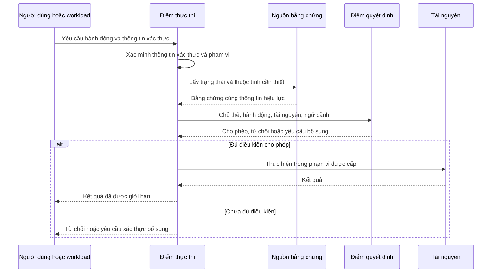

# Never trust, always verify: xác minh tường minh trong Zero Trust IAM

## 1. Ý nghĩa của nguyên tắc

“Never trust, always verify” thường được dùng để diễn đạt một ý tưởng cốt lõi của Zero Trust: **không cấp quyền truy cập chỉ dựa trên một giả định tin cậy sẵn có; hãy xác minh các bằng chứng cần thiết cho yêu cầu truy cập cụ thể**.

Trong IAM, những giả định dễ gặp gồm:

- Người dùng đã đăng nhập một lần nên mọi thao tác sau đó đều được chấp nhận.
- Request đến từ mạng nội bộ hoặc VPN nên chủ thể đáng tin cậy.
- Một dịch vụ có chứng thư hợp lệ nên được gọi mọi API nội bộ.
- Tài khoản mang tên `admin` nên được phép thao tác trên mọi tài nguyên.
- Token có chữ ký hợp lệ nên các quyền bên trong luôn còn đúng.

Các thông tin này có thể có ích, nhưng không thông tin nào tự trả lời đầy đủ câu hỏi: “Chủ thể này có được thực hiện hành động này, trên tài nguyên này, trong ngữ cảnh hiện tại không?”.

Nguyên tắc không yêu cầu loại bỏ mọi nền tảng tin cậy. Hệ thống vẫn cần tin có điều kiện vào những thành phần được lựa chọn và bảo vệ, như nhà phát hành danh tính, khóa xác minh, nguồn thuộc tính và bộ máy quyết định chính sách. Điều cần loại bỏ là sự tin cậy ngầm, không có phạm vi hoặc không được đánh giá lại khi điều kiện thay đổi.

Ví dụ xuyên suốt: Lan là nhân viên quản lý hợp đồng của An Bình. Lan đã đăng nhập qua SSO và kết nối VPN. Hệ thống có thể cho Lan xem một hợp đồng thuộc phạm vi được giao, nhưng thao tác xuất toàn bộ hợp đồng vẫn cần quyền riêng và có thể yêu cầu xác thực tăng cường. Nếu Lan vừa bị thu hồi quyền, VPN và phiên đăng nhập cũ không nên giữ nguyên quyền xuất dữ liệu.

## 2. Xác minh danh tính không thay thế xác minh quyền

Một yêu cầu truy cập thường cần nhiều nhóm bằng chứng:

| Nhóm kiểm tra | Câu hỏi cần trả lời | Ví dụ |
| --- | --- | --- |
| Xác thực | Chủ thể là ai và thông tin xác thực có hợp lệ không? | Access token được xác minh và dành cho API này |
| Trạng thái danh tính | Tài khoản hoặc workload có còn được sử dụng không? | Tài khoản chưa bị khóa |
| Quyền và quan hệ | Chủ thể có quyền cho hành động trên tài nguyên này không? | Lan có quyền đọc hợp đồng được phân công |
| Phạm vi | Quyền áp dụng trong tổ chức, tenant hoặc môi trường nào? | Quyền của An Bình không dùng cho Minh Hải |
| Ngữ cảnh | Điều kiện bổ sung của thao tác có được đáp ứng không? | Thiết bị đáp ứng yêu cầu, xác thực đủ mới |
| Hiệu lực bằng chứng | Dữ liệu kiểm tra có đáng tin và còn đủ mới không? | Kết quả kiểm tra thiết bị chưa quá hạn theo chính sách |

Có thể biểu diễn quyết định như sau:

```text
QUYẾT_ĐỊNH_TRUY_CẬP = chính_sách(
    danh_tính_đã_xác_minh,
    trạng_thái_hiện_hành,
    hành_động,
    tài_nguyên,
    phạm_vi,
    ngữ_cảnh,
    chất_lượng_và_độ_mới_của_bằng_chứng
)
```

Một người dùng xác thực thành công vẫn có thể bị từ chối truy cập. Ngược lại, nếu thiếu bằng chứng bắt buộc về danh tính, hệ thống không được bỏ qua bước đó chỉ vì người dùng có tên trong một danh sách vai trò.

Cách tách này cũng giúp hiểu đúng xác thực tăng cường: hoàn thành MFA có thể đáp ứng một điều kiện xác thực, nhưng không tự tạo ra một quyền nghiệp vụ mà người dùng chưa có.

## 3. Những điều không nên được coi là bằng chứng đủ

### 3.1. Vị trí mạng

Mạng nội bộ, địa chỉ IP quen thuộc hoặc VPN có thể là tín hiệu ngữ cảnh. Chúng không chứng minh request đến từ đúng người dùng, tài khoản chưa bị chiếm đoạt hoặc hành động đang được phép.

Một máy bị xâm nhập có thể ở trong mạng nội bộ. Một tài khoản hợp lệ cũng có thể cố truy cập ngoài phạm vi công việc.

Vì vậy, khi Lan gọi API từ VPN, API vẫn phải kiểm tra danh tính, hành động và tài nguyên. Việc áp dụng Zero Trust không làm cho kiểm soát mạng trở nên vô ích; kiểm soát mạng vẫn là một lớp giảm bề mặt tấn công, nhưng không thay thế IAM ở tầng tài nguyên.

### 3.2. Kết quả đăng nhập trước đó

Đăng nhập thành công tại thời điểm đầu phiên không bảo đảm mọi điều kiện tiếp tục giữ nguyên:

- Tài khoản có thể bị khóa.
- Quan hệ thành viên có thể bị thu hồi.
- Vai trò hoặc chính sách có thể thay đổi.
- Thiết bị có thể không còn đáp ứng yêu cầu.
- Thao tác mới có thể nhạy cảm hơn thao tác trước.

Hệ thống cần quy định lúc nào kiểm tra lại và kết quả trước đó được sử dụng trong bao lâu.

### 3.3. Tên vai trò hoặc tên tài khoản

Tên `admin`, `trusted-service` hoặc `internal-user` chỉ là nhãn nếu không có định nghĩa quyền và phạm vi rõ ràng.

Vai trò quản trị của một tenant không mặc nhiên là quyền quản trị nền tảng. Tài khoản dịch vụ chạy trong môi trường thử nghiệm không vì mang cùng tên với dịch vụ sản xuất mà được truy cập dữ liệu sản xuất.

### 3.4. Thông tin do phía gọi tự khai

Một header như `X-User-ID`, trường `role=admin` trong JSON hoặc claim chưa được xác minh không phải bằng chứng có thẩm quyền.

Nếu gateway truyền danh tính bằng header cho backend, đường truyền và cơ chế ủy thác cần được bảo vệ. Gateway phải xử lý các header do client tự gửi, và backend phải xác thực nguồn được phép đưa ra lời khẳng định đó. Không để client gọi trực tiếp backend rồi tự dựng header danh tính.

## 4. Xác minh bằng chứng theo bốn chiều

Không nên dừng ở câu hỏi “có thuộc tính hay không”. Mỗi loại bằng chứng cần được xem xét theo các chiều sau.

### 4.1. Nguồn có thẩm quyền

Ai có quyền khẳng định thông tin này?

Vai trò nên đến từ hệ thống quản lý quyền được chấp nhận. Tình trạng thiết bị nên đến từ nguồn được quản lý theo thiết kế. Danh tính workload phải được xác lập qua cơ chế phù hợp với môi trường chạy.

Nếu client tự gửi `deviceHealthy=true`, thuộc tính đó không tương đương kết quả đánh giá thiết bị từ một nguồn có thẩm quyền.

### 4.2. Tính toàn vẹn và ràng buộc

Bằng chứng có bị sửa, sử dụng nhầm chủ thể hoặc sử dụng nhầm tài nguyên không?

Một kết quả kiểm tra thiết bị cần liên quan đến thiết bị và phiên đang được đánh giá. Một quyền phê duyệt xuất dữ liệu cho tenant An Bình không được sử dụng để xuất dữ liệu của Minh Hải.

### 4.3. Phạm vi sử dụng

Bằng chứng được tạo để phục vụ ai và làm việc gì?

Một token dành cho API A không được API B chấp nhận chỉ vì cùng nhà phát hành. Một kết quả đăng nhập dùng cho ứng dụng giao diện cũng không tự trở thành giấy phép truy cập mọi API phía sau.

### 4.4. Độ mới và trạng thái thu hồi

Bằng chứng được tạo khi nào, còn hiệu lực trong bao lâu và có sự kiện nào khiến nó không còn đáng tin không?

Thời hạn token là một giới hạn hiệu lực của token, không phải bảo đảm rằng mọi vai trò chứa trong token chưa thay đổi. Tương tự, một ảnh chụp trạng thái thiết bị có thể không phản ánh sự cố xảy ra sau đó.

Chính sách cần xác định độ mới phù hợp với mức nhạy cảm của tài nguyên và khả năng vận hành. Không có một thời hạn duy nhất phù hợp cho mọi hành động.

## 5. Luồng quyết định và thực thi

Một cách tổ chức phổ biến là tách nơi thu thập bằng chứng, nơi quyết định và nơi thực thi. Đây là các vai trò logic; chúng có thể được triển khai trong một hoặc nhiều thành phần.

- **Điểm thực thi chính sách**, thường gọi là PEP, chặn yêu cầu trước khi cho truy cập tài nguyên.
- **Điểm quyết định chính sách**, thường gọi là PDP, đánh giá chính sách với dữ liệu được cung cấp.
- **Nguồn thông tin chính sách**, thường gọi là PIP, cung cấp thuộc tính hoặc trạng thái cần thiết.



Kết quả cho phép có thể kèm nghĩa vụ thực thi, chẳng hạn giới hạn trường dữ liệu, giới hạn tenant hoặc yêu cầu audit. Điểm thực thi phải có khả năng thực hiện đầy đủ các nghĩa vụ đó; không chỉ đọc chữ “ALLOW” rồi bỏ qua phần còn lại.

Kiểm tra cần diễn ra trước khi dữ liệu được tiết lộ hoặc tác động nghiệp vụ được tạo ra. Một response bị chặn sau khi email đã được gửi hoặc bản ghi đã bị sửa vẫn không bảo vệ được hành động ban đầu.

## 6. Ví dụ: xem hợp đồng và xuất toàn bộ hợp đồng

Giả sử An Bình định nghĩa hai hành động:

| Điều kiện | Xem hợp đồng được giao | Xuất toàn bộ hợp đồng |
| --- | --- | --- |
| Danh tính hợp lệ | Bắt buộc | Bắt buộc |
| Tư cách thành viên An Bình còn hiệu lực | Bắt buộc | Bắt buộc |
| Quyền nghiệp vụ | `contract:read` và quan hệ phù hợp với hợp đồng | `contract:export` |
| Phạm vi dữ liệu | Hợp đồng thuộc An Bình và phạm vi được cấp | Chỉ dữ liệu của An Bình được phép xuất |
| Yêu cầu thiết bị | Theo chính sách cho dữ liệu đang đọc | Có thể yêu cầu thiết bị được quản lý |
| Độ mới xác thực | Theo mức nhạy cảm | Có thể cần xác thực tăng cường gần thời điểm xuất |
| Audit | Ghi theo chính sách | Ghi rõ người yêu cầu, phạm vi và kết quả xuất |

Đây là chính sách minh họa, không phải cấu hình bắt buộc cho mọi hệ thống.

Lan có thể đủ quyền xem một hợp đồng nhưng chưa có `contract:export`. Trong trường hợp đó, yêu cầu Lan thực hiện thêm MFA không giải quyết được việc thiếu quyền xuất; kết quả vẫn phải là từ chối.

Nếu Lan có quyền xuất nhưng xác thực hiện tại chưa đáp ứng yêu cầu độ mới, hệ thống có thể yêu cầu xác thực bổ sung. Sau khi hoàn tất, phải đánh giá lại toàn bộ điều kiện liên quan, vì vai trò hoặc trạng thái tài khoản có thể đã thay đổi trong thời gian đó.

Nếu thiết bị không đáp ứng điều kiện bắt buộc, không nên giả định nhập thêm mật khẩu sẽ làm thiết bị trở nên phù hợp. Biện pháp khắc phục phải tương ứng với điều kiện đang thiếu.

## 7. Mã giả cho một quyết định truy cập

Đoạn sau minh họa cách tổ chức kiểm tra; các hàm đại diện cho những cơ chế cần được triển khai theo hệ thống cụ thể:

```text
function handleExportRequest(request, credential):
    identity = validateAccessCredential(
        credential,
        expectedIssuer = configuredIssuer,
        expectedAudience = contractApi
    )

    context = establishVerifiedScope(identity, request.tenantId)
    account = loadRequiredAccountState(identity.subject)
    membership = loadRequiredMembership(identity.subject, context.tenantId)
    deviceEvidence = loadDeviceEvidenceForCurrentContext(identity, request)

    evidence = {
        identity,
        context,
        account,
        membership,
        deviceEvidence
    }

    if requiredEvidenceIsMissingOrTooOld(evidence):
        denyWithoutStartingExport()

    decision = evaluatePolicy(
        subject = identity.subject,
        action = "contract:export",
        resource = verifiedTenantExportTarget(context),
        evidence = evidence
    )

    if decision.type == "DENY":
        auditDeniedDecision(decision)
        denyWithoutStartingExport()

    if decision.type == "REQUIRE_STEP_UP":
        return challengeBoundToCurrentRequest(decision)

    if decision.type != "ALLOW":
        denyWithoutStartingExport()

    requireAllObligationsCanBeEnforced(decision)
    executeExportWithinGrantedScope(decision)
    auditCompletedAction(decision)
```

Nếu cần xác thực bổ sung, request chưa được thực hiện. Sau khi nhận bằng chứng hoàn tất, server phải xác minh bằng chứng đó thuộc đúng luồng và đánh giá lại quyền trước khi chạy hành động.

Cờ `stepUpCompleted=true` trong request không phải bằng chứng. Kết quả từ một luồng xác thực khác cũng không được chấp nhận ngoài phạm vi mà hệ thống đã định.

Với thao tác ghi nhạy cảm, còn cần cân nhắc khoảng thời gian giữa quyết định và thực thi. Nếu điều kiện quan trọng có thể thay đổi trong khoảng đó, thiết kế có thể cần kiểm tra lại, ràng buộc phiên bản hoặc cơ chế nhất quán phù hợp ngay tại điểm thực thi.

## 8. “Always verify” không có nghĩa luôn hỏi lại mật khẩu

Mục tiêu là duy trì căn cứ cho quyết định truy cập, không phải bắt người dùng lặp lại đăng nhập ở mọi request.

Hệ thống có thể tái sử dụng bằng chứng còn hiệu lực trong phạm vi được phép:

- Phiên đăng nhập hoặc token đã xác minh.
- Trạng thái thành viên được cache với thời hạn và cơ chế làm mới.
- Kết quả xác thực tăng cường còn đủ mới cho hành động hiện tại.
- Quyền truy cập ngắn hạn đã được cấp cho đúng tài nguyên và mục đích.

Việc tái sử dụng cần có giới hạn. Một kết quả cho phép đọc hợp đồng không phải kết quả cho phép xuất dữ liệu; kết quả của tenant này không dùng cho tenant khác.

SSO có thể giảm số lần đăng nhập nhưng các ứng dụng vẫn phải thực hiện kiểm tra quyền của chính mình. MFA tăng chất lượng xác thực nhưng không thay thế kiểm tra hành động, phạm vi và tài nguyên.

Thiết kế tốt phân biệt ba tình huống:

1. Đã đủ bằng chứng và quyền: cho phép theo phạm vi.
2. Có thể bổ sung một điều kiện xác thực còn thiếu: yêu cầu bổ sung phù hợp.
3. Thiếu quyền, có bằng chứng xâm nhập hoặc vi phạm điều kiện không thể khắc phục bằng xác thực: từ chối theo chính sách.

Không nên biến mọi lần từ chối thành một vòng lặp hỏi thêm MFA. Cách làm đó gây khó sử dụng và có thể khiến người dùng hình thành thói quen chấp nhận yêu cầu xác thực mà không xem xét.

## 9. Đánh giá lại khi ngữ cảnh thay đổi

### 9.1. Chọn điểm đánh giá lại

Tùy tài nguyên và mô hình phiên, hệ thống có thể đánh giá:

- Khi thiết lập phiên hoặc bắt đầu kết nối.
- Khi nhận mỗi request đến tài nguyên.
- Trước thao tác có mức nhạy cảm cao hơn.
- Khi nhận sự kiện khóa tài khoản, thu hồi quyền hoặc phát hiện rủi ro.
- Theo chu kỳ phù hợp với kết nối hoặc tác vụ kéo dài.

“Liên tục” không có nghĩa mọi thuộc tính đều được truy vấn từ nguồn gốc trong từng gói tin. Nó có nghĩa quyền truy cập không được xem là bất biến sau quyết định đầu tiên, và hệ thống có cách đưa thay đổi quan trọng vào các quyết định tiếp theo.

### 9.2. Xử lý phiên và token đã cấp

Khóa tài khoản tại nhà cung cấp danh tính không nhất thiết tự kết thúc ngay mọi phiên ứng dụng hoặc làm mọi access token đã phát hành bị từ chối lập tức.

Khả năng thu hồi phụ thuộc vào cơ chế của các thành phần: trạng thái phiên tại ứng dụng, kiểm tra trực tuyến, sự kiện thu hồi, thời hạn token và cache quyền. Hệ thống phải hiểu khoảng trễ thực tế, thay vì hứa hẹn thu hồi tức thì khi chưa có cơ chế bảo đảm.

Một access token tự chứa có thể còn hợp lệ về chữ ký và thời hạn trong khi quyền nghiệp vụ đã bị thu hồi. Với hành động nhạy cảm, chỉ kiểm tra token có thể chưa đủ theo yêu cầu thu hồi của hệ thống.

### 9.3. Kết nối và tác vụ kéo dài

Một kết nối thời gian thực hoặc luồng tải dữ liệu có thể kéo dài sau thời điểm xác thực ban đầu. Cần quy định cách kiểm tra lại, dừng gửi dữ liệu hoặc đóng kết nối khi quyền không còn phù hợp.

Với job nền, phải xác định quyền được đánh giá tại lúc nhận yêu cầu, lúc chạy, hay cả hai. Nếu dùng quyền ủy nhiệm đã cấp, quyền đó cần giới hạn chủ thể, hành động, dữ liệu và thời gian.

Việc thu hồi ngăn truy cập tiếp theo trong khả năng của hệ thống; nó không tự lấy lại dữ liệu đã được tải xuống trước đó.

## 10. Áp dụng cho danh tính workload

Nguyên tắc cũng áp dụng khi bên gọi là dịch vụ, container, job hoặc tác nhân tự động.

Ví dụ, dịch vụ báo cáo có danh tính hợp lệ và giao tiếp được với dịch vụ hợp đồng. Dịch vụ hợp đồng vẫn cần kiểm tra:

- Bên gọi có được phép thực hiện hành động xuất hay chỉ được đọc?
- Yêu cầu áp dụng cho tenant hoặc môi trường nào?
- Bên gọi đang thao tác bằng quyền riêng hay thay mặt người dùng?
- Nếu thay mặt người dùng, việc ủy nhiệm có hợp lệ và có đúng phạm vi không?
- Thông tin xác thực và quyền cấp cho workload còn hiệu lực không?

Xác thực hai chiều trên kênh truyền có thể giúp xác lập danh tính hai đầu kết nối. Nó không tự quyết định quyền nghiệp vụ cho mọi API chạy trên kênh đó.

Tương tự, một thông tin xác thực tồn tại ngắn giúp giới hạn thời gian sử dụng nhưng không sửa được một chính sách cấp quyền quá rộng. Cần kết hợp định danh workload rõ ràng, quyền tối thiểu, phạm vi môi trường và cơ chế thay thế hoặc thu hồi thông tin xác thực.

Tránh dùng chung một API key có toàn quyền cho nhiều dịch vụ. Khi mọi workload dùng cùng một bí mật và danh tính, hệ thống khó xác minh đúng bên gọi, khó phân quyền riêng và khó điều tra khi có sự cố.

## 11. Cache, sự cố phụ thuộc và chế độ khẩn cấp

### 11.1. Cache phải giữ được ý nghĩa của quyết định

Cache giúp giảm độ trễ và phụ thuộc, nhưng có thể kéo dài hiệu lực của quyền cũ.

Khóa cache quyết định cần phản ánh các yếu tố làm thay đổi kết quả, chẳng hạn chủ thể, tenant, hành động, tài nguyên và phiên bản chính sách. Với điều kiện ngữ cảnh biến đổi, phải có cách giới hạn việc tái sử dụng phù hợp.

Không lấy quyết định `ALLOW` đã lưu cho một người dùng rồi áp dụng cho mọi tài nguyên mà người đó yêu cầu.

Thời hạn cache và cơ chế mất hiệu lực cần phù hợp với yêu cầu thu hồi. Khi nhận sự kiện quan trọng, hệ thống có thể phải bỏ quyết định cũ thay vì chờ cache hết hạn.

### 11.2. Thiếu dữ liệu không được tự diễn giải thành an toàn

Nếu nguồn trạng thái thiết bị không truy cập được, hệ thống chưa biết thiết bị có đáp ứng điều kiện bắt buộc hay không. Lỗi mạng không phải bằng chứng thiết bị khỏe.

Hành vi khi thiếu bằng chứng cần được định nghĩa trước. Đường truy cập nhạy cảm thường cần từ chối khi không thể xác minh điều kiện bắt buộc. Một khả năng hạn chế hơn chỉ được cho phép nếu chính sách đã xác định rõ dữ liệu, hành động và bằng chứng có thể dùng trong chế độ đó.

Không dùng một xử lý lỗi chung như “PDP không phản hồi thì cho qua” để giữ dịch vụ hoạt động.

### 11.3. Truy cập khẩn cấp là một chính sách riêng

Nếu cần cơ chế khẩn cấp, phải xác định danh tính đủ điều kiện, mục đích, tài nguyên, thời hạn và dấu vết kiểm toán.

Cơ chế đó không nên là một đường bỏ qua kiểm tra có thể bị client kích hoạt tùy ý. Quyền khẩn cấp cần được bảo vệ và đánh giá theo chính sách riêng, kể cả khi một số phụ thuộc vận hành đang gặp sự cố.

## 12. Quan sát và kiểm toán quyết định

Một quyết định cần đủ thông tin để giải thích vì sao yêu cầu được phép hoặc bị từ chối.

Ví dụ bản ghi minh họa:

```json
{
  "subjectId": "user-73",
  "tenantId": "tenant-an-binh",
  "action": "contract:export",
  "resourceId": "tenant-contract-collection",
  "decision": "DENY",
  "reasonCode": "MEMBERSHIP_INACTIVE",
  "policyVersion": "policy-18",
  "correlationId": "corr-92"
}
```

Tùy hệ thống, có thể bổ sung thời điểm đánh giá, nguồn bằng chứng và nghĩa vụ đã áp dụng. Không ghi nguyên token, mật khẩu hoặc bí mật xác thực vào log.

Thông báo cho người dùng nên giúp họ hiểu cách tiếp tục trong phạm vi phù hợp, nhưng không tiết lộ thông tin nhạy cảm về chính sách, tài nguyên khác hoặc cơ chế phát hiện rủi ro.

Chỉ số cần quan sát có thể gồm số lần từ chối do quyền hết hiệu lực, số yêu cầu xác thực bổ sung, độ trễ quyết định và số lần thiếu bằng chứng. Những chỉ số này giúp phát hiện cả lỗ hổng thực thi lẫn chính sách gây cản trở không cần thiết.

## 13. Kiểm thử nguyên tắc bằng các tình huống đối nghịch

| Tình huống | Điều cần xác nhận |
| --- | --- |
| Request từ VPN nhưng không có danh tính hợp lệ | Không được cấp quyền chỉ dựa trên mạng |
| Token có chữ ký hợp lệ nhưng dành cho API khác | Không được sử dụng tại API đang bảo vệ |
| Người dùng đăng nhập thành công nhưng không có quyền xuất | MFA bổ sung không tự tạo ra quyền xuất |
| Tài khoản hoặc tư cách thành viên vừa bị khóa | Các quyết định mới phản ánh thay đổi trong giới hạn thu hồi đã thiết kế |
| Client tự gửi header vai trò quản trị | Header không trở thành nguồn quyền có thẩm quyền |
| Kết quả cho phép được cache trước khi chính sách đổi | Không tiếp tục dùng ngoài giới hạn hiệu lực quy định |
| Thiết bị tự khai trạng thái khỏe | Không coi lời khai đó là bằng chứng đủ |
| Dịch vụ có danh tính hợp lệ gọi hành động ngoài quyền | Bị từ chối ở điểm thực thi tương ứng |
| Quyền của tenant A được sử dụng với tài nguyên tenant B | Không được vượt phạm vi |
| Yêu cầu xác thực tăng cường chưa hoàn tất | Không tạo side effect nghiệp vụ |
| PDP hoặc nguồn bằng chứng bị lỗi | Áp dụng hành vi sự cố đã định, không tự cho phép |
| Kết nối tồn tại lâu sau khi quyền thay đổi | Có hành vi đánh giá lại hoặc kết thúc theo chính sách |

Một hệ thống chỉ kiểm tra ở màn hình đăng nhập nhưng bỏ qua kiểm tra ở API, job nền hoặc dịch vụ nội bộ chưa duy trì được nguyên tắc trên các đường truy cập đó.

## 14. Cách đọc một quyết định truy cập đúng

Khi xem xét một thiết kế IAM theo nguyên tắc “Never trust, always verify”, hãy lần theo một request cụ thể:

1. Xác định danh tính thật của bên gọi và cách bằng chứng được xác minh.
2. Xác định hành động, tài nguyên và phạm vi mà request muốn sử dụng.
3. Tìm nguồn có thẩm quyền cho quyền, quan hệ và điều kiện ngữ cảnh.
4. Kiểm tra bằng chứng có đúng chủ thể, đúng mục đích và còn đủ mới.
5. Xác định điểm thực thi trước khi dữ liệu hoặc tác động nghiệp vụ xuất hiện.
6. Xem điều gì xảy ra khi quyền thay đổi hoặc nguồn bằng chứng gặp sự cố.

Trong tình huống của Lan, lý do cho phép xuất hợp đồng phải là một tập điều kiện đã được xác minh cho thao tác xuất của An Bình. “Lan đã vào VPN” hoặc “Lan đăng nhập từ sáng” chỉ là những thông tin chưa đủ để thay thế quyết định đó.
