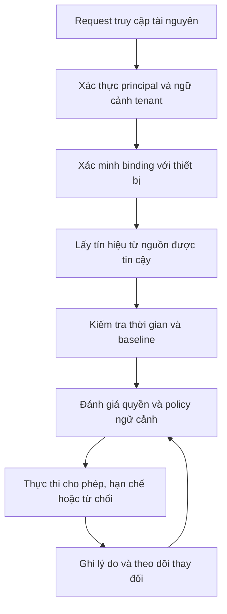

# Device context

## 1. Ngữ cảnh thiết bị đóng vai trò gì trong Zero Trust?

**Device context** là tập thông tin về thiết bị và trạng thái liên quan đến một yêu cầu truy cập. Trong IAM theo hướng Zero Trust, hệ thống có thể dùng những thông tin này cùng danh tính, quyền, tài nguyên và điều kiện môi trường để quyết định có cho phép một hành động hay không.

Ví dụ, cùng một nhân viên có quyền đọc báo cáo tài chính:

- Trên máy tính được tổ chức quản lý, có trạng thái bảo vệ phù hợp và bằng chứng còn mới, nhân viên có thể được tải báo cáo.
- Trên một thiết bị chưa xác định trạng thái, hệ thống có thể chỉ cho xem một phần nội dung qua một môi trường được kiểm soát.
- Trên thiết bị có cảnh báo rủi ro nghiêm trọng, hệ thống có thể chặn truy cập báo cáo dù người dùng nhập đúng mật khẩu và đã hoàn thành MFA.

Các kết quả trên là ví dụ policy của một tổ chức, không phải quy tắc cố định cho mọi hệ thống.

Device context bổ sung câu hỏi **“yêu cầu này xuất phát từ thiết bị nào và thiết bị đang ở trạng thái gì?”** vào các câu hỏi IAM vốn có:

```text
Ai đang yêu cầu?
Có quyền thực hiện hành động này không?
Trên tài nguyên và tenant nào?
Bằng phiên hoặc credential nào?
Thiết bị và ngữ cảnh hiện tại có đáp ứng policy không?
```

Thiết bị đạt yêu cầu không làm người dùng tự có thêm quyền nghiệp vụ. Ngược lại, người dùng có quyền nghiệp vụ cũng không mặc nhiên được dùng mọi thiết bị để thực hiện hành động nhạy cảm.

## 2. Phân biệt định danh, quản lý và trạng thái thiết bị

Một quyết định sai thường bắt đầu từ việc coi nhiều khái niệm khác nhau là một cờ `trusted_device=true`.

| Khái niệm | Câu hỏi | Ví dụ | Giới hạn |
| --- | --- | --- | --- |
| Device identifier | Hệ thống đang tham chiếu thiết bị nào? | Mã thiết bị trong registry nội bộ | Một chuỗi ID tự khai không chứng minh nguồn request |
| Device registration | Thiết bị đã được đăng ký theo quy trình nào? | Đăng ký khóa thiết bị với tổ chức | Đăng ký không chứng minh thiết bị luôn an toàn |
| Device management | Thiết bị có nằm trong phạm vi quản lý không? | Thiết bị thuộc hệ thống quản lý endpoint | Có bản ghi quản lý chưa đủ chứng minh trạng thái hiện tại |
| Device posture | Trạng thái thiết bị có đáp ứng điều kiện cụ thể không? | Mã hóa ổ đĩa, khóa màn hình, bản vá theo policy | Tín hiệu có thể cũ, thiếu hoặc sai |
| Device risk | Có dấu hiệu khiến mức rủi ro tăng không? | Cảnh báo từ giải pháp bảo vệ endpoint | Không có cảnh báo không đồng nghĩa chắc chắn không bị xâm nhập |
| Binding với phiên hoặc request | Bằng chứng thiết bị có thực sự thuộc yêu cầu này không? | Chứng minh sở hữu khóa đã liên kết với thiết bị | Phải xác minh theo cơ chế được hỗ trợ |

Một thiết bị được quản lý có thể không đáp ứng policy vì thiếu bản vá. Một thiết bị đạt kiểm tra ở buổi sáng có thể xuất hiện cảnh báo vào buổi chiều. Một cookie “ghi nhớ thiết bị” có thể giúp trải nghiệm đăng nhập nhưng không tự chứng minh trạng thái bảo vệ của hệ điều hành.

Trong ứng dụng web, User-Agent hoặc fingerprint trình duyệt thường chỉ là tín hiệu phụ. Chúng có thể thay đổi, bị giả mạo hoặc trùng giữa nhiều thiết bị. Không nên dùng chúng làm bằng chứng duy nhất để xác định một thiết bị được quản lý và đủ điều kiện truy cập.

## 3. Những tín hiệu thường được dùng

### 3.1. Nhóm tín hiệu

| Nhóm | Ví dụ thuộc tính | Câu hỏi khi sử dụng |
| --- | --- | --- |
| Định danh và đăng ký | Device ID, khóa hoặc chứng thư đã đăng ký | Ai cấp phát và ai xác minh quyền sở hữu? |
| Quản lý | Đơn vị quản lý, trạng thái đăng ký, phân loại sở hữu | Bản ghi còn hiệu lực và có đúng tenant không? |
| Hệ điều hành | Họ OS, phiên bản, thời điểm cập nhật | Có đáp ứng baseline của tổ chức không? |
| Bảo vệ dữ liệu | Trạng thái mã hóa lưu trữ, khóa màn hình | Nguồn báo cáo có đủ tin cậy không? |
| Bảo vệ endpoint | Trạng thái agent, cảnh báo rủi ro | Agent có hoạt động và dữ liệu có còn mới không? |
| Tính toàn vẹn | Kết quả kiểm tra hoặc attestation nếu có | Bằng chứng thực sự khẳng định điều gì và giới hạn ở đâu? |
| Quan hệ với request | Liên kết khóa, phiên, phương thức xác thực | Có ngăn việc gán trạng thái thiết bị khác vào request không? |

Không phải nền tảng nào cũng cung cấp được mọi thuộc tính. Đặc biệt, một trình duyệt thông thường không thể tự chứng minh đầy đủ trạng thái mã hóa ổ đĩa hay phần mềm bảo vệ endpoint chỉ bằng JavaScript trên trang web.

Khi thiếu năng lực thu thập, policy phải xử lý tình trạng chưa biết một cách rõ ràng. Không tự đổi `UNKNOWN` thành `COMPLIANT` để tránh lỗi giao diện.

### 3.2. Thuộc tính cần có nguồn gốc và thời gian

Một bản ghi khái niệm:

```json
{
  "device_id": "device_7d2",
  "tenant_id": "tenant_a",
  "management_state": "MANAGED",
  "posture_state": "COMPLIANT",
  "risk_state": "LOW",
  "source": "endpoint-management",
  "observed_at": "2026-01-15T08:00:00Z",
  "valid_until": "2026-01-15T08:05:00Z",
  "evidence_id": "evidence_92f"
}
```

Đây là schema minh họa, không phải định dạng chuẩn bắt buộc. Khoảng năm phút chỉ minh họa thời gian hiệu lực; hệ thống phải xác định giới hạn phù hợp với từng tín hiệu và hành động.

Các trạng thái tổng hợp như `COMPLIANT` cần truy được về baseline hoặc phiên bản policy đã dùng để đánh giá. Nếu policy thay đổi nhưng kết quả vẫn dựa trên baseline cũ, hệ thống không nên coi hai kết quả đó đương nhiên tương đương.

Không chỉ nhìn thời điểm nhận báo cáo. Một báo cáo mới được gửi lại có thể chứa quan sát đã cũ. Cần phân biệt thời gian quan sát, thời gian tiếp nhận và thời điểm hết hiệu lực.

## 4. Nguồn tin cậy và việc ràng buộc với request

### 4.1. Client tự khai không đủ để cấp quyền

Request sau không chứng minh thiết bị đáp ứng policy:

```http
GET /tenants/tenant_a/financial-reports
Authorization: Bearer <access-token>
X-Device-ID: device_7d2
X-Device-Compliant: true
```

Nếu client được tự đặt header, nó có thể gửi ID của một thiết bị khác hoặc đặt trạng thái tùy ý.

Máy chủ cần xác minh bằng chứng qua cơ chế đã được thiết kế, chẳng hạn nguồn quản lý endpoint có xác thực, dịch vụ đánh giá posture, agent được quản trị hoặc một cơ chế attestation phù hợp với nền tảng.

Ngay cả khi báo cáo có nguồn hợp lệ, vẫn cần xác định nó thuộc đúng thiết bị và đúng phiên hoặc request đang xét.

```text
Báo cáo hợp lệ cho thiết bị A
  không tự chứng minh
request hiện tại được gửi từ thiết bị A.
```

### 4.2. Chứng minh sở hữu khóa và giới hạn của nó

Một thiết bị có thể được liên kết với khóa đã đăng ký. Cơ chế xác thực hoặc credential phù hợp có thể yêu cầu chứng minh sở hữu khóa đó khi truy cập.

Tuy vậy, cần phân biệt:

- Chứng minh sở hữu khóa cho biết bên gọi kiểm soát khóa theo cơ chế đang dùng.
- Bằng chứng posture cho biết một nguồn đã quan sát hoặc đánh giá một số thuộc tính thiết bị.
- Policy quyết định kết hợp hai loại bằng chứng đó như thế nào.

mTLS hoặc một cơ chế token ràng buộc với bên gửi có thể hỗ trợ ràng buộc credential với khóa khi được triển khai đúng. Chúng không tự chứng minh máy đã được vá đầy đủ, không có mã độc hoặc đang tuân thủ mọi chính sách.

Tương tự, một claim `device_id` trong token có chữ ký có thể là thông tin đáng tin từ bên phát hành về ngữ cảnh lúc cấp token, nhưng không tự bảo đảm token chỉ được sử dụng từ thiết bị đó. Với bearer token, bên sở hữu token có thể sử dụng nó nếu không có biện pháp ràng buộc bổ sung mà resource server thực thi.

### 4.3. Attestation phải được diễn giải đúng phạm vi

Khi nền tảng hỗ trợ attestation, bên xác minh cần kiểm tra nguồn, hiệu lực, tính mới và khả năng liên kết bằng chứng với thiết bị hoặc phiên theo giao thức tương ứng.

Attestation không phải lời khẳng định chung rằng “thiết bị không thể bị xâm nhập”. Nó chứng minh một tập thuộc tính trong một mô hình tin cậy nhất định. Kết quả tại một thời điểm cũng không bảo đảm mọi trạng thái runtime về sau đều không thay đổi.

Chỉ nên dùng những thuộc tính mà cơ chế thực sự chứng minh được. Không suy diễn thêm trạng thái bảo vệ từ một bằng chứng chỉ xác nhận nguồn gốc hoặc quyền sở hữu khóa.

## 5. Đưa device context vào quyết định IAM

### 5.1. Xác thực và quyền nghiệp vụ vẫn là điều kiện nền

Một policy cho tải báo cáo nhạy cảm có thể yêu cầu:

```text
Principal đang hoạt động
AND có quyền report.export trong tenant đích
AND resource thuộc phạm vi được phép
AND mức xác thực phù hợp
AND bằng chứng thiết bị được xác minh và ràng buộc đúng request
AND thiết bị được quản lý
AND posture đáp ứng baseline hiện hành
AND rủi ro không vượt giới hạn
AND các tín hiệu bắt buộc còn mới.
```

Đây là policy minh họa. Việc một hành động có bắt buộc thiết bị được quản lý hay không phụ thuộc nhu cầu và rủi ro của tổ chức.

Không nên dùng điểm thiết bị tốt để bù cho việc người dùng không có quyền trên tài nguyên. Cũng không nên cộng nhiều tín hiệu yếu thành một mức điểm đủ để bỏ qua một điều kiện bắt buộc như tài khoản đã bị vô hiệu hóa.

### 5.2. Cho phép, hạn chế, yêu cầu bổ sung và từ chối

| Tình huống minh họa | Quyết định có thể phù hợp theo policy | Điều phải thực thi |
| --- | --- | --- |
| Người dùng có quyền, thiết bị đáp ứng yêu cầu, bằng chứng còn mới | Cho phép | Giữ giới hạn hành động, tài nguyên và thời gian |
| Hành động nhạy cảm yêu cầu xác thực gần đây hơn | Yêu cầu xác thực bổ sung | Ràng buộc kết quả với đúng phiên và hành động |
| Thiết bị chưa được quản lý nhưng sản phẩm cho phép xem hạn chế | Cấp chế độ hạn chế | Backend thực sự ngăn tải xuống hoặc hành động bị cấm |
| Posture không đáp ứng yêu cầu bắt buộc | Chặn và hướng dẫn khắc phục | Không cấp quyền chỉ vì người dùng hoàn thành MFA |
| Thiết bị có cảnh báo rủi ro nghiêm trọng | Từ chối hoặc ngắt phiên theo policy | Truyền quyết định đến các điểm thực thi |
| Tín hiệu bắt buộc đã cũ hoặc không xác minh được | Không cấp quyền dựa trên tín hiệu ấy | Áp dụng quy tắc lỗi và cập nhật bằng chứng |

**Step-up authentication** giúp tăng độ tin cậy về xác thực người dùng. Nó không trực tiếp sửa tình trạng ổ đĩa chưa mã hóa, agent bị tắt hoặc thiết bị có cảnh báo mã độc.

Nếu policy yêu cầu đồng thời MFA và posture phù hợp, vượt qua MFA chỉ thỏa một điều kiện.

Chế độ hạn chế cũng cần được hiểu thực tế. Ẩn nút tải xuống trên giao diện không ngăn người dùng gọi thẳng API tải file. Việc cho phép xem dữ liệu cũng không bảo đảm có thể ngăn hoàn toàn chụp ảnh hoặc sao chép thủ công. Các cam kết phải phù hợp với cơ chế thực thi.

### 5.3. Không coi mạng nội bộ là bằng chứng thay thế

Địa chỉ IP hoặc vị trí mạng có thể là tín hiệu ngữ cảnh. Tuy nhiên, kết nối từ mạng văn phòng hoặc VPN không tự chứng minh thiết bị được quản lý và đang đáp ứng baseline.

Tương tự, một thiết bị ở ngoài mạng văn phòng không tự động là thiết bị không hợp lệ. Policy nên dựa trên các điều kiện đã xác định thay vì suy ra độ tin cậy chỉ từ vị trí mạng.

## 6. Luồng thu thập, đánh giá và thực thi

Một mô hình khái niệm:



Mũi tên quay lại thể hiện khả năng đánh giá lại khi có thay đổi hoặc theo chu kỳ. Nó không có nghĩa hệ thống biết tức thời mọi sự kiện trên thiết bị.

Trong một kiến trúc phân tách trách nhiệm:

- Nguồn tín hiệu cung cấp thuộc tính và bằng chứng.
- Thành phần quyết định đánh giá policy.
- Điểm thực thi nằm ở gateway, ứng dụng, API hoặc nơi bảo vệ tài nguyên.
- Các cơ chế phiên và sự kiện hỗ trợ cập nhật hay thu hồi khi điều kiện thay đổi.

Nếu quyết định yêu cầu “chỉ xem”, “không export” hoặc “hết hiệu lực sau thời điểm X”, điểm thực thi phải hỗ trợ điều kiện đó. Trả về một danh sách điều kiện mà không có bên áp dụng không làm thay đổi mức truy cập thực tế.

Không để request đi đường tắt bỏ qua điểm thực thi. Một API phía sau gateway vẫn cần được bảo vệ theo mô hình tin cậy nội bộ đã thiết kế.

### 6.1. Ví dụ pseudocode

```java
Decision authorizeExport(AccessRequest request) {
    Principal principal = authentication.requirePrincipal(request);
    Resource resource = resources.requireInAuthorizedScope(
        principal, request.tenantId(), request.resourceId()
    );

    permissions.require(principal, "report.export", resource);

    VerifiedDeviceBinding binding =
        deviceBinding.requireVerified(request, principal);

    DeviceEvidence evidence =
        postureProvider.requireEvidence(binding.deviceId());

    if (!evidence.belongsTo(binding, resource.tenantId())) {
        return Decision.deny("DEVICE_CONTEXT_MISMATCH");
    }

    if (!evidence.isFresh(clock.now(), policy.exportFreshness())) {
        return Decision.deny("DEVICE_EVIDENCE_STALE");
    }

    if (!evidence.isManaged()
            || !evidence.matchesBaseline(policy.deviceBaseline())
            || evidence.hasBlockingRisk()) {
        return Decision.deny("DEVICE_REQUIREMENTS_NOT_MET");
    }

    if (!authentication.satisfiesExportRequirement(principal)) {
        return Decision.requireStepUp("EXPORT_AUTHENTICATION_REQUIRED");
    }

    return Decision.allowUntil(
        policy.earliestRelevantExpiry(principal, evidence)
    );
}
```

Đây là mã minh họa kiến trúc, không phải chương trình hoàn chỉnh. Các đối tượng và phương thức cần được hiện thực theo cơ chế xác minh của hệ thống.

`allowUntil` chỉ có ý nghĩa nếu điểm thực thi thật sự kiểm tra thời điểm hết hiệu lực. Khi có thay đổi rủi ro, hệ thống có thể cần đánh giá lại trước thời điểm này.

Hàm kiểm tra thiết bị không được chỉ so sánh `device_id` client gửi với một bản ghi posture tốt. Nó phải dựa trên binding đã được xác minh.

## 7. Độ mới, cache và phiên đang hoạt động

### 7.1. Đạt policy lúc đăng nhập chưa đủ cho cả phiên

Ví dụ:

```text
08:00  Thiết bị có bằng chứng phù hợp; người dùng đăng nhập.
08:20  Nguồn bảo vệ endpoint phát cảnh báo rủi ro.
08:21  Người dùng yêu cầu tải báo cáo nhạy cảm.
```

Nếu hệ thống chỉ lưu `device_compliant=true` lúc 08:00 rồi không đánh giá lại, quyết định lúc 08:21 có thể dựa trên thông tin lỗi thời.

Có thể kết hợp các cơ chế:

- Bằng chứng có thời hạn sử dụng theo độ nhạy của hành động.
- Đánh giá lại trước một thao tác nhạy cảm.
- Làm mới posture theo chu kỳ phù hợp.
- Nhận sự kiện thay đổi trạng thái từ nguồn được hỗ trợ.
- Vô hiệu hóa cache hoặc đánh dấu phiên phải đánh giá lại.
- Hạn chế hoặc ngắt truy cập theo policy khi có rủi ro.

Việc gọi là đánh giá liên tục không bảo đảm độ trễ bằng không. Cần biết thời gian thu thập, truyền sự kiện, cache và áp dụng quyết định.

### 7.2. Token tự chứa có thể giữ trạng thái cũ

Claim posture trong access token thường phản ánh thông tin bên cấp token biết tại thời điểm phát hành. Resource server chỉ kiểm tra chữ ký và thời hạn sẽ không tự biết thiết bị vừa đổi trạng thái.

Thời hạn token ngắn có thể giới hạn một phần khoảng trễ nhưng không tự tạo khả năng thu hồi ngay. Nếu yêu cầu cần phản ứng nhanh hơn, phải có cơ chế kiểm tra hoặc cập nhật trạng thái được resource server thực thi.

Refresh token cũng không nên tự động tái cấp quyền dựa mãi trên posture cũ. Luồng cấp mới cần đáp ứng các điều kiện hiện hành theo hợp đồng của hệ thống.

### 7.3. Cache cần giữ đúng phạm vi

Một cache quyết định truy cập có thể phụ thuộc đồng thời vào:

```text
principal + session + device + tenant
+ action/resource class
+ posture/baseline version
+ policy version + thời gian hiệu lực
```

Không phải mọi hệ thống đều cần đúng tập khóa này, nhưng khóa cache phải bao quát các thuộc tính thực sự ảnh hưởng đến quyết định.

Một kết quả thiết bị phù hợp tại tenant A không nên tự động thỏa baseline khác của tenant B. Quyết định cho đọc tài liệu công khai nội bộ cũng không mặc nhiên áp dụng cho export dữ liệu nhạy cảm.

Khi cập nhật policy, nguồn posture hoặc quan hệ quản lý thiết bị, cần xử lý các kết quả cache không còn thích hợp.

## 8. Trạng thái không xác định và sự cố nguồn tín hiệu

Nguồn quản lý thiết bị có thể chậm phản hồi hoặc tạm không truy cập được. Thiết bị cũng có thể mất kết nối và không gửi báo cáo mới.

Cần phân biệt:

| Trạng thái | Ý nghĩa |
| --- | --- |
| `COMPLIANT` | Có bằng chứng đáp ứng baseline trong phạm vi và thời gian quy định |
| `NON_COMPLIANT` | Có bằng chứng không đáp ứng một hoặc nhiều điều kiện |
| `UNKNOWN` | Chưa đủ thông tin để kết luận |
| `STALE` | Có thông tin nhưng đã vượt giới hạn thời gian sử dụng |
| `ERROR` | Quá trình thu thập hoặc xác minh bị lỗi |

`UNKNOWN` không đồng nghĩa với thiết bị có mã độc; đồng thời cũng không chứng minh thiết bị an toàn. Cách xử lý phải gắn với hành động đang bảo vệ.

Đối với một điều kiện bắt buộc để tải dữ liệu nhạy cảm, không xác minh được điều kiện đó không được tự biến thành cho phép. Policy có thể chặn thao tác, yêu cầu cập nhật bằng chứng hoặc cho dùng một chức năng khác ít nhạy cảm hơn nếu chức năng đó có policy riêng.

Nếu tổ chức chấp nhận dùng bằng chứng gần nhất trong một khoảng giới hạn khi dịch vụ gặp sự cố, phải xác định rõ phạm vi hành động, tuổi tối đa của bằng chứng và các điều kiện làm ngoại lệ mất hiệu lực. Đây là một lựa chọn rủi ro cụ thể, không phải lý do để bỏ qua kiểm tra vô thời hạn.

Quy trình truy cập khẩn cấp, nếu có, cần được thiết kế riêng với danh tính, thời hạn, quyền tối thiểu và audit. Không tạo một cờ client có thể gửi để bỏ qua posture.

## 9. Vòng đời thiết bị và bảo vệ dữ liệu thu thập

### 9.1. Đăng ký, thay đổi và thu hồi

Device context cần theo vòng đời thiết bị:

```text
Đăng ký
  → xác lập quan hệ quản lý và khóa
  → thu thập trạng thái
  → sử dụng có đánh giá
  → thay đổi chủ sở hữu hoặc cấu hình
  → mất, nghỉ sử dụng hoặc thu hồi.
```

Khi thiết bị bị báo mất hoặc loại khỏi hệ thống quản lý, cần xử lý đăng ký, khóa, chứng thư, phiên và grant liên quan theo thiết kế. Chỉ xóa một dòng hiển thị trên giao diện quản lý không tự bảo đảm credential cũ mất hiệu lực.

Thiết bị dùng chung cũng cần được phân biệt với người dùng. Một máy phù hợp policy không làm mọi người đăng nhập vào máy đó có cùng quyền. Máy được chuyển cho nhân viên khác không nên làm phiên của chủ cũ tiếp tục được xem là hợp lệ chỉ vì device ID không đổi.

Đối với thiết bị cá nhân, khả năng quản lý và quyền thu thập có thể khác thiết bị thuộc tổ chức. Policy và trải nghiệm đăng ký cần phản ánh đúng phạm vi này.

### 9.2. Chỉ thu thập những gì phục vụ quyết định

Có thể chỉ cần biết thiết bị đáp ứng baseline hoặc còn được quản lý, thay vì sao chép toàn bộ danh sách phần mềm và dữ liệu cá nhân vào IAM.

Các nguyên tắc thực tế:

- Chọn thuộc tính liên quan trực tiếp đến policy.
- Kiểm soát người và dịch vụ có quyền xem dữ liệu posture.
- Giới hạn thời gian lưu và mục đích sử dụng.
- Bảo vệ liên kết giữa device ID, người dùng và tenant.
- Tránh dùng fingerprint khó giải thích làm yếu tố duy nhất để chặn người dùng.
- Cung cấp lý do và hướng khắc phục đủ rõ mà không lộ chi tiết kiểm soát nhạy cảm.

Nếu cần audit quyết định, có thể ghi:

```text
principal_id=user_41
tenant_id=tenant_a
device_ref=device_7d2
action=report.export
decision=DENY
reason=DEVICE_EVIDENCE_STALE
evidence_ref=evidence_92f
policy_version=device-export-v3
request_id=req_581
```

Không ghi khóa riêng, access token hoặc toàn bộ bằng chứng nhạy cảm vào log thông thường. Quyền xem log và thời gian lưu cần phù hợp với mức nhạy cảm của dữ liệu liên kết thiết bị.

## 10. Các tình huống kiểm tra cần có

| Tình huống | Kết quả cần đạt |
| --- | --- |
| Người có quyền, thiết bị đáp ứng policy, bằng chứng còn mới | Được thực hiện đúng hành động và phạm vi đã cấp |
| Thiết bị tốt nhưng người dùng không có quyền tài nguyên | Không được cấp quyền chỉ nhờ trạng thái thiết bị |
| Client tự khai header thiết bị phù hợp | Không được coi là bằng chứng đã xác minh |
| Client gửi ID của thiết bị khác có posture tốt | Binding không hợp lệ phải bị phát hiện |
| Bằng chứng có nguồn hợp lệ nhưng đã cũ | Không được tiếp tục dùng ngoài giới hạn policy |
| Baseline thay đổi trong khi cache còn kết quả cũ | Quyết định được cập nhật theo phiên bản và hiệu lực phù hợp |
| Thiết bị phát cảnh báo sau khi người dùng đăng nhập | Phiên và hành động tiếp theo được đánh giá lại theo mục tiêu độ trễ |
| Người dùng hoàn thành MFA trên thiết bị không đáp ứng yêu cầu bắt buộc | MFA không làm mất điều kiện posture |
| Token chứa device ID bị dùng từ nơi khác | Hệ thống không giả định claim tự ngăn replay; kiểm tra binding theo cơ chế đã thiết kế |
| Dịch vụ posture không phản hồi | Áp dụng rõ policy cho trạng thái lỗi, không tự bỏ qua điều kiện bắt buộc |
| Cùng thiết bị truy cập hai tenant có baseline khác nhau | Quyết định của tenant này không tự áp sang tenant kia |
| Thiết bị bị thu hồi nhưng còn phiên hoặc credential cũ | Xử lý đúng mục tiêu vô hiệu hóa đã quy định |
| Chế độ hạn chế ẩn nút export | API export vẫn thực thi giới hạn khi bị gọi trực tiếp |

Device context hữu ích khi mỗi tín hiệu có nguồn đáng tin, có thời hạn sử dụng và được liên kết đúng với yêu cầu. Trong IAM theo hướng Zero Trust, trạng thái thiết bị là một đầu vào có giới hạn của quyết định truy cập; nó cần phối hợp với xác thực, quyền tối thiểu, phạm vi tenant và cơ chế thực thi tại tài nguyên.
