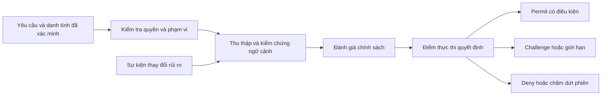

# Risk context

## 1. Ngữ cảnh rủi ro trong quyết định truy cập

**Risk context** là tập thông tin liên quan đến rủi ro của một yêu cầu truy cập tại thời điểm đánh giá. Nó kết hợp những gì hệ thống biết về danh tính, phiên, thiết bị, ứng dụng, hành động, tài nguyên và môi trường để quyết định có tiếp tục cho phép truy cập hay cần biện pháp khác.

Một nhân viên có vai trò đọc báo cáo có thể truy cập từ máy công ty đang đáp ứng chính sách vào buổi sáng. Buổi chiều, cùng tài khoản đó yêu cầu xuất toàn bộ dữ liệu từ một thiết bị chưa biết, trong khi hệ thống vừa nhận cảnh báo phiên bị đánh cắp. Danh tính và tên vai trò có thể chưa đổi, nhưng ngữ cảnh của hai yêu cầu khác nhau đáng kể.

Trong Zero Trust, vị trí trong mạng nội bộ hoặc việc thiết bị thuộc doanh nghiệp không tự tạo ra sự tin cậy mặc định. NIST SP 800-207 đặt trọng tâm bảo vệ vào người dùng, tài sản và tài nguyên thay vì chỉ dựa trên ranh giới mạng. [NIST SP 800-207: Zero Trust Architecture](https://csrc.nist.gov/pubs/sp/800/207/final).

Risk context giúp đưa các thông tin đang thay đổi vào quyết định IAM. Nó không phải giấy phép bỏ qua kiểm tra quyền cơ bản, và cũng không đồng nghĩa phải yêu cầu MFA cho mọi lời gọi API.

## 2. Phân biệt quyền, bằng chứng xác thực và rủi ro

Ba câu hỏi sau có liên quan nhưng không thay thế nhau:

| Câu hỏi | Thông tin chính | Ví dụ |
|---|---|---|
| Chủ thể đã chứng minh danh tính thế nào? | Bằng chứng xác thực và phiên | Token hợp lệ, phương thức xác thực, thời điểm xác thực |
| Chủ thể được phép làm gì? | Role, grant, scope, tenant và chính sách tài nguyên | Được đọc báo cáo của dự án A |
| Yêu cầu hiện tại có điều gì đáng lo? | Risk context | Thiết bị không đạt yêu cầu, dấu hiệu token replay, thao tác bất thường |

Một tài khoản rủi ro thấp nhưng không có quyền xóa dự án vẫn phải bị từ chối xóa. Một tài khoản có quyền xuất dữ liệu vẫn có thể bị chặn khi phiên đã bị thu hồi hoặc có bằng chứng bị chiếm quyền.

Có thể diễn đạt quan hệ này ở mức khái niệm:

```text
Quyền có thể sử dụng lúc này
  = quyền được cấp trong phạm vi tài nguyên
    chịu các điều kiện xác thực, trạng thái và ngữ cảnh đang áp dụng
```

Không dùng điểm rủi ro để tạo thêm entitlement. Kết quả “low risk” không biến người đọc thành quản trị viên, không cấp quyền ở tenant khác và không mở tài nguyên chưa được chia sẻ.

Ngược lại, “đã MFA” cũng không chứng minh mọi rủi ro đã được xử lý. MFA là bằng chứng về một bước xác thực; nó không sửa malware trên thiết bị, khôi phục token bị lộ hoặc làm một tài khoản đã đình chỉ trở lại hợp lệ.

## 3. Những nhóm tín hiệu tạo thành risk context

| Nhóm tín hiệu | Ví dụ | Câu hỏi cần đặt ra |
|---|---|---|
| Danh tính | Tài khoản bị đình chỉ, credential có dấu hiệu lộ, thay đổi recovery gần đây | Chủ thể hoặc cách khôi phục tài khoản có đang bị kiểm soát trái phép không? |
| Xác thực và phiên | Thời điểm xác thực, phương thức đã dùng, phiên bị thu hồi, dấu hiệu replay | Bằng chứng còn phù hợp với yêu cầu hiện tại không? |
| Thiết bị | Mức tuân thủ, trạng thái quản lý, bản vá, cảnh báo endpoint | Thiết bị đang sử dụng có đáp ứng chính sách không? |
| Mạng và vị trí | IP, ASN, proxy, vị trí suy đoán, thay đổi mạng | Đây là ngữ cảnh quen thuộc hay một dấu hiệu cần kết hợp thêm? |
| Hành vi | Lượng tải tăng mạnh, chuỗi thao tác mới, truy cập ngoài mẫu thông thường | Hoạt động có phù hợp với hành vi và nghiệp vụ dự kiến không? |
| Tài nguyên và hành động | Dữ liệu nhạy cảm, xuất hàng loạt, sửa IAM, tạo credential | Nếu cho phép sai, hậu quả có thể lớn đến đâu? |
| Ứng dụng và workload | Client ID, nơi chạy workload, phiên bản triển khai, credential vừa thay | Lời gọi có đến từ ứng dụng và môi trường đã được chấp thuận không? |
| Tình báo và điều tra | Chỉ dấu tấn công, xác nhận tài khoản bị xâm phạm, sự cố đang xử lý | Có căn cứ cần chặn ngay hay điều tra thêm không? |

Các tín hiệu không có giá trị như nhau. IP mới có thể là kết quả người dùng chuyển mạng di động. Một cảnh báo endpoint đã được xác minh là thiết bị nhiễm mã độc mang ý nghĩa khác với vị trí địa lý ước lượng chưa chắc chắn.

Một thuộc tính cũng có thể giữ nhiều vai trò. Quốc gia truy cập có thể là điều kiện cứng của một chính sách tài nguyên hoặc chỉ là tín hiệu bổ sung trong phát hiện bất thường. Cần định nghĩa rõ ngữ nghĩa khi sử dụng, thay vì coi mọi thuộc tính đều phải được chuyển thành cùng một điểm số.

Hành động và mức nhạy cảm của tài nguyên là một phần quan trọng của ngữ cảnh. Đọc một thông báo công khai và tạo credential quản trị không nên được đánh giá như cùng một thao tác chỉ vì đến từ một người dùng.

## 4. Phân biệt các loại rủi ro và mức độ chắc chắn

Risk context có thể chứa đánh giá ở nhiều cấp:

- **Rủi ro lần đăng nhập:** mức nghi ngờ đối với một lần xác thực cụ thể.
- **Rủi ro tài khoản:** dấu hiệu danh tính có thể bị xâm phạm, được tổng hợp từ nhiều sự kiện.
- **Rủi ro thiết bị hoặc workload:** dấu hiệu môi trường thực thi không còn đáp ứng điều kiện an toàn.
- **Rủi ro phiên hoặc yêu cầu:** điều bất thường phát sinh trong quá trình sử dụng, sau khi đăng nhập đã hoàn tất.

Một lần đăng nhập bình thường không tự xóa cảnh báo tài khoản đang bị chiếm quyền. Thiết bị đạt tuân thủ hôm qua cũng không chứng minh phiên hôm nay không bị đánh cắp.

Microsoft Entra phân biệt sign-in risk và user risk: loại thứ nhất liên quan tới lần xác thực, loại thứ hai liên quan tới khả năng tài khoản bị xâm phạm. Đây là thuật ngữ của sản phẩm cụ thể; khi tích hợp cần giữ đúng phạm vi của kết quả đánh giá. [Microsoft Learn: Risk-based access policies](https://learn.microsoft.com/en-us/entra/id-protection/concept-identity-protection-policies).

Không quy đổi tùy tiện `medium` của một nhà cung cấp thành một xác suất cụ thể hoặc đồng nhất với `medium` của nguồn khác. Thang điểm, dữ liệu quan sát, khả năng phát hiện và cách hiệu chỉnh có thể khác nhau.

Cần phân biệt ít nhất ba khái niệm:

| Khái niệm | Ý nghĩa |
|---|---|
| Mức rủi ro | Nhận định về khả năng hoặc mức đáng ngại của tình huống theo mô hình đang dùng |
| Độ tin cậy của đánh giá | Mức vững chắc của bằng chứng hoặc kết luận, nếu nguồn có cung cấp |
| Tác động của hành động | Thiệt hại tiềm tàng nếu cho phép sai |

Không có cảnh báo không đồng nghĩa không có rủi ro. Nguồn dữ liệu chưa quan sát được thiết bị mới có thể trả về unknown, chứ chưa có căn cứ để trả về low.

## 5. Một tín hiệu phải có nguồn, thời gian và đối tượng ràng buộc

Một giá trị `deviceCompliant=true` không đủ nếu không biết nó đến từ đâu, được quan sát khi nào và nói về thiết bị nào.

Ví dụ một snapshot ngữ cảnh được chuẩn hóa:

```json
{
  "contextId": "ctx-713",
  "tenantId": "minh-an",
  "principalId": "principal-93",
  "sessionId": "session-208",
  "deviceId": "device-61",
  "action": "report:export",
  "resourceId": "report-41",
  "devicePosture": {
    "value": "COMPLIANT",
    "source": "managed-device-service",
    "observedAt": "2027-01-10T09:00:00Z",
    "validUntil": "2027-01-10T09:05:00Z",
    "assessmentId": "posture-618"
  },
  "sessionRisk": {
    "level": "UNKNOWN",
    "reason": "ASSESSMENT_UNAVAILABLE"
  },
  "policyVersion": "policy-19"
}
```

Schema, tên trạng thái và thời hạn năm phút ở đây chỉ để minh họa thiết kế, không phải chuẩn hoặc ngưỡng dùng chung. Khoảng thời gian chấp nhận phải phù hợp nguồn dữ liệu, loại hành động và mục tiêu vận hành.

Một tín hiệu chỉ được sử dụng khi hệ thống xác minh nguồn, tính toàn vẹn, phạm vi tenant, đối tượng liên quan và độ mới cần thiết. Tín hiệu hợp lệ của thiết bị A không được áp dụng cho thiết bị B chỉ vì cùng người dùng đăng nhập.

Client có thể gửi thông tin để hỗ trợ đánh giá, nhưng không được tự quyết định trạng thái đáng tin. Header `X-Device-Compliant: true` do người dùng tùy ý đặt không tương đương kết quả từ dịch vụ quản lý thiết bị. Nếu gateway cung cấp thuộc tính, phải bảo vệ đường truyền nội bộ và loại bỏ khả năng giả mạo header từ bên ngoài.

Tương tự, `X-Forwarded-For` chỉ có ý nghĩa khi ứng dụng biết proxy nào được tin cậy và cách xác định địa chỉ gốc. Một IP lấy sai từ header có thể khiến toàn bộ phân tích vị trí và hành vi dựa trên dữ liệu do kẻ gọi chọn.

Với event đến trễ, cần phân biệt thời điểm sự kiện xảy ra, thời điểm nhận và thời điểm đánh giá. Một event cũ đến sau không được làm mất trạng thái đình chỉ hoặc kết luận mới hơn mà không có quy tắc xử lý phiên bản rõ ràng.

## 6. Chuyển ngữ cảnh thành quyết định truy cập

Luồng xử lý có thể tổ chức như sau:



Các tầng có thể được tối ưu hoặc sắp xếp khác để giảm chi phí, nhưng không được làm mất những điều kiện bắt buộc. Ví dụ, việc đánh giá risk trước để chặn sớm không có nghĩa có thể bỏ authorization khi risk thấp.

Một chính sách minh họa cho ứng dụng nội bộ:

| Điều kiện | Hành động dự kiến |
|---|---|
| Token không hợp lệ, chủ thể bị đình chỉ hoặc không có quyền với tài nguyên | Từ chối |
| Phiên bị thu hồi hoặc có kết luận bắt buộc chặn theo chính sách | Từ chối và xử lý phiên liên quan |
| Thiếu đánh giá thiết bị còn mới trong khi thao tác bắt buộc dùng thiết bị đạt yêu cầu | Chưa cho thực hiện thao tác; yêu cầu khắc phục hoặc đánh giá lại |
| Có quyền, nhưng mức xác thực chưa đáp ứng yêu cầu cho thao tác nhạy cảm | Yêu cầu xác thực bổ sung phù hợp |
| Ngữ cảnh đáp ứng chính sách và quyền vẫn hợp lệ | Cho phép trong phạm vi và thời gian đã định |
| Chỉ được dùng chế độ hạn chế trong ngữ cảnh hiện tại | Cho phép đúng chế độ hạn chế nếu điểm thực thi hỗ trợ |

Kết quả có thể gồm Permit, Deny, Challenge hoặc Permit kèm nghĩa vụ. Nghĩa vụ như “chỉ đọc”, “không tải xuống” hay “giới hạn lượng export” phải có cơ chế thực thi thật sự. Nếu API không hỗ trợ loại nghĩa vụ được yêu cầu, không được trả dữ liệu đầy đủ rồi chỉ thêm một nhãn cảnh báo.

MFA bổ sung phù hợp khi thiếu bằng chứng xác thực có thể được bù bằng một phương thức thích hợp. Nếu vấn đề là thiết bị không đạt yêu cầu hoặc tài khoản đang bị chặn, hoàn thành MFA không tự làm các điều kiện đó trở thành đạt.

## 7. Ví dụ đánh giá trong backend

Đoạn mã giả Java sau minh họa thứ tự lập luận cho một yêu cầu xuất báo cáo. Các kiểu và phương thức là thành phần giả định của ứng dụng, không phải API có thể chạy nguyên trạng.

```java
AccessDecision evaluateExport(
        VerifiedPrincipal principal,
        VerifiedRequest request,
        Instant now) {

    if (!accounts.isActive(principal.id())) {
        return AccessDecision.deny("ACCOUNT_INACTIVE");
    }

    Resource resource = resources.requireInTenant(
            request.tenantId(), request.resourceId());

    if (!authorization.hasPermission(
            principal, resource, "report:export")) {
        return AccessDecision.deny("NO_ENTITLEMENT");
    }

    RiskContext context = contextProvider.loadAndValidate(
            principal, request, resource, now);

    if (context.hasBlockingFinding() || sessions.isRevoked(request.sessionId())) {
        return AccessDecision.deny("BLOCKING_SECURITY_STATE");
    }

    if (!context.hasFreshRequiredDevicePosture(now)) {
        return AccessDecision.deny("REQUIRED_CONTEXT_UNAVAILABLE");
    }

    if (!authenticationPolicy.satisfiesExportRequirement(context)) {
        return AccessDecision.challenge("EXPORT_AUTHENTICATION_REQUIRED");
    }

    return policyEngine.decide(principal, resource, "report:export", context);
}
```

Ví dụ này giả định export bắt buộc có đánh giá thiết bị còn mới. Đây không phải yêu cầu mặc định cho mọi hệ thống. `loadAndValidate` cần giữ được trạng thái thiếu hoặc lỗi; không chuyển lỗi kết nối thành một context rỗng được coi là an toàn.

Điểm thực thi chỉ thực hiện export khi kết quả cuối cùng là Permit và mọi nghĩa vụ đều đáp ứng được. Challenge là trạng thái chưa được phép thực hiện yêu cầu, không phải Allow kèm một hộp thoại tùy chọn.

Sau khi người dùng hoàn thành challenge, hệ thống phải kiểm tra bằng chứng mới và đánh giá lại yêu cầu. Kết quả cần ràng buộc đúng principal, phiên, tenant, hành động và tài nguyên. Không dùng một lần MFA cho thao tác A như phê duyệt không giới hạn cho mọi thao tác B sau đó.

Với job export chạy nền, cần chính sách về thời điểm kiểm tra lại quyền và ngữ cảnh. Một quyết định Permit ngắn hạn lúc tạo job không mặc nhiên còn hiệu lực sau nhiều giờ chờ trong hàng đợi.

## 8. Ngữ cảnh thay đổi sau đăng nhập

Đánh giá tại lúc đăng nhập là một snapshot. Trong quá trình sử dụng, thiết bị có thể nhận cảnh báo, tài khoản bị đình chỉ, membership thay đổi hoặc token có dấu hiệu bị sử dụng lại ở nơi khác.

Một timeline minh họa:

```text
09:00  Đăng nhập hợp lệ, ngữ cảnh đáp ứng chính sách đọc báo cáo.
09:10  Endpoint phát hiện dấu hiệu nghiêm trọng trên thiết bị.
09:11  Dịch vụ chính sách nhận và xác minh sự kiện.
09:12  Yêu cầu export bị chặn theo trạng thái mới.
Sau đó Phiên hoặc credential liên quan được xử lý theo quy trình sự cố.
```

Các thời điểm chỉ minh họa; không mô tả độ trễ đảm bảo của một sản phẩm. Hiệu quả thực tế phụ thuộc tốc độ phát hiện, truyền event, invalidation và nơi thực thi quyền.

Có thể đánh giá lại theo yêu cầu nhạy cảm, khi đổi tài nguyên hoặc tenant, khi nhận sự kiện, hoặc sau một khoảng thời gian. Không nhất thiết gọi mọi nguồn telemetry từ xa cho từng request; có thể dùng snapshot được kiểm chứng, cache có giới hạn và sự kiện invalidation.

Tuy nhiên, access token tự chứa không tự nhận biết tài khoản đã bị khóa sau khi token phát hành. Nếu backend chỉ kiểm tra chữ ký và thời hạn, trạng thái mới chưa chắc có hiệu lực ngay. Thiết kế cần xác định cửa sổ chấp nhận và cơ chế phù hợp như kiểm tra trạng thái trực tuyến, token ngắn hạn hoặc cơ chế đánh giá lại được nền tảng hỗ trợ.

Đối với WebSocket, stream hoặc kết nối dài, kiểm tra khi mở kết nối chưa đủ cho mọi chính sách. Cần xác định khi nào đánh giá lại, cách ngừng gửi dữ liệu và cách chấm dứt phiên khi có kết luận bắt buộc chặn.

## 9. Xử lý unknown, lỗi nguồn dữ liệu và cache

Nên phân biệt ít nhất các trạng thái sau trong hợp đồng ngữ cảnh:

| Trạng thái | Ý nghĩa | Ví dụ |
|---|---|---|
| Fresh | Đánh giá còn đủ mới theo chính sách | Posture được xác minh trong thời hạn chấp nhận |
| Stale | Có dữ liệu nhưng quá hạn sử dụng | Kết quả thiết bị từ nhiều giờ trước |
| Unknown | Chưa có đủ căn cứ đánh giá | Thiết bị chưa từng được quan sát |
| Unavailable | Không lấy được đánh giá cần thiết | Dịch vụ context đang lỗi |
| Invalid | Bằng chứng không qua kiểm chứng | Sai đối tượng, sai chữ ký hoặc nguồn không được chấp nhận |

Unknown không phải một loại Low. Unavailable cũng không có nghĩa High theo mọi mô hình; đây là trạng thái vận hành cần chính sách xử lý riêng. Nếu một điều kiện là bắt buộc để cho phép thao tác, chưa chứng minh được điều kiện đó thì chưa cho phép thao tác.

Có thể thiết kế chế độ suy giảm được phê duyệt cho một số nghiệp vụ ít nhạy cảm, chẳng hạn giữ một số chức năng đọc hạn chế với context gần nhất còn trong giới hạn cho phép. Chế độ đó phải có phạm vi, thời hạn, giám sát và điểm dừng; không được âm thầm biến thành bỏ qua mọi kiểm tra khi dịch vụ risk lỗi.

Cache quyết định cần giữ ràng buộc với principal, phiên hoặc thiết bị liên quan, tenant, hành động, tài nguyên, phiên bản chính sách và các tín hiệu ảnh hưởng tới quyết định. Một Permit trên thiết bị công ty không được tái sử dụng cho thiết bị lạ chỉ vì cùng tài khoản.

Thời hạn Permit phải không vượt giới hạn hiệu lực của những điều kiện dùng để cấp quyền. Khi có event bắt buộc chặn, cần xử lý cả cache đang tồn tại; TTL ngắn giúp giới hạn độ trễ nhưng không thay thế mọi cơ chế thu hồi khẩn cấp.

## 10. Các giới hạn khi diễn giải tín hiệu

**Vị trí và mạng.** VPN, NAT, mạng di động và proxy có thể làm vị trí thay đổi mà người dùng không di chuyển. Một dấu hiệu “di chuyển bất khả thi” nên được xem trong tập bằng chứng thích hợp, không tự được coi là kết luận chắc chắn trong mọi hệ thống. Ngược lại, dùng IP nội bộ không chứng minh chủ thể an toàn.

**Thiết bị được quản lý.** Được quản lý và đang tuân thủ là những thuộc tính khác nhau. Một thiết bị đã đăng ký có thể thiếu bản vá hoặc có cảnh báo. Device ID tự khai cũng không chứng minh người gọi đang sử dụng đúng thiết bị đó.

**Hành vi bất thường.** Cuối tháng, người dùng có thể xuất nhiều dữ liệu do nghiệp vụ hợp lệ. Nhưng một người có quyền export vẫn có thể bị chiếm tài khoản. Phải phân biệt sự khác thường, bằng chứng xâm phạm và yêu cầu nghiệp vụ được xác nhận.

**Điểm số tổng hợp.** Cộng nhiều tín hiệu tương quan có thể đếm lặp cùng một sự kiện. Ví dụ, IP mới, vị trí mới và ASN mới có thể đều bắt nguồn từ một lần đổi mạng. Không dùng trung bình điểm số để làm loãng một điều kiện chặn cứng như tài khoản đã bị đình chỉ.

**Ngoại lệ.** Khi có ngoại lệ cho hoạt động hợp lệ, cần giới hạn theo người, tài nguyên, điều kiện và thời gian. Không đưa cả tổ chức hoặc mọi tài khoản quản trị ra khỏi đánh giá chỉ để giải quyết một cảnh báo nhầm.

**Danh tính workload.** Không thể yêu cầu một tiến trình nền bấm MFA như người dùng. Ngữ cảnh cần phù hợp với workload: môi trường chạy được chấp thuận, danh tính phát hành, credential, audience, hành động và mẫu sử dụng. Khi cần khắc phục, có thể phải chặn workload, đổi credential hoặc sửa cấu hình thay vì gửi challenge tương tác.

## 11. Kiểm toán và triển khai có thể quan sát

Một quyết định dựa trên risk context nên giải thích được mình dựa vào điều gì. Log có thể lưu:

```json
{
  "decisionId": "decision-902",
  "requestId": "req-614",
  "tenantId": "minh-an",
  "principalId": "principal-93",
  "action": "report:export",
  "resourceId": "report-41",
  "decision": "DENY",
  "reasonCodes": ["REQUIRED_DEVICE_CONTEXT_STALE"],
  "contextId": "ctx-713",
  "policyVersion": "policy-19"
}
```

Không cần chép toàn bộ telemetry vào mọi log quyết định. Tham chiếu tới assessment có kiểm soát truy cập có thể giúp điều tra mà giảm lặp dữ liệu. Không ghi raw token, secret, mật khẩu hoặc dữ liệu thiết bị vượt nhu cầu vận hành.

Nên theo dõi tỷ lệ challenge, tỷ lệ từ chối, nguồn context bị lỗi, dữ liệu quá hạn, thời gian từ event đến thực thi và phản hồi về cảnh báo nhầm. Chỉ đếm số lần chặn không cho biết chính sách có đang bảo vệ đúng hay làm gián đoạn người dùng hợp lệ.

Trước khi mở rộng một chính sách mới, có thể dùng chế độ quan sát hoặc report-only nếu hệ thống hỗ trợ, sau đó áp dụng trên phạm vi đại diện. Chế độ quan sát không thay thế các kiểm tra quyền đang có và không nên ghi nhận rằng yêu cầu đã bị chặn khi thực tế nó chỉ được đánh dấu trong báo cáo.

| Tình huống cần kiểm chứng | Kết quả mong đợi |
|---|---|
| Risk thấp nhưng không có entitlement | Từ chối |
| Có entitlement nhưng tài khoản bị đình chỉ | Từ chối, không dùng risk thấp để mở lại |
| Client tự gửi header thiết bị tuân thủ | Không coi là bằng chứng đã xác minh |
| Kết quả posture của thiết bị khác hoặc tenant khác | Không sử dụng cho yêu cầu hiện tại |
| Nguồn context lỗi khi điều kiện đó bắt buộc | Áp dụng chính sách unavailable, không mặc định Allow |
| MFA hoàn tất nhưng thiết bị vẫn không đạt yêu cầu | Không bỏ qua điều kiện thiết bị |
| Có event thu hồi sau khi cache Permit được tạo | Quyết định mới và phiên liên quan thay đổi theo cơ chế đã thiết kế |
| Challenge hoàn tất cho hành động khác | Không tự xem là phê duyệt cho yêu cầu hiện tại |
| Workload không hỗ trợ tương tác | Áp dụng chính sách dành cho workload, không mở quyền do không thể MFA |

## 12. Điểm cần ghi nhớ

Risk context là bằng chứng có phạm vi và thời hạn phục vụ một quyết định truy cập, không phải nhãn đáng tin vĩnh viễn gắn vào người dùng. Một context hữu ích phải cho biết nguồn nào cung cấp tín hiệu, tín hiệu áp dụng cho ai, mới đến mức nào và còn điều gì chưa biết.

Kết hợp quyền được cấp với ngữ cảnh đã kiểm chứng giúp IAM quyết định khi nào được tiếp tục truy cập, khi nào cần xác thực hoặc khắc phục thêm và khi nào phải chặn. Giá trị của Zero Trust nằm ở việc những quyết định đó được thực thi đúng tại tài nguyên và được cập nhật khi bằng chứng thay đổi.
