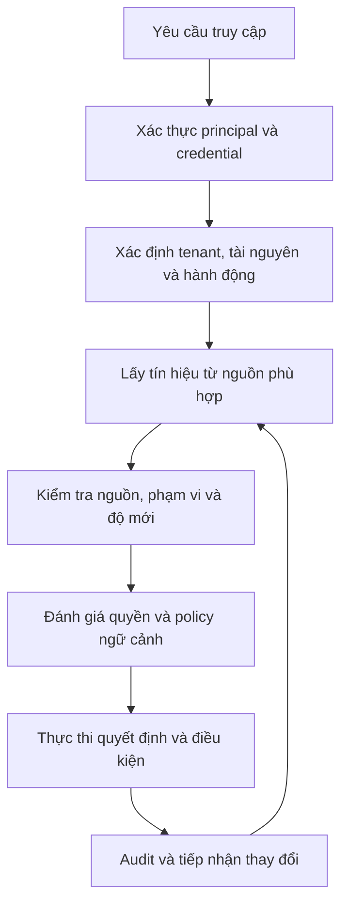

# Identity signal

## 1. Tín hiệu danh tính là đầu vào cho quyết định truy cập

**Identity signal** là một quan sát hoặc khẳng định liên quan đến danh tính, trạng thái xác thực, quan hệ quyền hoặc hoạt động của một chủ thể. Trong IAM theo hướng Zero Trust, hệ thống sử dụng những tín hiệu này để đánh giá yêu cầu truy cập thay vì mặc định tin cậy toàn bộ phiên sau một lần đăng nhập.

Ví dụ:

- Danh tính đã được xác thực bởi nguồn phát hành nào.
- Tài khoản hiện đang hoạt động hay đã bị vô hiệu hóa.
- Người dùng vừa xác thực bằng phương thức nào và cách đây bao lâu.
- Membership trong tenant còn hiệu lực hay đã bị thu hồi.
- Credential hoặc phiên có liên quan đến một cảnh báo xâm nhập không.
- Một workload có đúng danh tính dịch vụ và quyền được cấp cho môi trường đang chạy không.

Tín hiệu không phải bản thân quyết định. Một cảnh báo đăng nhập bất thường có thể dẫn đến yêu cầu xác minh bổ sung, hạn chế hành động hoặc từ chối tùy policy. Ngược lại, một lần xác thực mạnh không tự cấp quyền đọc dữ liệu mà người dùng chưa được phép truy cập.

Có thể hình dung:

```text
Yêu cầu: principal X muốn làm hành động Y trên tài nguyên Z
  + tín hiệu danh tính
  + ngữ cảnh thiết bị và môi trường
  + thuộc tính tài nguyên
  + policy hiện hành
  → quyết định và điều kiện thực thi.
```

Trong bài này, “chủ thể” có thể là người dùng hoặc workload. Không phải mọi tín hiệu của người dùng đều áp dụng được cho workload, và ngược lại.

## 2. Phân biệt những thông tin dễ bị nhầm

| Khái niệm | Ví dụ | Ý nghĩa và giới hạn |
| --- | --- | --- |
| Định danh | ID nội bộ hoặc subject từ một issuer | Cho biết đang nói đến chủ thể nào; một chuỗi ID tự khai chưa chứng minh danh tính |
| Credential | Mật khẩu, khóa riêng, token truy cập | Phương tiện được xác minh để chứng minh hoặc thực hiện quyền; không nên thu thập nguyên credential làm telemetry |
| Bằng chứng xác thực | Kết quả xác thực từ nguồn tin cậy | Cho biết một quá trình xác thực đã đáp ứng điều kiện cụ thể |
| Tín hiệu quyền | Membership, role assignment, grant | Cho biết phạm vi quyền theo nguồn và thời điểm được đánh giá |
| Tín hiệu rủi ro | Dấu hiệu phiên bị chiếm dụng | Ước lượng hoặc cảnh báo cần được diễn giải theo nguồn và độ tin cậy |
| Quyết định truy cập | Cho phép, từ chối, yêu cầu bổ sung | Kết quả policy áp dụng cho một hành động và phạm vi cụ thể |

Một access token có chữ ký hợp lệ có thể cung cấp nhiều tín hiệu đáng tin từ bên phát hành. Tuy nhiên:

- Chữ ký hợp lệ không làm token dành cho API khác trở thành hợp lệ cho API hiện tại.
- Claim role có thể phản ánh trạng thái lúc cấp token, không phải trạng thái quyền ngay bây giờ.
- Claim tenant không tự chứng minh tài nguyên đích thuộc tenant đó.
- Token còn hạn không tự chứng minh tài khoản hoặc phiên chưa bị thu hồi nếu cơ chế xác minh không kiểm tra thay đổi ấy.

Tương tự, trường `mfa=true` do client tự gửi không phải bằng chứng người dùng đã hoàn thành MFA.

## 3. Các nhóm identity signal thường gặp

### 3.1. Danh tính và vòng đời tài khoản

Nhóm này trả lời “đây là ai và danh tính có còn được phép hoạt động không?”.

Ví dụ:

- Nguồn danh tính và ánh xạ sang principal nội bộ.
- Trạng thái tài khoản: hoạt động, bị khóa, bị vô hiệu hóa.
- Quan hệ nhân sự hoặc đối tác theo nguồn có thẩm quyền.
- Tenant và membership còn hiệu lực.
- Trạng thái đăng ký hoặc thu hồi credential.
- Thay đổi nhạy cảm gần đây như khôi phục tài khoản hoặc đăng ký phương thức xác thực mới.

Địa chỉ email chỉ là một thuộc tính. Hai nguồn phát hành có thể cung cấp cùng một email nhưng đại diện cho hai danh tính độc lập. Trong liên kết danh tính, cần giữ định danh và issuer theo mô hình ánh xạ đã thiết kế, thay vì tự gộp tài khoản chỉ vì email giống nhau.

Thông tin “đã xác minh email” cũng không tương đương với “là nhân viên hiện tại” hoặc “có quyền quản trị tenant”.

### 3.2. Xác thực và phiên

Nhóm này mô tả cách danh tính đã được xác thực và trạng thái của phiên:

- Phương thức xác thực đã sử dụng.
- Mức đảm bảo được bên xác thực khẳng định.
- Thời điểm xác thực.
- Phiên hiện tại có còn hiệu lực không.
- Có thực hiện xác thực bổ sung cho hành động nhạy cảm không.
- Phiên có bị đánh dấu cần xác minh lại hoặc thu hồi không.

Một số giao thức và nhà cung cấp biểu đạt thông tin qua claim như `auth_time`, `amr` hoặc `acr`. Việc sử dụng phải theo hợp đồng của nguồn phát hành. Không được coi các giá trị hoặc cách diễn giải giữa mọi IdP là giống nhau nếu chưa có ánh xạ rõ ràng.

“Người dùng có đăng ký MFA” khác với “phiên hiện tại đã sử dụng phương thức đáp ứng policy”. Một phương thức mới được thêm trong quá trình khôi phục tài khoản cũng có thể cần được xử lý khác theo policy của tổ chức.

### 3.3. Quyền và quan hệ truy cập

Nhóm này gồm membership, role assignment, scope, quan hệ sở hữu, grant chia sẻ và ủy quyền có thời hạn.

Ví dụ:

```text
principal=user_lan
tenant=tenant_a
role=REPORT_READER
membership=ACTIVE
```

Tín hiệu trên không được biến thành quyền đọc báo cáo tại tenant B. Scope hoặc vai trò phải được giữ cùng phạm vi tenant, tài nguyên, môi trường và thời gian liên quan.

Danh tính được xác thực mạnh vẫn có thể không có entitlement cho tài nguyên đích. Khi đó kết quả đúng là không cấp quyền, không phải yêu cầu MFA lặp lại để cuối cùng cho phép.

### 3.4. Hoạt động và rủi ro danh tính

Ví dụ:

- Đăng nhập từ vị trí hoặc đặc điểm hoạt động bất thường.
- Dấu hiệu credential bị lộ theo nguồn phát hiện được tin cậy.
- Nhiều hành vi bất thường liên quan cùng principal hoặc phiên.
- Tác vụ nhạy cảm ngay sau thay đổi credential hoặc khôi phục tài khoản.
- Dấu hiệu sử dụng token không phù hợp với cơ chế ràng buộc đã thiết kế.

Những tín hiệu này thường có khả năng sai hoặc thiếu. Chuyển vị trí mạng có thể do VPN, mạng di động hoặc hạ tầng định tuyến. Một hành vi ít gặp chưa tự chứng minh tài khoản bị chiếm dụng.

Ngược lại, không có cảnh báo cũng không chứng minh danh tính an toàn. Hệ thống phát hiện có thể thiếu dữ liệu hoặc chưa nhận ra hành vi.

### 3.5. Workload identity

Với workload, các tín hiệu có thể gồm:

- Danh tính dịch vụ hoặc ứng dụng đã được xác minh.
- Môi trường, namespace hoặc deployment mà danh tính được cấp cho.
- Nguồn cấp credential và thời hạn.
- Trạng thái đăng ký, xoay khóa hoặc thu hồi.
- Grant đến API, tenant và tài nguyên cụ thể.
- Thông tin nguồn gốc workload khi có cơ chế chứng minh phù hợp.

Một workload đã xác thực không tự có quyền đại diện cho mọi người dùng hoặc truy cập mọi tenant. Cơ chế ủy quyền thay mặt người dùng phải được mô hình hóa riêng.

Không áp dụng yêu cầu “nhập MFA” cho một tiến trình nền như thể đó là người dùng tương tác. Hãy dùng điều kiện phù hợp với loại chủ thể và hành động.

## 4. Một tín hiệu cần có nguồn gốc, phạm vi và thời gian

### 4.1. Nguồn nào có thẩm quyền khẳng định điều gì?

| Nguồn minh họa | Có thể cung cấp | Không nên tự suy ra |
| --- | --- | --- |
| IdP hoặc dịch vụ xác thực | Kết quả xác thực, phương thức, issuer, phiên | Mọi quyền nghiệp vụ của mọi tenant |
| Registry danh tính | Principal và trạng thái danh tính | Người gọi đang sở hữu credential nếu chưa xác thực |
| Nguồn membership hoặc entitlement | Quan hệ và quyền trong phạm vi quản lý | Quyền ngoài tenant hoặc tài nguyên được giao |
| Hệ thống nhân sự | Trạng thái quan hệ lao động theo hợp đồng dữ liệu | Quyền tức thời trên từng API |
| Hệ thống phát hiện rủi ro | Cảnh báo và ngữ cảnh phát hiện | Kết luận chắc chắn cho mọi phiên |
| Registry workload | Danh tính triển khai và grant dịch vụ | Quyền tùy ý thay mặt người dùng |

Nguồn có thể đáng tin cho một loại thuộc tính nhưng không có thẩm quyền cho thuộc tính khác. Một IdP được cấu hình cho tenant A không mặc nhiên được phép khẳng định vai trò quản trị ở tenant B.

Tín hiệu do client tự khai có thể giúp phát hiện bất thường hoặc yêu cầu kiểm tra thêm, nhưng không nên tự trở thành bằng chứng để mở rộng quyền.

### 4.2. Mô hình bản ghi tín hiệu

Ví dụ schema nội bộ:

```json
{
  "signal_id": "sig_72a",
  "principal_id": "user_lan",
  "tenant_id": "tenant_a",
  "session_ref": "session_91",
  "signal_type": "MEMBERSHIP_STATE",
  "value": "ACTIVE",
  "source": "membership-service",
  "observed_at": "2026-01-15T08:00:00Z",
  "received_at": "2026-01-15T08:00:02Z",
  "valid_until": "2026-01-15T08:05:00Z",
  "source_version": 18,
  "evidence_ref": "membership_change_18"
}
```

Các field và khoảng thời gian chỉ minh họa; đây không phải chuẩn trao đổi bắt buộc.

Những yếu tố cần xác định gồm:

- **Chủ thể:** tín hiệu thuộc principal nào, và ánh xạ danh tính đã được xác minh chưa.
- **Phạm vi:** toàn cục, một tenant, một phiên, một credential hay một grant.
- **Nguồn:** thành phần nào phát hành và được xác thực bằng cơ chế nào.
- **Thời gian:** quan sát lúc nào, nhận lúc nào, được dùng đến khi nào.
- **Bằng chứng hoặc phiên bản:** cách truy vết và xử lý thứ tự cập nhật.
- **Độ chắc chắn:** giá trị là trạng thái có thẩm quyền hay chỉ là suy đoán rủi ro.

Không phải mọi tín hiệu đều cần cùng tập field, nhưng thiếu thông tin cần thiết không được tự bù bằng giả định thuận lợi.

## 5. Từ tín hiệu đến quyết định có thực thi

Một luồng khái niệm:



Các thành phần có thể nằm trong cùng ứng dụng hoặc được tách thành dịch vụ. Điểm quan trọng là tín hiệu chỉ có tác dụng bảo vệ khi quyết định được áp dụng tại nơi truy cập tài nguyên.

Nếu bộ quyết định yêu cầu xác thực bổ sung mà API vẫn trả dữ liệu trước khi nhận kết quả xác thực, policy chưa được thực thi.

Tương tự, đánh dấu một phiên là bị thu hồi trong một hệ thống trung tâm chưa bảo đảm mọi resource server đã ngừng chấp nhận token của phiên đó. Kiến trúc phải có cơ chế truyền và thực thi thay đổi.

### 5.1. Xác định các điều kiện bắt buộc trước khi tính rủi ro

Một policy có thể đặt các điều kiện:

```text
Tài khoản đang hoạt động.
Credential hoặc phiên chưa bị thu hồi theo cơ chế áp dụng.
Principal có quyền đối với tenant, hành động và tài nguyên đích.
Các bằng chứng xác thực bắt buộc được xác minh.
```

Những điều kiện này không nên bị bỏ qua chỉ vì một điểm tổng hợp khác đang “tốt”.

Ví dụ, người dùng có lịch sử đăng nhập ổn định nhưng đã bị vô hiệu hóa vẫn không được truy cập. Có MFA và thiết bị phù hợp không bù cho việc thiếu membership trong tenant.

Nếu dùng mô hình chấm điểm, cần phân biệt rõ điều kiện cứng với tín hiệu dùng để điều chỉnh rủi ro. Đồng thời phải tránh đếm nhiều lần cùng một bằng chứng: hai cảnh báo từ cùng một sự kiện không nhất thiết là hai quan sát độc lập.

### 5.2. Các kết quả policy thường gặp

| Tình huống | Hành động có thể phù hợp theo policy |
| --- | --- |
| Danh tính hoạt động, có quyền, bằng chứng đáp ứng yêu cầu | Cho phép trong phạm vi và thời gian cụ thể |
| Hành động nhạy cảm cần xác thực mới hơn hoặc mạnh hơn | Yêu cầu xác thực bổ sung |
| Có quyền nhưng tín hiệu rủi ro cần kiểm tra thêm | Tạm dừng, hạn chế hoặc yêu cầu xác minh theo thiết kế |
| Tài khoản, membership hoặc grant đã bị thu hồi | Từ chối trong đúng phạm vi bị thu hồi |
| Credential bị xác định là không còn được chấp nhận | Từ chối và xử lý phiên liên quan theo quy trình |
| Thiếu bằng chứng bắt buộc | Không cấp quyền dựa trên điều kiện chưa được xác minh |

Không nên mặc định mọi cảnh báo đều vô hiệu hóa toàn bộ tài khoản. Phản ứng cần xét độ tin cậy, phạm vi bị ảnh hưởng, mức nhạy cảm của hành động và quy trình xử lý sự cố.

Mặt khác, không nên chỉ hiển thị một cảnh báo trong dashboard trong khi hệ thống vẫn cho phép hành động mà policy đã yêu cầu chặn.

### 5.3. Xác thực bổ sung phải gắn với đúng ngữ cảnh

Giả sử một yêu cầu export đòi hỏi xác thực gần đây hơn. Kết quả xác thực bổ sung phải được kiểm tra và liên kết với phiên hoặc luồng yêu cầu thích hợp.

Không chấp nhận một trường `step_up_completed=true` do client tự gửi. Cũng không dùng kết quả của một phiên khác mà không có cơ chế liên kết được xác minh.

Nếu policy cấp một khoảng quyền tạm thời cho hành động nhạy cảm, phải xác định phạm vi và thời hạn của quyền đó. Hoàn thành một challenge không nên làm mọi hành động nhạy cảm được cho phép vô thời hạn.

## 6. Ví dụ quyết định cho tải báo cáo nhạy cảm

Pseudocode theo phong cách Java:

```java
Decision authorizeReportExport(AccessRequest request) {
    Principal principal =
        authentication.requireVerifiedPrincipal(request);

    IdentityState identity =
        identitySignals.requireUsableIdentityState(principal);

    if (!identity.isActive()) {
        return Decision.deny("IDENTITY_NOT_ACTIVE");
    }

    AccessContext context = accessContext.requireAuthorizedScope(
        principal,
        request.tenantId(),
        request.resourceId()
    );

    permissions.require(context, "report.export");

    SessionState session =
        identitySignals.requireUsableSessionState(principal, request);

    if (!session.isAllowed()) {
        return Decision.deny("SESSION_NOT_ALLOWED");
    }

    RiskState risk = identitySignals.riskFor(context, session);

    if (policy.requiresDenyFor(risk, context.action())) {
        return Decision.deny("IDENTITY_RISK_BLOCKED");
    }

    AuthenticationEvidence evidence =
        authentication.evidenceFor(session);

    if (!policy.authenticationSatisfied(evidence, context.action())) {
        return Decision.requireStepUp("RECENT_AUTHENTICATION_REQUIRED");
    }

    return Decision.allowUntil(
        policy.earliestRelevantExpiry(identity, context, session, evidence)
    );
}
```

Đây là mã minh họa, không phải chương trình hoàn chỉnh. Các phương thức `requireUsable...` bao hàm việc kiểm tra nguồn, phạm vi và thời gian theo thiết kế.

Một số điểm cần chú ý:

- Principal đến từ xác thực, không phải một ID tự khai trong body.
- Trạng thái toàn cục và trạng thái membership trong tenant có thể là hai nguồn khác nhau.
- Quyền nghiệp vụ được kiểm tra độc lập với tín hiệu xác thực.
- Policy phải định nghĩa cách xử lý rủi ro chưa xác định; không tự đổi thành rủi ro thấp.
- Kết quả `allowUntil` phải được điểm thực thi áp dụng.
- Nếu có thay đổi quan trọng trước thời điểm hết hiệu lực, hệ thống có thể cần đánh giá lại sớm hơn.

Không nhất thiết phải truy vấn mọi nguồn trực tiếp trên từng request. Có thể dùng cache, token hoặc dữ liệu đã tổng hợp, miễn là mức độ mới và cơ chế cập nhật đáp ứng mục tiêu của hành động đang bảo vệ.

## 7. Độ mới, sự kiện và thu hồi quyền

### 7.1. Tín hiệu đúng nhưng cũ vẫn có thể dẫn đến quyết định sai

Ví dụ:

```text
09:00  Lan có membership hoạt động tại tenant A.
09:01  Lan nhận access token.
09:05  Membership tại A bị thu hồi.
09:06  Lan dùng token cũ để đọc dữ liệu A.
```

Nếu API chỉ tin ảnh chụp membership lúc 09:01, quyết định lúc 09:06 có thể không phản ánh thay đổi.

Thiết kế cần xác định:

- Quyền bị thu hồi phải có hiệu lực trong bao lâu.
- Nguồn nào thông báo thay đổi.
- Dịch vụ nào đang cache trạng thái cũ.
- Token hoặc phiên nào cần được xử lý.
- Các điểm thực thi biết thay đổi bằng cơ chế gì.

Access token có thời hạn ngắn có thể giới hạn khoảng sử dụng trạng thái cũ, nhưng không tự tạo thu hồi tức thì. Một claim phiên bản quyền cũng không giúp nếu API không đối chiếu với phiên bản hiện hành.

### 7.2. Xử lý sự kiện bị trễ, lặp hoặc sai thứ tự

Một hệ thống nhận sự kiện vòng đời danh tính cần dự liệu:

```text
Sự kiện phiên bản 18: membership bị thu hồi.
Sau đó mới nhận phiên bản 17: membership từng hoạt động.
```

Không được để bản cập nhật cũ làm membership hoạt động trở lại ngoài quy trình được phép.

Có thể cần phiên bản nguồn, số thứ tự, định danh sự kiện để xử lý lặp, cùng cơ chế đồng bộ lại khi phát hiện thiếu sự kiện. Cách cụ thể phụ thuộc nguồn dữ liệu và hợp đồng nhất quán.

Timestamp hữu ích nhưng không nên mặc định mọi đồng hồ hoàn toàn đồng bộ. Cần hiểu timestamp đại diện cho lúc quan sát, lúc thay đổi có hiệu lực hay lúc phát hành sự kiện.

Kênh nhận sự kiện cũng phải xác thực nguồn và bảo vệ tính toàn vẹn theo cơ chế được thiết kế. Một request bên ngoài tự khai “người dùng này có quyền quản trị” không được trở thành cập nhật entitlement đáng tin cậy.

### 7.3. Cache không được làm mất phạm vi

Cache tín hiệu hoặc quyết định có thể cần các chiều:

```text
principal + tenant + session hoặc credential
+ hành động hoặc nhóm tài nguyên
+ phiên bản policy + phiên bản nguồn + thời gian hiệu lực.
```

Không phải hệ thống nào cũng cần đúng tập khóa trên, nhưng phải bao quát mọi thuộc tính ảnh hưởng đến kết quả.

Membership A của Lan không được dùng thay membership B. Một trạng thái phiên bị thu hồi không nhất thiết đồng nghĩa mọi phiên khác bị thu hồi, trừ khi policy hoặc sự kiện quy định phạm vi đó.

## 8. Tín hiệu thiếu, mâu thuẫn hoặc nguồn bị lỗi

Cần phân biệt trạng thái có bằng chứng và trạng thái không đủ thông tin:

```text
ACTIVE:       nguồn có thẩm quyền xác nhận hoạt động.
DISABLED:     nguồn có thẩm quyền xác nhận bị vô hiệu hóa.
UNKNOWN:      chưa đủ thông tin để kết luận.
STALE:        thông tin đã vượt giới hạn sử dụng.
ERROR:        lỗi thu thập hoặc xác minh.
```

Danh sách trên minh họa trạng thái tài khoản; mỗi loại tín hiệu có thể dùng mô hình khác.

Không nhận được cảnh báo không đồng nghĩa nhận được xác nhận “an toàn”. Không truy cập được dịch vụ membership không đồng nghĩa người dùng là thành viên.

Khi một điều kiện bắt buộc chưa xác minh được, hệ thống không nên tự cấp quyền như thể điều kiện đó đã đạt. Có thể trả lỗi tạm thời, yêu cầu làm mới bằng chứng hoặc cho dùng chức năng ít nhạy cảm hơn nếu chức năng ấy có policy riêng.

Với nguồn rủi ro dạng bổ trợ, tổ chức có thể quy định cách vận hành khi nguồn gián đoạn mà vẫn giữ các kiểm tra xác thực và phân quyền bắt buộc. Nếu sử dụng dữ liệu gần nhất, cần giới hạn tuổi, hành động được phép và thời điểm ngoại lệ hết hiệu lực.

Khi hai nguồn mâu thuẫn, phải có quy tắc về thẩm quyền. Không đơn giản chọn giá trị thuận lợi hơn hoặc bản ghi nhận được sau cùng. Cũng không tự dùng kết quả của một nguồn yếu để đảo ngược trạng thái thu hồi từ nguồn có thẩm quyền.

## 9. Quan sát được quyết định mà không làm lộ credential

Để điều tra vì sao một request được cho phép hoặc bị chặn, audit nên liên kết được:

- Principal và tenant bị tác động.
- Phiên hoặc credential dưới dạng tham chiếu phù hợp.
- Hành động và tài nguyên.
- Quyết định và mã lý do.
- Nguồn tín hiệu hoặc bằng chứng được dùng.
- Phiên bản policy và thời điểm đánh giá.

Ví dụ:

```text
principal_id=user_lan
tenant_id=tenant_a
session_ref=session_91
action=report.export
decision=STEP_UP_REQUIRED
reason=AUTHENTICATION_TOO_OLD
identity_state_version=24
policy_version=export-v3
request_id=req_381
```

Không ghi mật khẩu, khóa riêng, access token hay refresh token vào log. Với dữ liệu rủi ro hoặc hành vi người dùng, cần giới hạn quyền xem, mục đích sử dụng và thời gian lưu.

Nên thu thập thuộc tính phục vụ policy thay vì sao chép toàn bộ lịch sử hoạt động vào mọi dịch vụ. Một dịch vụ có thể chỉ cần kết quả trạng thái cùng bằng chứng tham chiếu, không cần mọi chi tiết nhạy cảm từ hệ thống phát hiện.

Quyết định dựa vào suy đoán rủi ro cũng cần có khả năng giải thích và xem xét khi sai. Cùng một tín hiệu có thể tạo nhiều cảnh báo trùng nhau; quan sát được nguồn gốc giúp tránh hiểu chúng thành nhiều bằng chứng độc lập.

Thông báo cho người dùng nên đủ để họ biết bước tiếp theo phù hợp, nhưng không làm lộ credential, chi tiết tài khoản người khác hoặc toàn bộ logic phát hiện nhạy cảm.

## 10. Các tình huống kiểm tra cần có

| Tình huống | Kết quả cần đạt |
| --- | --- |
| Client tự gửi claim đã MFA trong body hoặc header | Không được coi là bằng chứng xác thực đáng tin |
| Token đúng chữ ký nhưng sai issuer hoặc audience theo hợp đồng API | Không được dùng làm căn cứ cấp quyền |
| Người dùng đã đăng ký MFA nhưng phiên chưa đáp ứng yêu cầu hành động | Policy không đánh đồng đăng ký với bằng chứng của phiên |
| Xác thực mạnh nhưng không có membership tenant đích | Bị từ chối do thiếu quyền phạm vi |
| Tài khoản bị vô hiệu hóa dù lịch sử rủi ro đang thấp | Điều kiện trạng thái danh tính vẫn được thực thi |
| Membership A bị thu hồi nhưng B còn hợp lệ | Thu hồi đúng phạm vi theo sự kiện và policy |
| Sự kiện thu hồi mới đến trước sự kiện hoạt động cũ | Bản cũ không làm khôi phục quyền trái phép |
| Cùng một sự kiện được nhận nhiều lần | Không tạo thay đổi hoặc quyền lặp ngoài ý muốn |
| Cache chứa trạng thái trước khi quyền thay đổi | Được cập nhật hoặc hết hiệu lực trong mục tiêu đã định |
| Nguồn tín hiệu bắt buộc không phản hồi | Không tự đổi trạng thái chưa biết thành cho phép |
| Có cảnh báo vị trí bất thường do VPN hợp lệ | Xử lý theo độ tin cậy và policy, có đường xem xét phù hợp |
| Không có cảnh báo rủi ro | Không bỏ qua các kiểm tra xác thực và phân quyền khác |
| Workload có credential hợp lệ nhưng yêu cầu tenant chưa được cấp grant | Không được mở rộng quyền chỉ nhờ xác thực thành công |
| Quyết định yêu cầu xác thực bổ sung | API không trả tài nguyên trước khi điều kiện được đáp ứng |
| Phiên bị thu hồi trong khi token còn hạn | Hành vi đúng với cơ chế và mục tiêu độ trễ thu hồi đã công bố |

Identity signal tạo giá trị khi hệ thống hiểu rõ tín hiệu nói về ai, trong phạm vi nào, do nguồn nào khẳng định và còn dùng được đến khi nào. Quyết định Zero Trust cần kết hợp các bằng chứng ấy với quyền hiện hành và thực thi tại tài nguyên; một tập claim hoặc cảnh báo được thu thập mà không ảnh hưởng đúng đến quyết định truy cập chưa tạo thành cơ chế bảo vệ hoàn chỉnh.
