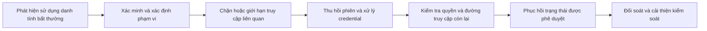

# Defense in depth

## 1. Phòng thủ nhiều lớp trong IAM

**Defense in depth** là chiến lược kết hợp nhiều lớp kiểm soát để một sai sót hoặc một cơ chế bị vượt qua không lập tức dẫn đến mất toàn bộ khả năng bảo vệ. Với IAM, các lớp này bao phủ việc tạo danh tính, xác thực, quản lý phiên, cấp quyền, truy cập tài nguyên, sử dụng đặc quyền, phát hiện và phục hồi.

NIST mô tả defense in depth là chiến lược kết hợp con người, công nghệ và năng lực vận hành để thiết lập các rào cản ở nhiều lớp. Vì vậy, số lượng sản phẩm bảo mật không phải thước đo đầy đủ của phòng thủ nhiều lớp. [NIST Glossary: Defense-in-depth](https://csrc.nist.gov/glossary/term/defense_in_depth).

Ví dụ, một tổ chức có MFA nhưng ứng dụng cho phép người dùng đã đăng nhập đọc tài liệu của mọi khách hàng. MFA làm khó một số cách chiếm tài khoản, nhưng không xử lý lỗi phân quyền theo đối tượng. Một người dùng hợp lệ hoặc một phiên bị chiếm vẫn có thể truy cập quá phạm vi nếu backend không kiểm tra quyền.

Thiết kế nhiều lớp đặt thêm các điểm kiểm soát phù hợp: xác minh phiên, kiểm tra quyền theo tài nguyên và tenant, hạn chế quyền của workload, ghi nhận hành động nhạy cảm và có khả năng thu hồi truy cập. Các lớp cần bổ sung cho nhau theo những đường tấn công cụ thể.

## 2. Bắt đầu từ tài nguyên và đường gây hại

Trước khi chọn một kiểm soát, cần xác định tài sản cần bảo vệ và điều gì có thể xảy ra nếu IAM bị sử dụng sai.

| Mục tiêu của hành vi trái phép | Một đường có thể xảy ra | Kiểm soát cần xét |
|---|---|---|
| Chiếm tài khoản | Credential bị lộ, phishing, recovery yếu | Xác thực phù hợp, bảo vệ recovery, phát hiện bất thường |
| Dùng lại phiên bị đánh cắp | Token hoặc cookie bị lộ | Bảo vệ phiên, giới hạn hiệu lực, thu hồi và đánh giá lại |
| Đọc dữ liệu khách hàng khác | Đổi tenant hoặc resource ID | Authorization theo đối tượng, tenant binding, cách ly dữ liệu |
| Tự tăng quyền | Sửa role, nhóm hoặc credential đặc quyền | Quản trị quyền có phạm vi, kiểm soát ủy quyền, phê duyệt |
| Di chuyển sang hệ thống khác | Workload có quyền quá rộng hoặc secret dùng chung | Danh tính workload, quyền hẹp, phân đoạn và quản lý secret |
| Xóa dấu vết và duy trì truy cập | Tắt log, tạo credential mới | Audit được bảo vệ, theo dõi thay đổi và ứng phó |

Không phải mọi sự cố đi qua cùng một chuỗi. Kẻ tấn công có thể bắt đầu bằng mật khẩu, nhưng cũng có thể bắt đầu bằng một service account, một phiên đã xác thực hoặc quyền quản trị bị lạm dụng. Chỉ bảo vệ màn hình đăng nhập sẽ bỏ sót các điểm khởi đầu khác.

Với mỗi đường gây hại, nên đặt ba câu hỏi: lớp nào chặn trước, lớp nào còn hiệu lực nếu lớp đầu thất bại và bằng chứng nào giúp phát hiện hoặc phục hồi? Không cần giả định lớp đầu chắc chắn thất bại, nhưng phải biết hệ thống sẽ còn gì để dựa vào.

## 3. Bốn mục tiêu của các lớp kiểm soát

Phòng thủ nhiều lớp bao gồm nhiều mục tiêu vận hành:

| Mục tiêu | Ví dụ trong IAM | Giới hạn cần hiểu |
|---|---|---|
| Ngăn chặn | MFA, kiểm tra quyền, giới hạn scope | Không có một cơ chế nào ngăn mọi loại tấn công |
| Giới hạn tác động | Tenant isolation, least privilege, đặc quyền có thời hạn | Vẫn có thể xảy ra thiệt hại trong phạm vi quyền hợp lệ |
| Phát hiện | Audit, cảnh báo thay đổi IAM, phân tích hành vi | Ghi log chưa đồng nghĩa có người hoặc hệ thống phản ứng |
| Ứng phó và phục hồi | Thu hồi phiên, đổi credential, khôi phục cấu hình được duyệt | Phải biết độ trễ và những đường truy cập chưa bị vô hiệu hóa |

Một hệ thống có thể phát hiện tài khoản bị chiếm nhưng chưa có cách chấm dứt phiên. Khi đó, lớp phát hiện có giá trị nhưng đường ứng phó còn thiếu. Ngược lại, khả năng thu hồi rất nhanh cũng khó sử dụng nếu không có tín hiệu để biết cần thu hồi ai và tại đâu.

Các mục tiêu này liên kết thành vòng vận hành: phát hiện cung cấp căn cứ phản ứng; phản ứng giới hạn thiệt hại; phục hồi đưa hệ thống về trạng thái được kiểm soát; bài học từ sự cố cải thiện các lớp ngăn chặn.

## 4. Lớp danh tính và xác thực

Lớp đầu tiên không chỉ là chọn một phương thức đăng nhập. Nó còn gồm nguồn danh tính, quy trình cấp tài khoản, đăng ký phương thức xác thực, recovery và vòng đời tài khoản.

**Cấp phát đúng đối tượng.** Tài khoản nên gắn với chủ thể có căn cứ, đơn vị chịu trách nhiệm và trạng thái rõ ràng. Khi người dùng rời tổ chức, phải có quy trình chấm dứt quyền, thay vì đợi tài khoản hết hoạt động tự nhiên.

**Xác thực phù hợp mức nhạy cảm.** MFA, trong đó có phương thức chống phishing khi phù hợp, giúp giảm rủi ro của việc chỉ dựa vào một credential dễ bị đánh cắp. Nhưng hai lần nhập mật khẩu hoặc mật khẩu cộng câu hỏi bí mật không tự tạo thành hai yếu tố độc lập.

**Bảo vệ đường thay thế.** Nếu đường chính yêu cầu xác thực mạnh nhưng helpdesk có thể reset bằng thông tin công khai, kẻ tấn công có thể chọn đường recovery. Việc thêm phương thức MFA mới, đổi email khôi phục hoặc cấp recovery code cần kiểm soát và dấu vết tương ứng.

**Giảm lạm dụng tự động.** Rate limit, phát hiện password spraying và phản hồi không làm lộ tài khoản có thể hỗ trợ bảo vệ đăng nhập. Cơ chế khóa tài khoản cũng cần tính tới nguy cơ bị dùng để gây từ chối dịch vụ cho người dùng hợp lệ.

Một bài kiểm tra hữu ích là liệt kê mọi đường tạo hoặc khôi phục khả năng đăng nhập: SSO, tài khoản local, recovery, thiết bị mới, API key và tài khoản hỗ trợ. Đường yếu nhất có thể trở thành cách đi vòng các lớp mạnh hơn.

## 5. Lớp phiên và token sau đăng nhập

Đăng nhập thành công chỉ là điểm bắt đầu của phiên. Cookie hoặc bearer token bị đánh cắp có thể cho phép sử dụng phiên mà không cần nhập lại mật khẩu trong mỗi yêu cầu.

Các kiểm soát cần xét gồm bảo vệ token khi truyền và lưu, kiểm tra issuer và audience theo giao thức, giới hạn thời gian hiệu lực, kiểm soát refresh token, chấm dứt phiên và xác thực lại cho thao tác nhạy cảm.

Trong ứng dụng web dùng cookie, cấu hình `Secure`, `HttpOnly` và `SameSite` cần phù hợp luồng hoạt động. Chúng phục vụ các mục tiêu khác nhau: `HttpOnly` không ngăn mọi tác hại của XSS, còn `SameSite` không thay thế mọi biện pháp CSRF cho tất cả kiến trúc và luồng trình duyệt.

Không ghi access token, refresh token hoặc cookie phiên vào log. Không đưa token vào URL khi điều đó có thể làm lộ qua lịch sử, telemetry hoặc các thành phần trung gian.

Thiết kế thu hồi cần trả lời các câu hỏi cụ thể:

- Khi tài khoản bị khóa, phiên ứng dụng hiện có có còn sử dụng được không?
- Khi refresh token bị thu hồi, access token đã phát hành còn hiệu lực bao lâu?
- Khi quyền bị xóa, backend tra cứu quyền hiện hành hay tiếp tục dùng claim cũ đến hết hạn?
- Khi một WebSocket hoặc job đã khởi chạy, thay đổi trạng thái bảo mật được thực thi ở đâu?

Token ngắn hạn giúp giới hạn một số cửa sổ sử dụng trái phép, nhưng không tự thay thế phát hiện, authorization hoặc cơ chế xử lý phiên. Cần biết chính xác việc thu hồi được nền tảng hỗ trợ đến mức nào.

## 6. Lớp authorization tại chức năng, đối tượng và tenant

Xác thực trả lời chủ thể đã chứng minh danh tính như thế nào. Authorization quyết định chủ thể được thực hiện hành động nào lên tài nguyên nào trong phạm vi nào.

Một API cần phân biệt ít nhất:

1. Quyền sử dụng chức năng, chẳng hạn đọc hoặc xóa báo cáo.
2. Quyền với đối tượng cụ thể, chẳng hạn báo cáo `report-41`.
3. Phạm vi tenant, dự án hoặc tổ chức sở hữu đối tượng.
4. Điều kiện đang áp dụng, chẳng hạn trạng thái membership, thời hạn grant hoặc yêu cầu xác thực bổ sung.

OWASP khuyến nghị cấu hình từ chối mặc định và kiểm tra permission trên mọi yêu cầu được bảo vệ. Việc kiểm tra phải phù hợp đối tượng và nghiệp vụ, không chỉ xác nhận rằng người gọi đã đăng nhập. [OWASP Authorization Cheat Sheet](https://cheatsheetseries.owasp.org/cheatsheets/Authorization_Cheat_Sheet.html).

Ví dụ mã giả Java cho một dịch vụ báo cáo:

```java
ReportView readReport(VerifiedPrincipal principal, ReadReportRequest request) {
    TenantContext tenant = tenantAccess.requireActiveMembership(
            principal.id(), request.tenantId());

    Report report = reports.findByTenantAndId(tenant.id(), request.reportId())
            .orElseThrow(NotFound::new);

    authorization.requireAllowed(
            principal, tenant, "report:read", report.resourceDescriptor());

    accessConditions.requireSatisfied(principal, tenant, report);
    return report.toView();
}
```

Các kiểu và phương thức là thành phần minh họa, không phải mã thư viện để chạy nguyên trạng. Bước xác minh danh tính diễn ra trước khi tạo `VerifiedPrincipal`. Tenant do client yêu cầu phải được kiểm tra; không tự trở thành tenant mà người dùng được phép sử dụng.

Backend kiểm tra quyền trước khi trả dữ liệu. Bộ lọc tenant ở truy vấn giúp không lấy nhầm báo cáo của khách hàng khác. Hai cơ chế này hỗ trợ nhau, nhưng truy vấn có tenant không đủ nếu người gọi chưa được cấp quyền tại tenant đó.

Ẩn nút xóa trên giao diện, dùng UUID khó đoán hoặc chỉ cho mở trang từ menu không thay thế authorization. Người dùng có thể gọi API trực tiếp, và một tài khoản hợp lệ vẫn có thể yêu cầu hành động ngoài quyền.

## 7. Lớp dữ liệu, workload và đường truy cập nội bộ

Sau lớp API, dữ liệu vẫn cần được bảo vệ bằng cơ chế phù hợp kiến trúc: phạm vi quyền database, row-level security, schema riêng, database riêng hoặc các biện pháp cách ly khác.

Một lớp dữ liệu có thể giới hạn tác động của lỗi ứng dụng nếu nó thực sự áp dụng ràng buộc mà ứng dụng không tùy ý vượt qua. Nếu cùng một credential database có toàn quyền và được dùng cho mọi yêu cầu, lớp đó có thể không giúp giới hạn hậu quả khi workload bị chiếm.

Row-level security cũng cần cấu hình role database và tenant context đúng. Không giả định mọi role đều bị ràng buộc như nhau; các quyền đặc biệt hoặc cách kết nối sai có thể làm mất hiệu lực mong muốn. Với connection pool, ngữ cảnh tenant phải được thiết lập và dọn sạch theo đơn vị công việc.

Danh tính workload nên tách theo chức năng hoặc phạm vi cần thiết. Dịch vụ đọc báo cáo không mặc nhiên cần quyền sửa cấu hình IAM; một worker xử lý tenant A không mặc nhiên cần đọc secret của tenant B. Credential dùng chung rộng làm tăng phạm vi tác động khi một thành phần bị xâm phạm.

Mạng riêng, phân đoạn hoặc mTLS có thể kiểm soát đường kết nối và danh tính dịch vụ. Chúng không tự chứng minh người dùng cuối có quyền với tài nguyên. Khi một dịch vụ gọi thay người dùng, phải giữ được quan hệ giữa actor ứng dụng, chủ thể và quyền hiệu lực, thay vì coi mọi lời gọi nội bộ đều toàn quyền.

Mã hóa khi lưu và khi truyền bảo vệ trước những tình huống nhất định. Nếu ứng dụng hợp lệ đã có quyền giải mã rồi trả nhầm dữ liệu, mã hóa at rest không sửa lỗi authorization đó. Vì vậy, cần xác định rõ mỗi lớp bảo vệ trước mối đe dọa nào.

## 8. Lớp quản trị đặc quyền và thay đổi IAM

Một tài khoản có quyền sửa chính sách có thể thay đổi cách mọi lớp khác vận hành. Do đó, quyền quản trị IAM, log, secret, hệ thống triển khai và backup cần được xem xét riêng.

Các biện pháp có thể gồm tài khoản quản trị tách biệt, cấp đặc quyền có thời hạn, scope hẹp, phê duyệt cho thay đổi nhạy cảm, phân tách nhiệm vụ và ghi nhận lý do sử dụng.

Không chỉ kiểm soát thao tác gán role. Sửa role definition, thêm thành viên nhóm đặc quyền, tạo credential cho một ứng dụng mạnh hoặc đổi recovery của quản trị viên đều có thể tạo ra quyền truy cập mới.

Phân tách nhiệm vụ cần được thể hiện trong cơ chế thực thi. Một người không nên có khả năng tự tạo yêu cầu, tự phê duyệt và tự xóa dấu vết nếu mô hình quản trị yêu cầu kiểm soát chéo. Hai tài khoản do cùng một người hoặc cùng một hệ thống bị chiếm kiểm soát chưa chắc là hai bên độc lập.

Tài khoản khẩn cấp phục vụ phục hồi cần có người chịu trách nhiệm, bảo vệ credential, giám sát sử dụng và kiểm tra định kỳ. Nó không nên trở thành tài khoản dùng hằng ngày hoặc ngoại lệ không giới hạn khỏi toàn bộ chính sách.

Đường triển khai cũng thuộc phạm vi này. Nếu credential CI/CD có thể sửa middleware xác thực, mở rộng role và tắt audit, việc bảo vệ người dùng bằng nhiều lớp có thể bị vô hiệu hóa qua pipeline. Quyền thay đổi code và cấu hình bảo mật cần được tính trong mô hình tin cậy.

## 9. Phát hiện, ứng phó và phục hồi là các lớp thực sự

Audit nên bao quát các sự kiện có ý nghĩa: đăng nhập bất thường, thay phương thức xác thực, cấp và thu hồi quyền, tạo credential, sử dụng đặc quyền, export nhạy cảm và các quyết định từ chối đáng chú ý.

Một sự kiện cần giúp xác định ai thực hiện, tác động tenant và tài nguyên nào, kết quả ra sao và chính sách hoặc quyền nào làm căn cứ. Với lời gọi thay mặt người khác, nên phân biệt actor và subject.

Log cần được bảo vệ khỏi chỉnh sửa hoặc xóa bởi chính principal đang được giám sát trong phạm vi thiết kế. Chỉ ghi file trên máy ứng dụng mà một tài khoản ứng dụng bị chiếm có thể xóa sạch sẽ làm giảm giá trị lớp kiểm toán.

Không biến logging thành kho secret. Giảm dữ liệu nhạy cảm, kiểm soát người được đọc log và duy trì khả năng truy vết bằng định danh sự kiện hoặc request ID.

Một chuỗi ứng phó minh họa:



Thu hồi một phiên không bảo đảm credential mới do kẻ tấn công tạo đã bị xóa. Đổi mật khẩu cũng không tự thu hồi mọi API key, consent hoặc quyền gán qua nhóm. Cần kiểm tra những cơ chế duy trì truy cập có liên quan.

Phục hồi từ backup phải giữ hiệu lực các quyết định bảo mật mới hơn khi cần. Không khôi phục một bản cấu hình cũ rồi vô tình mở lại tài khoản đã khóa hoặc credential đã xác định bị lộ.

## 10. Nhiều lớp không đồng nghĩa nhiều cơ chế độc lập

Một thiết kế có thể trông nhiều lớp nhưng cùng phụ thuộc vào một giả định sai.

| Thiết kế tưởng là nhiều lớp | Điểm yếu chung | Cách đánh giá lại |
|---|---|---|
| Frontend và backend cùng đọc một role do client tự gửi | Cả hai cùng tin dữ liệu chưa được xác minh | Backend phải sử dụng principal và quyền từ nguồn đáng tin |
| Hai API đều chỉ kiểm tra chữ ký token | Cùng thiếu authorization theo tenant và đối tượng | Thực thi quyền gần tài nguyên, giữ scope cụ thể |
| Hai bước reset đều dựa vào email đang bị chiếm | Cùng một quyền kiểm soát khôi phục | Đánh giá lại bằng chứng và quy trình recovery |
| Gateway kiểm tra nhưng backend còn đường truy cập bỏ qua | Mọi bảo vệ phụ thuộc đường đi được giả định | Bảo vệ đường nội bộ và hợp đồng danh tính tại backend |
| Backup và log cùng do một tài khoản đặc quyền có thể xóa | Chung một điểm thất bại quản trị | Tách quyền và kiểm tra khả năng phục hồi phù hợp |

Độc lập tuyệt đối không phải lúc nào cũng khả thi. Mục tiêu là nhận diện phụ thuộc và tránh để một lỗi cấu hình, một credential hoặc một đường bypass làm tất cả lớp mất hiệu lực cùng lúc.

Không nhân các xác suất thất bại giả định để tuyên bố hệ thống an toàn nếu chưa có căn cứ về tính độc lập. Hai lớp cùng dùng một cấu hình sai thường không thất bại độc lập với nhau.

Tính đa dạng cũng có chi phí. Thêm nhiều bộ chính sách không thống nhất có thể tạo khoảng trống, chậm thu hồi hoặc khó xác định quyền hiệu lực. Có thể dùng policy được quản lý tập trung nhưng thực thi tại nhiều điểm, miễn các điểm thực thi bảo vệ đúng tài nguyên và xử lý kết quả nhất quán.

## 11. Kiểm chứng bằng cách giả định một lớp không còn bảo vệ

Kiểm thử nhiều lớp nên đi theo tình huống trong môi trường và phạm vi được cho phép. Mục đích là xác định lớp còn lại có thực thi đúng chức năng, không phải tắt kiểm soát sản xuất một cách tùy tiện.

| Giả định kiểm thử | Điều cần quan sát |
|---|---|
| Có một phiên người dùng hợp lệ | Vẫn không đọc được tài nguyên ngoài quyền |
| Người dùng đổi tenant hoặc object ID trong request | Backend và tầng dữ liệu giữ đúng phạm vi |
| Client gọi trực tiếp endpoint không qua giao diện | Authorization vẫn được áp dụng |
| Gateway không còn là đường duy nhất có thể đến backend | Đường còn lại không chấp nhận context giả hoặc bỏ kiểm soát |
| Một workload credential bị dùng ngoài nhu cầu bình thường | Scope giới hạn tác động và telemetry hỗ trợ phát hiện |
| Một tài khoản đặc quyền bị đình chỉ | Phiên, token và quyền liên quan được xử lý theo giới hạn đã thiết kế |
| Dịch vụ policy hoặc risk không khả dụng | Hành động bắt buộc có điều kiện không tự được cho phép |
| Người vận hành ứng dụng cố sửa log bảo mật | Biện pháp bảo vệ log có hiệu lực theo mô hình đã chọn |
| Khôi phục cấu hình từ backup | Không làm sống lại quyền hoặc credential đã thu hồi ngoài kế hoạch |

Với sự cố phụ thuộc như dịch vụ policy lỗi, cần chính sách suy giảm rõ ràng. Một số chức năng có thể dùng quyết định cache còn hợp lệ trong giới hạn đã duyệt; thao tác nhạy cảm cần các điều kiện bắt buộc thì chưa đủ bằng chứng phải chưa được thực hiện. Không mặc định tất cả đều Allow để giữ tính sẵn sàng.

Ngược lại, không thiết kế mọi lỗi vận hành thành khóa toàn bộ khả năng phục hồi. Đường quản trị khẩn cấp cần được kiểm soát và kiểm chứng riêng, với phạm vi nhỏ và khả năng giám sát phù hợp.

Bằng chứng có thể gồm kết quả truy cập, log quyết định, trạng thái phiên, quyền hiệu lực và thời gian từ thu hồi đến thực thi. Một nhãn “MFA enabled” hoặc “audit enabled” không chứng minh mọi đường truy cập cần bảo vệ đã được bao phủ.

## 12. Vận hành nhiều lớp mà không tạo quyền thừa

Mỗi lớp nên có mục tiêu, chủ sở hữu, phạm vi, phụ thuộc và cách kiểm chứng. Ví dụ:

| Lớp | Mục tiêu cụ thể | Bằng chứng vận hành |
|---|---|---|
| Xác thực và recovery | Giảm khả năng nhận danh tính trái phép | Kiểm tra đường đăng nhập và reset, sự kiện thay phương thức |
| Phiên và token | Giới hạn thời gian và cách sử dụng phiên | Kết quả thu hồi, kiểm tra audience, giới hạn hiệu lực |
| Authorization | Chỉ cho phép hành động trên tài nguyên được cấp | Kiểm thử quyền theo persona, tenant và object |
| Workload và dữ liệu | Giới hạn tác động khi một thành phần bị chiếm | Scope credential, kết quả cách ly, quyền database |
| Quản trị đặc quyền | Kiểm soát thay đổi ảnh hưởng lớn | Phê duyệt, thời hạn đặc quyền, log thay đổi |
| Phát hiện và phục hồi | Nhận biết và xử lý đường truy cập trái phép | Cảnh báo có người xử lý, thử phục hồi và đối soát |

Ưu tiên theo những đường gây hại thực tế và mức ảnh hưởng tài nguyên. Một tenant nhỏ không nhất thiết cần cùng số lượng công cụ với một nền tảng lớn, nhưng vẫn cần biết ai được truy cập, quyền được thực thi ở đâu và cách chấm dứt quyền khi có sự cố.

Chỉ số hữu ích là độ bao phủ của các đường xác thực và recovery, khả năng chặn truy cập ngoài scope, thời gian thu hồi thực tế, thời gian phát hiện thay đổi quyền nhạy cảm và kết quả thử phục hồi. Số firewall, số lần MFA hoặc dung lượng log tự nó không chứng minh chiều sâu phòng thủ.

Defense in depth trong IAM có hiệu quả khi một lớp giảm khả năng bị xâm nhập, lớp khác hạn chế quyền sử dụng, lớp khác giữ ranh giới tài nguyên và các năng lực vận hành phát hiện rồi xử lý điều còn vượt qua. Chất lượng nằm ở cách các lớp phối hợp và những phụ thuộc được kiểm soát, không nằm ở việc lặp lại cùng một kiểm tra nhiều lần.
