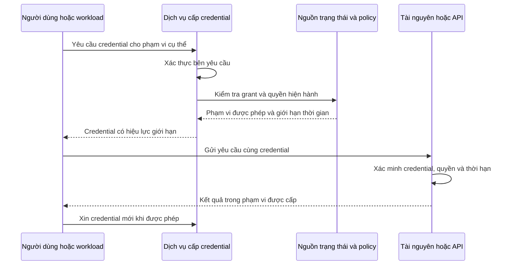

# Short-lived credential

## 1. Credential ngắn hạn là gì?

**Short-lived credential** là thông tin xác thực hoặc bằng chứng truy cập có thời hạn sử dụng ngắn và được bên nhận thực sự kiểm tra thời hạn đó. Sau khi hết hiệu lực, credential không được tiếp tục dùng để tạo truy cập mới theo hợp đồng của hệ thống.

Ví dụ:

- Access token có thời điểm hết hạn.
- Credential tạm thời do dịch vụ cấp quyền cho workload.
- Chứng thư client hoặc SSH certificate được cấp cho một khoảng thời gian.
- Tài khoản hoặc mật khẩu cơ sở dữ liệu động có lease được quản lý.
- Credential được cấp sau khi kích hoạt quyền đặc biệt trong thời gian giới hạn.

Không có một số phút cố định để mọi loại credential đều được coi là ngắn hạn. Khoảng thời gian phù hợp phụ thuộc rủi ro, hành động được cấp, khả năng làm mới, độ sẵn sàng của bên cấp và cách bên nhận thực thi hết hạn.

Một chuỗi có trường `expires_at` nhưng API không kiểm tra trường đó chưa tạo ra giới hạn hiệu lực thực tế.

Cần phân biệt thời hạn credential với thời hạn danh tính. Một dịch vụ có thể tồn tại nhiều năm nhưng mỗi credential của nó chỉ có hiệu lực trong một khoảng ngắn. Quyền được cấp cũng có thể thay đổi giữa các lần cấp credential mới.

## 2. Phân biệt hết hạn, làm mới, xoay vòng và thu hồi

| Khái niệm | Ý nghĩa | Điều không tự bảo đảm |
| --- | --- | --- |
| Hết hạn | Credential không còn được chấp nhận sau mốc thời gian quy định | Không vô hiệu hóa trước mốc đó |
| Làm mới hoặc cấp lại | Nhận credential mới qua một cơ chế được phép | Không tự chứng minh quyền cũ vẫn còn hợp lệ |
| Xoay vòng | Thay credential hoặc khóa theo quy trình chuyển đổi | Không chắc credential cũ đã bị thu hồi ngay |
| Thu hồi | Làm credential, grant hoặc phiên mất hiệu lực theo cơ chế của hệ thống | Không có hiệu lực tức thì trên mọi thành phần nếu chưa được truyền và thực thi |
| Hết hạn phiên | Kết thúc một ngữ cảnh đăng nhập hoặc truy cập | Không tự làm mọi token đã phát hành bị từ chối ở mọi API |

Một access token có thể hết hạn sau mười phút trong khi phiên người dùng kéo dài nhiều giờ và refresh grant có vòng đời khác. Các con số chỉ là ví dụ; không nên dùng thời hạn access token để suy ra thời hạn của toàn bộ phiên.

Với chứng thư, cần phân biệt thời hạn của chứng thư với vòng đời khóa riêng. Cấp chứng thư ngắn hạn cho cùng một khóa không tự làm khóa đó trở thành khóa ngắn hạn.

Với tài khoản cơ sở dữ liệu động, giới hạn lease chỉ có tác dụng đúng nếu hệ thống cấp phát và cơ sở dữ liệu thực thi quy trình hết hạn hoặc thu hồi phù hợp. Không mặc định một timestamp ở hệ thống quản lý sẽ tự đóng mọi kết nối đang mở.

## 3. Giảm rủi ro gì và vẫn còn giới hạn nào?

### 3.1. Giới hạn thời gian sử dụng credential bị đánh cắp

Giả sử credential bị lộ lúc 10:08:

```text
Credential A hết hạn lúc 10:10.
Credential B hết hạn vào ngày hôm sau.
```

Nếu mọi bên nhận đều kiểm tra hết hạn đúng và không có cách cấp tiếp trái phép, credential A chỉ còn một khoảng hiệu lực ngắn hơn credential B.

Đây là lợi ích chính: giảm khoảng thời gian mà credential bị lộ có thể được dùng để truy cập mới.

Tuy vậy, kẻ có credential vẫn có thể thực hiện hành động được cấp ngay trong thời gian còn hiệu lực. Vì vậy credential ngắn hạn cần đi cùng:

- Quyền tối thiểu.
- Phạm vi tenant, API và tài nguyên rõ ràng.
- Bảo vệ đường truyền và nơi lưu credential.
- Giám sát và khả năng thu hồi khi cơ chế hỗ trợ.
- Kiểm soát khả năng cấp hoặc làm mới credential tiếp theo.

Credential có hiệu lực rất ngắn nhưng được cấp quyền quản trị toàn hệ thống vẫn có thể gây tác động lớn.

### 3.2. Không giải quyết mọi dạng chiếm dụng

Credential ngắn hạn không tự ngăn:

- Sử dụng credential ngay sau khi đánh cắp.
- Kẻ tấn công chiếm được refresh token hoặc quyền gọi dịch vụ cấp credential.
- Workload bị chiếm dụng liên tục xin credential mới.
- Secret bị ghi vào log trong mọi lần cấp lại.
- Quyền quá rộng trong tenant hoặc môi trường khác.
- Tác động đã xảy ra, như dữ liệu đã bị tải xuống.

Bearer token thường có thể được sử dụng bởi bên sở hữu nó trong phạm vi được API chấp nhận. Thời hạn ngắn giới hạn thời gian, nhưng không tự chứng minh bên gửi là workload hoặc thiết bị ban đầu.

Cơ chế ràng buộc credential với khóa của bên gửi, nếu được hệ thống hỗ trợ và thực thi đúng, có thể bổ sung bảo vệ. Nó vẫn không thay thế giới hạn quyền và bảo vệ thành phần giữ khóa.

### 3.3. Thời điểm hết hạn không đảo ngược tác động cũ

Một yêu cầu được chấp nhận trước khi credential hết hạn có thể đã tạo job hoặc mở một kết nối dài hạn. Cách xử lý tiếp phụ thuộc giao thức và policy.

Cần xác định rõ:

```text
Hết hạn chặn yêu cầu mới?
Có đánh giá lại kết nối đang mở không?
Job đã được nhận có tiếp tục chạy không?
Ai có quyền lấy kết quả của job?
Có kiểm tra lại trước bước gây tác động nhạy cảm không?
```

Không suy ra từ một trường hết hạn rằng mọi tác vụ đang chạy sẽ tự dừng chính xác tại cùng thời điểm.

## 4. Vòng đời cấp credential ngắn hạn

Một mô hình thường gặp:



Dịch vụ cấp có thể là authorization server, broker credential, hệ thống quản lý danh tính workload hoặc dịch vụ cấp phát phù hợp. Không phải sản phẩm nào cũng hỗ trợ cùng loại credential và cơ chế thu hồi.

### 4.1. Xác thực nguồn yêu cầu trước khi cấp

Không được cấp credential chỉ vì request tự khai:

```json
{
  "workload": "report-exporter",
  "tenant_id": "tenant_a",
  "permissions": ["reports:read"]
}
```

Các field trên mô tả mong muốn, chưa chứng minh bên gọi là workload đó hoặc có quyền tại tenant A.

Bên cấp phải xác thực bằng cơ chế tin cậy, kiểm tra grant, giới hạn quyền client được yêu cầu và trạng thái hiện hành. Với workload, danh tính môi trường hoặc nền tảng có thể hỗ trợ bootstrap khi được cấu hình đúng. Không mặc định một request đến từ mạng nội bộ thì có quyền xin mọi credential.

### 4.2. Thời hạn không vượt giới hạn của grant

Có thể diễn đạt giới hạn cấp ở mức khái niệm:

```text
expires_at không muộn hơn:
  thời điểm hiện tại + thời lượng policy cho phép,
  thời điểm grant hết hiệu lực,
  thời điểm phiên hoặc ngữ cảnh ủy quyền nền hết hiệu lực
  nếu các giới hạn đó áp dụng cho loại credential này.
```

Nếu quyền đặc biệt chỉ còn hiệu lực ba phút, không nên cấp credential cho phép dùng quyền đó thêm một giờ mà không có cơ chế giới hạn tương ứng.

Các quyền được cấp cũng phải nằm trong phần giao của quyền principal, giới hạn client, tenant và tài nguyên đích. Làm thời hạn ngắn không phải lý do để mở rộng scope.

### 4.3. Bảo vệ thành phần cấp credential

Bên cấp thường có quyền tạo nhiều credential có giá trị. Cần kiểm soát quyền truy cập, khóa ký hoặc secret gốc, cấu hình trust và audit của nó.

Việc cấp token ngắn hạn bằng một khóa ký dài hạn không loại bỏ nhu cầu bảo vệ khóa ký. Nếu bên cấp bị chiếm dụng, kẻ tấn công có thể tiếp tục tạo credential mới trong phạm vi mà hệ thống nhận chấp nhận.

## 5. Bên nhận phải thực thi thời hạn và phạm vi

### 5.1. Xác minh trước khi tin nội dung

Với access token dạng JWT, API cần xác minh theo hợp đồng của mình, chẳng hạn:

- Loại token được chấp nhận.
- Chữ ký, thuật toán và khóa được cho phép.
- Issuer nằm trong nguồn tin cậy.
- Audience phù hợp với API.
- Các điều kiện thời gian liên quan.
- Tenant và scope phù hợp với yêu cầu.
- Trạng thái thu hồi hoặc quyền hiện hành nếu mô hình yêu cầu kiểm tra.

Chỉ decode payload để đọc thời điểm hết hạn là chưa đủ. Token giả có thể tự khai thời hạn dài và quyền rộng.

Với opaque token hoặc credential được tra cứu phía máy chủ, việc xác minh phải dùng nguồn trạng thái đáng tin cậy. Với chứng thư hoặc mật khẩu động, bên nhận thực thi theo cơ chế của giao thức và sản phẩm tương ứng, không áp dụng máy móc quy trình JWT.

Một credential còn hạn nhưng sai tenant hoặc sai audience vẫn phải bị từ chối.

### 5.2. Đồng hồ và khoảng dung sai

Hệ thống phân tán cần thời gian đủ nhất quán để kiểm tra hết hạn. Một khoảng dung sai đồng hồ có thể được cấu hình theo cơ chế thực tế, nhưng phải nhỏ, có lý do và được kiểm soát.

Không thêm một “grace period” không giới hạn mỗi khi client gửi token hết hạn. Nếu mọi API tự kéo dài hiệu lực khác nhau, thời hạn credential không còn mang ý nghĩa thống nhất.

Thời gian gia hạn ở client để chủ động xin credential mới khác với thời gian dung sai mà server dùng khi xác minh.

```text
Client refresh sớm:
  giảm xác suất gửi credential sắp hết hạn.

Server kiểm tra hết hạn:
  quyết định credential còn được chấp nhận không.
```

Client có thể dùng thời lượng nhận được để lên lịch làm mới, nhưng server vẫn là nơi quyết định hiệu lực của request.

### 5.3. Đánh giá đúng điểm thực thi

Các thành phần cần chú ý gồm API, gateway, dịch vụ phía sau, cơ sở dữ liệu, kho file và kết nối dài hạn.

Nếu gateway xác minh token nhưng API có một đường vào khác không được bảo vệ, TTL tại gateway không bảo vệ đường tắt đó.

Nếu cơ sở dữ liệu chỉ xác thực lúc mở connection, việc credential hết hạn có thể chỉ chặn connection mới. Cần kiểm tra hành vi của hệ thống cụ thể và quản lý tuổi connection hoặc thu hồi phiên nếu yêu cầu cần điều đó.

Một URL tải file có thời hạn cũng cần được hiểu theo hợp đồng của nơi phục vụ file. Hết hạn URL không thu hồi dữ liệu đã tải và không tự chứng minh người đang dùng URL là người nhận ban đầu.

## 6. Làm mới credential an toàn

### 6.1. Cấp mới phải có căn cứ ủy quyền còn hiệu lực

Người dùng có thể dùng refresh grant để nhận access token mới nếu hệ thống hỗ trợ. Workload có thể dùng danh tính nền tảng hoặc phiên với broker để xin credential tiếp theo.

Điểm chung là bên cấp phải kiểm tra các điều kiện áp dụng ở thời điểm cấp mới. Không sao chép mãi quyền cũ chỉ vì lần cấp trước đã thành công.

Nếu membership bị thu hồi hoặc workload không còn được cấp quyền trong tenant, chuỗi cấp mới cần dừng theo cơ chế và mục tiêu hiệu lực đã thiết kế.

Một access token chỉ tồn tại vài phút nhưng refresh token không được bảo vệ có thể vẫn dẫn đến truy cập kéo dài. Credential gốc cho phép cấp tiếp thường cần bảo vệ đặc biệt.

### 6.2. Chủ động làm mới trước khi hết hạn

Một tiến trình có thể làm mới trước khi credential hiện tại hết hạn, chừa thời gian xử lý mạng và retry.

Các nguyên tắc:

- Chọn khoảng đệm phù hợp với thời hạn và độ trễ thực tế.
- Thêm jitter để nhiều instance không đồng loạt xin cấp mới.
- Dùng cơ chế chỉ một luồng làm mới cho cùng ngữ cảnh khi cần.
- Retry có giới hạn và backoff, thay vì gọi dồn liên tục.
- Không tiếp tục dùng credential đã hết hạn chỉ vì lần làm mới bị lỗi.

Pseudocode:

```java
Credential credentialFor(AccessScope scope) {
    Credential current = cache.current(scope);

    if (current != null
            && current.isUsableNow(clock.now())
            && !current.needsRefreshSoon(clock.now())) {
        return current;
    }

    return refreshCoordinator.singleFlight(scope, () -> {
        Credential latest = cache.current(scope);

        if (latest != null
                && latest.isUsableNow(clock.now())
                && !latest.needsRefreshSoon(clock.now())) {
            return latest;
        }

        try {
            Credential issued = issuer.issueForCurrentGrant(scope);
            credentialChecks.requireValidForScope(issued, scope);
            cache.replace(scope, issued);
            return issued;
        } catch (TemporaryIssueFailure failure) {
            Credential fallback = cache.current(scope);

            if (fallback != null
                    && fallback.isUsableNow(clock.now())
                    && policy.allowsUseUntilExpiry(scope)) {
                return fallback;
            }

            throw new CredentialUnavailable(failure);
        }
    });
}
```

Đây là mã minh họa, không phải chương trình hoàn chỉnh. `isUsableNow` phải phản ánh các điều kiện mà hệ thống biết cần kiểm tra, không chỉ so sánh thời gian nếu credential đã có thông tin bị thu hồi.

Ví dụ chỉ cho phép tiếp tục sử dụng credential hiện tại khi nó vẫn hợp lệ và policy cho phép. Không dùng lại credential đã hết hạn, không tự cấp thêm TTL và không tự chuyển sang một secret dài hạn ngoài thiết kế.

Mỗi cache key phải giữ đúng principal, tenant, audience, scope hoặc những chiều khác ảnh hưởng đến credential. Không để một credential được cấp cho tenant A được lấy ra khi tiến trình đang xử lý tenant B.

### 6.3. Chuyển đổi khi hai credential cùng còn hiệu lực

Có thể tồn tại một khoảng chồng lấn giữa credential cũ và mới để tránh gián đoạn. Khoảng này cần có giới hạn và quy tắc rõ ràng.

Ví dụ:

```text
Credential cũ: còn hiệu lực đến 10:10.
Credential mới: được cấp lúc 10:08.
Từ 10:08 đến 10:10: có thể cùng tồn tại theo policy.
```

Khi cập nhật, cần tránh race condition làm một phản hồi cấp mới đến trễ ghi đè credential mới hơn. Có thể cần version, định danh lần cấp hoặc cơ chế thay thế nguyên tử theo kiến trúc.

Nếu loại credential hỗ trợ thu hồi credential cũ sau chuyển đổi, phải xác định thời điểm phù hợp với các request đang chạy. Không mặc định cứ nhận credential mới là credential cũ tự mất hiệu lực.

### 6.4. Chọn thời hạn cân bằng với khả năng vận hành

Thời hạn quá dài tăng khoảng lạm dụng khi credential bị lộ. Thời hạn rất ngắn làm tăng tần suất cấp mới và mức phụ thuộc vào dịch vụ cấp.

Cần cân nhắc:

| Yếu tố | Ảnh hưởng đến thiết kế |
| --- | --- |
| Mức nhạy cảm và quyền được cấp | Quyền mạnh thường cần giới hạn và kiểm soát chặt hơn |
| Khả năng thu hồi | Không có thu hồi sớm thì hết hạn giữ vai trò lớn hơn |
| Độ sẵn sàng của bên cấp | Outage có thể làm workload không nhận được credential mới |
| Độ trễ và giới hạn tần suất | Làm mới cần khoảng đệm và phân tán tải |
| Tác vụ kéo dài | Cần xác định cách gia hạn hoặc kiểm tra lại trong quá trình |
| Khả năng kết nối | Không phải workload nào cũng liên tục truy cập broker |
| Mục tiêu vận hành | Cần biết tác vụ nào bị dừng khi không lấy được credential hợp lệ |

Không chọn TTL chỉ vì một giá trị ví dụ trong tài liệu hoặc vì muốn giảm số lần gọi bên cấp.

## 7. Thu hồi trước hạn và kiểm soát chuỗi cấp mới

### 7.1. Hết hạn là một giới hạn, không phải toàn bộ cơ chế thu hồi

Nếu token hết hạn lúc 11:00 nhưng bị xác định là lộ lúc 10:50, có thể cần chặn ngay thay vì chờ thêm mười phút.

Các cơ chế tùy hệ thống có thể gồm:

- Kiểm tra trạng thái token ở phía máy chủ.
- Thu hồi phiên hoặc grant và truyền trạng thái đến nơi thực thi.
- Danh sách credential bị chặn khi resource server thực sự kiểm tra.
- Vô hiệu hóa tài khoản hoặc danh tính trong phạm vi cần thiết.
- Thu hồi tài khoản động, chứng thư hoặc quyền cấp tiếp theo khả năng sản phẩm.

JWT được xác minh hoàn toàn cục bộ có thể tiếp tục được chấp nhận đến hết hạn nếu API không có nguồn trạng thái hoặc cơ chế cập nhật tương ứng.

Không mặc định xoay khóa ký là cách thu hồi riêng một token. Thay đổi khóa ký có thể ảnh hưởng nhiều token và phụ thuộc cách phân phối khóa, cache cũng như chính sách chấp nhận của bên nhận.

### 7.2. Credential cấp tiếp có thể là điểm rủi ro lớn hơn

Khi refresh token hoặc credential bootstrap bị lộ, kẻ tấn công có thể nhận nhiều credential ngắn hạn liên tiếp.

Cần xem xét cả chuỗi:

```text
Danh tính hoặc credential gốc
  → grant được cấp
  → refresh hoặc broker session
  → access credential ngắn hạn
  → truy cập tài nguyên.
```

Nếu chỉ thu hồi access token hiện tại mà không xử lý quyền cấp tiếp bị chiếm dụng, credential mới vẫn có thể xuất hiện.

Tùy cơ chế, có thể sử dụng giới hạn thời hạn grant, idle timeout, yêu cầu xác thực lại, xoay refresh token hoặc phát hiện tái sử dụng. Các khả năng này phải được bên cấp và client hỗ trợ; không phải thuộc tính tự động của mọi refresh token.

### 7.3. Workload bị chiếm dụng cần xử lý gốc

Nếu workload đang chạy bị chiếm dụng và tiếp tục chứng minh được danh tính của nó, giảm TTL xuống thấp không tự ngăn nó xin credential mới.

Cần xử lý workload, grant, khóa hoặc danh tính bị ảnh hưởng theo quy trình sự cố, rồi kiểm tra các phiên và credential còn tồn tại. Khôi phục tiến trình mà giữ nguyên đường cấp quyền bị lộ có thể không giải quyết được nguyên nhân.

## 8. Áp dụng cho người dùng và workload

### 8.1. Truy cập đặc quyền của người dùng

Một người vận hành có thể được cấp quyền quản trị tạm thời sau khi xác thực bổ sung và đáp ứng quy trình phê duyệt.

Credential cần phản ánh đúng:

```text
Ai được cấp?
Quản trị môi trường hoặc tenant nào?
Được làm những hành động nào?
Căn cứ phê duyệt nào?
Bắt đầu và kết thúc khi nào?
```

Sau khi hết khoảng quyền đặc biệt, không được tiếp tục cấp mới credential mang quyền đó chỉ vì phiên đăng nhập thông thường còn hoạt động.

Nên giữ khả năng phân biệt danh tính thực hiện, quyền đặc biệt được kích hoạt và tài nguyên bị tác động trong audit.

### 8.2. Truy cập giữa các dịch vụ

Workload nên nhận credential phù hợp cho API đích và quyền cần dùng. Không truyền tùy ý token dành cho API A sang API B.

Nếu một dịch vụ xử lý thay mặt người dùng, phải làm rõ cách quyền người dùng giới hạn hành động downstream. Không để credential rộng của dịch vụ biến mọi yêu cầu client thành thao tác được phép.

Một broker credential có thể giúp cấp quyền tạm thời theo danh tính workload, nhưng endpoint broker cũng cần được bảo vệ khỏi việc bị gọi bởi bên không có quyền. Credential metadata hoặc đường cấp phát trong môi trường chạy không nên bị ứng dụng tùy ý chuyển tiếp ra ngoài.

### 8.3. Cơ sở dữ liệu và tác vụ nền

Credential cơ sở dữ liệu động cần phối hợp với connection pool. Workload có thể cần dùng credential mới để mở connection mới, ngừng tái sử dụng connection cũ theo policy và xử lý lỗi xác thực khi lease thay đổi.

Không giả định mọi database đều thu hồi connection đang mở theo cùng cách. Hành vi thực tế cần được kiểm tra với cơ chế cấp phát đang dùng.

Với job nền, nên truyền định danh job, tenant và căn cứ ủy quyền cần thiết thay vì mặc định đặt access token người dùng vào payload lâu dài. Consumer phải có cơ chế lấy credential hợp lệ cho thời điểm thực thi và đúng mô hình quyền.

Nếu job được phép chạy lâu hơn phiên người dùng, sự cho phép đó phải nằm trong thiết kế ủy quyền. Không tự kéo dài credential người dùng để tránh phải xác định quyền của job.

## 9. Bảo vệ credential và quan sát vận hành

Credential ngắn hạn vẫn là secret nếu việc sở hữu nó cho phép truy cập. Cần bảo vệ trong truyền nhận, bộ nhớ, kho lưu và đường chuyển giữa các thành phần theo loại credential.

Không ghi nguyên credential vào:

- Log request hoặc response.
- Thông báo lỗi.
- Trace và sự kiện telemetry.
- Tệp cấu hình hoặc mã nguồn.
- Báo cáo test hoặc ảnh chụp màn hình.

Có thể ghi tham chiếu và metadata cần thiết:

```text
principal=service_report_exporter
tenant=tenant_a
audience=report-api
credential_ref=cred_92a
issued_at=10:00
expires_at=10:10
grant_ref=grant_41
event=CREDENTIAL_ISSUED
```

Định danh credential cũng cần được quản lý theo mức nhạy cảm và khả năng liên kết dữ liệu; không dùng chính giá trị credential làm correlation ID.

Các chỉ số hữu ích có thể gồm tỉ lệ cấp mới thành công, độ trễ cấp, số lỗi do credential hết hạn, số lần retry, số credential gần hết hạn và tỉ lệ thu hồi được thực thi trong mục tiêu.

Khi dịch vụ cấp bị gián đoạn, cần biết workload nào sắp hết credential và chức năng nào sẽ bị ảnh hưởng. Quan sát tốt giúp xử lý outage mà không tạo một đường fallback bỏ qua xác thực.

## 10. Các tình huống kiểm tra cần có

| Tình huống | Kết quả cần đạt |
| --- | --- |
| Credential hợp lệ, còn hạn và đúng quyền | Truy cập đúng phạm vi được cấp |
| Credential hết hạn tại bên nhận | Không được tiếp tục chấp nhận cho truy cập mới ngoài hợp đồng |
| Client tự sửa thời điểm hết hạn | Không vượt qua cơ chế xác minh |
| Credential còn hạn nhưng sai tenant hoặc audience | Bị từ chối |
| Grant bị thu hồi trước lần cấp mới | Không tiếp tục cấp quyền cũ trái policy |
| Refresh token hoặc quyền cấp tiếp bị thu hồi | Chuỗi làm mới dừng theo cơ chế và mục tiêu hiệu lực đã định |
| Dịch vụ cấp tạm lỗi trong khi credential hiện tại còn hợp lệ | Hành vi đúng policy, retry có giới hạn |
| Dịch vụ cấp lỗi và credential hiện tại đã hết hạn | Không tự gia hạn hoặc dùng secret dài hạn ngoài thiết kế |
| Nhiều luồng cùng phát hiện cần làm mới | Không tạo đợt cấp mới dồn hoặc ghi đè sai phiên bản |
| Nhiều instance làm mới gần cùng thời điểm | Tải được phân tán theo cơ chế thiết kế |
| Hai tenant dùng chung tiến trình | Cache không cấp nhầm credential giữa các tenant |
| Clock skew trong giới hạn đã quy định | Hành vi nhất quán tại các mốc thời gian |
| Credential bị thu hồi trong khi token hoặc cache còn hiệu lực | Phản ánh đúng khả năng và độ trễ thu hồi đã cam kết |
| Connection hoặc job kéo dài qua thời điểm hết hạn | Được xử lý theo hợp đồng đã xác định, không giả định tự dừng |
| Ghi log khi cấp hoặc làm mới thất bại | Không lộ credential hoặc secret gốc |

Short-lived credential giúp thu hẹp khoảng thời gian một quyền truy cập có thể bị sử dụng mà không cần cấp lại. Hiệu quả phụ thuộc vào việc bên cấp giới hạn đúng quyền, bên nhận kiểm tra đúng hiệu lực, quy trình làm mới giữ được căn cứ ủy quyền và cơ chế thu hồi xử lý được các tình huống cần chặn trước hạn.
