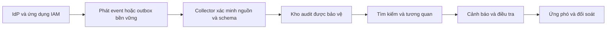

# Audit security event

## 1. Sự kiện bảo mật cần trả lời được điều gì?

**Audit security event** là bản ghi có cấu trúc về một hoạt động có ý nghĩa bảo mật, đủ thông tin để truy vết, kiểm tra và phân tích sau đó. Trong IAM, những hoạt động này bao gồm xác thực, quản lý phiên, thay đổi danh tính, cấp hoặc thu hồi quyền, sử dụng đặc quyền và thay đổi chính sách truy cập.

Ví dụ, câu log `User updated successfully` không giúp biết ai đã sửa người dùng nào, thuộc tenant nào, thay đổi điều gì và quyền nào cho phép thao tác đó. Một audit event được thiết kế tốt cần biểu diễn rõ các thông tin này mà không đưa mật khẩu, token hay secret vào log.

Audit phục vụ nhiều mục tiêu: phát hiện hành vi bất thường, điều tra sự cố, giải thích quyền hiệu lực, đối soát thay đổi và xác minh các kiểm soát IAM đã hoạt động. Nó là một lớp kiểm soát phát hiện và trách nhiệm giải trình, không thay thế authorization.

NIST SP 800-92 xem quản lý log bảo mật là một hoạt động xuyên suốt từ tạo, truyền, lưu đến phân tích và xử lý vòng đời dữ liệu. Vì vậy, bật một logger ở ứng dụng mới chỉ là một phần của hệ thống audit. [NIST: Guide to Computer Security Log Management](https://csrc.nist.gov/pubs/sp/800/92/final).

## 2. Phân biệt audit, log kỹ thuật và kết quả nghiệp vụ

| Loại bản ghi | Mục đích chính | Ví dụ |
|---|---|---|
| Log kỹ thuật | Chẩn đoán hoạt động của phần mềm | Lỗi kết nối database, thời gian xử lý request |
| Audit bảo mật | Ghi lại hoạt động và thay đổi có ý nghĩa truy cập | Admin cấp role cho một thành viên |
| Sự kiện nghiệp vụ | Mô tả thay đổi trong nghiệp vụ | Báo cáo được phê duyệt, đơn hàng được giao |
| Cảnh báo bảo mật | Nêu kết quả phát hiện cần xử lý | Nhiều lần cấp đặc quyền bất thường trong một phiên |

Các loại này có thể liên kết với nhau nhưng không đồng nhất. Một cảnh báo có thể được suy ra từ nhiều audit event. Một HTTP response `200` có thể chỉ báo job đã được nhận, chưa chứng minh export hoặc thay đổi quyền đã hoàn thành.

Cần phân biệt các mốc:

```text
Yêu cầu được nhận
    -> quyết định quyền cho phép hoặc từ chối
    -> thao tác được thực hiện hoặc không thực hiện
    -> thay đổi được commit hoặc thất bại
```

`PERMIT` là kết quả đánh giá quyền, không phải bằng chứng một assignment đã được tạo. Nếu database lỗi sau Permit, audit của thao tác phải thể hiện thất bại hoặc không có sự kiện tạo thành công, tùy thiết kế sự kiện. Không dùng một nhãn `SUCCESS` chung cho tất cả các mốc.

Tương tự, `logout.requested`, `session.revocation.requested` và `session.revocation.completed` có thể mang ý nghĩa khác nhau. Tên và outcome phải phản ánh điều thành phần phát sự kiện thực sự biết.

## 3. Những hoạt động IAM nên được xem xét ghi nhận

Danh mục cần xuất phát từ mô hình hệ thống và nhu cầu điều tra, không chỉ từ những gì thư viện mặc định đã ghi.

| Nhóm sự kiện | Ví dụ | Giá trị điều tra |
|---|---|---|
| Xác thực | Thành công, thất bại, challenge, phương thức sử dụng | Dựng lại quá trình truy cập danh tính |
| Đăng ký và recovery | Thêm MFA, đổi email khôi phục, reset credential | Phát hiện thay đổi đường kiểm soát tài khoản |
| Vòng đời danh tính | Tạo, đình chỉ, kích hoạt lại, chấm dứt membership | Biết tài khoản có hợp lệ tại thời điểm truy cập không |
| Phiên và token | Tạo phiên, refresh bị từ chối, yêu cầu thu hồi | Theo dõi sử dụng và chấm dứt phiên |
| Phân quyền | Tạo hoặc xóa assignment, sửa role, đổi membership nhóm | Giải thích quyền được hình thành qua đường nào |
| Ứng dụng và workload | Tạo client, cấp consent, thêm hoặc thu hồi credential | Nhận diện truy cập máy-máy và đường duy trì quyền |
| Đặc quyền | Kích hoạt quyền tạm thời, dùng tài khoản khẩn cấp, impersonation | Kiểm tra thao tác có ảnh hưởng lớn |
| Chính sách | Đổi SSO, federation, điều kiện truy cập, cấu hình audit | Phát hiện thay đổi làm suy yếu kiểm soát |
| Tài nguyên nhạy cảm | Export, tải dữ liệu đặc biệt, thao tác bị từ chối | Đối chiếu hành vi truy cập với quyền và phạm vi |

Không chỉ ghi hoạt động thành công. Các lần bị từ chối, lỗi xác minh hoặc thay đổi thất bại có thể cho thấy thử vượt quyền hoặc lạm dụng tự động. Tuy nhiên, cần phân loại nguyên nhân để không coi mọi lỗi mật khẩu hoặc lỗi mạng là sự cố đã được xác nhận.

Tài khoản dịch vụ, quản trị viên, công cụ monitoring và tài khoản hỗ trợ cũng phải nằm trong mô hình ghi nhận phù hợp. Gắn nhãn một chủ thể là nội bộ không khiến hoạt động của nó mất ý nghĩa bảo mật.

Việc thay đổi thành viên nhóm có thể quan trọng ngang thao tác gán role trực tiếp. Nếu role được cấp qua nhóm, chỉ ghi bảng assignment sẽ bỏ sót đường thực tế làm quyền xuất hiện hoặc biến mất.

## 4. Các trường cần có trong một audit event

OWASP khuyến nghị log ứng dụng có đủ thông tin về thời điểm, nơi xảy ra, chủ thể và hoạt động. Ứng dụng thường biết ngữ cảnh quyền và đối tượng mà log hạ tầng không có. [OWASP Logging Cheat Sheet](https://cheatsheetseries.owasp.org/cheatsheets/Logging_Cheat_Sheet.html).

Một schema IAM có thể chuẩn hóa như sau:

| Nhóm trường | Ý nghĩa | Điểm cần chú ý |
|---|---|---|
| `eventId`, `schemaVersion` | Định danh sự kiện và phiên bản schema | Event ID phải ổn định khi gửi lại cùng sự kiện |
| `eventType` | Loại hoạt động có ngữ nghĩa thống nhất | Tránh chỉ dùng thông điệp tự do |
| `eventTime` | Thời điểm nguồn quan sát hoạt động | Phân biệt với thời điểm hệ thống log tiếp nhận |
| `producer` | Dịch vụ hoặc thành phần tạo sự kiện | Cần kiểm chứng nguồn phát |
| `tenantId` | Tenant mà hoạt động tác động | Không lấy tùy tiện từ header chưa xác minh |
| `actor` | Chủ thể thực hiện thao tác | Con người, workload hoặc hệ thống tự động |
| `targetPrincipal` | Danh tính bị tác động, nếu có | Khác actor trong thao tác quản trị người khác |
| `resource`, `action` | Tài nguyên và hành động liên quan | Phải đủ xác định scope của thay đổi |
| `authorization` | Quyết định quyền và căn cứ liên quan | Không đồng nhất với kết quả thực hiện |
| `operationOutcome`, `reasonCode` | Kết quả thao tác và nguyên nhân có cấu trúc | Phân biệt bị từ chối, lỗi và hoàn thành |
| `change` | Phần thay đổi đã được phép ghi nhận | Chỉ giữ các trường cần thiết, không serialize secret |
| `requestId`, `correlationId` | Liên kết hoạt động qua nhiều thành phần | Phải biết trường nào do client cung cấp |

Nếu một ứng dụng hành động thay mặt người dùng, cần giữ quan hệ giữa workload thực thi và người khởi tạo hoặc subject được ủy quyền. Trường `producer` nói dịch vụ nào phát event; nó không tự trả lời người nào đã yêu cầu hành động.

Nếu chưa xác thực được người gọi, không gán username người dùng nhập vào thành actor đã được chứng minh. Có thể lưu một định danh mục tiêu được bảo vệ hoặc trường claimed identity với ngữ nghĩa rõ ràng. Điều tra phải phân biệt dữ liệu được xác minh và dữ liệu người gọi tự khai.

## 5. Ví dụ một sự kiện tạo role assignment

Ví dụ sau là schema minh họa của ứng dụng, không phải định dạng bắt buộc của một nhà cung cấp IAM:

```json
{
  "eventId": "event-713",
  "schemaVersion": "1",
  "eventType": "iam.role_assignment.created",
  "eventTime": "2027-01-10T09:00:00Z",
  "producer": "iam-administration-service",
  "tenantId": "minh-an",
  "actor": {
    "principalId": "admin-17",
    "principalType": "HUMAN"
  },
  "targetPrincipal": {
    "principalId": "employee-93",
    "principalType": "HUMAN"
  },
  "action": "role_assignment:create",
  "resource": {
    "type": "ROLE_ASSIGNMENT",
    "id": "assignment-482"
  },
  "authorization": {
    "decision": "PERMIT",
    "decisionId": "decision-902",
    "policyVersion": "policy-19"
  },
  "operationOutcome": "COMMITTED",
  "change": {
    "before": null,
    "after": {
      "roleId": "project-reader-6",
      "scopeType": "PROJECT",
      "scopeId": "project-41",
      "expiresAt": "2027-02-10T00:00:00Z"
    }
  },
  "requestId": "request-614",
  "correlationId": "workflow-27"
}
```

Event này khẳng định assignment đã được commit trong hệ thống phát sự kiện. Nó không tự khẳng định mọi cache quyền đã nhận thay đổi hoặc một hệ thống ngoài đã đồng bộ thành công. Nếu cần theo dõi propagation, phải có bằng chứng hoặc event riêng tại thành phần nhận.

Role ID cần liên kết được với định nghĩa quyền ở thời điểm xảy ra thao tác. Nếu role definition có thể thay đổi, phiên bản role hoặc lịch sử thay đổi giúp giải thích quyền thực tế khi đó. Chỉ giữ tên role hiện tại có thể làm sai diễn giải sự kiện cũ.

Với việc sửa credential, `change` nên mô tả credential ID, loại và trạng thái cần thiết; không ghi giá trị secret mới hoặc cũ. Không đưa toàn bộ entity người dùng vào audit chỉ để thuận tiện lập trình.

## 6. Ghi sự kiện tại đúng ranh giới thực hiện

Audit cần nằm ở nơi biết được ngữ nghĩa và kết quả thao tác. Web server biết request tới URL nào, nhưng có thể không biết project nào được cấp quyền hoặc transaction có commit hay không.

Với thay đổi IAM được lưu trong một database, transactional outbox là một cách liên kết thay đổi và sự kiện cần phát. Ý tưởng là ghi bản thay đổi cùng bản ghi outbox trong một transaction, rồi một publisher gửi event sau khi transaction commit.

```text
Transaction trong database
  1. Kiểm tra trạng thái và điều kiện thay đổi cần thiết.
  2. Tạo hoặc sửa role assignment.
  3. Ghi event thành công vào outbox.
  4. Commit cả thay đổi lẫn outbox, hoặc rollback cả hai.

Publisher sau commit
  5. Đọc outbox, gửi tới pipeline audit.
  6. Retry với cùng eventId khi chưa có xác nhận phù hợp.
```

Mã giả Java minh họa:

```java
RoleAssignment grantRole(VerifiedActor actor, GrantRoleCommand command) {
    return transactions.execute(() -> {
        grantPolicy.requireAllowedWithCurrentState(actor, command);

        RoleAssignment created = assignments.createValidated(command);

        AuditEvent event = auditEvents.assignmentCreated(
                actor, created, command.requestId());

        auditOutbox.append(event);
        return created;
    });
}
```

Đây là mô hình minh họa, không phải mã có thể chạy nguyên trạng. Tính nguyên tử chỉ có khi thay đổi assignment và append outbox thực sự cùng phạm vi transaction. Gọi một API log từ xa bên trong transaction không tự tạo ra transaction phân tán an toàn.

Nếu transaction rollback, bản ghi outbox thành công cũng phải rollback. Một sự kiện về lần thử bị từ chối hoặc lỗi cần đường ghi riêng thích hợp, vì transaction không commit sẽ không giữ bản ghi nằm trong nó. Tránh phát event thành công ra ngoài trước rồi mới phát hiện thao tác nghiệp vụ thất bại.

Outbox giúp hạn chế khoảng trống giữa commit và phát event, nhưng không tự bảo đảm publisher luôn chạy. Phải theo dõi backlog, tuổi event chưa gửi, retry và lỗi không phục hồi. Nếu bản ghi outbox bị xóa trước khi gửi hoặc không có cơ chế đối soát, bằng chứng vẫn có thể mất.

## 7. Pipeline audit phải giữ được ý nghĩa sự kiện



Tại collector, cần kiểm chứng nguồn gửi, tenant được phép phát, schema và kích thước dữ liệu. Không để một dịch vụ chỉ có quyền gửi event của A tự gắn `tenantId=B` để tạo bằng chứng giả hoặc làm nhiễu dữ liệu của B.

Event đến từ client, hệ thống ngoài hoặc vùng tin cậy khác không tự có độ tin cậy như event được phát từ backend kiểm soát thao tác. Cần lưu provenance và trạng thái xác minh phù hợp, không âm thầm nâng dữ liệu tự khai thành kết luận nội bộ.

Pipeline có thể gửi trùng khi retry. Consumer nên có cơ chế deduplicate bằng định danh event cùng namespace nguồn hoặc tenant đã xác minh. Event ID do người gọi tùy ý chọn không nên được dùng trực tiếp để loại bỏ các event bảo mật khác.

Không giả định thứ tự tiếp nhận là thứ tự xảy ra. Một event thu hồi quyền có thể đến sau hoặc trước event liên quan do khác đường truyền. Dùng timestamp, phiên bản đối tượng, correlation và trạng thái hệ thống khi đối soát; không dựa duy nhất vào thứ tự dòng log.

Schema nên có chính sách tiến hóa: ý nghĩa trường, kiểu dữ liệu và enum phải rõ ràng. Thay đổi tên field mà không cập nhật rule phát hiện có thể khiến log vẫn được lưu nhưng cảnh báo ngừng hoạt động.

## 8. Bảo vệ tính toàn vẹn và quyền truy cập audit

Audit có thể chứa thông tin nhạy cảm về cấu trúc tổ chức, đặc quyền, hoạt động quản trị và tài nguyên được sử dụng. Cần bảo vệ cả tính bí mật, toàn vẹn và khả dụng của nó.

**Tách quyền ghi, đọc và quản trị.** Ứng dụng cần phát event nhưng không nhất thiết được sửa hoặc xóa lịch sử. Người có quyền vận hành ứng dụng không mặc nhiên cần quyền xóa kho audit. Các thao tác truy vấn, export và thay cấu hình log cũng cần phạm vi phù hợp.

**Bảo vệ lưu trữ.** Có thể sử dụng cơ chế append-only, retention lock, bản sao tách biệt hoặc các biện pháp khác phù hợp hệ thống. Phải biết tài khoản đặc quyền nào vẫn có thể thay đổi retention, khóa mã hóa hoặc đường thu thập.

**Phát hiện chỉnh sửa.** Hash chain hoặc chữ ký có thể hỗ trợ chứng minh một số thay đổi, nhưng cần bảo vệ khóa, điểm neo và quy trình kiểm tra. Nếu người tấn công có thể sửa toàn bộ chuỗi rồi tính lại hash và thay cả điểm neo, chỉ có hash chain trong cùng một nơi chưa đủ bảo vệ.

**Giữ metadata điều tra.** Khi xuất event cho điều tra, lưu phạm vi truy vấn, mốc thời gian, nguồn dữ liệu và checksum của bản xuất khi cần. Checksum giúp kiểm tra bản sao có thay đổi sau khi xuất; nó không tự chứng minh event ban đầu đã phản ánh đúng sự thật.

**Cách ly tenant.** Người quản trị của một khách hàng chỉ được xem các event thuộc phạm vi được cấp. Bộ tìm kiếm, API audit và file export đều cần thực thi ranh giới này; lọc đúng ở trang giao diện chưa đủ.

Mã hóa log khi lưu không ngăn một tài khoản đã được cấp quyền hợp lệ sửa hoặc đọc dữ liệu quá rộng. Phân quyền và thiết kế quản trị vẫn là những kiểm soát riêng cần được thực thi.

## 9. Giảm dữ liệu nhạy cảm và chống log injection

Nguyên tắc thực tế là ghi đủ để giải thích hoạt động, không ghi mọi dữ liệu nhìn thấy. Có thể dùng principal ID nội bộ thay cho email hoặc tên đầy đủ khi không cần thông tin trực tiếp định danh.

Không ghi raw access token, refresh token, session cookie, mật khẩu, private key, client secret, recovery code hoặc chuỗi kết nối chứa credential. Đối với dữ liệu nhạy cảm cần liên kết, cân nhắc định danh tham chiếu hoặc cơ chế pseudonymization phù hợp; một hash đơn giản của dữ liệu dễ đoán không tự làm dữ liệu đó vô danh.

Dữ liệu do người dùng cung cấp có thể chứa xuống dòng, ký tự phân cách hoặc nội dung có ý đánh lừa trình xem log. Sử dụng structured logging và serialization đúng, giới hạn chiều dài và xử lý ký tự điều khiển. Nếu trình xem audit hiển thị HTML, nó vẫn cần encode đầu ra để event không trở thành nội dung thực thi.

Một trường không hợp lệ không nhất thiết là lý do xóa toàn bộ dấu vết. Có thể thay trường lỗi bằng giá trị an toàn, ghi mã lỗi xác minh và giữ ngữ cảnh tối thiểu đã kiểm chứng. Nhưng không đưa nguyên payload độc hại hoặc secret vào phần “validation error” rồi làm mất tác dụng redaction.

IP, thông tin thiết bị và vị trí chỉ nên thu thập theo nhu cầu đã xác định. Khi dùng để kết luận danh tính hoặc điều tra, phải hiểu proxy, NAT, thiết bị dùng chung và những giới hạn của dữ liệu đó.

## 10. Lỗi logging là một tình huống phải thiết kế trước

Audit có thể gặp đầy ổ đĩa, mất kết nối, hết quota, lỗi schema hoặc publisher dừng. Cần biết hệ thống sẽ làm gì trong từng trường hợp.

| Tình huống | Hướng xử lý cần xác định |
|---|---|
| Collector từ xa không sẵn sàng | Buffer hoặc outbox bền vững có giới hạn, retry và cảnh báo |
| Không ghi được event bắt buộc cho thay đổi đặc quyền | Chặn hoặc tạm hoãn thay đổi theo chính sách đã định |
| Event không qua schema validation | Cách ly an toàn, giữ bằng chứng tối thiểu và báo lỗi producer |
| Nhận trùng event | Deduplicate có namespace và theo dõi tỷ lệ retry |
| Lượng event tăng đột biến | Backpressure, giới hạn tài nguyên và ưu tiên theo hợp đồng |
| Không có event từ một nguồn vốn hoạt động | Kiểm tra sức khỏe đường thu thập, không tự kết luận không có sự cố |

Không xử lý mọi lỗi bằng `catch` rồi bỏ qua và tiếp tục ghi nhận “audit thành công”. Với thao tác cần bảo đảm lưu dấu vết, phải xác định điểm xác nhận bền vững và hành vi khi chưa đạt điểm đó.

Ngược lại, pipeline log cũng không nên là công cụ dễ làm cạn tài nguyên ứng dụng. Cần buffer có giới hạn, giới hạn kích thước event và chính sách tải rõ ràng. Đối với những loại event bắt buộc giữ đầy đủ, sampling không được âm thầm làm mất lịch sử; nếu có giảm dữ liệu hoặc gián đoạn, phải có chỉ báo và cơ chế đối soát.

Kẻ tấn công có thể tạo nhiều request lỗi để gây quá tải log hoặc cảnh báo. Giữ khả năng phát hiện chuỗi hoạt động này, đồng thời tránh một rule tự động khóa tài khoản người khác chỉ dựa trên dữ liệu chưa đủ tin cậy.

## 11. Từ sự kiện đến phát hiện và điều tra

Một event riêng lẻ thường chưa đủ để kết luận tài khoản đã bị xâm phạm. Giá trị nằm ở việc liên kết những sự kiện có ngữ nghĩa và thời gian phù hợp.

Ví dụ một chuỗi cần được xem xét:

```text
Thay phương thức recovery
    -> thêm phương thức xác thực mới
    -> kích hoạt đặc quyền
    -> tạo workload credential
    -> xuất dữ liệu nhạy cảm
```

Chuỗi này có thể có lý do hợp lệ, nhưng mức ảnh hưởng đủ lớn để cần đối chiếu chủ thể, thiết bị, phê duyệt và ticket liên quan. Không coi tất cả các event là cùng một người chỉ vì cùng IP.

Các trường hợp phát hiện khác có thể gồm tăng quyền ngoài quy trình, cấp role ở tenant bất thường, thay đổi policy rồi tắt logging, hoặc nhiều lần bị từ chối trên các object thuộc khách hàng khác.

Alert cần có người hoặc hệ thống chịu trách nhiệm, mức ưu tiên, dữ liệu hỗ trợ và quy trình xử lý. Trạng thái cảnh báo đã được đóng phải có lý do; không xóa audit gốc chỉ để làm bảng cảnh báo sạch hơn.

Nên đo độ trễ từ phát event tới tìm kiếm và cảnh báo, tỷ lệ nguồn hoạt động, backlog chưa gửi, lỗi parsing, event bị mất hoặc trùng và thời gian phản ứng. Dung lượng log lớn không chứng minh khả năng phát hiện tốt.

## 12. Kiểm chứng audit như một kiểm soát IAM

Một bộ kiểm chứng nên bao phủ cả ngữ nghĩa sự kiện lẫn độ bền và quyền truy cập:

| Tình huống | Điều cần chứng minh |
|---|---|
| Tạo role assignment thành công | Event xác định đúng actor, target, tenant, scope và kết quả commit |
| Authorization Permit nhưng transaction rollback | Không ghi thành thay đổi thành công đã commit |
| Thao tác bị từ chối | Có dấu vết phù hợp và nguyên nhân không bị nhầm thành lỗi thực thi |
| Actor quản trị người khác | Phân biệt người thực hiện và danh tính bị tác động |
| Retry gửi cùng event | Không tạo nhiều thay đổi giả trong báo cáo hoặc rule phát hiện |
| Producer giả tenant hoặc source | Collector và quyền ingest chặn hoặc cách ly đúng |
| Payload có xuống dòng, HTML hoặc secret | Không tạo event giả, không thực thi nội dung, không lộ bí mật |
| Collector lỗi hoặc outbox bị tồn đọng | Không mất event im lặng; hành vi nghiệp vụ theo chính sách |
| Admin tenant A truy vấn event tenant B | Bị từ chối ở API và export, không chỉ ở giao diện |
| Có thay đổi quyền hoặc cấu hình pipeline audit | Có lịch sử và cảnh báo phù hợp với mức ảnh hưởng |

Kiểm tra thêm khả năng truy vấn dữ liệu đã lưu theo thời hạn vận hành, khôi phục bản sao, quản lý khóa mã hóa và theo dõi sức khỏe từng nguồn. Retention phải có mục tiêu cụ thể; giữ mãi mọi dữ liệu hoặc xóa quá sớm đều có thể làm tăng rủi ro và chi phí.

Một hệ thống audit IAM có giá trị khi ghi đúng sự thật mà thành phần nguồn biết, giữ được bối cảnh chủ thể và phạm vi, chuyển event đáng tin qua pipeline có thể quan sát và cho phép người có thẩm quyền sử dụng bằng chứng. Chất lượng không nằm ở số dòng log, mà ở khả năng giải thích ai đã làm gì, bằng quyền nào, kết quả ra sao và điều gì cần xử lý tiếp.
