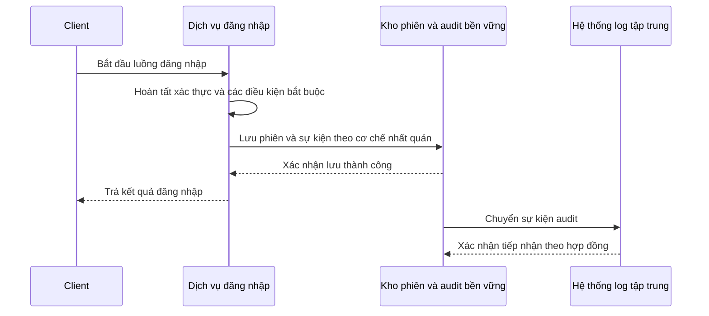

# Login success

## 1. Sự kiện đăng nhập thành công chứng minh điều gì?

**Login success** là sự kiện ghi nhận một luồng đăng nhập đã đáp ứng các điều kiện xác thực mà thành phần phát sự kiện chịu trách nhiệm kiểm tra.

Trong logging và audit IAM, sự kiện này giúp trả lời:

- Danh tính nào đã được xác thực?
- Thành phần hoặc nhà cung cấp nào xác thực danh tính đó?
- Luồng đăng nhập nào vừa hoàn tất?
- Thời điểm nào và qua ứng dụng nào?
- Phương thức xác thực nào đã được sử dụng?
- Có tạo phiên truy cập cho ứng dụng hay không?

Ý nghĩa phải được định nghĩa theo nguồn phát sự kiện. Một IdP có thể ghi nhận xác thực thành công tại IdP, trong khi ứng dụng sử dụng SSO vẫn chưa hoàn tất kiểm tra phản hồi hoặc chưa tạo phiên cục bộ.

Vì vậy, không nên đọc mọi bản ghi “success” trong toàn hệ thống như cùng một mốc.

```text
Xác thực thành công tại IdP
  ≠ ứng dụng đã chấp nhận phản hồi SSO
  ≠ ứng dụng đã tạo phiên cục bộ
  ≠ người dùng được phép truy cập mọi tài nguyên.
```

Một login success cũng không chứng minh chắc chắn chủ tài khoản hợp pháp đã trực tiếp thực hiện thao tác. Credential hoặc phiên xác thực có thể bị chiếm dụng. Sự kiện ghi lại điều hệ thống đã xác minh theo cơ chế của nó, không phải một kết luận tuyệt đối về người đang ngồi trước thiết bị.

## 2. Xác định đúng ranh giới thành công

### 2.1. Không phát sự kiện quá sớm

Giả sử ứng dụng yêu cầu mật khẩu và MFA:

```text
Nhập mật khẩu
  → kiểm tra mật khẩu thành công
  → yêu cầu MFA
  → xác minh MFA thành công
  → hoàn tất policy đăng nhập
  → tạo phiên theo thiết kế
  → login success tại ứng dụng.
```

Nếu phát login success ngay sau bước kiểm tra mật khẩu, báo cáo có thể ghi thành công cho những luồng chưa hoàn tất MFA hoặc bị chặn ở bước tiếp theo.

Có thể ghi các sự kiện trung gian riêng như `authentication.factor_verified`, nhưng phải phân biệt chúng với kết quả cuối của luồng.

Một số mốc dễ bị nhầm:

| Mốc quan sát | Có phải login success hoàn chỉnh không? |
| --- | --- |
| Mật khẩu đúng nhưng MFA còn đang chờ | Chưa, nếu MFA là điều kiện bắt buộc của luồng |
| IdP trả về thông tin xác thực nhưng ứng dụng chưa kiểm tra | Chưa phải đăng nhập thành công tại ứng dụng |
| Ứng dụng xác thực phản hồi và hoàn tất điều kiện đăng nhập | Có thể là mốc thành công theo hợp đồng đã định |
| Phiên chưa được tạo vì lỗi lưu trữ | Không được khai là đã tạo phiên thành công |
| Access token được làm mới từ grant hiện có | Thường là sự kiện làm mới hoặc cấp token, không phải một lần đăng nhập mới |
| Người dùng được cho phép đọc tài liệu | Là sự kiện phân quyền hoặc truy cập tài nguyên |
| Đăng ký phương thức xác thực mới | Là thay đổi credential, không tự là đăng nhập |
| Khôi phục tài khoản hoàn tất | Cần loại sự kiện riêng; chỉ ghi thêm login success nếu thật sự có luồng đăng nhập tương ứng |

Tên sự kiện là một lựa chọn schema nội bộ. Điều cần giữ là ý nghĩa nhất quán và có thể phân biệt.

### 2.2. Xác thực thành công khác với cấp quyền tài nguyên

Một ứng dụng có thể xác thực được Lan nhưng không cho Lan mở một tenant hoặc tài nguyên.

Ví dụ:

```text
Lan đăng nhập thành công vào ứng dụng.
Lan yêu cầu mở tenant B.
Lan không có membership tại B.
Ứng dụng từ chối truy cập tenant B.
```

Hai sự kiện có thể cùng đúng:

```text
authentication.login_succeeded
authorization.access_denied
```

Nếu sản phẩm quy định membership là điều kiện bắt buộc để hoàn tất đăng nhập vào một tenant cụ thể, ranh giới thành công của luồng đó sẽ khác. Hợp đồng phải nêu rõ đang ghi nhận đăng nhập toàn ứng dụng hay đăng nhập vào một phạm vi tenant đã được xác lập.

Không đổi kết quả xác thực thành công thành thất bại chỉ vì một request đọc tài nguyên sau đó bị từ chối. Ngược lại, không dùng bản ghi login success làm bằng chứng người dùng có quyền trên tài nguyên.

### 2.3. Ghi đúng thành phần phát sự kiện

Trong luồng SSO, có thể tồn tại:

```text
IdP: xác thực principal thành công.
Ứng dụng: chấp nhận phản hồi xác thực.
Ứng dụng: tạo phiên cục bộ thành công.
API: cho phép một hành động cụ thể.
```

Không xóa các khác biệt này khi tổng hợp log. Cần giữ `source`, `event_type`, ứng dụng đích và correlation phù hợp.

Ứng dụng phải xác minh phản hồi SSO theo giao thức và cấu hình tin cậy trước khi lấy danh tính làm actor đã xác thực. Dữ liệu nhận được qua callback chưa được kiểm tra không phải nguồn đáng tin để ghi “người dùng X đã đăng nhập thành công”.

## 3. Các trường audit nên có

Một bản ghi có ích cần đủ ngữ cảnh nhưng không chứa credential.

| Nhóm trường | Ví dụ | Mục đích |
| --- | --- | --- |
| Định danh sự kiện | `event_id`, `event_type`, `schema_version` | Nhận diện, xử lý lặp và diễn giải đúng schema |
| Thời gian | `occurred_at`, `ingested_at` | Phân biệt lúc xảy ra và lúc nhận log |
| Nguồn | Service, environment, instance hoặc producer | Biết nơi xác minh và phát sự kiện |
| Danh tính | Principal ID nội bộ, nguồn xác thực | Liên kết sự kiện với đúng danh tính |
| Ứng dụng | Client hoặc application ID được xác định hợp lệ | Biết người dùng đăng nhập vào đâu |
| Phạm vi | Tenant đã xác lập hoặc trạng thái chưa chọn tenant | Tránh suy diễn hoặc trộn dữ liệu giữa tenant |
| Kết quả | Loại kết quả và mốc hoàn tất | Biết thành công ở bước nào |
| Xác thực | Phương thức, mức đáp ứng policy nếu có | Phân biệt các luồng xác thực |
| Phiên | Tham chiếu audit riêng cho phiên | Liên kết chuỗi hoạt động mà không lộ session secret |
| Liên kết luồng | Correlation ID hoặc authentication flow ID | Theo dõi qua nhiều thành phần |
| Ngữ cảnh nguồn truy cập | Địa chỉ mạng hoặc thiết bị khi có căn cứ | Hỗ trợ điều tra với giới hạn về nguồn và độ tin cậy |

Không phải mọi hệ thống đều cần đúng tập trường trên. Các field bắt buộc cần phù hợp với câu hỏi điều tra và kiến trúc thực tế.

### 3.1. Principal đã xác thực khác với tên người dùng nhập vào

Tên đăng nhập do client gửi có thể được chuẩn hóa, ánh xạ hoặc không khớp định danh nội bộ. Actor của login success nên đến từ kết quả xác thực đã được chấp nhận.

Trong liên kết nhiều nguồn danh tính, cần lưu hoặc tham chiếu được nguồn phát hành để tránh nhầm hai subject trùng chuỗi từ hai issuer khác nhau.

Email hiển thị có thể thay đổi và không nên là khóa duy nhất để liên kết lịch sử. Có thể cần principal ID ổn định cùng thông tin hiển thị được bảo vệ theo chính sách dữ liệu.

### 3.2. Tenant phải phản ánh ngữ cảnh đã xác lập

Nếu người dùng đăng nhập xong mới chọn tenant, bản ghi không nên tự gán tenant từ một tham số chưa được xác minh.

Có thể biểu đạt:

```text
tenant_id=null
tenant_context=NOT_SELECTED
```

Sau khi chọn tenant và được cấp quyền tương ứng, có thể ghi một sự kiện riêng cho thay đổi ngữ cảnh đó.

Nếu hệ thống đã xác lập tenant trước khi hoàn tất luồng, cần ghi tenant từ ngữ cảnh máy chủ đã kiểm tra. Tenant trong audit cũng là dữ liệu cần kiểm soát truy cập khi cho người quản trị khách hàng xem lịch sử.

### 3.3. Tham chiếu phiên không được là session secret

Cookie phiên, access token hoặc refresh token có thể được dùng để truy cập tài khoản. Không đưa các giá trị này vào log chỉ để dễ tìm kiếm.

Nên dùng một tham chiếu audit riêng, không mang quyền truy cập, hoặc cơ chế biến đổi được thiết kế phù hợp. Không mặc định việc băm một secret tùy ý luôn đủ để cho phép lưu nó ở mọi nơi; vẫn phải xét khả năng suy đoán, liên kết và quyền truy cập dữ liệu.

Correlation ID cũng không phải bằng chứng xác thực. Nếu nhận ID từ bên ngoài, cần giới hạn định dạng và độ dài theo hợp đồng, tránh đưa dữ liệu tùy ý vào log.

## 4. Ví dụ một sự kiện có cấu trúc

```json
{
  "schema_version": 1,
  "event_id": "evt_login_8b42",
  "event_type": "authentication.login_succeeded",
  "occurred_at": "2026-01-15T08:30:00Z",
  "source": {
    "service": "customer-auth",
    "environment": "production"
  },
  "principal": {
    "id": "user_47",
    "type": "HUMAN",
    "identity_source": "workforce-idp"
  },
  "application_id": "project-web",
  "tenant_id": "tenant_a",
  "authentication": {
    "flow": "INTERACTIVE",
    "methods": ["password", "totp"],
    "requirement": "interactive-policy-v3",
    "result": "SUCCESS"
  },
  "session": {
    "audit_ref": "session_audit_193",
    "creation_result": "SUCCESS"
  },
  "correlation_id": "auth_flow_6f12"
}
```

Đây là schema minh họa, không phải định dạng chuẩn bắt buộc. Các phương thức và nhãn policy phải lấy từ kết quả đã được hệ thống xác minh, không sao chép nguyên từ client.

Một số ý nghĩa của bản ghi:

- Thành phần `customer-auth` phát sự kiện sau khi hoàn tất policy đăng nhập mà nó chịu trách nhiệm.
- Danh tính nội bộ `user_47` đã được ánh xạ từ nguồn xác thực.
- Tenant A là phạm vi đã được xác lập theo hợp đồng của luồng.
- Phiên cục bộ đã được tạo thành công.
- Không có mật khẩu, OTP, cookie hoặc token trong bản ghi.

Nếu nguồn là IdP và không tạo phiên của ứng dụng, không nên tự thêm `session.creation_result=SUCCESS` cho phiên cục bộ của ứng dụng. Mỗi nguồn chỉ ghi điều nó thực sự biết.

Nếu mức xác thực do IdP cung cấp cần ánh xạ sang policy nội bộ, phải giữ được căn cứ ánh xạ. Không chỉ nhìn thấy hai tên phương thức rồi kết luận mọi yêu cầu xác thực của hành động nhạy cảm đều đã đạt.

## 5. Ghi sự kiện ở đâu trong luồng đăng nhập?

### 5.1. Xác định mốc trước khi gắn log vào code

Với luồng có phiên cục bộ, có thể dùng mô hình:



Sơ đồ thể hiện một lựa chọn kiến trúc có lưu bền vững trước khi chuyển log tập trung. Không phải mọi hệ thống đều có cùng một kho phiên và audit; cần thiết kế tính nhất quán theo công nghệ đang dùng.

Việc trả response thành công không chứng minh client đã nhận được cookie hoặc đã mở trang tiếp theo. Nếu đường truyền bị ngắt sau khi server hoàn tất tạo phiên, bản ghi có thể vẫn đúng về kết quả phía server.

Nếu cần biết client đã sử dụng phiên, hãy dùng sự kiện quan sát riêng như request đầu tiên đã được xác thực. Không làm một event phải khẳng định cả điều server biết lẫn điều server chưa quan sát được.

### 5.2. Tránh khoảng hở giữa tạo phiên và ghi audit

Hai lỗi thường gặp:

```text
Ghi login success trước
  → lưu phiên thất bại
  → audit khai phiên đã được tạo dù thực tế không có.

Lưu phiên trước
  → tiến trình dừng trước khi ghi audit
  → có phiên nhưng thiếu sự kiện.
```

Nếu session và outbox cùng nằm trong một hệ thống hỗ trợ transaction phù hợp, có thể lưu chúng trong cùng transaction rồi chuyển sự kiện đi sau.

Pseudocode theo phong cách Java:

```java
LoginResponse completeLogin(VerifiedLogin login) {
    loginPolicy.requireCompleted(login);

    SessionResult session = transactions.run(() -> {
        SessionResult created =
            sessions.createForVerifiedLogin(login);

        AuditEvent event = auditEvents.loginSucceeded(
            login.principal(),
            login.application(),
            login.authorizedTenantContext(),
            login.authenticationEvidence(),
            created.auditReference(),
            login.flowReference()
        );

        outbox.append(event);
        return created;
    });

    return loginResponses.forCreatedSession(session);
}
```

Đây là mã minh họa. Transaction chỉ bảo vệ được các thao tác thật sự tham gia cùng phạm vi transaction; không mặc định nó bao phủ một session store bên ngoài hoặc một HTTP call.

Event phải được tạo bằng dữ liệu đã được xác minh và không chứa session secret. Nếu transaction thất bại, không được trả như thể phiên đã được tạo thành công.

Khi các thành phần nằm ở nhiều kho khác nhau, cần một cơ chế đảm bảo phù hợp, chẳng hạn lưu bền vững riêng, trạng thái xử lý và đối soát. Không tuyên bố “không thể mất log” chỉ vì có gọi một hàm logger.

### 5.3. Hệ thống log tập trung bị gián đoạn

Cần xác định rõ mức bảo đảm:

- Ứng dụng đã gọi logger.
- Sự kiện đã vào bộ đệm trong bộ nhớ.
- Sự kiện đã được lưu bền vững.
- Collector đã nhận sự kiện.
- Kho audit đã lưu và cho phép tìm kiếm.
- Quy tắc cảnh báo đã xử lý sự kiện.

Các mốc này không tương đương nhau. Ghi vào bộ nhớ rồi tiến trình dừng có thể làm mất sự kiện.

Ứng dụng có thể tiếp tục hoạt động khi collector gián đoạn nếu sự kiện được lưu bền vững và policy cho phép. Với thao tác nhạy cảm yêu cầu audit là điều kiện bắt buộc, cần thiết kế rõ cách ngăn hoàn tất thao tác khi không bảo đảm được điều kiện đó.

Không nên vô tình đăng nhập thành công rồi mới quyết định trả lỗi chỉ vì một HTTP call gửi log thất bại. Cách xử lý phải thống nhất với mốc hoàn tất và khả năng phục hồi của luồng.

Bộ đệm bền vững cũng cần giới hạn, giám sát dung lượng, retry và cảnh báo. Một outbox tồn đọng vô thời hạn không đáp ứng mục tiêu phát hiện sự cố kịp thời.

## 6. Thời gian, sự kiện lặp và liên kết nhiều nguồn

### 6.1. Lúc xảy ra khác lúc tìm kiếm được

Một sự kiện xảy ra lúc 08:30 có thể được collector nhận lúc 08:32 vì mạng gián đoạn.

Cần giữ:

```text
occurred_at: thời điểm nguồn ghi nhận mốc đăng nhập.
ingested_at: thời điểm hệ thống log tiếp nhận.
```

Không thay thời điểm xảy ra bằng thời điểm retry gửi log. Khi dựng timeline, cần xét nguồn thời gian và khả năng lệch đồng hồ.

Sắp xếp theo timestamp từ nhiều dịch vụ không tự chứng minh quan hệ nhân quả. Correlation ID và các mốc của luồng giúp hiểu quan hệ giữa sự kiện IdP, callback và tạo phiên.

### 6.2. Gửi lại không có nghĩa đăng nhập lại

Pipeline có thể gửi một sự kiện nhiều lần khi chưa chắc collector đã nhận được bản trước. Cần giữ cùng định danh cho cùng một sự kiện khi retry.

Có thể xử lý trùng theo cặp nguồn phát và event ID. Không chỉ loại trùng theo principal và timestamp vì một người có thể thực hiện hai lần đăng nhập hợp lệ gần nhau.

Ngược lại, hai lần đăng nhập thực sự khác nhau cần hai event ID khác nhau, dù cùng người dùng, ứng dụng và địa chỉ mạng.

Trong SSO, sự kiện thành công ở IdP và thành công ở ứng dụng là hai sự kiện khác ý nghĩa. Không loại bỏ một sự kiện chỉ vì chúng cùng correlation ID.

### 6.3. Client không được tự khẳng định sự kiện thành công

Một endpoint telemetry cho trình duyệt gửi “login success” có thể phục vụ quan sát giao diện. Nó không nên là nguồn audit có thẩm quyền về kết quả xác thực.

Sự kiện audit cần đến từ thành phần đã thực hiện hoặc kiểm chứng bước tương ứng. Các kênh nhận sự kiện từ IdP hoặc dịch vụ khác cần xác thực nguồn theo cơ chế được thiết kế.

Không dùng một sự kiện nhận được từ nguồn chưa xác minh để tự cấp phiên hoặc tăng quyền cho tài khoản.

## 7. Bảo vệ nội dung và quyền truy cập log

### 7.1. Không ghi secret

Không đưa vào login success:

- Mật khẩu hoặc giá trị kiểm tra mật khẩu.
- OTP, recovery code hoặc secret tạo OTP.
- Access token, refresh token hoặc ID token nguyên vẹn.
- Cookie hoặc session ID có thể dùng trực tiếp để truy cập.
- Authorization code và dữ liệu khôi phục tài khoản có giá trị sử dụng.
- Toàn bộ request, response hoặc assertion chỉ để “đủ thông tin”.

Không nên coi token đã hết hạn là dữ liệu mặc nhiên an toàn để lưu. Nó vẫn có thể chứa thông tin cá nhân hoặc các thuộc tính nhạy cảm.

Nếu cần thông tin từ token hoặc phản hồi IdP, hãy chọn đúng thuộc tính đã được xác minh và cần cho mục tiêu audit.

### 7.2. IP và User-Agent có giới hạn

IP có thể giúp điều tra nhưng không phải định danh chắc chắn của người dùng hay thiết bị. Nhiều người có thể dùng chung IP; một người có thể đổi IP vì hạ tầng mạng.

Nếu lấy địa chỉ nguồn qua reverse proxy, chỉ tin metadata được tạo hoặc làm sạch bởi proxy tin cậy. Không chấp nhận nguyên một header client tự gửi rồi diễn giải nó như địa chỉ mạng đã xác minh.

User-Agent là dữ liệu đầu vào có thể bị giả mạo. Nên ghi có cấu trúc, giới hạn độ dài và xử lý an toàn khi hiển thị.

### 7.3. Tránh log injection và rò dữ liệu giữa tenant

Ưu tiên serializer và schema có cấu trúc thay vì ghép chuỗi tùy ý từ tên người dùng, User-Agent hoặc tham số request.

Ký tự xuống dòng hoặc nội dung đặc biệt do client gửi không được tạo ra một bản ghi audit giả hay chèn nội dung chủ động vào giao diện xem log.

Quyền xem audit cũng cần phân vùng. Quản trị viên tenant A không được đọc lịch sử đăng nhập riêng của tenant B chỉ bằng cách thay filter trong API tìm kiếm log.

Các truy vấn, export và bản sao log phục vụ hỗ trợ đều cần giữ ranh giới quyền tương ứng.

## 8. Dùng login success trong giám sát và điều tra

### 8.1. Một lần đăng nhập thành công có thể vẫn đáng điều tra

Ví dụ chuỗi sự kiện:

```text
08:00  Khôi phục tài khoản hoàn tất.
08:02  Đăng ký phương thức xác thực mới.
08:04  Đăng nhập thành công từ ngữ cảnh ít gặp.
08:06  Yêu cầu export dữ liệu nhạy cảm.
```

Chuỗi này có thể đáng xem xét theo policy, nhưng từng sự kiện không tự chứng minh tài khoản bị chiếm dụng. Người dùng có thể vừa đổi thiết bị hợp lệ.

Cần liên kết thêm nguồn xác thực, phiên, trạng thái tài khoản, thay đổi quyền và hành động trên tài nguyên. Không kết luận chỉ từ một địa chỉ IP hoặc một lần đăng nhập thành công.

### 8.2. Login success không thay thế audit phân quyền

Nếu cần điều tra “ai đã tải báo cáo?”, login success chỉ giúp xác định phiên hoặc danh tính được sử dụng. Cần sự kiện tại bước export hoặc truy cập tài nguyên để chứng minh hành động cụ thể.

Tương tự, muốn biết ai cấp quyền quản trị phải xem thay đổi role hoặc grant, không suy ra từ việc một quản trị viên đăng nhập gần thời điểm đó.

Một chuỗi audit có thể gồm:

```text
authentication.login_succeeded
  → tenant.context_selected
  → authorization.access_allowed
  → report.export_requested
  → report.export_completed.
```

Các tên trên minh họa cách tách ý nghĩa. Hệ thống phải xác định nguồn phát và kết quả thực tế của từng mốc.

### 8.3. Đếm đúng loại sự kiện

Không đếm mỗi request API có token hợp lệ thành một lần đăng nhập. Cũng không gộp làm mới token, tái xác thực cho hành động nhạy cảm và đăng nhập mới vào cùng một số mà không phân loại.

Khi đo tỉ lệ đăng nhập thành công, cần định nghĩa mẫu số: số luồng bắt đầu, số lần hoàn tất xác thực hay số phiên được tạo. Một luồng có nhiều factor và nhiều HTTP request không nên bị diễn giải thành nhiều lần đăng nhập độc lập nếu sản phẩm không định nghĩa như vậy.

Khi tổng hợp nhiều nguồn, tránh đếm một lần ở IdP và một lần ở ứng dụng thành hai người dùng vừa đăng nhập ứng dụng.

### 8.4. Quyền xem và thời gian lưu phục vụ mục đích rõ ràng

Audit cần đủ lâu để phục vụ mục tiêu vận hành và điều tra đã xác định, đồng thời tránh lưu dữ liệu không cần thiết vô thời hạn.

Nên có chính sách về:

- Loại dữ liệu được giữ và mức chi tiết.
- Ai được xem, tìm kiếm và export.
- Bảo vệ tính toàn vẹn và hạn chế sửa hoặc xóa trái phép.
- Theo dõi việc truy cập chính kho audit.
- Khả năng tìm kiếm các bản ghi đã lưu trữ.
- Hành vi khi pipeline có dấu hiệu mất dữ liệu.

Không mặc định log bất biến là log có nội dung chính xác. Nếu nguồn phát sai mốc hoặc sai principal, việc chống sửa log chỉ bảo vệ một bản ghi đã sai từ đầu.

## 9. Các tình huống kiểm tra cần có

| Tình huống | Kết quả cần đạt |
| --- | --- |
| Mật khẩu đúng nhưng MFA bắt buộc chưa hoàn tất | Không phát login success cuối luồng |
| MFA hoàn tất và toàn bộ điều kiện đăng nhập đạt | Phát đúng sự kiện tại mốc đã định |
| Phản hồi SSO chưa vượt kiểm tra của ứng dụng | Không ghi nhận ứng dụng đã chấp nhận danh tính |
| IdP đăng nhập thành công nhưng tạo phiên ứng dụng thất bại | Không khai phiên ứng dụng đã được tạo thành công |
| Đăng nhập hợp lệ nhưng truy cập tenant hoặc tài nguyên bị cấm | Phân biệt kết quả xác thực và phân quyền |
| Client khai tên principal khác danh tính đã xác thực | Actor lấy từ kết quả xác minh của máy chủ |
| Người dùng chưa chọn tenant | Không tự gán tenant chưa được xác lập |
| Refresh token được dùng thành công | Ghi loại sự kiện phù hợp, không mặc định là đăng nhập mới |
| Collector tạm gián đoạn | Sự kiện được bảo đảm và xử lý theo mức bền vững đã cam kết |
| Retry gửi cùng một event | Không bị đếm thành nhiều lần đăng nhập mới |
| Hai luồng đăng nhập thật sự khác nhau của cùng người dùng | Không bị loại trùng nhầm |
| Audit bền vững là điều kiện bắt buộc nhưng không ghi được | Luồng thực thi đúng policy hoàn tất và phục hồi đã thiết kế |
| Mất mạng sau khi server đã tạo phiên | Bản ghi mô tả đúng kết quả phía server, không suy đoán client đã nhận |
| User-Agent hoặc tên nhập có ký tự đặc biệt | Không tạo log giả hoặc nội dung không an toàn khi hiển thị |
| Ghi log ở nhánh lỗi, debug hoặc trace | Không lộ token, cookie, mật khẩu hoặc mã xác thực |
| Quản trị viên A truy vấn log tenant B | Bị chặn theo quyền xem audit |
| Pipeline nhận log trễ | Giữ thời điểm xảy ra và thời điểm tiếp nhận riêng biệt |

Một login success có giá trị audit khi được phát từ đúng điểm xác minh, gắn với đúng principal và mô tả đúng phạm vi thành công. Chất lượng của nó phụ thuộc đồng thời vào ngữ nghĩa sự kiện, tính bền vững của đường ghi log và việc bảo vệ dữ liệu nhạy cảm trong suốt quá trình thu thập, lưu và sử dụng.
