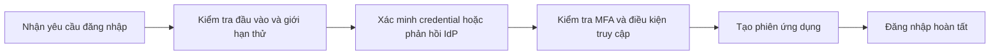

# Login failure

## 1. Đăng nhập thất bại là tín hiệu, chưa phải kết luận tấn công

**Login failure** là kết quả một lần thử đăng nhập không hoàn tất thành công theo luồng xác thực của hệ thống. Nguyên nhân có thể là credential bị từ chối, MFA chưa đáp ứng, tài khoản không được sử dụng, luồng SSO không hợp lệ hoặc một phụ thuộc kỹ thuật không sẵn sàng.

Một lần nhập sai mật khẩu thường chỉ là lỗi của người dùng. Nhiều lần thất bại theo một mẫu có thể cho thấy hoạt động đoán credential, tài khoản bị nhắm tới hoặc ứng dụng đang cấu hình sai. Một đợt thất bại trên hàng nghìn tài khoản cùng lúc cũng có thể bắt nguồn từ IdP ngừng hoạt động.

Trong logging và audit IAM, mục tiêu là ghi đủ bằng chứng để phân biệt những tình huống này, hỗ trợ phản ứng phù hợp và không làm lộ bí mật xác thực. Ghi mọi lỗi thành `BAD_PASSWORD` sẽ làm sai cả điều tra lẫn số liệu vận hành.

Một luồng đăng nhập có thể gồm nhiều bước. Cần định nghĩa sự kiện đang mô tả một lần kiểm tra yếu tố, một bước challenge hay kết quả cuối của cả luồng; nếu không, cùng một hành vi có thể bị đếm thành nhiều lần thất bại không có thật.

## 2. Xác định lỗi xảy ra tại giai đoạn nào

Ví dụ một luồng đơn giản:



Mỗi bước có loại thất bại khác nhau:

| Giai đoạn | Ví dụ thất bại | Điều không nên suy diễn |
|---|---|---|
| Tiếp nhận đầu vào | Payload sai định dạng, thiếu thông tin bắt buộc | Không tự kết luận mật khẩu sai |
| Kiểm soát số lần thử | Request bị throttle trước khi kiểm tra credential | Chưa có bằng chứng credential đã được kiểm tra |
| Kiểm tra yếu tố đầu | Credential bị từ chối | Chưa chứng minh người nhập là chủ tài khoản |
| SSO hoặc federation | Sai cấu hình client, callback không qua kiểm chứng | Không gộp thành lỗi người dùng nhập mật khẩu |
| MFA | Mã không hợp lệ, challenge hết hạn, yêu cầu bị từ chối | Chưa hoàn thành toàn bộ xác thực |
| Điều kiện truy cập | Tài khoản bị hạn chế hoặc không đạt chính sách | Có thể đã xác minh một số yếu tố nhưng chưa được mở phiên |
| Tạo phiên | Kho phiên lỗi hoặc thao tác phát hành phiên thất bại | Không được báo đăng nhập thành công ở ứng dụng |

Nếu người dùng xác thực tại IdP thành công nhưng ứng dụng từ chối callback, đó là hai sự kiện thuộc hai thành phần khác nhau. Chúng cần được liên kết, không sửa sự kiện IdP thành thất bại để làm cho hai báo cáo giống nhau.

Một API từ chối access token hết hạn không nhất thiết là một lần đăng nhập sai. Refresh token bị thu hồi, authorization bị từ chối và phiên hết hạn cũng nên có loại sự kiện riêng để không làm nhiễu bộ đếm lỗi xác thực tương tác.

## 3. Chuẩn hóa kết quả và nguyên nhân nội bộ

Nên có các nhóm nguyên nhân ổn định, thay vì dùng toàn bộ exception message làm dữ liệu phân loại. Bảng sau là ví dụ của ứng dụng, không phải bộ enum chuẩn dùng chung:

| `reasonCode` | Ngữ nghĩa nội bộ | `outcome` minh họa |
|---|---|---|
| `INPUT_REJECTED` | Yêu cầu không đáp ứng hợp đồng đầu vào | `REJECTED` |
| `CREDENTIAL_REJECTED` | Không chấp nhận bằng chứng credential | `REJECTED` |
| `ACCOUNT_RESTRICTED` | Trạng thái tài khoản không cho tiếp tục | `REJECTED` |
| `MFA_REJECTED` | Bằng chứng MFA bị từ chối | `REJECTED` |
| `MFA_EXPIRED` | Challenge hết hiệu lực trước khi hoàn tất | `EXPIRED` |
| `FLOW_VALIDATION_FAILED` | Không xác minh được luồng hoặc phản hồi xác thực | `REJECTED` |
| `RATE_LIMITED` | Bị giới hạn trước hoặc trong quá trình thử | `THROTTLED` |
| `AUTH_DEPENDENCY_UNAVAILABLE` | Dịch vụ cần thiết không sẵn sàng | `ERROR` |
| `SESSION_CREATION_FAILED` | Không tạo được phiên sau các bước trước | `ERROR` |

Hệ thống phải định nghĩa rõ khi nào một lần thử kết thúc. Việc người dùng chưa trả lời push MFA chưa phải ngay lập tức là `MFA_REJECTED`; có thể vẫn đang chờ, hết hạn hoặc client đã bỏ luồng. Không tự gán ý định người dùng nếu không có bằng chứng.

Nguyên nhân nội bộ có thể chi tiết hơn phản hồi công khai. Nếu cần lưu rằng tài khoản không tồn tại hoặc đang bị đình chỉ để hỗ trợ điều tra, giới hạn quyền đọc dữ liệu đó; không đưa cùng thông tin ra endpoint đăng nhập.

Lỗi credential và lỗi hạ tầng cần tách biệt khi tính thống kê. Nếu IdP timeout mà tăng bộ đếm sai mật khẩu, người dùng có thể bị khóa do sự cố hệ thống thay vì hành vi của họ.

## 4. Danh tính tự khai không phải actor đã được xác thực

Trước khi đăng nhập thành công, username hoặc email được nhập chỉ là **claimed identity**: tài khoản mà người gọi đang tự nhận hoặc muốn xác thực. Kẻ tấn công cũng có thể nhập username của một quản trị viên.

Không ghi `actor=admin-17` theo nghĩa “quản trị viên đã thực hiện thao tác” chỉ vì request chứa email của người đó. Có thể ghi actor chưa xác thực và lưu một tham chiếu tới claimed identity hoặc target account theo cơ chế được bảo vệ.

Một số luồng đã hoàn thành yếu tố đầu và đang kiểm tra MFA. Khi đó, có thể biết tài khoản mà challenge được ràng buộc, nhưng vẫn cần đánh dấu mức xác thực chưa hoàn tất. Không đánh đồng nó với một phiên ứng dụng đã được xác thực đầy đủ.

Đối với hệ thống nhiều tenant, cần biết username đang được giải nghĩa trong namespace nào. Hai tổ chức có thể sử dụng cùng một tên đăng nhập. Tenant context từ request phải được phân giải và kiểm chứng theo thiết kế; không để người gọi tự gắn một tenant bất kỳ vào dữ liệu audit đã được coi là đáng tin.

Nếu không cần lưu định danh thô, có thể dùng một tham chiếu giả danh hóa để tương quan. Ví dụ về ý tưởng:

```text
claimedIdentityRef = HMAC(
    protectedLoggingKey,
    tenantNamespace + canonicalIdentityAccordingToProviderRules
)
```

Đây không phải cơ chế chứng minh tài khoản tồn tại hoặc người gọi sở hữu tài khoản. Cần bảo vệ khóa, quản lý phiên bản khóa và hiểu tác động của việc thay khóa tới khả năng tương quan. Không log chính khóa hoặc đầu vào chứa credential.

Chuẩn hóa định danh phải theo quy tắc của hệ thống danh tính. Không tùy ý xóa dấu, bỏ ký tự hoặc đổi mọi phần của email sang chữ thường nếu nhà cung cấp không định nghĩa như vậy. Chuẩn hóa sai có thể gộp hai định danh khác nhau.

## 5. Schema sự kiện đăng nhập thất bại

Một sự kiện hữu ích thường cần các nhóm trường sau:

| Nhóm thông tin | Ví dụ | Mục đích |
|---|---|---|
| Định danh và schema | `eventId`, `schemaVersion`, `eventType` | Phân loại, gửi lại và kiểm soát tiến hóa schema |
| Thời gian | `eventTime`, thời điểm collector tiếp nhận | Dựng timeline và nhận biết độ trễ |
| Luồng và lần thử | `interactionId`, `attemptId`, `requestId` | Tách một lần thử khỏi nhiều event kỹ thuật |
| Ngữ cảnh danh tính | Claimed identity reference, tenant, mức xác thực đã biết | Tương quan mà không khẳng định nhầm actor |
| Giai đoạn và kết quả | `stage`, `outcome`, `reasonCode` | Phân biệt credential, chính sách và lỗi hệ thống |
| Nguồn thực hiện | Dịch vụ phát event, loại client, IdP liên quan | Xác định thành phần quan sát sự kiện |
| Mạng đã xác minh | IP nguồn theo hợp đồng proxy, thông tin mạng cần thiết | Phân tích mẫu hoạt động với giới hạn rõ ràng |
| Phản ứng | Throttle đã áp dụng, challenge hoặc bước hỗ trợ tiếp theo | Xác nhận kiểm soát thực sự hoạt động |

Ví dụ JSON dưới đây dùng các trường tùy chỉnh của ứng dụng:

```json
{
  "eventId": "event-813",
  "schemaVersion": "1",
  "eventType": "iam.authentication.attempt_failed",
  "eventTime": "2027-01-10T09:00:00Z",
  "producer": "login-service",
  "tenantId": "minh-an",
  "interactionId": "interaction-72",
  "attemptId": "attempt-714",
  "requestId": "request-614",
  "actor": {
    "authenticationState": "UNAUTHENTICATED"
  },
  "claimedIdentity": {
    "reference": "identity-ref-fac3",
    "referenceKeyVersion": "v3"
  },
  "stage": "PRIMARY_CREDENTIAL",
  "outcome": "REJECTED",
  "reasonCode": "CREDENTIAL_REJECTED",
  "source": {
    "ip": "192.0.2.27",
    "provenance": "VALIDATED_PROXY_CONTEXT"
  },
  "responseClass": "GENERIC_AUTHENTICATION_FAILURE",
  "securityPolicyVersion": "login-policy-19"
}
```

Địa chỉ IP trong ví dụ dành cho tài liệu. Giá trị `VALIDATED_PROXY_CONTEXT` chỉ được ghi khi hệ thống thực sự thực hiện kiểm tra tương ứng, không phải nhãn tự động thêm để làm dữ liệu trông đáng tin.

`attemptId` và `interactionId` là định danh tương quan không có khả năng đăng nhập. Không dùng session cookie, authorization code, OTP hoặc giá trị bí mật của challenge để làm correlation ID trong log.

## 6. Phản hồi công khai cần tránh lộ tài khoản

Đối với luồng đăng nhập chưa xác thực, phản hồi không nên cho phép người gọi dễ phân biệt “tài khoản không tồn tại”, “mật khẩu sai” và “tài khoản đang bị khóa”. OWASP khuyến nghị phản hồi lỗi xác thực chung, đồng thời lưu ý rằng khác biệt ở mã HTTP hoặc thời gian xử lý cũng có thể làm lộ thông tin. [OWASP Authentication Cheat Sheet](https://cheatsheetseries.owasp.org/cheatsheets/Authentication_Cheat_Sheet.html).

Một thông điệp minh họa:

```text
Không thể đăng nhập bằng thông tin đã cung cấp.
Vui lòng kiểm tra lại hoặc sử dụng quy trình khôi phục được hỗ trợ.
Mã hỗ trợ: request-614
```

Mã hỗ trợ giúp nhân viên được phân quyền tra cứu nguyên nhân nội bộ. Endpoint tra cứu mã không được trở thành cách công khai lấy trạng thái tài khoản hoặc thông tin nhạy cảm của người khác.

Cần kiểm tra toàn bộ phản hồi: nội dung, mã trạng thái, redirect, header, kích thước khác biệt có ý nghĩa và đường recovery. Chỉ đổi chữ trên giao diện trong khi API trả `USER_NOT_FOUND` vẫn làm lộ thông tin.

Thiết kế đường xử lý không nên tạo chênh lệch thời gian rõ ràng giữa các trường hợp liên quan tới sự tồn tại tài khoản. Biện pháp cụ thể phụ thuộc cơ chế xác thực; một phép delay cố định đơn giản không tự bảo đảm mọi khác biệt quan sát được đã biến mất.

Phản hồi lỗi hạ tầng có thể cần hướng dẫn người dùng thử lại hoặc kiểm tra trạng thái dịch vụ. Có thể phân biệt sự cố dịch vụ với credential bị từ chối mà vẫn tránh tiết lộ một username cụ thể có tồn tại hay không. Trong OAuth/OIDC hoặc giao thức khác, phải giữ đúng hợp đồng lỗi của giao thức và giới hạn dữ liệu nhạy cảm.

Một người đã có phiên được xác minh có thể nhận một số thông tin hỗ trợ chi tiết hơn, nhưng đó là ngữ cảnh khác với endpoint công khai. Quyền xem nguyên nhân vẫn phải được xác định rõ.

## 7. Tương quan và đếm đúng số lần thử

Một lần người dùng nhấn đăng nhập có thể tạo event ở gateway, ứng dụng và IdP. Nếu cộng tất cả thành ba lần thất bại, dashboard sẽ phóng đại hành vi và có thể kích hoạt khóa nhầm.

Nên phân biệt:

- `requestId`: một request được xử lý tại thành phần cụ thể.
- `attemptId`: một lần thử xác thực theo hợp đồng của hệ thống.
- `interactionId`: toàn bộ tương tác có thể chứa nhiều lần thử hoặc challenge.
- `eventId`: một event cụ thể, giữ nguyên khi retry phát event đó.

Những định danh này không nhất thiết chia sẻ được tự động giữa mọi sản phẩm. Khi tích hợp IdP ngoài, có thể cần mapping với transaction reference của nhà cung cấp; không suy ra cùng người chỉ từ việc hai event gần nhau hoặc cùng IP.

Retry chuyển event qua pipeline phải giữ event ID để deduplicate. Một lần thử credential mới cần được nhận diện là lần thử mới theo quy tắc server, không cho client tái sử dụng tùy ý ID cũ để che hoạt động.

Đồng hồ giữa các thành phần cần được quản lý phù hợp. Giữ cả thời điểm sự kiện và thời điểm tiếp nhận giúp nhận biết event đến trễ. Không lấy timestamp từ client làm thời điểm đáng tin duy nhất cho việc áp dụng cửa sổ phát hiện.

## 8. Nhận diện mẫu bất thường mà không kết luận vội

| Mẫu quan sát | Khả năng cần xem xét | Thông tin bổ sung |
|---|---|---|
| Nhiều lần credential bị từ chối trên một định danh | Người dùng quên mật khẩu, ứng dụng dùng credential cũ hoặc hoạt động đoán | Client, thời gian, thay đổi mật khẩu, đăng nhập thành công sau đó |
| Nhiều định danh bị nhắm trong một khoảng thời gian | Password spraying, credential stuffing hoặc lỗi tích hợp diện rộng | Nguồn request, reason class, loại ứng dụng, mức phân tán |
| Nhiều MFA bị từ chối hoặc hết hạn | Người dùng không sẵn sàng, cấu hình sai hoặc yêu cầu không mong muốn | Có tương tác người dùng thật không, nguồn khởi tạo, lịch sử challenge |
| Nhiều tenant cùng có lỗi phụ thuộc | IdP, DNS, mạng hoặc cấu hình dùng chung gặp sự cố | Health check, thay đổi triển khai, mã lỗi kỹ thuật |
| Thất bại rồi thành công và dùng đặc quyền bất thường | Người dùng tự sửa lỗi hoặc tài khoản có thể đã bị chiếm | Thiết bị, phiên, phương thức xác thực và hoạt động sau đăng nhập |

Một IP có nhiều thất bại có thể là proxy doanh nghiệp hoặc NAT phục vụ nhiều người. Một tài khoản nhận request từ nhiều IP cũng có thể đang bị nhắm từ nguồn phân tán. Vì vậy, cần quan sát theo cả định danh, nguồn, tenant, ứng dụng, giai đoạn và nguyên nhân.

Truy vấn SQL minh họa sau chỉ đếm các lần thử thuộc nhóm credential, sau khi dữ liệu đã được chuẩn hóa:

```sql
SELECT tenant_id,
       claimed_identity_ref,
       COUNT(DISTINCT attempt_id) AS rejected_attempts
FROM authentication_events
WHERE event_time >= :window_start
  AND event_time < :window_end
  AND event_type = 'iam.authentication.attempt_failed'
  AND stage = 'PRIMARY_CREDENTIAL'
  AND outcome = 'REJECTED'
  AND reason_code = 'CREDENTIAL_REJECTED'
GROUP BY tenant_id, claimed_identity_ref
HAVING COUNT(DISTINCT attempt_id) >= :review_threshold;
```

Đây là ví dụ phân tích, không phải rule phát hiện hoàn chỉnh. Ngưỡng và cửa sổ phải được hiệu chỉnh theo dữ liệu, loại tài khoản và khả năng phản ứng. Cần xử lý tham chiếu định danh bị thiếu, thay phiên bản khóa giả danh hóa và độ trễ dữ liệu trước khi sử dụng kết quả vận hành.

Không đưa lỗi timeout IdP vào bộ đếm đoán mật khẩu chỉ vì mọi event đều có từ `failed`. Cũng không bỏ qua mọi lỗi sau một lần đăng nhập thành công: thành công có thể hợp lệ hoặc chính là điểm cần điều tra tiếp.

## 9. Phản ứng phù hợp với nguyên nhân

**Credential bị thử quá nhiều.** Áp dụng cơ chế giới hạn số lần thử và theo dõi account/authenticator theo thiết kế. Kết hợp tín hiệu nguồn, tenant và tải toàn hệ thống khi cần; chỉ giới hạn theo IP thường không phản ánh đầy đủ tài khoản bị nhắm tới.

NIST SP 800-63B-4 trình bày rate limiting để hạn chế thử xác thực thất bại và có các yêu cầu gắn với loại authenticator. Không lấy một con số ngưỡng rời khỏi ngữ cảnh để dùng chung cho mọi phương thức đăng nhập. [NIST SP 800-63B-4: Authentication and Authenticator Management](https://pages.nist.gov/800-63-4/sp800-63b.html).

**Khóa tài khoản.** Cần cân bằng với nguy cơ người ngoài cố ý gây khóa người dùng hợp lệ. Chính sách phải xác định cửa sổ quan sát, thời hạn hạn chế, cách phục hồi và sự khác biệt giữa credential bị vô hiệu hóa với toàn bộ tài khoản bị đình chỉ.

**MFA không mong muốn.** Không khuyến khích người dùng liên tục phê duyệt push để “thử cho xong”. Cần hướng dẫn từ chối yêu cầu họ không khởi tạo và xử lý theo quy trình phù hợp khi có dấu hiệu credential hoặc phiên bị lộ.

**Lỗi SSO hoặc phụ thuộc.** Điều tra cấu hình, chứng thư, metadata, client và tình trạng dịch vụ. Không bật một đường local login không được kiểm soát hoặc bỏ kiểm tra callback để giải quyết nhanh một lỗi tích hợp.

**Credential cũ trong ứng dụng nền.** Xác định workload và chủ sở hữu, xử lý credential đúng quy trình. Không mặc định lỗi của một tác vụ định kỳ là người dùng đang tự đăng nhập sai liên tục.

**Nghi ngờ xâm phạm.** Đối chiếu hoạt động sau đăng nhập, phiên và các thay đổi bảo mật. Thông báo hoặc phản ứng tự động phải có căn cứ đủ tin cậy, tránh gửi thông tin tài khoản cho người khởi tạo request chưa xác thực.

## 10. Ghi log an toàn và giữ khả năng quan sát

Tuyệt đối không ghi mật khẩu người dùng thử, OTP, recovery code, raw token hoặc toàn bộ request body đăng nhập. Credential bị nhập sai vẫn là thông tin nhạy cảm; nó có thể là mật khẩu thật của người dùng trên một hệ thống khác.

Exception của thư viện cũng có thể chứa URL, header hoặc nội dung phản hồi nhạy cảm. Dùng reason code kiểm soát và thông tin kỹ thuật đã được xử lý thay vì đẩy nguyên exception tới kho audit có nhiều người đọc.

Username, user agent hoặc message do client gửi có thể chứa xuống dòng và ký tự điều khiển. Structured logging, serialization đúng và giới hạn kích thước giúp tránh tạo dòng log giả hoặc làm cạn tài nguyên. Trình xem log phải xử lý đầu ra an toàn.

IP nguồn phải được xác định theo hợp đồng proxy đáng tin. Không chọn tùy ý phần tử đầu trong một header có thể bị client giả mạo. Nếu không xác định chắc được nguồn, giữ provenance phù hợp thay vì thêm một nhãn chắc chắn sai.

Khi xảy ra lượng lỗi lớn, pipeline cần cơ chế buffer, retry, backpressure và giám sát mất dữ liệu. Nếu giảm chi tiết hoặc tổng hợp một số event theo chính sách, phải biết báo cáo còn đo được điều gì; không dùng số liệu đã sampling như tổng số lần thử chính xác.

Không có event đăng nhập thất bại có thể là do không có hoạt động, nhưng cũng có thể do logging bị tắt hoặc collector mất kết nối. Theo dõi sức khỏe nguồn và độ trễ là điều kiện để diễn giải sự im lặng.

## 11. Số liệu và quy trình điều tra

Dashboard nên tách lỗi người dùng, từ chối do chính sách, throttling và lỗi hệ thống. Một tỷ lệ thất bại tổng có thể che mất việc toàn bộ lỗi đang đến từ một phiên bản client hoặc một IdP cụ thể.

Khi tính tỷ lệ, cần định nghĩa mẫu số. Ví dụ, số lần credential bị từ chối chia cho số lần credential thực sự được kiểm tra khác với số tương tác không hoàn tất chia cho số tương tác đã kết thúc. Các luồng còn chờ và event đến trễ cần cách xử lý riêng.

Một quy trình điều tra có thể gồm:

1. Kiểm tra nguồn dữ liệu, thời gian và độ đầy đủ của event.
2. Xác định giai đoạn thất bại và reason class đang tăng.
3. So sánh theo tenant, ứng dụng, nguồn và claimed identity trong phạm vi được phép.
4. Đối chiếu thay đổi triển khai, cấu hình SSO, sự cố dịch vụ và phản hồi người dùng.
5. Liên kết các lần thành công và hoạt động nhạy cảm sau đó khi có căn cứ tương quan.
6. Chọn hỗ trợ người dùng, sửa hệ thống hoặc ứng phó bảo mật theo bằng chứng.

Người vận hành không cần biết mật khẩu đã thử để làm những bước trên. Quyền đọc log chi tiết, truy vấn nhiều tenant hoặc xem target account phải được giới hạn theo trách nhiệm công việc.

Kết luận điều tra nên lưu lý do và căn cứ, chẳng hạn tích hợp cũ dùng credential đã thay hoặc nguồn request đang bị lạm dụng. Đóng cảnh báo không có nghĩa xóa lịch sử gốc hoặc bỏ mọi kiểm soát với tài khoản đó.

## 12. Những tình huống cần kiểm chứng

| Tình huống | Điều cần chứng minh |
|---|---|
| Sai credential của tài khoản có thật và định danh không tồn tại | Phản hồi công khai không tạo cách phân biệt dễ khai thác |
| Username nhập là của quản trị viên | Event không khẳng định quản trị viên đã xác thực thực hiện hành động |
| MFA hết hạn sau khi yếu tố đầu hợp lệ | Ghi đúng stage và trạng thái, không báo đăng nhập hoàn tất |
| IdP timeout | Lỗi hệ thống được tách khỏi sai credential và không gây khóa nhầm |
| Gateway, ứng dụng và IdP cùng ghi một luồng | Tương quan và bộ đếm không nhân sai số lần thử |
| Retry gửi event | Không tạo thêm lần thử giả |
| Client giả header IP hoặc tenant | Không được nâng thành ngữ cảnh đã xác minh |
| Payload chứa password, OTP hoặc ký tự xuống dòng | Không lộ bí mật, không tạo event giả |
| Có nhiều lỗi từ một proxy phục vụ nhiều người | Phân tích không đồng nhất IP với một danh tính |
| Thất bại rồi thành công và có thay đổi quyền | Có thể liên kết đúng để hỗ trợ điều tra |
| Logging bị gián đoạn | Có chỉ báo sức khỏe và giới hạn diễn giải số liệu |

Login failure có giá trị khi nó mô tả chính xác lần thử nào thất bại, ở bước nào, vì nhóm nguyên nhân gì và nguồn nào quan sát được. Kết hợp dữ liệu đó với phản hồi công khai an toàn, kiểm soát số lần thử và quy trình điều tra giúp IAM vừa hỗ trợ người dùng hợp lệ, vừa phát hiện những đường lạm dụng xác thực.
