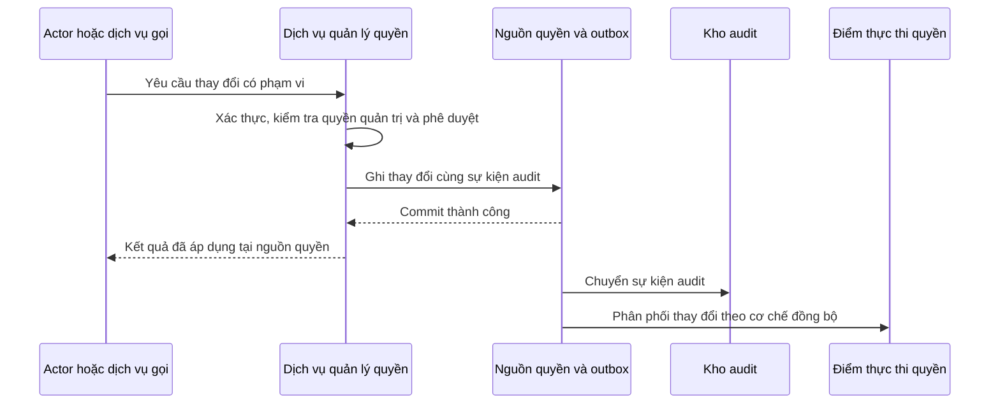

# Permission change

## 1. Thay đổi quyền là sự kiện cần truy vết riêng

**Permission change** là thay đổi ảnh hưởng đến những hành động mà một danh tính được phép thực hiện trên một phạm vi tài nguyên. Trong audit IAM, loại sự kiện này giúp trả lời:

- Ai đã thực hiện thay đổi?
- Quyền của người dùng, nhóm hoặc workload nào bị tác động?
- Quyền được thêm, gỡ hay điều chỉnh?
- Áp dụng trong tenant, tài nguyên và khoảng thời gian nào?
- Căn cứ phê duyệt hoặc quy trình nào cho phép thay đổi?
- Thay đổi đã được lưu hay đã có hiệu lực tại nơi thực thi?

Ví dụ, một quản trị viên cấp cho Lan vai trò xuất báo cáo của tenant A. Một bản ghi “update user thành công” không đủ để điều tra việc cấp quyền đó. Cần biết vai trò nào được thêm, ai cấp và phạm vi của assignment.

```text
Actor: admin_12
Target principal: user_lan
Action: cấp role REPORT_EXPORTER
Scope: tenant A
Validity: khoảng thời gian được cấp
Result: assignment đã được lưu.
```

Audit permission change không thay thế kiểm soát cấp quyền. Hệ thống vẫn phải kiểm tra actor có quyền quản trị đúng phạm vi trước khi thay đổi. Log dùng để truy vết quyết định và kết quả, không hợp thức hóa một thao tác vốn không được phép.

## 2. Quyền có thể thay đổi trực tiếp hoặc gián tiếp

### 2.1. Các loại thay đổi ảnh hưởng đến quyền

| Loại thay đổi | Ví dụ | Điều cần truy vết |
| --- | --- | --- |
| Grant trực tiếp | Cấp quyền đọc một tài liệu cho Lan | Principal, tài nguyên, hành động và thời hạn |
| Role assignment | Gán vai trò quản trị dự án trong tenant A | Vai trò, principal và phạm vi assignment |
| Group membership | Thêm Lan vào nhóm được cấp quyền | Nhóm và quan hệ membership thay đổi |
| Role definition | Thêm quyền xóa dữ liệu vào một vai trò | Nội dung role và các assignment có thể chịu ảnh hưởng |
| Policy | Thay điều kiện cho phép export | Phiên bản và phạm vi policy |
| Resource sharing | Chia sẻ tài liệu cho nhóm của tenant B | Nguồn sở hữu, bên nhận và giới hạn chia sẻ |
| Delegation | Cho ứng dụng thực hiện một số hành động thay mặt người dùng | Grant, client, subject và tài nguyên đích |
| Workload grant | Cấp dịch vụ quyền đọc một kho dữ liệu | Workload identity, môi trường và scope |
| Thời hạn hoặc điều kiện | Gia hạn quyền quản trị tạm thời | Khoảng hiệu lực và điều kiện trước/sau |
| Trust hoặc ánh xạ danh tính | Thay nguồn có thẩm quyền khẳng định role | Cấu hình tin cậy và phạm vi bị ảnh hưởng |

Một thay đổi cấu hình có thể ảnh hưởng nhiều principal dù không chỉnh từng role assignment. Ví dụ, thêm `report.delete` vào role `REPORT_OPERATOR` làm thay đổi ý nghĩa quyền của những người đang giữ role đó.

Không nên chỉ audit endpoint “gán role” rồi bỏ qua thay đổi group, định nghĩa role hoặc policy.

### 2.2. Trạng thái cấu hình khác với quyền hiệu lực

Trong RBAC, quyền có thể đến từ nhiều đường:

```text
Lan
  ├─ assignment trực tiếp: REPORT_READER
  └─ membership nhóm Finance
       └─ assignment của nhóm: REPORT_EXPORTER
```

Nếu gỡ assignment trực tiếp `REPORT_READER`, Lan vẫn có thể đọc báo cáo qua một quyền khác.

Do đó, sự kiện “đã gỡ assignment X” không tự chứng minh “Lan không còn bất kỳ quyền đọc báo cáo nào”.

Audit cần mô tả đúng đối tượng đã thay đổi. Nếu hệ thống đưa ra kết luận về quyền hiệu lực, phải có quá trình đánh giá dựa trên đầy đủ quan hệ, policy và thời điểm tương ứng.

## 3. Phân biệt yêu cầu, phê duyệt, áp dụng và hiệu lực

Một quy trình có thể có nhiều mốc:

```text
Yêu cầu cấp quyền
  → kiểm tra và phê duyệt
  → ghi thay đổi vào nguồn quyền
  → đồng bộ đến các thành phần
  → điểm thực thi áp dụng trạng thái mới.
```

Những mốc đó không tương đương.

| Mốc | Ý nghĩa | Chưa chứng minh |
| --- | --- | --- |
| `REQUESTED` | Đã tiếp nhận ý định thay đổi | Yêu cầu được phê duyệt hoặc quyền đã thay đổi |
| `APPROVED` | Quy trình đã chấp nhận nội dung cụ thể | Thao tác lưu thành công |
| `APPLIED` | Thay đổi đã được lưu ở nguồn quyền theo contract | Mọi API đã sử dụng trạng thái mới |
| `EFFECTIVE` | Có căn cứ cho biết phạm vi thực thi đã áp dụng | Hiệu lực toàn hệ thống nếu chỉ quan sát một phần |
| `DENIED` | Bị từ chối bởi kiểm soát quyền hoặc policy | Có thay đổi thành công |
| `FAILED` | Thao tác không hoàn tất theo contract | Trạng thái chắc chắn đã rollback ở mọi nơi |
| `UNCHANGED` | Không có thay đổi trạng thái tại điểm được kiểm tra | Một lần grant hoặc revoke mới đã xảy ra |

Các nhãn trên minh họa một cách thiết kế schema. Mỗi hệ thống phải xác định rõ điều kiện phát và phạm vi quan sát.

### 3.1. Quyết định cho phép không phải kết quả thay đổi

Một request được authorize thành công nhưng transaction lưu role assignment bị lỗi. Khi đó có thể có sự kiện quyết định cho phép và sự kiện thao tác thất bại, nhưng không được ghi rằng assignment đã được cấp thành công.

Ngược lại, nếu thay đổi đã commit nhưng response bị mất trên mạng, actor có thể không biết kết quả trong khi trạng thái thật đã thay đổi. Audit cần dựa vào mốc mà nguồn thực sự quan sát, không dựa vào suy đoán client đã nhận response.

### 3.2. Quyền có lịch hiệu lực cần ghi đúng thời gian

Một grant được lưu lúc 09:00 nhưng có hiệu lực từ 10:00 không nên được mô tả là người dùng đã có quyền ngay từ 09:00.

Cần phân biệt:

```text
changed_at: lúc cấu hình quyền được thay đổi.
valid_from: lúc grant bắt đầu được chấp nhận.
valid_until: giới hạn kết thúc.
```

Nếu quyền tự hết hiệu lực do policy kiểm tra thời gian, có thể không có thao tác xóa bản ghi tại đúng thời điểm hết hạn. Không bịa một sự kiện “assignment đã bị xóa” nếu chỉ có điều kiện thời gian không còn thỏa.

## 4. Nội dung tối thiểu của một sự kiện thay đổi quyền

### 4.1. Actor và target là hai vai trò khác nhau

- **Actor** là chủ thể khởi tạo hoặc thực hiện thay đổi.
- **Target principal** là danh tính, nhóm hoặc workload nhận tác động.
- **Executor** có thể là một dịch vụ thực thi thay mặt actor.
- **Approver** là chủ thể phê duyệt nếu quy trình có bước đó.

Không điền actor bằng target principal chỉ vì request chứa ID của người nhận quyền.

Nếu một tác vụ tự động gỡ quyền theo dữ liệu nhân sự, cần ghi danh tính dịch vụ thực hiện và tham chiếu sự kiện hoặc quy tắc gây ra thao tác. Không tạo một actor người dùng giả để làm bản ghi trông giống thao tác thủ công.

Nếu có quyền hỗ trợ hoặc đại diện người dùng, cần giữ được cả chủ thể thật và ngữ cảnh đại diện.

### 4.2. Các trường nên cân nhắc

| Nhóm | Ví dụ | Giá trị điều tra |
| --- | --- | --- |
| Sự kiện | ID, loại, schema version, nguồn phát | Nhận diện và xử lý lại |
| Actor | ID, loại principal, ngữ cảnh đại diện | Biết ai chịu trách nhiệm thực hiện |
| Target | Principal, group, role hoặc policy ID | Biết đối tượng thật bị thay đổi |
| Phạm vi | Tenant, môi trường, tài nguyên | Tránh hiểu quyền cục bộ là quyền toàn cục |
| Thao tác | Grant, revoke, update | Biết chiều thay đổi |
| Trước/sau | Assignment hoặc cấu hình liên quan | Biết chính xác nội dung đã đổi |
| Thời gian | Xảy ra, tiếp nhận, hiệu lực | Dựng lại timeline |
| Căn cứ | Request, approval, ticket hoặc rule reference | Kiểm tra quy trình cấp quyền |
| Kết quả | Requested, applied, denied, failed | Không nhầm ý định với trạng thái |
| Phiên bản | State version, policy version | Xử lý đồng thời và truy vết lịch sử |
| Liên kết | Correlation, operation và batch ID | Nối các bước của cùng quy trình |

Không phải hệ thống nào cũng cần mọi field, nhưng không nên thay thông tin có cấu trúc bằng một câu “quyền đã được cập nhật”.

### 4.3. Trước/sau phải lấy từ trạng thái được xác nhận

Body request thể hiện điều actor muốn thay đổi, chưa phải trạng thái sau đã được lưu.

```text
Requested change
  ≠ validated change
  ≠ committed change.
```

Giá trị trước nên đến từ trạng thái được đọc và bảo vệ theo cơ chế đồng thời phù hợp. Giá trị sau nên phản ánh dữ liệu thực sự được áp dụng, bao gồm các giới hạn mà server đã điều chỉnh theo policy.

Nếu ghi delta thay vì snapshot toàn bộ, cần nói rõ chỉ những field hoặc assignment được nêu mới thay đổi. Không khiến người đọc hiểu một mảng rỗng là đã xóa mọi quyền khi thực tế chỉ gỡ một assignment.

Với thay đổi role definition hoặc policy, cần lưu phiên bản và đủ thông tin để hiểu sự khác biệt. Nếu chỉ lưu tên role mà định nghĩa role bị ghi đè theo thời gian, rất khó dựng lại quyền tại thời điểm cũ.

## 5. Ví dụ sự kiện cấp role trong một tenant

```json
{
  "schema_version": 1,
  "event_id": "evt_permission_63f",
  "event_type": "iam.role_assignment.changed",
  "occurred_at": "2026-01-15T09:00:00Z",
  "source": "tenant-access-service",
  "actor": {
    "id": "admin_12",
    "type": "HUMAN"
  },
  "target": {
    "principal_id": "user_lan",
    "principal_type": "HUMAN"
  },
  "tenant_id": "tenant_a",
  "action": "GRANT",
  "outcome": "APPLIED",
  "change": {
    "assignment_id": "assignment_81",
    "before": null,
    "after": {
      "role_id": "REPORT_EXPORTER",
      "role_revision": 7,
      "scope": {
        "type": "TENANT",
        "id": "tenant_a"
      },
      "valid_from": "2026-01-15T09:00:00Z",
      "valid_until": "2026-01-15T10:00:00Z"
    }
  },
  "authorization_state_version": 42,
  "approval_ref": "approval_19",
  "operation_id": "op_82a",
  "correlation_id": "req_193"
}
```

Đây là schema minh họa. Các ID không mang quyền truy cập và không phải credential.

Bản ghi cho biết assignment mới đã được lưu. Nó không tự chứng minh:

- Lan đã nhận token mới chứa quyền này.
- Mọi API đã cập nhật cache.
- Mọi báo cáo trong tenant đều cho phép export bất kể policy tài nguyên.
- Quyền export biến mất hoàn toàn khi assignment này bị gỡ.

`before=null` ở đây nghĩa là assignment cụ thể chưa tồn tại. Nó không có nghĩa Lan trước đó không có bất kỳ quyền nào.

Nếu hệ thống không lưu được tham chiếu đến một phiên bản role có thể truy xuất về sau, chỉ ghi `role_revision=7` vẫn chưa đủ cho việc tái dựng. Cần bảo đảm bản định nghĩa hoặc bằng chứng tương ứng được bảo tồn theo thiết kế audit.

### 5.1. Ví dụ thu hồi cùng assignment

Một lần thu hồi có thể ghi:

```text
event_type=iam.role_assignment.changed
action=REVOKE
assignment_id=assignment_81
outcome=APPLIED
before=assignment đang hoạt động theo trạng thái trước
after=assignment không còn được cấp theo mô hình lưu trữ
authorization_state_version=43
```

Giá trị `after` cụ thể phụ thuộc hệ thống dùng xóa bản ghi, đánh dấu thu hồi hay một mô hình grant khác. Không ép mọi triển khai phải có cùng biểu diễn.

Nếu cần theo dõi hiệu lực thu hồi tại API, nên có bằng chứng hoặc sự kiện riêng về việc áp dụng phiên bản quyền mới. Không đổi nhãn thành “thu hồi toàn hệ thống thành công” chỉ từ kết quả cập nhật một bảng.

## 6. Ghi audit nhất quán với thay đổi quyền

### 6.1. Transaction và outbox

Khi trạng thái quyền và sự kiện có thể cùng tham gia một transaction, có thể ghi thay đổi và outbox trước khi commit.



Các đường chuyển đến kho audit và điểm thực thi có thể khác nhau. Kho audit đã nhận sự kiện không chứng minh điểm thực thi đã áp dụng thay đổi.

Pseudocode:

```java
ChangeResult grantRole(VerifiedActor actor, GrantCommand command) {
    return transactions.run(() -> {
        AuthorizedAdminContext context =
            authorization.requireGrantAuthority(actor, command);

        approvals.requireValidForExactChange(context, command);

        AssignmentSnapshot before =
            assignments.readForChange(context, command.assignmentKey());

        ValidatedGrant validated =
            grantPolicy.validate(context, command, before);

        AssignmentSnapshot after =
            assignments.applyWithExpectedVersion(
                validated, before.version()
            );

        AuditEvent event = permissionEvents.assignmentChanged(
            context,
            before,
            after,
            "APPLIED",
            validated.operationReference()
        );

        outbox.append(event);
        return ChangeResult.applied(after.reference(), after.version());
    });
}
```

Đây là mã minh họa, không phải chương trình hoàn chỉnh. Tính nguyên tử chỉ có khi các thao tác thực sự nằm trong phạm vi transaction được hỗ trợ.

Nếu transaction rollback, không phát sự kiện khẳng định thay đổi đã commit. Có thể ghi một sự kiện thất bại ở cơ chế phù hợp để vẫn quan sát được lần thử.

Nếu audit bền vững là điều kiện bắt buộc của loại thay đổi đó, hành vi khi không ghi được phải được thiết kế trước. Không âm thầm bỏ log rồi trả thành công như thể điều kiện đã được đáp ứng.

### 6.2. Nội dung phê duyệt phải khớp thay đổi được thực hiện

Một approval cho quyền đọc trong tenant A không được dùng để cấp quyền quản trị tenant B.

Nếu nội dung thay đổi sau khi phê duyệt, phải kiểm tra approval còn phù hợp hay không. Audit nên liên kết được approval với chính scope, quyền và khoảng hiệu lực được áp dụng.

Việc cùng có một mã ticket trong request không tự chứng minh có phê duyệt hợp lệ. Cần xác minh qua quy trình hoặc nguồn mà hệ thống tin cậy.

### 6.3. Thay đổi đồng thời và phiên bản

Hai quản trị viên có thể cùng chỉnh quyền:

```text
Admin X đọc phiên bản 10 và định thêm quyền đọc.
Admin Y cập nhật thành phiên bản 11 để gỡ quyền ghi.
Admin X gửi lại trạng thái dựa trên phiên bản 10.
```

Nếu ghi đè toàn bộ mà không kiểm tra đồng thời, thao tác của X có thể làm quyền ghi xuất hiện trở lại.

Cơ chế như optimistic locking hoặc kiểm soát phiên bản phù hợp giúp ngăn cập nhật dựa trên trạng thái cũ. Audit phải phản ánh bản trước/sau thật của thao tác được chấp nhận, không lấy bản trước từ một form đã mở lâu.

Khi có xung đột, ghi kết quả đúng như `CONFLICT` hoặc loại thất bại tương ứng theo schema; không khai thao tác đã áp dụng.

## 7. Thao tác hàng loạt, retry và thay đổi tự động

### 7.1. Bulk cần giữ kết quả từng phần

Giả sử một request cấp role cho 100 người:

- Nếu contract là toàn bộ cùng thành công hoặc thất bại, audit phải phù hợp với kết quả commit hoặc rollback chung.
- Nếu contract cho phép thành công từng phần, cần biết chính xác principal nào được cấp, principal nào bị từ chối hoặc lỗi.
- Batch ID giúp nối các kết quả, nhưng một bản ghi “batch thành công” không thay thế danh sách kết quả cần thiết.

Có thể dùng sự kiện tổng hợp và các sự kiện con hoặc một cấu trúc kết quả có giới hạn kích thước. Thiết kế cần bảo đảm không mất thông tin khi số lượng lớn.

Không cắt bỏ danh sách target trong log mà không có bằng chứng chi tiết được lưu ở nơi khác có thể truy xuất.

### 7.2. Retry không tạo một thay đổi mới giả

Sau khi request commit nhưng response bị mất, client có thể gửi lại.

Nếu hệ thống hỗ trợ idempotency, kết quả gửi lại cần được liên kết với cùng một operation theo contract. Không đếm một assignment đã tồn tại thành một lần cấp mới chỉ vì HTTP request được retry.

Pipeline chuyển audit cũng có thể gửi cùng event nhiều lần. Cùng một sự kiện nên giữ nguyên event ID qua các lần gửi, để consumer xử lý lặp mà không gộp nhầm hai thao tác thật sự khác nhau.

Không chỉ deduplicate theo actor và target, vì một quản trị viên có thể cấp rồi gỡ cùng role trong thời gian ngắn.

### 7.3. Thay đổi do quy tắc hoặc lịch

Một tác vụ tự động có thể gỡ membership khi quan hệ nhân sự kết thúc. Bản ghi nên liên kết:

```text
Executor: lifecycle-worker
Target: user_47
Action: gỡ assignment trong tenant A
Cause: sự kiện vòng đời có thẩm quyền
Rule version: phiên bản quy tắc đã áp dụng
Result: thay đổi thật đã được lưu.
```

Không nhận một thông điệp bất kỳ rồi coi nó là căn cứ quản trị. Cần xác thực nguồn và kiểm tra phiên bản hoặc thứ tự sự kiện theo thiết kế.

Sự kiện cũ bị gửi lại không được làm tái cấp quyền sau một lần thu hồi mới hơn. Audit cùng phiên bản nguồn giúp điều tra, nhưng cơ chế cập nhật trạng thái vẫn phải tự ngăn lỗi đó.

## 8. Theo dõi hiệu lực của thu hồi và cấp quyền

Ví dụ:

```text
09:00  Cấp assignment tại nguồn quyền, phiên bản 42.
09:01  API A nhận phiên bản 42.
09:02  Thu hồi assignment tại nguồn quyền, phiên bản 43.
09:03  API A nhận phiên bản 43.
```

Audit của nguồn quyền chứng minh có hai thay đổi ở 09:00 và 09:02. Nếu API vẫn giữ cache cũ đến 09:03, khoảng trễ cần được hiểu và kiểm tra theo mục tiêu của hệ thống.

Access token tự chứa có thể mang ảnh chụp quyền cũ. Nếu API chỉ xác minh chữ ký và thời hạn mà không có cơ chế kiểm tra thay đổi, token có thể tiếp tục được chấp nhận đến hết hạn.

Do đó, một báo cáo thu hồi nên phân biệt:

- Trạng thái tại nguồn quyền.
- Trạng thái phân phối hoặc cache.
- Trạng thái phiên, token hoặc grant cấp tiếp.
- Bằng chứng tại điểm thực thi.
- Những quan hệ cấp quyền khác còn tồn tại.

Không có bản ghi truy cập sau thời điểm thu hồi không tự chứng minh mọi API đã thực thi quyền mới; có thể đơn giản là chưa có request để quan sát.

Khi cần chứng minh hiệu lực, có thể kết hợp xác nhận phiên bản, kiểm tra trạng thái và ca truy cập kiểm soát được theo thiết kế. Bằng chứng phải phản ánh đúng phạm vi đã kiểm tra.

Tương tự, grant đã được lưu không bảo đảm người dùng được truy cập ngay nếu policy tài nguyên, thời hạn hoặc điều kiện xác thực vẫn chưa thỏa.

## 9. Bảo vệ dữ liệu audit thay đổi quyền

### 9.1. Ghi đủ sự khác biệt, tránh sao chép secret

Audit có thể chứa role, principal, tenant, grant, policy và tham chiếu tài nguyên. Đây là dữ liệu nhạy cảm về cấu trúc quyền của hệ thống.

Không ghi nguyên:

- Access token, refresh token, cookie hoặc khóa riêng.
- Credential mới được cấp cùng một thao tác quản trị.
- Toàn bộ request hoặc đối tượng người dùng có nhiều field không liên quan.
- Dữ liệu bí mật nằm trong một cấu hình tích hợp chỉ vì đang ghi before/after.

Nên chọn field liên quan trực tiếp đến thay đổi. Nếu một thao tác vừa xoay secret vừa điều chỉnh scope, audit có thể ghi tham chiếu credential và thay đổi scope, không ghi giá trị secret cũ hoặc mới.

Chuỗi do actor nhập như lý do hoặc mô tả cần được giới hạn, serialize và hiển thị an toàn. Không để nội dung đó tạo bản ghi giả qua ký tự điều khiển hoặc chèn nội dung vào trang xem audit.

### 9.2. Người thay đổi quyền không mặc nhiên được sửa lịch sử

Kho audit cần kiểm soát quyền ghi, đọc và sửa hoặc xóa theo trách nhiệm đã định. Có thể sử dụng cơ chế lưu nối tiếp, bảo vệ tính toàn vẹn hoặc lưu trữ chống sửa theo nhu cầu.

Những cơ chế đó bảo vệ bản ghi sau khi nhận, nhưng không tự chứng minh nội dung ban đầu đúng. Nguồn phát vẫn phải ghi chính xác actor, trạng thái và kết quả.

Việc xem, export hoặc thay đổi cấu hình audit cũng là các hành động cần được quản trị. Một tài khoản có quyền cấp role trong tenant A không mặc nhiên có quyền đọc toàn bộ cấu trúc quyền của tenant B.

### 9.3. Khả năng dựng lại lịch sử

Để trả lời “Lan có quyền gì tại thời điểm T?”, có thể cần:

```text
Trạng thái nền trước T
+ các thay đổi assignment và group membership
+ phiên bản role hoặc policy
+ phạm vi tenant và tài nguyên
+ khoảng hiệu lực
+ các grant chia sẻ hoặc ủy quyền
+ điều kiện ngữ cảnh áp dụng.
```

Một danh sách event thiếu trạng thái nền hoặc thiếu phiên bản định nghĩa có thể không đủ để tính lại quyền.

Ngay cả khi dựng lại được cấu hình quyền, kết luận về một request thực tế vẫn có thể cần log quyết định tại API, phiên bản cache và ngữ cảnh của request đó. Trạng thái cấu hình và quyết định từng request là hai lớp bằng chứng bổ sung nhau.

## 10. Các tình huống kiểm tra cần có

| Tình huống | Kết quả cần đạt |
| --- | --- |
| Actor có quyền cấp role trong tenant A | Audit ghi đúng actor, target, role và scope A |
| Actor chỉ quản trị A nhưng yêu cầu cấp role tại B | Bị từ chối; không có event khẳng định grant đã áp dụng |
| Request khai actor khác danh tính đã xác thực | Actor lấy từ ngữ cảnh máy chủ đã xác minh |
| Approval cho quyền đọc nhưng request chuyển thành quyền quản trị | Không dùng approval sai nội dung để hoàn tất thay đổi |
| Transaction rollback | Không phát event khẳng định thay đổi đã commit |
| Không ghi được audit bền vững khi contract yêu cầu bắt buộc | Thực thi đúng policy thất bại và phục hồi đã định |
| Hai actor cùng cập nhật trạng thái cũ | Không ghi đè mất thay đổi; audit phản ánh đúng xung đột |
| Client retry sau khi response bị mất | Không tạo grant hoặc sự kiện thay đổi mới giả |
| Pipeline gửi lại cùng event | Xử lý lặp mà không đếm thêm thao tác |
| Bulk thành công một phần | Biết chính xác target nào đổi và target nào không đổi |
| Gỡ một role nhưng còn grant gián tiếp | Không tuyên bố mất toàn bộ quyền nếu chưa đánh giá đầy đủ |
| Sửa định nghĩa role đang được nhiều người dùng | Có phiên bản và nội dung thay đổi để truy vết tác động |
| Quyền có hiệu lực trong tương lai hoặc tự hết hạn | Phân biệt lúc lưu cấu hình với thời gian hiệu lực |
| Thu hồi tại nguồn nhưng API đang cache quyền cũ | Báo cáo đúng phạm vi và độ trễ thực thi |
| Tác vụ tự động nhận sự kiện vòng đời trễ | Không dùng trạng thái cũ để tái cấp quyền trái phép |
| Before/after đi qua serializer và các nhánh lỗi | Không lộ credential hoặc dữ liệu ngoài mục tiêu |
| Quản trị viên tenant A tìm kiếm hoặc export audit của B | Bị chặn theo quyền xem lịch sử |

Một sự kiện permission change có giá trị khi chỉ ra đúng thay đổi đã xảy ra, chủ thể chịu trách nhiệm và phạm vi bị tác động. Khả năng điều tra đầy đủ còn cần liên kết bản ghi đó với quy trình phê duyệt, phiên bản quyền và bằng chứng thực thi, đặc biệt khi hệ thống phân phối quyền qua token, cache và nhiều dịch vụ.
