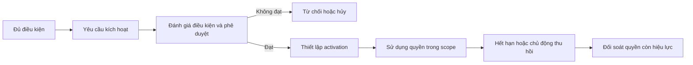

# Privilege elevation

## 1. Nâng đặc quyền và mục tiêu kiểm toán

**Privilege elevation** là việc một chủ thể có khả năng thực hiện những hành động đặc quyền hơn so với trạng thái trước đó, trong một phạm vi và khoảng thời gian xác định hoặc thông qua thay đổi quyền lâu dài. Việc này có thể hợp lệ, chẳng hạn kỹ sư kích hoạt quyền vận hành để xử lý sự cố, hoặc trái phép do lỗi phân quyền và hành vi lạm dụng.

Trong chương logging và audit IAM, cần trả lời không chỉ “ai đã trở thành admin?” mà còn:

- Đặc quyền xuất hiện qua đường nào và ai có thẩm quyền cho phép?
- Quyền thực tế áp dụng cho tài nguyên, tenant và hành động nào?
- Chủ thể đã sử dụng quyền đó làm gì?
- Khi hết hạn hoặc thu hồi, khả năng truy cập đã chấm dứt tới đâu?

Một event `ADMIN_LOGIN_SUCCESS` không đủ trả lời những câu hỏi này. Đăng nhập bằng tài khoản quản trị, được chấp thuận kích hoạt quyền và thực thi một thao tác đặc quyền là những sự kiện khác nhau.

Ví dụ, Lan có quyền đọc log thường xuyên, nhưng chỉ được kích hoạt quyền restart dịch vụ của dự án `project-41` trong một cửa sổ xử lý sự cố. Audit cần chứng minh quyền restart đã được cấp đúng scope, sử dụng đúng mục đích và kết thúc theo chính sách; không suy rằng Lan được quản trị toàn tenant.

## 2. Phân biệt eligibility, activation và sử dụng quyền

| Khái niệm | Ý nghĩa | Điều chưa được chứng minh |
|---|---|---|
| Eligibility | Chủ thể đủ điều kiện yêu cầu một vai trò theo chính sách | Chưa có nghĩa đang được sử dụng vai trò đó |
| Request | Một yêu cầu kích hoạt đã được tạo | Chưa có nghĩa đã được phê duyệt |
| Approval | Yêu cầu đã qua bước chấp thuận cần thiết | Chưa có nghĩa quyền đã được thiết lập tại mọi tài nguyên |
| Activation | Quyền được kích hoạt theo mô hình của hệ thống | Chưa có nghĩa đã có thao tác đặc quyền xảy ra |
| Privileged operation | Một hành động sử dụng đặc quyền tại tài nguyên | Cần biết quyết định quyền và kết quả thực thi |
| Deactivation hoặc expiration | Kết thúc trạng thái kích hoạt | Chưa tự chứng minh mọi token, cache và quyền phát sinh đã hết hiệu lực |

Xác thực bổ sung cũng khác nâng quyền. Hoàn thành MFA có thể là điều kiện trước activation, nhưng không tự cấp một role chưa được cho phép. Ngược lại, gán role trong control plane không thay thế kiểm tra phiên và danh tính khi thực thi thao tác.

Microsoft Entra PIM là một ví dụ về quản lý kích hoạt vai trò theo thời gian và điều kiện phê duyệt. Mô hình sản phẩm giúp minh họa việc tách quyền đủ điều kiện khỏi quyền đang hoạt động; thuật ngữ và cách thực thi của hệ thống khác cần được xác định riêng. [Microsoft Learn: What is Privileged Identity Management?](https://learn.microsoft.com/en-us/entra/id-governance/privileged-identity-management/pim-configure).

Không phải mọi hệ thống đều có PIM hoặc cùng loại vòng đời. Một mô hình cấp quyền trực tiếp vẫn cần audit việc cấp, sửa, sử dụng và thu hồi đặc quyền, kể cả khi không có event tên `activation`.

## 3. Các đường có thể làm tăng quyền hiệu lực

Chỉ theo dõi thao tác `assign Admin role` sẽ bỏ sót nhiều cách hình thành quyền:

| Đường thay đổi | Ví dụ | Bằng chứng nên liên kết |
|---|---|---|
| Kích hoạt role tạm thời | Bật quyền vận hành theo ca trực | Eligibility, request, approval, activation và thời hạn |
| Gán role trực tiếp | Thêm quyền quản trị cho một principal | Actor, subject, role, scope và căn cứ thay đổi |
| Thay thành viên nhóm | Thêm người vào nhóm đang giữ quyền mạnh | Membership thay đổi và assignment của nhóm |
| Sửa role definition | Thêm permission nhạy cảm vào role đang dùng | Phiên bản role, permission diff và các assignment chịu ảnh hưởng |
| Thay policy hoặc thuộc tính | Sửa điều kiện ABAC làm chủ thể được quyền cao hơn | Policy hoặc attribute diff, nguồn quản lý và quyết định quyền |
| Ủy quyền ứng dụng | Cấp quyền ứng dụng, consent hoặc quyền thay mặt | Client, actor, tập quyền, tenant và cơ chế ủy quyền |
| Tạo credential cho danh tính mạnh | Thêm khóa cho service principal đặc quyền | Credential metadata và đặc quyền của danh tính đích |
| Impersonation hoặc assume-role | Một chủ thể hành động trong ngữ cảnh quyền khác | Chủ thể ban đầu, actor thực thi, vai trò và chuỗi ủy quyền |

Một credential mới không phải lúc nào cũng làm permission của principal thay đổi. Tuy nhiên, nó có thể tạo thêm một đường kiểm soát danh tính đặc quyền. Audit phải nhìn cả thay đổi quyền lẫn thay đổi khả năng sử dụng quyền.

Tên role không đủ xác định mức nguy hiểm. Role tên `Support` vẫn có thể tạo credential hoặc sửa recovery của admin nếu định nghĩa permission quá rộng. Phân loại theo khả năng thực tế, không chỉ theo từ `Admin` trong tên.

## 4. Vòng đời sự kiện cho một lần kích hoạt

Một vòng đời minh họa có thể được mô hình hóa như sau:



Các tên event dưới đây là gợi ý schema của ứng dụng:

| Mốc | Event minh họa | Ngữ nghĩa cần giữ |
|---|---|---|
| Tạo yêu cầu | `iam.elevation.requested` | Yêu cầu đã được lưu, chưa phải quyền đã được cấp |
| Chấp thuận | `iam.elevation.approved` | Một bên có thẩm quyền đã phê duyệt phạm vi cụ thể |
| Từ chối | `iam.elevation.denied` | Không cho activation theo điều kiện đánh giá |
| Thiết lập quyền | `iam.elevation.activated` | Activation đã được ghi nhận thành công tại thành phần quản lý |
| Thực thi | `iam.privileged_operation.completed` | Thao tác đặc quyền đã có kết quả tại tài nguyên |
| Kết thúc | `iam.elevation.expired` hoặc `iam.elevation.deactivated` | Trạng thái kích hoạt kết thúc theo cơ chế tương ứng |
| Lỗi | `iam.elevation.activation_failed` | Có yêu cầu nhưng thiết lập quyền không thành công |

Không ghi `activated` khi mới nhận request hoặc khi chỉ bắt đầu một tác vụ nền. Với xử lý bất đồng bộ, phải xác định mốc nào là accepted, scheduled và completed.

Gia hạn, thay scope hoặc đổi role sau approval có thể làm nội dung yêu cầu khác với nội dung đã được duyệt. Những thay đổi làm mở rộng quyền cần được đánh giá theo chính sách, có thể yêu cầu approval mới; audit phải giữ được phiên bản của từng quyết định.

## 5. Ghi rõ ai yêu cầu, ai nhận quyền và ai phê duyệt

Một workflow nâng quyền có nhiều chủ thể:

- **Requester:** người hoặc workload yêu cầu thay đổi.
- **Subject:** danh tính nhận đặc quyền.
- **Approver:** chủ thể chấp thuận theo chính sách.
- **Executor:** thành phần thực sự tạo assignment hoặc activation.
- **Producer:** thành phần phát event đang được quan sát.

Các vai trò này có thể trùng trong một mô hình được phê duyệt, nhưng không nên gộp thành một trường `user` không rõ nghĩa. Đặc biệt, dịch vụ tự động tạo assignment không phải lúc nào cũng là người đã ra quyết định cấp quyền.

Nếu chính sách yêu cầu phân tách nhiệm vụ, audit cần cho thấy người phê duyệt thực sự đáp ứng điều kiện đó. Không coi một chuỗi `approvedBy` do client gửi là bằng chứng phê duyệt. Nguồn của approval, trạng thái, scope và người có thẩm quyền phải được kiểm chứng.

Không kết luận rằng hai tài khoản khác nhau luôn đại diện cho hai người độc lập. Mô hình quản trị cần nhận diện quan hệ sở hữu và ủy quyền có liên quan. Nếu cho phép tự kích hoạt một số vai trò mà không qua người phê duyệt, phải ghi đúng rằng chính sách cho phép tự kích hoạt, thay vì tạo một approval giả.

Ticket và lý do là dữ liệu hỗ trợ. Một ticket ID có hình thức đúng không tự chứng minh yêu cầu đã được phê duyệt hoặc ticket còn hiệu lực. Trường justification cũng có thể chứa dữ liệu nhạy cảm hoặc nội dung không đáng tin, cần được giới hạn và xử lý trước khi lưu.

## 6. Schema sự kiện activation

Một audit event activation có thể chứa:

```json
{
  "eventId": "event-914",
  "schemaVersion": "1",
  "eventType": "iam.elevation.activated",
  "eventTime": "2027-01-10T09:00:00Z",
  "producer": "privileged-access-service",
  "tenantId": "minh-an",
  "requesterId": "engineer-17",
  "subjectId": "engineer-17",
  "executorId": "privilege-controller",
  "elevationRequestId": "elevation-request-72",
  "activationId": "activation-208",
  "approvalRef": "approval-618",
  "roleAssignmentId": "assignment-482",
  "roleId": "service-operator-6",
  "roleDefinitionVersion": "role-v4",
  "scope": {
    "tenantId": "minh-an",
    "type": "PROJECT",
    "id": "project-41"
  },
  "validFrom": "2027-01-10T09:00:00Z",
  "validUntil": "2027-01-10T09:30:00Z",
  "operationOutcome": "COMMITTED",
  "policyVersion": "elevation-policy-19",
  "ticketRef": "incident-713",
  "requestId": "request-614"
}
```

Đây là schema và thời lượng minh họa, không phải định dạng hoặc thời gian tối đa dùng chung. `activationId` là tham chiếu audit, không phải access token hay session cookie.

Event `COMMITTED` chỉ khẳng định trạng thái tại thành phần phát event đã được lưu theo hợp đồng. Việc quyền đã tới mọi API, thiết bị hoặc cache phải được kiểm chứng theo cơ chế của hệ thống đích. Một quyền hợp lệ ở control plane cũng không bảo đảm thao tác cụ thể sẽ vượt qua mọi điều kiện tài nguyên.

Role definition có thể thay đổi trong khi activation còn hiệu lực. Cần biết hệ thống sử dụng snapshot role hay đánh giá role hiện hành, và ghi phiên bản liên quan để điều tra. Không chỉ dựa vào tên vai trò hiện tại khi giải thích quyền trong lịch sử.

Với yêu cầu kích hoạt bị từ chối, ghi reason code có cấu trúc và căn cứ thích hợp. Không tạo `activationId` mang nghĩa quyền đã hoạt động nếu chưa có activation thực sự.

## 7. Liên kết activation với hoạt động tại tài nguyên

Audit về vòng đời quyền và audit về sử dụng quyền thường nằm ở những nơi khác nhau. Thành phần IAM biết assignment nào được bật; API tài nguyên biết hành động nào đã được thực thi và kết quả ra sao.

| Nguồn | Bằng chứng chính | Giới hạn |
|---|---|---|
| Hệ thống quản lý đặc quyền | Eligibility, approval, activation, thời hạn | Không mặc nhiên biết mọi thao tác ở tài nguyên |
| IdP hoặc hệ thống phiên | Xác thực, reauthentication, phiên liên quan | Đăng nhập không chứng minh quyền đã được sử dụng |
| API hoặc control plane tài nguyên | Hành động, đối tượng, quyết định quyền, outcome | Có thể không biết workflow phê duyệt gốc |
| Hệ điều hành hoặc database | Thao tác ở tầng thực thi | Principal có thể là workload hoặc tài khoản kỹ thuật |

Nếu backend biết assignment hoặc activation nào là căn cứ cho Permit, nên ghi một tham chiếu ổn định tới căn cứ đó theo schema của hệ thống. Không yêu cầu client tự khai `usedActivationId` rồi coi đó là bằng chứng quyền được sử dụng.

Khi không có liên kết trực tiếp, có thể tìm ứng viên theo principal, tenant, scope và cửa sổ thời gian, nhưng cần giữ mức chắc chắn thích hợp. Một người có thể đồng thời có quyền lâu dài, quyền qua nhóm và nhiều activation. Cùng người, cùng giờ không đủ chứng minh thao tác sử dụng đúng activation đang điều tra.

Microsoft Entra PIM cho Azure resource role cho phép xem hoạt động tài nguyên trong thời gian một activation được chọn. Đây là ví dụ cho việc nối vòng đời đặc quyền với hành động thực tế, thay vì chỉ dừng ở lịch sử kích hoạt. [Microsoft Learn: View activity and audit history for Azure resource roles](https://learn.microsoft.com/en-us/entra/id-governance/privileged-identity-management/azure-pim-resource-rbac).

## 8. Giữ định danh workflow qua xử lý bất đồng bộ

Một lần activation có thể trải qua nhiều request: tạo yêu cầu, approver chấp thuận, scheduler kích hoạt và worker thu hồi khi hết hạn. Correlation ID của từng request có thể khác nhau.

Nên phân biệt:

```text
elevationRequestId  -> yêu cầu nâng quyền ổn định
activationId       -> một lần quyền được kích hoạt
requestId          -> một request tại thành phần cụ thể
eventId            -> một sự kiện, giữ nguyên khi retry gửi
```

Không gom mọi activation của một người vào cùng workflow chỉ vì cùng subject. Một yêu cầu bị từ chối rồi tạo lại là một lịch sử khác cần được giữ rõ.

Trong Microsoft Entra PIM, tài liệu lưu ý `CorrelationId` có thể khác nhau giữa các bước của cùng vòng activation/deactivation và sử dụng `roleAssignmentRequestId` để tương quan các event liên quan. Đây là tên field của sản phẩm; khi chuẩn hóa, cần giữ mapping thay vì giả định một correlation ID bao phủ toàn chu kỳ. [Microsoft Learn: Correlating events related to the same activation cycle](https://learn.microsoft.com/en-us/entra/id-governance/privileged-identity-management/pim-how-to-use-audit-log#correlating-events-related-to-the-same-activation-cycle).

Pipeline có thể gửi trùng hoặc đến trễ. Deduplicate theo namespace nguồn và event ID đã kiểm chứng, giữ event time cùng thời điểm tiếp nhận và theo dõi độ trễ. Nếu approval chưa xuất hiện trong kho log, đó có thể là khoảng trống telemetry; cần kiểm tra trạng thái workflow trước khi kết luận activation trái phép.

Với thay đổi trạng thái do ứng dụng tự quản lý, có thể dùng cơ chế ghi bền vững như outbox cùng transaction để giảm nguy cơ quyền được cấp nhưng mất event. Các event bị từ chối hoặc lỗi cũng cần đường ghi thích hợp, không bị rollback cùng transaction thất bại rồi biến mất hoàn toàn.

## 9. Audit khi đặc quyền hết hạn hoặc bị thu hồi

Một activation có `validUntil` không bảo đảm mọi nơi ngừng chấp nhận quyền đúng lúc nếu hệ thống còn dùng cache, token chứa quyền cũ hoặc kết nối dài.

Ví dụ cần đối soát:

```text
09:00  Activation được thiết lập cho project-41.
09:10  Một thao tác restart được thực hiện theo quyền hợp lệ.
09:30  Activation tới thời điểm hết hạn.
09:31  Một request mới tiếp tục yêu cầu thao tác đặc quyền.
       -> kiểm tra kết quả thực thi tại tài nguyên, không chỉ trạng thái portal.
```

Các thời điểm chỉ minh họa. Hệ thống cần định nghĩa cách đánh giá hiệu lực, xử lý request đang chạy và giới hạn propagation thực tế. Không lấy timestamp ingest của event để thay thời điểm thực hiện thao tác.

Khi thấy thao tác sau thời gian activation, trước hết kiểm tra có một căn cứ quyền khác hợp lệ hay không. Nếu không còn căn cứ nhưng API vẫn Permit do cache cũ hoặc thiếu kiểm tra, đó là vấn đề cần xử lý. Không coi mọi hoạt động sau một activation là tự động trái phép nếu chủ thể còn assignment khác.

Theo dõi các kết quả thu hồi theo lớp: assignment đã kết thúc, cache đã invalidated, phiên có yêu cầu xử lý đã bị tác động và các thao tác mới bị từ chối đúng phạm vi. Không ghi “đã thu hồi hoàn toàn” khi thành phần chỉ mới gửi yêu cầu thu hồi.

Quyền phát sinh trong thời gian đặc quyền cũng cần xem xét. Một người có thể đã tạo API key, thêm credential hoặc cấp quyền cho principal khác. Hết activation của người đó không tự xóa những đối tượng đã tạo nếu hệ thống không có chính sách tương ứng.

## 10. Phát hiện những mẫu nâng quyền cần điều tra

| Mẫu quan sát | Điều cần đối chiếu |
|---|---|
| Activation không tìm thấy căn cứ phê duyệt bắt buộc | Chính sách tại thời điểm đó, dữ liệu đến trễ và trạng thái workflow chuẩn |
| Scope hoặc thời lượng thực tế rộng hơn nội dung được duyệt | Phiên bản request, approval và activation đã commit |
| Thay policy rồi ngay lập tức kích hoạt quyền mạnh | Actor, lý do thay đổi, phê duyệt và hoạt động sau activation |
| Sửa role đang giữ để thêm permission mạnh | Permission diff và principal hưởng lợi, không chỉ tên role |
| Thêm thành viên nhóm đặc quyền ngoài quy trình | Người thay membership, assignment nhóm và căn cứ thay đổi |
| Dùng quyền tạo credential hoặc cấp quyền lâu dài | Đối tượng phát sinh và khả năng truy cập còn lại sau activation |
| Thao tác ngoài scope hoặc sau khi không còn căn cứ quyền | Authorization decision tại tài nguyên, token/cache và role khác nếu có |
| Tài khoản khẩn cấp được sử dụng | Tình huống khẩn cấp, người phụ trách, phạm vi và đối soát sau sử dụng |

Một luật minh họa có thể được mô tả bằng mã giả:

```text
Khi nhận event activation đã commit:
  xác định policyVersion và yêu cầu approval tương ứng
  đối chiếu request, subject, tenant, role, scope và cửa sổ hiệu lực
  nếu thiếu dữ liệu:
      tạo nhiệm vụ đối soát và theo dõi độ trễ/nguồn log
  nếu có bằng chứng mâu thuẫn với policy hoặc approval:
      cảnh báo theo mức ảnh hưởng và quy trình phản ứng
```

Đây không phải rule chạy nguyên trạng. Cần xử lý quyền đã được cấp theo cơ chế khác, thay đổi chính sách có hiệu lực theo thời gian, retry và những ngoại lệ được phê duyệt.

Không tự khóa mọi quản trị viên chỉ vì số activation tăng trong một ca xử lý sự cố. Ngược lại, một ticket hợp lệ cũng không phải lý do bỏ qua việc vượt scope, tắt log hoặc tạo credential ngoài kế hoạch.

## 11. Bảo vệ audit khỏi chính chủ thể có đặc quyền

Lịch sử nâng quyền chứa dữ liệu nhạy cảm về cơ cấu quản trị, quyền của danh tính và phạm vi tài nguyên. Người có quyền kích hoạt một role không mặc nhiên cần quyền xóa audit hoặc xem toàn bộ lịch sử của mọi tenant.

Cần tách quyền phát event, đọc điều tra và quản trị lưu trữ khi mô hình cho phép. Nếu một tài khoản có thể nâng quyền, vô hiệu hóa nguồn log và xóa cả bản sao audit, nhiều kiểm soát cùng phụ thuộc vào một điểm thất bại.

Theo dõi riêng thay đổi cấu hình audit, retention, rule phát hiện và credential của pipeline. Phải biết những thay đổi nào có thể làm dữ liệu ngừng xuất hiện, để không diễn giải sự im lặng thành việc không còn hoạt động đặc quyền.

Không log access token, credential đặc quyền, mã MFA, cookie hoặc secret dùng cho tài khoản khẩn cấp. Có thể lưu metadata và tham chiếu điều tra; nội dung nhạy cảm của ticket hoặc justification cần được giới hạn và xử lý an toàn.

Session recording, nếu được dùng, không thay thế audit có cấu trúc. Nó có thể không bao phủ mọi API, tiến trình nền hoặc đường kết nối. Audit cần chỉ rõ phạm vi quan sát thực tế, đồng thời bảo vệ dữ liệu nhạy cảm có thể xuất hiện trong bản ghi phiên.

Log không hoàn chỉnh hoặc bị mất không chứng minh hành vi đã hợp lệ. Khi thiếu bằng chứng về một thay đổi quan trọng, cần đối soát trạng thái, nguồn phát và các dấu vết liên quan thay vì tự tạo event lịch sử để lấp chỗ trống.

## 12. Kiểm chứng và đối soát toàn chu kỳ

| Tình huống kiểm chứng | Kết quả mong đợi |
|---|---|
| Chủ thể chỉ eligible nhưng chưa active | Không bị báo như đã sử dụng đặc quyền |
| Request được approve nhưng activation thất bại | Phân biệt approval và kết quả thiết lập quyền |
| Một workflow có nhiều request bất đồng bộ | Liên kết được qua định danh ổn định, không chỉ một correlation ID |
| Client tự gửi trường approver hoặc activation ID | Không được coi là bằng chứng đã xác minh |
| Scope được mở rộng sau approval | Bị đánh giá lại theo policy và giữ đủ lịch sử thay đổi |
| Một principal có nhiều assignment cùng lúc | Căn cứ quyền của thao tác không bị gán nhầm |
| Role definition được sửa trong cửa sổ activation | Có thể giải thích quyền theo phiên bản và cách đánh giá của hệ thống |
| Hết thời hạn nhưng còn token hoặc cache cũ | Đo được việc tài nguyên chấp nhận hoặc từ chối theo thiết kế |
| Credential hoặc grant mới được tạo trong thời gian đặc quyền | Được đối soát độc lập khi activation kết thúc |
| Event đến trễ hoặc gửi trùng | Không tạo activation giả hoặc kết luận thiếu approval quá sớm |
| Người có quyền mạnh tác động pipeline log | Có kiểm soát và dấu vết phù hợp |

Các chỉ số có ích gồm tỷ lệ activation có đủ căn cứ, mức quyền lâu dài so với quyền tạm thời, độ trễ thiết lập/thu hồi được quan sát tại tài nguyên, số thay đổi ngoài quy trình và tỷ lệ sự kiện không liên kết được. Không chỉ đếm số người có role admin ở thời điểm hiện tại.

Audit privilege elevation đầy đủ giữ được chuỗi từ yêu cầu đến căn cứ cấp quyền, từ activation đến hành động thực tế và từ thời điểm kết thúc đến các quyền còn tồn tại. Chuỗi đó giúp phân biệt vận hành hợp lệ với lạm dụng, đồng thời kiểm chứng nguyên tắc ít quyền nhất trong cả thời gian và phạm vi tài nguyên.
