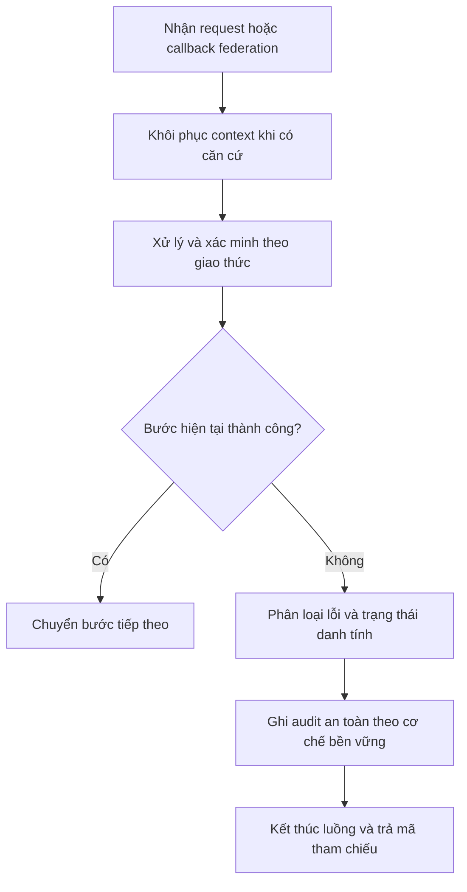

# Federation failure

## 1. Federation failure là lỗi ở ranh giới liên kết danh tính

**Federation failure** là việc một luồng sử dụng danh tính từ nguồn bên ngoài không hoàn tất được bước mà thành phần ghi log chịu trách nhiệm xử lý. Trong ứng dụng dùng OIDC hoặc SAML, lỗi có thể xuất hiện trước, trong hoặc sau khi nhà cung cấp danh tính xác thực người dùng.

Ví dụ:

- Không tìm được cấu hình kết nối IdP phù hợp.
- Người dùng hủy đăng nhập tại IdP.
- Không trao đổi được authorization code do lỗi mạng hoặc lỗi giao thức.
- Chữ ký, issuer, audience hoặc điều kiện thời gian không hợp lệ.
- Không xác minh được liên kết giữa phản hồi và luồng đăng nhập đã bắt đầu.
- Phản hồi hợp lệ về giao thức nhưng không ánh xạ được danh tính vào tài khoản theo policy.
- Ứng dụng không tạo được phiên cục bộ sau khi chấp nhận danh tính.

Những tình huống này không có cùng nguyên nhân và không nên được gom thành một câu “SSO failed”.

Audit cần trả lời:

```text
Lỗi xảy ra ở đâu?
Thành phần nào quan sát lỗi?
Đang dùng kết nối federation nào?
Bằng chứng nào đã được xác minh?
Danh tính đã đủ tin cậy để xác định actor chưa?
Luồng kết thúc như thế nào?
```

Một lỗi federation không tự chứng minh mật khẩu người dùng sai hoặc IdP bị xâm nhập. Tương tự, IdP báo xác thực thành công chưa chứng minh ứng dụng đã chấp nhận phản hồi và tạo phiên.

## 2. Xác định các mốc của luồng trước khi phân loại lỗi

### 2.1. Luồng khái niệm tại ứng dụng sử dụng SSO

```text
Chọn kết nối IdP
  → tạo yêu cầu và ngữ cảnh luồng
  → chuyển người dùng đến IdP
  → nhận phản hồi
  → xác minh giao thức và nguồn tin cậy
  → ánh xạ danh tính, kiểm tra điều kiện tài khoản
  → tạo phiên cục bộ.
```

OIDC và SAML có các thông điệp, tham số và cách kiểm tra khác nhau. Mô hình trên chỉ mô tả trách nhiệm ở mức khái niệm, không thay thế quy trình xác minh của giao thức cụ thể.

Mỗi hệ thống cần định nghĩa rõ “federation accepted” kết thúc ở bước nào. Có thể tách sự kiện giao thức đã được chấp nhận khỏi lỗi provisioning hoặc lỗi tạo phiên ứng dụng.

### 2.2. Các nhóm lỗi nên phân biệt

| Nhóm | Ví dụ quan sát | Không nên suy diễn |
| --- | --- | --- |
| Chọn kết nối | Không có cấu hình phù hợp tenant hoặc ứng dụng | Người dùng đã nhập sai credential |
| Hạ tầng | Timeout, lỗi DNS, TLS hoặc dịch vụ phụ thuộc | Phản hồi danh tính đã hợp lệ |
| Kết quả từ IdP | Người dùng hủy hoặc IdP trả lỗi của luồng | Có tấn công chỉ vì luồng không thành công |
| Liên kết request-response | Không xác minh được context hoặc correlation theo giao thức | Mọi dữ liệu trong callback đều đáng tin |
| Xác minh thông điệp | Chữ ký, issuer, audience hoặc thời gian không đáp ứng contract | Chỉ cần retry là có thể bỏ qua kiểm tra |
| Thuộc tính danh tính | Thiếu subject hoặc thuộc tính bắt buộc theo cấu hình | Có thể tự tạo một giá trị mặc định |
| Ánh xạ tài khoản | Không có liên kết tài khoản được phép | Có thể tự gộp tài khoản cùng email |
| Provisioning hoặc policy tài khoản | Không được phép tạo hoặc sử dụng tài khoản | Kiểm tra chữ ký đã thất bại |
| Tạo phiên | Lỗi lưu phiên sau khi đã chấp nhận danh tính | Phiên cục bộ đã được tạo thành công |

Tên nhóm là lựa chọn schema nội bộ. Điều cần giữ là sự khác nhau giữa lỗi xác minh danh tính, lỗi điều kiện ứng dụng và lỗi vận hành.

### 2.3. Phân biệt với lỗi cấp quyền tài nguyên

Giả sử ứng dụng đã chấp nhận phản hồi SSO, tạo phiên cho Lan, nhưng Lan không có quyền đọc một báo cáo. Đó là lỗi hoặc quyết định từ chối ở lớp phân quyền tài nguyên, không nên gắn nhãn “chữ ký federation không hợp lệ”.

Nếu membership của tenant là điều kiện bắt buộc để hoàn tất đăng nhập tenant, có thể ghi luồng đăng nhập không hoàn tất tại bước kiểm tra membership. Bản ghi vẫn cần cho biết xác minh giao thức đã thành công trước đó.

Phân loại đúng giúp tránh sửa nhầm nơi: lỗi entitlement không được giải quyết bằng cách nới kiểm tra issuer, và lỗi mạng không được giải quyết bằng cách tự liên kết tài khoản.

## 3. Các điểm kiểm tra trong OIDC và SAML

### 3.1. OIDC

Trong luồng sử dụng OIDC, ứng dụng cần thực hiện các kiểm tra theo flow và cấu hình đang dùng. Những điểm có thể phát sinh lỗi gồm:

- Phản hồi không gắn được với ngữ cảnh đăng nhập đã tạo.
- Không trao đổi được code theo hợp đồng của luồng.
- Token không đến từ issuer được tin cậy.
- Chữ ký hoặc thuật toán không được chấp nhận.
- Audience không dành cho ứng dụng nhận.
- Token không đáp ứng các điều kiện thời gian.
- Điều kiện nonce hoặc các ràng buộc của flow không hợp lệ khi chúng áp dụng.
- Thiếu định danh hoặc thuộc tính bắt buộc.

Không coi việc nhận được HTTP response từ token endpoint hoặc decode được payload là xác minh thành công.

Một lỗi trao đổi code có thể liên quan đến code hết hiệu lực, đã được sử dụng, cấu hình client, ràng buộc của flow hoặc nguyên nhân khác. Chỉ ghi nguyên nhân đã quan sát và xác định; không khẳng định mật khẩu sai từ một mã lỗi ở bước trao đổi code.

### 3.2. SAML

Trong luồng SAML, các điểm lỗi có thể gồm:

- Không tìm được cấu hình đối tác tin cậy phù hợp.
- Response hoặc assertion không có bằng chứng chữ ký đáp ứng cấu hình.
- Issuer không khớp nguồn được chấp nhận.
- Audience, recipient, destination hoặc điều kiện liên quan không phù hợp theo profile đang dùng.
- Các điều kiện thời gian không hợp lệ.
- Không gắn được phản hồi với request theo mô hình luồng áp dụng.
- Phản hồi bị phát lại ngoài điều kiện được phép.
- Thiếu hoặc không ánh xạ được định danh và thuộc tính bắt buộc.

Các kiểm tra cụ thể phụ thuộc profile, binding và việc dùng luồng do ứng dụng hay IdP khởi tạo. Không lấy một danh sách tham số của OIDC áp dụng nguyên sang SAML.

Nếu hệ thống cho phép luồng IdP-initiated, cần có contract và policy riêng cho luồng đó. Không dùng việc thiếu request correlation làm lý do tự chấp nhận mọi phản hồi ngoài thiết kế.

### 3.3. Lỗi cấu hình tin cậy và thay đổi khóa

Một lần thay chứng thư hoặc khóa phía IdP có thể khiến một nhóm luồng thất bại nếu ứng dụng chưa cập nhật nguồn tin cậy theo quy trình.

Cần quan sát được kết nối nào, phiên bản cấu hình nào và giai đoạn nào gặp lỗi. Không giải quyết bằng cách tắt xác minh chữ ký hoặc chấp nhận khóa tùy ý từ thông điệp chưa được xác minh.

Cơ chế cập nhật metadata hoặc khóa cũng cần lấy từ nguồn đã cấu hình tin cậy. Một URL được đưa vào callback không tự trở thành nguồn khóa có thẩm quyền.

## 4. Nguyên tắc quan trọng: chưa xác minh thì chưa có actor đáng tin

Một callback có thể tự khai subject, email, issuer hoặc tenant. Nếu lỗi xảy ra trước khi xác minh, các giá trị đó chưa được coi là danh tính đã xác thực.

Ví dụ không phù hợp:

```text
actor=user_admin
event=federation_failed
reason=INVALID_SIGNATURE
```

Nếu `user_admin` chỉ lấy từ một assertion có chữ ký sai, bản ghi khiến người đọc hiểu nhầm tài khoản quản trị thật đã thực hiện thao tác.

Có thể biểu đạt:

```text
principal_id=null
identity_verification=NOT_COMPLETED
connection_ref=connection_17
failure_stage=MESSAGE_VALIDATION
reason_code=SIGNATURE_REJECTED
```

Nếu cần ghi một định danh do thông điệp tự khai để điều tra, phải có field thể hiện rõ là dữ liệu chưa xác minh, giới hạn nội dung và quyền xem. Không dùng dữ liệu ấy làm khóa chính cho actor hoặc cho việc cấp quyền.

Ngược lại, khi xác minh giao thức đã hoàn tất nhưng tạo tài khoản hoặc phiên thất bại, hệ thống có thể biết danh tính đã được xác minh ở nguồn ngoài. Bản ghi cần phân biệt danh tính ngoài đó với principal nội bộ có thể chưa được tạo hoặc liên kết.

Tenant trong audit cũng phải lấy từ ngữ cảnh đã được máy chủ xác lập. Không gán tenant từ callback lỗi rồi để log xuất hiện trong trang audit của một khách hàng không liên quan.

## 5. Nội dung của một sự kiện federation failure

### 5.1. Các trường nên có

| Nhóm | Ví dụ | Mục đích |
| --- | --- | --- |
| Sự kiện | ID, loại, schema version | Nhận diện và diễn giải đúng bản ghi |
| Nguồn quan sát | Service, environment, instance | Biết nơi phát hiện lỗi |
| Giao thức và kết nối | OIDC hoặc SAML, connection reference | Khoanh vùng tích hợp |
| Giai đoạn | Callback, code exchange, message validation, account mapping | Biết luồng dừng ở đâu |
| Phân loại và mã lý do | Network timeout, issuer rejected, mapping denied | Tìm kiếm và thống kê ổn định |
| Trạng thái xác minh | Chưa hoàn tất, đã chấp nhận giao thức | Không gán nhầm độ tin cậy danh tính |
| Danh tính | Principal nội bộ hoặc null | Chỉ dùng giá trị có căn cứ |
| Phạm vi | Tenant đã xác lập hoặc chưa xác định | Giữ ranh giới dữ liệu |
| Liên kết luồng | Flow, request, correlation reference | Theo dõi qua nhiều bước |
| Cấu hình | Connection hoặc trust configuration version | Đối chiếu thay đổi vận hành |
| Thời gian | Occurred, received, ingested | Dựng lại thứ tự quan sát |
| Kết quả cục bộ | Không tạo phiên, đã xác minh nhưng tạo phiên lỗi | Mô tả tác động thực tế |

Tên mã lỗi nội bộ nên ổn định, có định nghĩa và không phụ thuộc nguyên văn thông báo của thư viện. Có thể giữ mã lỗi của đối tác trong một field riêng nếu đã xử lý an toàn và hiểu đúng nguồn.

Không dùng chuỗi exception bất kỳ làm kết luận chính. Exception có thể thay đổi theo phiên bản thư viện hoặc chứa dữ liệu nhạy cảm.

### 5.2. Ví dụ lỗi xác minh thông điệp

```json
{
  "schema_version": 1,
  "event_id": "evt_federation_48d",
  "event_type": "iam.federation.flow_failed",
  "occurred_at": "2026-01-15T08:30:00Z",
  "source": {
    "service": "customer-sso",
    "environment": "production"
  },
  "protocol": "SAML",
  "connection_ref": "connection_17",
  "connection_config_version": 8,
  "tenant_id": "tenant_a",
  "tenant_context_source": "SERVER_LOGIN_CONTEXT",
  "flow_ref": "flow_92c",
  "request_ref": "req_193",
  "principal_id": null,
  "identity_verification": "NOT_COMPLETED",
  "failure": {
    "stage": "MESSAGE_VALIDATION",
    "category": "TRUST_VALIDATION",
    "reason_code": "SIGNATURE_REJECTED"
  },
  "local_session_creation": "NOT_ATTEMPTED",
  "outcome": "FAILED"
}
```

Đây là schema minh họa, không phải chuẩn log bắt buộc.

Trong ví dụ, tenant và kết nối đã được xác định từ ngữ cảnh đăng nhập phía máy chủ trước khi nhận phản hồi. Nếu không có căn cứ đó, không nên tự điền chúng từ nội dung callback.

Bản ghi không khẳng định một principal cụ thể đã đăng nhập thất bại, vì danh tính chưa vượt bước xác minh. Nó cũng không kết luận đây chắc chắn là tấn công; nguyên nhân có thể cần điều tra thêm.

Nếu không tìm được một flow hợp lệ, `flow_ref` có thể không có giá trị. Hệ thống vẫn có thể tạo request reference riêng để điều tra thay vì dựng một liên kết không tồn tại.

### 5.3. Ví dụ lỗi sau khi đã chấp nhận danh tính

```text
event_type=iam.federation.flow_failed
stage=ACCOUNT_MAPPING
category=LOCAL_ACCOUNT_POLICY
reason_code=LINK_NOT_ALLOWED
identity_verification=PROTOCOL_ACCEPTED
external_identity_ref=verified_identity_82
principal_id=null
local_session_creation=NOT_ATTEMPTED
```

Ví dụ này cho biết bằng chứng bên ngoài đã được chấp nhận nhưng chưa có liên kết tài khoản nội bộ được phép. Không nên hiển thị hoặc thống kê nó như một lỗi chữ ký.

Tham chiếu danh tính ngoài cũng phải có cơ chế lưu và quyền truy cập phù hợp. Không cần chép toàn bộ assertion hoặc token vào sự kiện để chứng minh đã xác minh.

## 6. Ghi sự kiện và xử lý luồng an toàn

### 6.1. Ghi tại nơi biết lỗi, giữ mốc kết thúc rõ ràng

Một luồng khái niệm:



Một lần retry nội bộ có thể tạo sự kiện vận hành, nhưng không nên bị đếm thành nhiều luồng đăng nhập thất bại nếu cuối cùng cùng một flow vẫn hoàn tất.

Nếu client bỏ dở và không có callback, hệ thống có thể chỉ biết flow hết thời gian chờ. Không tự kết luận người dùng nhập sai mật khẩu hoặc IdP từ chối. Có thể dùng loại kết quả như `EXPIRED` hoặc `ABANDONED` theo ý nghĩa mà hệ thống thực sự quan sát.

### 6.2. Không tạo phiên mới từ luồng xác minh thất bại

Pseudocode theo phong cách Java:

```java
LoginResult handleFederationCallback(CallbackRequest request) {
    RequestReference requestRef = requests.newReference();

    try {
        ServerLoginContext context =
            loginContexts.requireValidFor(request);

        VerifiedExternalIdentity identity =
            federation.verifyAccordingToConnection(request, context);

        LocalPrincipal principal =
            accountLinking.requireAllowedMapping(identity, context);

        return sessions.completeVerifiedLogin(
            principal, identity, context
        );
    } catch (KnownFederationFailure failure) {
        SafeFailureEvent event = failureEvents.fromVerifiedContext(
            requestRef,
            failure.safeContext(),
            failure.stage(),
            failure.reasonCode(),
            failure.identityVerificationState()
        );

        audit.recordAccordingToPolicy(event);

        return LoginResult.failedWithReference(requestRef.value());
    }
}
```

Ví dụ là mã minh họa, không phải chương trình hoàn chỉnh. Các phương thức phải được hiện thực theo giao thức và mô hình tin cậy thực tế.

Những điểm cần giữ:

- Chỉ tạo phiên sau khi toàn bộ điều kiện bắt buộc đã đạt.
- Context an toàn không được lấy nguyên từ callback lỗi.
- Exception có phân loại chỉ cung cấp metadata đã lọc.
- Audit không chứa token, code hay assertion nguyên vẹn.
- Lỗi ghi log không được làm ứng dụng bỏ qua xác minh và cho đăng nhập.

Nếu người dùng đã có một phiên hợp lệ trước khi bắt đầu flow mới, việc flow mới thất bại không tự quyết định phiên cũ phải bị xóa hay được giữ. Điều đó cần policy riêng. Bản ghi chỉ nên mô tả kết quả của luồng đang xử lý.

### 6.3. Tách thông báo người dùng và chẩn đoán nội bộ

Thông báo có thể cung cấp:

```text
Không thể hoàn tất đăng nhập qua nhà cung cấp danh tính.
Vui lòng dùng mã tham chiếu req_193 khi liên hệ hỗ trợ.
```

Nội bộ có thể biết giai đoạn và mã nguyên nhân cụ thể hơn. Không trả toàn bộ stack trace, claim, cấu hình khóa hoặc chi tiết tài khoản ra trình duyệt chỉ để hỗ trợ debug.

Các lỗi người dùng có thể tự giải quyết như hủy đăng nhập hoặc thiếu thao tác tương tác nên có hướng dẫn phù hợp. Nhưng không để nội dung lỗi của đối tác chưa được kiểm soát trở thành HTML hoặc câu lệnh được ứng dụng hiển thị trực tiếp.

### 6.4. Retry phải phù hợp với giai đoạn

Timeout hạ tầng có thể cho phép retry có giới hạn theo contract. Một phản hồi không vượt qua kiểm tra tin cậy không được trở thành hợp lệ chỉ vì được thử lại nhiều lần.

Việc trao đổi hoặc sử dụng thông điệp một lần có thể có trạng thái riêng. Không mặc định phát lại authorization code, assertion hoặc callback là thao tác idempotent.

Khi cần, hãy khởi tạo một flow đăng nhập mới theo cơ chế được hỗ trợ. Tránh vòng lặp chuyển hướng liên tục giữa ứng dụng và IdP mà không ghi được lý do hoặc có điểm dừng.

Không tự chuyển sang một tài khoản cục bộ có quyền tương đương để “cứu đăng nhập” khi xác minh federation thất bại. Cơ chế truy cập thay thế, nếu có, phải là một luồng được thiết kế và cấp quyền riêng.

## 7. Bảo vệ bằng chứng và dữ liệu nhạy cảm

Không ghi nguyên các dữ liệu sau vào log thông thường:

- Authorization code, access token, refresh token hoặc ID token.
- Assertion hoặc response SAML đầy đủ.
- Cookie phiên, state, nonce hoặc secret dùng cho flow.
- Giá trị verifier của cơ chế bảo vệ luồng.
- Khóa riêng hoặc credential của client.
- Toàn bộ request, response hoặc đối tượng exception có thể chứa thông điệp gốc.

Một bản ghi lỗi cần metadata đủ chẩn đoán, không cần sao chép credential. Nếu thực sự phải thu thập bằng chứng chi tiết để xử lý sự cố, cần một cơ chế được kiểm soát riêng với phạm vi, thời hạn và quyền truy cập phù hợp.

Issuer, email, group, role và thuộc tính trong phản hồi cũng có thể là dữ liệu nhạy cảm. Chọn lọc thuộc tính cần thiết và thể hiện trạng thái đã xác minh hay chưa.

Dữ liệu do đối tác hoặc client gửi phải được giới hạn độ dài, serialize và hiển thị an toàn. Tránh log injection qua ký tự điều khiển hoặc nội dung có thể hoạt động trong giao diện xem log.

Nếu lưu địa chỉ mạng, phải phân biệt địa chỉ quan sát từ kết nối và metadata do proxy tin cậy cung cấp với header tự khai của client. IP không phải bằng chứng chắc chắn về danh tính người dùng.

## 8. Phân tích lỗi mà không kết luận vượt bằng chứng

### 8.1. Dùng nhiều chiều quan sát

Một số mẫu có thể hỗ trợ khoanh vùng:

| Mẫu quan sát | Hướng kiểm tra | Chưa đủ để kết luận |
| --- | --- | --- |
| Lỗi tăng sau một lần thay cấu hình kết nối | So sánh phiên bản trust, metadata, khóa và ứng dụng | Chắc chắn IdP bị tấn công |
| Timeout cùng lúc ở nhiều tenant | Kiểm tra hạ tầng chung và phụ thuộc mạng | Credential của mọi người dùng đều sai |
| Chỉ một kết nối có lỗi issuer hoặc audience | Đối chiếu cấu hình hai phía | Có thể bỏ qua điều kiện không khớp |
| Lỗi thời gian tăng trên một nhóm instance | Kiểm tra đồng hồ và điều kiện thời gian | Nên nới dung sai vô hạn |
| Nhiều flow bị hủy tại IdP | Kiểm tra trải nghiệm và phân loại kết quả | Tất cả là đăng nhập trái phép |
| Giao thức được chấp nhận nhưng mapping bị chặn | Kiểm tra liên kết tài khoản và policy provisioning | Cần tắt kiểm tra chữ ký |
| Callback không có flow hợp lệ tăng đột biến | Kiểm tra flow hết hạn, lặp callback và nguồn request | Mọi callback đều thuộc một người dùng đã xác định |

Các hướng kiểm tra là giả thuyết cần đối chiếu, không phải kết luận nguyên nhân.

Cần phối hợp log tại IdP, ứng dụng và phụ thuộc liên quan khi có quyền truy cập phù hợp. Correlation hoặc mã tham chiếu riêng có ích, nhưng không dùng credential làm khóa nối.

### 8.2. Thời gian và nguồn sự kiện

Nên giữ thời điểm nguồn quan sát lỗi và thời điểm hệ thống log tiếp nhận. Một lỗi phát sinh lúc 08:30 nhưng nhận lúc 08:35 không nên được đổi thành lỗi xảy ra lúc 08:35.

Timestamp từ nhiều nguồn có thể lệch. Khi dựng timeline, cần xét cả flow reference, request reference và mốc xử lý của từng thành phần.

Retry gửi cùng một sự kiện nên giữ event ID. Không đếm các bản sao do pipeline thành nhiều luồng thất bại độc lập.

Hai service có thể ghi hai quan sát khác nhau của cùng flow. Cùng correlation ID không có nghĩa chúng là bản ghi trùng cần loại bỏ.

### 8.3. Chỉ số và cảnh báo

Có thể theo dõi:

- Tỉ lệ flow thất bại theo giai đoạn và kết nối.
- Phân bố mã lỗi ổn định.
- Độ trễ phụ thuộc và timeout.
- Lỗi liên quan một phiên bản cấu hình.
- Luồng hết hạn hoặc bị bỏ dở.
- Độ trễ chuyển audit và sự kiện không ghi được.

Khi tính tỉ lệ, cần định nghĩa rõ mẫu số và loại flow. Không trộn retry kỹ thuật, người dùng hủy và lỗi xác minh nghiêm trọng thành cùng một tín hiệu mà không giữ phân loại.

Một lỗi cấu hình có thể tạo nhiều bản ghi giống nhau. Cảnh báo nên liên kết được phạm vi sự cố để giảm nhiễu mà vẫn giữ bằng chứng cần thiết theo policy.

Hệ thống nhận callback cũng cần được bảo vệ khỏi việc tạo tải quá lớn lên pipeline log. Cơ chế giới hạn, lưu đệm hoặc tổng hợp phải được thiết kế để không âm thầm làm mất audit bắt buộc.

### 8.4. Quyền truy cập log

Một quản trị viên tenant A có thể cần xem lỗi kết nối SSO của A, nhưng không mặc nhiên được xem thuộc tính danh tính hoặc cấu hình trust của B.

Quyền tìm kiếm, xem chi tiết và export phải thực thi theo tenant và vai trò được phép. Dữ liệu toàn cục phục vụ vận hành cần một quyền riêng, có audit phù hợp.

Không để một field tenant chưa xác minh trong callback quyết định ai được xem sự kiện. Khi chưa xác định được tenant, bản ghi cần được xử lý theo phạm vi vận hành được thiết kế cho trạng thái đó.

## 9. Các tình huống kiểm tra cần có

| Tình huống | Kết quả cần đạt |
| --- | --- |
| Người dùng hủy tại IdP | Phân loại phù hợp, không tự kết luận credential sai hoặc có tấn công |
| Lỗi mạng khi gọi phụ thuộc | Ghi đúng giai đoạn và nguyên nhân đã quan sát |
| Phản hồi chưa gắn được với flow hợp lệ | Không cấp phiên mới từ ngữ cảnh chưa xác minh |
| Token hoặc assertion sai chữ ký | Từ chối theo giao thức; không tin subject tự khai làm actor |
| Issuer hoặc audience không phù hợp | Không được chấp nhận chỉ vì thông điệp đọc được |
| Thông điệp không thỏa điều kiện thời gian | Áp dụng kiểm tra theo contract, không tự kéo dài hiệu lực |
| Khóa IdP thay đổi nhưng trust chưa cập nhật | Khoanh vùng được kết nối và phiên bản cấu hình |
| Phản hồi hợp lệ nhưng liên kết tài khoản không được phép | Phân biệt lỗi mapping với lỗi xác minh giao thức |
| Phiên cục bộ tạo thất bại sau khi chấp nhận danh tính | Không ghi phiên ứng dụng đã được tạo thành công |
| Flow mới thất bại trong khi có phiên cũ | Hành vi với phiên cũ đúng policy, không suy diễn từ kết quả flow mới |
| Callback chứa email, tenant hoặc issuer giả | Không dùng giá trị chưa xác minh làm ngữ cảnh đáng tin |
| Retry hoặc phát lại callback | Xử lý theo contract của flow và cơ chế chống phát lại |
| Cùng một event được gửi lại | Không đếm thêm flow thất bại giả |
| Event đến chậm hoặc các nguồn lệch thời gian | Giữ thời điểm và nguồn riêng để điều tra |
| Exception hoặc debug log có thông điệp gốc | Không lộ code, token, assertion hay secret |
| Nội dung lỗi đối tác có ký tự điều khiển hoặc HTML | Không tạo log giả hoặc nội dung chủ động khi hiển thị |
| Quản trị viên A truy vấn log SSO của B | Bị chặn theo quyền xem audit |
| Collector log tạm lỗi | Xử lý theo cơ chế bền vững đã định, không nới xác minh federation |

Federation failure có giá trị audit khi mô tả chính xác nơi luồng dừng, điều đã được xác minh và điều vẫn chưa biết. Phân loại tốt giúp đội vận hành sửa đúng lỗi cấu hình hoặc hạ tầng, đồng thời giữ nguyên các kiểm tra tin cậy và tránh biến dữ liệu callback chưa xác minh thành danh tính hoặc quyền truy cập.
