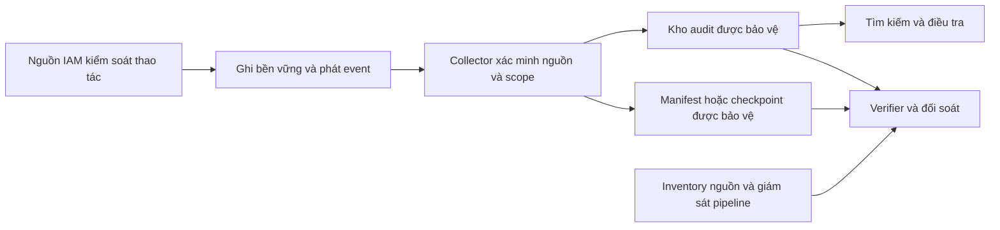

# Audit integrity

## 1. Tính toàn vẹn của audit bảo vệ bằng chứng IAM

**Audit integrity** là khả năng bảo vệ và kiểm chứng rằng dữ liệu audit không bị thay đổi trái phép trong phạm vi đã xác định. Trong IAM, lịch sử đăng nhập, cấp quyền, sử dụng đặc quyền và thu hồi truy cập có thể là bằng chứng chính khi giải thích một sự cố.

Ví dụ, một tài khoản quản trị bị chiếm đã tạo credential cho ứng dụng đặc quyền. Nếu cùng tài khoản đó có thể sửa event thành thao tác của người khác hoặc xóa cả lịch sử liên quan, tổ chức có thể không xác định được đường truy cập còn tồn tại.

Một hệ thống audit đáng tin cần làm khó việc sửa bằng chứng và cung cấp cách phát hiện những thay đổi không được phép. Nó cũng phải cho biết giới hạn quan sát: dữ liệu có chữ ký hợp lệ chưa chứng minh mọi hoạt động ngoài đời đều đã được ghi.

Audit integrity không chỉ là checksum của một file. Nó liên quan đến nguồn tạo event, đường truyền, collector, lưu trữ, quyền quản trị, khóa mật mã, công cụ kiểm chứng và quy trình sử dụng dữ liệu.

## 2. Phân biệt những thuộc tính thường bị gộp chung

| Thuộc tính | Câu hỏi cần trả lời | Điều chưa được bảo đảm chỉ nhờ thuộc tính đó |
|---|---|---|
| Toàn vẹn nội dung | Event có bị sửa sau mốc bảo vệ không? | Event ban đầu có phản ánh đúng thực tế không? |
| Xác thực nguồn | Event có gắn được với một nguồn được chấp nhận không? | Nguồn đó có bị xâm phạm hoặc nói sai không? |
| Độ đầy đủ | Có thiếu event trong phạm vi dự kiến không? | Mọi loại hoạt động cần ghi đã được cấu hình đúng chưa? |
| Liên tục và thứ tự | Có mất đoạn, lặp hoặc đổi thứ tự trong stream không? | Thứ tự tiếp nhận có phải thứ tự nghiệp vụ toàn hệ thống không? |
| Khả dụng | Có thể lấy và đọc bằng chứng khi cần không? | Dữ liệu có chính xác hoặc chưa bị sửa không? |
| Bí mật | Người không có quyền có đọc được log không? | Người được đọc có được phép sửa hoặc xóa không? |

Một file được mã hóa có thể vẫn bị thay bằng một file khác. Một event được ký bởi nguồn hợp lệ có thể đã sai ngay từ khi nguồn phát tạo ra nó. Một kho append-only có thể giữ nguyên mọi event đã nhận nhưng không biết những event bị bỏ trước khi gửi.

Kết luận kiểm chứng vì thế cần cụ thể, chẳng hạn “những file trong manifest này khớp digest đã được xác minh”, thay vì “mọi hoạt động IAM đều được ghi chính xác và đầy đủ”.

## 3. Xác định ai có thể làm sai bằng chứng và ở đâu

Một mô hình đe dọa đơn giản:

| Điểm tác động | Điều có thể xảy ra | Kiểm soát cần xem xét |
|---|---|---|
| Ứng dụng tạo event | Không phát event, gắn sai actor, che giấu thao tác | Ghi tại ranh giới thực thi, đối soát nguồn và bảo vệ đường triển khai |
| Đường truyền | Giả nguồn, sửa, phát lại hoặc làm mất event | Xác thực kết nối, bảo vệ nội dung, định danh event và cơ chế giao nhận |
| Collector | Sửa tenant, loại bỏ event hoặc chuẩn hóa sai | Quyền ingest có phạm vi, giữ provenance, giám sát biến đổi |
| Kho lưu trữ | Ghi đè, xóa một đoạn hoặc thay cả batch | Hạn chế quyền, lưu trữ bất biến và bằng chứng kiểm chứng tách biệt |
| Khóa ký | Ký dữ liệu giả hoặc giả manifest | Quản lý khóa, giới hạn người được ký và theo dõi sử dụng |
| Công cụ kiểm chứng | Tin khóa không đúng hoặc báo PASS sai | Trust store được quản lý, kiểm thử verifier và bảo vệ cấu hình |
| Người xem hoặc xuất audit | Chọn thiếu phạm vi hoặc sửa bản xuất | Ghi phạm vi truy vấn, bảo vệ bản sao và lưu dấu vết bàn giao |

Không nhất thiết một người tấn công có mọi khả năng trên. Thiết kế phải xác định quyền nào thực sự được tách và quyền quản trị nào còn có thể tác động nhiều lớp cùng lúc.

Nếu người quản trị ứng dụng cũng sửa được log, khóa ký, điểm neo kiểm chứng và backup, việc thêm chữ ký chưa tạo ra một ranh giới bảo vệ mạnh trước chính tài khoản đó.

## 4. Kiến trúc có ranh giới tin cậy rõ ràng



Mỗi mũi tên cần một hợp đồng: ai được gửi, dữ liệu nào được chấp nhận, khi nào xác nhận đã lưu bền vững và điều gì xảy ra khi lỗi. Kết nối TLS giúp bảo vệ đường truyền, nhưng không ngăn collector hợp lệ sửa nội dung sau khi nhận.

Tại ingress, ràng buộc danh tính producer với tenant và loại event được phép gửi. Trường `producerId` hoặc `tenantId` trong payload không tự chứng minh nguồn có quyền khẳng định thông tin đó.

Nên tách quyền phát event, đọc điều tra, quản trị retention và quản lý khóa theo mô hình vận hành. Tài khoản ứng dụng thường cần append, không cần ghi đè lịch sử. Việc sửa cấu hình pipeline, trust store hoặc chính sách lưu trữ cũng là hoạt động cần được audit.

Kho tìm kiếm có thể là một bản chiếu thuận tiện, không phải bản bằng chứng gốc. Khi index bị xây dựng lại hoặc parser được nâng phiên bản, cần vẫn truy về được dữ liệu đã bảo vệ và mô tả biến đổi.

## 5. Giảm khoảng trống trước khi event được bảo vệ

Không thể dùng chữ ký để khôi phục event chưa từng được tạo. Vì vậy, điểm đầu của audit integrity là hợp đồng ghi nhận tại nguồn.

Với một thay đổi IAM trong database, có thể dùng cơ chế ghi event hoặc outbox cùng transaction để giảm nguy cơ thay đổi đã commit nhưng event mất do tiến trình dừng ngay sau đó. Cơ chế chỉ có ý nghĩa khi cả thay đổi và bản ghi phát event thực sự cùng phạm vi nguyên tử.

Các lần bị từ chối hoặc transaction rollback cần đường ghi phù hợp. Nếu event lỗi nằm trong transaction bị rollback, chính dấu vết về thất bại có thể biến mất.

Đường gửi cần xử lý retry mà không tạo bằng chứng giả về nhiều thao tác. Event ID nên ổn định cho cùng một event khi gửi lại, được ràng buộc với namespace nguồn đã xác minh và không do người gọi tùy ý chọn để che các event khác.

Sequence có thể giúp phát hiện mất đoạn, nhưng cần định nghĩa phạm vi rõ ràng:

```text
stream = producer + tenant/phạm vi được định nghĩa + epoch
sequence = thứ tự trong stream đó
eventId = định danh một sự kiện cụ thể
```

Trong hệ phân tán, không mặc định mọi nguồn chia sẻ một sequence toàn cục. Restart, chuyển leader hoặc tạo epoch mới cần dấu vết để verifier không nhầm reset hợp lệ với hành vi xóa đầu lịch sử.

Inventory nguồn, heartbeat và đối soát trạng thái giúp nhận biết một stream biến mất hoàn toàn. Chỉ kiểm tra rằng sequence của những file còn tồn tại liên tục sẽ không phát hiện được nguồn đã ngừng gửi mà không để lại một file nào.

## 6. Hash, MAC, chữ ký và mã hóa giải quyết các vấn đề khác nhau

| Cơ chế | Giá trị chính | Giới hạn |
|---|---|---|
| Hash nội dung | Phát hiện dữ liệu khác với digest đã biết | Nếu sửa được cả nội dung lẫn digest, người tấn công có thể thay cả hai |
| MAC hoặc HMAC | Kiểm tra nội dung bằng một khóa bí mật chung | Bên có khóa xác minh cũng có thể tạo MAC |
| Chữ ký số | Gắn nội dung với khóa ký, cho phép xác minh bằng khóa công khai | Phải tin nguồn của khóa công khai và bảo vệ khóa riêng |
| Mã hóa | Hạn chế người đọc nội dung | Không tự chứng minh lịch sử đầy đủ hoặc nguồn event trung thực |
| Lưu trữ bất biến | Hạn chế ghi đè hoặc xóa trong điều kiện được cấu hình | Không tự xác minh nội dung trước lúc lưu hay phát hiện nguồn bỏ event |

Một digest nằm ngay cạnh file không phải bằng chứng độc lập nếu cùng credential có thể sửa cả hai. Tương tự, không lấy khóa công khai do chính một gói log chưa kiểm chứng tự gửi rồi coi chữ ký của nó là đáng tin.

RFC 5848 mô tả cơ chế ký cho syslog nhằm hỗ trợ xác thực nguồn, toàn vẹn thông điệp, chống phát lại, thứ tự và phát hiện thiếu thông điệp trong phạm vi giao thức. Đây là ví dụ cho việc thiết kế nhiều thuộc tính cùng nhau, thay vì chỉ thêm một trường hash. [RFC 5848: Signed Syslog Messages](https://www.rfc-editor.org/info/rfc5848/).

Khi triển khai, ưu tiên cơ chế và thư viện đã được đánh giá theo giao thức phù hợp. Những công thức trong bài chỉ giải thích ý tưởng, không phải một giao thức mật mã hoàn chỉnh để tự triển khai sản xuất.

## 7. Chuỗi hash và điểm neo độc lập

Một chuỗi hash có thể ràng buộc mỗi bản ghi với bản trước. Ở mức khái niệm:

```text
B_i = byte của event theo hợp đồng serialization đã cố định

h_i = H(encode(
    domainSeparator,
    streamId,
    sequence_i,
    h_previous,
    B_i
))
```

`encode` phải không mơ hồ về kiểu và độ dài từng thành phần. Không nối chuỗi tùy tiện rồi cho rằng mọi bộ giá trị đều có biểu diễn khác nhau. Cần cố định phiên bản, thuật toán, encoding và phạm vi stream.

Nếu một event ở giữa bị sửa, những liên kết sau nó không còn khớp với điểm cuối đã được bảo vệ. Tuy nhiên, có hai giới hạn quan trọng:

1. Nếu sửa được toàn bộ chuỗi và digest cuối mà không có điểm đối chiếu đáng tin, người tấn công có thể tính lại chuỗi mới.
2. Nếu xóa phần đuôi và chỉ để lại một tiền tố hợp lệ, kiểm tra các liên kết còn lại chưa đủ biết đã mất phần đuôi.

Để giảm những khoảng trống đó, cần một **checkpoint hoặc điểm neo được bảo vệ** chứa định danh stream, sequence đã chốt và digest tương ứng. Điểm neo có thể được ký và lưu ở miền quản trị tách biệt hoặc cơ chế bảo vệ phù hợp. Tính độc lập phải được đánh giá theo quyền thật, không chỉ theo việc nằm trong thư mục khác.

Khoảng giữa hai lần chốt neo vẫn có giới hạn quan sát. Nếu phần đuôi chưa được neo biến mất, có thể cần receipt, inventory, sequence phía nguồn hoặc đối soát khác để xác định mất dữ liệu. Không tuyên bố một chuỗi có checkpoint định kỳ bảo vệ hoàn hảo mọi event mới nhất.

Ký theo batch hoặc dùng cây Merkle cũng cần manifest, định danh batch và điểm neo đáng tin. Inclusion proof có thể cho biết event thuộc một tập đã cam kết; nó không chứng minh nguồn đã đưa mọi event đáng lẽ phải có vào tập đó.

## 8. Cố định byte được bảo vệ và quản lý khóa

JSON có thể thay đổi thứ tự field hoặc khoảng trắng mà vẫn mang cùng ý nghĩa đối với parser. Nếu ký byte gốc, việc parse rồi serialize lại trước khi kiểm tra có thể làm chữ ký không còn khớp. Nếu ký dạng chuẩn hóa, phải có quy tắc canonicalization cụ thể và nhất quán giữa signer với verifier.

Một hợp đồng cần trả lời:

- Nội dung nào được ký hoặc hash, và trường nào không nằm trong phạm vi bảo vệ?
- Dữ liệu được redaction trước hay sau khi ký?
- Định dạng, encoding, canonicalization và phiên bản được nhận diện thế nào?
- Batch có ràng buộc nguồn, tenant, khoảng sequence và liên kết batch trước không?
- Verifier tìm khóa đáng tin và xử lý thay khóa qua nguồn nào?

Nên loại bỏ secret ngay trong bước tạo event theo schema được duyệt, trước khi bảo vệ bằng chứng. Không lưu raw password hoặc token chỉ vì muốn giữ một “bản gốc nguyên vẹn”. Nguyên vẹn của audit không yêu cầu thu thập bí mật không cần thiết.

Collector có thể bổ sung metadata nhận dữ liệu, nhưng không được âm thầm sửa nội dung đã ký rồi vẫn gán trạng thái xác minh cũ. Có thể giữ phần producer đã bảo vệ và một envelope ingest riêng, hoặc tạo bản dẫn xuất có liên kết rõ ràng tới bản đó.

Khóa ký cần có chủ sở hữu, phạm vi sử dụng, cơ chế bảo vệ, thay khóa và xử lý khi nghi bị lộ. Giữ đủ thông tin để xác minh lịch sử; không mặc định xóa khóa xác minh cũ khi xoay khóa đang sử dụng.

Chữ ký hợp lệ của khóa đã bị lộ có giới hạn bằng chứng. Cần xác định khoảng thời gian nghi ngờ, provenance và các điểm neo liên quan. Timestamp do chính nguồn tự khai không tự chứng minh event đã được ký trước lúc khóa bị xâm phạm.

## 9. Lưu trữ bất biến và kiểm chứng phải cùng được vận hành

Lưu trữ theo mô hình WORM có thể hạn chế sửa hoặc xóa đối tượng trong thời gian cấu hình. Azure Blob immutable storage là một ví dụ hỗ trợ chính sách bảo vệ dữ liệu khỏi ghi đè và xóa theo phạm vi, trạng thái và thời hạn của chính sách. Không nên suy rằng mọi blob trong một tài khoản đều đã bất biến chỉ vì dịch vụ có tính năng đó. [Microsoft Learn: Immutable storage overview](https://learn.microsoft.com/en-us/azure/storage/blobs/immutable-storage-overview).

Cần kiểm tra quyền thay chính sách, khả năng khóa chính sách, version của đối tượng, bản sao và đường quản trị liên quan. Bản sao trong cùng miền quyền có thể không bảo vệ trước một tài khoản đủ quyền tác động tất cả.

Khóa mã hóa cũng ảnh hưởng khả dụng của bằng chứng. Một đối tượng không thể bị xóa nhưng không còn giải mã được vẫn không sử dụng được để điều tra. Chính sách quản lý khóa và phục hồi cần tương thích với thời gian cần đọc audit.

AWS CloudTrail sử dụng digest có chữ ký để hỗ trợ kiểm tra log file sau khi được giao. Tài liệu phân biệt rõ: bật tính năng tạo digest không đồng nghĩa các file đã được kiểm chứng; cần thực hiện bước validation. Đây là khác biệt giữa có cơ chế bằng chứng và thực sự sử dụng cơ chế đó. [AWS CloudTrail: Validating log file integrity](https://docs.aws.amazon.com/awscloudtrail/latest/userguide/cloudtrail-log-file-validation-intro.html).

Không coi một nhãn cấu hình như `integrityEnabled=true` là kết quả PASS. Hệ thống cần biết lần kiểm tra gần nhất, phạm vi đã kiểm tra, bằng chứng nào bị thiếu và có lỗi nào chưa xử lý.

## 10. Quy trình kiểm chứng và cách báo cáo kết quả

Một quy trình kiểm chứng tổng quát có thể gồm:

```text
1. Xác định nguồn, stream, epoch và khoảng cần kiểm tra.
2. Lấy manifest/checkpoint cùng khóa từ nguồn tin cậy đã cấu hình.
3. Kiểm tra chữ ký, định danh nguồn và liên kết giữa các manifest.
4. Đối chiếu các file hoặc event được liệt kê với dữ liệu thực có.
5. Kiểm tra digest, sequence, event trùng và những khoảng bị thiếu.
6. Đối chiếu inventory nguồn cùng dữ liệu vận hành liên quan.
7. Phát hành kết quả có phạm vi, thời gian và giới hạn rõ ràng.
```

Nếu thiếu khóa, thiếu checkpoint hoặc không hỗ trợ phiên bản định dạng, kết quả có thể là **chưa kiểm chứng được**, khác với đã chứng minh dữ liệu bị sửa. Một chữ ký sai, một file mất và một pipeline giao digest chậm cũng là các trạng thái cần phân loại riêng.

Ví dụ báo cáo minh họa:

```yaml
verificationRunId: verification-2027-14
streamId: iam-source-minh-an-epoch-8
requestedSequenceRange:
  first: 12000
  last: 12099
status: INCOMPLETE
findings:
  - type: MISSING_EVENT
    sequence: 12043
checkpointReference: checkpoint-619
conclusion: Chưa thể xác nhận toàn bộ khoảng yêu cầu là đầy đủ và toàn vẹn
```

Tên trường là ví dụ của ứng dụng, không phải schema của các sản phẩm được nhắc tới. Báo cáo không nên biến thành PASS chỉ vì phần dữ liệu còn lại đọc được.

Verifier nên ghi phiên bản công cụ, cấu hình trust và thời điểm kiểm tra. Không tự lấy một checkpoint cũ hơn để làm biến mất cảnh báo về phần đuôi bị thiếu; nếu thay phạm vi, phải thể hiện rõ đó là phạm vi khác.

Với kết quả kiểm chứng trên log đã được export, giữ được mapping tới bản gốc và manifest liên quan. Một CSV đã đổi timezone, cắt field hoặc sắp xếp lại có thể vẫn hữu ích để đọc, nhưng không tự mang cùng bằng chứng byte như bản đã ký.

## 11. Sửa sai dữ liệu, retention và xử lý nghi ngờ can thiệp

Nếu một event đã phát có thông tin nghiệp vụ sai, không âm thầm ghi đè rồi tính lại hash như chưa từng có lỗi. Có thể phát một event hiệu chỉnh tham chiếu event ban đầu, nêu nguồn xác minh và lý do; bản gốc được xử lý theo chính sách dữ liệu đã định.

Quy trình biến đổi hợp lệ phải tách khỏi hành vi sửa trái phép. Chuẩn hóa index, re-encrypt dữ liệu hoặc chuyển định dạng cần manifest và cách kiểm chứng tương ứng. Một thao tác hợp lệ cũng có thể làm mất bằng chứng nếu không bảo toàn những byte, khóa hoặc metadata cần thiết.

Xóa sau thời hạn lưu giữ có thể là hoạt động được phép. Độ đầy đủ phải được đánh giá trong phạm vi còn thuộc hợp đồng lưu giữ, không yêu cầu giữ vô thời hạn mọi dữ liệu. Cần ghi nhận chính sách, phiên bản và thao tác xóa phù hợp để phân biệt với việc mất dữ liệu ngoài kế hoạch.

Khi phát hiện mismatch hoặc mất đoạn:

1. Giữ nguyên bản dữ liệu và các bằng chứng đang có trong phạm vi được phép.
2. Xác minh lỗi công cụ, khóa, định dạng và độ trễ giao nhận trước khi kết luận.
3. Đối chiếu nguồn, bản sao, manifest và thay đổi quản trị liên quan.
4. Xác định ảnh hưởng tới các cuộc điều tra hoặc cảnh báo đã dùng dữ liệu đó.
5. Xử lý quyền, khóa hoặc thành phần bị nghi ngờ theo quy trình sự cố.

Không sửa log để làm validation PASS hoặc tạo event lịch sử giả nhằm lấp một khoảng trống. Nếu không khôi phục được bằng chứng, phải giữ kết luận thiếu dữ liệu cùng giới hạn của những suy luận sau đó.

## 12. Những tình huống cần kiểm chứng thực tế

| Tình huống | Điều cần chứng minh |
|---|---|
| Sửa actor hoặc tenant trong một event đã bảo vệ | Verifier phát hiện nội dung không khớp bằng chứng |
| Xóa event ở giữa stream | Có khả năng phát hiện mất đoạn theo hợp đồng sequence/manifest |
| Xóa phần đuôi hoặc cả stream | Điểm neo và inventory độc lập giúp xác định khoảng không còn quan sát được |
| Tính lại hash sau khi sửa cả file | Không thể thay luôn điểm đối chiếu đáng tin bằng cùng quyền đã bị chiếm |
| Phát lại event hợp lệ | Không bị coi là hoạt động mới hoặc làm sai báo cáo |
| Thay khóa công khai trong gói log | Verifier không tự tin khóa ngoài trust configuration |
| Xoay khóa ký hoặc re-encrypt lưu trữ | Vẫn xác minh và đọc được lịch sử theo chính sách |
| Parser đổi thứ tự JSON hoặc cắt field | Phân biệt bản gốc được bảo vệ và bản dẫn xuất |
| Collector hoặc pipeline mất kết nối | Có chỉ báo độ trễ, backlog và dữ liệu chưa được xác nhận bền vững |
| Tài khoản ứng dụng cố sửa hoặc xóa lịch sử | Quyền lưu trữ và cơ chế bất biến chặn theo mô hình đã chọn |
| Khôi phục hoặc xuất audit để điều tra | Giữ đủ manifest, phạm vi và metadata kiểm chứng |

Nên theo dõi độ bao phủ kiểm chứng, tuổi checkpoint gần nhất, khoảng sequence chưa đối soát, lỗi chữ ký/digest, nguồn im lặng và thay đổi quyền quản trị audit. Chỉ đếm số file hoặc dung lượng lưu trữ không cho biết bằng chứng có đáng tin hay không.

Audit integrity hiệu quả kết hợp ranh giới quyền, ghi nhận bền vững, bằng chứng mật mã, lưu trữ được bảo vệ và quy trình kiểm chứng có thể quan sát. Điều quan trọng là phát biểu đúng điều đã chứng minh: nội dung nào được giữ nguyên, nguồn nào đã được xác thực, phạm vi nào đầy đủ và phần nào vẫn chưa có đủ bằng chứng.
