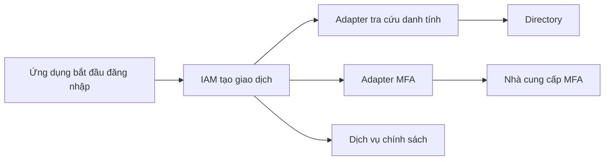

# Correlation ID trong IAM

## 1. Vì sao một lần đăng nhập cần được liên kết xuyên hệ thống?

Một lần đăng nhập có thể đi qua reverse proxy, ứng dụng, dịch vụ IAM, nhà cung cấp danh tính, kho tài khoản, thành phần MFA và dịch vụ cấp token. Khi một bước thất bại, mỗi thành phần thường chỉ nhìn thấy một phần của hành trình.

Ví dụ, ứng dụng ghi “đăng nhập không hoàn tất”, dịch vụ IAM ghi “hết thời gian chờ directory”, còn directory ghi một truy vấn chậm. Nếu không có cách liên kết, người vận hành phải dựa vào thời điểm gần nhau hoặc tên người dùng để phỏng đoán các sự kiện có thuộc cùng giao dịch hay không. Cách đó dễ sai khi có nhiều lượt đăng nhập đồng thời và còn làm tăng nhu cầu truy cập dữ liệu định danh.

**Correlation ID** là định danh dùng để liên kết các sự kiện thuộc cùng một phạm vi xử lý đã xác định. Trong IAM, phạm vi đó thường là một giao dịch xác thực, một yêu cầu kiểm tra quyền hoặc một công việc cấp phát tài khoản.

Correlation ID giúp trả lời: “Những sự kiện nào thuộc cùng hành trình?”. Nó không tự trả lời người dùng là ai, có quyền gì hay kết quả có đáng tin cậy hay không.

## 2. Chọn phạm vi trước khi chọn định dạng

Thuật ngữ correlation ID có thể được các hệ thống sử dụng ở những phạm vi khác nhau. Vì vậy, cần công bố rõ ID đang liên kết một HTTP request hay cả giao dịch IAM gồm nhiều request.

Một mô hình có thể dùng các định danh tách biệt:

| Định danh | Phạm vi minh họa | Vai trò |
| --- | --- | --- |
| `request_id` | Một HTTP request tại ranh giới đã chọn | Tra cứu một lần gọi cụ thể |
| `correlation_id` | Một giao dịch IAM logic | Gom các request và sự kiện liên quan |
| `trace_id` | Một trace trong hệ thống quan sát phân tán | Liên kết các span và quan hệ thực thi |
| `span_id` | Một hoạt động trong trace | Chỉ ra bước nào thực hiện việc gì và mất bao lâu |
| `event_id` | Một sự kiện được phát sinh | Nhận biết bản ghi sự kiện và hỗ trợ chống trùng khi có hợp đồng phù hợp |

Không bắt buộc mọi hệ thống phải có toàn bộ các trường trên. Nhưng nếu dùng nhiều loại, ý nghĩa của chúng cần ổn định.

Một giao dịch đăng nhập qua trình duyệt có thể gồm request bắt đầu, chuyển hướng, callback và trao đổi phía sau giữa các server. Các request có thể có `request_id` khác nhau nhưng cùng `correlation_id` giao dịch.

Một công việc cấp phát tài khoản bất đồng bộ có thể trải qua nhiều lần thực thi, cách nhau nhiều phút. Nó có thể cần nhiều trace ngắn được nối với một ID công việc hoặc correlation ID chung. Không cần ép mọi hoạt động kéo dài vào một span duy nhất.

Ngược lại, không dùng một correlation ID duy nhất cho toàn bộ vòng đời của một người dùng. ID kiểu đó khó tách giao dịch, tạo tập kết quả quá lớn và dễ trở thành định danh theo dõi lâu dài.

## 3. Correlation ID không thay thế dữ liệu bảo vệ giao thức

IAM đã có nhiều loại định danh và giá trị ngẫu nhiên. Chúng có thể nhìn giống nhau nhưng có hợp đồng khác nhau.

| Giá trị | Mục đích cần giữ riêng | Quan hệ với quan sát |
| --- | --- | --- |
| Correlation ID | Liên kết sự kiện theo phạm vi vận hành | Dùng để tìm và đối chiếu sự kiện |
| `state` trong luồng OAuth/OIDC sử dụng nó | Liên kết phản hồi với giao dịch phía client và thực hiện kiểm tra theo thiết kế luồng | Có thể ánh xạ nội bộ sang giao dịch; không thay bằng một nhãn log tùy ý |
| `nonce` trong luồng OIDC sử dụng nó | Ràng buộc theo hợp đồng xác thực và kiểm tra của giao thức | Không tái sử dụng correlation ID như thể hai giá trị có cùng vai trò |
| Định danh request/response trong liên kết danh tính | Phục vụ đối chiếu thông điệp theo giao thức đang dùng | Chỉ liên kết sau khi kiểm tra thông điệp theo quy định của giao thức |
| Session ID hoặc token | Xác định hay mang thông tin của phiên/quyền truy cập theo cơ chế tương ứng | Không sao chép vào correlation ID hoặc ghi nguyên giá trị nhạy cảm vào log |
| Khóa idempotency | Điều khiển cách xử lý lặp lại một thao tác theo hợp đồng API | Không mặc định correlation ID có khả năng chống thực thi trùng |

Biết một correlation ID không được phép giúp người gọi truy cập tài khoản, lấy token, vượt MFA hay bỏ qua kiểm tra quyền. Nó cũng không phải bằng chứng rằng sự kiện đến từ một client đáng tin cậy.

Nếu correlation ID được trả về cho người dùng để hỗ trợ tra cứu sự cố, giao diện hỗ trợ vẫn phải xác thực và phân quyền người xem dữ liệu. Không cung cấp API đọc toàn bộ log chỉ vì người gọi biết ID.

## 4. Tạo và tiếp nhận ID tại ranh giới tin cậy

Một điểm vào đáng tin cậy có thể tạo correlation ID khi khởi tạo giao dịch. ID nên không chứa thông tin nghiệp vụ hoặc thông tin cá nhân và có không gian giá trị đủ lớn để xác suất trùng thấp trong phạm vi sử dụng.

Không tạo ID bằng cách ghép email, số điện thoại, tenant và thời điểm đăng nhập. Cấu trúc đó làm lộ dữ liệu, dễ bị đoán và gắn chặt quan sát với danh tính cá nhân. ID cũng không cần mã hóa quyền hay vai trò.

### Khi request bên ngoài đã có ID

Một client có thể gửi header đề nghị ID để tra cứu. Giá trị này là dữ liệu không tin cậy cho tới khi được xử lý theo hợp đồng của hệ thống.

Một phương án dễ kiểm soát là:

1. Tạo ID nội bộ tại điểm tiếp nhận giao dịch.
2. Nếu cần phục vụ tích hợp, tiếp nhận ID do client gửi vào một trường riêng như `external_request_id`.
3. Kiểm tra định dạng, chiều dài và ký tự của giá trị bên ngoài trước khi lưu hoặc trả lại.
4. Chỉ cho phép thành phần nội bộ đã xác thực truyền tiếp ID nội bộ theo chính sách của tổ chức.

Một tổ chức cũng có thể chọn kế thừa ID từ gateway đáng tin cậy. Khi đó phải có cách nhận biết gateway và xử lý header do client bên ngoài tự gắn vào; tên header không tự tạo ra sự tin cậy.

Giới hạn độ dài và tập ký tự giúp ngăn giá trị bất thường làm hỏng dữ liệu quan sát. Ví dụ, có thể chỉ chấp nhận một định dạng ID cố định theo hợp đồng tích hợp. Không chèn trực tiếp giá trị tùy ý vào dòng log văn bản hoặc câu truy vấn tìm kiếm.

Kiểm tra cú pháp không bảo đảm ID là duy nhất hoặc đến từ nguồn có thẩm quyền. Hai client vẫn có thể cố tình gửi cùng một ID hợp lệ về mặt định dạng. Đây là lý do cần phân biệt ID ngoài với ID nội bộ và luôn giới hạn truy vấn theo phạm vi được phép.

## 5. Truyền ngữ cảnh qua các bước IAM

### Gọi đồng bộ giữa các dịch vụ

Khi dịch vụ IAM gọi directory adapter, MFA adapter hoặc policy service, ngữ cảnh quan sát cần được gắn vào request theo hợp đồng nội bộ. Bên nhận ghi ID vào các sự kiện tương ứng và truyền tiếp khi thực hiện các bước con được phép.

Một luồng minh họa:



Correlation ID giao dịch có thể xuất hiện ở các thành phần do tổ chức kiểm soát. Không mặc định directory hoặc nhà cung cấp ngoài hỗ trợ cùng header hay cùng trường log. Adapter có thể lưu ánh xạ giữa ID giao dịch nội bộ và request ID mà nhà cung cấp trả về.

Các dịch vụ cần biết ngữ cảnh nào được phép truyền đi. Không chuyển toàn bộ metadata nội bộ, thuộc tính danh tính hoặc dữ liệu quan sát cho mọi đích bên ngoài chỉ vì request có ngữ cảnh tương quan.

### Chuyển hướng trình duyệt và SSO

Trình duyệt thực hiện request mới sau mỗi lần chuyển hướng; không thể giả định header nội bộ tự đi theo toàn bộ hành trình. Việc liên kết giao dịch cần được thiết kế tại thành phần quản lý luồng xác thực.

Một cách tiếp cận là lưu correlation ID trong trạng thái giao dịch phía server. Khi callback hợp lệ quay về, hệ thống tìm đúng giao dịch bằng cơ chế của giao thức, thực hiện đầy đủ các kiểm tra cần thiết rồi khôi phục ngữ cảnh quan sát.

Không sửa ý nghĩa của `state`, `nonce`, chữ ký hay các kiểm tra đối chiếu thông điệp để thuận tiện cho logging. Không thêm thông tin định danh hoặc bí mật vào URL chuyển hướng để làm correlation: URL có thể xuất hiện trong lịch sử, log và các kênh quan sát khác.

Nếu một đối tác SSO cung cấp request ID phục vụ hỗ trợ, ghi nhận nó dưới tên riêng sau khi kiểm tra phản hồi theo giao thức. Không coi một trường ID trong thông điệp chưa được kiểm tra là nguồn xác nhận danh tính.

### Hàng đợi và công việc bất đồng bộ

Một message có thể mang metadata tương quan cùng với ID sự kiện. Consumer khôi phục ngữ cảnh khi bắt đầu xử lý và ghi rõ lần thực thi.

```text
correlation_id: liên kết công việc IAM logic
event_id: nhận biết sự kiện được phát đi
execution_attempt: nhận biết lần xử lý của consumer
```

Nếu cùng một message được giao lại, correlation ID vẫn có thể giữ nguyên để nhìn thấy các lần thử thuộc cùng công việc. Điều đó không tự ngăn việc tạo tài khoản hai lần; chống thực thi trùng cần cơ chế idempotency riêng theo hợp đồng nghiệp vụ.

Khi một yêu cầu sinh nhiều công việc con, nên giữ ID riêng cho từng công việc và quan hệ với công việc cha. Một ID chung quá rộng có thể làm mất khả năng phân biệt các nhánh hoặc nguyên nhân retry.

## 6. Giữ ngữ cảnh đúng khi xử lý đồng thời

Một dịch vụ có thể tiếp nhận hàng nghìn giao dịch đồng thời trên các thread hoặc tác vụ bất đồng bộ. Correlation ID phải gắn với ngữ cảnh của từng giao dịch, không phải biến dùng chung cho toàn bộ tiến trình.

Trong ứng dụng Java, không lưu ID hiện tại vào một trường `static` có thể bị mọi request thay đổi. Nếu dùng ngữ cảnh logging gắn với thread, cần hiểu rằng thread pool tái sử dụng thread, còn một luồng bất đồng bộ có thể chuyển sang thread khác.

Hai lỗi điển hình là:

- Tác vụ con không được truyền ngữ cảnh nên log không có ID hoặc có ID không liên quan.
- Ngữ cảnh không được dọn sau request trước, khiến request mới bị gán ID của người dùng khác.

Một mẫu xử lý ở mức ý tưởng:

```text
Tiếp nhận request
  → xác định hoặc tạo ngữ cảnh giao dịch hợp lệ
  → đặt ngữ cảnh cho phạm vi xử lý hiện tại
  → truyền bản ngữ cảnh phù hợp vào tác vụ con
  → ghi các sự kiện có cấu trúc
  → khôi phục hoặc dọn ngữ cảnh trong finally
```

Với xử lý lồng nhau, cần khôi phục ngữ cảnh trước đó thay vì luôn xóa vô điều kiện. Việc truyền ngữ cảnh phải phù hợp với mô hình thực thi và công cụ quan sát của ứng dụng; không mặc định một cơ chế thread-local giải quyết mọi kiểu bất đồng bộ.

Ngữ cảnh xác thực và ngữ cảnh quan sát cũng có vai trò khác nhau. Truyền correlation ID không đồng nghĩa đã truyền principal hoặc chứng minh quyền. Mọi kiểm tra xác thực, phân quyền và tách tenant vẫn phải được thực hiện tại ranh giới thích hợp.

## 7. Ghi log có cấu trúc và có ý nghĩa

Log tốt không chỉ có ID; nó còn cho biết hoạt động nào xảy ra và kết quả là gì. Một schema minh họa có thể gồm thời điểm, service, event, correlation ID, request ID, outcome, duration và nhóm lỗi.

Ví dụ sau sử dụng ID ngắn để dễ đọc, không nhằm mô tả định dạng ID dùng trong sản xuất:

```json
{
  "timestamp": "2026-01-01T02:00:00.100Z",
  "service": "iam-login",
  "event": "authentication.started",
  "correlation_id": "auth-demo-01",
  "request_id": "req-demo-01",
  "outcome": "started"
}
```

Một sự kiện khác thuộc cùng giao dịch:

```json
{
  "timestamp": "2026-01-01T02:00:00.850Z",
  "service": "directory-adapter",
  "event": "identity.lookup.completed",
  "correlation_id": "auth-demo-01",
  "request_id": "req-demo-02",
  "outcome": "timeout",
  "duration_ms": 700,
  "error_category": "dependency_timeout"
}
```

Hai bản ghi giúp người vận hành tìm đúng giao dịch và nhận ra một lỗi phụ thuộc. Chúng không cần chứa mật khẩu, token, mã OTP, authorization code hay toàn bộ thuộc tính người dùng.

Tên sự kiện nên biểu đạt mốc xử lý ổn định, chẳng hạn `authentication.started`, `mfa.challenge.completed`, `authorization.decided` hoặc `provisioning.completed`. Khi biểu diễn kết quả, phân biệt lỗi kỹ thuật với từ chối theo chính sách; không gom mọi trường hợp người dùng không đăng nhập được thành lỗi server.

Nếu một bước có thể chạy nhiều lần, ghi thêm thông tin lần thử phù hợp. Cùng correlation ID không có nghĩa mọi dòng log là bản sao. Ngược lại, nhiều bản ghi có nội dung giống nhau không chắc là nhiều lần thực thi; có thể do pipeline giao lại cùng sự kiện.

## 8. Điều tra một giao dịch bằng correlation ID

Giả sử người dùng được trả một mã hỗ trợ tương ứng với correlation ID nội bộ. Người vận hành có quyền phù hợp thực hiện các bước:

1. Xác định ứng dụng, môi trường và khoảng thời gian của sự cố.
2. Tra cứu ID trong phạm vi được phép, không tìm rộng mọi tenant theo mặc định.
3. Nhận diện các mốc bắt đầu, quyết định chính sách, phụ thuộc và kết thúc.
4. Theo các trace hoặc request ID liên quan để xem thời lượng và đường gọi.
5. Đối chiếu dữ liệu còn thiếu, retry và phiên bản triển khai trước khi kết luận.

Một bảng tái dựng minh họa:

| Mốc | Thành phần | Kết quả | Điều có thể suy ra |
| --- | --- | --- | --- |
| Bắt đầu | IAM login | Giao dịch được tiếp nhận | Request đã vào hệ thống |
| Tra cứu danh tính | Directory adapter | Thành công | Bước tra cứu này đã hoàn tất |
| Đánh giá chính sách | Policy service | Cần MFA | Luồng phải thực hiện xác minh bổ sung |
| Phát hành challenge | MFA adapter | Lỗi phụ thuộc | Bước phát hành không hoàn tất theo hợp đồng |
| Kết thúc | IAM login | Đăng nhập không hoàn tất | Có kết quả cuối để đối chiếu tác động |

Correlation ID nối các mốc, nhưng thứ tự dòng log theo thời gian không tự chứng minh quan hệ nhân quả. Log có thể đến muộn, đồng hồ có thể lệch và các bước có thể chạy song song. Quan hệ gọi trong trace, ID quyết định và trạng thái giao dịch giúp củng cố kết luận.

Không thấy sự kiện kết thúc cũng chưa đủ để khẳng định giao dịch bị treo. Có thể việc thu thập bị mất dữ liệu, sự kiện bị lọc hoặc ứng dụng kết thúc trước khi xuất log. Cần xem sức khỏe telemetry và trạng thái giao dịch nếu hệ thống lưu nó.

## 9. Tách vai trò của log, trace, metric và audit

| Loại dữ liệu | Correlation ID hỗ trợ gì? | Giới hạn cần nhớ |
| --- | --- | --- |
| Log | Tìm các sự kiện thuộc giao dịch | Log cần nội dung, phân quyền và chất lượng thu thập phù hợp |
| Trace | Nối giao dịch với đường gọi và thời lượng | Trace có thể bị lấy mẫu hoặc tách qua ranh giới hệ thống |
| Metric | Hỗ trợ đi từ biểu đồ tới dữ liệu chi tiết bằng cơ chế liên kết được kiểm soát | Không dùng ID giao dịch làm nhãn metric thông thường |
| Audit event | Liên kết hành động và quyết định liên quan để điều tra | ID không tự bảo đảm tính toàn vẹn, nguồn gốc hoặc đầy đủ của audit |

Correlation ID có số lượng giá trị tăng theo giao dịch. Đưa nó vào nhãn metric như `login_total{correlation_id="..."}` thường tạo ra rất nhiều chuỗi thời gian. Metric tổng hợp nên dùng các chiều hữu hạn như môi trường, loại luồng và nhóm kết quả; dữ liệu chi tiết được tìm trong log hoặc trace.

Việc có correlation ID cũng không bảo đảm trace được lưu. Nếu hệ thống lấy mẫu trace, có thể chỉ còn log của giao dịch. Cần thiết kế khả năng tra cứu và chính sách lưu dữ liệu phù hợp thay vì giả định mọi ID đều mở ra một trace đầy đủ.

Đối với audit, vẫn phải ghi các trường theo yêu cầu nghiệp vụ như chủ thể thực hiện, hành động, đối tượng và kết quả trong phạm vi được phép. Correlation ID bổ sung quan hệ giữa các sự kiện; nó không thay thế các trường đó hay cơ chế bảo vệ log kiểm toán.

## 10. Bảo vệ dữ liệu và ranh giới tenant

Correlation ID thường không phải bí mật cấp quyền, nhưng tập sự kiện mà nó dẫn tới có thể nhạy cảm. Dữ liệu liên quan có thể tiết lộ thời điểm truy cập, tên ứng dụng, bước xác minh, trạng thái tài khoản hoặc hành động quản trị.

Vì vậy, cần tách quyền xem log theo vai trò và phạm vi tenant hoặc môi trường. Khi công cụ hỗ trợ tìm kiếm theo ID, hệ thống phải bổ sung điều kiện phân quyền từ ngữ cảnh của người tra cứu; không lấy tenant từ một tham số do người gọi tự khai rồi coi là đã được phép.

ID gửi ra ngoài nên phục vụ đúng mục đích hỗ trợ. Không đưa chi tiết hạ tầng, tên tài khoản, vai trò hay lý do từ chối nhạy cảm vào cấu trúc ID. Nếu cần che ID nội bộ, có thể dùng mã hỗ trợ được ánh xạ theo thiết kế của hệ thống.

Ngay cả một ID ngẫu nhiên không chứa tên người dùng vẫn có thể liên kết gián tiếp với cá nhân qua dữ liệu khác. Chính sách lưu, truy cập, chia sẻ và xóa dữ liệu quan sát cần tính đến khả năng liên kết đó.

## 11. Những lỗi thiết kế thường gặp

| Lỗi | Hệ quả | Cách xử lý ở mức thiết kế |
| --- | --- | --- |
| Dùng một ID cho mọi request của một người dùng | Không tách được giao dịch và tăng khả năng theo dõi dài hạn | Xác định ID theo giao dịch hoặc công việc cụ thể |
| Tin mọi ID gửi từ client | Có thể ghép nhầm hoặc cố tình làm nhiễu sự kiện | Tạo ID nội bộ, phân biệt giá trị ngoài và nguồn tin cậy |
| Mỗi service tự tạo ID mới mà không lưu liên hệ | Đứt hành trình khi qua ranh giới dịch vụ | Truyền ngữ cảnh hoặc ghi quan hệ ánh xạ rõ ràng |
| Truyền ID bằng biến dùng chung | Sự kiện của các giao dịch bị trộn | Gắn ngữ cảnh với phạm vi thực thi và dọn đúng lúc |
| Dùng correlation ID thay `state` hoặc khóa idempotency | Sai hợp đồng giao thức hoặc xử lý lặp | Giữ vai trò từng loại giá trị và liên kết nội bộ khi cần |
| Ghi token hoặc email vào ID | Rò rỉ dữ liệu qua nhiều kênh | Dùng ID không mang thông tin nhạy cảm |
| Coi ID là bằng chứng audit | Kết luận vượt quá dữ liệu thực có | Kiểm tra nguồn gốc, tính đầy đủ và cơ chế bảo vệ audit |

Một hệ thống quan sát IAM dùng correlation ID hiệu quả khi người vận hành có thể đi từ một giao dịch tới các bước liên quan, hiểu các ranh giới bị mất ngữ cảnh và phân biệt được điều đã quan sát với điều còn phải kiểm chứng. ID là điểm nối; chất lượng sự kiện, truyền ngữ cảnh và kiểm soát truy cập mới làm cho điểm nối đó hữu ích.
