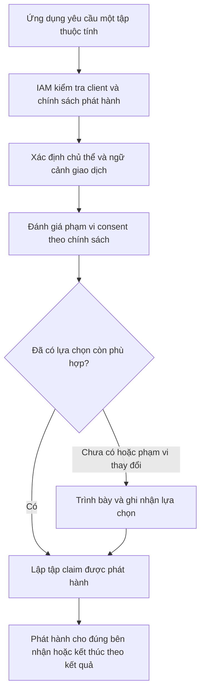

# Consent cho attribute

## 1. Consent đang cho phép điều gì?

Trong IAM, **attribute** là thuộc tính mô tả một danh tính hoặc ngữ cảnh liên quan: tên hiển thị, email, đơn vị công tác, nhóm, trạng thái xác minh hay các dữ liệu khác mà hệ thống quản lý.

**Consent cho attribute** là việc ghi nhận lựa chọn của chủ thể về một phạm vi chia sẻ hoặc sử dụng thuộc tính đã được trình bày rõ trong một luồng có yêu cầu đồng ý. Chẳng hạn, người dùng đồng ý để ứng dụng đặt lịch nhận tên hiển thị và email phục vụ gửi xác nhận, nhưng không chia sẻ số điện thoại cho mục đích nhắc lịch tùy chọn.

Một lựa chọn có ý nghĩa cần gắn với những câu hỏi cụ thể: thuộc tính nào, bên nhận nào, mục đích nào và phạm vi hiệu lực nào. Nút “Tôi đồng ý” chung chung không tự cung cấp đủ ngữ cảnh để hệ thống quyết định được phép phát hành dữ liệu gì.

Bài này xem consent từ góc độ thiết kế kỹ thuật IAM. Việc một hoạt động xử lý dữ liệu có cần consent hay được thực hiện theo cơ sở nào phải do chính sách áp dụng xác định; không thể suy ra chỉ từ việc giao diện có một hộp chọn.

## 2. Phân biệt consent, xác thực và phân quyền

Ba khái niệm có liên hệ nhưng không thay thế cho nhau:

| Khái niệm | Câu hỏi chính | Ví dụ |
| --- | --- | --- |
| Xác thực | Chủ thể đang tương tác là ai theo mức bảo đảm yêu cầu? | Người dùng hoàn tất đăng nhập và MFA |
| Phân quyền | Chủ thể hoặc ứng dụng được thực hiện hành động nào trong ngữ cảnh này? | Client được phép yêu cầu một nhóm claim cho đúng API |
| Consent thuộc tính | Chủ thể đã đồng ý với phạm vi chia sẻ được yêu cầu trong luồng này chưa? | Đồng ý chia sẻ email cho ứng dụng đặt lịch để gửi xác nhận |

Người dùng đăng nhập thành công không có nghĩa mọi ứng dụng được nhận toàn bộ hồ sơ. Người dùng chọn đồng ý cũng không thể cấp cho một ứng dụng quyền mà chính sách IAM cấm, hoặc cho phép ứng dụng đọc hồ sơ của người khác.

Ví dụ, một client chỉ được đăng ký nhận tên hiển thị và email. Nếu client yêu cầu thêm nhóm đặc quyền nội bộ, việc người dùng bấm chấp nhận không làm thuộc tính đó trở thành dữ liệu được phép phát hành.

Tương tự, một hệ thống nội bộ có thể cần thuộc tính đơn vị công tác để thực thi chính sách truy cập. IAM có thể sử dụng thuộc tính đó bên trong điểm quyết định mà không cần phát hành giá trị cho ứng dụng. “Cần để quyết định quyền” và “cần chia sẻ cho bên nhận” là hai nhu cầu khác nhau.

## 3. Xác định đơn vị của một lựa chọn đồng ý

Không nên chỉ lưu một cờ `consent=true` trên tài khoản. Cờ này không cho biết người dùng đã đồng ý với ứng dụng nào hoặc với dữ liệu nào.

Một đơn vị consent có thể được mô hình hóa theo tổ hợp:

```text
Chủ thể
  + tenant hoặc phạm vi danh tính
  + ứng dụng/bên nhận đã xác minh
  + mục đích đã đăng ký
  + tập thuộc tính được mô tả rõ
  + phiên bản phạm vi và thông báo liên quan
  + thời gian và trạng thái hiệu lực
```

Các thành phần cần được hiểu đúng:

| Thành phần | Lý do cần lưu rõ |
| --- | --- |
| Chủ thể | Tránh áp dụng lựa chọn của người này cho người khác |
| Tenant, issuer hoặc namespace phù hợp | Tránh nhầm các định danh giống nhau ở những miền danh tính khác nhau |
| Client và bên nhận | Tránh dùng consent của ứng dụng A cho ứng dụng B |
| Mục đích | Phân biệt gửi xác nhận đặt lịch với quảng bá dịch vụ |
| Tập thuộc tính | Cho phép thực thi đúng các trường đã được chấp nhận |
| Phiên bản | Phát hiện phạm vi hoặc nội dung giải thích đã thay đổi |
| Trạng thái và thời điểm | Phân biệt đang hiệu lực, hết hạn hoặc đã bị thu hồi |

Tên hiển thị của ứng dụng có thể đổi; định danh client phải được quản lý ổn định theo hợp đồng hệ thống. Danh tính chủ thể cũng không nên chỉ được nhận biết bằng email, vì email có thể thay đổi hoặc được cấp lại.

## 4. Giảm dữ liệu trước khi hỏi consent

Consent không nên trở thành lý do để yêu cầu toàn bộ dữ liệu rồi giao người dùng tự cân nhắc. Trước khi hiển thị lựa chọn, ứng dụng và IAM cần xác định dữ liệu tối thiểu phục vụ chức năng.

Ví dụ minh họa:

| Nhu cầu chức năng | Dữ liệu có thể cân nhắc | Câu hỏi thiết kế |
| --- | --- | --- |
| Hiển thị lời chào | Tên hiển thị | Có cần tên pháp lý đầy đủ không? |
| Gửi xác nhận | Email được phép dùng trong ngữ cảnh này | Có cần số điện thoại hoặc địa chỉ nhà không? |
| Kiểm tra một điều kiện tuổi | Kết quả xác minh điều kiện từ nguồn phù hợp | Có cần gửi ngày sinh đầy đủ không? |
| Áp dụng giá theo tư cách thành viên | Trạng thái thành viên liên quan | Có cần danh sách mọi nhóm của người dùng không? |

Một thuộc tính suy dẫn như “đạt điều kiện tuổi” có thể giảm dữ liệu được chia sẻ so với ngày sinh. Tuy nhiên, thuộc tính suy dẫn vẫn có thể liên quan tới cá nhân; nó cần nguồn tin cậy, định nghĩa và kiểm soát phát hành phù hợp. Không biến một giá trị do client tự khai thành bằng chứng xác minh.

Nên tách phần dữ liệu cần cho chức năng đang được yêu cầu với lựa chọn bổ sung. Chẳng hạn, nhắc lịch qua SMS có thể là tùy chọn riêng; từ chối số điện thoại không nên vô tình làm hỏng chức năng gửi xác nhận qua email vốn không dùng số điện thoại.

Nếu ứng dụng thực sự không thể thực hiện chức năng khi thiếu một thuộc tính, giao diện cần giải thích rõ hậu quả của việc từ chối. Không mô tả một lựa chọn là tùy chọn trong khi hệ thống vẫn buộc chia sẻ để tiếp tục cùng chức năng.

## 5. Thiết kế màn hình đồng ý đủ cụ thể

Một màn hình minh họa có thể trình bày:

```text
Ứng dụng: Cổng đặt lịch A

Chức năng: Đặt lịch và nhận xác nhận

Thông tin được yêu cầu:
- Tên hiển thị: hiển thị người đặt lịch.
- Email: gửi xác nhận và thay đổi liên quan tới lịch đã đặt.

Tùy chọn bổ sung:
[ ] Chia sẻ số điện thoại để nhận nhắc lịch qua SMS.

Bạn có thể xem và thu hồi lựa chọn chia sẻ trong phần quản lý tài khoản.

[Từ chối] [Đồng ý với phạm vi đã chọn]
```

Nội dung thực tế còn cần mô tả bên nhận, thời hạn hoặc điều kiện hiệu lực theo thiết kế và chính sách của tổ chức. Nếu dữ liệu được chuyển sang hệ thống khác để thực hiện chức năng, phần giải thích phải phản ánh đúng luồng dữ liệu đã phê duyệt.

Nên dùng tên thuộc tính mà người dùng hiểu được, kèm mục đích cụ thể. Chỉ hiển thị chuỗi kỹ thuật như `profile.read.extended` thường không đủ để giải thích nhóm dữ liệu bên trong.

Các lựa chọn tùy chọn nên cho phép người dùng chủ động chọn, với hành vi từ chối rõ ràng. Việc có thể thu hồi cũng phải tương ứng với chức năng thực sự ở backend; một đường dẫn không có khả năng thay đổi trạng thái không giải quyết được yêu cầu đó.

Nếu hệ thống có người đại diện thực hiện lựa chọn, cần mô hình hóa riêng chủ thể dữ liệu và người thực hiện hành động, cùng cơ chế xác minh thẩm quyền đại diện theo chính sách. Không tự coi một phiên quản trị là quyền chấp nhận mọi lựa chọn thay người dùng.

## 6. Consent trong luồng SSO và phát hành claim

Một luồng minh họa gồm các bước:



Thứ tự chi tiết phụ thuộc giao thức và kiến trúc. Điểm bắt buộc ở mức thiết kế là backend quyết định tập dữ liệu được phát hành từ các nguồn có thẩm quyền; không lấy danh sách checkbox từ trình duyệt làm quyền phát hành cuối cùng.

Tập claim cuối có thể được hiểu là giao của nhiều giới hạn:

```text
Tập dữ liệu được phát hành
  = dữ liệu được yêu cầu cho chức năng
  ∩ dữ liệu client được phép nhận
  ∩ dữ liệu chính sách cho phép phát hành trong ngữ cảnh
  ∩ dữ liệu thuộc phạm vi đồng ý đang hiệu lực, khi chính sách yêu cầu consent
  ∩ dữ liệu thực sự có và đạt điều kiện về nguồn, chất lượng
```

Điều kiện “khi chính sách yêu cầu consent” phải được xác định phía server. Client không được tự gửi một cờ “không cần consent” để bỏ qua đánh giá.

### Scope không luôn tương đương một thuộc tính

Trong OAuth/OIDC, ứng dụng có thể yêu cầu scope hoặc claim theo cơ chế mà triển khai hỗ trợ. Một scope có thể đại diện một nhóm dữ liệu hoặc một quyền truy cập, không nhất thiết tương ứng một trường hồ sơ.

Nếu giao diện cho người dùng chọn từng thuộc tính nhưng backend chỉ xử lý một scope rất rộng, hệ thống cần cơ chế giới hạn phát hành tương ứng. Không được hiển thị lựa chọn từng trường rồi gửi nguyên cả nhóm dữ liệu bất kể lựa chọn.

Token ký số cũng không mặc định giữ bí mật nội dung claim. Cần đánh giá ai nhận token và ai có thể đọc dữ liệu trong nó. Tránh thêm thuộc tính vào token chỉ vì thuận tiện, đặc biệt khi dữ liệu không cần cho bên nhận hoặc khó thu hồi sau phát hành.

Consent ở IdP cho một ứng dụng cũng không tự cho phép ứng dụng chuyển dữ liệu sang bất kỳ bên thứ ba nào. Phạm vi bên nhận và mục đích cần được mô tả, quản lý và thực thi theo đúng luồng đã xác định.

## 7. Lưu bằng chứng mà không sao chép hồ sơ

Một bản ghi minh họa có thể như sau. Tên trường do hệ thống tự định nghĩa; các ID và thời hạn chỉ phục vụ ví dụ:

```json
{
  "grant_id": "consent-demo-01",
  "subject_ref": "subject-demo-01",
  "tenant_ref": "tenant-demo-01",
  "client_id": "appointment-client",
  "recipient_id": "appointment-service",
  "purpose_id": "appointment-confirmation",
  "attributes": ["display_name", "email"],
  "optional_attributes_declined": ["phone_number"],
  "scope_version": "2",
  "notice_version": "3",
  "status": "active",
  "recorded_at": "2026-01-01T02:00:00Z",
  "expires_at": "2026-04-01T02:00:00Z"
}
```

Bản ghi này lưu phạm vi lựa chọn, không cần sao chép email hay số điện thoại thực tế vào cùng bản ghi. Nếu cần giải thích sau này người dùng đã nhìn thấy nội dung nào, có thể lưu tham chiếu tới phiên bản thông báo được quản lý và nội dung phiên bản tương ứng theo chính sách lưu giữ.

Không nên giả định một bản ghi có dấu thời gian đã tự chứng minh tính hợp lệ của toàn bộ quy trình. Backend còn phải bảo đảm lựa chọn được gắn với đúng phiên, đúng client, đúng tập thuộc tính được trình bày và đúng ngữ cảnh xác thực.

Các thay đổi trạng thái như tạo mới, thay đổi phạm vi và thu hồi nên có lịch sử đủ để đối soát. Cơ chế bảo vệ audit cần ngăn sửa trái phép và giới hạn người có thể xem. Lưu audit cũng phải có mục đích và thời hạn; không giữ mọi dữ liệu chi tiết vô thời hạn chỉ vì gọi đó là bằng chứng consent.

## 8. Thực thi lựa chọn ở backend

Một mẫu xử lý ở mức ý tưởng:

```text
releaseAttributes(authenticatedTransaction, registeredClient, requestedFields):
    subject = subjectFromTrustedTransaction(authenticatedTransaction)
    purpose = purposeFromServerSideClientConfiguration(registeredClient)

    validateRequestedFields(requestedFields)
    eligibleFields = evaluateAttributeReleasePolicy(
        subject, registeredClient, purpose, requestedFields
    )

    if serverPolicyRequiresConsent(subject, registeredClient, purpose):
        grant = loadApplicableActiveGrant(
            subject, registeredClient, purpose
        )
        eligibleFields = intersect(eligibleFields, grant.acceptedFields)

    return projectTrustedIdentityData(subject, eligibleFields)
```

Đây là mã giả mô tả trách nhiệm, không phải một thư viện hoàn chỉnh. Hệ thống thực tế phải xử lý rõ các trường hợp không có grant, grant hết hiệu lực hoặc thiếu thuộc tính mà chức năng cần. Không để một giá trị `null` vô tình trở thành “cho phép mọi trường”.

Chủ thể được lấy từ giao dịch đã xác thực, không từ một `user_id` tùy ý do trình duyệt gửi. Client, redirect đích và mục đích phải gắn với cấu hình và giao dịch đã được xác minh theo giao thức. Tập thuộc tính nhận từ client là yêu cầu cần kiểm tra, không phải danh sách đã được cấp quyền.

Ở tầng xuất dữ liệu, dùng phép chiếu theo danh sách cho phép rõ ràng. Trả nguyên đối tượng hồ sơ rồi chỉ ẩn trường trên giao diện không ngăn dữ liệu đi tới client. Tương tự, bảo vệ token phát hành nhưng để endpoint hồ sơ trả mọi thuộc tính vẫn làm mất ý nghĩa của giới hạn consent.

API nghiệp vụ còn phải kiểm tra quyền truy cập độc lập. Consent cho email của chính người dùng không cho phép ứng dụng đọc email của các tài khoản khác hoặc truy cập chức năng quản trị.

### Bảo vệ thao tác ghi nhận lựa chọn

Request chấp nhận hoặc thu hồi cần được bảo vệ khỏi giả mạo thao tác, gắn với đúng phiên và giao dịch. Backend không được tin một form tự tạo có thể khai client khác, mục đích khác hoặc phiên bản thông báo khác.

Cần kiểm tra phạm vi lựa chọn đã trình bày với phạm vi được ghi nhận. Nếu tập dữ liệu thay đổi trong khi màn hình còn mở, hệ thống phải xử lý theo cơ chế phiên bản thay vì âm thầm ghi nhận cho phạm vi mới.

Các biện pháp bảo vệ giao diện và phiên như chống giả mạo request, kiểm soát nhúng trang và xử lý đầu vào cần phù hợp với kiến trúc. Tuy nhiên, những biện pháp đó không thay cho kiểm tra phát hành dữ liệu phía server.

## 9. Thay đổi phạm vi và yêu cầu lựa chọn lại

Một grant cho tên hiển thị và email để gửi xác nhận không bao gồm số điện thoại cho quảng bá dịch vụ. Khi ứng dụng mở rộng nhu cầu, cần đánh giá lại sự tương thích của grant hiện có.

| Thay đổi | Cách đánh giá |
| --- | --- |
| Thêm thuộc tính | Không tự mở rộng tập đã chấp nhận; xem xét yêu cầu lựa chọn mới |
| Thêm mục đích | Đánh giá như một phạm vi mới thay vì dùng lại grant theo tên client |
| Thêm hoặc thay bên nhận | Kiểm tra lại ranh giới chia sẻ đã trình bày |
| Thay đổi cách diễn đạt nhưng không đổi phạm vi | Quản lý phiên bản và đánh giá theo quy tắc của hệ thống |
| Người dùng đổi email | Kiểm tra ngữ nghĩa grant, trạng thái xác minh và chính sách phát hành giá trị hiện tại |
| Liên kết hoặc hợp nhất tài khoản | Đối soát chủ thể và phạm vi, không sao chép grant chỉ vì email giống nhau |

Không phải mọi thay đổi phiên bản giao diện đều làm consent cũ mất hiệu lực, và cũng không phải mọi thay đổi dữ liệu đều được consent cũ bao phủ. Hệ thống cần quy tắc đánh giá phạm vi thực chất thay vì chỉ so sánh một số phiên bản chung.

Nếu cần hỏi lại, nên giải thích phần thay đổi để người dùng hiểu mình đang lựa chọn điều gì. Không âm thầm biến thao tác đăng nhập thông thường thành đồng ý với mục đích mới.

## 10. Thu hồi và giới hạn sau khi dữ liệu đã phát hành

Thu hồi cần thay đổi trạng thái thực thi, không chỉ xóa dấu chọn trên màn hình. Sau khi thu hồi, các lần phát hành dữ liệu mới trong phạm vi grant đó phải được đánh giá lại theo chính sách.

Một quy trình kỹ thuật có thể gồm:

1. Xác minh chủ thể hoặc thẩm quyền thực hiện thao tác.
2. Đánh dấu grant hết hiệu lực và ghi nhận sự kiện thay đổi.
3. Làm mất hiệu lực cache consent và các bản quyết định liên quan theo thiết kế.
4. Xử lý token hoặc quyền truy cập chịu tác động bằng cơ chế mà hệ thống hỗ trợ.
5. Thông báo hoặc điều phối thay đổi với bên nhận khi luồng chia sẻ yêu cầu điều đó.
6. Xác minh việc phát hành mới thực sự dừng trong thời hạn cam kết của hệ thống.

Token tự chứa đã phát hành có thể vẫn vượt qua kiểm tra chữ ký và thời hạn sau khi grant bị thu hồi. Nếu API chỉ kiểm tra các điều kiện đó, nó không tự biết trạng thái consent mới. Thiết kế cần lựa chọn cơ chế thích hợp như kiểm tra trạng thái liên quan, thu hồi theo khả năng triển khai hoặc giới hạn thời gian tồn tại, đồng thời hiểu rõ khoảng trễ còn lại.

Dữ liệu đã được bên nhận đọc hoặc sao chép cũng không thể bị “thu hồi ngược” chỉ bằng việc đổi trạng thái grant tại IAM. Việc ngừng sử dụng, xóa hay lưu tiếp dữ liệu đã nhận phụ thuộc luồng xử lý và chính sách áp dụng tại bên nhận; cần có quy trình phối hợp rõ ràng nếu chức năng yêu cầu.

Thu hồi consent cũng không tự đồng nghĩa xóa tài khoản, xóa mọi bản audit hoặc thu hồi tất cả quyền không liên quan. Mỗi hành động có phạm vi riêng cần được xác định để tránh xóa nhầm hoặc tiếp tục xử lý ngoài ý muốn.

## 11. Ví dụ hoàn chỉnh và những lỗi cần tránh

Ứng dụng đặt lịch yêu cầu tên hiển thị và email để gửi xác nhận; số điện thoại dành cho nhắc lịch tùy chọn. Người dùng chấp nhận hai thuộc tính đầu và từ chối số điện thoại.

Kết quả đúng ở mức thiết kế là backend chỉ phát hành những thuộc tính thuộc tập được cho phép và được chấp nhận trong luồng này. Endpoint hồ sơ, token và tác vụ xuất dữ liệu đều phải giữ cùng giới hạn có liên quan. Chức năng SMS không được kích hoạt bằng một nguồn số điện thoại khác chỉ để bỏ qua lựa chọn đã ghi nhận.

Nếu ứng dụng bổ sung mục đích quảng bá, grant cho xác nhận đặt lịch không tự bao phủ mục đích mới. Nếu người dùng thu hồi lựa chọn chia sẻ email, hệ thống phải giải thích tác động tới các chức năng phụ thuộc và xử lý những lần phát hành sau theo trạng thái mới.

| Lỗi thiết kế | Hệ quả |
| --- | --- |
| Lưu một cờ consent chung trên tài khoản | Không phân biệt ứng dụng, mục đích và thuộc tính |
| Đồng nhất đăng nhập SSO với chấp nhận mọi dữ liệu | Mở rộng chia sẻ ngoài phạm vi đã được lựa chọn |
| Chỉ lọc trường ở giao diện | Dữ liệu vẫn đi tới client hoặc endpoint khác |
| Cho phép checkbox cấp vượt chính sách client | Consent bị dùng như đường mở rộng đặc quyền |
| Chỉ kiểm tra consent lúc tạo token rồi quên thay đổi trạng thái | Thu hồi không ảnh hưởng thực tế tới truy cập trong khoảng còn hiệu lực |
| Ghi cả hồ sơ vào bản ghi consent | Tạo thêm bản sao dữ liệu không cần thiết |
| Dùng email để nối grant giữa các tài khoản | Có thể áp dụng nhầm lựa chọn sang chủ thể khác |

Consent cho attribute được thực thi tốt khi lựa chọn của chủ thể gắn được với một phạm vi chia sẻ cụ thể và được giữ nhất quán ở mọi điểm phát hành liên quan. Giao diện giải thích, dữ liệu grant, chính sách client và cơ chế thu hồi cần cùng biểu đạt một phạm vi đó.
