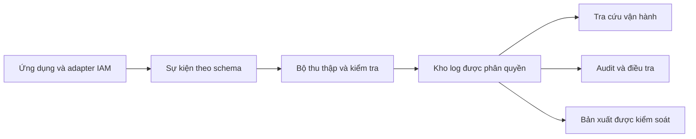

# PII trong log

## 1. Vì sao log IAM dễ chứa dữ liệu định danh?

**PII** trong bài này là thông tin có thể nhận diện một cá nhân trực tiếp hoặc khi kết hợp với dữ liệu khác. Trong IAM, log phát sinh ngay tại những bước xử lý danh tính: đăng nhập, MFA, liên kết tài khoản, cấp phiên, kiểm tra quyền và cấp phát tài khoản.

Một dòng log có thể chứa email, số điện thoại hoặc tên tài khoản. Nhưng ngay cả khi bỏ những trường đó, tổ hợp ID người dùng, thời điểm truy cập, tên ứng dụng và địa chỉ mạng vẫn có thể liên kết tới một người cụ thể trong bối cảnh của hệ thống.

Ví dụ, một hệ thống ghi toàn bộ request khi đăng nhập thất bại để “dễ debug”. Request có thể chứa mật khẩu, cookie, mã xác minh hoặc thông tin trong URL callback. Sau đó, dữ liệu được chuyển tới bộ thu thập, kho tìm kiếm và bản xuất hỗ trợ. Một thao tác ghi log đã tạo thêm nhiều nơi phải bảo vệ.

Mục tiêu thiết kế là giữ đủ bằng chứng để vận hành và kiểm toán, đồng thời giảm dữ liệu cá nhân và bí mật bị sao chép sang hệ thống quan sát. Bài tập trung vào các biện pháp kỹ thuật; phạm vi phân loại và yêu cầu xử lý cụ thể cần được xác định theo chính sách áp dụng cho hệ thống.

## 2. Phân loại dữ liệu trước khi quyết định ghi

PII và bí mật xác thực có phần giao nhau, nhưng không phải cùng một khái niệm. Một API key của workload có thể không định danh cá nhân mà vẫn không được phép xuất hiện trong log thông thường.

| Nhóm dữ liệu | Ví dụ trong IAM | Cách xem xét khi thiết kế log |
| --- | --- | --- |
| Định danh trực tiếp | Email, số điện thoại, tên đầy đủ | Chỉ ghi khi có mục đích rõ và không có lựa chọn ít dữ liệu hơn |
| Định danh liên kết được | Subject ID, mã nhân sự, định danh thiết bị | Vẫn đánh giá khả năng truy ngược hoặc nối dữ liệu |
| Dữ liệu ngữ cảnh | IP, thời điểm đăng nhập, ứng dụng truy cập, vị trí suy luận | Xem rủi ro khi kết hợp và mức chi tiết thực sự cần |
| Thuộc tính hồ sơ hoặc tổ chức | Đơn vị, chức danh, nhóm, trạng thái tài khoản | Không ghi nguyên hồ sơ chỉ để giải thích một quyết định |
| Bí mật và thông tin cấp quyền | Mật khẩu, mã OTP, cookie phiên, access token, refresh token, khóa riêng | Loại khỏi log; xử lý việc lộ như sự cố theo loại dữ liệu |
| Kết quả vận hành đã giới hạn | Loại sự kiện, nhóm kết quả, thời lượng, mã chính sách | Thường phù hợp hơn để quan sát, nhưng vẫn cần kiểm soát ngữ cảnh |

Các thuộc tính như nhóm hoặc ứng dụng được truy cập có thể tiết lộ nhiều hơn một tên người dùng. Ví dụ, tên nhóm có thể phản ánh vai trò đặc quyền hoặc một phân loại cá nhân mà người xem log không cần biết.

Không mặc định “ID nội bộ không phải email” nghĩa là đã loại bỏ khả năng định danh. Nếu đội vận hành có thể tra ID đó trong directory, dữ liệu vẫn có thể được liên kết tới người dùng.

## 3. Những đường đưa PII vào log thường bị bỏ sót

### Ghi toàn bộ request, response hoặc đối tượng

Các lệnh ghi request body, header map, đối tượng principal hoặc response từ IdP dễ sao chép dữ liệu vượt nhu cầu. Một đối tượng ban đầu có ít trường nhưng sau khi bổ sung tính năng có thể chứa thêm token hoặc thuộc tính nhạy cảm; lời gọi log cũ vẫn tiếp tục xuất tất cả.

Không coi phương thức `toString()` hoặc cơ chế serialize mặc định của đối tượng bảo mật là định dạng log an toàn. Cần một biểu diễn dành riêng cho quan sát với các trường được chọn rõ ràng.

### URL, callback và header

URL có thể chứa query parameter của luồng xác thực. Header có thể chứa thông tin cấp quyền, cookie hoặc định danh được bên ngoài gửi vào. Ngoài log của ứng dụng, gateway, reverse proxy và bộ ghi truy cập cũng có thể lưu những giá trị này.

Trong luồng SSO, việc ứng dụng không log token chưa đủ nếu proxy vẫn ghi nguyên URL callback hoặc công cụ theo dõi tự thu thập response. Cần kiểm tra đường đi dữ liệu tại từng lớp có khả năng ghi nhận.

### Exception và log từ dependency

Thông báo lỗi directory có thể chứa distinguished name, tên tài khoản hoặc bộ lọc truy vấn. Exception của HTTP client có thể kèm URL và nội dung phản hồi. Ghi `exception.message` vào một trường có tên chung như `details` không làm dữ liệu bên trong bớt nhạy cảm.

Stack trace cũng cần được đánh giá cùng thông báo lỗi và các dữ liệu mà công cụ theo dõi tự gắn kèm. Một collector có thể thu thêm biến cục bộ hoặc nội dung request theo cấu hình; chỉ kiểm tra câu lệnh log trong mã ứng dụng sẽ không bao phủ được phần đó.

### Audit, trace và bản xuất hỗ trợ

Gọi một bản ghi là audit không làm mọi dữ liệu trong đó trở nên cần thiết. Trace span, breadcrumb, message queue metadata và gói chẩn đoán cũng là những nơi dữ liệu có thể bị sao chép.

Một dashboard có thể che email khi hiển thị nhưng bản JSON tải xuống vẫn giữ email nguyên vẹn. Kiểm soát hiển thị và kiểm soát dữ liệu lưu hoặc xuất là các lớp khác nhau.

## 4. Thiết kế sự kiện bằng danh sách trường cho phép

Cách chủ động hơn việc lọc mọi chuỗi nhạy cảm là định nghĩa schema log theo từng loại sự kiện. Mỗi trường cần có mục đích, nguồn dữ liệu và giới hạn giá trị.

Ví dụ, để biết vì sao đăng nhập thất bại ở bước phụ thuộc, một sự kiện có thể gồm:

```json
{
  "event": "authentication.completed",
  "service": "iam-login",
  "environment": "production",
  "correlation_id": "auth-demo-01",
  "outcome": "dependency_failure",
  "stage": "directory_lookup",
  "error_category": "dependency_timeout",
  "duration_ms": 850,
  "policy_version": "login-policy-4"
}
```

ID trong ví dụ chỉ phục vụ minh họa. Sự kiện không cần ghi email, mật khẩu, truy vấn directory hoặc response đầy đủ để thể hiện điểm thất bại.

Một schema tối thiểu có thể được đánh giá như sau:

| Trường | Lý do ghi | Điều cần tránh |
| --- | --- | --- |
| `event` | Nhận biết loại hành động | Dùng chuỗi tự do chứa nội dung người dùng |
| `outcome` | Phân biệt thành công, từ chối và lỗi | Ghép nguyên thông báo exception |
| `error_category` | Nhóm lỗi để tổng hợp và điều tra | Sao chép tên tài khoản hoặc bộ lọc vào mã lỗi |
| `correlation_id` | Nối sự kiện trong giao dịch | Mã hóa email hoặc token vào ID |
| `duration_ms` | Đánh giá tác động hiệu năng | Ghi cùng toàn bộ payload chỉ để giải thích thời lượng |
| `policy_version` | Đối chiếu thay đổi chính sách | Ghi nguyên biểu thức có dữ liệu cá nhân nội suy |

Nếu một sự kiện kiểm toán thực sự cần nhận biết chủ thể, có thể dùng tham chiếu được kiểm soát thay vì sao chép toàn bộ hồ sơ. Việc tra cứu từ tham chiếu sang danh tính nên có quyền riêng và dấu vết truy cập thích hợp.

Không nên đặt trường `details` không giới hạn rồi cho mọi thành phần tự nhét dữ liệu vào. Những trường mở rộng cần có hợp đồng rõ, nếu không danh sách cho phép ở bên ngoài chỉ còn mang tính hình thức.

## 5. Masking, hashing và pseudonymization có giới hạn gì?

Các kỹ thuật biến đổi dữ liệu có thể hữu ích, nhưng không tự biến mọi bản ghi thành dữ liệu vô danh.

| Kỹ thuật | Có thể giúp gì? | Giới hạn |
| --- | --- | --- |
| Loại bỏ trường | Tránh lưu dữ liệu không cần dùng | Cần xác nhận dữ liệu không bị sao chép ở nơi khác |
| Masking | Giảm phần thông tin nhìn thấy, ví dụ chỉ hiện một phần email | Mẫu còn lại và ngữ cảnh vẫn có thể nhận diện |
| Cắt bớt hoặc giảm độ chi tiết | Giảm dữ liệu ngữ cảnh được giữ | Không bảo đảm mất khả năng liên kết |
| Hash không khóa | Tạo giá trị dẫn xuất xác định | Dữ liệu có thể đoán như email dễ bị đối chiếu bằng tập giá trị ứng viên |
| Pseudonymization có cơ chế quản lý | Thay định danh bằng mã trong một phạm vi | Bên giữ ánh xạ hoặc dữ liệu liên quan vẫn có thể nhận biết chủ thể |
| Mã hóa | Bảo vệ dữ liệu trước bên không có khóa theo thiết kế | Người có quyền giải mã vẫn thấy dữ liệu; lượng dữ liệu thu thập không giảm |

Hash email bằng một hàm băm không khóa không đủ để khẳng định đã vô danh hóa. Người có một danh sách email ứng viên có thể tính các giá trị tương ứng và so sánh. Thêm một giá trị công khai không tự loại bỏ khả năng đối chiếu đó.

Nếu cần liên kết sự kiện theo chủ thể mà không lộ định danh trực tiếp, thiết kế có thể cân nhắc mã thay thế hoặc phép dẫn xuất có khóa theo phạm vi. Khi đó phải quản lý khóa, ánh xạ, quyền truy cập và mục đích liên kết. Việc dùng cùng một mã ở mọi ứng dụng, tenant và thời gian dài vẫn tạo khả năng theo dõi rộng.

Không hash mật khẩu, token hoặc mã OTP rồi ghi vào log để “an toàn hơn”. Những giá trị đó không cần xuất hiện dưới dạng dẫn xuất trong log vận hành thông thường; việc tạo thêm dấu vết ổn định có thể mở ra rủi ro đối chiếu không cần thiết.

## 6. Kiểm soát từ nơi phát sinh đến nơi tra cứu

Một luồng dữ liệu quan sát có thể gồm nhiều chặng:



### Giảm dữ liệu tại nguồn

Loại thông tin không cần thiết trước khi nó được gửi vào logger hoặc công cụ theo dõi. Đây là nơi có ngữ cảnh tốt nhất để biết trường nào thực sự cần.

Một mẫu xử lý ở mức ý tưởng:

```text
onAuthenticationFinished(transaction, result):
    event = newAllowedEvent("authentication.completed")
    event.correlation_id = transaction.observationReference
    event.outcome = mapToAllowedOutcome(result)
    event.error_category = mapToAllowedErrorCategory(result)
    event.duration_ms = transaction.elapsedTime

    emitStructuredEvent(event)
```

Không thêm `transaction.request`, `result.rawResponse` hoặc `exception.message` vào sự kiện bằng một nhánh debug tiện lợi. Nếu cần thêm thông tin chẩn đoán, thiết kế các trường cụ thể và đánh giá chúng theo cùng nguyên tắc.

### Kiểm tra tại collector

Collector có thể kiểm tra schema, loại hoặc che trường ngoài hợp đồng và phát hiện mẫu dữ liệu không mong đợi. Đây là lớp bổ sung, không phải lý do cho phép ứng dụng gửi mọi dữ liệu rồi chờ lọc.

Nếu PII đã được gửi vào collector, nó có thể đã xuất hiện trong buffer, spool trên đĩa, hàng đợi hoặc nơi ghi lỗi trước khi bộ lọc chạy. Kiểm tra cần tính tới thứ tự xử lý và đường lỗi, không chỉ đầu ra cuối cùng.

### Phân quyền tại nơi lưu và truy vấn

Nhân viên vận hành có thể cần xem kết quả kỹ thuật nhưng không cần toàn bộ danh tính. Nhà điều tra có thể cần khả năng đối soát sâu hơn trong một phạm vi cụ thể. Tách các quyền này giúp áp dụng nguyên tắc ít quyền nhất cho chính hệ thống log.

Trong môi trường nhiều tenant, điều kiện tenant phải được áp dụng từ quyền của người tra cứu. Không dựa vào việc người dùng công cụ tự thêm bộ lọc đúng. Quyền tải xuống, chia sẻ dashboard, tạo liên kết công khai và xuất gói hỗ trợ cũng cần được kiểm soát.

## 7. Redaction và log có cấu trúc không giải quyết mọi vấn đề

Một bộ lọc có thể xóa trường tên `password`, nhưng bỏ sót cùng giá trị trong `requestBody`, `description` hoặc thông báo lỗi. Thuộc tính có thể bị đổi tên, lồng sâu hoặc xuất hiện ở dạng mã hóa biểu diễn khác.

Các biểu thức tìm mẫu có thể hỗ trợ phát hiện email hoặc số điện thoại, nhưng có cả bỏ sót lẫn nhận nhầm. Chúng khó hiểu ý nghĩa của subject ID, nhóm nội bộ hay một chuỗi callback. Vì vậy, danh sách cho phép dựa trên schema và dữ liệu phát sinh có chủ đích thường dễ kiểm soát hơn việc chỉ dựa vào regex.

Log JSON có cấu trúc giúp tránh ghép chuỗi tùy tiện và hỗ trợ truy vấn. Tuy nhiên, JSON vẫn có thể chứa toàn bộ hồ sơ hoặc token nếu ứng dụng đưa chúng vào. Định dạng có cấu trúc không đồng nghĩa nội dung đã được giảm thiểu.

Đầu vào người dùng cũng cần được xử lý để không giả mạo thêm dòng log hoặc trường sự kiện. Dùng serializer và cơ chế ghi log phù hợp, giới hạn chiều dài và không coi dữ liệu đầu vào là cấu trúc log. Vấn đề này khác với PII: escape ký tự có thể bảo vệ định dạng nhưng vẫn giữ nguyên thông tin cá nhân.

## 8. Debug và điều tra mà không mở rộng thu thập vô hạn

Khi có sự cố, đội vận hành thường muốn bật debug để thấy nhiều dữ liệu hơn. Một chế độ debug tốt vẫn sử dụng schema đã được duyệt và chỉ bổ sung trường cần thiết cho vấn đề cụ thể.

Có thể giới hạn theo thời gian, thành phần, môi trường và nhóm giao dịch phù hợp. Nhưng giới hạn đó không tự làm việc ghi token hay mật khẩu trở nên cần thiết. Không dùng dữ liệu người dùng thật làm mẫu để kiểm tra bộ che dữ liệu khi có thể dùng dữ liệu tổng hợp.

Correlation ID giúp thu hẹp tập sự kiện của một giao dịch mà không cần tìm bằng email trong mọi dòng log. Khi thực sự cần xác định chủ thể, công cụ có quyền thích hợp có thể đối soát với kho danh tính thay vì nhân bản định danh sang mọi bản ghi.

Sampling cũng không phải biện pháp loại bỏ PII. Nó có thể giảm khối lượng thu thập, nhưng những mẫu còn lại vẫn chứa dữ liệu nhạy cảm nếu schema không được kiểm soát. Ngược lại, với dữ liệu kiểm toán cần đầy đủ theo hợp đồng hệ thống, lấy mẫu tùy tiện còn có thể làm mất bằng chứng cần thiết.

## 9. Lưu giữ, bản sao và xử lý khi phát hiện rò rỉ

Thời hạn lưu cần gắn với mục đích của từng loại dữ liệu: vận hành ngắn hạn, điều tra, kiểm toán hoặc nhu cầu khác đã được xác định. Không có một số ngày chung phù hợp với mọi loại log IAM.

Chính sách phải tính tới log chính, chỉ mục tìm kiếm, cache, replica, backup, bản xuất và gói hỗ trợ. Xóa một trường khỏi giao diện không có nghĩa bản gốc đã biến mất khỏi các nơi này.

Nếu phát hiện PII hoặc bí mật xác thực đã đi vào log, một quy trình kỹ thuật có thể bao gồm:

1. Dừng nguồn ghi không phù hợp bằng thay đổi có phạm vi xác định.
2. Xác định loại dữ liệu, thời gian và các đích đã nhận, kể cả bản sao và bản xuất.
3. Giới hạn quyền tiếp cận tập dữ liệu bị ảnh hưởng trong khi xử lý.
4. Nếu có thông tin cấp quyền còn hiệu lực, đánh giá và thực hiện vô hiệu hóa hoặc thay thế theo loại thông tin.
5. Xử lý dữ liệu đã ghi theo chính sách sự cố và lưu giữ, có xác minh kết quả.
6. Bổ sung kiểm soát để cùng đường ghi không tái diễn.

Không tự xóa rộng toàn bộ log để che sự cố. Việc giữ bằng chứng và xử lý bản sao cần được điều phối đúng phạm vi. Tương tự, chỉ xóa token khỏi một chỉ mục không làm token đã bị lộ mất khả năng sử dụng.

## 10. Kiểm chứng thiết kế bằng dữ liệu tổng hợp

Thiết kế log cần được kiểm tra ở các đường thành công, từ chối và lỗi. Đường lỗi thường có mức thu thập cao hơn do exception và công cụ theo dõi tự gắn context.

Một tập tình huống kiểm chứng có thể gồm:

| Tình huống | Điều cần xác nhận |
| --- | --- |
| Đăng nhập thành công và thất bại | Không có mật khẩu, cookie hoặc payload thông tin xác thực |
| MFA sai mã hoặc hết hạn | Không có mã OTP, bí mật đăng ký hoặc mã khôi phục |
| Callback SSO lỗi | Không có token, authorization code hoặc toàn bộ query nhạy cảm |
| Directory không phản hồi | Không lộ thông tin bind, DN hoặc bộ lọc chứa định danh ngoài phạm vi |
| Kiểm tra quyền bị từ chối | Chỉ có dữ liệu giải thích quyết định cần thiết, không nguyên hồ sơ |
| Thu thập debug và export | Các giới hạn dữ liệu vẫn được áp dụng tại đầu ra thực tế |
| Tra cứu giữa các tenant | Người xem không thể vượt phạm vi nhờ biết ID hoặc sửa bộ lọc |

Có thể dùng các giá trị tổng hợp dễ nhận biết để tìm xem chúng có xuất hiện ở đầu ra hay không. Cần kiểm tra cả collector, kho lưu và bản xuất trong môi trường kiểm chứng được phép, không chỉ nội dung console của ứng dụng.

Việc không tìm thấy một mẫu tổng hợp không chứng minh mọi PII đã được loại bỏ. Nó là một phần bằng chứng, kết hợp với schema, kiểm soát dependency và đánh giá các thay đổi mới. Khi một thư viện được bật thu thập request hoặc một đối tượng hồ sơ có thêm trường, hợp đồng log cũng cần được xem xét.

## 11. Ví dụ áp dụng cho luồng IAM

Giả sử một ứng dụng cần điều tra các lỗi đăng nhập liên quan directory. Thiết kế ban đầu ghi email, toàn bộ request và exception đầy đủ vào cùng một dòng. Đội vận hành thực tế chỉ cần biết giao dịch nào lỗi, lỗi ở bước nào, thời gian chờ và nhóm lỗi.

Thiết kế được điều chỉnh theo các nguyên tắc sau:

- Sự kiện vận hành ghi correlation ID, loại bước, nhóm kết quả và thời lượng.
- Dữ liệu nhận biết chủ thể chỉ xuất hiện trong bản ghi có mục đích rõ, với quyền tra cứu phù hợp.
- Adapter ánh xạ lỗi dependency sang mã hữu hạn, tránh sao chép thông báo chứa dữ liệu đầu vào.
- Gateway và công cụ theo dõi áp dụng cùng giới hạn đối với header, query và body nhạy cảm.
- Bản xuất hỗ trợ giữ giới hạn dữ liệu và quyền truy cập tương ứng.

Nhờ đó, người vận hành vẫn có thể nối các bước của giao dịch và xác định đường lỗi mà không cần mỗi thành phần lưu thêm một bản hồ sơ. Khi cần đối soát danh tính, họ đi qua cơ chế có kiểm soát thay vì tìm định danh trực tiếp trong mọi dòng log.

Log IAM hữu ích khi trả lời được câu hỏi vận hành và kiểm toán với lượng dữ liệu phù hợp. Chất lượng đó đến từ việc chọn trường ngay tại nguồn, kiểm soát toàn bộ đường lưu chuyển và giới hạn người có thể xem hoặc xuất dữ liệu.
