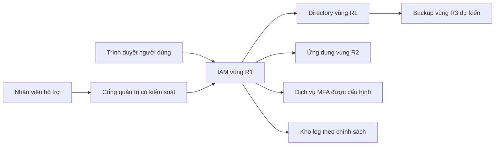

# Cross-border identity data

## 1. Dữ liệu danh tính đi qua biên giới bằng những đường nào?

**Cross-border identity data** đề cập tới dữ liệu danh tính được truyền, lưu trữ, xử lý hoặc truy cập qua các ranh giới quốc gia và phạm vi quản lý có liên quan. Trong một nền tảng IAM phân tán, dữ liệu có thể đi xa hơn vị trí của cơ sở dữ liệu tài khoản chính.

Ví dụ, hồ sơ người dùng nằm trong một vùng triển khai, nhưng ứng dụng ở vùng khác nhận email qua SSO. Log đăng nhập được gửi tới kho quan sát tập trung; bản sao lưu được đặt ở vùng dự phòng; nhân viên hỗ trợ từ một địa điểm khác có quyền mở hồ sơ. Các đường này đều cần được nhận diện khi đánh giá luồng dữ liệu của hệ thống.

Bài này tập trung vào thiết kế và kiểm soát kỹ thuật. Việc một luồng cụ thể có được phép thực hiện, phải đáp ứng điều kiện gì và có được xem là chuyển dữ liệu theo quy định áp dụng hay không cần được xác định từ chính sách, hợp đồng và đánh giá có thẩm quyền. Một cấu hình cloud hoặc lựa chọn của người dùng không tự giải quyết các câu hỏi đó.

## 2. Phạm vi dữ liệu lớn hơn bảng user

IAM xử lý nhiều loại dữ liệu có thể liên quan tới cá nhân. Không nên lập bản đồ xuyên vùng chỉ cho email, số điện thoại và tên đầy đủ.

| Nhóm dữ liệu | Ví dụ | Đường lưu chuyển thường cần kiểm tra |
| --- | --- | --- |
| Định danh | Subject ID, username, mã nhân sự | SSO, liên kết tài khoản, provisioning |
| Thuộc tính | Email, đơn vị, trạng thái tài khoản, nhóm | Token, endpoint hồ sơ, đồng bộ directory |
| Bằng chứng và ngữ cảnh xác thực | Phương thức xác thực, thời điểm, thiết bị, tín hiệu rủi ro | MFA, đánh giá rủi ro, audit |
| Dữ liệu cấp quyền | Vai trò, entitlement, quan hệ tổ chức | Policy service, API, bộ nhớ đệm quyền |
| Thông tin xác thực và phiên | Token, cookie, khóa hoặc bí mật liên quan | Trình duyệt, kho phiên, dịch vụ cấp token |
| Dữ liệu quan sát | IP, trace, correlation ID, log lỗi | Collector, kho log, công cụ hỗ trợ |
| Dữ liệu phục hồi | Snapshot, bản sao lưu, bản xuất | Disaster recovery, kiểm thử khôi phục, hỗ trợ |

Bí mật xác thực cần biện pháp bảo vệ riêng; không nên chuyển hoặc nhân bản chúng chỉ vì một ứng dụng cần thuộc tính hồ sơ. Trong nhiều kiến trúc liên kết danh tính, ứng dụng nhận kết quả xác thực thích hợp thay vì nhận mật khẩu người dùng.

Subject ID không chứa tên vẫn có thể được liên kết tới cá nhân. Tương tự, một danh tính workload có thể gắn với người sở hữu, người phê duyệt hoặc lịch sử hành động quản trị. Phân loại cần dựa vào ngữ cảnh sử dụng, không chỉ tên trường.

## 3. Phân biệt lưu trú, xử lý và khả năng truy cập

Nói “dữ liệu nằm ở vùng R1” có thể chỉ mô tả vị trí lưu bản chính. Nó chưa mô tả đầy đủ đường xử lý và quyền truy cập.

| Góc nhìn | Câu hỏi kiến trúc cần trả lời |
| --- | --- |
| Lưu trữ | Bản chính, replica, cache, chỉ mục và backup nằm ở đâu? |
| Xử lý | Thành phần nào đọc, biến đổi hoặc ra quyết định từ dữ liệu, tại vùng nào? |
| Truy cập | Nhân viên, tài khoản quản trị và nhà cung cấp nào có thể xem hoặc xuất dữ liệu? |
| Điều phối | Control plane, cấu hình tenant và công cụ vận hành có phụ thuộc dịch vụ toàn cục không? |
| Phục hồi | Khi sự cố, dữ liệu và dịch vụ được chuyển tới đâu? |
| Lưu giữ | Khi hết thời hạn hoặc có yêu cầu xóa, bản sao nào còn tồn tại? |

**Data residency** thường được dùng để nói về vị trí dữ liệu được lưu theo phạm vi đã mô tả. Các yêu cầu rộng hơn về xử lý, quyền truy cập và thẩm quyền quản lý cần được làm rõ riêng; không nên dùng một nhãn residency để khẳng định mọi khía cạnh đã được đáp ứng.

Truy cập quản trị từ xa là một đường cần đánh giá ngay cả khi không tạo bản sao cơ sở dữ liệu ở nơi khác. Công cụ hỗ trợ có thể hiển thị, tải xuống hoặc lưu dữ liệu tạm. Kết luận về cách phân loại đường đó phải dựa trên yêu cầu áp dụng, không suy ra chỉ từ việc sử dụng VPN.

## 4. Lập bản đồ luồng dữ liệu theo giao dịch và vòng đời

Một sơ đồ đầu vào có thể như sau. R1, R2 và R3 là các vùng giả định, không đại diện cho một quốc gia cụ thể:



Sơ đồ giúp đặt câu hỏi, không chứng minh các đường đã được phép. Từng mũi tên cần có mô tả dữ liệu và điều kiện thực hiện.

Một bảng kiểm kê luồng có thể gồm:

| Trường kiểm kê | Nội dung cần ghi rõ |
| --- | --- |
| Nguồn và bên nhận | Hệ thống, đơn vị quản lý và endpoint được cấu hình |
| Vùng nguồn và vùng đích | Vị trí theo phạm vi đánh giá, kể cả xử lý và lưu |
| Tập dữ liệu | Tên thuộc tính, dữ liệu suy dẫn, metadata và bí mật nếu có |
| Mục đích | Đăng nhập, kiểm tra quyền, hỗ trợ hay khôi phục |
| Thời điểm và tần suất | Theo giao dịch, đồng bộ định kỳ hoặc khi xảy ra sự cố |
| Thời hạn và bản sao | Cache, log, backup, bản xuất và cơ chế xóa |
| Quyền truy cập | Workload, quản trị viên, nhà cung cấp và cơ chế hỗ trợ |
| Chính sách phê duyệt | Phiên bản quy tắc, chủ sở hữu và bằng chứng đánh giá |

Không chỉ kiểm kê đường thành công. Callback lỗi có thể bị ghi nguyên URL; sự cố có thể kích hoạt gửi crash dump; failover có thể đổi vùng xử lý. Những đường ít xảy ra vẫn có thể mang nhiều dữ liệu hơn luồng bình thường.

## 5. Các luồng IAM dễ tạo chia sẻ xuyên vùng

### Federation và SSO

Khi IdP cung cấp kết quả xác thực cho một ứng dụng ở vùng khác, các claim hoặc assertion được phát hành là một phần của luồng dữ liệu cần xem xét. Vị trí hồ sơ gốc không quyết định vị trí của mọi bản sao thuộc tính sau đó.

Ứng dụng có thể nhận dữ liệu qua trình duyệt, nhận trực tiếp từ dịch vụ token hoặc gọi endpoint hồ sơ. Cần kiểm tra cả các kênh này thay vì chỉ xem một token được trả ở bước đầu.

Một thiết kế giảm dữ liệu có thể chỉ phát hành định danh theo phạm vi ứng dụng và thuộc tính thực sự cần. Không gửi toàn bộ nhóm nội bộ hoặc hồ sơ nhân sự cho mọi ứng dụng SSO.

Token được ký không mặc định được giữ bí mật về nội dung. Cần đánh giá dữ liệu bên nhận có thể đọc, nơi token được lưu và việc thuộc tính có bị ghi vào log hay cache tại ứng dụng không.

### Provisioning và đồng bộ directory

Đồng bộ tài khoản sang ứng dụng ở vùng khác tạo một bản dữ liệu tại bên nhận. Khi nguồn thay đổi hoặc tài khoản bị vô hiệu hóa, cần có cơ chế đồng bộ tương ứng và đối soát kết quả.

Xóa thuộc tính ở directory nguồn không tự xóa nó khỏi tài khoản ứng dụng, log đồng bộ hoặc backup đích. Bản đồ luồng phải bao gồm cả cập nhật, thu hồi quyền và kết thúc vòng đời.

### MFA và đánh giá rủi ro

Dịch vụ MFA có thể cần thông tin liên hệ, định danh thiết bị hoặc metadata của giao dịch. Thành phần đánh giá rủi ro có thể xử lý IP và tín hiệu hành vi. Chỉ ghi “dịch vụ xác thực phụ trợ” trong sơ đồ là chưa đủ; phải xác định dữ liệu thực sự gửi và nơi xử lý theo cấu hình đang dùng.

Không mặc định mọi phương thức MFA cần cùng dữ liệu hoặc có cùng đường xử lý. Việc đổi nhà cung cấp hoặc bật thêm phương thức có thể tạo luồng mới cần được đánh giá.

### Quan sát và hỗ trợ

Log, trace và bản xuất hỗ trợ thường được tập trung để thuận tiện vận hành. Nếu chúng chứa email, subject ID hoặc token, một thiết kế hồ sơ theo vùng vẫn có thể chia sẻ dữ liệu qua hệ thống quan sát.

Collector và công cụ hỗ trợ cần nằm trong cùng quá trình kiểm kê. Tắt trường nhạy cảm ở ứng dụng nhưng để công cụ theo dõi tự thu body hoặc header không giải quyết hết đường chia sẻ.

## 6. Chuyển chính sách thành ràng buộc kỹ thuật

Sau khi các luồng được đánh giá, hệ thống cần biểu đạt được quyết định đó thành các giới hạn có thể thực thi. Chỉ có một tài liệu mô tả “không chuyển dữ liệu ngoài vùng” là chưa đủ nếu các endpoint và cơ chế failover vẫn cho phép chuyển tùy ý.

Một hợp đồng luồng minh họa có thể như sau:

```yaml
flowId: workforce-sso-r1-to-app-r2
policyVersion: reviewed-flow-3
sourceRegion: R1
recipientId: application-b
destinationRegion: R2
purpose: application-sign-in
allowedAttributes:
  - application_subject
  - display_name
forbiddenAttributes:
  - phone_number
  - full_group_membership
storageProfile: approved-application-profile
onwardSharingProfile: approved-recipient-profile
supportAccessProfile: restricted-support-profile
```

Đây là schema minh họa, không phải cấu hình mặc định của một sản phẩm. Giá trị profile cần tham chiếu tới quy tắc thực có; tên “approved” không tự chứng minh đã đánh giá hoặc thực thi.

Các điểm thực thi có thể bao gồm:

- Danh sách endpoint và bên nhận được phép gọi từ từng vùng.
- Chính sách phát hành thuộc tính theo client, mục đích và ngữ cảnh đã xác minh.
- Cấu hình vùng cho dữ liệu chính, replica, backup, cache và kho log.
- Hạn chế egress và danh tính workload được phép thực hiện luồng.
- Quyền quản trị và cơ chế hỗ trợ có phạm vi, thời hạn, phê duyệt và audit.
- Quy tắc thay đổi và failover kiểm tra lại phạm vi được phép.

Không dùng một header `region` do client tự gửi làm bằng chứng đủ để chọn nơi lưu dữ liệu. Vùng chính sách của tenant hoặc tài khoản cần lấy từ cấu hình có thẩm quyền. Vị trí suy luận từ IP có thể hỗ trợ một số quyết định ngữ cảnh, nhưng không thay thế dữ liệu chính sách và không tự chứng minh quốc tịch hay nơi cư trú.

## 7. Giảm dữ liệu và tách định danh giữa các bên nhận

Giảm tập thuộc tính giúp hạn chế dữ liệu đi qua ranh giới. Ví dụ, ứng dụng chỉ cần biết người dùng có tư cách thành viên hợp lệ thì có thể nhận một thuộc tính về điều kiện đó, thay vì toàn bộ danh sách nhóm và đơn vị.

Một định danh riêng theo ứng dụng có thể giảm khả năng các bên nhận trực tiếp nối hồ sơ bằng cùng một mã toàn cục. Tuy nhiên, dữ liệu đó không tự trở thành vô danh: hệ thống nguồn vẫn có thể giữ ánh xạ, còn các thuộc tính bổ sung có thể hỗ trợ liên kết.

Hash email cũng không tự giải quyết vấn đề. Dữ liệu đầu vào dễ đoán có thể bị đối chiếu, và giá trị dẫn xuất ổn định vẫn hỗ trợ theo dõi giữa các tập dữ liệu. Cần đánh giá khả năng liên kết và quyền truy cập chứ không chỉ kiểm tra chuỗi có còn nhìn giống email hay không.

Consent nếu được yêu cầu trong một luồng cần gắn với đúng bên nhận, thuộc tính và mục đích. Một lựa chọn đồng ý chung không tự mở rộng quyền chia sẻ tới mọi vùng hoặc mọi nhà cung cấp. Các điều kiện khác của chính sách vẫn phải được kiểm tra độc lập.

## 8. Mã hóa, khóa và quyền quản trị

Mã hóa trên đường truyền và khi lưu giúp bảo vệ dữ liệu theo mô hình đe dọa tương ứng. Nhưng nếu dịch vụ ở vùng đích có thể giải mã để xử lý hồ sơ, dữ liệu vẫn đang được sử dụng tại vùng đó theo thiết kế. Mã hóa không thay cho đánh giá luồng hoặc giảm dữ liệu.

Khi xem xét quản lý khóa, cần biết khóa được tạo và sử dụng ở đâu, ai có thể yêu cầu giải mã, cơ chế hỗ trợ nào có thể truy cập và các bản sao phục vụ khôi phục được bảo vệ ra sao.

Tách khóa và quyền quản trị có thể giảm phạm vi truy cập, nhưng không nên kết luận chỉ từ việc “khóa ở R1” rằng mọi xử lý cũng chỉ ở R1. Một workload ở R2 vẫn có thể được cấp quyền gọi dịch vụ giải mã theo cấu hình.

Quản trị viên và workload cần có quyền tối thiểu phù hợp với nhiệm vụ. Truy cập hỗ trợ có thể được thiết kế theo cơ chế cấp tạm thời, giới hạn tập dữ liệu và ghi lại hành động. Tài khoản hỗ trợ dùng chung với quyền đọc toàn cầu làm khó việc kiểm soát và đối soát.

## 9. Backup, failover và những đường phát sinh khi sự cố

Một kiến trúc theo vùng có thể bị thay đổi hành vi khi một vùng ngừng phục vụ. Cần xác định trước đích dự phòng nào được phép và loại dữ liệu nào có thể được phục hồi ở đó.

Không để cơ chế định tuyến tự chuyển sang bất kỳ vùng còn khỏe nào nếu việc chuyển có thể vượt giới hạn đã được phê duyệt. Khả năng phục vụ và phạm vi dữ liệu phải được xử lý cùng nhau trong kế hoạch phục hồi.

| Tình huống | Điều cần xác định trước |
| --- | --- |
| Directory tại R1 không phản hồi | Có endpoint thay thế nào được phép và dữ liệu nào ở đó? |
| Kho log đầy hoặc lỗi | Buffer nằm ở đâu, có chuyển sang kho mặc định vùng khác không? |
| Khôi phục backup để kiểm thử | Môi trường đích, người có quyền và cách xử lý dữ liệu kiểm thử |
| Hỗ trợ khẩn cấp | Ai được cấp quyền, trong bao lâu và có thể xuất dữ liệu gì? |
| Rollback cấu hình | Có khôi phục lại endpoint hoặc luồng từng bị loại bỏ không? |

Khi không có đường dự phòng phù hợp, hệ thống cần phản hồi theo phương án đã thiết kế thay vì âm thầm bỏ ràng buộc dữ liệu. Điều đó cũng không được biến lỗi IAM thành cho phép truy cập không qua kiểm tra.

Backup cần được quản lý theo thời hạn và phạm vi phục hồi. Nếu khôi phục một snapshot cũ, phải có cơ chế đối soát các thay đổi vòng đời sau snapshot, như tài khoản đã bị khóa, quyền đã thu hồi hoặc yêu cầu xử lý dữ liệu đã hoàn tất. Nếu không, phục hồi có thể tái tạo quyền hoặc dữ liệu không còn phù hợp.

## 10. Kiểm chứng bằng cấu hình và bằng chứng vận hành

Chọn một region trong màn hình cấu hình chưa đủ để xác nhận mọi luồng dữ liệu. Bằng chứng cần phù hợp với từng thành phần và phạm vi cần kiểm tra.

Một kế hoạch kiểm chứng kỹ thuật có thể gồm:

1. Đối chiếu sơ đồ với cấu hình endpoint, vùng lưu trữ, replica và backup thực tế.
2. Kiểm tra tập thuộc tính được phát hành cho từng client bằng dữ liệu tổng hợp.
3. Kiểm tra đường egress và danh tính workload gọi các dependency.
4. Kiểm tra collector, log, trace và bản xuất có giữ giới hạn dữ liệu không.
5. Đối chiếu quyền quản trị và hoạt động hỗ trợ với phạm vi đã phê duyệt.
6. Diễn tập failover, khôi phục và xử lý dữ liệu cuối vòng đời trong phạm vi được phép.

Địa chỉ IP hoặc tên miền chỉ cung cấp một phần thông tin về đường kết nối; chúng không tự chứng minh vị trí của mọi bản sao, xử lý phía sau hoặc truy cập quản trị. Với dịch vụ do bên ngoài quản lý, cần kết hợp bằng chứng cấu hình với thông tin dịch vụ, hợp đồng và xác nhận phù hợp từ bên chịu trách nhiệm.

Thay đổi nhà cung cấp, bật tính năng phân tích mới, chuyển collector hoặc đổi vùng dự phòng đều có thể làm bản đồ luồng cũ không còn đúng. Các thay đổi đó nên đi qua cùng cơ chế đánh giá và cập nhật phiên bản chính sách.

## 11. Ví dụ thiết kế cho một tổ chức nhiều vùng

Giả sử tổ chức có hồ sơ nhân sự tại R1 và một ứng dụng cộng tác tại R2. Chính sách đã xác định ứng dụng được nhận định danh riêng theo ứng dụng và tên hiển thị; email và nhóm nội bộ không thuộc tập phát hành của luồng này.

Một thiết kế phù hợp với giả định đó có thể gồm:

- Directory và hồ sơ gốc được quản lý theo cấu hình R1 đã xác nhận.
- IdP phát hành đúng tập claim cho client của ứng dụng tại R2.
- Ứng dụng không tự gọi một endpoint hồ sơ rộng hơn để lấy thêm dữ liệu.
- Log tại các bên chỉ giữ các trường cần cho mục đích vận hành đã xác định.
- Backup, hỗ trợ và failover có cấu hình riêng đã được đối chiếu với phạm vi chính sách.
- Khi tài khoản bị vô hiệu hóa hoặc dữ liệu thay đổi, có đường đồng bộ và đối soát liên quan.

Nếu ứng dụng bắt đầu yêu cầu email, đó là thay đổi luồng cần đánh giá; không chỉ là thêm một trường JSON. Nếu kho log được chuyển sang R3, bản đồ dữ liệu cũng phải thay đổi dù token SSO vẫn giữ nguyên.

Ví dụ này không khẳng định một cặp vùng nào luôn được phép chia sẻ dữ liệu. Nó minh họa cách chuyển quyết định đã được xác định thành giới hạn kỹ thuật ở từng nơi dữ liệu đi qua.

## 12. Những kết luận dễ sai

| Kết luận | Vì sao chưa đủ? |
| --- | --- |
| Cơ sở dữ liệu chính ở một vùng nên không có dữ liệu đi ra ngoài | Claim, log, cache, backup và hỗ trợ có thể tạo các đường khác |
| Dữ liệu đã mã hóa nên không cần đánh giá bên nhận | Bên nhận hoặc workload vẫn có thể giải mã và xử lý |
| Đổi email thành hash là đã vô danh | Vẫn có khả năng đối chiếu hoặc liên kết trong ngữ cảnh |
| Người dùng đã đồng ý nên mọi đường chia sẻ đều được phép | Consent không tự thay thế các điều kiện khác của chính sách |
| Failover chỉ là thay đổi hạ tầng | Nó có thể đổi vùng lưu, xử lý và truy cập dữ liệu |
| Xóa ở nguồn là xóa hết | Dữ liệu có thể còn ở ứng dụng, log, chỉ mục, bản xuất và backup |

Quản lý dữ liệu danh tính xuyên biên giới bắt đầu bằng việc nhìn đầy đủ các đường lưu chuyển trong vòng đời IAM. Khi phạm vi đã được xác định rõ, kiến trúc cần thực thi nó bằng giới hạn thuộc tính, cấu hình vùng, kiểm soát truy cập và cơ chế phục hồi có thể kiểm chứng.
