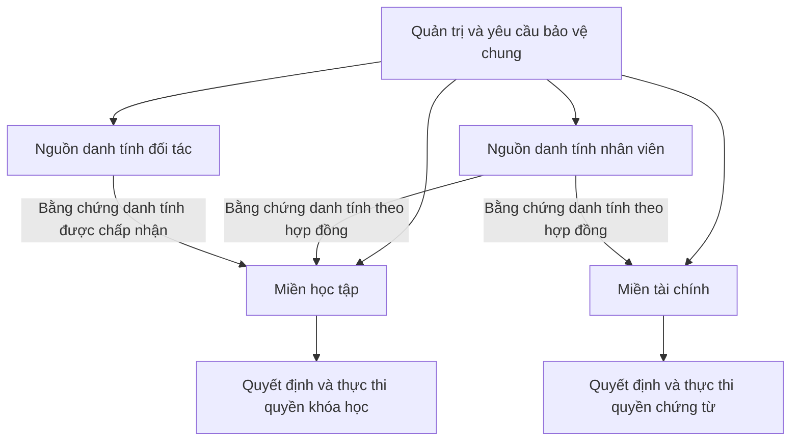

# Decentralized IAM

## 1. Decentralized IAM là gì?

**Decentralized IAM** là cách tổ chức quản lý danh tính và quyền truy cập trong đó nhiều miền hoặc đơn vị có trách nhiệm và quyền tự chủ đối với những phần IAM được xác định rõ. Mỗi miền có thể quản lý nguồn danh tính, chính sách truy cập, vòng đời tài khoản hoặc điểm thực thi của mình, trong khi vẫn cần những quy tắc chung và hợp đồng tin cậy khi kết nối với miền khác.

Một miền có thể là một đơn vị kinh doanh, tổ chức đối tác, hệ thống sản phẩm, tenant hoặc vùng vận hành có ranh giới quản trị phù hợp. Không nên mặc định mỗi microservice phải trở thành một miền IAM độc lập.

Ví dụ, miền nhân sự quản lý trạng thái nhân viên, miền học tập quản lý quyền trên khóa học, còn miền tài chính quản lý quyền trên chứng từ. Miền học tập có thể tin bằng chứng xác thực từ nguồn nhân viên nhưng vẫn tự quyết định người đó được xem hay chấm điểm khóa học nào.

Điểm quan trọng là **phân định quyền quyết định và trách nhiệm**, không chỉ đặt nhiều máy chủ hoặc nhiều bản sao database ở nhiều nơi.

Trong bài này, decentralized IAM được dùng theo nghĩa kiến trúc và quản trị IAM phân quyền theo miền. Nó không mặc nhiên có nghĩa phải dùng blockchain, decentralized identifier hoặc ví danh tính của người dùng.

## 2. Những khái niệm dễ bị nhầm lẫn

| Khái niệm | Trọng tâm | Quan hệ với decentralized IAM |
|---|---|---|
| IAM tập trung | Một đầu mối quản trị chủ yếu kiểm soát danh tính hoặc chính sách | Là một lựa chọn về quyền quản lý; vẫn có thể triển khai nhiều instance |
| Triển khai phân tán | Thành phần phần mềm và dữ liệu nằm trên nhiều node hoặc vùng | Không tự tạo quyền tự chủ cho các miền |
| IAM phân quyền theo miền | Nhiều miền chịu trách nhiệm cho những phần IAM cụ thể | Là phạm vi chính của bài học |
| Federation | Chấp nhận bằng chứng danh tính qua một quan hệ tin cậy đã thiết lập | Là một cách kết nối miền; không tự phân phối toàn bộ quyền quản trị |
| Mô hình lai | Kết hợp quản trị chung với quyết định hoặc thực thi tại miền | Thường hữu ích khi cần vừa thống nhất vừa tự chủ |
| Danh tính do chủ thể kiểm soát và các công nghệ liên quan | Cách tạo, giữ hoặc trình bày bằng chứng danh tính theo một mô hình riêng | Có thể tham gia kiến trúc nhưng không đồng nghĩa decentralized IAM |

SSO cũng không quyết định toàn bộ kiến trúc. Một tổ chức có thể có SSO tập trung nhưng authorization tại từng miền. Ngược lại, nhiều IdP không có hợp đồng tin cậy hoặc quản trị chung có thể chỉ tạo ra nhiều kho tài khoản rời rạc.

Không thể kết luận một kiến trúc an toàn hoặc sẵn sàng cao chỉ từ nhãn “decentralized”. Cần xem những quyền nào được phân chia, nguồn nào được tin và điểm phụ thuộc nào vẫn dùng chung.

## 3. Chọn rõ phần nào được phân quyền

IAM gồm nhiều chức năng có thể được phân chia theo các cách khác nhau:

| Chức năng | Một cách phân chia có thể dùng | Câu hỏi cần trả lời |
|---|---|---|
| Nguồn danh tính | Mỗi tổ chức duy trì chủ thể thuộc trách nhiệm của mình | Ai xác nhận trạng thái và định danh nào có thẩm quyền? |
| Authentication và MFA | Nguồn xác thực của từng miền thực hiện theo yêu cầu chung | Miền nhận có chấp nhận mức bảo đảm đó cho thao tác này không? |
| Authorization | Miền tài nguyên quyết định quyền trên tài nguyên của mình | Ai được sửa policy và ai phê duyệt đặc quyền? |
| Provisioning và vòng đời | Nguồn chủ thể phát sự kiện, miền đích thực thi trạng thái cục bộ | Thu hồi được truyền, xác nhận và đối soát thế nào? |
| Workload identity | Mỗi môi trường quản lý danh tính workload theo phạm vi | Dịch vụ đích tin workload nào và cho phép hành động gì? |
| Audit | Miền ghi bằng chứng tại điểm quyết định và thực thi | Làm sao điều tra xuyên miền mà vẫn giới hạn dữ liệu? |
| Quản trị nền tảng | Có thể giữ chuẩn, kiểm kê và quy trình chung | Chuẩn nào bắt buộc và ngoại lệ thuộc thẩm quyền của ai? |

Một mô hình minh họa là nguồn nhân viên và yêu cầu bảo vệ chung được quản trị tập trung, còn quyền đối với từng tài nguyên được giao cho chủ sở hữu miền nghiệp vụ.

Điều đó giúp nhóm hiểu nghiệp vụ quản lý quyền chi tiết, đồng thời tránh mỗi miền tự đặt một chuẩn xác thực hoàn toàn khác nhau. Mức phân quyền phù hợp phụ thuộc cấu trúc tổ chức, mức rủi ro, năng lực vận hành và các ràng buộc thực tế.

## 4. Kiến trúc logic và ranh giới trách nhiệm

Sơ đồ dưới đây minh họa việc quản trị chung nhưng giữ quyết định quyền ở từng miền tài nguyên:



Các mũi tên biểu diễn quan hệ trách nhiệm hoặc tin cậy logic, không phải tất cả lời gọi mạng trong mỗi request. Việc miền học tập chấp nhận một nguồn đối tác không có nghĩa miền tài chính cũng tự động chấp nhận nguồn đó.

Trong một miền có thể có:

- Điểm tiếp nhận và kiểm chứng bằng chứng danh tính.
- Nơi lưu thuộc tính hoặc entitlement do miền sở hữu.
- Thành phần đánh giá policy.
- Điểm thực thi gần API, dịch vụ hoặc tài nguyên.
- Kênh cập nhật trạng thái, thu hồi và audit.

Các thành phần này có thể nằm trong một ứng dụng hoặc được triển khai thành dịch vụ riêng. Không cần tách mọi chức năng thành một hệ thống độc lập chỉ vì kiến trúc có nhiều miền.

## 5. Hợp đồng tin cậy giữa các miền

Tin cậy phải trả lời những câu hỏi cụ thể, không chỉ có một cấu hình “trust=true”.

| Nội dung hợp đồng | Điều cần xác định |
|---|---|
| Nguồn phát hành | Issuer hoặc nguồn nào được chấp nhận, do ai quản lý |
| Bên nhận | Token, thông điệp hoặc dữ liệu dành cho client, dịch vụ và tài nguyên nào |
| Định danh | Cách phân biệt chủ thể trong ngữ cảnh nguồn, tenant và miền |
| Bằng chứng | Loại thông điệp, cách kiểm chứng tính toàn vẹn, thời hạn và ngữ cảnh |
| Thuộc tính | Claim nào có nguồn đáng tin, ý nghĩa và độ mới ra sao |
| Mức xác thực | Yêu cầu xác thực nào đủ cho từng loại hành động |
| Quyền được ủy quyền | Nguồn ngoài được xác nhận điều gì, miền nhận tự quyết định điều gì |
| Vòng đời | Cách thông báo trạng thái, thu hồi, xử lý lỗi và đối soát |
| Thay đổi và sự cố | Cách xoay khóa, ngừng tin cậy, cập nhật metadata và phối hợp điều tra |

Một bên có quyền xác nhận “đây là nhân viên của tổ chức A” không mặc nhiên có quyền cấp role quản trị ở tổ chức B.

Định danh cũng phải có ngữ cảnh. Hai nguồn có thể cùng dùng giá trị subject `123` cho hai chủ thể khác nhau. Miền nhận cần khóa liên kết phù hợp, thường bao gồm nguồn phát hành cùng định danh và ranh giới tenant liên quan.

Email trùng nhau không tự là bằng chứng đủ để nối hai tài khoản. Việc liên kết tài khoản cần quy trình xác minh và xử lý xung đột riêng, nhất là khi email có thể thay đổi hoặc được tái sử dụng.

### Tin cậy không mặc nhiên bắc cầu

Nếu miền A chấp nhận danh tính từ B và B chấp nhận C, A không tự động phải chấp nhận mọi chủ thể hoặc mọi claim từ C. Nếu dùng broker hoặc một chuỗi liên kết, hợp đồng phải xác định nguồn gốc, thuộc tính và phạm vi mà broker được phép chuyển tiếp hoặc xác nhận.

Không để một miền ít được bảo vệ trở thành đường vòng lấy quyền của miền nhạy cảm chỉ vì chúng cùng kết nối tới một broker.

## 6. Luồng truy cập xuyên miền

Giả sử một giảng viên đối tác truy cập API chấm điểm của miền học tập:

1. Ứng dụng sử dụng luồng xác thực hoặc cấp token đã được cấu hình cho tích hợp.
2. Nguồn danh tính thực hiện xác thực theo hợp đồng của nó và tạo bằng chứng phù hợp.
3. Miền nhận kiểm chứng nguồn phát hành, bên nhận, thời hạn và các điều kiện của loại bằng chứng đó.
4. Miền nhận liên kết chủ thể bằng định danh có ngữ cảnh, không chỉ theo tên hoặc email hiển thị.
5. Thuộc tính từ nguồn ngoài được ánh xạ theo hợp đồng giới hạn.
6. Miền học tập lấy entitlement và quan hệ tài nguyên thuộc trách nhiệm của mình.
7. Điểm quyết định đánh giá hành động cụ thể trên khóa học cụ thể.
8. Điểm thực thi cho phép hoặc từ chối và ghi bằng chứng cần thiết.

Một bằng chứng xác thực hợp lệ không bỏ qua các bước authorization. Việc người dùng thuộc nhóm giảng viên đối tác cũng không mặc định cho phép chấm mọi khóa học.

Nếu token ban đầu không dành cho API học tập, không chuyển tiếp và chấp nhận nó chỉ vì cùng có chữ ký hợp lệ. Cần dùng luồng cấp hoặc trao đổi bằng chứng đã được hỗ trợ và phê duyệt để có credential đúng mục đích, bên nhận và phạm vi.

Các bước trên là luồng logic minh họa. Không phải mọi request đều cần gọi trực tiếp IdP; cách kiểm chứng tại chỗ hoặc qua dịch vụ trạng thái phụ thuộc loại credential và yêu cầu của hệ thống.

## 7. Authorization tại miền tài nguyên

Một lợi ích của phân quyền là chủ sở hữu miền có thể quản lý chính sách sát với nghiệp vụ. Nhưng miền phải chịu trách nhiệm cả những quyết định bị từ chối và các trường hợp thiếu dữ liệu.

Ví dụ logic cho hành động chấm điểm:

```text
Cho phép grade_course khi đồng thời:
    bằng chứng danh tính hợp lệ cho API học tập
    nguồn danh tính được chấp nhận cho nhóm giảng viên đối tác
    chủ thể đang được phép hoạt động theo ngữ cảnh cần kiểm tra
    miền học tập đã gán chủ thể cho đúng khóa học
    hành động nằm trong phạm vi credential được cấp
    các điều kiện bổ sung của policy được đáp ứng

Nếu thiếu bằng chứng bắt buộc hoặc không có quan hệ phù hợp:
    không cấp quyền cho hành động này
```

Đây là logic minh họa, không phải cú pháp của một policy engine cụ thể.

Các role hoặc group bên ngoài cần ánh xạ có phạm vi. Nhận một claim `admin` từ IdP đối tác không phải lý do để tạo quyền quản trị nền tảng trong miền nhận. Nếu cho phép ủy quyền quản trị, phải chỉ rõ bên nào được quản trị tài nguyên nào và trong giới hạn nào.

Với API, kiểm tra quyền cần gắn với đối tượng tài nguyên và hành động, không chỉ với việc người gọi đã đăng nhập. Một gateway có thể thực hiện một phần kiểm tra nhưng không tự biết toàn bộ quan hệ nghiệp vụ bên trong dịch vụ.

Quyền sửa policy, gán role và phê duyệt đặc quyền cũng là quyền nhạy cảm. Phân quyền cho miền không có nghĩa mọi người vận hành miền đều được tự mở rộng quyền không giới hạn.

## 8. Vòng đời danh tính và thu hồi quyền

Federation không tự giải quyết provisioning hoặc deprovisioning. Một ứng dụng có thể tạo tài khoản cục bộ khi đăng nhập lần đầu, rồi giữ phiên và entitlement lâu hơn trạng thái ở nguồn danh tính.

Cần xác định nguồn nào có thẩm quyền đối với từng trạng thái:

- Nguồn nhân viên quản lý quan hệ làm việc và trạng thái thuộc phạm vi của nó.
- Miền học tập quản lý việc phân công khóa học.
- Miền tài chính quản lý phê duyệt chứng từ.
- Nền tảng workload quản lý vòng đời dịch vụ và credential liên quan.

Thay đổi ở một nguồn phải được truyền và áp dụng đúng những nơi chịu tác động. Có thể kết hợp thông báo sự kiện, đồng bộ theo lịch và đối soát trạng thái tùy yêu cầu.

### 8.1. Xử lý hệ thống phân tán

Sự kiện có thể bị gửi lặp, đến muộn hoặc sai thứ tự. Bộ nhận cần xử lý idempotent và có quy tắc xác định phiên bản hoặc thứ tự hợp lệ trong phạm vi nguồn và đối tượng.

Không so sánh tùy tiện một số phiên bản từ nguồn A với số phiên bản của nguồn B như thể chúng cùng một chuỗi. Chủ sở hữu từng loại trạng thái và cách hợp nhất phải rõ ràng.

Một sự kiện cũ “tài khoản hoạt động” đến sau sự kiện vô hiệu hóa không được tự khôi phục tài khoản chỉ vì nó tới sau trên hàng đợi.

### 8.2. Khoảng trễ thu hồi

Thu hồi ở nguồn không nhất thiết có hiệu lực tức thời ở mọi điểm thực thi. Độ trễ có thể liên quan tới phiên ứng dụng, token đã phát hành, cache policy, replication và lịch đồng bộ.

Kiến trúc cần một mục tiêu rõ ràng về thời gian từ quyết định thu hồi tới khi từng lớp ngừng chấp nhận quyền liên quan, kèm phương pháp đo và xử lý trường hợp chưa hoàn tất.

Theo dõi số sự kiện chưa xử lý, tuổi sự kiện, đích lỗi và kết quả đối soát. Việc hàng đợi đã nhận event chỉ là một mốc, không chứng minh dịch vụ đích đã thực thi mất quyền.

## 9. Token, phiên và cấu hình tin cậy

### 9.1. Kiểm chứng credential theo đúng hợp đồng

Với credential có thể kiểm chứng bằng chữ ký, điểm nhận phải dùng cấu hình tin cậy đã được quản lý, kiểm tra nguồn, bên nhận, thời hạn và các ràng buộc của loại credential tương ứng. Chữ ký hợp lệ từ một nguồn bất kỳ không đủ.

Không để dữ liệu chưa được kiểm chứng trong token tự quyết định một nguồn khóa hoặc một issuer mới được tin. Cấu hình thuật toán, khóa và metadata cần được kiểm soát theo giao thức và triển khai sử dụng.

Với opaque token hoặc credential cần tra cứu trạng thái, dịch vụ kiểm tra cũng là một phụ thuộc phải được bảo vệ và giám sát. Token tự chứa và token tra cứu có các đặc tính vận hành khác nhau; không lựa chọn chỉ theo số lời gọi mạng.

### 9.2. Cache và xoay khóa

Cache khóa công khai hoặc cấu hình có thể giảm phụ thuộc trên đường request, nhưng cần có giới hạn độ cũ, cách cập nhật và quy trình khi gặp khóa chưa biết.

Xoay khóa cần phối hợp thời điểm phát hành, phân phối khóa xác minh và các credential còn hiệu lực theo thiết kế. Một bản cache cũ có thể gây từ chối hàng loạt hoặc giữ cấu hình tin cậy đã bị thu hồi lâu hơn mong muốn.

Không biến lỗi cập nhật khóa hoặc policy thành điều kiện bỏ kiểm chứng. Phương án suy giảm phải được thiết kế trước với phạm vi và thời hạn rõ ràng.

### 9.3. Phiên không tự kết thúc đồng loạt

Người dùng có thể có phiên ở IdP và nhiều phiên ứng dụng riêng. Kết thúc một phiên không tự chứng minh mọi phiên và token ở các miền khác đã mất hiệu lực.

Hợp đồng tích hợp cần mô tả hành vi logout, thu hồi, timeout và giới hạn còn tồn tại. Với sự kiện bảo mật nghiêm trọng, có thể cần cơ chế phối hợp riêng thay vì chỉ thực hiện logout tại một ứng dụng.

## 10. Độ sẵn sàng và hành vi khi phụ thuộc lỗi

Phân quyền có thể giảm phụ thuộc quản trị vào một đầu mối, nhưng cũng tạo nhiều nguồn trạng thái và kênh đồng bộ cần vận hành. Một broker chung, kho khóa chung hoặc nguồn nhân viên chung vẫn có thể là phụ thuộc quan trọng của nhiều miền.

Cần phân biệt đường phục vụ request với đường quản trị và cập nhật cấu hình. Nếu điểm thực thi có cấu hình tin cậy, credential và policy còn hợp lệ tại chỗ, một số chức năng có thể tiếp tục theo thiết kế ngay cả khi đường quản trị tạm thời gián đoạn. Những chức năng đòi trạng thái mới nhất có thể không tiếp tục được.

| Tình trạng | Hành vi cần xác định trước |
|---|---|
| IdP nguồn không sẵn sàng | Login mới, refresh và phiên hiện có bị ảnh hưởng thế nào? |
| Dịch vụ quyết định quyền không phản hồi | Hành động nào phải từ chối, cache nào được dùng nếu có? |
| Sự kiện thu hồi bị trễ | Cách giới hạn quyền còn hiệu lực và thông báo tác động |
| Cấu hình khóa chưa cập nhật | Cách xử lý credential chưa thể kiểm chứng |
| Kho audit bị nghẽn | Hành vi theo yêu cầu ghi bằng chứng của từng hoạt động |
| Một miền bị cô lập mạng | Phạm vi nào còn vận hành được mà không vượt hợp đồng? |

Không dùng một quy tắc “dịch vụ IAM lỗi thì cho qua” cho toàn hệ thống. Một phương án dùng cache, nếu được chấp nhận, phải giữ đúng chủ thể, tài nguyên, hành động, phiên bản, thời hạn và các điều kiện liên quan. Cache của quyết định cũ không phải quyền truy cập vĩnh viễn.

Các thao tác quản trị nhạy cảm có thể cần điều kiện mới hơn và mức bảo đảm cao hơn so với đọc dữ liệu ít nhạy cảm. Kiến trúc phải ghi rõ sự khác biệt thay vì áp một hành vi suy giảm cho mọi request.

## 11. Workload identity và bảo vệ dữ liệu xuyên miền

Workload cũng cần định danh và quyền theo miền, chẳng hạn dịch vụ học tập gọi dịch vụ lưu trữ hoặc một tác vụ báo cáo gọi API tài chính.

Nên xác định riêng danh tính workload, người sở hữu vận hành, môi trường, tài nguyên được gọi và vòng đời credential. Không chia sẻ một secret quản trị toàn tổ chức cho mọi dịch vụ chỉ để tránh cấu hình nhiều quan hệ tin cậy.

Xác thực kênh hoặc chứng minh workload đang giữ credential hợp lệ chưa quyết định mọi hành động nghiệp vụ. Dịch vụ đích vẫn cần kiểm tra quyền đối với tài nguyên và mục đích sử dụng. Nếu workload hành động thay người dùng, cần giữ đúng ý nghĩa của danh tính dịch vụ và sự ủy quyền liên quan.

Phân quyền theo miền cũng giúp giới hạn dữ liệu danh tính được chia sẻ. Miền học tập có thể chỉ cần định danh theo hợp đồng và entitlement liên quan; không cần sao chép toàn bộ hồ sơ nhân sự hoặc toàn bộ nhóm của chủ thể.

Các bản sao thuộc tính tạo thêm trách nhiệm về độ mới, sửa sai, retention và quyền riêng tư. Sơ đồ kết nối danh tính nên cho biết cả dữ liệu nào đi qua ranh giới, không chỉ mũi tên token được gửi đi đâu.

## 12. Quản trị chung và khả năng điều tra

Một kiến trúc phân quyền vẫn cần những chuẩn tối thiểu và người chịu trách nhiệm rõ ràng. Những phần có thể được thống nhất gồm yêu cầu bảo vệ credential, định nghĩa claim, mức xác thực, nguyên tắc ánh xạ role, quản lý tenant, quy trình thay đổi trust và phối hợp sự cố.

Chuẩn chung không nhất thiết bắt mọi miền dùng cùng một sản phẩm. Điều cần đạt là hành vi và bằng chứng có thể kiểm chứng ở ranh giới kết nối.

Một phân chia trách nhiệm minh họa:

| Chủ thể quản trị | Trách nhiệm chính |
|---|---|
| Nhóm nền tảng IAM | Giao thức tích hợp được hỗ trợ, công cụ, mẫu cấu hình và kiểm kê trust |
| Chủ sở hữu nguồn danh tính | Tính đúng của trạng thái, định danh, thuộc tính và sự kiện thuộc nguồn |
| Chủ sở hữu miền tài nguyên | Policy nghiệp vụ, entitlement, thực thi và kiểm tra quyền |
| Nhóm an ninh và quản trị | Yêu cầu chung, phê duyệt ngoại lệ và phối hợp xử lý sự cố |
| Người vận hành tích hợp | Theo dõi đồng bộ, xoay khóa, cảnh báo và đối soát |

Để điều tra xuyên miền, cần liên kết được kết quả xác thực, quyết định quyền, phiên bản policy và thao tác thực tế trong phạm vi được phép. Một mã tương quan có kiểm soát có thể hỗ trợ, nhưng không nên log token, secret hoặc toàn bộ hồ sơ chỉ để nối dữ liệu.

Theo dõi riêng lỗi xác thực, từ chối authorization, lỗi kỹ thuật, độ trễ quyết định, độ cũ policy và độ trễ thu hồi. Một tỷ lệ từ chối tăng có thể do mapping sai hoặc nguồn dữ liệu lỗi, không tự chứng minh một miền đang bị tấn công.

## 13. Ví dụ thiết kế ba miền

Một nền tảng có miền nhân viên, miền học tập và miền tài chính. Ngoài ra, miền học tập cần tiếp nhận giảng viên từ một tổ chức đối tác.

Một thiết kế minh họa có thể chọn:

1. Nguồn nhân viên xác nhận danh tính và trạng thái thuộc trách nhiệm của tổ chức.
2. Nguồn đối tác chỉ được tin cho nhóm chủ thể và thuộc tính đã thỏa thuận với miền học tập.
3. Miền học tập giữ phân công giảng viên theo từng khóa học và quyết định quyền chấm điểm.
4. Miền tài chính giữ quyền chứng từ, không tự chấp nhận nguồn đối tác chỉ vì miền học tập đã chấp nhận.
5. Các workload dùng credential riêng đúng API đích, với quyền trong phạm vi chức năng.
6. Trạng thái vô hiệu hóa và thay đổi quyền được truyền, đối soát và theo dõi thời gian thực thi.

Nếu đối tác thêm một người vào nhóm `instructor`, miền học tập có thể dùng thông tin đó theo mapping đã duyệt. Người đó vẫn cần quan hệ phân công cục bộ để chấm khóa học cụ thể.

Nếu nhóm đối tác đổi tên thành `admin`, hệ thống không tự ánh xạ sang quản trị nền tảng. Hợp đồng mapping dựa trên nguồn, ngữ nghĩa và phạm vi đã định nghĩa, không chỉ chuỗi ký tự role.

Nếu một giảng viên bị vô hiệu hóa ở nguồn nhưng phiên ứng dụng còn tồn tại, quy trình thu hồi phải xử lý phần phiên và quyền còn hiệu lực theo thiết kế. Trạng thái offboarding chưa hoàn tất không được che dưới thông báo “federation đã kết nối thành công”.

## 14. Cách triển khai và các tình huống kiểm chứng

Khi đưa một miền mới vào kiến trúc, có thể bắt đầu từ phạm vi tài nguyên nhỏ, hợp đồng claim tối thiểu và quyền không nhạy cảm, sau đó mở rộng khi đã kiểm chứng được trust, mapping, vòng đời và vận hành.

Cần kiểm tra cả quyền được phép lẫn ranh giới phải từ chối. So sánh quyết định cũ và mới có thể hỗ trợ migration, nhưng việc chạy quan sát song song không được tự cấp thêm quyền cho request thực tế.

| Tình huống | Điều cần kiểm chứng |
|---|---|
| Hai issuer phát cùng giá trị subject | Không nối nhầm hai chủ thể |
| Email giống nhau ở hai nguồn | Không tự liên kết tài khoản khi chưa đủ bằng chứng |
| Token hợp lệ nhưng sai API đích | Điểm nhận không chấp nhận chỉ dựa trên chữ ký |
| Claim role đặc quyền từ đối tác | Không vượt mapping và thẩm quyền đã cấp |
| Nguồn đối tác được miền A tin nhưng không được miền B tin | Trust không tự mở rộng bắc cầu |
| Người dùng có role nhưng không có quan hệ với tài nguyên | Authorization cấp đối tượng vẫn được thực thi |
| Event vô hiệu hóa đến trước event hoạt động cũ | Không khôi phục sai trạng thái do thứ tự nhận |
| Một đích đồng bộ hoặc thu hồi đang lỗi | Có trạng thái còn dở, đối soát và người xử lý |
| Xoay khóa trong khi credential cũ còn hiệu lực | Hành vi kiểm chứng và cập nhật theo đúng thiết kế |
| IdP hoặc dịch vụ quyết định quyền bị gián đoạn | Không bỏ qua điều kiện bảo vệ ngoài phương án đã được duyệt |
| Cache policy hoặc claim đã cũ | Giới hạn độ cũ và mục tiêu thu hồi được giữ đúng |
| Logout ở một ứng dụng | Không tuyên bố mọi phiên xuyên miền đã kết thúc khi chưa xác minh |
| Workload gọi API khác môi trường hoặc khác tenant | Ranh giới bên nhận và quyền vẫn được thực thi |
| Điều tra một hành động xuyên miền | Có thể tìm bằng chứng phù hợp mà không lộ credential |

Decentralized IAM có giá trị khi quyền tự chủ của từng miền đi cùng hợp đồng tin cậy và trách nhiệm có thể kiểm chứng. Nguồn danh tính xác nhận những điều thuộc thẩm quyền của mình, miền tài nguyên giữ quyết định quyền của nó, còn quản trị và vận hành chung bảo đảm các ranh giới vẫn được duy trì khi trạng thái, khóa và tổ chức thay đổi.
