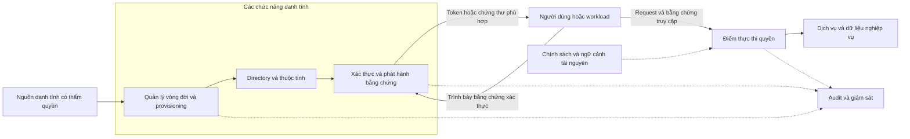

# Identity plane — Lớp chức năng danh tính trong kiến trúc IAM

## 1. Identity plane giúp trả lời câu hỏi kiến trúc nào?

Một hệ thống nhiều ứng dụng cần một cách nhất quán để xác định chủ thể, kiểm tra bằng chứng xác thực, quản lý vòng đời tài khoản và cung cấp ngữ cảnh đáng tin cậy cho quyết định truy cập. Chủ thể có thể là người dùng, quản trị viên, ứng dụng hoặc workload đang chạy.

Trong bài này, **identity plane** được dùng như một góc nhìn kiến trúc về tập chức năng và luồng tin cậy liên quan tới danh tính. Nó giúp làm rõ danh tính đến từ đâu, ai được phát hành bằng chứng về danh tính, bên nào tin bằng chứng đó và thay đổi vòng đời được truyền tới nơi thực thi như thế nào.

Đây là một ranh giới logic để phân tích hệ thống, không phải tên của một protocol, một subnet bắt buộc hay một sơ đồ thành phần có cùng định nghĩa ở mọi sản phẩm. Khi đọc tài liệu nhà cung cấp, cần đối chiếu cách nhà cung cấp dùng từ “plane” với các chức năng thực tế.

Một IdP thường là thành phần quan trọng, nhưng chỉ có trang đăng nhập SSO chưa tạo thành đầy đủ năng lực quản lý danh tính. Hệ thống còn cần nguồn tài khoản đáng tin cậy, quản lý phương tiện xác thực, cấp phát và thu hồi, xác minh bằng chứng tại ứng dụng, quản lý quyền quản trị cùng khả năng kiểm toán.

## 2. Phân biệt identity plane với control plane và data plane

### 2.1. Các khái niệm nhìn hệ thống theo những trục khác nhau

| Góc nhìn | Câu hỏi chính | Ví dụ |
|---|---|---|
| Identity plane | Chủ thể là ai, được nhận biết bằng gì và danh tính được quản lý ra sao? | Directory, IdP, dịch vụ cấp workload identity, luồng thu hồi tài khoản |
| Control plane | Ai và cơ chế nào thay đổi cấu hình, chính sách hoặc trạng thái điều khiển? | Đổi trust configuration, quản lý signing key, cấu hình role và mapping |
| Data plane | Những thao tác nào nằm trên đường xử lý truy cập hoặc dữ liệu lúc chạy? | Kiểm tra credential, áp dụng quyết định quyền, xử lý request tới tài nguyên |

Những góc nhìn này có thể giao nhau. Chức năng danh tính có cả thao tác quản trị cấu hình và thao tác xác thực lúc chạy. Vì vậy, không nên mặc định toàn bộ identity plane đều nằm ngoài đường xử lý request hoặc không ảnh hưởng độ sẵn sàng của ứng dụng.

Một ví dụ cụ thể là AWS IAM: tài liệu AWS mô tả control plane quản lý cấu hình tài nguyên IAM và data plane thực hiện xác thực, phân quyền cho request. Ví dụ này cho thấy IAM không chỉ là hoạt động cấu hình ở control plane; không phải một sơ đồ triển khai bắt buộc cho mọi nền tảng khác. [AWS IAM — Resilience in AWS Identity and Access Management](https://docs.aws.amazon.com/IAM/latest/UserGuide/disaster-recovery-resiliency.html).

### 2.2. Xác thực không thay thế phân quyền

Identity plane cung cấp thông tin để hệ thống nhận biết chủ thể và mức tin cậy của bằng chứng. Quyết định “chủ thể này có được sửa hóa đơn này không?” còn cần hành động, tài nguyên, tenant, chính sách và ngữ cảnh nghiệp vụ.

IdP có thể phát hành một role hoặc scope, nhưng API vẫn cần hiểu quyền đó trong phạm vi tài nguyên cụ thể. Chứng minh một request đến từ dịch vụ thanh toán không đồng nghĩa dịch vụ đó được đọc toàn bộ dữ liệu khách hàng.

Trong mô hình zero trust, NIST SP 800-207 phân biệt các thành phần quyết định, quản trị chính sách và thực thi truy cập. Cách phân biệt này hữu ích khi xác định nơi danh tính được tiêu thụ và nơi quyết định quyền thật sự được áp dụng. [NIST SP 800-207 — Zero Trust Architecture](https://nvlpubs.nist.gov/nistpubs/specialpublications/NIST.SP.800-207.pdf).

## 3. Những chức năng thường cần có

### 3.1. Nguồn danh tính và quản lý vòng đời

Nguồn có thẩm quyền cung cấp thông tin để hệ thống biết tài khoản nào nên tồn tại và thuộc tính nào đáng tin. Với nhân viên, nguồn có thể là hệ thống nhân sự. Với khách hàng, đó có thể là quy trình đăng ký và xác minh của dịch vụ. Với workload, nguồn thông tin có thể liên quan tới môi trường triển khai, tài khoản nền tảng hoặc cơ chế attestation.

Nguồn chuẩn không nhất thiết là nơi xác thực mọi request. Hệ thống nhân sự có thể quyết định trạng thái nhân viên nhưng không cần nằm trên đường gọi API. IAM tiếp nhận các thay đổi đó, đối chiếu, cấp phát và truyền trạng thái cần thiết tới các hệ thống sử dụng.

Quản lý vòng đời bao gồm tạo, thay đổi, tạm ngừng, thu hồi và xử lý tài khoản hết nhu cầu sử dụng. Quan trọng là định nghĩa được kết quả cuối: đã disable ở directory, đã gỡ quyền ở ứng dụng, hay đã xử lý cả các phiên còn hoạt động. Các kết quả đó không tự động đồng nhất.

### 3.2. Định danh, directory và thuộc tính

Directory lưu hoặc cung cấp định danh, trạng thái và thuộc tính phục vụ IAM. Cần xác định namespace, tenant, khóa liên kết cùng nguồn của từng thuộc tính. Email hoặc tên hiển thị không nên bị mặc định là khóa bất biến duy nhất cho mọi tích hợp.

Một thuộc tính như `department` có thể là đầu vào ABAC, nhưng chỉ đáng dùng khi biết nguồn phát hành, quyền sửa và mức độ mới. Nếu người dùng tự sửa được thuộc tính quyết định quyền, một policy đúng cú pháp vẫn có thể cấp quyền sai.

Với federation, cần xem subject trong phạm vi issuer được tin cậy. Hai issuer khác nhau có thể phát hành cùng chuỗi subject mà không nói về cùng tài khoản. Việc hợp nhất danh tính giữa các nguồn cần quy tắc và bằng chứng liên kết rõ ràng.

### 3.3. Xác thực, phương tiện xác thực và phiên

Các chức năng này kiểm tra bằng chứng người dùng hoặc workload trình bày, quản lý phương tiện xác thực và tạo ngữ cảnh đã được xác minh. Với con người, có thể bao gồm mật khẩu, MFA, passkey, đăng nhập liên kết và khôi phục tài khoản. Với workload, có thể là credential ngắn hạn, chứng thư hoặc bằng chứng từ nền tảng chạy.

Quản lý phiên cần được phân biệt với quản lý tài khoản. Một thay đổi trạng thái tại IdP không tự bảo đảm mọi session cục bộ ở tất cả ứng dụng đã chấm dứt. Kiến trúc phải nêu rõ nơi nào giữ phiên, cách kiểm tra trạng thái và giới hạn thời gian chấp nhận dữ liệu cũ.

### 3.4. Phát hành và phân phối bằng chứng tin cậy

IdP, authorization server hoặc cơ quan cấp chứng thư phát hành các artifact phù hợp với protocol: token, assertion hoặc chứng thư. Bên nhận dùng trust configuration cùng kiểm tra protocol để xác minh artifact và dựng ngữ cảnh chủ thể.

Không nên gọi mọi artifact là “token đăng nhập” rồi dùng lẫn cho mọi mục đích. ID token, access token và chứng thư workload có đối tượng nhận, cách xác minh và phạm vi sử dụng khác nhau. Bằng chứng cho ứng dụng A không tự được chấp nhận tại API B.

### 3.5. Tích hợp chính sách, thực thi và kiểm toán

Danh tính được tiêu thụ tại điểm thực thi quyền, chẳng hạn gateway, middleware API hoặc dịch vụ nghiệp vụ. Một hệ thống có thể quyết định quyền cục bộ, gọi dịch vụ quyết định quyền hoặc kết hợp cả hai. Trách nhiệm phải rõ để không có đoạn đường truy cập nào được xem là đã kiểm tra chỉ vì một thành phần phía trước có trang đăng nhập.

Các thay đổi quản trị và hoạt động lúc chạy cần dấu vết để truy tìm quyết định: ai đổi trust, ai cấp role, bằng chứng được chấp nhận từ issuer nào, policy nào được dùng và kết quả là gì. Audit không cần lưu nguyên token, mật khẩu hoặc hồ sơ cá nhân đầy đủ.

## 4. Một sơ đồ tham chiếu logic

Sơ đồ sau minh họa quan hệ chức năng. Nó không yêu cầu mỗi ô là một sản phẩm riêng hoặc mọi request đều đi qua mọi ô.



Các mũi tên liền minh họa luồng cấp phát hoặc sử dụng bằng chứng; đường nét đứt thể hiện thông tin chính sách hoặc quan sát. Đây không phải mô tả đầy đủ các trao đổi của OIDC, SAML hay một protocol cấp chứng thư cụ thể.

Điểm thực thi quyền cần tin đúng nguồn khóa và issuer. Nó không chỉ đọc JSON do client gửi rồi coi đó là danh tính đã xác thực. Với workload, việc cấp chứng thư còn cần quy trình xác định workload nào đang xin credential, không chỉ đọc tên dịch vụ do workload tự khai báo.

## 5. Hai luồng sử dụng identity plane

### 5.1. Người dùng truy cập ứng dụng qua SSO

Một luồng khái niệm có thể gồm:

1. Người dùng bắt đầu đăng nhập tại ứng dụng và được chuyển tới IdP theo protocol đã cấu hình.
2. IdP xác thực người dùng, áp dụng yêu cầu MFA hoặc điều kiện phù hợp với phiên và chính sách.
3. Ứng dụng nhận và xác minh kết quả xác thực theo protocol, rồi liên kết với tài khoản cục bộ bằng định danh đáng tin cậy.
4. Khi gọi API, client trình bày access token hoặc cơ chế truy cập phù hợp với kiến trúc.
5. API xác minh bằng chứng, dựng ngữ cảnh chủ thể và đánh giá quyền đối với đúng hành động, tài nguyên cùng tenant.
6. Hệ thống ghi các sự kiện cần thiết để kiểm toán và phát hiện bất thường.

Ứng dụng không nên dùng ID token thay cho access token tại mọi API. Nếu gateway đã xác thực, dịch vụ phía sau vẫn cần một contract rõ ràng về cách nhận và tin ngữ cảnh từ gateway, đồng thời bảo đảm không có đường bypass cho phép client tự gửi các header danh tính.

Một ngữ cảnh nội bộ minh họa có thể là:

```json
{
  "principal_type": "human",
  "issuer": "https://idp.example.test",
  "subject": "subject-demo-42",
  "tenant_ref": "tenant-demo",
  "authentication_context": "verified-context-reference",
  "granted_scopes": ["invoices:read"]
}
```

Đây không phải token hoàn chỉnh hoặc schema chuẩn. Dữ liệu cần được tạo từ kết quả đã xác minh, truyền qua kênh được bảo vệ và sử dụng theo contract. API vẫn cần kiểm tra hóa đơn cụ thể có thuộc phạm vi mà chủ thể được phép đọc hay không.

### 5.2. Workload gọi một workload khác

Với workload, kiến trúc cần giải quyết cách bootstrap danh tính, gắn danh tính với thực thể đang chạy và cấp bằng chứng có vòng đời phù hợp. Một tên pod, hostname hoặc IP do bên gọi tự khai báo chưa phải bằng chứng xác thực.

Một hướng là nền tảng xác minh workload, cấp credential ngắn hạn và phân phối trust material để các bên xác thực lẫn nhau. Ví dụ, SPIFFE cung cấp mô hình danh tính workload và SVID; việc nhận biết workload vẫn cần kết hợp chính sách phân quyền của hệ thống sử dụng. Tài liệu SPIRE cũng phân biệt năng lực xác thực của SPIFFE/SPIRE với việc triển khai chính sách phân quyền nghiệp vụ. [SPIFFE/SPIRE — Comparisons](https://spiffe.io/docs/latest/spire-about/comparisons/).

Khi dịch vụ A gọi dịch vụ B thay mặt người dùng, cần phân biệt danh tính dịch vụ A với danh tính người dùng được đại diện. Không nên chỉ chuyển tiếp một header `user_id` tùy ý hoặc gộp hai chủ thể thành một tài khoản dùng chung có toàn quyền. Luồng ủy quyền cần xác định ai là actor, ai là chủ thể được đại diện và phạm vi nào được phép chuyển tiếp.

## 6. Thiết kế ranh giới tin cậy và quyền quản trị

### 6.1. Ai được nói điều gì về chủ thể?

Một trust relationship không chỉ có câu “tin IdP này”. Cần xác định issuer nào được chấp nhận, artifact nào được dùng, audience nào hợp lệ, claim nào được tin và mapping nào chuyển claims thành vai trò hoặc thuộc tính nội bộ.

Ví dụ, một IdP đối tác có thể được phép xác thực người dùng của đối tác, nhưng không được tự gán role quản trị hệ thống của doanh nghiệp. Nếu ứng dụng ánh xạ mọi chuỗi `role=admin` từ mọi issuer vào quyền nội bộ, trust đã bị mở rộng vượt mục đích.

Tương tự, việc một workload có chứng thư hợp lệ không tự cho phép nó truy cập mọi tài nguyên trong cùng mạng. Cần kiểm tra danh tính cụ thể và chính sách của tài nguyên, thay vì chỉ kiểm tra chứng thư thuộc một CA được tin.

### 6.2. Bảo vệ các thao tác có khả năng tạo quyền

Các API quản trị identity plane có thể thay đổi cách toàn hệ thống nhận biết và tin chủ thể. Thay signing key, cấu hình federation, tạo service principal, sửa mapping role hoặc reset MFA đều có tác động lớn.

Cần phân quyền quản trị theo nhiệm vụ, sử dụng phương thức xác thực phù hợp, giới hạn đặc quyền theo thời gian khi thích hợp và lưu dấu vết thay đổi. Một người được hỗ trợ mở khóa tài khoản không nên mặc nhiên có quyền cấu hình issuer mới hoặc cấp role quản trị cho chính mình.

Cũng cần xem xét đường khôi phục. Nếu mọi thao tác phục hồi IdP đều bắt buộc đăng nhập vào chính IdP đang gặp sự cố, tổ chức có thể không còn đường xử lý. Cơ chế truy cập khẩn cấp cần được chuẩn bị, kiểm soát, giám sát và kiểm tra từ trước, không phải một đường bypass tùy tiện được mở khi xảy ra lỗi.

## 7. Độ sẵn sàng, cache và tính nhất quán

### 7.1. Phân biệt loại sự cố

| Sự cố | Ảnh hưởng có thể xảy ra | Câu hỏi thiết kế cần trả lời |
|---|---|---|
| Không tạo được phiên hoặc token mới | Người dùng mới đăng nhập hoặc workload cần credential mới bị gián đoạn | Phiên hiện hành và credential còn hiệu lực được xử lý thế nào? |
| Không đọc được nguồn khóa xác minh | Bên nhận không xác minh được token dùng khóa chưa có trong cache | Cache nào còn hợp lệ, khi nào phải từ chối? |
| Dịch vụ quyết định quyền không phản hồi | Không có quyết định cho thao tác cần kiểm tra trực tuyến | Có chính sách dự phòng đã định nghĩa cho hành động đó không? |
| Provisioning chậm hoặc lỗi | Quyền mới chưa có hoặc quyền cũ chưa được gỡ ở đích | Deadline, tuổi công việc và biện pháp giảm rủi ro là gì? |
| Thay đổi policy chưa truyền tới mọi nơi | Các điểm thực thi dùng phiên bản khác nhau | Độ trễ chấp nhận được và cách phát hiện sai lệch là gì? |
| Khóa phát hành bị lộ | Bằng chứng giả có thể được tạo trong phạm vi bị ảnh hưởng | Phạm vi tin cậy, thu hồi và cập nhật bên nhận ra sao? |

Các khả năng ở bảng phụ thuộc kiến trúc cụ thể. Không nên kết luận “IdP lỗi thì mọi API đều dừng” hoặc “JWT tự xác minh được nên IdP không bao giờ ảnh hưởng runtime”. Cần kiểm tra từng đường phụ thuộc thực tế.

### 7.2. Cache làm giảm phụ thuộc nhưng tạo dữ liệu cũ

Resource server có thể xác minh một số token tự chứa bằng khóa đã được cache, trong giới hạn của cấu hình và protocol. Khả năng này không cho phép chấp nhận token hết hạn, khóa không còn được tin hoặc issuer không hợp lệ.

Khi gặp một key ID chưa biết, không được bỏ kiểm tra chữ ký để giữ dịch vụ chạy. Cơ chế refresh khóa cần có giới hạn và lấy từ nguồn được cấu hình tin cậy, tránh để một request tùy ý điều khiển endpoint cung cấp khóa.

Cache kết quả quyền, thuộc tính và trust material cần có phạm vi, thời hạn và cơ chế cập nhật tương ứng. Tăng thời hạn cache có thể giúp khi thành phần trung tâm gián đoạn, nhưng cũng kéo dài thời gian nhận biết thay đổi hoặc thu hồi. Mức chấp nhận cần được quyết định theo tác động của thao tác, không bằng một mặc định vô hạn.

Đối với request không đủ bằng chứng xác thực hoặc không có quyết định quyền hợp lệ, hệ thống cần hành vi từ chối rõ ràng. Nếu có chế độ dự phòng giới hạn, nó phải được thiết kế và phê duyệt trước theo loại hành động; không tự cho phép toàn bộ request chỉ vì dependency không phản hồi.

### 7.3. Thu hồi là một luồng cần đo đến điểm thực thi

Giả sử một tài khoản bị disable lúc 10:00. API vẫn có thể đang chấp nhận token phát hành trước đó hoặc ứng dụng còn phiên riêng. Vì thế, thời điểm nguồn đổi trạng thái và thời điểm quyền hết tác dụng có thể khác nhau.

Kiến trúc nên định nghĩa mục tiêu thu hồi cho từng nhóm hệ thống, theo dõi các bước truyền trạng thái và kiểm tra kết quả tại đích. Tài khoản đặc quyền, thao tác nhạy cảm hoặc workload bị nghi lộ credential có thể cần biện pháp khác với tài khoản ít rủi ro. Không thể chỉ dựa vào trạng thái “đã gửi sự kiện” để khẳng định quyền đã được gỡ ở mọi nơi.

## 8. Ownership, giám sát và quyền riêng tư

### 8.1. Phân công trách nhiệm theo contract

| Phạm vi | Trách nhiệm cần xác định |
|---|---|
| Nguồn danh tính | Chất lượng, độ mới và thẩm quyền của thông tin đầu vào |
| Nền tảng IAM | Xác thực, credential, trust, mapping và vòng đời được cung cấp |
| Nền tảng workload | Cách nhận biết thực thể đang chạy và bảo vệ credential được cấp |
| Chủ ứng dụng | Liên kết tài khoản, kiểm tra quyền nghiệp vụ và trạng thái ở hệ thống đích |
| Chủ dữ liệu hoặc nghiệp vụ | Quy tắc ai được truy cập tài nguyên nào và điều kiện phê duyệt |
| Vận hành và an ninh | Giám sát, ứng phó, kiểm tra khôi phục và truy vết thay đổi |

Ownership phải có điểm bàn giao. “Đội IAM đã cấp token” chưa chứng minh ứng dụng áp dụng đúng quyền; “ứng dụng dùng SSO” chưa chứng minh luồng nghỉ việc đã gỡ tài khoản ở đích.

### 8.2. Quan sát theo chức năng

Nên theo dõi thành công và lỗi xác thực, độ trễ phát hành credential, lỗi xác minh theo nguyên nhân, độ mới của khóa và policy, backlog provisioning cùng độ trễ thu hồi. Dấu vết quản trị cần liên kết được thay đổi cấu hình với các biến động runtime.

Không dùng toàn bộ token hoặc dữ liệu cá nhân đầy đủ làm chất liệu mặc định cho log. Một sự kiện có thể giữ mã tương quan, tham chiếu chủ thể, issuer, kết quả và phiên bản policy phù hợp với mục đích điều tra. Các tham chiếu vẫn cần được bảo vệ vì có thể liên kết hành vi.

Identity plane thường có khả năng quan sát nhiều ứng dụng, nên một cấu hình log hoặc export quá rộng có thể tập trung dữ liệu nhạy cảm ở một nơi. Giảm claims theo bên nhận, giới hạn dữ liệu chia sẻ và tách quyền quản trị khỏi quyền đọc dữ liệu điều tra là những quyết định kiến trúc cần xem xét từ đầu.

## 9. Tự kiểm tra cách hiểu

**Có một IdP và trang đăng nhập SSO đã đủ để quản lý vòng đời quyền chưa?**

Chưa. Cần nguồn danh tính, luồng cấp phát và thu hồi, liên kết tài khoản ở ứng dụng, xử lý phiên hoặc credential còn hiệu lực và xác minh kết quả ở các hệ thống sử dụng.

**Một token hợp lệ có đủ để cho phép mọi thao tác của API không?**

Không. Hệ thống còn phải kiểm tra quyền cho hành động, tài nguyên, tenant và ngữ cảnh tương ứng. Xác thực chỉ cung cấp một phần đầu vào cho quyết định đó.

**Identity plane có phải luôn là một mạng riêng tách biệt vật lý không?**

Không. Trong bài, đó là góc nhìn chức năng và luồng tin cậy. Cách triển khai vật lý cần được quyết định theo hệ thống; một thành phần có thể cung cấp nhiều chức năng hoặc một chức năng được phân tán qua nhiều thành phần.

**Tại sao phải theo dõi độ trễ thu hồi tại điểm thực thi?**

Vì thay đổi trạng thái ở nguồn chưa tự làm mọi token, phiên, cache hoặc quyền tại đích mất hiệu lực ngay. Mục tiêu an toàn cần được đánh giá theo kết quả truy cập thực tế.

**Một bản thiết kế identity plane có ích cần thể hiện gì?**

Nguồn thẩm quyền của danh tính, các bên phát hành và tiêu thụ bằng chứng, nơi quyết định và thực thi quyền, luồng vòng đời cùng hành vi khi phụ thuộc lỗi. Khi các contract và owner đó rõ ràng, kiến trúc IAM mới có thể được vận hành, kiểm toán và khôi phục một cách có căn cứ.
