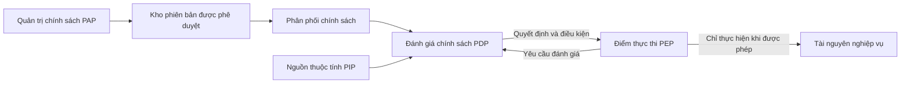

# Policy plane

## 1. Policy plane giải quyết vấn đề gì?

Trong kiến trúc IAM, **policy plane** là lớp trách nhiệm dành cho việc quản lý và sử dụng chính sách để xác định một hành động có được phép thực hiện trong một ngữ cảnh cụ thể hay không.

Ví dụ, một người đã đăng nhập và có vai trò duyệt chi phí. Hệ thống vẫn cần biết họ được duyệt chứng từ nào, trong tenant nào, với hạn mức nào và có được duyệt chứng từ do chính mình tạo hay không. Những điều kiện đó thuộc chính sách truy cập; việc xác thực thành công chưa đủ để trả lời.

Nếu mỗi ứng dụng tự viết toàn bộ điều kiện vào các nhánh `if`, cùng một quy tắc có thể được triển khai khác nhau. Một dịch vụ kiểm tra tenant, dịch vụ khác quên; một nơi cập nhật hạn mức mới, nơi khác vẫn sử dụng giá trị cũ. Policy plane giúp biểu đạt trách nhiệm về chính sách một cách rõ ràng và có thể quản lý.

Thuật ngữ này mô tả một lớp kiến trúc logic, không bắt buộc là một microservice riêng. Thành phần quản lý chính sách có thể tập trung, trong khi thành phần đánh giá nằm cạnh ứng dụng hoặc được nhúng vào ứng dụng.

## 2. Phân biệt chính sách với xác thực và xử lý nghiệp vụ

Một giao dịch được bảo vệ thường cần các bước khác nhau:

| Trách nhiệm | Câu hỏi | Ví dụ |
| --- | --- | --- |
| Xác thực | Chủ thể hoặc workload gọi vào đã được xác minh như thế nào? | Kiểm tra phiên, token và mức bảo đảm phù hợp |
| Đánh giá chính sách | Chủ thể có được làm hành động này trên tài nguyên này không? | Cho phép duyệt chứng từ thuộc đơn vị được quản lý |
| Thực thi quyết định | Quyết định có thực sự được áp dụng tại điểm truy cập không? | Chặn request trước khi thay đổi trạng thái chứng từ |
| Xử lý nghiệp vụ | Hành động hợp lệ được thực hiện ra sao? | Cập nhật trạng thái và ghi nhận người phê duyệt |

Policy plane không biến một claim chưa được xác minh thành sự thật. Nó cần dữ liệu đầu vào có nguồn tin cậy và một điểm thực thi bảo đảm kết quả đánh giá được tôn trọng.

Tương tự, đưa quy tắc ra một policy engine không có nghĩa chuyển toàn bộ nghiệp vụ vào đó. Việc tính toán chứng từ, lưu giao dịch và bảo đảm tính nhất quán vẫn cần được đặt tại các thành phần phù hợp. Chính sách truy cập xác định điều kiện được phép thực hiện, còn dịch vụ nghiệp vụ chịu trách nhiệm thực hiện đúng hành động đó.

## 3. Các vai trò thường gặp

Có thể dùng những vai trò logic sau để mô tả thiết kế. Một triển khai có thể gộp hoặc tách chúng; tên gọi không bắt buộc tương ứng với từng tiến trình riêng.

| Vai trò | Tên viết tắt thường dùng | Trách nhiệm |
| --- | --- | --- |
| Quản trị chính sách | PAP — Policy Administration Point | Soạn, xem xét và quản lý thay đổi chính sách |
| Ra quyết định | PDP — Policy Decision Point | Đánh giá yêu cầu theo chính sách và dữ liệu đầu vào |
| Thực thi quyết định | PEP — Policy Enforcement Point | Cho phép, từ chối hoặc áp dụng điều kiện tại nơi truy cập |
| Cung cấp thông tin | PIP — Policy Information Point | Cung cấp thuộc tính cần cho đánh giá từ nguồn có thẩm quyền |
| Lưu và phân phối chính sách | Kho chính sách và bộ phân phối | Quản lý phiên bản, phát hành và trạng thái áp dụng |

Một sơ đồ minh họa:



PEP thường nằm trên đường xử lý request của ứng dụng, gateway hoặc dịch vụ. Trong mô tả này, nó là điểm tiếp giáp giữa logic chính sách và hành động thực tế, không có nghĩa tất cả PEP đều phải thuộc cùng một dịch vụ policy.

Không nên chỉ đặt PEP ở giao diện người dùng. Ẩn một nút không ngăn người gọi gửi request trực tiếp tới API. Một gateway có thể kiểm tra điều kiện tổng quát, nhưng dịch vụ nghiệp vụ thường vẫn cần kiểm tra ở mức tài nguyên mà gateway không có đủ dữ liệu để hiểu.

## 4. Hợp đồng đầu vào của một quyết định

Một yêu cầu đánh giá thường mô tả bốn nhóm:

```text
Subject: chủ thể đang hành động
Action: hành động được yêu cầu
Resource: tài nguyên chịu tác động
Context: ngữ cảnh của giao dịch
```

Ví dụ minh họa:

```json
{
  "subject": {
    "id": "user-demo-17",
    "tenant_id": "tenant-demo-a",
    "status": "active",
    "roles": ["expense_approver"]
  },
  "action": "expense.approve",
  "resource": {
    "id": "expense-demo-91",
    "tenant_id": "tenant-demo-a",
    "owner_id": "user-demo-22",
    "department_id": "department-demo-3",
    "state": "submitted"
  },
  "context": {
    "application": "expense-service",
    "correlation_id": "request-demo-05"
  }
}
```

Đây là schema do ứng dụng giả định, không phải định dạng chung bắt buộc. Một hệ thống thực tế có thể cần thêm quan hệ quản lý, hạn mức, mức bảo đảm xác thực hoặc phiên bản tài nguyên.

Vấn đề quan trọng hơn tên trường là **nguồn dữ liệu**:

- Danh tính chủ thể phải lấy từ cơ chế xác thực đã được kiểm tra theo hợp đồng của ứng dụng.
- Tenant, owner và trạng thái tài nguyên phải lấy từ dữ liệu có thẩm quyền, không tin bản sao do client tự khai.
- Vai trò, nhóm và quan hệ phải có nguồn, phạm vi và độ mới phù hợp với quyết định.
- Hành động phải ánh xạ từ nghiệp vụ phía server, không cho người gọi đổi tên sang một hành động ít hạn chế hơn.

Nếu request có tham số `department_id`, hệ thống không được mặc định giá trị đó là đơn vị thực của tài nguyên. Client có thể gửi một đơn vị mà mình được phép quản lý trong khi tài nguyên thuộc đơn vị khác.

Policy plane cũng cần phân biệt danh tính workload đang gọi với danh tính người dùng mà workload đại diện. Workload được xác thực không tự có mọi quyền của người dùng; ngữ cảnh ủy quyền cần được xác minh và giới hạn theo luồng.

## 5. Biểu đạt quy tắc mà không tạo quyền ngoài ý muốn

Một chính sách minh họa cho hành động duyệt chứng từ có thể yêu cầu đồng thời:

```text
Cho phép expense.approve khi:
  chủ thể đã được xác thực theo yêu cầu
  AND tài khoản đang hoạt động
  AND tenant của chủ thể phù hợp với tài nguyên
  AND chủ thể có vai trò duyệt trong phạm vi tương ứng
  AND chủ thể được quản lý đơn vị của chứng từ
  AND chứng từ đang ở trạng thái submitted
  AND chủ thể không phải người tạo chứng từ
  AND giá trị chứng từ nằm trong hạn mức áp dụng
```

Nếu có so sánh giá trị tiền và hạn mức, hợp đồng dữ liệu còn phải xác định đơn vị và tiền tệ. Một giá trị số không có ngữ nghĩa rõ có thể dẫn tới đánh giá sai dù biểu thức chính sách đúng cú pháp.

Vai trò trong ví dụ cung cấp điều kiện tổng quát; thuộc tính và quan hệ giới hạn phạm vi cụ thể. Đây là cách phối hợp các mô hình như RBAC và ABAC hoặc kiểm tra quan hệ, không cần coi chúng là lựa chọn loại trừ nhau.

Các quy tắc xung đột cần có cơ chế kết hợp được định nghĩa rõ. Không mặc định một engine luôn ưu tiên từ chối, luôn ưu tiên cho phép hay dừng tại quy tắc đầu tiên. Ý nghĩa thực tế phụ thuộc mô hình và cấu hình đã chọn.

Nên có cách trả lời vì sao một quyết định được đưa ra bằng mã lý do phù hợp. Tuy nhiên, dữ liệu trả cho client bên ngoài không nhất thiết phải chứa toàn bộ thuộc tính hoặc cấu trúc chính sách nội bộ.

## 6. Kết quả đánh giá phải được thực thi đúng

Một phản hồi minh họa từ PDP có thể gồm:

```json
{
  "decision": "permit",
  "decision_id": "decision-demo-12",
  "policy_version": "expense-policy-7",
  "reason_code": "approval_conditions_satisfied",
  "obligations": [
    {
      "type": "record_approval_audit"
    }
  ]
}
```

`Obligation` trong ví dụ là điều kiện bắt buộc đi kèm việc cho phép, theo hợp đồng giữa PDP và PEP. Nếu PEP không hiểu hoặc không thể thực hiện điều kiện bắt buộc, không được tùy ý bỏ qua rồi tiếp tục như một `permit` vô điều kiện.

Không phải mọi engine đều dùng cùng tập trạng thái. Một hệ thống có thể phân biệt cho phép, từ chối, không có quy tắc áp dụng và không thể đánh giá. Ứng dụng cần ánh xạ chúng rõ ràng; với hành động được bảo vệ, lỗi hoặc không có quyết định hợp lệ không nên vô tình trở thành cho phép.

Một khung xử lý có thể như sau:

```text
handleApproveRequest(request):
    subject = authenticateAndResolveTrustedSubject(request)
    resource = loadResourceInAuthorizedNamespace(request.resourceId)
    input = buildPolicyInput(subject, resource, action="expense.approve")
    decision = evaluatePolicy(input)

    requireSupportedDecision(decision)
    requirePermit(decision)
    requireMandatoryConditionsCanBeSatisfied(decision)

    performApprovalWithConsistencyChecks(resource, decision)
    recordRequiredAuditWithoutUnnecessaryIdentityData()
```

Đây là mã giả mô tả trách nhiệm. Nó không tự giải quyết tính nguyên tử giữa kiểm tra quyền, cập nhật tài nguyên và ghi audit; hệ thống phải thiết kế các bảo đảm đó theo mức rủi ro của hành động.

### Tránh khoảng trống giữa kiểm tra và sử dụng

Nếu chứng từ đổi owner, trạng thái hoặc giá trị sau khi đánh giá nhưng trước khi cập nhật, quyết định có thể không còn phù hợp. Dịch vụ cần cơ chế như kiểm tra phiên bản tài nguyên, điều kiện cập nhật hoặc phối hợp giao dịch để bảo đảm hành động được thực hiện trên trạng thái đã được cho phép.

Quyết định không nên được tái sử dụng như một giấy phép chung cho mọi tài nguyên. Nếu lưu hoặc truyền một kết quả đánh giá, cần ràng buộc nó với đúng chủ thể, hành động, tài nguyên và các điều kiện hiệu lực liên quan.

## 7. Đánh giá tập trung hay phân tán?

Có thể tập trung quản trị chính sách nhưng chọn nơi đánh giá tùy yêu cầu vận hành.

| Mô hình | Đặc điểm | Đánh đổi cần xử lý |
| --- | --- | --- |
| PDP từ xa dùng chung | Ứng dụng gửi yêu cầu đánh giá tới dịch vụ trung tâm | Độ trễ mạng, phụ thuộc sẵn sàng, tải và phạm vi dữ liệu gửi đi |
| PDP cạnh ứng dụng | Một thành phần gần ứng dụng đánh giá bằng chính sách được phân phối | Độ mới chính sách, đồng bộ cấu hình và vận hành nhiều bản |
| Thư viện nhúng | Đánh giá trong cùng tiến trình với ứng dụng | Tương thích phiên bản, cập nhật thư viện và tính nhất quán triển khai |
| Kết hợp | Một số quyết định tại chỗ, một số cần nguồn trung tâm | Cần hợp đồng rõ về thẩm quyền và điều kiện chuyển sang từng đường |

PDP tại chỗ không đồng nghĩa không có phụ thuộc mạng: nó vẫn có thể cần dữ liệu nhóm, quan hệ hoặc trạng thái tài khoản từ PIP. Ngược lại, PDP trung tâm có thể dùng cache, nên không mặc định mọi quyết định đều dựa trên dữ liệu mới nhất.

Lựa chọn cần dựa vào loại quyết định, yêu cầu độ mới, ngân sách độ trễ và phạm vi ảnh hưởng khi sự cố. Không chỉ so sánh thời gian chạy biểu thức chính sách mà quên chi phí lấy dữ liệu đầu vào.

## 8. Vòng đời chính sách và phân phối phiên bản

Một thay đổi chính sách có thể mở hoặc đóng quyền trên nhiều ứng dụng. Vì vậy, vòng đời nên có các bước rõ ràng:

```text
Soạn thay đổi
  → kiểm tra schema và ngữ nghĩa theo hợp đồng
  → kiểm tra các tình huống cho phép và từ chối
  → xem xét, phê duyệt theo mức tác động
  → phát hành phiên bản xác định
  → xác nhận các điểm đánh giá đã nhận và kích hoạt
  → theo dõi kết quả, xử lý rollback khi cần
```

Phiên bản cần đủ cụ thể để truy lại nội dung được sử dụng cho một quyết định. Một nhãn `latest` đơn thuần không cho biết tại thời điểm đó ứng dụng đã áp dụng bộ quy tắc nào.

Gói chính sách cần được bảo vệ về nguồn gốc và tính toàn vẹn theo thiết kế. Hash hỗ trợ phát hiện nội dung khác nhau, nhưng một hash đi cùng dữ liệu từ cùng nguồn không tin cậy không tự chứng minh gói đó được phép phát hành.

Khi phân phối, cần xử lý việc tải chưa đầy đủ hoặc một phần cấu hình mới ghép với phần cũ. Cách kích hoạt nguyên bộ phiên bản đã xác minh giúp tránh trạng thái pha trộn ngoài dự kiến.

Rollback cũng cần được kiểm soát. Một phiên bản cũ có thể chứa quyền đã bị thu hồi; quay lại mã chính sách cũ không nên vô tình khôi phục mọi trạng thái quyền cũ. Hệ thống cần phân biệt phiên bản logic đánh giá với dữ liệu quyền và sự kiện vòng đời đang có hiệu lực.

Nếu nhiều tenant có chính sách khác nhau, quyền quản trị và namespace phiên bản phải giữ ranh giới tenant. Người có quyền sửa chính sách của một tenant không tự có quyền sửa cấu hình nền tảng hoặc chính sách của tenant khác.

## 9. Độ mới của dữ liệu, cache và thu hồi quyền

Một quyết định phụ thuộc ít nhất vào chính sách và dữ liệu đầu vào. Giữ chính sách mới nhưng dùng nhóm người dùng đã cũ vẫn có thể cho kết quả sai với trạng thái mong muốn.

Các loại cache cần được phân biệt:

| Loại cache | Dữ liệu được giữ | Rủi ro khi cũ |
| --- | --- | --- |
| Cache chính sách | Quy tắc và cấu hình đánh giá | Chưa áp dụng điều kiện hoặc giới hạn mới |
| Cache thuộc tính | Nhóm, trạng thái tài khoản, quan hệ | Tiếp tục sử dụng quyền hoặc trạng thái đã thay đổi |
| Cache quyết định | Kết quả cho một tập đầu vào cụ thể | Tái sử dụng cho ngữ cảnh không còn phù hợp |
| Claim trong token | Ảnh chụp thuộc tính tại lúc phát hành | Quyền đã thay đổi nhưng token vẫn chứa giá trị cũ |

Cache quyết định cần có khóa bao phủ những yếu tố thực sự ảnh hưởng tới kết quả. Nếu bỏ tenant hoặc resource khỏi khóa, kết quả của một giao dịch có thể bị dùng nhầm cho giao dịch khác.

Thời hạn cache không phải cam kết thu hồi tức thì. Cần xác định khoảng trễ chấp nhận được và thiết kế cách làm mới, vô hiệu hóa hoặc kiểm tra trạng thái bổ sung. Với hành động nhạy cảm, chỉ dựa vào claim cũ trong token có thể không đáp ứng yêu cầu độ mới của hệ thống.

Không tăng thời gian lưu quyết định cho phép chỉ để giảm số request tới PDP khi chưa đánh giá ảnh hưởng tới thu hồi quyền. Các quyết định từ chối được lưu cũng có thể làm chậm việc cấp quyền hợp lệ mới; cả hai chiều đều cần được hiểu.

## 10. Hành vi khi thiếu dữ liệu hoặc có sự cố

Policy plane cần hợp đồng rõ khi PDP không phản hồi, PIP timeout, gói chính sách chưa sẵn sàng hoặc kết quả đánh giá không hợp lệ.

| Tình huống | Câu hỏi thiết kế |
| --- | --- |
| Không có thuộc tính bắt buộc | Từ chối, yêu cầu bổ sung hay kết thúc với lỗi nào? |
| PDP không sẵn sàng | Có chính sách tại chỗ còn hợp lệ không, được dùng cho hành động nào? |
| Chính sách quá cũ | Giới hạn tuổi phiên bản và cách dừng sử dụng là gì? |
| Điều kiện bắt buộc không thực hiện được | PEP ngăn hành động và ghi kết quả như thế nào? |
| Không có quy tắc áp dụng | Ứng dụng ánh xạ kết quả theo hợp đồng nào? |

Nếu có chế độ dùng dữ liệu hoặc chính sách lưu sẵn, phải xác định từ trước phạm vi, thời hạn và hành động được áp dụng. Nó không phải cơ chế tự cấp toàn quyền khi dịch vụ trung tâm gặp sự cố.

Phân biệt rõ “từ chối vì không đủ quyền” với “không thể hoàn tất đánh giá” trong dữ liệu vận hành. Cả hai có thể dẫn tới việc không thực hiện hành động, nhưng nguyên nhân và cách khắc phục khác nhau.

Không xử lý mọi lỗi bằng một giá trị mặc định `true`. Hành vi như vậy biến sự cố phụ thuộc thành đường bỏ qua kiểm soát truy cập.

## 11. Quan sát và quyền quản trị của chính policy plane

Một sự kiện quyết định có thể ghi decision ID, correlation ID, loại hành động, nhóm kết quả, phiên bản chính sách, thời lượng và mã lý do đã giới hạn. Chỉ thêm định danh hoặc thuộc tính khi có mục đích rõ và kiểm soát truy cập phù hợp.

Không ghi nguyên token, hồ sơ, danh sách nhóm hoặc dữ liệu tài nguyên nhạy cảm vào mỗi log đánh giá. Khả năng giải thích quyết định nên cân bằng với việc giảm dữ liệu được sao chép sang hệ thống quan sát.

Các chỉ số có ích gồm tỷ lệ lỗi đánh giá, độ trễ PDP và PIP, phiên bản đang hoạt động, tuổi gói chính sách, trạng thái đồng bộ và số lần không đáp ứng điều kiện bắt buộc. Tỷ lệ từ chối tăng cần được xem cùng thay đổi chính sách và lưu lượng; không tự đồng nghĩa có tấn công hoặc lỗi triển khai.

Policy plane cũng cần IAM cho chính nó: ai được soạn, phê duyệt, phát hành, kích hoạt và đọc dữ liệu đánh giá. Quyền quản trị chính sách có thể ảnh hưởng tới nhiều tài nguyên hơn một quyền nghiệp vụ đơn lẻ, nên cần phạm vi và dấu vết thay đổi rõ ràng.

## 12. Các lỗi kiến trúc thường gặp

| Lỗi | Hệ quả |
| --- | --- |
| Chỉ có PDP mà không có PEP đáng tin cậy | Quyết định được tạo nhưng hành động vẫn có thể bỏ qua nó |
| Tin owner, tenant hoặc vai trò do client khai | Người gọi có thể làm sai đầu vào đánh giá |
| Gộp mọi quyền vào một claim vai trò tổng quát | Không biểu đạt được phạm vi tài nguyên và điều kiện ngữ cảnh |
| Cache quyết định thiếu yếu tố đầu vào | Cho phép hoặc từ chối sai giao dịch |
| Đánh giá xong mới thay đổi tài nguyên mà không kiểm tra lại trạng thái | Có khoảng trống giữa điều kiện đã kiểm tra và hành động thực tế |
| Cập nhật chính sách mà không xác nhận phiên bản đang chạy | Các điểm thực thi có thể áp dụng quy tắc khác nhau |
| Bỏ qua obligation không được hỗ trợ | Quyết định có điều kiện bị biến thành cho phép vô điều kiện |
| Cho phép mặc định khi phụ thuộc lỗi | Sự cố vận hành trở thành lỗ hổng kiểm soát truy cập |

Một policy plane rõ trách nhiệm giúp tổ chức quản lý quy tắc nhất quán, nhưng tính an toàn cuối cùng phụ thuộc cả dữ liệu đầu vào, điểm thực thi và vòng đời triển khai. Câu hỏi cần luôn trả lời được là: **ai quyết định, dựa trên dữ liệu và phiên bản nào, và thành phần nào bảo đảm quyết định đó được áp dụng cho đúng hành động?**
